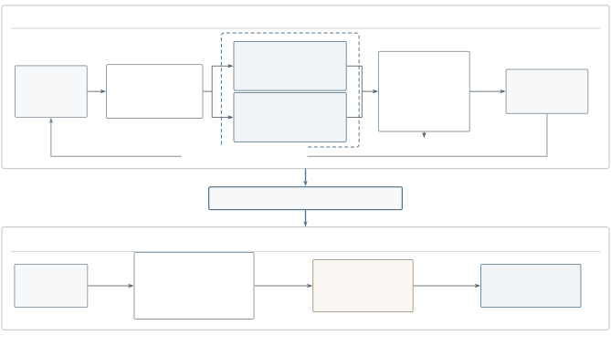

# Explore More, Validate Less: Efficient Reflective Prompt Optimization

CCS: Computing methodologies Natural language processing

Xiaofan Zhou Affiliation: Pennsylvania State University, USA email:
<xpz5429@psu.edu> and Lu Cheng Affiliation: Pennsylvania State
University, USA

© none

###### Abstract.

Reflective prompt optimization improves instructions using task
feedback, but coupling candidate generation with full-validation-based
selection can make search costly and sequential. We propose a two-stage
framework that decouples reflective candidate-pool construction from
validation allocation. During construction, sampled parents first answer
training questions, and groups of their saved responses guide parallel
reflection and revision. Each child is screened on its group’s questions
against the corresponding parent scores. Improving, nonduplicate prompts
enter the pool and can become parents without full validation. After
construction, an exploration policy selects candidates from the frozen
pool under a fixed full-validation budget, and the prompt with the
highest measured validation score is returned. This separation allows
candidate-pool size and validation budget to be set independently. We
evaluate random selection and a multilayer perceptron with
similarity-based exploration (MLP + similarity) on five benchmarks using
Qwen3.5-9B and Llama-3.1-8B-Instruct. With 100 retained candidates and
20 full validations, our framework improves over the initial solver by
up to 11.22 percentage points. MLP + similarity improves over the
initial solver in all ten comparisons, although neither selection policy
consistently outperforms the other. These results support separating
reflective search from budgeted validation while leaving room for
stronger candidate-selection policies.

###### Keywords: 

automatic prompt optimization, reflective search, parallel search,
candidate selection

## 1. Introduction

Large language models (LLMs) exhibit broad capabilities in language and
reasoning (OpenAI, 2023; Anthropic, 2024; Grattafiori et al., 2024), but
their task performance depends on how these capabilities are elicited.
In-context learning (ICL) specifies tasks through demonstrations without
updating model weights (Brown et al., 2020); these demonstrations convey
input distributions, label spaces, and output formats (Min et al.,
2022). Chain-of-thought (CoT) prompting improves multi-step reasoning
through worked examples of intermediate steps (Wei et al., 2022), while
zero-shot CoT can elicit such steps with a short instruction (Kojima
et al., 2022). Prompt design is also consequential within a task:
example selection (Liu et al., 2022), example order (Lu et al., 2022),
and prompt format (Zhao et al., 2021) can substantially affect
performance. These findings make prompts a practical optimization
target. Manually inspecting outputs and revising instructions is costly
across tasks, motivating automatic prompt optimization that improves
prompts while keeping model parameters fixed (Zhou et al., 2023;
Opsahl-Ong et al., 2024; Agrawal et al., 2026). For LLM-based Web
content analysis and question answering, the relevant challenge is how
to adapt task instructions while limiting repeated evaluation costs. We
study this trade-off between prompt exploration and validation
expenditure.

Reflective prompt optimization faces several challenges. First,
reflection attempts can consume time without producing an improved
prompt. Each attempt requires parent evaluation and, when errors are
found, reflection, revision, and child screening; these costs are
incurred even when no candidate is retained. For example, Genetic-Pareto
(GEPA) retains complementary parents, but its original single-proposal
loop evaluates a parent on a training minibatch, revises it using
observed errors, and fully validates a locally improved child before
updating the frontier (Agrawal et al., 2026). As Figure 1 illustrates,
successive reflections depend on preceding evaluations and decisions. An
all-correct minibatch incurs parent-answering and scoring costs but
produces no revision; a rejected child also consumes work without
expanding the pool. Additionally, repeated full validation during prompt
evolution can be time-consuming, limiting the range of prompts explored
within a fixed time budget. Parallel proposals reduce serial generation,
yet accepted proposals still require full validation before frontier
updates (Zhang et al., 2026).

To address the above challenges, our approach separates reflective
candidate-pool construction from validation-based selection, exploring
multiple lineages before fully validating a subset of candidates. We
first evaluate each sampled parent on a set of training questions, then
reuse small groups of its saved responses, each containing an observed
error, for parallel reflection and revision. Children that outperform
the saved parent scores on their corresponding groups enter the pool
after deduplication and become eligible for later expansion. Once the
pool is frozen, an exploration policy, such as random sampling or MLP +
similarity, selects candidates for full validation under a fixed budget.
The candidate with the highest measured validation score is returned.
Removing full validation from the generation loop allows the pool to
grow beyond the validation budget, while different selection policies
can reuse the same pool without regenerating prompts.


Figure 1. GEPA’s original single-proposal workflow. The reflector
callout highlights sequential evaluation dependencies and
parent-evaluation cost when all sampled answers are correct. Solid
arrows show the successful-proposal path and frontier update; return
edges for all-correct minibatches and rejected children are omitted for
clarity. The dashed arrow connects the reflector to explanatory
annotations rather than an execution step.The original single-proposal
GEPA pipeline: select a parent from the Pareto frontier, sample
questions, obtain parent answers and scores, reflect and revise when
errors are present, screen the child, and fully validate an improved
child before updating the frontier. A dashed annotation arrow from the
reflector points to two bottlenecks: serial reflection attempts, and
parent evaluation costs already incurred when an all-correct minibatch
causes reflection to be skipped.

Our contributions are threefold:

- •
  We introduce a two-stage framework that decouples reflective
  candidate-pool construction from full validation, allowing pool size
  and validation budget to be set independently. This targets validation
  efficiency by reserving expensive full evaluations for a selected
  subset rather than every accepted revision.
- •
  We develop a multi-parent construction procedure that shares training
  feedback across parallel reflection branches and locally screens
  revisions without full-validation scores. Reusing parent responses
  reduces repeated evaluation, while concurrent expansion across parents
  and minibatches supports broader search over alternative revision
  paths.
- •
  Experiments on five benchmarks with two models demonstrate the
  effectiveness of our framework, with gains over the initial solver of
  up to 11.22 percentage points. Our variants use 20 full validations
  versus GEPA’s 30 and collectively lead on seven of ten model–dataset
  combinations. Separate analyses report stage-wise runtime and show
  greater mean tree depth in nine of ten comparisons against the
  configured GEPA searches.

## 2. Related Work

### 2.1. Automatic Prompt Optimization

Automatic prompt optimization searches for effective prompts while
keeping model weights fixed. AutoPrompt uses gradient-guided search to
find discrete trigger tokens for masked language models (Shin et al.,
2020). For natural-language instructions, APE generates candidates from
demonstrations (Zhou et al., 2023); Optimization by Prompting (OPRO)
conditions proposals on past instructions and scores (Yang et al.,
2024); EvoPrompt evolves prompt populations (Guo et al., 2024). MIPRO
jointly optimizes instructions and demonstrations for multi-stage
programs (Opsahl-Ong et al., 2024). Beyond individual prompts, AFlow
searches code-represented agentic workflows using Monte Carlo tree
search and execution feedback (Zhang et al., 2025). Consensus-Evolve
(C-Evolve) evolves prompt groups using voting-based fitness rather than
individual scores (Li et al., 2026). metaTextGrad optimizes the prompts
and structure of language-model optimizers themselves (Xu et al., 2025).

Evaluation-efficient selection is also established. Prompt Optimization
with Textual Gradients (ProTeGi) combines textual feedback, beam search,
and bandit-based selection (Pryzant et al., 2023). InstructZero uses
Bayesian optimization over low-dimensional soft prompts that an open
model converts into instructions for a black-box model (Chen et al.,
2024). Instruction Optimization using Neural Bandits Coupled with
Transformers (INSTINCT) uses a multilayer perceptron (MLP) surrogate
coupled to transformer representations to guide soft-prompt search and
instruction generation (Lin et al., 2024). Multi-Agent System Prompt
Optimization via Bandits (MASPOB) combines graph neural representations,
uncertainty-aware selection, and coordinate ascent to optimize prompts
within fixed multi-agent workflows (Hong et al., 2026).

TRIPLE formulates selection from a pre-generated prompt pool as
fixed-budget best-arm identification (Shi et al., 2024). Building on
budgeted selection, our focus is constructing a reflective candidate
tree whose intermediate prompts can produce descendants without full
validation, using shared parent feedback and local child screening. The
subsequent policy allocates complete validation-set evaluations over
that frozen pool. Unlike soft-prompt search, it selects among already
constructed natural-language prompts; random selection and MLP +
similarity provide two ways to explore the same frozen pool.

### 2.2. Feedback-driven Improvement

Self-Refine critiques and revises individual outputs (Madaan et al.,
2023), while Reflexion stores feedback-derived reflections for
subsequent agent trials (Shinn et al., 2023). TextGrad propagates
language-model feedback through a computation graph to optimize its
components (Yuksekgonul et al., 2025). This addresses how feedback
reaches optimization variables, whereas our framework controls when
candidate prompts receive full validation. GEPA combines trajectory
reflection with instance-wise Pareto selection to retain complementary
prompts (Agrawal et al., 2026). Its parallel-proposal extension
generates revisions from multiple parents, but still fully validates
accepted proposals before updating the frontier (Zhang et al., 2026). In
our framework, training feedback and local screening drive pool
construction, allowing accepted children to become parents before full
validation. Validation is allocated after the pool is frozen. The
optimization target remains a reusable task prompt rather than an
individual output or the optimizer itself.

## 3. Method

### 3.1. Problem Definition

We seek a reusable task prompt that performs well on unseen examples
under a limited evaluation budget. Let $`f_{p}`$ denote an LLM
conditioned on prompt $`p`$, with model weights and the task interface
held fixed. For an input $`x`$ and target $`y`$, a task-specific scoring
function $`s(f_{p}(x),y)\in[0,1]`$ measures output quality. Optimization
uses a training partition $`\mathcal{D}_{\mathrm{tr}}`$ for feedback and
a validation partition $`\mathcal{D}_{\mathrm{val}}`$ to measure the
full-validation score $`V(p)`$:

```math
V(p)=\frac{1}{|\mathcal{D}_{\mathrm{val}}|}\sum_{(x,y)\in\mathcal{D}_{\mathrm{val}}}s(f_{p}(x),y). \tag{1}
```

Vertical bars denote set cardinality or minibatch length. We distinguish
the candidate-pool size $`N`$ from the full-validation budget $`B`$,
both positive integers with $`B\leq N`$. One budget unit evaluates one
candidate on all of $`\mathcal{D}_{\mathrm{val}}`$, rather than on a
single example. Given an initial prompt $`p_{0}`$, the problem is to
construct a pool $`\mathcal{P}`$ of size $`N`$, choose an evaluated
subset $`\mathcal{O}\subseteq\mathcal{P}`$ with $`|\mathcal{O}|\leq B`$,
and return a prompt from $`\mathcal{O}`$. Training evaluations and
reflection calls are accounted for separately from the full-validation
budget. Generalization is assessed on held-out test data after final
prompt selection.

### 3.2. Overall Framework

Our framework separates candidate-pool construction from
validation-based selection. The first stage follows four steps: parent
evaluation, parallel reflection, local screening, and pool admission.
Multiple parents supply training feedback for parallel revisions, and
locally improved children enter the pool. At the stage boundary, prompt
texts and generation metadata are frozen. The second stage applies an
exploration policy to this pool, acquiring validation scores without
generating additional candidates. Different exploration policies can
therefore share the same construction stage. The final output is the
prompt with the highest measured validation score. Figure 2 illustrates
the framework, and Algorithm 1 summarizes the procedure.



Figure 2. Two stages separated by a frozen candidate pool. Stage I
constructs $`N`$ prompts using training feedback only. The dashed region
highlights parallel proposal branches: reflection and revision can
execute concurrently across minibatches and parents, while each revision
follows its own reflection. Locally improved children enter the pool,
and the generation loop stays within Stage I. Once the pool reaches
$`N`$ prompts, its texts and metadata are frozen. Stage II uses an
exploration policy $`\pi`$ to allocate $`B`$ full validations and
returns the prompt with the highest measured validation score, without
generating new prompts or sending validation feedback to Stage I.
Construction and selection symbols are defined in Sections 3.3 and 3.4,
respectively. Test evaluation follows final selection.A two-stage
workflow. Stage I repeatedly samples parents from a growing pool, shares
their saved training responses across parallel reflection branches, and
admits locally improved, nonduplicate children. After the pool is
frozen, Stage II uses an exploration policy to select candidates for
full validation and returns the candidate with the highest measured
validation score. There is no feedback from Stage II to Stage I.

1: Initial prompt $`p_{0}`$; data
$`\mathcal{D}_{\mathrm{tr}},\mathcal{D}_{\mathrm{val}}`$; pool size
$`N`$; validation budget $`B`$; parent limit $`P`$; feedback size $`M`$;
branches $`K`$; minibatch size $`b`$; exploration policy $`\pi`$.

2: Selected prompt $`p^{\star}`$.

3: Stage I: Candidate-pool construction

4: $`\mathcal{P}_{0}\leftarrow\{p_{0}\}`$; $`g\leftarrow 0`$

5: while $`|\mathcal{P}_{g}|<N`$ do

6:   Uniformly select up to $`P`$ distinct parents from
$`\mathcal{P}_{g}`$

7:   for all selected parents $`p`$ in parallel do

8:    repeat

9:     Sample $`M`$ distinct examples
$`T_{p}\subseteq\mathcal{D}_{\mathrm{tr}}`$

10:     Evaluate $`p`$ on $`T_{p}`$; save responses, scores, and
feedback

11:    until at least one response fails

12:    Sample $`K`$ distinct ordered size-$`b`$ minibatches
$`S_{p,1},\ldots,S_{p,K}`$ from $`T_{p}`$, each containing a failure and
no repeated example

13:    for $`k=1,\ldots,K`$ in parallel do

14:     $`r_{p,k}\sim R(\,\cdot\mid p,\tau(p,S_{p,k}))`$

15:     $`p^{\prime}_{p,k}\sim G(\,\cdot\mid p,r_{p,k})`$

16:     Evaluate $`p^{\prime}_{p,k}`$ on $`S_{p,k}`$; compute
$`\Delta_{p,k}`$ against saved parent scores

17:    end for

18:    Gather improving children $`\mathcal{Q}_{p}`$ using Eq. (3)

19:   end for

20:   Join all branches; merge $`\mathcal{Q}_{p}`$ across parents and
deduplicate against $`\mathcal{P}_{g}`$ and within the batch

21:   Form $`\mathcal{P}_{g+1}`$ by appending children to
$`\mathcal{P}_{g}`$ in fixed parent-slot and proposal order, stopping at
size $`N`$

22:   $`g\leftarrow g+1`$

23: end while

24: Freeze $`\mathcal{P}\leftarrow\mathcal{P}_{g}`$

25: Stage II: Validation-based selection

26: $`\mathcal{O}_{0}\leftarrow\varnothing`$;
$`\mathcal{H}_{0}\leftarrow\varnothing`$

27: for $`t=0,\ldots,B-1`$ do

28:   $`\mathcal{U}_{t}\leftarrow\mathcal{P}\setminus\mathcal{O}_{t}`$

29:   $`q_{t+1}\sim\pi(\,\cdot\mid\mathcal{U}_{t},\mathcal{H}_{t})`$

30:   Measure $`V(q_{t+1})`$ on all of $`\mathcal{D}_{\mathrm{val}}`$

31:   Update $`\mathcal{O}_{t+1},\mathcal{H}_{t+1}`$ using Eq. (4)

32: end for

33: return $`p^{\star}=\arg\max_{p\in\mathcal{O}_{B}}V(p)`$

34: Break ties by fixed pool order. The default $`\pi`$ selects
$`p_{0}`$ first, then samples uniformly without replacement.

Algorithm 1 Two-stage prompt optimization

### 3.3. Candidate-Pool Construction

#### Parent evaluation

This step spreads search across alternative prompt lineages and
amortizes parent-answering cost over multiple proposals. Selecting
parents before generating branches gives each selected prompt a shared
source of feedback, rather than evaluating it separately for every
revision. Let $`g=0,1,\ldots`$ index generation batches and
$`\mathcal{P}_{g}`$ denote the pool at the start of batch $`g`$,
initialized as $`\mathcal{P}_{0}=\{p_{0}\}`$. We uniformly sample up to
$`P`$ distinct parents from this pool without consulting full-validation
scores. For each selected parent $`p`$, we sample a feedback set
$`T_{p}\subseteq\mathcal{D}_{\mathrm{tr}}`$ of $`M`$ distinct training
examples, then generate and save their responses, scores, and feedback.
Parent-specific notation below is local to the current batch.

The feedback set is larger than an individual reflection minibatch,
providing multiple combinations of observed successes and failures.
Increasing $`M`$ offers more combinations at greater upfront evaluation
cost. Branches may reuse the same examples without regenerating parent
responses. Implementation Details specifies the feedback-set size,
branch count, and minibatch size.

#### Parallel reflection

Different feedback groups can expose different weaknesses of the same
parent. We therefore generate several revisions concurrently, allowing
alternative corrections to be explored without waiting for an earlier
branch’s screening result. For each parent $`p`$, we sample $`K`$
reflection minibatches $`S_{p,1},\ldots,S_{p,K}`$ from its evaluated
feedback set $`T_{p}`$. Each contains $`b`$ distinct examples and
supplies saved responses, scores, and feedback to a separate revision
branch. Small groups focus each reflection on a limited set of
observations without repeating parent evaluation.

Every group must include an example on which the parent failed to
achieve the maximum task score. Otherwise, it offers no observed error
for reflection to address. If the entire feedback set contains no such
example, we draw a fresh feedback set and evaluate the same parent again
before forming groups. Successful responses may accompany failures,
giving the reflector examples of behavior to preserve as well as errors
to correct. The sampling policy determines their proportions; we do not
require a fixed failure–success ratio across tasks.

Questions may recur across groups, but not within a group; repeated
ordered groups are excluded for the same parent in the current batch.
Thus, a failed response can inform several branches with different
companions rather than being assigned to a single disjoint block.
Implementation Details specifies the sampling configurations.

Each minibatch drives a separate reflection and prompt revision.
Reflection diagnoses the observed errors before revision uses that
diagnosis to modify the reusable prompt. The main task-score experiments
use one fixed error-analysis instruction across all branches, keeping
reflection style constant across groups and exploration-policy
comparisons. Following the trace-based reflection setup (Agrawal et al.,
2026), let $`\tau(p,S_{p,k})`$ contain the saved parent responses,
scores, and feedback for $`S_{p,k}`$. We generate reflection text
$`r_{p,k}`$ and a revised child prompt $`p^{\prime}_{p,k}`$ as

```math
\displaystyle r_{p,k} \displaystyle\sim R(\,\cdot\mid p,\tau(p,S_{p,k})), \tag{2}
```

```math
\displaystyle p^{\prime}_{p,k} \displaystyle\sim G(\,\cdot\mid p,r_{p,k}),
```

where $`R`$ and $`G`$ are the conditional output distributions of the
reflection and revision operators, and $`\sim`$ denotes sampling.
Branches can run concurrently across minibatches and parents; within
each branch, reflection precedes revision and child evaluation.

#### Local screening

We use a low-cost admission test so that every proposed revision need
not undergo full validation. The test asks whether a child improves on
the feedback that motivated its revision, reserving broader assessment
for the later selection stage. Each child answers the same $`b`$
examples used for its reflection and is compared with the saved parent
scores. Matching examples avoids confounding the comparison with
question selection and requires no additional parent responses. Let
$`\widehat{v}(p;S)`$ be the mean task score of prompt $`p`$ on minibatch
$`S`$, using recorded responses. The local improvement $`\Delta_{p,k}`$
and qualifying-child set $`\mathcal{Q}_{p}`$ are

```math
\displaystyle\Delta_{p,k} \displaystyle=\widehat{v}(p^{\prime}_{p,k};S_{p,k})-\widehat{v}(p;S_{p,k}), \tag{3}
```

```math
\displaystyle\mathcal{Q}_{p} \displaystyle=\{p^{\prime}_{p,k}:1\leq k\leq K,\ \Delta_{p,k}>0\}.
```

The gate admits strictly improving revisions to the pool; selection
later compares candidates on the complete validation set.

#### Pool admission

Keeping multiple qualifying children preserves alternative paths for
subsequent refinement instead of selecting a single winner from each
parent’s proposals. Intermediate prompts can thus support useful
descendants without first consuming the full-validation budget. We
combine the qualifying children from all selected parents and retain
nonduplicate prompts, together with their parent identifiers and
generation metadata. After batch $`g`$ finishes, candidates are added to
$`\mathcal{P}_{g}`$ in a predefined parent-slot and proposal order to
form $`\mathcal{P}_{g+1}`$, rather than in completion order. Fixed-order
admission prevents response latency from determining which candidates
occupy the remaining slots. If the final batch exceeds the target size,
this order determines which candidates fill the remaining slots.
Construction continues until $`N`$ prompts, including the initial
prompt, have been retained; we denote this frozen pool by
$`\mathcal{P}`$. No full-validation scores are queried during this
stage, allowing unvalidated intermediate prompts to support further
revisions.

### 3.4. Validation-Based Selection

Once $`\mathcal{P}`$ is frozen, an exploration policy $`\pi`$ chooses
which candidates receive full validation. Let $`t`$ count completed
selections, $`\mathcal{O}_{t}`$ be the set of fully validated
candidates, and $`\mathcal{H}_{t}=\{(p,V(p)):p\in\mathcal{O}_{t}\}`$ be
the observed history. The remaining candidates form
$`\mathcal{U}_{t}=\mathcal{P}\setminus\mathcal{O}_{t}`$. For
$`t=0,\ldots,B-1`$, let $`q_{t+1}`$ denote the next selected prompt. The
common interface is

```math
\displaystyle q_{t+1} \displaystyle\sim\pi(\,\cdot\mid\mathcal{U}_{t},\mathcal{H}_{t}), \tag{4}
```

```math
\displaystyle\mathcal{O}_{t+1} \displaystyle=\mathcal{O}_{t}\cup\{q_{t+1}\},
```

```math
\displaystyle\mathcal{H}_{t+1} \displaystyle=\mathcal{H}_{t}\cup\{(q_{t+1},V(q_{t+1}))\},
```

starting from empty sets
$`\mathcal{O}_{0}=\mathcal{H}_{0}=\varnothing`$. The exploration policy
has support only on candidates not yet fully validated and may ignore
the observed scores. Test scores are never inputs. This interface
separates the exploration policy from candidate-pool construction; we
evaluate random selection and MLP + similarity.

#### Random selection

In the baseline-inclusive configuration, the initial prompt is selected
first, $`q_{1}=p_{0}`$. The remaining $`B-1`$ candidates are sampled
uniformly without replacement from $`\mathcal{P}\setminus\{p_{0}\}`$,
independently of their validation scores.

#### MLP + similarity

We also evaluate an MLP trained on prompt embeddings and observed
full-validation scores. After random initialization, the policy
repeatedly refits the predictor and ranks unvalidated candidates by a
weighted combination of predicted score and novelty. Novelty is one
minus the maximum cosine similarity to any already validated prompt.
Predictions and novelty are separately min–max normalized over the
remaining candidates before combination. This policy uses only acquired
validation labels and the frozen pool; unlike the baseline-inclusive
random policy, it does not force the initial prompt to be selected.

Selection stops when the validation budget is exhausted. The returned
prompt $`p^{\star}`$ is

```math
p^{\star}=\underset{p\in\mathcal{O}_{B}}{\operatorname{arg\,max}}\;V(p), \tag{5}
```

with ties broken by fixed pool order. Exploration policies share the
same pool and final selection criterion, differing in which candidates
receive validation. The selection stage requires
$`B|\mathcal{D}_{\mathrm{val}}|`$ candidate–example evaluations, with
construction and final testing accounted for separately.

### 3.5. Inference

We fix $`p^{\star}`$ and model weights throughout testing. For each
unseen input $`x`$, the solver receives $`p^{\star}`$ through the task’s
system-instruction template, together with the question and any
task-provided context, and generates $`f_{p^{\star}}(x)`$. No
reflection, candidate search, or prompt-tree traversal is performed. The
task-specific evaluator scores the answer against the held-out target
without feeding test scores back into selection. Decoding settings and
three-seed averaging follow the experimental setup.

## 4. Experimental Setup

### 4.1. Research Questions

We organize the experiments around three research questions (RQs):

- RQ1.
  How do the two-stage framework and its exploration policies compare
  with the initial solver, prompt optimization, and preference
  fine-tuning across two models?
- RQ2.
  What do the reported construction and full-validation times indicate
  about the relative costs of our workflow and GEPA?
- RQ3.
  How do the retained candidate trees compare with GEPA in mean depth
  and mean branching factor?

### 4.2. Datasets

We evaluate on five benchmarks. HotpotQA (Yang et al., 2018) tests
multi-hop question answering, scored by normalized exact match using
three retrieved passages per question. SuperGPQA (Du et al., 2025)
contains graduate-level questions with ten answer options, scored by
accuracy. LiveBench-Math (White et al., 2025) covers mathematical
reasoning and uses task-specific answer checkers. IFBench (Pyatkin
et al., 2025) measures instruction following using the mean fraction of
satisfied constraints per example. BIG-Bench Extra Hard (BBEH) (Kazemi
et al., 2025) evaluates challenging reasoning tasks with binary answer
matching.

Training, validation, and test subsets contain 150, 300, and 300
examples, respectively, except for LiveBench-Math, which uses 122
examples per subset. For IFBench, training and validation use
multi-constraint instruction data, while testing uses the official test
set. All subsets are fixed across methods; validation guides prompt
selection, and test data are reserved for final evaluation.

### 4.3. Models

We evaluate Qwen3.5-9B (Qwen Team, 2026) and Llama-3.1-8B-Instruct
(Grattafiori et al., 2024). Within each prompt-optimization experiment,
the same model performs task solving, reflection, and prompt revision,
with its parameters fixed; Qwen’s thinking mode is disabled. Final task
inference uses temperature $`0.7`$, as do reflection and revision. Task
responses have a maximum output budget of 4,096 tokens. For every
method, final test scores are averaged over three inference seeds.

### 4.4. Compared Methods

We compare against four reference methods: the initial solver, MIPRO
version 2 (MIPROv2) (Opsahl-Ong et al., 2024), GEPA (Agrawal et al.,
2026), and Direct Preference Optimization (DPO) (Rafailov et al., 2023).
They cover an unoptimized prompt, prompt optimization, and
preference-based parameter adaptation. Within each model block, methods
start from the same base checkpoint and use the same test examples and
scoring metrics.

#### Initial solver

The initial solver receives only the original question and the required
output format, without an optimized prompt or reflective search.

#### MIPROv2

MIPROv2 extends MIPRO (Opsahl-Ong et al., 2024) in the Declarative
Self-improving Python (DSPy) framework (Khattab et al., 2024) to jointly
optimize instructions and few-shot demonstrations.¹¹ 1
[https://dspy.ai/3.4.0/api/optimizers/MIPROv2/](https://dspy.ai/3.4.0/api/optimizers/MIPROv2/)
It first constructs demonstration candidates from successful executions
and proposes instructions informed by the task, program, and examples.
Bayesian optimization then searches over combinations of instructions
and demonstrations using validation feedback. The resulting program
retains the model’s parameters and improves its behavior through the
selected prompt configuration.

#### GEPA

GEPA (Agrawal et al., 2026) is a reflective prompt optimizer that
combines natural-language feedback with Pareto-based candidate
selection. It examines execution trajectories to diagnose errors and
propose revised instructions, then evaluates candidates to guide further
search. By retaining prompts that perform well on different examples, it
preserves complementary strengths rather than relying only on a single
aggregate-score winner. Reflection and selection are interleaved
throughout optimization, improving task prompts without updating the
underlying model’s parameters.

#### DPO

DPO (Rafailov et al., 2023) is a preference-based method for adapting
language models. Given preferred and dispreferred responses to the same
input, it optimizes a pairwise objective that increases the relative
likelihood of preferred responses with respect to a fixed reference
policy. This formulation avoids training a separate reward model or
running a reinforcement-learning optimization loop. Unlike prompt
optimization, DPO changes trainable model parameters to incorporate
preference information rather than searching over natural-language
instructions.

#### Our exploration policies

Both variants use a single fixed reflection instruction and the same
frozen candidate pool for each model–dataset pair. Ours (Random) uses
baseline-inclusive random selection; Ours (MLP + similarity) combines
predicted validation performance with similarity-based exploration, as
described in Section 3.4.

|                         |                       |                       |                       |                       |                       |                       |
| ----------------------- | --------------------- | --------------------- | --------------------- | --------------------- | --------------------- | --------------------- |
| Method                  | SuperGPQA             | LiveBench-Math        | IFBench               | BBEH                  | HotpotQA              | Average               |
| Llama-3.1-8B-Instruct   |                       |                       |                       |                       |                       |                       |
| Initial solver          | $`17.00`$             | $`7.38`$              | $`31.00`$             | $`9.33`$              | $`32.33`$             | $`19.41`$             |
| MIPROv2                 | $`18.67`$             | $`8.47`$              | $`31.50`$             | $`9.33`$              | $`\mathbf{44.89}`$    | $`\underline{22.57}`$ |
| GEPA                    | $`16.67`$             | $`\mathbf{10.66}`$    | $`30.78`$             | $`7.33`$              | $`41.00`$             | $`21.29`$             |
| DPO                     | $`16.33`$             | $`7.38`$              | $`\mathbf{32.00}`$    | $`8.33`$              | $`41.00`$             | $`21.01`$             |
| Ours (Random)           | $`\underline{18.89}`$ | $`\underline{10.38}`$ | $`28.11`$             | $`\mathbf{10.00}`$    | $`\underline{42.44}`$ | $`21.96`$             |
| Ours (MLP + similarity) | $`\mathbf{21.44}`$    | $`9.02`$              | $`\underline{31.67}`$ | $`\underline{9.67}`$  | $`42.22`$             | $`\mathbf{22.80}`$    |
| Qwen3.5-9B              |                       |                       |                       |                       |                       |                       |
| Initial solver          | $`48.44`$             | $`53.28`$             | $`39.28`$             | $`\underline{25.22}`$ | $`40.67`$             | $`41.38`$             |
| MIPROv2                 | $`50.00`$             | $`51.64`$             | $`31.33`$             | $`22.00`$             | $`49.33`$             | $`40.86`$             |
| GEPA                    | $`50.56`$             | $`52.05`$             | $`40.39`$             | $`21.11`$             | $`51.00`$             | $`43.02`$             |
| DPO                     | $`49.33`$             | $`52.46`$             | $`36.83`$             | $`21.33`$             | $`40.00`$             | $`39.99`$             |
| Ours (Random)           | $`\underline{51.33}`$ | $`\underline{56.28}`$ | $`\mathbf{41.67}`$    | $`24.56`$             | $`\mathbf{51.89}`$    | $`\underline{45.15}`$ |
| Ours (MLP + similarity) | $`\mathbf{52.78}`$    | $`\mathbf{56.83}`$    | $`\underline{41.22}`$ | $`\mathbf{25.78}`$    | $`\underline{51.78}`$ | $`\mathbf{45.68}`$    |

Table 1. Main task scores (%; higher is better). Scores are three-seed
test means. Each of our selection policies uses a budget of 20
full-validation evaluations, compared with 30 for GEPA. Average is the
unweighted mean across five benchmarks. Bold and underline denote
column-wise best and second-best scores within each model block.

### 4.5. Implementation Details

Experiments use NVIDIA A100 GPUs with 40 GB or 80 GB of memory per GPU.
We report candidate construction and full validation separately in
minutes, with 20 full-validation evaluations per method in the runtime
comparison. The timings describe the reported execution settings;
construction and validation are measured as separate stages.

#### Prompt optimization

We set the target pool size to $`N=100`$ prompts, including the initial
prompt, using the training-only procedure in Section 3.3. Each
generation batch samples up to $`P=5`$ parents. Each parent first
answers $`M=15`$ training examples. From its scored responses, we sample
$`K=5`$ minibatches of $`b=3`$ examples. Across all benchmarks, each
minibatch contains distinct examples and at least one parent error;
examples may recur across minibatches, but repeated ordered minibatches
are rejected. Each child is screened on its corresponding three examples
against saved parent scores, not on the full feedback set. All branches
use the same ordinary error-analysis instruction.

After freezing the pool, the random policy validates the initial prompt
and 19 additional candidates sampled uniformly without replacement. The
MLP + similarity policy uses five randomly selected candidates for
initialization, then allocates the remaining 15 validations
sequentially. It embeds prompt text with a frozen MPNet-based sentence
encoder (Song et al., 2020) and refits an MLP with one 16-unit hidden
layer, tanh activation, an L2 regularization coefficient of $`1`$, and a
maximum of 500 quasi-Newton optimization iterations. Acquisition weights
are $`0.4`$ for normalized predicted score and $`0.6`$ for normalized
novelty. Both policies select the prompt with the highest measured
validation score, breaking ties by fixed pool order. For task-score
comparisons, our method uses 20 full-validation evaluations, and GEPA is
configured with a budget of 30.

#### DPO training

For each training question, we sample four answers at temperature
$`0.7`$ with a maximum output length of 4,096 tokens. LoRA uses rank
$`16`$, scaling parameter $`\alpha=32`$, and dropout $`0.05`$. We train
for two epochs with learning rate $`5\times 10^{-6}`$, four
gradient-accumulation steps, and DPO preference-loss coefficient
$`\beta=0.1`$. We use the second-epoch checkpoint throughout. Testing
uses the fixed test examples and native scorers, with scores averaged
over three inference seeds.

## 5. Results

### 5.1. Main Results (RQ1)

Table 1 shows that our framework achieves the highest reported score in
most model–dataset combinations. The two exploration policies
collectively lead in seven of ten comparisons, covering all five Qwen
tasks as well as Llama SuperGPQA and BBEH. MLP + similarity leads on
Qwen SuperGPQA, LiveBench-Math, and BBEH, and on Llama SuperGPQA; random
selection leads on Qwen IFBench and HotpotQA, and on Llama BBEH. Neither
selector consistently leads across tasks.

The improvements over the initial solver extend across both model
families and are largest on HotpotQA. Random selection increases Qwen
from 40.67 to 51.89 and Llama from 32.33 to 42.44, gains of 11.22 and
10.11 percentage points. MLP + similarity reaches 51.78 and 42.22,
respectively, yielding similarly large gains. On SuperGPQA, this policy
increases Qwen from 48.44 to 52.78 and Llama from 17.00 to 21.44,
improvements of 4.34 and 4.44 points despite different starting scores.
More broadly, it improves over the initial solver in all ten
comparisons, while random selection improves in eight. Across the same
comparisons, MIPROv2 improves in six cases, GEPA in five, and DPO in
three. The gains therefore extend beyond a few favorable tasks.

Our method also outperforms GEPA in most comparisons. Random selection
and MLP + similarity exceed GEPA in eight and nine of ten cases,
respectively, with both policies winning on all five Qwen tasks. Their
largest Qwen margins occur on LiveBench-Math, where 56.28 and 56.83
exceed GEPA’s 52.05 by 4.23 and 4.78 points. On Llama SuperGPQA, MLP +
similarity reaches 21.44 versus 16.67, a 4.77-point gain; random
selection reaches 10.00 versus 7.33 on Llama BBEH. On Llama
LiveBench-Math, GEPA’s 10.66 exceeds random selection at 10.38 and MLP +
similarity at 9.02. On Llama IFBench, random selection scores 28.11
versus GEPA’s 30.78, whereas MLP + similarity reaches 31.67.

The remaining gaps to the best baseline are concentrated on Llama. GEPA
leads on LiveBench-Math at 10.66, DPO on IFBench at 32.00, and MIPROv2
on HotpotQA at 44.89; our best corresponding scores are 10.38, 31.67,
and 42.44. In contrast, both policies exceed MIPROv2 and DPO on every
Qwen benchmark. This model-dependent pattern may reflect differences in
reflection quality or the ability to follow revised instructions, since
each checkpoint serves as both solver and reflector. Recent
prompt-evolution studies, including GEPA and C-Evolve, evaluate Qwen3-8B
alongside other models (Agrawal et al., 2026; Li et al., 2026). Our
results extend this comparison to Llama, capturing the combined effect
of each model’s task-solving and reflective-revision capabilities.

Prompt optimization is competitive with preference fine-tuning without
updating solver weights. Each of our policies exceeds DPO in nine of ten
comparisons; Llama IFBench is the sole exception. On Qwen
LiveBench-Math, random selection and MLP + similarity score 56.28 and
56.83 against DPO’s 52.46, while on HotpotQA they score 51.89 and 51.78
against 40.00. These results compare final performance under the
evaluated configurations, not equal-cost optimization.

Random selection nevertheless exhibits two regressions that illustrate
the importance of candidate choice. On Qwen BBEH, it reaches 24.56,
above GEPA’s 21.11 but below the initial solver’s 25.22. MLP +
similarity reaches 25.78 and improves upon both. On Llama IFBench,
random selection falls from the initial score of 31.00 to 28.11, whereas
MLP + similarity reaches 31.67. In contrast, random selection leads on
Qwen IFBench at 41.67 versus 41.22 for the MLP + similarity policy. It
avoids both regressions, while the contrast between the two IFBench
results shows that selector performance depends on the model.

MLP + similarity beats random selection in five comparisons and loses in
five. Its largest gains are 3.56 points on Llama IFBench and 2.55 on
Llama SuperGPQA, while random selection leads by 1.36 points on Llama
LiveBench-Math. Since both policies use the same pool, their shared
gains are consistent with parallel revision and local screening
contributing useful candidates; the selector changes validation
allocation rather than construction.

MLP + similarity reaches 22.80 on Llama and 45.68 on Qwen, compared with
the strongest baseline averages of 22.57 for MIPROv2 and 43.02 for GEPA.
Random selection averages 21.96 and 45.15, exceeding GEPA’s 21.29 and
43.02 without MLP + similarity.

The validation budget also determines the number of scored examples. On
benchmarks with 300 validation examples, our 20 full validations require
6,000 evaluations, compared with 9,000 for GEPA’s 30. On LiveBench-Math,
the counts are 2,440 and 3,660. This one-third reduction concerns
selection; construction costs are reported separately below. Despite the
smaller validation budget, MLP + similarity improves the model-level
average over GEPA by 1.51 points on Llama and 2.66 on Qwen; random
selection gains 0.67 and 2.13 points, respectively.

### 5.2. Runtime Evaluation (RQ2)

|                       |               |            |                   |            |
| --------------------- | ------------- | ---------- | ----------------- | ---------- |
|                       | Ours (Random) |            | 20 rounds of GEPA |            |
| Dataset               | Build         | Validation | Build             | Validation |
| Llama-3.1-8B-Instruct |               |            |                   |            |
| SuperGPQA             | 53.92         | 54.42      | 85.91             | 56.58      |
| LiveBench-Math        | 219.51        | 35.54      | 287.26            | 37.24      |
| IFBench               | 38.77         | 43.33      | 46.02             | 40.97      |
| BBEH                  | 173.17        | 76.37      | 367.25            | 78.51      |
| HotpotQA              | 15.70         | 15.28      | 25.29             | 19.42      |
| Qwen3.5-9B            |               |            |                   |            |
| SuperGPQA             | 87.47         | 52.04      | 63.70             | 64.01      |
| LiveBench-Math        | 113.12        | 47.58      | 113.80            | 45.98      |
| IFBench               | 34.61         | 46.92      | 33.89             | 52.33      |
| BBEH                  | 284.64        | 100.34     | 358.66            | 63.17      |
| HotpotQA              | 33.34         | 8.96       | 51.75             | 8.98       |

Table 2. Reference runtime in minutes. Times are intended for relative
comparison within our experimental setting. Build denotes candidate
construction.

Table 2 reports construction and validation times for our method and 20
rounds of GEPA. Both methods use 20 full validations here, whereas the
task-score comparison gives GEPA 30. Combined totals are lower for our
method in eight of ten comparisons: all five Llama tasks and Qwen
IFBench, BBEH, and HotpotQA. For Qwen IFBench, the totals are
$`34.61+46.92=81.53`$ versus $`33.89+52.33=86.22`$ minutes. Qwen
SuperGPQA takes longer at 139.51 versus 127.71 minutes, while
LiveBench-Math is nearly tied at 160.70 versus 159.78. These reference
timings reflect the reported execution settings; hardware-normalized
speedups require matched conditions.

The breakdown locates the main differences. On Llama BBEH, construction
accounts for 194.08 minutes of the 196.22-minute total difference. On
Qwen BBEH, shorter construction saves 74.02 minutes but longer
validation offsets 37.17 minutes, leaving a net difference of 36.85
minutes. Thus, the construction advantage can be partly offset at
selection, even with the same full-validation count.

### 5.3. Search-Tree Structure (RQ3)

The third experiment characterizes the retained search trees using mean
depth and mean branching factor. Depth counts revision steps from the
initial prompt; its zero depth is included in the mean over all retained
nodes. Mean branching factor is the number of retained parent–child
edges divided by the number of non-leaf nodes, measuring the average
number of direct children per expanded node. Table 3 reports both
statistics.

|                       |            |      |                |      |
| --------------------- | ---------- | ---- | -------------- | ---- |
|                       | Mean depth |      | Mean branching |      |
| Dataset               | Ours       | GEPA | Ours           | GEPA |
| Llama-3.1-8B-Instruct |            |      |                |      |
| SuperGPQA             | 4.37       | 3.47 | 2.41           | 1.81 |
| LiveBench-Math        | 4.09       | 3.00 | 2.15           | 2.23 |
| IFBench               | 3.37       | 5.73 | 3.19           | 1.93 |
| BBEH                  | 5.24       | 3.80 | 2.11           | 1.93 |
| HotpotQA              | 5.01       | 3.67 | 2.75           | 2.07 |
| Qwen3.5-9B            |            |      |                |      |
| SuperGPQA             | 3.32       | 2.73 | 2.68           | 2.08 |
| LiveBench-Math        | 3.44       | 1.67 | 2.83           | 2.20 |
| IFBench               | 3.28       | 2.93 | 2.54           | 1.81 |
| BBEH                  | 3.46       | 3.00 | 2.36           | 2.42 |
| HotpotQA              | 3.28       | 3.10 | 2.75           | 2.07 |

Table 3. Retained search-tree structure. Depth and branching describe
search behavior, not prompt quality. Node counts differ across methods.

Under their respective pool sizes and retention rules, our searches
produce trees with greater mean branching in eight of ten comparisons,
with four of five tasks for each model; the exceptions are Llama
LiveBench-Math and Qwen BBEH. Mean depth is greater in nine of ten
comparisons, with Llama IFBench the exception at 3.37 versus 5.73.
Expanded nodes therefore generally retain more alternatives, and
revision paths extend through more generations.

Depth and branching need not move together. On Llama IFBench, higher
branching of 3.19 versus 1.93 accompanies lower depth of 3.37 versus
5.73, indicating more direct alternatives per expanded node rather than
longer chains. Llama LiveBench-Math shows the reverse: depth rises from
3.00 to 4.09 while branching falls from 2.23 to 2.15. Four Qwen tasks
gain in both dimensions. Together, these measures distinguish expansion
around a parent from refinement along a path.

## 6. Conclusion

We presented a two-stage framework that separates training-driven
candidate construction from full-validation-based selection. Shared
parent feedback supports parallel reflection, while later descendants
can be selected without fully validating intermediate prompts. Across
five benchmarks and two models, our variants lead on all five Qwen tasks
and two Llama tasks, but neither exploration policy dominates. Reference
timing totals are lower in eight of ten comparisons against 20 rounds of
GEPA in the reported setting. Retained trees show greater mean depth in
nine comparisons and greater branching in eight, under differing node
counts and retention rules. Better candidate-selection policies and
matched-total-budget comparisons remain important directions.

## Limitations

MLP + similarity predicts scores from individual prompt embeddings,
without modeling reflection paths. Future work could replace the MLP
with a recurrent neural network (RNN) that encodes prompts, reflections,
and revisions along each parent–child path. The resulting trajectory
representations could exploit evolution history to predict candidate
performance and guide full-validation selection.

Our experiments cover two open-weight models, Qwen3.5-9B and
Llama-3.1-8B-Instruct, but no closed-source models such as GPT (OpenAI, 2023) or Claude (Anthropic, 2024). Whether the results extend to these
model families remains to be tested.

## References

- Agrawal et al. (2026) Lakshya A. Agrawal, Shangyin Tan, Dilara Soylu,
  Noah Ziems, Rishi Khare, Krista Opsahl-Ong, Arnav Singhvi, Herumb
  Shandilya, Michael J. Ryan, Meng Jiang, Christopher Potts, Koushik
  Sen, Alexandros G. Dimakis, Ion Stoica, Dan Klein, Matei Zaharia, and
  Omar Khattab. 2026. GEPA: Reflective Prompt Evolution Can Outperform
  Reinforcement Learning. In _The Fourteenth International Conference on
  Learning Representations_.
  [https://proceedings.iclr.cc/paper_files/paper/2026/hash/0e9e708b6f48e14fd0ac29e167413f76-Abstract-Conference.html](https://proceedings.iclr.cc/paper_files/paper/2026/hash/0e9e708b6f48e14fd0ac29e167413f76-Abstract-Conference.html)
- Anthropic (2024) Anthropic. 2024. _The Claude 3 Model Family: Opus,
  Sonnet, Haiku_. Model card. Anthropic.
  [https://assets.anthropic.com/m/61e7d27f8c8f5919/original/Claude-3-Model-Card.pdf](https://assets.anthropic.com/m/61e7d27f8c8f5919/original/Claude-3-Model-Card.pdf)
- Brown et al. (2020) Tom Brown, Benjamin Mann, Nick Ryder, Melanie
  Subbiah, Jared D. Kaplan, Prafulla Dhariwal, Arvind Neelakantan,
  Pranav Shyam, Girish Sastry, Amanda Askell, Sandhini Agarwal, Ariel
  Herbert-Voss, Gretchen Krueger, Tom Henighan, Rewon Child, Aditya
  Ramesh, Daniel Ziegler, Jeffrey Wu, Clemens Winter, Chris Hesse, Mark
  Chen, Eric Sigler, Mateusz Litwin, Scott Gray, Benjamin Chess, Jack
  Clark, Christopher Berner, Sam McCandlish, Alec Radford, Ilya
  Sutskever, and Dario Amodei. 2020. Language Models are Few-Shot
  Learners. In _Advances in Neural Information Processing Systems_,
  Vol. 33. 1877–1901.
  [https://papers.nips.cc/paper/2020/hash/1457c0d6bfcb4967418bfb8ac142f64a-Abstract.html](https://papers.nips.cc/paper/2020/hash/1457c0d6bfcb4967418bfb8ac142f64a-Abstract.html)
- Chen et al. (2024) Lichang Chen, Jiuhai Chen, Tom Goldstein, Heng
  Huang, and Tianyi Zhou. 2024. InstructZero: Efficient Instruction
  Optimization for Black-Box Large Language Models. In _Proceedings of
  the 41st International Conference on Machine Learning_ _(Proceedings
  of Machine Learning Research, Vol. 235)_. PMLR, 6503–6518.
  [https://proceedings.mlr.press/v235/chen24e.html](https://proceedings.mlr.press/v235/chen24e.html)
- Du et al. (2025) Xeron Du, Yifan Yao, Kaijing Ma, Bingli Wang, Tianyu
  Zheng, et al. 2025. SuperGPQA: Scaling LLM Evaluation across 285
  Graduate Disciplines. In _Advances in Neural Information Processing
  Systems_, Vol. 38.
  [doi:10.52202/085713-3766](https://doi.org/10.52202/085713-3766)
- Grattafiori et al. (2024) Aaron Grattafiori, Abhimanyu Dubey, Abhinav
  Jauhri, Abhinav Pandey, Abhishek Kadian, et al. 2024. The Llama 3 Herd
  of Models. _arXiv preprint arXiv:2407.21783_ (2024).
  [doi:10.48550/arXiv.2407.21783](https://doi.org/10.48550/arXiv.2407.21783)
- Guo et al. (2024) Qingyan Guo, Rui Wang, Junliang Guo, Bei Li, Kaitao
  Song, Xu Tan, Guoqing Liu, Jiang Bian, and Yujiu Yang. 2024.
  Connecting Large Language Models with Evolutionary Algorithms Yields
  Powerful Prompt Optimizers. In _The Twelfth International Conference
  on Learning Representations_.
  [https://proceedings.iclr.cc/paper_files/paper/2024/hash/9156b0f6dfa9bbd18c79cc459ef5d61c-Abstract-Conference.html](https://proceedings.iclr.cc/paper_files/paper/2024/hash/9156b0f6dfa9bbd18c79cc459ef5d61c-Abstract-Conference.html)
- Hong et al. (2026) Zhi Hong, Qian Zhang, Jiahang Sun, Zhiwei Shang,
  Mingze Kong, Xiangyi Wang, Yao Shu, and Zhongxiang Dai. 2026. MASPOB:
  Bandit-Based Prompt Optimization for Multi-Agent Systems with Graph
  Neural Networks. In _Proceedings of the 43rd International Conference
  on Machine Learning_ _(Proceedings of Machine Learning Research,
  Vol. 306)_. PMLR, 43744–43774.
  [https://proceedings.mlr.press/v306/hong26l.html](https://proceedings.mlr.press/v306/hong26l.html)
- Kazemi et al. (2025) Mehran Kazemi, Bahare Fatemi, Hritik Bansal, John
  Palowitch, Chrysovalantis Anastasiou, Sanket Vaibhav Mehta, Lalit K.
  Jain, Virginia Aglietti, Disha Jindal, Peter Chen, Nishanth Dikkala,
  Gladys Tyen, Xin Liu, Uri Shalit, Silvia Chiappa, Kate Olszewska, Yi
  Tay, Vinh Q. Tran, Quoc V. Le, and Orhan Firat. 2025. BIG-Bench Extra
  Hard. In _Proceedings of the 63rd Annual Meeting of the Association
  for Computational Linguistics (Volume 1: Long Papers)_. Association
  for Computational Linguistics, 26473–26501.
  [doi:10.18653/v1/2025.acl-long.1285](https://doi.org/10.18653/v1/2025.acl-long.1285)
- Khattab et al. (2024) Omar Khattab, Arnav Singhvi, Paridhi Maheshwari,
  Zhiyuan Zhang, Keshav Santhanam, Sri Vardhamanan, Saiful Haq, Ashutosh
  Sharma, Thomas T. Joshi, Hanna Moazam, Heather Miller, Matei Zaharia,
  and Christopher Potts. 2024. DSPy: Compiling Declarative Language
  Model Calls into State-of-the-Art Pipelines. In _The Twelfth
  International Conference on Learning Representations_.
  [https://proceedings.iclr.cc/paper_files/paper/2024/hash/f1cf02ce09757f57c3b93c0db83181e0-Abstract-Conference.html](https://proceedings.iclr.cc/paper_files/paper/2024/hash/f1cf02ce09757f57c3b93c0db83181e0-Abstract-Conference.html)
- Kojima et al. (2022) Takeshi Kojima, Shixiang (Shane) Gu, Machel Reid,
  Yutaka Matsuo, and Yusuke Iwasawa. 2022. Large Language Models are
  Zero-Shot Reasoners. In _Advances in Neural Information Processing
  Systems_, Vol. 35. 22199–22213.
  [doi:10.52202/068431-1613](https://doi.org/10.52202/068431-1613)
- Li et al. (2026) Tiancheng Li, Yuhang Wang, Zhiyang Chen, Zijun Wang,
  Liyuan Ma, and Guo-jun Qi. 2026. C-Evolve: Consensus-based Evolution
  for Prompt Groups. In _The Fourteenth International Conference on
  Learning Representations_.
  [https://proceedings.iclr.cc/paper_files/paper/2026/hash/3f1351a10a3f904e6f3845a94275a909-Abstract-Conference.html](https://proceedings.iclr.cc/paper_files/paper/2026/hash/3f1351a10a3f904e6f3845a94275a909-Abstract-Conference.html)
- Lin et al. (2024) Xiaoqiang Lin, Zhaoxuan Wu, Zhongxiang Dai, Wenyang
  Hu, Yao Shu, See-Kiong Ng, Patrick Jaillet, and Bryan Kian Hsiang
  Low. 2024. Use Your INSTINCT: INSTruction optimization for LLMs usIng
  Neural bandits Coupled with Transformers. In _Proceedings of the 41st
  International Conference on Machine Learning_ _(Proceedings of Machine
  Learning Research, Vol. 235)_. PMLR, 30317–30345.
  [https://proceedings.mlr.press/v235/lin24r.html](https://proceedings.mlr.press/v235/lin24r.html)
- Liu et al. (2022) Jiachang Liu, Dinghan Shen, Yizhe Zhang, Bill Dolan,
  Lawrence Carin, and Weizhu Chen. 2022. What Makes Good In-Context
  Examples for GPT-3?. In _Proceedings of Deep Learning Inside Out
  (DeeLIO 2022): The 3rd Workshop on Knowledge Extraction and
  Integration for Deep Learning Architectures_. Association for
  Computational Linguistics, 100–114.
  [doi:10.18653/v1/2022.deelio-1.10](https://doi.org/10.18653/v1/2022.deelio-1.10)
- Lu et al. (2022) Yao Lu, Max Bartolo, Alastair Moore, Sebastian
  Riedel, and Pontus Stenetorp. 2022. Fantastically Ordered Prompts and
  Where to Find Them: Overcoming Few-Shot Prompt Order Sensitivity. In
  _Proceedings of the 60th Annual Meeting of the Association for
  Computational Linguistics (Volume 1: Long Papers)_. Association for
  Computational Linguistics, 8086–8098.
  [doi:10.18653/v1/2022.acl-long.556](https://doi.org/10.18653/v1/2022.acl-long.556)
- Madaan et al. (2023) Aman Madaan, Niket Tandon, Prakhar Gupta, Skyler
  Hallinan, Luyu Gao, Sarah Wiegreffe, Uri Alon, Nouha Dziri, Shrimai
  Prabhumoye, Yiming Yang, Shashank Gupta, Bodhisattwa Prasad Majumder,
  Katherine Hermann, Sean Welleck, Amir Yazdanbakhsh, and Peter
  Clark. 2023. Self-Refine: Iterative Refinement with Self-Feedback. In
  _Advances in Neural Information Processing Systems_, Vol. 36.
  [https://papers.neurips.cc/paper_files/paper/2023/hash/91edff07232fb1b55a505a9e9f6c0ff3-Abstract-Conference.html](https://papers.neurips.cc/paper_files/paper/2023/hash/91edff07232fb1b55a505a9e9f6c0ff3-Abstract-Conference.html)
- Min et al. (2022) Sewon Min, Xinxi Lyu, Ari Holtzman, Mikel Artetxe,
  Mike Lewis, Hannaneh Hajishirzi, and Luke Zettlemoyer. 2022.
  Rethinking the Role of Demonstrations: What Makes In-Context Learning
  Work?. In _Proceedings of the 2022 Conference on Empirical Methods in
  Natural Language Processing_. Association for Computational
  Linguistics, 11048–11064.
  [doi:10.18653/v1/2022.emnlp-main.759](https://doi.org/10.18653/v1/2022.emnlp-main.759)
- OpenAI (2023) OpenAI. 2023. GPT-4 Technical Report. _arXiv preprint
  arXiv:2303.08774_ (2023).
  [https://arxiv.org/abs/2303.08774](https://arxiv.org/abs/2303.08774)
- Opsahl-Ong et al. (2024) Krista Opsahl-Ong, Michael J Ryan, Josh
  Purtell, David Broman, Christopher Potts, Matei Zaharia, and Omar
  Khattab. 2024. Optimizing Instructions and Demonstrations for
  Multi-Stage Language Model Programs. In _Proceedings of the 2024
  Conference on Empirical Methods in Natural Language Processing_, Yaser
  Al-Onaizan, Mohit Bansal, and Yun-Nung Chen (Eds.). Association for
  Computational Linguistics, Miami, Florida, USA, 9340–9366.
  [doi:10.18653/v1/2024.emnlp-main.525](https://doi.org/10.18653/v1/2024.emnlp-main.525)
- Pryzant et al. (2023) Reid Pryzant, Dan Iter, Jerry Li, Yin Lee,
  Chenguang Zhu, and Michael Zeng. 2023. Automatic Prompt Optimization
  with “Gradient Descent” and Beam Search. In _Proceedings of the 2023
  Conference on Empirical Methods in Natural Language Processing_.
  Association for Computational Linguistics, Singapore, 7957–7968.
  [doi:10.18653/v1/2023.emnlp-main.494](https://doi.org/10.18653/v1/2023.emnlp-main.494)
- Pyatkin et al. (2025) Valentina Pyatkin, Saumya Malik, Victoria Graf,
  Hamish Ivison, Shengyi Huang, Pradeep Dasigi, Nathan Lambert, and
  Hannaneh Hajishirzi. 2025. Generalizing Verifiable Instruction
  Following. In _Advances in Neural Information Processing Systems_,
  Vol. 38.
  [doi:10.52202/085713-1645](https://doi.org/10.52202/085713-1645)
- Qwen Team (2026) Qwen Team. 2026. Qwen3.5: Towards Native Multimodal
  Agents.
  [https://qwen.ai/blog?id=qwen3.5](https://qwen.ai/blog?id=qwen3.5)
- Rafailov et al. (2023) Rafael Rafailov, Archit Sharma, Eric Mitchell,
  Christopher D. Manning, Stefano Ermon, and Chelsea Finn. 2023. Direct
  Preference Optimization: Your Language Model is Secretly a Reward
  Model. In _Advances in Neural Information Processing Systems_,
  Vol. 36. 53728–53741.
  [doi:10.52202/075280-2338](https://doi.org/10.52202/075280-2338)
- Shi et al. (2024) Chengshuai Shi, Kun Yang, Zihan Chen, Jundong Li,
  Jing Yang, and Cong Shen. 2024. Efficient Prompt Optimization Through
  the Lens of Best Arm Identification. In _Advances in Neural
  Information Processing Systems_, Vol. 37.
  [https://papers.nips.cc/paper_files/paper/2024/hash/b46bc1449205888e1883f692aff1a252-Abstract-Conference.html](https://papers.nips.cc/paper_files/paper/2024/hash/b46bc1449205888e1883f692aff1a252-Abstract-Conference.html)
- Shin et al. (2020) Taylor Shin, Yasaman Razeghi, Robert L. Logan IV,
  Eric Wallace, and Sameer Singh. 2020. AutoPrompt: Eliciting Knowledge
  from Language Models with Automatically Generated Prompts. In
  _Proceedings of the 2020 Conference on Empirical Methods in Natural
  Language Processing (EMNLP)_. Association for Computational
  Linguistics, 4222–4235.
  [doi:10.18653/v1/2020.emnlp-main.346](https://doi.org/10.18653/v1/2020.emnlp-main.346)
- Shinn et al. (2023) Noah Shinn, Federico Cassano, Ashwin Gopinath,
  Karthik Narasimhan, and Shunyu Yao. 2023. Reflexion: Language Agents
  with Verbal Reinforcement Learning. In _Advances in Neural Information
  Processing Systems_, Vol. 36.
  [https://papers.nips.cc/paper_files/paper/2023/hash/1b44b878bb782e6954cd888628510e90-Abstract-Conference.html](https://papers.nips.cc/paper_files/paper/2023/hash/1b44b878bb782e6954cd888628510e90-Abstract-Conference.html)
- Song et al. (2020) Kaitao Song, Xu Tan, Tao Qin, Jianfeng Lu, and
  Tie-Yan Liu. 2020. MPNet: Masked and Permuted Pre-training for
  Language Understanding. In _Advances in Neural Information Processing
  Systems_, Vol. 33. 16857–16867.
  [https://papers.nips.cc/paper/2020/hash/c3a690be93aa602ee2dc0ccab5b7b67e-Abstract.html](https://papers.nips.cc/paper/2020/hash/c3a690be93aa602ee2dc0ccab5b7b67e-Abstract.html)
- Wei et al. (2022) Jason Wei, Xuezhi Wang, Dale Schuurmans, Maarten
  Bosma, Brian Ichter, Fei Xia, Ed H. Chi, Quoc V. Le, and Denny
  Zhou. 2022. Chain-of-Thought Prompting Elicits Reasoning in Large
  Language Models. In _Advances in Neural Information Processing
  Systems_, Vol. 35. 24824–24837.
  [doi:10.52202/068431-1800](https://doi.org/10.52202/068431-1800)
- White et al. (2025) Colin White, Samuel Dooley, Manley Roberts, Arka
  Pal, Benjamin Feuer, Siddhartha Jain, Ravid Shwartz-Ziv, Neel Jain,
  Khalid Saifullah, Sreemanti Dey, Shubh-Agrawal, Sandeep Singh Sandha,
  Siddhartha Naidu, Chinmay Hegde, Yann LeCun, Tom Goldstein, Willie
  Neiswanger, and Micah Goldblum. 2025. LiveBench: A Challenging,
  Contamination-Limited LLM Benchmark. In _The Thirteenth International
  Conference on Learning Representations_.
  [https://proceedings.iclr.cc/paper_files/paper/2025/hash/e4a46394ba5378b3f9a186a5b4c650d1-Abstract-Conference.html](https://proceedings.iclr.cc/paper_files/paper/2025/hash/e4a46394ba5378b3f9a186a5b4c650d1-Abstract-Conference.html)
- Xu et al. (2025) Guowei Xu, Mert Yuksekgonul, Carlos Guestrin, and
  James Zou. 2025. metaTextGrad: Automatically optimizing language model
  optimizers. In _Advances in Neural Information Processing Systems_,
  Vol. 38.
  [https://openreview.net/forum?id=10s01YrlKp](https://openreview.net/forum?id=10s01YrlKp)
- Yang et al. (2024) Chengrun Yang, Xuezhi Wang, Yifeng Lu, Hanxiao Liu,
  Quoc V. Le, Denny Zhou, and Xinyun Chen. 2024. Large Language Models
  as Optimizers. In _The Twelfth International Conference on Learning
  Representations_.
  [https://openreview.net/forum?id=Bb4VGOWELI](https://openreview.net/forum?id=Bb4VGOWELI)
- Yang et al. (2018) Zhilin Yang, Peng Qi, Saizheng Zhang, Yoshua
  Bengio, William Cohen, Ruslan Salakhutdinov, and Christopher D.
  Manning. 2018. HotpotQA: A Dataset for Diverse, Explainable Multi-hop
  Question Answering. In _Proceedings of the 2018 Conference on
  Empirical Methods in Natural Language Processing_. Association for
  Computational Linguistics, 2369–2380.
  [doi:10.18653/v1/D18-1259](https://doi.org/10.18653/v1/D18-1259)
- Yuksekgonul et al. (2025) Mert Yuksekgonul, Federico Bianchi, Joseph
  Boen, Sheng Liu, Pan Lu, Zhi Huang, Carlos Guestrin, and James
  Zou. 2025. Optimizing generative AI by backpropagating language model
  feedback. _Nature_ 639 (2025), 609–616.
  [doi:10.1038/s41586-025-08661-4](https://doi.org/10.1038/s41586-025-08661-4)
- Zhang et al. (2026) Jialin Zhang, Lakshya A. Agrawal, Shangyin Tan,
  Donghyun Lee, Lutfi Eren Erdogan, Dan Klein, Koushik Sen,
  Alexandros G. Dimakis, and Matei Zaharia. 2026. Batching the
  Reflective Optimization Loop: Parallel Proposals Make GEPA Faster and
  Better. GEPA technical blog.
  [https://gepa-ai.github.io/gepa/blog/2026/07/30/parallel-proposals/](https://gepa-ai.github.io/gepa/blog/2026/07/30/parallel-proposals/)
- Zhang et al. (2025) Jiayi Zhang, Jinyu Xiang, Zhaoyang Yu, Fengwei
  Teng, Xionghui Chen, Jiaqi Chen, Mingchen Zhuge, Xin Cheng, Sirui
  Hong, Jinlin Wang, Bingnan Zheng, Bang Liu, Yuyu Luo, and Chenglin
  Wu. 2025. AFlow: Automating Agentic Workflow Generation. In _The
  Thirteenth International Conference on Learning Representations_.
  [https://openreview.net/forum?id=z5uVAKwmjf](https://openreview.net/forum?id=z5uVAKwmjf)
- Zhao et al. (2021) Zihao Zhao, Eric Wallace, Shi Feng, Dan Klein, and
  Sameer Singh. 2021. Calibrate Before Use: Improving Few-shot
  Performance of Language Models. In _Proceedings of the 38th
  International Conference on Machine Learning_ _(Proceedings of Machine
  Learning Research, Vol. 139)_. PMLR, 12697–12706.
  [https://proceedings.mlr.press/v139/zhao21c.html](https://proceedings.mlr.press/v139/zhao21c.html)
- Zhou et al. (2023) Yongchao Zhou, Andrei Ioan Muresanu, Ziwen Han,
  Keiran Paster, Silviu Pitis, Harris Chan, and Jimmy Ba. 2023. Large
  Language Models Are Human-Level Prompt Engineers. In _The Eleventh
  International Conference on Learning Representations_.
  [https://openreview.net/forum?id=YdqwNaCLCx](https://openreview.net/forum?id=YdqwNaCLCx)

## Appendix A Generative AI Usage

We used generative AI tools to assist with manuscript writing and code
development. The authors take responsibility for the content of the
paper and the code.
