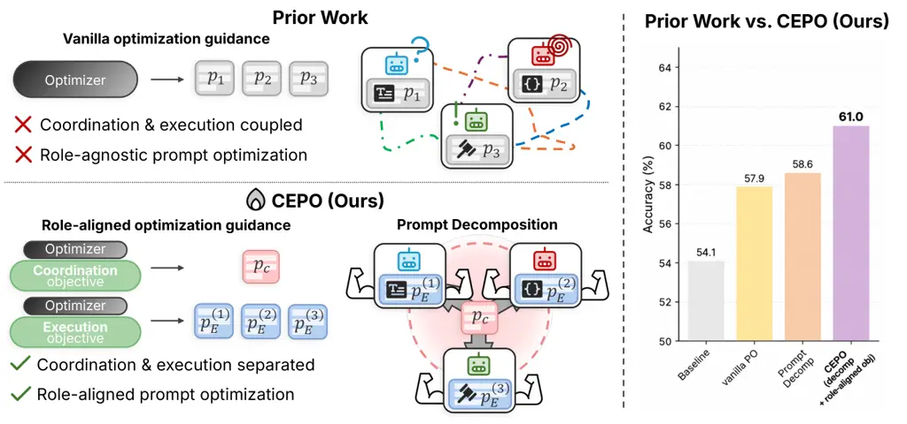
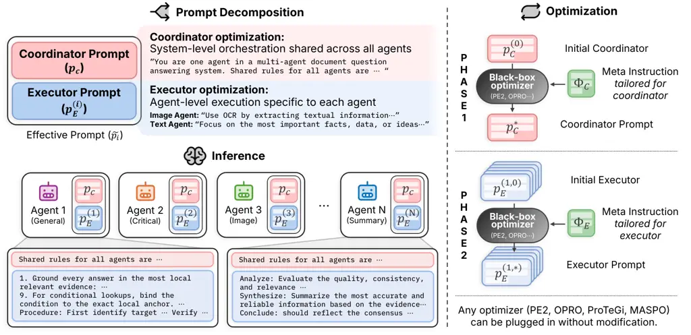
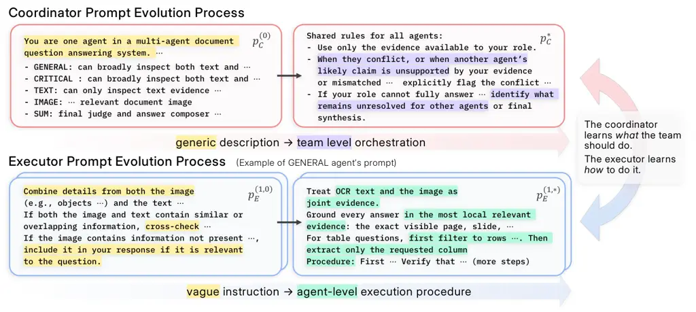

# CEPO: A General Framework for Improving Prompt Optimization in Multi-Agent Systems

Jongha Kim^(1,∗), Seohyun Lee^(2,∗), Jonathan Minho Chung², Jinsung
Yoon³, Hyunwoo J. Kim^(2,†)  
¹Korea University ²KAIST ³Google Cloud AI Research
jonghakim@korea.ac.kr, jinsungyoon@google.com  
{seohyunlee,minho,hyunwoojkim}@kaist.ac.kr

###### Abstract

Multi-agent systems (MAS) require both effective coordination and
specialized task execution. Existing prompt optimization approaches
typically couple these functions within agent-specific prompts. We
introduce Coordinator-Executor Prompt Optimization (CEPO), a general
framework for improving prompt optimization in MAS. CEPO separates
system-level coordination from agent-level execution through a shared
coordinator prompt and agent-specific executor prompts, and guides their
updates according to their respective roles. This structure allows
shared coordination rules to be refined consistently across agents while
keeping execution instructions separately adjustable. CEPO provides the
prompt structure and optimization guidance, while existing prompt
optimizers perform the underlying search. Extensive experiments spanning
11 benchmarks across four domains demonstrate that applying CEPO to four
existing prompt optimizers consistently improves their performance.
Ablations and qualitative analyses support the proposed design, while
controlled studies on a document-understanding MAS further demonstrate
improved optimization budget efficiency and performance scaling with the
number of agents.

|     |
| --- |
|     |

¹¹footnotetext: Equal contribution.²²footnotetext: Corresponding author.

## 1 Introduction

Large language models (LLMs) have demonstrated strong capabilities in
reasoning, tool use, and cross-modal grounding (Achiam et al., 2023;
Schick et al., 2023; Huang et al., 2023b), enabling multi-agent systems
(MAS) (Wu et al., 2024; Li et al., 2023; Zhuge et al., 2024) in which
specialized agents collaborate on complex tasks. These systems have
shown promising results across document understanding (Han et al.,
2025a; Sun et al., 2025), mathematical reasoning (Du et al., 2024; Yuan
& Xie, 2025), code generation (Islam et al., 2024), and video
understanding (Liu et al., 2026; Wang et al., 2026a). However, realizing
their potential requires both effective system-level coordination and
specialized agent-level execution. In other words, each agent must
perform their assigned tasks well while working together toward the
system’s overall goal.

Prompt optimization automates the search for effective instructions and
has expanded from single-agent settings (Zhou et al., 2023; Yang et al.,
2024; Pryzant et al., 2023; Ye et al., 2024) to multi-agent
systems (Zhou et al., 2026; Zhuge et al., 2024). Recent methods jointly
optimize agent prompts or incorporate feedback from downstream
interactions and system-level outcomes (Han et al., 2025b; Wang et al.,
2026b). However, even when these methods account for agent interactions,
their prompt updates typically target only agent-specific prompts,
within which system-level coordination and agent-level execution remain
coupled. Revising shared coordination rules can therefore require
consistent changes across multiple prompts with different execution
responsibilities. This raises our central question: “how can prompt
structure and optimization guidance make existing prompt optimizers more
effective for MAS?”

We introduce Coordinator-Executor Prompt Optimization (CEPO), a general
framework for improving prompt optimization in multi-agent systems. CEPO
specifies how prompts are structured and how their updates are guided,
while existing prompt optimizers carry out the underlying search. The
framework combines two complementary components. First,
coordinator-executor prompt decomposition introduces a coordinator
prompt that is shared across all agents and defines system-level rules
for how they coordinate. Each agent receives this shared coordinator
prompt together with its own executor prompt, which specifies how it
performs its assigned task. This structure allows a single coordination
update to apply consistently across all agents while keeping each
agent’s execution instructions separately adjustable. Second,
role-aligned optimization provides distinct meta-instructions that guide
coordinator updates toward team-level collaboration and executor updates
toward each agent’s task execution. Together, these components make
coordination and execution explicit optimization targets that can be
refined using different underlying optimizers.



Figure 1: CEPO separates coordination and execution for role-aligned
prompt optimization. (a) Prior work vs. CEPO (left). Existing methods
couple coordination and execution roles within agent-specific prompts.
CEPO represents these functions as distinct optimizable parameters
through a shared coordinator prompt $`p_{C}`$ and agent-specific
executor prompts $`p_{E}`$, and guides their updates according to their
respective roles using an existing prompt optimizer. (b) Component-wise
comparison (right). Accuracy on MDocAgent (Han et al., 2025a) +
MMLongBench-Doc (Ma et al., 2024). Vanilla optimizer improves baseline
($`54.1\to 57.9`$), prompt decomposition yields a further gain
($`58.6`$), and combining decomposition with role-aligned optimization
(CEPO) performs the best ($`61.0`$).

We apply CEPO to four different prompt optimizers (PE2, OPRO, ProTeGi,
and MASPO) (Ye et al., 2024; Yang et al., 2024; Pryzant et al., 2023;
Wang et al., 2026b) and conduct extensive experiments on 11 benchmarks
across four domains: document understanding, mathematical reasoning,
code generation, and video understanding. Across the evaluated settings,
CEPO consistently improves performance over the corresponding optimizers
without CEPO, demonstrating its applicability to both general-purpose
and MAS-specific prompt optimizers. Beyond these performance gains,
controlled studies on MDocAgent show improved optimization budget
efficiency and performance scaling with the number of agents. Component
ablations, optimization-guidance swaps, and qualitative prompt analyses
further support the benefits of separating coordination from execution
and aligning optimization guidance with each component’s role.

Our main contributions are as follows.

- •
  We propose two principles to address the coupling of coordination and
  execution, a common limitation of existing MAS prompt optimization. We
  decompose prompts into a shared coordinator prompt for system-level
  coordination and agent-specific executor prompts for agent-level
  execution, and apply role-aligned guidance for each.
- •
  We integrate these two principles into CEPO, a general framework for
  MAS prompt optimization. Applying CEPO to four different prompt
  optimizers yields consistent gains in extensive experiments spanning
  eleven benchmarks across four domains.
- •
  Quantitative and qualitative analyses support the proposed design, and
  controlled studies on a document-understanding MAS further demonstrate
  improved optimization budget efficiency and performance scaling with
  MAS size.

## 2 Related Work

Multi-Agent Systems for Complex Reasoning. LLM-based multi-agent systems
(MAS) distribute complex tasks across multiple agents. In document
understanding, agents gather multimodal evidence, verify intermediate
answers, and synthesize findings (Han et al., 2025a; Sun et al., 2025;
Zhu et al., 2025). Mathematical reasoning systems use debate and
iterative reflection to refine candidate solutions (Du et al., 2024;
Yuan & Xie, 2025). Code generation systems assign complementary roles
for planning, programming, testing, and debugging (Islam et al., 2024;
Huang et al., 2023a). Video understanding systems combine multimodal
evidence processing, temporal localization, and hypothesis verification
through agent collaboration (Kugo et al., 2025; Liu et al., 2026; Wang
et al., 2026a). Across these domains, effective collaboration depends on
both system-level coordination and agent-level execution, motivating the
study of how prompts supporting these functions should be structured and
optimized.

Prompt Optimization. Prompt optimization automates the search for
effective instructions, from single-agent tasks (Zhou et al., 2023; Yang
et al., 2024; Pryzant et al., 2023; Ye et al., 2024; Guo et al., 2024)
to compound systems (Yuksekgonul et al., 2025; Khattab et al., 2024;
Opsahl-Ong et al., 2024). Recent work extends optimization to MAS
through joint search over prompts and topology (Zhou et al., 2026; Zhuge
et al., 2024) and collaborative optimization of agent prompts (Han
et al., 2025b; Zhang et al., 2026; Hong et al., 2026). MASPO (Wang
et al., 2026b) further incorporates downstream interactions and
coordination failures into prompt optimization. Although these
approaches account for dependencies among agents, they typically do not
explicitly separate system-level coordination and agent-level execution
into distinct prompt components, nor provide role-aligned optimization
guidance. To address this gap, we propose Coordinator-Executor Prompt
Optimization (CEPO), a framework that introduces a shared coordinator
prompt and agent-specific executor prompts and optimizes each according
to its role, which complements the underlying prompt optimizer.

## 3 Method

We propose Coordinator-Executor Prompt Optimization (CEPO), a general
framework for improving existing prompt optimizers in multi-agent
systems. CEPO combines two components: _coordinator-executor prompt
decomposition_, which separates shared coordination from agent-specific
execution, and _role-aligned optimization_, which guides updates to each
component according to its function. We first formulate the MAS prompt
optimization problem (§3.1), then introduce the two design principles
and their implementation (§3.2), and finally describe the optimization
procedure (§3.3).

### 3.1 Problem Formulation

We consider a multi-agent system $`f_{\mathcal{S}}`$ composed of $`N`$
LLM-based agents $`\{A_{1},\ldots,A_{N}\}`$, each parameterized by a
natural-language prompt $`p_{i}`$. Given a task query $`q`$ and optional
context $`x`$, the system produces an output
$`\hat{y}=f_{\mathcal{S}}(x,q;\,\mathbf{p})`$, where
$`\mathbf{p}=(p_{1},\ldots,p_{N})`$. The context may contain
task-specific information. Let $`\mathcal{M}`$ denote a task-specific
performance metric and
$`\mathcal{D}_{\text{opt}}=\mathcal{D}_{\text{train}}\cup\mathcal{D}_{\text{val}}`$
denote disjoint training and validation sets. Each example $`(x,q,y)`$
includes a reference $`y`$ used to evaluate the system output. The
prompt optimization objective is:

```math
\mathbf{p}^{\star}\;=\;\argmax_{\mathbf{p}}\;\mathbb{E}_{(x,q,y)\sim\mathcal{D}_{\text{val}}}\big[\,\mathcal{M}\!\left(f_{\mathcal{S}}(x,q;\,\mathbf{p}),\,y\right)\,\big]. \tag{1}
```

Following common practice in prompt optimization (Pryzant et al., 2023;
Ye et al., 2024), training examples provide feedback for prompt updates,
and validation performance selects prompts along the optimization
trajectory. The feedback and selection mechanisms used within prompt
search depend on the underlying optimizer.

Existing prompt optimizers (Zhou et al., 2023; Yang et al., 2024;
Pryzant et al., 2023; Ye et al., 2024; Zhou et al., 2026) can account
for dependencies among agents when updating the prompt collection
$`\mathbf{p}`$ in Eq. (1). Nevertheless, shared coordination and
agent-specific execution remain expressed within per-agent prompts. We
instead make them distinct optimization targets: a shared component
specifies how agents collaborate, and local components specify how they
execute their respective tasks. This separation allows a coordination
update to be applied consistently across agents while execution updates
remain specific to individual roles.

### 3.2 Two Design Principles for MAS Prompt Optimization

Principle 1: Coordinator-executor prompt decomposition. To separate the
role of system-level coordination and agent-level execution, we
represent system-level coordination through a dedicated, shared prompt
parameter. We implement this principle through _coordinator-executor
prompt decomposition_, a structured parameterization with a shared
coordinator prompt $`p_{C}`$ and agent-specific executor prompts
$`\{p_{E}^{(1)},\ldots,p_{E}^{(N)}\}`$. The coordinator specifies
system-level collaboration, such as how agents share findings, flag
disagreements, and support subsequent stages. Each executor specifies
how its agent carries out its assigned task. At each invocation of agent
$`A_{i}`$, the effective prompt is

```math
\tilde{p}_{i}\;=\;p_{C}\oplus p_{E}^{(i)}, \tag{2}
```

where $`\oplus`$ denotes prepending $`p_{C}`$ to $`p_{E}^{(i)}`$. The
full parameterization becomes
$`\mathbf{P}=\big(p_{C},p_{E}^{(1)},\ldots,p_{E}^{(N)}\big)`$, and
Eq. (1) is reformulated as
$`\mathbf{P}^{\star}=\argmax_{\mathbf{P}}J(\mathbf{P})`$, with
$`J(\mathbf{P})`$ denoting the validation objective in Eq. (1) under the
substitution $`p_{i}\mapsto\tilde{p}_{i}`$. Updating $`p_{C}`$ changes
the shared instructions received by all agents, whereas updating
$`p_{E}^{(i)}`$ changes the local instructions of agent $`A_{i}`$.

Principle 2: Role-aligned optimization. To ensure that the coordinator
and executor prompts are optimized for their intended roles, we propose
role-aligned optimization. We implement this strategy using
role-specific optimization meta-instructions, $`\Phi_{C}`$ and
$`\Phi_{E}`$, which are supplied to the underlying optimizer. When
updating $`p_{C}`$, $`\Phi_{C}`$ directs the optimizer to refine
system-level collaboration, including cross-agent communication,
handling of conflicting evidence, and shared reasoning norms. When
updating $`p_{E}^{(i)}`$, $`\Phi_{E}`$ directs it to refine the target
agent’s execution, including task scoping, evidence use, and concrete
procedures under the shared coordination context. Thus, $`\Phi_{C}`$
provides system-level guidance on how agents should coordinate, whereas
$`\Phi_{E}`$ provides agent-level guidance on how each agent should
execute its assigned task.

Note that both prompt layers are selected according to the system-level
performance objective $`J`$. The meta-instructions provide different
guidance for their updates, although they do not define separate
numerical objectives. The meta-instruction excerpts in Table 1
illustrate this distinction, and the swap analysis in Table 7 evaluates
the effect of aligning the guidance with each prompt’s role.

|                                                                                                                                                                                                                                                                                                                                                                                                                                                                  |                                                                                                                                                                                                                                                                                                                                                                                                                                                                                                       |
| ---------------------------------------------------------------------------------------------------------------------------------------------------------------------------------------------------------------------------------------------------------------------------------------------------------------------------------------------------------------------------------------------------------------------------------------------------------------- | ----------------------------------------------------------------------------------------------------------------------------------------------------------------------------------------------------------------------------------------------------------------------------------------------------------------------------------------------------------------------------------------------------------------------------------------------------------------------------------------------------- |
| Coordinator optimizer meta-instruction ($`\Phi_{C}`$)                                                                                                                                                                                                                                                                                                                                                                                                            | Executor optimizer meta-instruction ($`\Phi_{E}`$)                                                                                                                                                                                                                                                                                                                                                                                                                                                    |
| You are optimizing one shared multi-agent system prompt for a multi-agent document QA pipeline. This shared prompt is prepended to ALL five agents. Each agent also receives its own agent-specific prompt with role-specific instructions. The goal is to improve system-level behavior across the trace.  $`\cdots`$  Prefer compact shared rules that help the pipeline make better decisions over formatting instructions that only change how answers look. | Your task is to optimize only the target agent’s executor prompt: the how-to instructions that tell this specific agent how to perform  $`\cdots`$ Infer the execution behavior that would have prevented it and convert it into reusable executor-level instructions. The final prompt should be concrete and operational  $`\cdots`$  provide enough task-specific guidance to avoid recurring failure patterns. Include procedural details when they clarify how the agent should select evidence. |

Table 1: Meta-instructions for role-aligned guidance. The coordinator
meta-instruction $`\Phi_{C}`$ directs the optimizer toward team-level
coordination signals, while the executor meta-instruction $`\Phi_{E}`$
directs it toward agent-level execution signals. Full prompts reported
in Appendix C.2 and C.3.

Coordinator-Executor Prompt Optimization. CEPO combines
coordinator-executor prompt decomposition with role-aligned
optimization. The framework specifies the prompt components and the
guidance for optimizing them, while an underlying prompt optimizer
performs the search and updates. For the single-target update procedure
below, we write an optimizer call as
$`p^{\prime}=\mathcal{O}(p;\,\mathcal{C},\,\Phi,\,\mathcal{D}_{\text{opt}})`$,
where $`p`$ is the target prompt, $`\mathcal{C}`$ contains the other
prompts held fixed, $`\Phi`$ is the role-specific optimization
meta-instruction, and $`\mathcal{D}_{\text{opt}}`$ supplies the
optimization data. Candidate generation and search follow the underlying
optimizer, and we show that CEPO is generally applicable to various
optimizers, such as PE2 (Ye et al., 2024), OPRO (Yang et al., 2024),
ProTeGi (Pryzant et al., 2023) (Table 8), and MASPO (Wang et al., 2026b)
(Table 3).



Figure 2: Overview of CEPO. CEPO decomposes prompts within a multi-agent
system into two layers with distinct roles. The _coordinator prompt_
$`p_{C}`$ (top), shared across all agents, captures coordination signals
(team composition, role assignment, and shared norms for reasoning).
Each _executor prompt_ $`p_{E}^{(i)}`$ (bottom), local to agent
$`A_{i}`$, captures execution signals (evidence anchoring, task scoping,
and procedure execution). The effective prompt for $`A_{i}`$ is the
concatenation $`p_{C}\oplus p_{E}^{(i)}`$. Two layers are sequentially
optimized with role-aligned guidance under CEPO: the coordinator is
optimized using meta-instruction $`\Phi_{C}`$ with executors fixed
(Phase 1), then executors are optimized using $`\Phi_{E}`$ with the
coordinator fixed (Phase 2). CEPO applies these design principles to
existing prompt optimizers $`\mathcal{O}`$, consistently improving those
methods.

### 3.3 The CEPO Optimization Procedure

Our default procedure first optimizes the coordinator with the initial
executor prompts fixed, then optimizes selected executors under the
resulting shared coordination context. This schedule performs best among
those evaluated in our document-system ablation (Appendix §B.2). It is
an implementation choice, while CEPO is defined by prompt decomposition
and role-aligned optimization.

Phase 1: Coordinator optimization. Starting from an initial coordinator
$`p_{C}^{(0)}`$ and fixed initial executors $`\{p_{E}^{(i,0)}\}`$, we
update the coordinator for $`T_{C}`$ iterations using $`\Phi_{C}`$:

```math
p_{C}^{(t)}\;=\;\mathcal{O}\!\left(p_{C}^{(t-1)};\,\{p_{E}^{(i,0)}\}_{i=1}^{N},\,\Phi_{C},\,\mathcal{D}_{\text{opt}}\right),\quad t=1,\ldots,T_{C}. \tag{3}
```

Here, $`\mathcal{O}(p;\,\mathcal{C},\,\Phi,\,\mathcal{D})`$ updates the
target prompt while keeping $`\mathcal{C}`$ fixed. The full MAS
$`f_{\mathcal{S}}`$ is run on $`\mathcal{D}_{\text{train}}`$, and
failures under $`\mathcal{M}`$ provide feedback for candidate updates.
Each coordinator iterate is evaluated on $`\mathcal{D}_{\text{val}}`$
with the initial executors fixed. We select $`p_{C}^{\star}`$ from the
initial prompt and all iterates according to the highest system-level
validation score $`J`$.

Phase 2: Executor optimization. With $`p_{C}^{\star}`$ fixed, we
optimize the executor prompts of a user-specified subset
$`\mathcal{I}\subseteq\{1,\ldots,N\}`$. Each selected executor is
updated for $`T_{E}`$ iterations using $`\Phi_{E}`$:

```math
p_{E}^{(i,t)}\;=\;\mathcal{O}\!\left(p_{E}^{(i,t-1)};\,p_{C}^{\star},\,\{p_{E}^{(j,0)}\}_{j\neq i},\,\Phi_{E},\,\mathcal{D}_{\text{opt}}\right),\quad t=1,\ldots,T_{E}. \tag{4}
```

Training feedback is collected from the full MAS under $`p_{C}^{\star}`$
and the executor context used for the update, and the executor prompt is
selected by validation scores. Agents outside $`\mathcal{I}`$ retain
their initial prompts. The choice $`\mathcal{I}=\emptyset`$ gives
coordinator-only optimization, while $`\mathcal{I}=\{1,\ldots,N\}`$
permits optimization of every executor. The executor subsets are
described in §B.2. Algorithm 1 summarizes the default procedure.

1: MAS $`f_{\mathcal{S}}`$ with $`N`$ agents; training set
$`\mathcal{D}_{\text{train}}`$ and validation set
$`\mathcal{D}_{\text{val}}`$; metric $`\mathcal{M}`$; optimizer
$`\mathcal{O}`$; meta-instructions $`\Phi_{C},\Phi_{E}`$; initial
prompts $`p_{C}^{(0)},\{p_{E}^{(i,0)}\}_{i=1}^{N}`$; iteration budgets
$`T_{C},T_{E}`$; agent subset $`\mathcal{I}`$.

2: Optimized prompt set
$`\mathbf{P}^{\star}=(p_{C}^{\star},\{p_{E}^{(i,\star)}\})`$.

3: // Phase 1: Coordinator optimization

4: for $`t=1`$ to $`T_{C}`$ do

5:
  $`p_{C}^{(t)}\leftarrow\mathcal{O}\!\left(p_{C}^{(t-1)};\,\{p_{E}^{(i,0)}\}_{i=1}^{N},\,\Phi_{C},\,\mathcal{D}_{\text{opt}}\right)`$

6: end for

7:
$`p_{C}^{\star}\leftarrow\argmax_{t\in\{0,\ldots,T_{C}\}}J(p_{C}^{(t)},\,\{p_{E}^{(i,0)}\})`$

8: // Phase 2: Executor optimization

9: for $`i\in\mathcal{I}`$ do

10:   for $`t=1`$ to $`T_{E}`$ do

11:
   $`p_{E}^{(i,t)}\leftarrow\mathcal{O}\!\left(p_{E}^{(i,t-1)};\,p_{C}^{\star},\,\{p_{E}^{(j,0)}\}_{j\neq i},\,\Phi_{E},\,\mathcal{D}_{\text{opt}}\right)`$

12:   end for

13:
  $`p_{E}^{(i,\star)}\leftarrow\argmax_{t\in\{0,\ldots,T_{E}\}}J(p_{C}^{\star},\,p_{E}^{(i,t)})`$

14: end for

15: for $`i\notin\mathcal{I}`$ do

16:   $`p_{E}^{(i,\star)}\leftarrow p_{E}^{(i,0)}`$

17: end for

18: return $`(p_{C}^{\star},\,\{p_{E}^{(i,\star)}\}_{i=1}^{N})`$

Algorithm 1 CEPO optimization procedure.

## 4 Experiments

### 4.1 Implementation Details

Benchmarks and evaluation. We evaluate CEPO on eleven benchmarks across
four domains: document understanding (MMLongBench-Doc (Ma et al., 2024),
LongDocURL (Deng et al., 2025), and PaperTab, PaperText, and
FetaTab (Hui et al., 2024)), mathematical reasoning (AQuA (Ling et al.,
2017), MATH-500 (Lightman et al., 2024), and AGIEval-MATH (Zhong et al.,
2024)), code generation (HumanEval-ET (Dong et al., 2025) and
MBPP (Austin et al., 2021)), and video understanding (LongTVQA+ (Liu
et al., 2026)).

Since the document benchmarks lack dedicated training sets, we partition
their test sets into document-level train/validation/test splits of
10/10/80 using a fixed seed. Baseline scores on our test splits are
close to those on the original test sets (Appendix A.1). We evaluate
answers with GPT-5-mini following the LLM-as-judge protocol of (Han
et al., 2025a) (Appendix C.1). We follow MASPO (Wang et al., 2026b) for
mathematical reasoning and code generation settings. For video
understanding, we follow LongVideoAgent (Liu et al., 2026), retaining
its test set and reserving 50 questions from its training set for
validation.

Underlying prompt optimizers. For document experiments, we use PE2 (Ye
et al., 2024) with GPT-5.4 as the optimizer LLM and $`T_{C}=T_{E}=3`$.
We also evaluate ProTeGi (Pryzant et al., 2023) and OPRO (Yang et al., 2024) on MDocAgent across all five benchmarks with the same LLM and
iteration budgets, retaining each optimizer’s default hyperparameters
(Table 8). For mathematical reasoning and code generation, we follow the
official MASPO (Wang et al., 2026b) configurations. With MASPO, CEPO
first optimizes the coordinator for up to $`T_{C}=4`$ rounds. Then, with
the coordinator fixed, we perform two Predictor updates followed by two
Reflector updates and repeat this sequence twice ($`T_{E}=4`$ per
executor). GPT-5-mini generates and evaluates prompt candidates. For
video understanding, we use PE2 with GPT-5.4 and $`T_{C}=T_{E}=3`$,
optimizing the coordinator first and then optimizing the grounding
agent’s executor prompt.

Multi-agent systems. For document understanding, we use MDocAgent (Han
et al., 2025a) with Qwen-3.5 (4B) (Qwen Team, 2026) and DocAgent (Sun
et al., 2025) with GPT-5-mini. For mathematical reasoning and code
generation, we use MASPO’s (Wang et al., 2026b) Qwen3-8B-based MAS. For
video understanding, we use LongVideoAgent (Liu et al., 2026) with
Qwen2.5-7B as the master agent, and GPT-5-mini as grounding, and vision
agents.

Prompt initialization. For all evaluated multi-agent systems, executor
prompts are initialized from the corresponding baseline’s default
prompts. An initial coordinator prompt is generated by GPT-5-mini from a
description of the system and its agent roles. Examples in Tables S14
and S15.

### 4.2 Results

Document understanding. Table 2 presents the results of applying PE2 +
CEPO to MDocAgent and DocAgent across five document benchmarks. Compared
to their unoptimized baselines, both systems improve on every benchmark,
with average gains of 4.3 and 2.7 points, respectively. The largest gain
occurs on MMLongBench-Doc with DocAgent, where the score rises from 59.5
to 67.4 (+7.9 points). These consistent gains across both agent systems
and all five benchmarks demonstrate that the benefits extend across
diverse document understanding tasks.

Method MMLongBench-Doc LongDocURL PaperTab PaperText FetaTab Avg.
Proprietary Models GPT-4.1^(†) 49.0 – – – – – Claude-4-Sonnet 53.4 – – –
– – Gemini-2.5-Pro 58.1 – – – – – Single-agent Systems M3DocRAG (Cho
et al., 2024) 29.6 50.3 15.2 – 53.7 – DocReact (Wu et al., 2025a) 38.3 –
– – – – MoloRAG (Wu et al., 2025b) 37.1 53.6 15.7 – 55.4 – MoloRAG+ (Wu
et al., 2025b) 37.2 52.8 19.5 – 60.0 – MAB-DQA (Xiang et al., 2026) 39.9
56.4 26.9 – 63.8 – MLDocRAG (Zhang & Wu, 2026) 47.9 50.8 – – – –
Multi-agent Systems DMAP (Fu et al., 2026) 43.2 60.7 39.0 56.7 72.5 54.4
VisDoMRAG (Suri et al., 2025) – – 44.1 – 63.3 – MDocAgent^(†) (Han
et al., 2025a) 54.1 74.9 46.3 72.1 78.8 65.2    + CEPO^(†) (Ours)
61.0*((+6.9)) 75.4*((+0.5)) 53.7*((+7.4)) 76.4*((+4.3)) 80.8*((+2.0))
69.5*((+4.3)) DocAgent^(†) (Sun et al., 2025) 59.5 72.9 60.0 75.6 82.0
70.0    + CEPO^(†) (Ours) 67.4*((+7.9)) 73.2*((+0.3)) 62.2*((+2.2))
78.3*((+2.7)) 82.6*((+0.6)) 72.7*((+2.7))

Table 2: Results on Document understanding. Results across five document
understanding benchmarks. ^(†): results on custom test split (Table S1);
others: results on original test set. “–”: results not available. Avg.:
average over benchmarks. Best results in bold, ours highlighted.

Method Math Code Avg. AQuA MATH-500 AGIEval-MATH HumanEval-ET MBPP
Baseline 83.47 75.10 59.38 68.90 57.26 68.82   + MASPO 85.56 77.80 61.98
73.78 65.11 72.85    + CEPO 87.01*((+3.54)) 79.60*((+4.50))
62.89*((+3.51)) 74.39*((+5.49)) 65.57*((+8.31)) 73.89*((+5.07))

Table 3: CEPO with a multi-agent prompt optimizer. Results with
MASPO (Wang et al., 2026b) on mathematical reasoning and code
generation. Rows are cumulative: + CEPO applies CEPO on top of MASPO.
Green subscripts denote gains over the baseline. Avg.: average over
benchmarks.

Mathematical reasoning and code generation. Table 3 evaluates CEPO with
MASPO (Wang et al., 2026b) on mathematical reasoning and code
generation. MASPO + CEPO outperforms both the baseline and MASPO alone
on all five benchmarks, achieving an average gain of 5.07 points over
the baseline. These results show that explicit coordinator-executor
decomposition and role-aligned optimization can complement a prompt
optimizer that is already tailored to multi-agent systems.

Long video understanding. Table 7 shows that applying CEPO on top of PE2
further improves LongVideoAgent (Liu et al., 2026) on LongTVQA+ to 64.9,
yielding a gain of 1.5 points over vanilla PE2 and 4.6 points over
baseline, demonstrating that CEPO is effective for long-video
understanding.

Table 4: Component ablation results.

Configuration Accuracy Baseline 54.1 w/ Vanilla PE2 57.9 w/ Coordinator
Prompt (LLM-generated) 55.6 w/ Coordinator Prompt (optimized) 58.6 w/
Role-aligned Optimization 61.0

|        |           |           |              |        |      |
| ------ | --------- | --------- | ------------ | ------ | ---- |
| Method | $`T_{C}`$ | $`T_{E}`$ | \# API Calls |        | Acc. |
|        |           |           | Opt.         | LLM    |      |
| PE2    | 0         | 3         | 10           | 5,714  | 57.9 |
|        | 0         | 6         | 22           | 11,945 | 57.4 |
| + CEPO | 1         | 1         | 2            | 3,120  | 60.1 |
|        | 3         | 3         | 20           | 11,458 | 61.0 |

Table 5: Accuracy by training budget. $`T_{C},T_{E}`$: optimization
iterations. Opt: external optimizer API calls. LLM: MAS internal API
calls.

Component analysis. Table 5 examines the prompt components on MDocAgent
with MMLongBench-Doc, averaging results over three random seeds. Adding
an LLM-generated coordinator without prompt optimization raises the
score from 54.1 to 55.6. Optimizing only the executor with vanilla PE2
reaches 57.9, while optimizing only the coordinator reaches 58.6. PE2 +
CEPO, which optimizes both the coordinator and the selected executor
using role-aligned guidance, achieves 61.0. These comparisons support
optimizing both shared coordination and local execution. The
meta-instruction swap experiment separately examines the importance of
matching update guidance to each component’s role.

### 4.3 Analysis

Unless otherwise stated, the following analyses use PE2 with MDocAgent
on MMLongBench-Doc. MDocAgent supports controlled changes to agent
configurations and optimization targets, while MMLongBench-Doc includes
diverse document reasoning cases.

CEPO improves optimization budget efficiency. Table 5 shows that PE2 +
CEPO with $`T_{C}=T_{E}=1`$ reaches 60.1, exceeding vanilla PE2 with
three executor iterations by 2.2 points while using fewer optimizer and
MAS API calls. At comparable API-call budgets, PE2 + CEPO with
$`T_{C}=T_{E}=3`$ reaches 61.0, whereas vanilla PE2 with six executor
iterations reaches 57.4. Additional controls examine inference cost
(Table S5) and prompt length (Table S8): CEPO incurs little inference
overhead in this document setting, and extending vanilla PE2’s prompts
to a comparable length does not recover CEPO’s performance. These
results support the value of how prompts are structured and optimized
beyond simply increasing the optimization budget or prompt length.

Figure 3: Performance under varying numbers of agents. Annotations
indicate CEPO’s gain over the baseline.

CEPO improves performance scaling with MAS size. Figure 3 compares the
unoptimized system, vanilla PE2, and PE2 + CEPO on MDocAgent
configurations containing one to five agents. The unoptimized system
gains little as agents are added, while vanilla PE2 exhibits a
non-monotonic trend and falls below the unoptimized result at three
agents. PE2 + CEPO shows a monotonic increase in the reported scores,
reaching 61.0 at five agents, and its advantage over the unoptimized
system grows from 3.9 points at two agents to 6.9 at five agents. With
two agents, it already exceeds the best unoptimized five-agent result.
These observations support the benefit of explicit coordination
optimization as the number of collaborating agents increases in this
system. Per-configuration results and the aggregation procedure are
provided in Appendix A.4.

|                                                            |       |      |
| ---------------------------------------------------------- | ----- | ---- |
|  | Coord | Exec |
| Coord                                                      | 58.1  | 61.0 |
| Exec                                                       | 57.7  | 59.1 |

Table 6: Optimization guidance swap experiment. Role-aligned guidance
($`p_{C}`$ = coordination, $`p_{E}`$ = execution) perform best, and
reversing them performs worst.

|                                   |                |
| --------------------------------- | -------------- |
| Method                            | LongTVQA+      |
| LongVideoAgent (Liu et al., 2026) | 60.3           |
|    + PE2                          | 63.4           |
|     + CEPO                        | 64.9\_((+4.6)) |

Table 7: Results on long-video understanding. Rows are cumulative. The
green subscript denotes the gain over the baseline.

Method MMLongBench-Doc LongDocURL PaperTab PaperText FetaTab MDocAgent
54.1 74.9 46.3 72.1 78.8 + PE2 57.9 74.4 48.1 71.4 77.8    + CEPO 61.0
75.4 53.7 76.4 80.8 + ProTeGi 55.5 73.5 46.6 72.7 78.4    + CEPO 57.9
75.4 53.1 76.7 79.2 + OPRO 57.3 73.2 46.3 70.9 78.9    + CEPO 60.4 75.2
46.9 73.0 80.0

Table 8: CEPO with different prompt optimizers across document
benchmarks. Results with PE2, ProTeGi, and OPRO on MDocAgent across five
document benchmarks. Within each optimizer block, rows are cumulative: +
CEPO applies CEPO on top of the corresponding optimizer.

Role-aligned guidance improves optimization. With the
coordinator-executor decomposition fixed, we compare four assignments of
optimization guidance (Table 7). Applying coordination guidance
$`\Phi_{C}`$ to the coordinator and execution guidance $`\Phi_{E}`$ to
the executor achieves the best score of 61.0, whereas reversing the
assignment yields the worst score of 57.7. Using the same guidance for
both layers gives intermediate results: 58.1 (coordination guidance) and
59.1 (execution guidance). These results show the importance of using
distinct optimization guidance aligned with each layer’s role.

CEPO complements different prompt optimizers. Table 8 compares PE2 (Ye
et al., 2024), ProTeGi (Pryzant et al., 2023), and OPRO (Yang et al., 2024) with and without CEPO on MDocAgent across all five document
benchmarks. CEPO improves performance in every optimizer-benchmark
combination, with gains of 0.6 to 6.5 points over the corresponding
vanilla optimizer. Table 3 further shows that CEPO improves MASPO (Wang
et al., 2026b), a multi-agent prompt optimizer, on all five mathematical
reasoning and code generation benchmarks. Together, these results
demonstrate that CEPO complements both general-purpose and multi-agent
prompt optimizers.

Coordinator and executor prompts develop complementary roles. Figure 4
shows how role-aligned guidance transforms a generic system description
into detailed team-level coordination and vague executor instructions
into concrete agent-level execution procedures. The coordinator adds
shared rules for flagging unsupported claims, identifying unresolved
issues, and supporting final synthesis. The executor specifies how to
combine OCR and image evidence, ground answers, and extract table
information. These examples illustrate the distinction between shared
coordination and agent-specific execution under role-aligned guidance.



Figure 4: Qualitative comparison of optimized prompts. Through
optimization, the coordinator prompt evolves from a generic description
into team-level orchestration rules. The executor prompt of GENERAL
agent evolves from vague instructions into a concrete agent-level
execution procedure.

## 5 Conclusion

We presented CEPO, a general framework that addresses a shared
limitation in MAS prompt optimization: coupled coordination and
execution. By combining coordinator-executor prompt decomposition with
role-aligned optimization, CEPO enables existing optimizers to refine
both components considering their respective roles. Applying CEPO to
four different prompt optimizers yields consistent gains in extensive
experiments spanning eleven benchmarks across four domains. Controlled
studies further support the proposed design and show improved
optimization budget efficiency and performance scaling with MAS size.

### AI use statement

LLMs are used as components of our experimental framework, including
prompt optimization and LLM-as-judge evaluation, as described in the
paper. We also used generative AI tools to assist with coding during
experiments, to identify and retrieve relevant literature, and to
improve the clarity and language of the manuscript. The authors take
responsibility for the final manuscript, code, analyses, and reported
results.

### Ethics statement

CEPO can reduce the manual effort required to design prompts for
multi-agent systems, making these systems more accessible. However,
easier prompt optimization may encourage deployment without sufficient
validation. Optimized prompts can still produce unintended model
behavior, particularly in high-stakes or out-of-distribution settings.
We therefore recommend task-specific validation and appropriate human
oversight before deployment.

### Reproducibility statement

Section 3 presents CEPO and its optimization procedure. Section 4.1 and
Appendix A describe the experimental setup, dataset splits, model
configurations, and computing resources. Appendix C provides evaluator
prompts, optimization meta-instructions, and examples of initial and
optimized prompts. We plan to release the full codebase upon acceptance.

## References

- Achiam et al. (2023) Josh Achiam, Steven Adler, Sandhini Agarwal, Lama
  Ahmad, Ilge Akkaya, Florencia Leoni Aleman, Diogo Almeida, Janko
  Altenschmidt, Sam Altman, Shyamal Anadkat, et al. GPT-4 technical
  report. _arXiv preprint arXiv:2303.08774_, 2023.
- Austin et al. (2021) Jacob Austin, Augustus Odena, Maxwell Nye,
  Maarten Bosma, Henryk Michalewski, David Dohan, Ellen Jiang, Carrie
  Cai, Michael Terry, Quoc Le, and Charles Sutton. Program synthesis
  with large language models. _arXiv preprint arXiv:2108.07732_, 2021.
- Cho et al. (2024) Jaemin Cho, Debanjan Mahata, Ozan Irsoy, Yujie He,
  and Mohit Bansal. M3DocRAG: Multi-modal retrieval is what you need for
  multi-page multi-document understanding. _arXiv preprint
  arXiv:2411.04952_, 2024.
- Deng et al. (2025) Chao Deng, Jiale Yuan, Pi Bu, Peijie Wang,
  Zhong-Zhi Li, Jian Xu, Xiao-Hui Li, Yuan Gao, Jun Song, Bo Zheng,
  et al. Longdocurl: a comprehensive multimodal long document benchmark
  integrating understanding, reasoning, and locating. In _ACL_, 2025.
- Dong et al. (2025) Yihong Dong, Jiazheng Ding, Xue Jiang, Ge Li, Zhuo
  Li, and Zhi Jin. CodeScore: Evaluating code generation by learning
  code execution. _ACM Transactions on Software Engineering and
  Methodology_, 34(3), 2025. doi: 10.1145/3695991.
- Du et al. (2024) Yilun Du, Shuang Li, Antonio Torralba, Joshua B.
  Tenenbaum, and Igor Mordatch. Improving factuality and reasoning in
  language models through multiagent debate. In _ICML_, 2024.
- Fu et al. (2026) ShunLiang Fu, Yanxin Zhang, Yixin Xiang, Xiaoyu Du,
  and Jinhui Tang. Dmap: Human-aligned structural document map for
  multimodal document understanding. In _Proceedings of the ACM Web
  Conference 2026_, 2026.
- Guo et al. (2024) Qingyan Guo, Rui Wang, Junliang Guo, Bei Li, Kaitao
  Song, Xu Tan, Guoqing Liu, Jiang Bian, and Yujiu Yang. Connecting
  large language models with evolutionary algorithms yields powerful
  prompt optimizers. In _ICLR_, 2024.
- Han et al. (2025a) Siwei Han, Peng Xia, Ruiyi Zhang, Tong Sun, Yun Li,
  Hongtu Zhu, and Huaxiu Yao. Mdocagent: A multi-modal multi-agent
  framework for document understanding. _arXiv preprint
  arXiv:2503.13964_, 2025a.
- Han et al. (2025b) Yichen Han, Yuhang Han, Bojun Liu, Zhengpeng Zhou,
  Guanyu Liu, Zeng Zhang, Yang Yang, Wenli Wang, Isaac N Shi, Yunyan
  Zhang, Lewei He, and Tianyu Shi. Mapgd: Multi-agent prompt gradient
  descent for collaborative prompt optimization, 2025b. URL
  [https://arxiv.org/abs/2509.11361](https://arxiv.org/abs/2509.11361).
- Hong et al. (2026) Zhi Hong, Qian Zhang, Jiahang Sun, Zhiwei Shang,
  Mingze Kong, Xiangyi Wang, Yao Shu, and Zhongxiang Dai. Maspob:
  Bandit-based prompt optimization for multi-agent systems with graph
  neural networks. _arXiv preprint arXiv:2603.02630_, 2026.
- Huang et al. (2023a) Dong Huang, Jie M. Zhang, Michael Luck, Qingwen
  Bu, Yuhao Qing, and Heming Cui. AgentCoder: Multi-agent-based code
  generation with iterative testing and optimisation. _arXiv preprint
  arXiv:2312.13010_, 2023a.
- Huang et al. (2023b) Shaohan Huang, Li Dong, Wenhui Wang, Yaru Hao,
  Saksham Singhal, Shuming Ma, Tengchao Lv, Lei Cui, Owais Khan
  Mohammed, Barun Patra, et al. Language is not all you need: Aligning
  perception with language models. In _NeurIPS_, 2023b.
- Hui et al. (2024) Yulong Hui, Yao Lu, and Huanchen Zhang. UDA: A
  benchmark suite for retrieval augmented generation in real-world
  document analysis. In _NeurIPS_, 2024.
- Islam et al. (2024) Md. Ashraful Islam, Mohammed Eunus Ali, and
  Md Rizwan Parvez. MapCoder: Multi-agent code generation for
  competitive problem solving. In _ACL_, 2024.
- Khattab et al. (2024) Omar Khattab, Arnav Singhvi, Paridhi Maheshwari,
  Zhiyuan Zhang, Keshav Santhanam, Sri Vardhamanan, Saiful Haq, Ashutosh
  Sharma, Thomas T. Joshi, Hanna Moazam, Heather Miller, Matei Zaharia,
  and Christopher Potts. Dspy: Compiling declarative language model
  calls into self-improving pipelines. In _ICLR_, 2024.
- Kugo et al. (2025) Noriyuki Kugo, Xiang Li, Zixin Li, Ashish Gupta,
  Arpandeep Khatua, Nidhish Jain, Chaitanya Patel, Yuta Kyuragi,
  Yasunori Ishii, Masamoto Tanabiki, Kazuki Kozuka, and Ehsan Adeli.
  VideoMultiAgents: A multi-agent framework for video question
  answering. _arXiv preprint arXiv:2504.20091_, 2025.
- Li et al. (2023) Guohao Li, Hasan Hammoud, Hani Itani, Dmitrii
  Khizbullin, and Bernard Ghanem. Camel: Communicative agents for" mind"
  exploration of large language model society. In _NeurIPS_, 2023.
- Lightman et al. (2024) Hunter Lightman, Vineet Kosaraju, Yuri Burda,
  Harrison Edwards, Bowen Baker, Teddy Lee, Jan Leike, John Schulman,
  Ilya Sutskever, and Karl Cobbe. Let’s verify step by step. In
  _ICLR_, 2024.
- Ling et al. (2017) Wang Ling, Dani Yogatama, Chris Dyer, and Phil
  Blunsom. Program induction by rationale generation: Learning to solve
  and explain algebraic word problems. In _ACL_, 2017.
- Liu et al. (2026) Runtao Liu, Ziyi Liu, Jiaqi Tang, Yue Ma, Renjie Pi,
  Jipeng Zhang, and Qifeng Chen. LongVideoAgent: Multi-agent reasoning
  with long videos. In _ACL_, 2026.
- Ma et al. (2024) Yubo Ma, Yuhang Zang, Liangyu Chen, Meiqi Chen, Yizhu
  Jiao, Xinze Li, Xinyuan Lu, Ziyu Liu, Yan Ma, Xiaoyi Dong, et al.
  MMLongBench-Doc: Benchmarking long-context document understanding with
  visualizations. In _NeurIPS_, 2024.
- Opsahl-Ong et al. (2024) Krista Opsahl-Ong, Michael J Ryan, Josh
  Purtell, David Broman, Christopher Potts, Matei Zaharia, and Omar
  Khattab. Optimizing instructions and demonstrations for multi-stage
  language model programs. In _EMNLP_, 2024.
- Pryzant et al. (2023) Reid Pryzant, Dan Iter, Jerry Li, Yin Lee,
  Chenguang Zhu, and Michael Zeng. Automatic prompt optimization with
  “gradient descent” and beam search. In _EMNLP_, 2023.
- Qwen Team (2026) Qwen Team. Qwen3.5: Towards native multimodal agents.
  [https://qwen.ai/blog?id=qwen3.5](https://qwen.ai/blog?id=qwen3.5),
  February 2026.
- Schick et al. (2023) Timo Schick, Jane Dwivedi-Yu, Roberto Dessì,
  Roberta Raileanu, Maria Lomeli, Eric Hambro, Luke Zettlemoyer, Nicola
  Cancedda, and Thomas Scialom. Toolformer: Language models can teach
  themselves to use tools. In _NeurIPS_, 2023.
- Sun et al. (2025) Li Sun, Liu He, Shuyue Jia, Yangfan He, and Chenyu
  You. DocAgent: An agentic framework for multi-modal long-context
  document understanding. In _EMNLP_, 2025.
- Suri et al. (2025) Manan Suri, Puneet Mathur, Franck Dernoncourt,
  Kanika Goswami, Ryan A Rossi, and Dinesh Manocha. Visdom:
  Multi-document qa with visually rich elements using multimodal
  retrieval-augmented generation. In _NAACL_, 2025.
- Wang et al. (2026a) Zheng Wang, Haoran Chen, Haoxuan Qin, Zhipeng Wei,
  Tianwen Qian, and Cong Bai. Think, then verify: A
  hypothesis-verification multi-agent framework for long video
  understanding. In _CVPR_, 2026a.
- Wang et al. (2026b) Zhexuan Wang, Xuebo Liu, Li Wang, Zifei Shan,
  Yutong Wang, Zhenxi Song, and Min Zhang. MASPO: Joint prompt
  optimization for LLM-based multi-agent systems, 2026b. URL
  [https://arxiv.org/abs/2605.06623](https://arxiv.org/abs/2605.06623).
- Wu et al. (2025a) Junda Wu, Yu Xia, Tong Yu, Xiang Chen, Sai Sree
  Harsha, Akash V Maharaj, Ruiyi Zhang, Victor Bursztyn, Sungchul Kim,
  Ryan A Rossi, et al. Doc-react: Multi-page heterogeneous document
  question-answering. In _ACL (short)_, 2025a.
- Wu et al. (2024) Qingyun Wu, Gagan Bansal, Jieyu Zhang, Yiran Wu,
  Beibin Li, Erkang Zhu, Li Jiang, Xiaoyun Zhang, Shaokun Zhang, Jiale
  Liu, et al. Autogen: Enabling next-gen llm applications via
  multi-agent conversations. In _COLM_, 2024.
- Wu et al. (2025b) Xixi Wu, Yanchao Tan, Nan Hou, Ruiyang Zhang, and
  Hong Cheng. MoloRAG: Bootstrapping document understanding via
  multi-modal logic-aware retrieval. In _EMNLP_, 2025b.
- Xiang et al. (2026) Yixin Xiang, Yunshan Ma, Xiaoyu Du, Yibing Chen,
  Yanxin Zhang, and Jinhui Tang. Mab-dqa: Addressing query aspect
  importance in document question answering with multi-armed bandits. In
  _ACL_, 2026.
- Yang et al. (2024) Chengrun Yang, Xuezhi Wang, Yifeng Lu, Hanxiao Liu,
  Quoc V Le, Denny Zhou, and Xinyun Chen. Large language models as
  optimizers. In _ICLR_, 2024.
- Ye et al. (2024) Qinyuan Ye, Mohamed Ahmed, Reid Pryzant, and Fereshte
  Khani. Prompt engineering a prompt engineer. In _ACL
  (Findings)_, 2024.
- Yuan & Xie (2025) Yurun Yuan and Tengyang Xie. Reinforce LLM reasoning
  through multi-agent reflection. In _ICML_, 2025.
- Yuksekgonul et al. (2025) Mert Yuksekgonul, Federico Bianchi, Joseph
  Boen, Sheng Liu, Pan Lu, Zhi Huang, Carlos Guestrin, and James Zou.
  Optimizing generative ai by backpropagating language model feedback.
  _Nature_, 639, 2025.
- Zhang & Wu (2026) Yongyue Zhang and Yaxiong Wu. Mldocrag: Multimodal
  long-context document retrieval augmented generation. _arXiv preprint
  arXiv:2602.10271_, 2026.
- Zhang et al. (2026) Zheyuan Zhang, Lin Ge, Hongjiang Li, Weicheng Zhu,
  Chuxu Zhang, and Yanfang Ye. Mapro: Recasting multi-agent prompt
  optimization as maximum a posteriori inference. In _EACL
  (Findings)_, 2026.
- Zhong et al. (2024) Wanjun Zhong, Ruixiang Cui, Yiduo Guo, Yaobo
  Liang, Shuai Lu, Yanlin Wang, Amin Saied, Weizhu Chen, and Nan Duan.
  AGIEval: A human-centric benchmark for evaluating foundation models.
  In _NAACL (Findings)_, 2024.
- Zhou et al. (2026) Han Zhou, Xingchen Wan, Ruoxi Sun, Hamid Palangi,
  Shariq Iqbal, Ivan Vulić, Anna Korhonen, and Sercan Ö Arık.
  Multi-agent design: Optimizing agents with better prompts and
  topologies. In _ICLR_, 2026.
- Zhou et al. (2023) Yongchao Zhou, Andrei Ioan Muresanu, Ziwen Han,
  Keiran Paster, Silviu Pitis, Harris Chan, and Jimmy Ba. Large language
  models are human-level prompt engineers. In _ICLR_, 2023.
- Zhu et al. (2025) Dawei Zhu, Rui Meng, Jiefeng Chen, Sujian Li, Tomas
  Pfister, and Jinsung Yoon. Doclens : A tool-augmented multi-agent
  framework for long visual document understanding. _arXiv preprint
  arXiv:2511.11552_, 2025.
- Zhuge et al. (2024) Mingchen Zhuge, Wenyi Wang, Louis Kirsch,
  Francesco Faccio, Dmitrii Khizbullin, and Jürgen Schmidhuber.
  GPTSwarm: Language agents as optimizable graphs. In _ICML_, 2024.

## Appendix A Experimental Details

### A.1 Dataset statistics

We split each dataset at the document level with a 10/10/80
train/validation/test ratio: documents are randomly shuffled and
assigned to splits, and all questions associated with a given document
are kept together. Since many documents contain multiple questions
(Table S2), a question-level split would leak shared document context
across splits. As shown in Table S1, performance on our custom test
split closely matches that on the original test split, confirming that
our split does not introduce an easier evaluation. For mathematical
reasoning and code generation, we use the same datasets and splits as
MASPO (Wang et al., 2026b). For LongTVQA+, we use the same test set as
LongVideoAgent (Liu et al., 2026). We hold out 50 questions from the
original training set for validation and use the remainder as our
training set.

### A.2 Computing resource

For MDocAgent, the agent backbone is Qwen-3.5 (4B) (Qwen Team, 2026),
served locally on 8$`\times`$H200 GPUs. For DocAgent, the agent backbone
is GPT-5-mini, accessed through the OpenAI API. For the video
experiments, we use Qwen2.5-7B as the locally served master agent, while
the grounding and vision agents are powered by GPT-5-mini through the
OpenAI API. We use GPT-5.4 as the optimizer LLM.

### A.3 Further implementation details

We instantiate CEPO on two competitive multi-agent systems for document
understanding. MDocAgent (Han et al., 2025a) is a five-agent multi-agent
system (GENERAL, CRITIC, TEXT, IMAGE, SUM) that splits processing across
text and image modalities: the GENERAL and CRITIC agents produce initial
answer and identifies crucial clues, the TEXT and IMAGE agents process
modality-specific evidence, and the SUM agent aggregates all
intermediate outputs into the final answer. DocAgent (Sun et al., 2025)
is a three-agent actor-reviewer-reflector. The actor drafts an answer,
the reviewer critiques it, and the reflector revises the answer based on
the critique. Agents in MDocAgent and DocAgent are powered by Qwen-3.5
(4B) (Qwen Team, 2026) and GPT-5-mini, respectively. Executor prompts
are initialized from the default prompts published with each system, and
the coordinator prompt for CEPO is initialized by querying GPT-5-mini
with a brief description of the agent composition (Appendix C.4).

### A.4 Configuration by number of agents

Table S3 reports the per-configuration breakdown underlying the
agent-count analysis in the main text. From the full set of 5 agent
roles (GENERAL, CRITIC, TEXT, IMAGE, SUM), we construct subsets of size
1 to 5 and retain only those configurations that produce a valid final
answer. When multiple valid configurations exist for a given agent
count, we report each configuration’s accuracy individually and provide
the arithmetic mean across them as the headline result; the bold row in
each group indicates the value used for cross-group comparison. We
compare three settings: baseline (unoptimized prompts), PE2, and PE2 +
CEPO. Across all agent counts and individual configurations, CEPO
consistently outperforms both baseline and vanilla PE2, with the margin
over baseline growing from 3.9 at 2 agents to 6.9 at 5 agents. Vanilla
PE2 is less stable, even falling slightly below baseline at 3 agents due
to a sharp drop on GENERAL + TEXT + SUM.

|                 |                        |                         |            |
| --------------- | ---------------------- | ----------------------- | ---------- |
| Dataset         | Full test set accuracy | Split test set accuracy | $`\Delta`$ |
| MMLongBench-Doc | 54.2                   | 54.1                    | -0.1       |
| LongDocURL      | 73.1                   | 74.9                    | 1.8        |
| PaperTab        | 47.6                   | 46.3                    | -1.3       |
| PaperText       | 71.1                   | 72.1                    | 1.0        |
| FetaTab         | 77.2                   | 78.8                    | 1.6        |

Table S1: Test set accuracy on full set and split set. $`\Delta`$: Split
test set accuracy - full test set accuracy.

|                 |         |      |            |      |         |       |                    |
| --------------- | ------- | ---- | ---------- | ---- | ------- | ----- | ------------------ |
| Dataset         | Train   |      | Validation |      | Test    |       | Average \# Q / Doc |
|                 | \# Docs | \# Q | \# Docs    | \# Q | \# Docs | \# Q  |                    |
| FetaTab         | 87      | 104  | 87         | 100  | 697     | 812   | 1.17               |
| LongDocURL      | 40      | 209  | 40         | 226  | 316     | 1,890 | 5.87               |
| MMLongBench-Doc | 13      | 123  | 13         | 103  | 108     | 847   | 8.01               |
| PaperTab        | 31      | 36   | 31         | 37   | 245     | 320   | 1.28               |
| PaperText       | 109     | 292  | 109        | 300  | 869     | 2,212 | 2.58               |

Table S2: Data split statistics. Each split is constructed at the
PDF/document level. \# Q denotes the number of questions.

|          |                                       |          |      |            |            |
| -------- | ------------------------------------- | -------- | ---- | ---------- | ---------- |
| \#Agents | Configuration                         | Baseline | PE2  | PE2 + CEPO | $`\Delta`$ |
| 1        | GENERAL                               | 54.3     | –    | –          |            |
| 2        | GENERAL + SUM                         | 53.0     | 55.5 | 56.9       | +3.9       |
| 3        | Average                               | 53.6     | 53.2 | 57.7       | +4.1       |
|          | GENERAL + TEXT + SUM                  | 52.2     | 47.5 | 55.5       | +3.3       |
|          | GENERAL + IMAGE + SUM                 | 55.0     | 58.8 | 59.9       | +4.9       |
| 4        | Average                               | 54.2     | 57.5 | 58.7       | +4.5       |
|          | GENERAL + TEXT + IMAGE + SUM          | 55.4     | 57.7 | 59.6       | +4.2       |
|          | GENERAL + CRITIC + TEXT + SUM         | 52.1     | 56.1 | 57.0       | +4.9       |
|          | GENERAL + CRITIC + IMAGE + SUM        | 55.1     | 58.7 | 59.6       | +4.5       |
| 5        | GENERAL + CRITIC + TEXT + IMAGE + SUM | 54.1     | 57.9 | 61.0       | +6.9       |

Table S3: Performance variation across agent configurations. For each
agent count, the bold row reports the headline result (single
configuration when only one is valid, otherwise the average across valid
configurations). Indented rows below show the per-configuration
breakdown for multi-configuration cases. $`\Delta`$ denotes the
improvement of PE2 + CEPO over the baseline. “–”: for 1-agent
configuration, we did not apply PE2 or CEPO to compare performance on
multi-agent configurations. Averaged results are also visually plotted
in Fig. 3.

|        |           |           |              |        |      |
| ------ | --------- | --------- | ------------ | ------ | ---- |
| Method | $`T_{C}`$ | $`T_{E}`$ | \# API Calls |        | Acc. |
|        |           |           | Opt.         | LLM    |      |
| PE2    | 0         | 3         | 10           | 5,714  | 57.9 |
|        | 0         | 6         | 22           | 11,945 | 57.4 |
| + CEPO | 1         | 1         | 2            | 3,120  | 60.1 |
|        | 2         | 2         | 12           | 7,288  | 60.2 |
|        | 3         | 3         | 20           | 11,458 | 61.0 |
|        | 4         | 4         | 28           | 15,616 | 58.6 |

Table S4: Results by optimization budget. Opt: \# optimizer API calls,
LLM: \# MDocAgent internal API calls.

|          |                         |                            |      |
| -------- | ----------------------- | -------------------------- | ---- |
| Method   | Throughput (sec/sample) | Output tokens (tok/sample) | Acc. |
| Baseline | 15.92                   | 847.7                      | 54.1 |
| PE2      | 13.35                   | 595.8                      | 57.9 |
| + CEPO   | 15.61                   | 824.7                      | 61.0 |

Table S5: Inference cost by optimization method. Throughput
(sec/sample): average wall-clock time per sample. Output tokens: average
number of output tokens per sample.

|             |                   |                |
| ----------- | ----------------- | -------------- |
| Schedule    | Coordinator-first | Executor-first |
| Sequential  | 61.0              | 60.7           |
| Alternating | 60.1              | 58.2           |

Table S6: Analysis on the optimization schedule. Two design axes are
varied: schedule type (sequential vs. alternating) and which role is
optimized first (coordinator vs. executor). All schedules use the same
total budget of six iterations.

|     |                                                               |      |                                     |
| --- | ------------------------------------------------------------- | ---- | ----------------------------------- | ---------- | --- |
| $`  | \mathcal{I}                                                   | `$   | Target executor set $`\mathcal{I}`$ | PE2 + CEPO | PE2 |
| 1   | GENERAL (ours)                                                | 61.0 | 57.9                                |
|     | CRITIC                                                        | 58.0 | 57.9                                |
|     | TEXT                                                          | 59.1 | 55.3                                |
|     | IMAGE                                                         | 58.0 | 54.2                                |
|     | SUM                                                           | 55.8 | 57.5                                |
| 2   | GENERAL $`\to`$ TEXT                                          | 59.7 | 56.1                                |
| 3   | GENERAL $`\to`$ TEXT $`\to`$ IMAGE                            | 60.0 | 56.3                                |
| 4   | GENERAL $`\to`$ CRITIC $`\to`$ TEXT $`\to`$ IMAGE             | 57.5 | 57.6                                |
| 5   | GENERAL $`\to`$ CRITIC $`\to`$ TEXT $`\to`$ IMAGE $`\to`$ SUM | 56.9 | 55.3                                |

Table S7: Ablation on the target executor set $`\mathcal{I}`$.

|             |           |          |
| ----------- | --------- | -------- |
| Method      | \# Tokens | Accuracy |
| Baseline    | 226       | 54.1     |
| PE2 (short) | 631       | 57.9     |
| PE2 (long)  | 1410      | 54.0     |
| PE2 + CEPO  | 1408      | 61.0     |

Table S8: Prompt length controlled comparison. \# Tokens: total tokens
of optimized prompts.

## Appendix B Further analysis

### B.1 Cost analysis

#### Optimization cost comparison.

Table S4 examines accuracy as we vary the optimization budget
$`(T_{C},T_{E})`$. We adopt PE2’s default iteration budget for each
phase of $`(T_{C}{=}3,T_{E}{=}3)`$ for CEPO, which matches the empirical
plateau: pushing the budget further to $`(T_{C}{=}4,T_{E}{=}4)`$ yields
no improvement and in fact degrades accuracy from $`61.0`$ to $`58.6`$.
When matched against PE2 under comparable budgets, CEPO’s gains do not
stem from spending more compute. CEPO with $`(T_{C}{=}1,T_{E}{=}1)`$
already improves over PE2 with $`(T_{C}{=}0,T_{E}{=}3)`$ by $`2.2`$
points ($`60.1`$ vs. $`57.9`$) while using far fewer API calls, showing
that even a minimal optimization budget yields a substantial benefit. At
a near-identical optimization cost to PE2 with
$`(T_{C}{=}0,T_{E}{=}6)`$, CEPO with $`(T_{C}{=}3,T_{E}{=}3)`$ still
leads by $`3.6`$ points ($`61.0`$ vs. $`57.4`$), confirming that the
advantage comes from more effective optimization rather than from an
inflated budget.

#### Inference cost comparison.

Table S5 reports the inference cost of each method, measured as average
wall-clock time per sample. Since input text tokens are dominated by
image tokens in the MDocAgent pipeline, throughput is driven primarily
by intermediate output length rather than by prompt length. CEPO
produces intermediate outputs comparable in length to the baseline
(PE2 + CEPO: 824.7 vs. baseline: 847.7 tokens) yet improves accuracy by
6.9 points, while vanilla PE2 reaches lower accuracy (57.9) with shorter
intermediates (595.8 tokens). This indicates that prompts optimized with
CEPO elicit richer intermediate reasoning at no additional inference
cost compared to the baseline, whereas vanilla PE2’s compactness comes
at an accuracy cost.

### B.2 Analysis on design choices

#### Analysis on optimization schedule.

Table S6 ablates the optimization schedule along two axes: schedule type
(sequential vs. alternating) and starting role (coordinator-first vs.
executor-first). Here, alternating schedule denotes optimizing each
agent in turn for a single iteration. Sequential schedules outperform
alternating ones, as letting each role converge before switching avoids
the instability of co-adapting two interdependent prompts. Optimizing
the coordinator first is also preferable, since fixing the high-level
pipeline behavior early provides a stable target against which the
executors can specialize. Our choice combines both, yielding the highest
accuracy of $`61.0`$.

#### Analysis on target executor set $`\mathcal{I}`$.

Table S7 ablates the choice of the target executor set $`\mathcal{I}`$,
the set of agents whose executor prompts are optimized. For
$`|\mathcal{I}|=1`$, we report results for every agent individually. For
$`|\mathcal{I}|>1`$, agents are added incrementally in descending order
of their single-agent accuracy, and their executor prompts are then
optimized sequentially along the topological order of the MDocAgent
pipeline (GENERAL $`\to`$ CRITIC $`\to`$ TEXT, IMAGE $`\to`$ SUM), with
each prompt optimized while all others remain fixed. Among single-agent
targets, optimizing the GENERAL executor yields the highest accuracy
($`61.0`$), outperforming the next-best target (TEXT, $`59.1`$) by
$`1.9`$ points and the weakest target (SUM, $`55.8`$) by $`5.2`$ points.
This gap suggests that the GENERAL agent, which produces the initial
document-level answer that subsequent agents refine, is the most
impactful component to optimize in the pipeline. Notably, vanilla PE2
exhibits larger performance degradation as more executor prompts are
jointly optimized, whereas CEPO mitigates this instability and maintains
comparatively robust performance in the multi-agent setting. Extending
the target set beyond GENERAL does not yield further gains, supporting
$`|\mathcal{I}|=1`$ as our default and leaving joint optimization of
multiple executor prompts to future work.

#### CEPO’s gains are not from longer prompts.

A natural concern is whether CEPO’s advantage simply comes from feeding
longer prompts to the MAS. To isolate this effect, we compare three
configurations at different prompt length budgets. “PE2 (short)” is the
default vanilla PE2 setup. “PE2 (long)” runs vanilla PE2 with an
extended budget so that its optimized prompts are at least as long as
CEPO’s total prompt length, controlling for the possibility that gains
come from longer prompts alone. CEPO uses our default
$`(T_{C}{=}3,T_{E}{=}3)`$ configuration. As shown in Table S8, simply
allowing vanilla PE2 to produce longer prompts not only fails to close
the gap, but actually _hurts_ performance: “PE2 (long)” drops to 54.0,
falling below even the no-optimization baseline (54.1), suggesting that
naively extending prompt length does not necessarily improve
performance. Meanwhile, additionally applying CEPO results in accuracy
of 61.0 with a comparable token budget, demonstrating that the gains
stem from _how_ prompt parameters are structured and optimized, not from
the sheer length of the prompts being optimized.

|                                                        |            |          |           |         |
| ------------------------------------------------------ | ---------- | -------- | --------- | ------- |
| Coordinator Prompt $`p_{C}^{\star}`$                   | LongDocURL | PaperTab | PaperText | FetaTab |
| Baseline (no coordinator)                              | 74.9       | 46.3     | 72.1      | 78.8    |
| Cross-dataset ($`p_{C}^{\star}`$ from MMLongBench-Doc) | 74.8       | 49.7     | 73.4      | 79.4    |
| In-domain ($`p_{C}^{\star}`$ from target dataset)      | 75.4       | 53.7     | 76.4      | 80.8    |

Table S9: Coordinator prompt transferability. $`p_{C}^{\star}`$
optimized on MMLongBench-Doc transfers to four other benchmarks with
negligible loss compared to dataset-specific optimization.

Cross-dataset coordinator transfer. Table S9 evaluates transfer of a
coordinator prompt optimized on MMLongBench-Doc to four other document
benchmarks against in-domain optimization. The transferred CEPO
configuration achieves an average score of 69.3, compared with 71.6 for
in-domain optimization, a gap of 2.3 points. These results provide
evidence that the learned coordination instructions can be reused across
document benchmarks.

#### Full optimized prompts.

We provide the final optimized prompts in §C.5. Qualitatively, the
coordinator prompt mainly learns _what_ agents should coordinate at the
team level, while executor prompts primarily learn _how_ each agent
should focus on during execution.

## Appendix C Prompts

### C.1 Evaluator LLM prompts

Table S10 provides the input prompt used for the evaluator LLM.

|                  |                                                                                                                                                                                                                                                                                                                                                                                     |
| ---------------- | ----------------------------------------------------------------------------------------------------------------------------------------------------------------------------------------------------------------------------------------------------------------------------------------------------------------------------------------------------------------------------------- |
| Evaluator Prompt | Question: {question} Predicted Answer: {answer} Ground Truth Answer: {gt} Please evaluate if the predicted answer is correct compared to the ground truth. Score the answer on: Binary correctness (0-1): 1 if the answer is correct, 0 if it is incorrect Return only a string with these scores in a dictionary and can be parsed by json.loads, e.g. {{"binary_correctness": 1}} |

Table S10: Evaluator LLM prompt.

### C.2 Optimizer meta-instruction for optimizing coordinator prompts

Tables S11 and S12 provide the meta-instructions used for the optimizer
LLM for MDocAgent and DocAgent.

|                        |                                                                                                                                                                                                                                                                                                                                                                                                                                                                                                                                                                                                                                                                                                                                                                                                                                                                                                                                                                                                                                                                                                                                                                                                                                                                                                                                                                                                                                                                                                                                                                                                                                                                                                                                                                                                                                                                                                                                                                                                                                                                                                                                                                                                                                                                                                                                                                                                                                                                                                                                                                                                                                                                                                                                                                                                                                                                                                                                                                                                                                                                                                                                                                                                                                                                                                                                                                                                                                                                                                                                                                                                                                                                                        |
| ---------------------- | -------------------------------------------------------------------------------------------------------------------------------------------------------------------------------------------------------------------------------------------------------------------------------------------------------------------------------------------------------------------------------------------------------------------------------------------------------------------------------------------------------------------------------------------------------------------------------------------------------------------------------------------------------------------------------------------------------------------------------------------------------------------------------------------------------------------------------------------------------------------------------------------------------------------------------------------------------------------------------------------------------------------------------------------------------------------------------------------------------------------------------------------------------------------------------------------------------------------------------------------------------------------------------------------------------------------------------------------------------------------------------------------------------------------------------------------------------------------------------------------------------------------------------------------------------------------------------------------------------------------------------------------------------------------------------------------------------------------------------------------------------------------------------------------------------------------------------------------------------------------------------------------------------------------------------------------------------------------------------------------------------------------------------------------------------------------------------------------------------------------------------------------------------------------------------------------------------------------------------------------------------------------------------------------------------------------------------------------------------------------------------------------------------------------------------------------------------------------------------------------------------------------------------------------------------------------------------------------------------------------------------------------------------------------------------------------------------------------------------------------------------------------------------------------------------------------------------------------------------------------------------------------------------------------------------------------------------------------------------------------------------------------------------------------------------------------------------------------------------------------------------------------------------------------------------------------------------------------------------------------------------------------------------------------------------------------------------------------------------------------------------------------------------------------------------------------------------------------------------------------------------------------------------------------------------------------------------------------------------------------------------------------------------------------------------------- |
| Actor Optimizer Prompt | Optimization target: ONE shared multi agent system prompt used by GENERAL, CRITICAL, TEXT, IMAGE, and SUM. \### Agent System Prompt Optimization Objective You are optimizing one shared multi-agent system prompt for a multi-agent document QA pipeline. This shared prompt is prepended to ALL five agents (GENERAL, CRITICAL, TEXT, IMAGE, SUM). Each agent also receives its own agent-specific prompt with role-specific instructions. The goal is to improve system-level behavior across the trace: uncertainty preservation, modality discipline, evidence handling, handoff, conflict surfacing, and final synthesis. Do not primarily optimize output format, templates, XML wrappers, field names, or rigid reporting schemas. It is acceptable to add short role-dependent guidance only when it defines division of labor across the system, not detailed role-specific heuristics. Prefer compact shared rules that help the pipeline make better decisions over formatting instructions that only change how answers look. \### Brevity as an Optimizer-Only Constraint Brevity is a constraint on how you edit and select the new shared system prompt. It is not, by itself, a rule that should be inserted into the produced prompt. Do not add self-referential brevity instructions such as ‘‘be concise,’’ ‘‘keep outputs minimal,’’ ‘‘use a short format,’’ or similar rules unless failure analysis shows that runtime verbosity is itself causing a shared pipeline failure. Do not mention token budgets, prompt length, minimality, or concision inside the produced shared system prompt unless that is directly justified by the failure pattern. Instead, satisfy the brevity constraint by deleting, merging, or rewriting redundant shared rules while preserving or improving coordination quality. When two candidate prompts are likely to behave similarly, prefer the shorter one. When a useful change can be made either by revising an existing rule or by adding a new one, prefer revising the existing rule. Hard limit: the optimized shared system prompt (‘new_prompt‘) must remain under 600 tokens. \### Multimodal Failure Case Format When failure examples include retrieved images, each case may attach the images once near the top of that case using aliases such as ‘case1_image1‘, ‘case1_image2‘, etc. Treat those aliases as the actual images retrieved for that failure case. Later agent input traces may reference the same aliases in ‘referenced_images‘; do not expect repeated image blocks inside every agent input. Use the case-local aliases to reason about what GENERAL, CRITICAL, and IMAGE could see, while keeping the prompt edit focused on shared multi-agent behavior. \### Multimodal Optimizer Attachments The optimizer request includes 20 actual image(s). They are attached to this request in the same order as the image mapping shown inside the failure examples. When analyzing a case, use only the images mapped to that example and only when the target agent input shows those images were runtime-visible. \### Step 1 (Analyze end-to-end failures) For each example, inspect the full multi-agent trace and classify the final-answer failure. Decide whether the optimized target prompt could have changed the trace toward the gold answer. Separate target-actionable failures from downstream-only, other-agent-only, and evidence-missing cases. Current prompt: {CURRENT PROMPT} Failure examples: {FAIL EXAMPLES INCLUDED} \### Step 2 (Produce optimized prompt) Return ONLY a JSON object with the keys: {"reasoning": "...", "new_prompt": "...", "new_history": "..."} |

Table S11: Meta-instruction for optimizing the coordinator prompt on
MDocAgent.

|                           |                                                                                                                                                                                                                                                                                                                                                                                                                                                                                                                                                                                                                                                                                                                                                                                                                                                                                                                                                                                                                                                                                                                                                                                                                                                                                                                                                                                                                                                                                                                                                                                                                                                                                                                                                                                                                                                                                                                                                                                                                                                                                                                                                                                                                                                                                                                                                                                                                                                                                                                                                                                                                                                                                                                                                                                                                                                                                                                                                                                                                                                                                                                                                                                                                    |
| ------------------------- | ------------------------------------------------------------------------------------------------------------------------------------------------------------------------------------------------------------------------------------------------------------------------------------------------------------------------------------------------------------------------------------------------------------------------------------------------------------------------------------------------------------------------------------------------------------------------------------------------------------------------------------------------------------------------------------------------------------------------------------------------------------------------------------------------------------------------------------------------------------------------------------------------------------------------------------------------------------------------------------------------------------------------------------------------------------------------------------------------------------------------------------------------------------------------------------------------------------------------------------------------------------------------------------------------------------------------------------------------------------------------------------------------------------------------------------------------------------------------------------------------------------------------------------------------------------------------------------------------------------------------------------------------------------------------------------------------------------------------------------------------------------------------------------------------------------------------------------------------------------------------------------------------------------------------------------------------------------------------------------------------------------------------------------------------------------------------------------------------------------------------------------------------------------------------------------------------------------------------------------------------------------------------------------------------------------------------------------------------------------------------------------------------------------------------------------------------------------------------------------------------------------------------------------------------------------------------------------------------------------------------------------------------------------------------------------------------------------------------------------------------------------------------------------------------------------------------------------------------------------------------------------------------------------------------------------------------------------------------------------------------------------------------------------------------------------------------------------------------------------------------------------------------------------------------------------------------------------------ |
| Pipeline Optimizer Prompt | Optimization target: one shared DocAgent pipeline instruction. It is composed into the actual system message with the original DocAgent system prompt. \### Agent System Prompt Optimization Objective You are optimizing one shared multi-agent system prompt for a multi-agent document QA pipeline. This shared prompt is prepended to ALL three agents (actor, reviewer, reflector). Each agent also receives its own agent-specific prompt with role-specific instructions. The goal is to improve system-level behavior across the trace: evidence handling, handoff, conflict surfacing, and final synthesis. Encourage each agent to act as evidence support for the final synthesis. Non-final agents should preserve information that may help the final answerer, including verified evidence, partial support, and conflicts. Optimize the shared prompt toward better evidence preservation. The resulting prompt should help the final synthesizer recover the strongest answer supported by the available context. Do not primarily optimize output format, templates, XML wrappers, field names, or rigid reporting schemas. It is acceptable to add short role-dependent guidance only when it defines division of labor across the system, not detailed role-specific heuristics. Prefer compact shared rules that help the pipeline make better decisions over formatting instructions that only change how answers look. \### Brevity as an Optimizer-Only Constraint Brevity is a constraint on how you edit and select the new shared system prompt. It is not, by itself, a rule that should be inserted into the produced prompt. Do not add self-referential brevity instructions such as ‘‘be concise,’’ ‘‘keep outputs minimal,’’ ‘‘use a short format,’’ or similar rules unless failure analysis shows that runtime verbosity is itself causing a shared pipeline failure. Do not mention token budgets, prompt length, minimality, or concision inside the produced shared system prompt unless that is directly justified by the failure pattern. Instead, satisfy the brevity constraint by deleting, merging, or rewriting redundant shared rules while preserving or improving coordination quality. When two candidate prompts are likely to behave similarly, prefer the shorter one. When a useful change can be made either by revising an existing rule or by adding a new one, prefer revising the existing rule. Hard limit: the optimized shared system prompt (‘new_prompt‘) must remain under 600 tokens. \### Step 1 (Analyze end-to-end failures) For each example, inspect the actor/reviewer/reflection trace and classify the final-answer failure. Decide whether shared pipeline behavior could have changed the trace toward the gold answer. Separate prompt-actionable failures from evidence-missing or judge-only issues. The optimized prompt must preserve these template placeholders: {agent_role} and {agent_specific_prompt}. Current prompt: {current_prompt} Failure examples: {failure_examples} \### Step 2 (Produce optimized prompt) {history_section} Return ONLY a JSON object with keys ‘‘reasoning’’, ‘‘new_prompt’’, and ‘‘new_history’’. |

Table S12: Meta-instruction for optimizing the coordinator prompt on
DocAgent.

### C.3 Optimizer meta-instruction for optimizing executor prompts

Table S13 provides the meta-instruction used for optimizing
agent-specific executor prompts.

|                           |                                                                                                                                                                                                                                                                                                                                                                                                                                                                                                                                                                                                                                                                                                                                                                                                                                                                                                                                                                                                                                                                                                                                                                                                                                                                                                                                                                                                                                                                                                                                                                                                                                                                                                                                                                                                                                                                                                                                                                                                                                                                                                                                                                                                                                                                                                                                                                                                                                                                                                                                                                                                                                                                                                                                                                                                                                                               |
| ------------------------- | ------------------------------------------------------------------------------------------------------------------------------------------------------------------------------------------------------------------------------------------------------------------------------------------------------------------------------------------------------------------------------------------------------------------------------------------------------------------------------------------------------------------------------------------------------------------------------------------------------------------------------------------------------------------------------------------------------------------------------------------------------------------------------------------------------------------------------------------------------------------------------------------------------------------------------------------------------------------------------------------------------------------------------------------------------------------------------------------------------------------------------------------------------------------------------------------------------------------------------------------------------------------------------------------------------------------------------------------------------------------------------------------------------------------------------------------------------------------------------------------------------------------------------------------------------------------------------------------------------------------------------------------------------------------------------------------------------------------------------------------------------------------------------------------------------------------------------------------------------------------------------------------------------------------------------------------------------------------------------------------------------------------------------------------------------------------------------------------------------------------------------------------------------------------------------------------------------------------------------------------------------------------------------------------------------------------------------------------------------------------------------------------------------------------------------------------------------------------------------------------------------------------------------------------------------------------------------------------------------------------------------------------------------------------------------------------------------------------------------------------------------------------------------------------------------------------------------------------------------------- |
| Pipeline Optimizer Prompt | Target agent: {TARGET AGENT} You are optimizing one target agent prompt in a multi-agent system. Your task is to optimize only the target agent’s executor prompt: the how-to instructions that tell this specific agent how to perform its assigned subtask under the given context. Analyze the failure examples using only the target-agent input and target-agent output shown in each case. Do not rely on hidden upstream reasoning, downstream corrections, missing pages, unavailable images, or information that was not visible to the target agent. Infer the execution behavior that would have prevented each failure, then generalize those behaviors into reusable executor-level instructions. Target optimized prompt granularity: - The final prompt should be concrete and operational, not merely a generic multimodal QA prompt. - It should provide enough task-specific guidance for the target agent to avoid recurring failure patterns. - Merge similar behaviors into broader rules when possible, but keep the resulting rules specific enough to guide execution. - Include procedural details when they clarify how the agent should select evidence, reason over multimodal inputs, and produce its answer. - Avoid overfitting to individual examples or encoding narrow case-specific fixes. - Avoid making the prompt unnecessarily long, but do not omit useful execution guidance just to keep it minimal. Prompt organization: - Write the optimized prompt as an executor-facing how-to guide. - Prefer a compact structure with:  1. a brief statement of the target agent’s task;  2. a ‘‘Core behavior’’ section describing the main execution rules the agent should follow;  3. a ‘‘Procedure’’ section describing the order in which the agent should apply those rules. - The ‘‘Core behavior’’ section should contain stable behavioral principles derived from the failures. Keep the structure focused on how this target agent should execute its own task. The optimized prompt should stay at the executor level. It should describe how the target agent should perform its own multimodal document QA task under the given context. Do not redefine the overall multi-agent system, assign roles to other agents, change global routing, or add unsupported capabilities. \### Step 1 (Analyze target-agent failures) For each example, inspect only the target agent input/output shown in the failure case. Decide what prompt behavior would have made that target agent answer correctly from the same input. Do not rely on hidden upstream or downstream agent traces. Current prompt: {CURRENT PROMPT} Failure examples: {FAIL EXAMPLES INCLUDED} \### Step 2 (Produce optimized prompt) Return ONLY a JSON object with the keys: {"reasoning": "...", "new_prompt": "...", "new_history": "..."} |

Table S13: Meta-insturction for optimizing the executor prompt on
MDocAgent.

### C.4 LLM-generated initial coordinator prompts

Tables S14 and S15 show the seed coordinator prompts for MDocAgent and
DocAgent, generated by GPT-5-mini and used as the initial coordinator
prompt $`p^{(0)}_{C}`$ for optimization.

|                              |                                                                                                                                                                                                                                                                                                                                                                                                                                                                                                                                                              |
| ---------------------------- | ------------------------------------------------------------------------------------------------------------------------------------------------------------------------------------------------------------------------------------------------------------------------------------------------------------------------------------------------------------------------------------------------------------------------------------------------------------------------------------------------------------------------------------------------------------ |
| MDocAgent Coordinator Prompt | Current prompt: You are one agent in a multi-agent document question answering system. There are five agents: - GENERAL: can broadly inspect both text and image evidence - CRITICAL: can broadly inspect both text and image evidence - TEXT: can only inspect text evidence extracted from the document image, including OCR text - IMAGE: can only inspect the relevant document image - SUM: final judge and answer composer; can only view the discussion history from GENERAL, TEXT, and IMAGE You are the {agent_role} agent. {agent_specific_prompt} |

Table S14: Initial coordinator prompt $`p^{(0)}_{C}`$ for MDocAgent.

|                             |                                                                                                                                                                                                                                                                                                                                                                                                                                                                                                                                                                                                                                                                                                                                                                             |
| --------------------------- | --------------------------------------------------------------------------------------------------------------------------------------------------------------------------------------------------------------------------------------------------------------------------------------------------------------------------------------------------------------------------------------------------------------------------------------------------------------------------------------------------------------------------------------------------------------------------------------------------------------------------------------------------------------------------------------------------------------------------------------------------------------------------- |
| DocAgent Coordinator Prompt | You are part of DocAgent, a document question answering pipeline for long multimodal documents. The pipeline has three prompt-driven stages: - ACTOR: studies the document outline, uses search, section, page-image, image, and table-image tools to gather evidence, and produces a concise answer inside \<final_result\>. - REVIEWER: checks the actor answer against document evidence using only necessary tools, then either confirms or corrects the final answer inside \<final_result\>. - REFLECTION: when the reviewer changes the actor answer, updates a concise reusable guideline that may help future questions. You are the {agent_role}. Follow the core system instruction below while preserving the shared pipeline behavior: {agent_specific_prompt} |

Table S15: Initial coordinator prompt $`p^{(0)}_{C}`$ for DocAgent.

### C.5 Qualitative Examples of Optimized Prompts

Tables C.5 and C.5 show the final optimized coordinator and executor
prompts for MDocAgent.

|                                                                                                                                                                                                                                                                                   |
| --------------------------------------------------------------------------------------------------------------------------------------------------------------------------------------------------------------------------------------------------------------------------------- |
| Optimized coordinator prompt for MDocAgent.                                                                                                                                                                                                                                       |
| \endfirsthead       Continued from previous page.                                                                                                                                                                                                                                 |
| \endhead   \endfootYou are one agent in a multi-agent document question answering system.                                                                                                                                                                                         |
| There are five agents:                                                                                                                                                                                                                                                            |
| - GENERAL: can broadly inspect both text and image evidence                                                                                                                                                                                                                       |
| - CRITICAL: can broadly inspect both text and image evidence                                                                                                                                                                                                                      |
| - TEXT: can only inspect text evidence extracted from the document image, including OCR text                                                                                                                                                                                      |
| - IMAGE: can only inspect the relevant document image                                                                                                                                                                                                                             |
| - SUM: final judge and answer composer; can only view the discussion history from GENERAL, TEXT, and IMAGE                                                                                                                                                                        |
| You are the {agent_role} agent.                                                                                                                                                                                                                                                   |
| Shared rules for all agents:                                                                                                                                                                                                                                                      |
| - Use only the evidence available to your role. Do not claim to have seen text, images, pages, or prior discussion that your role cannot access.                                                                                                                                  |
| - Separate direct evidence from inference. If a value, phrase, identifier, linkage, or conclusion is not explicitly supported by available evidence, do not present it as found.                                                                                                  |
| - Preserve uncertainty. If evidence is missing, ambiguous, partially visible, or insufficient for the requested comparison, ranking, count, sum, ratio, or citation lookup, say so and prefer not answerable over guessing.                                                       |
| - Keep scope local to the question. Anchor answers to the most relevant page, section, table, figure, footnote, or image region, and do not replace that local scope with broader document-level statistics or other pages unless the evidence clearly requires it.               |
| - Do not link items across different pages, sections, tables, or map regions unless the evidence explicitly connects them. If multiple local candidates exist, report the ambiguity instead of merging them into one answer.                                                      |
| - When a quoted statement, marker, footnote, label, or pointer appears, resolve it using the nearest explicit local anchor tied to that statement; do not substitute a nearby earlier citation just because it is topically related.                                              |
| - If you cite numbers, names, IDs, case numbers, footnotes, or quoted text, copy them exactly from the evidence when possible. Do not normalize, reformat, convert units, or ‘‘clean up’’ identifiers unless explicitly asked.                                                    |
| - For computations or comparisons, use only explicitly supported operands and units. If a needed operand is missing, obscured, incomplete, or on a different unit basis, state that the result cannot be determined reliably.                                                     |
| - Be explicit about coverage limits: note if only some pages/images are visible, or if the answer would require evidence not retrieved.                                                                                                                                           |
| - When text and image evidence agree, use that agreement. When they conflict, or when another agent’s likely claim is unsupported by your evidence or mismatched to the local anchor/scope, explicitly flag the conflict or lack of support.                                      |
| - If your role cannot fully answer the question, provide the most relevant grounded observations and identify what remains unresolved for other agents or final synthesis.                                                                                                        |
| - For SUM: synthesize only from the discussion history. Prefer claims that are grounded, locally scoped, and corroborated. Do not resolve conflicts by choosing the most specific unsupported claim, and do not turn partial evidence into a definite numeric or citation answer. |
| {agent_specific_prompt}                                                                                                                                                                                                                                                           |

|                                                                                                                                                                                                                                                                                                                     |
| ------------------------------------------------------------------------------------------------------------------------------------------------------------------------------------------------------------------------------------------------------------------------------------------------------------------- |
| Optimized executor prompt for the GENERAL agent in MDocAgent.                                                                                                                                                                                                                                                       |
| \endfirsthead       Continued from previous page.                                                                                                                                                                                                                                                                   |
| \endhead   \endfootYou are the GENERAL agent in a multimodal document QA system. You can inspect both OCR/text and the visible document images. Answer only from the evidence actually visible to you.                                                                                                              |
| Core behavior:                                                                                                                                                                                                                                                                                                      |
| 1. Ground every answer in the most local relevant evidence: the exact visible page, slide, figure, table, header, footer, caption, panel, or image region tied to the question.                                                                                                                                     |
| 2. Treat OCR text and the image as joint evidence. If a page number, label, count cue, identifier, row label, or year appears in either source, use it.                                                                                                                                                             |
| 3. Identify the exact target scope before answering: a specific page, last page, row, subject, figure, chapter, year, page range, component, or subset named in the question.                                                                                                                                       |
| 4. Do not replace the asked scope with a broader or different one. In particular, do not substitute whole-document totals, benchmark totals, or unrelated page content unless the question explicitly asks for them.                                                                                                |
| 5. If document coverage is incomplete and the question depends on unseen pages/images or on a complete set, for example: ‘‘all samples,’’ ‘‘each chapter,’’ ‘‘entire document,’’ ‘‘last page,’’ answer: Not answerable from the visible evidence.                                                                   |
| 6. Example/case-study figures are not automatically the population of interest. If the question asks about all examples in a subject/category, use the visible index/table/list that enumerates that set, not a single showcased example page.                                                                      |
| 7. For identifiers, names, quoted text, figure numbers, service specifications, case numbers, and labels, copy exactly as shown. Do not normalize punctuation, spacing, commas, hyphens, abbreviations, or formatting unless explicitly asked.                                                                      |
| 8. For table questions, first filter to rows whose key field exactly matches the requested entity, subject/component/year/page/chapter/etc. Then extract only the requested column(s) from those rows. Do not mix in values from neighboring rows or other components.                                              |
| 9. For conditional lookups, bind the condition to the exact local anchor. Example: if a question asks ‘‘when X reached Y,’’ first find the year/row where Y occurs, then read the corresponding value for that same year/row from the relevant chart/table. Do not switch to a more visually salient nearby number. |
| 10. For percentages/ratios/counts, use only operands explicitly supported by the relevant local evidence. Do not invent denominators. Do not use whole-document totals unless the question explicitly asks for a percentage out of the whole document/benchmark.                                                    |
| 11. When counting ‘‘how many distinct examples/samples,’’ count unique matching indexed items in the relevant local scope, deduplicating repeated renderings and ignoring unrelated pages.                                                                                                                          |
| 12. If the question asks about ‘‘all’’ or ‘‘each,’’ verify that all requested members are visible. If only some members are shown, answer Not answerable from the visible evidence rather than generalizing from the visible subset.                                                                                |
| 13. If multiple visible candidates exist and the question does not clearly specify which one, state the ambiguity briefly instead of guessing.                                                                                                                                                                      |
| 14. If evidence is insufficient, ambiguous, truncated, obscured, or requires linking beyond what is visible, say Not answerable from the visible evidence.                                                                                                                                                          |
| 15. Prefer a short direct answer. Do not include long reasoning unless needed to explain unanswerability or a brief calculation.                                                                                                                                                                                    |
| 16. Ensure the final answer matches your own grounded evidence. Do not present exploratory or conflicting reasoning that points to a different final answer.                                                                                                                                                        |
| Procedure:                                                                                                                                                                                                                                                                                                          |
| - First identify the exact target scope named in the question.                                                                                                                                                                                                                                                      |
| - Verify that the scope is visible and complete enough.                                                                                                                                                                                                                                                             |
| - Find the nearest governing anchor: exact row label, year, chapter, subject, figure index, or component name.                                                                                                                                                                                                      |
| - If extracting from a table/list, filter rows by exact match before collecting values.                                                                                                                                                                                                                             |
| - If computing, use only the visible operands tied to that same local scope.                                                                                                                                                                                                                                        |
| - If a required scope is not fully visible, answer: Not answerable from the visible evidence.                                                                                                                                                                                                                       |
| - Return just the answer, or the answer plus a very short grounding phrase.                                                                                                                                                                                                                                         |

### C.6 Qualitative comparison of prompts optimized with different objectives.

Table S16 provides qualitative evidence for the role-aligned objectives
principle (Table 7) by showing how each prompt layer evolves under
different optimization objectives. Under the _what-to_ objective (top
row), both the coordinator and executor prompts converge to high-level
signals that define desirable system behavior, such as “use only the
evidence available to your role” or “preserve the exact target of the
question.” In contrast, under the _how-to_ objective (bottom row), both
layers converge to procedural rules and step-by-step instructions
tailored to specific execution patterns. The aligned configuration
($`p_{C}`$=_what-to_, $`p_{E}`$=_how-to_) thus assigns each layer the
kind of signal it is structurally suited to carry: high-level
coordination at the coordinator and concrete execution at the executor.

|         |                                                                                                                                                                                                                                                                                                                                                                                                                                                                                                                                                                                                                                                                                                                                                                                                                                                                                                                                                                                                                                                                                                                                                                                                                                                                                                                                                                                                                                                                                                                                                                                                                                                                                                                                                                                                                             |                                                                                                                                                                                                                                                                                                                                                                                                                                                                                                                                                                                                                                                                                                                                                                                                                                                                                                                                                                                                                                                                                                                                                                                                                                                                                                                                                                                                                                                                                                                                                                                                                                                                                                                                                                                                                          |
| ------- | --------------------------------------------------------------------------------------------------------------------------------------------------------------------------------------------------------------------------------------------------------------------------------------------------------------------------------------------------------------------------------------------------------------------------------------------------------------------------------------------------------------------------------------------------------------------------------------------------------------------------------------------------------------------------------------------------------------------------------------------------------------------------------------------------------------------------------------------------------------------------------------------------------------------------------------------------------------------------------------------------------------------------------------------------------------------------------------------------------------------------------------------------------------------------------------------------------------------------------------------------------------------------------------------------------------------------------------------------------------------------------------------------------------------------------------------------------------------------------------------------------------------------------------------------------------------------------------------------------------------------------------------------------------------------------------------------------------------------------------------------------------------------------------------------------------------------- | ------------------------------------------------------------------------------------------------------------------------------------------------------------------------------------------------------------------------------------------------------------------------------------------------------------------------------------------------------------------------------------------------------------------------------------------------------------------------------------------------------------------------------------------------------------------------------------------------------------------------------------------------------------------------------------------------------------------------------------------------------------------------------------------------------------------------------------------------------------------------------------------------------------------------------------------------------------------------------------------------------------------------------------------------------------------------------------------------------------------------------------------------------------------------------------------------------------------------------------------------------------------------------------------------------------------------------------------------------------------------------------------------------------------------------------------------------------------------------------------------------------------------------------------------------------------------------------------------------------------------------------------------------------------------------------------------------------------------------------------------------------------------------------------------------------------------ |
|         | Coordinator prompt                                                                                                                                                                                                                                                                                                                                                                                                                                                                                                                                                                                                                                                                                                                                                                                                                                                                                                                                                                                                                                                                                                                                                                                                                                                                                                                                                                                                                                                                                                                                                                                                                                                                                                                                                                                                          | Executor prompt                                                                                                                                                                                                                                                                                                                                                                                                                                                                                                                                                                                                                                                                                                                                                                                                                                                                                                                                                                                                                                                                                                                                                                                                                                                                                                                                                                                                                                                                                                                                                                                                                                                                                                                                                                                                          |
| WHAT-TO | You are one agent in a multi-agent document question answering system. … - Use only the evidence available to your role; do not claim unseen text, images, pages, or prior discussion. - Separate direct evidence from inference; unsupported values, phrases, identifiers, or conclusions should not be presented as found. - Preserve uncertainty; if evidence is missing, ambiguous, or insufficient, prefer not answerable over guessing. - Keep scope local to the question; do not replace local evidence with broader document-level statistics or unrelated pages. - Do not link items across pages, sections, tables, or map regions unless the evidence explicitly connects them. … - If your role cannot fully answer, provide grounded observations and identify what remains unresolved for other agents or final synthesis.…                                                                                                                                                                                                                                                                                                                                                                                                                                                                                                                                                                                                                                                                                                                                                                                                                                                                                                                                                                                  | Answer the user’s question using only document content that is visibly established in the provided text and images. … Your answer must preserve the exact target of the question: the requested entity type, group, field, location relation, count, title, ratio, or other attribute. Favor the most specific evidence that directly matches the ask. Do not substitute a nearby heading, broader list, related item, parent category, child category, or different semantic type just because it appears relevant. … Reflect the document faithfully: when the answer depends on labels, captions, map placement, section membership, figure association, or category wording, use only what is directly shown and clearly linked. … If the exact requested content is not visibly established, or if the visible evidence only supports a related but different answer, say so rather than guessing.                                                                                                                                                                                                                                                                                                                                                                                                                                                                                                                                                                                                                                                                                                                                                                                                                                                                                                                  |
| HOW-TO  | You are one agent in a multi-agent document question answering system. … Before answering, check all of the following: 1) Do I have the right evidence source for this question? 2) Is the referenced page, region, table, chart, figure, row, item, label, or field actually visible or explicitly quoted? 3) Does the evidence support the exact answer requested, rather than a nearby, broader, parent-category, child-category, or implied one? 4) Am I using the correct unit, denominator, item identity, counting rule, and formatting rule? … Do not assume the full document is available; retrieved items may be partial, cropped, non-consecutive, or from different parts of the document. If the question targets a specific page, region, figure, row, item, or file, verify that the target content is visibly present and clearly linked. For exact-string tasks, copy carefully and preserve unclear punctuation, separators, spacing, decimals, or digit grouping. For visual-region questions, anchor your reasoning to the specified region; if it is cropped, occluded, or absent, say so. If multiple plausible answers exist, keep them as candidates and state what evidence remains unresolved. For maps, first identify the relevant visible map page or region before naming a place or sight. For tables, identify the table title, row, and column headers before extracting any cell. For charts, identify title, axes, units, legend, and series before reading values. For counts, ratios, or percentages, define the unit before calculating and verify the numerator and denominator. … If text and image disagree, state the conflict rather than forcing a single answer. Use exactly: Not answerable from the provided evidence when the required support is missing or unresolved. … | You can inspect both OCR/text and visible document images. Answer only from evidence actually visible to you. … 1. Ground every answer in the most local relevant evidence: page, slide, figure, table, header, footer, caption, panel, or image region. 2. Treat OCR text and the image as joint evidence; use page numbers, labels, count cues, identifiers, row labels, or years from either source. 3. Identify the exact target scope before answering: page, last page, row, subject, figure, chapter, year, page range, component, or subset. … use the visible index/table/list when the question asks about all examples. … 7. For exact strings and identifiers, copy exactly; do not normalize punctuation, spacing, hyphens, abbreviations, or formatting. 8. For table questions, first filter to rows whose key field exactly matches the requested entity; then extract only the requested column(s). 9. For conditional lookups, bind the condition to the exact local anchor. 10. For percentages, ratios, and counts, use only visible operands tied to the same local evidence. 11. For distinct examples or samples, count unique matching items and deduplicate repeated renderings. 12. If the question asks about all or each, verify that all requested members are visible; otherwise answer Not answerable rather than generalizing. 13. If multiple visible candidates remain, state the ambiguity instead of guessing. … Procedure: first identify the exact target scope; verify that the scope is visible and complete enough; find the nearest governing anchor; extract using the correct structure. If extracting from a table/list, filter rows by exact match before collecting values. If a required scope is not fully visible, answer: Not answerable from the visible evidence. … |

Table S16: Coordinator and executor prompts optimization results under
different objectives. Rows denote objective types (_what-to_ vs.
_how-to_), and columns denote prompt layers (coordinator vs. executor).
Blue highlights indicate high-level _what-to_ signals defining desirable
behavior, and yellow highlights _how-to_ signals describing procedural
details and rules. Green-shaded cells mark the role-aligned
configuration used in our method.
