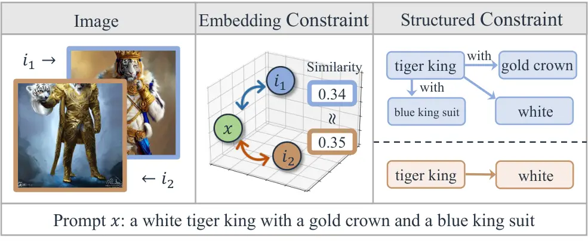
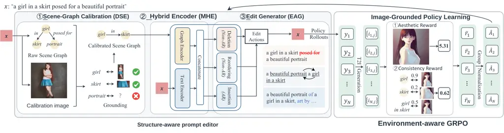
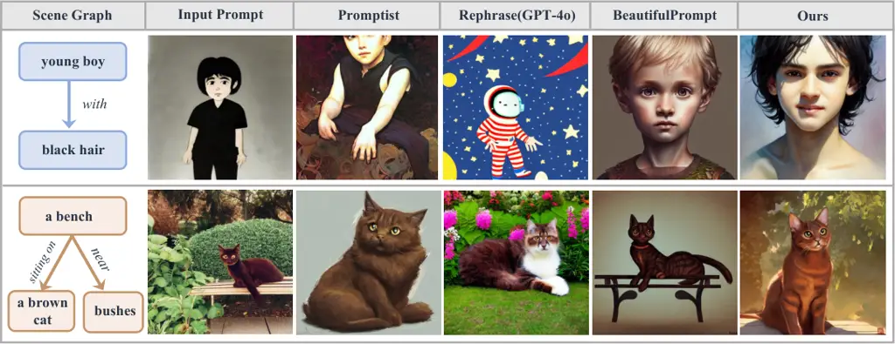
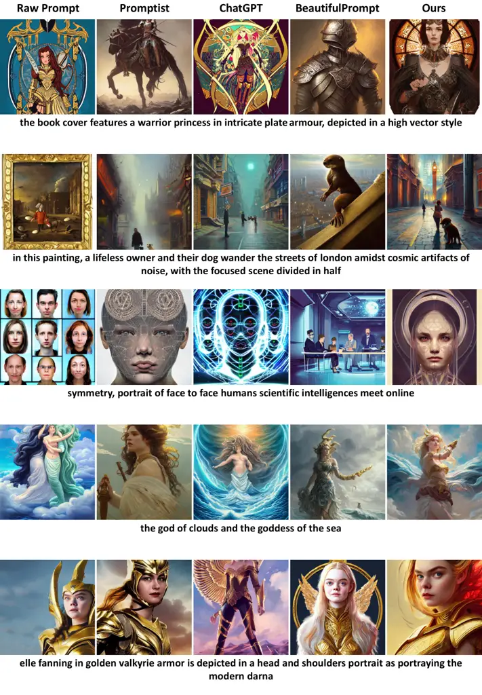

# From Structural Feedback to Prompt Policies: Learning Faithful Text-to-Image Prompt Editors

Wentao Ye   Yali Ye¹¹footnotemark: 1   Zhiqing Xiao¹¹footnotemark: 1
  Ru Peng   Xinpeng Ti ^(†)^(†)thanks: Equal contribution.
Affiliation: Zhejiang University   Tencent AI Lab    Liyao Li   Zhanming
Shen   Peng Lu   Jie Zhang²²footnotemark: 2   Haobo Wang ^(†)^(†)thanks:
Corresponding authors: Peng Lu and Jie Zhang. Affiliation: China Telecom
Artificial Intelligence Technology (Beijing) Co. Ltd

###### Abstract

Prompt optimization should improve the image a user receives without
changing the scene the user requested. Yet stylistic rewriting can
weaken object attributes and relations even when global text–image
similarity remains high. We propose StruPO, a structure-aware prompt
editor that uses a calibrated scene graph as a shared representation for
policy conditioning and image-grounded supervision. The graph exposes
what should be preserved, while deletion, reordering, and insertion
provide a token-aligned way to modify the prompt. This turns structural
feedback from an external critique into a training signal for a reusable
editing policy. Learning from that signal requires handling both
uncertain grounding and stochastic image generation. StruPO retains
grounding confidence through smooth reward shaping and averages multiple
images for each edit before computing group-relative advantages.
Experiments span three disjoint 2K-prompt test sets and four frozen
generation backbones, with comparisons to learned prompt optimizers,
iterative structural feedback, diffusion-model fine-tuning, and
inference-time attention control. StruPO improves the
faithfulness–aesthetics trade-off, with consistent gains in relational
fidelity. Independent automatic evaluators and a 15-annotator study
provide complementary evidence, and human preference margins increase
with relation complexity. Controlled ablations connect these gains to
graph conditioning, local editing, and image-grounded learning. The
resulting policy produces reusable optimized text in one pass after
graph calibration, without an iterative critique–rewrite loop.

## 1 Introduction

Text-to-image (T2I) models such as Stable Diffusion \[1\] and
DALL-E \[2\] have made visual content creation widely accessible, but
the quality of their outputs still depends strongly on prompt
formulation. Users describe what they want to see; generators also
respond to how that intent is expressed through composition, lighting,
and stylistic detail. Automatic prompt optimization bridges this gap by
transforming a user prompt $`x`$ into a generator-effective prompt
$`y`$. Its objective is twofold: improve the resulting image’s
perceptual quality and preserve the scene specified by the user.

These goals need not move together. A rewriter can make a prompt more
vivid while changing which objects appear, which attributes belong to
them, or how they relate. Style-oriented optimizers \[3, 4\] and
embedding-level relevance constraints \[5\] address important parts of
the task, but a high global text–image score can conceal local semantic
failures \[6, 7\]. A tiger with the wrong coat color or without its
requested crown may remain topically similar to the prompt. Figure 1
illustrates why _preserving the scene_ requires a more explicit account
of intent than preserving overall similarity.



Figure 1: Similar global embedding scores can conceal different
structural errors. A scene graph makes object attributes and relations
explicit.

Scene graphs (SGs) express this intent through object phrases and
relations. Complete phrases such as “gold crown” retain attributes,
while edges specify how the objects are connected. Prior methods already
exploit such structure: OPT2I optimizes consistency scores through
iterative prompting \[8\], and VisualPrompter uses atomic visual
feedback to target missing concepts \[9\]. These methods establish the
value of structural diagnosis. The next question is how to turn that
diagnosis into a _learned editing behavior_ that generalizes across
prompts, rather than repeatedly asking an external rewriter to interpret
feedback at test time.

Our central idea is to use _the same structured intent to condition the
editor and to evaluate its consequences_. This connects the information
available when choosing an edit to the object–attribute–relation
constraints checked in the generated image. A graph-conditioned policy
can then learn which textual changes improve rendering while retaining
semantic anchors. Expressing those changes as deletion, reordering, and
insertion further biases the policy toward modifying the input rather
than replacing it wholesale. The benefit is not only fewer test-time
revisions: it is a closer alignment between the representation of user
intent, the granularity of prompt changes, and the feedback used to
learn them.

Making this alignment learnable presents two challenges. First, text
parsers may confuse style or camera descriptions with visible content,
while grounding models provide uncertain evidence about genuine
constraints. Second, image generation is stochastic: two renders of the
same edited prompt can receive different scores. A policy trained on
thresholded, single-image feedback can therefore react to evaluator
discontinuities or rendering noise instead of the quality of an edit.
Graph calibration, confidence-preserving rewards, and environment-sample
averaging address these distinct sources of uncertainty.

We instantiate this approach as StruPO (Structured Prompt Optimization).
A scene-graph extractor calibrates the input structure, a hybrid encoder
exposes text and graph features to the policy, and an edit-action
generator produces the optimized prompt. Supervised fine-tuning provides
an initial editing behavior; image-grounded reinforcement learning then
improves its downstream consequences. Smooth structural rewards retain
grounding confidence, and environment-aware GRPO compares edits after
averaging multiple renders of each candidate. At inference time, one
policy pass follows graph calibration and returns reusable text; the T2I
generator stays frozen.

Our contributions are threefold. First, we develop a structure-aware
editing policy in which calibrated intent is shared between policy
conditioning and image-grounded supervision. Second, we pair
confidence-preserving reward shaping with environment-aware
group-relative optimization, supported by a reward-stability analysis.
Third, we establish the approach’s relation-sensitive benefits through
controlled ablations, cross-backbone transfer, independent evaluators,
and human judgments. The experiments connect improvements to graph
access, local edits, and image feedback, while comparisons with learned
and iterative optimizers characterize the resulting quality–cost
trade-off. Additional evaluator and baseline results are provided in the
appendix.

## 2 Related Work

#### Prompt optimization for T2I generation.

Early work studies how users construct T2I prompts and derives practical
design guidelines \[10, 11\]. Automatic methods optimize prompt tokens
or embeddings through generator gradients in white-box settings \[12,
13\], or learn textual reformulations with supervised fine-tuning \[4,
14\], multimodal supervision \[15, 16\], reinforcement learning \[5\],
and LLM prompting \[17\]. Recent learned optimizers broaden the
objective beyond style: PAE learns modifiers together with token weights
and denoising-time ranges \[18\], while RePrompt uses GRPO to train
reasoning-augmented reprompting from image-level feedback \[19\]. StruPO
focuses on a complementary design choice: sharing a calibrated scene
graph between the editor’s input and its atomic grounding reward, then
learning token-aligned edits from that feedback. Appendix G.3 compares
PAE and RePrompt under matched SD v1.5/Lexica evaluation.

#### Structure-aware feedback for prompt optimization.

OPT2I iteratively revises prompts to maximize consistency, including
Davidsonian scene-graph (DSG) scores \[8\]. VisualPrompter decomposes
prompts into atomic concepts, identifies missing content through visual
feedback, and performs targeted refinement without training \[9\]. Both
demonstrate that structural feedback can improve prompt–image alignment.
StruPO learns a reusable editor from this type of feedback: the graph
conditions its decisions, and image-grounded rewards evaluate the edited
prompt against the same constraints. The distinction is thus learned
graph-conditioned editing versus test-time feedback-driven revision.
Appendix G.7 compares the resulting policy with a three-round GPT-4o
structural-feedback system on the full 2K-prompt Lexica test set.

#### Scene graphs and fine-grained T2I evaluation.

Scene graphs represent objects and pairwise relations \[20, 21\]. Image
scene-graph generation combines object detection with contextual
relation reasoning \[22, 23, 24, 25\]; language-supervised systems
extend grounding to open-vocabulary concepts \[26, 27\]. For T2I
evaluation, DSG \[6\] decomposes semantic correctness into dependent
atomic questions, exposing failures that global similarity can miss.
StruPO uses object and relation grounding for policy learning while
retaining attribute-bearing phrases in both graph features and grounding
queries. We assess this learned objective with held-out OR/RR, and
complement it with Gemini-VQA, human judgments, and independent
evaluators (Appendix G.2).

#### Text editing and broader faithfulness interventions.

Explicit text editors decompose rewriting into deletion, reordering, and
insertion \[28, 29\], providing a token-level link between an input and
its revision. StruPO adapts this action representation to
graph-conditioned, image-grounded prompt optimization. Related
approaches intervene elsewhere in the generation process: DPOK updates
diffusion-model parameters \[30\], and Attend-and-Excite adjusts the
latent trajectory using attention-based guidance \[31\]. These
approaches expose different control and access requirements.
Appendix G.6 compares their quality, offline cost, and per-image
interventions with the reusable-text interface of StruPO.

## 3 Proposed Method: StruPO

#### Problem formulation.

Let $`g`$ denote a frozen T2I generator. Given a user prompt $`x`$,
prompt optimization learns a policy $`\pi_{\theta}`$ that produces an
optimized prompt $`y`$ such that images $`i_{y}\sim g(y)`$ improve
perceptual quality while preserving the semantic intent of $`x`$. We
formulate structure-aware prompt optimization as a single-step
reinforcement-learning problem, or contextual bandit \[32\]. A
calibrated scene graph $`G_{x}=(O_{x},V_{x})`$ represents object
phrases, including their attributes, and relation triplets. The same
$`G_{x}`$ conditions the policy and specifies the constraints used to
score its output. The policy samples an edit-action sequence
$`a\sim\pi_{\theta}(\cdot\mid x,G_{x})`$ and deterministically applies
it to obtain $`y`$. The environment then renders $`i_{y}\sim g(y)`$ and
returns an image-grounded scalar reward $`r_{x,y}`$. The learning
objective is $`\mathcal{J}(\theta)=\mathbb{E}_{x,a,i_{y}}[r_{x,y}]`$.
Here, “single-step” refers to one complete prompt edit and its image
reward, not to the token-level decoding steps within the editor.



Figure 2: Overview of StruPO. Calibrated structural intent conditions
the DSE–MHE–EAG editor and defines image-grounded consistency feedback.
Environment-aware GRPO averages renders of each candidate before
comparing edit rollouts.

### 3.1 Scene-Graph-Aware Prompt Editing Policy

Figure 2 separates three roles: scene-graph extraction and calibration
(DSE) establish the structural context; a multimodal hybrid encoder
(MHE) makes it available to the policy; and an edit action generator
(EAG) turns it into prompt changes. Together, they connect the user’s
semantic anchors to the decisions optimized by the image-grounded
reward.

#### Scene-graph extraction and calibration (DSE).

DSE constructs a calibrated scene graph $`G_{x}=(O_{x},V_{x})`$ from the
input prompt $`x`$. A language parser first produces a coarse graph
$`\tilde{G}_{x}=(\tilde{O}_{x},\tilde{V}_{x})`$, but text-only parsing
can introduce artifacts. For example, in “a girl photographed with a
Leica lens,” the phrase “Leica lens” may be misinterpreted as a visible
object rather than a photographic condition.

DSE uses one image $`i_{x}\sim g(x)`$ to help identify ambiguous parser
outputs. Parsed elements are partitioned into _text-core_ elements and
_auxiliary_ elements. Text-core objects are explicit syntactic heads or
entities participating in relations; auxiliary elements are ambiguous
noun phrases that often describe style, camera, or medium. Visual
evidence filters auxiliary elements, while text-core elements are
retained even when the initial image fails to render them. Thus, a
missing requested object remains a constraint for subsequent
optimization; an ambiguous camera or style phrase can be removed from
the graph.

Object grounding uses GLIP \[26\]. Let $`C_{\mathrm{GLIP}}(i_{x})`$
denote the detected open-vocabulary labels, and let
$`\tilde{O}_{x}^{\mathrm{core}}`$ and $`\tilde{O}_{x}^{\mathrm{aux}}`$
denote the core and auxiliary object sets. We construct

```math
O_{x}=\tilde{O}_{x}^{\mathrm{core}}\cup\{o\in\tilde{O}_{x}^{\mathrm{aux}}\mid o\in C_{\mathrm{GLIP}}(i_{x})\}.
```

For relation grounding, write each triplet as
$`v=(o_{\mathrm{sub}},p,o_{\mathrm{obj}})`$, where $`p`$ is the
predicate. Given endpoint boxes, we crop their minimal enclosing patch
$`\gamma^{v}_{i_{x}}`$ and query BLIP \[33\] with
$`q_{v}=o_{\mathrm{sub}}\oplus p\oplus o_{\mathrm{obj}}`$. Core
relations are retained, whereas auxiliary relations require positive
visual support:

```math
V_{x}=\{v\in\tilde{V}_{x}\mid o_{\mathrm{sub}},o_{\mathrm{obj}}\in O_{x},\;v\in\tilde{V}_{x}^{\mathrm{core}}\ \text{or}\ P_{V}(\mathrm{Yes}\mid q_{v},\gamma^{v}_{i_{x}})>0.5\}.
```

Attributes are represented explicitly through complete phrases rather
than separate typed nodes: modifiers remain attached in object labels or
relation arguments, e.g., “black hair,” “gold crown,” and “blue king
suit.” The same attribute-bearing phrases are therefore available to
policy conditioning and image grounding. Appendix G.4 isolates this
pathway, while Appendix G.9 evaluates DSE under injected parser noise.

#### Multimodal hybrid encoder (MHE).

MHE maps the prompt and SG into a shared representation. A frozen CLIP
text encoder \[34\] produces token-level features
$`f_{\mathrm{text}}(x)\in\mathbb{R}^{l\times d}`$. Each object phrase
and serialized relation query $`q_{v}`$ is encoded by the same text
encoder, with the \[EOS\] embedding used as the initial representation
of a graph element. A two-layer GCN propagates information over the
topology induced by $`V_{x}`$, producing
$`f_{\mathrm{graph}}(G_{x})\in\mathbb{R}^{n\times d}`$ for
$`n=|O_{x}|+|V_{x}|`$. The editor receives the concatenated
representation
$`f(x,G_{x})=f_{\mathrm{text}}(x)\oplus f_{\mathrm{graph}}(G_{x})`$.
This representation supplies token detail and graph context to the same
editor. Appendix G.5 evaluates encoder sensitivity with a T5 replacement
and a CLIP-free training variant.

#### Edit action generator (EAG).

Represent $`x`$ as a token sequence $`\{t_{j}\}_{j=1}^{l}`$, with
special start and end tokens. EAG predicts a compositional edit sequence
from $`f(x,G_{x})`$. Following explicit text-editing models \[28, 29\],
the actions are applied in the order illustrated in Figure 3: deletion,
reordering, and insertion.

Figure 3: The three edit operations used by EAG. Tokens are first
retained or deleted, the retained subsequence is reordered, and new
tokens are inserted into the resulting slots.

- •
  Deletion. For each token $`t_{j}`$, the deletion policy samples
  $`\delta_{j}\in\{0,1\}`$ from
  $`\pi_{\theta_{1}}^{\mathrm{del}}(\delta_{j}\mid j,f(x,G_{x}))`$,
  where $`1`$ retains the token and $`0`$ removes it. Boundary tokens
  are fixed.
- •
  Reordering. Let $`x_{\mathrm{del}}=\{t_{j}\}_{j=1}^{l^{\prime}}`$ be
  the retained sequence. For each $`j<l^{\prime}`$, the reordering
  policy predicts the successor distribution
  $`\pi_{\theta_{2}}^{\mathrm{reo}}(\rho_{j}=k\mid j,x_{\mathrm{del}},f(x,G_{x}))`$.
  A complete successor assignment induces a permutation decoded by beam
  search.
- •
  Insertion. Given the reordered sequence $`x_{\mathrm{reo}}`$, the
  insertion policy $`\pi_{\theta_{3}}^{\mathrm{ins}}`$ autoregressively
  samples new tokens or \[BOS\] slot markers. Retained tokens are filled
  into these slots in order, yielding the optimized prompt $`y`$.

The complete action is $`a=(\delta,\rho,\tau)`$. Deletion and reordering
are decoded non-autoregressively, while insertion is autoregressive.
This semi-autoregressive parameterization preserves an explicit
correspondence to retained input tokens while allowing new phrasing and
style. It is an inductive bias toward conservative edits, not a hard
guarantee that every constraint is preserved; the image reward
determines which edits are reinforced.

### 3.2 Policy Training

Training first teaches the policy how to express prompt revisions, then
which revisions improve images. Supervised fine-tuning (SFT) warm-starts
the editor from input–target pairs, and on-policy RL optimizes the
rendered outcomes.

#### Supervised fine-tuning.

For a paired dataset $`\mathcal{D}=\{(x,y)\}`$, token alignment yields a
target edit sequence $`a^{\star}(x,y)`$: unmatched input tokens define
deletions, retained tokens define successor pointers, and unmatched
output tokens define insertions. We minimize
$`\mathcal{L}_{\mathrm{SFT}}=-\mathbb{E}_{(x,y)\in\mathcal{D}}\log\pi_{\theta}(a^{\star}(x,y)\mid x,G_{x})`$.

#### Uncertainty-aware reward shaping.

The reward combines structured consistency, aesthetic quality, and
coarse image–text consistency. A common discrete structural score has
the form $`\mathbb{E}_{z\in G_{x}}\mathds{1}[P(z\mid i_{y})\geq u]`$,
where $`z`$ is an object or relation and $`u\in(0,1)`$ is a fixed
threshold. A small confidence change near $`u`$ can flip a constraint’s
contribution, whereas an improvement away from $`u`$ receives no credit.
We instead retain grounding confidence. For $`K=|O_{x}|+|V_{x}|\geq 1`$
constraints and confidence vector $`p(I)\in[0,1]^{K}`$, define the
unshaped score $`R_{s}(I)=K^{-1}\sum_{k}p_{k}(I)`$. The following result
characterizes its sensitivity to grounding perturbations.

###### Theorem 3.1.

For a rollout observation $`I=(a,i_{y})`$, let
$`\widehat{\nabla}J(\theta;I)=\Psi(\theta;I)R_{s}(I)`$, where
$`\Psi(\theta;I)=\nabla_{\theta}\log\pi_{\theta}(a\mid x,G_{x})`$. For
any two rollouts $`I,I^{\prime}`$ under the same context $`(x,G_{x})`$,

```math
\|\widehat{\nabla}J(\theta;I)-\widehat{\nabla}J(\theta;I^{\prime})\|\leq\|\Psi(\theta;I)-\Psi(\theta;I^{\prime})\|+\frac{\|\Psi(\theta;I)\|}{K}\|p(I)-p(I^{\prime})\|_{1}.
```

A thresholded score generally has no uniform finite Lipschitz bound at
$`u`$.

Theorem 3.1 separates changes in the policy score function from changes
in grounding confidence. For a fixed edit, the first term vanishes:
confidence perturbations affect the gradient contribution continuously.
Appendix B gives the proof and a reward-variation bound.

In training, we use the monotone clipped-log transform
$`\phi(t)=[\log(\max\{t,\eta\})]_{c_{\min}}^{c_{\max}}`$, with
$`\eta>0`$ and $`[s]_{a}^{b}=\min\{b,\max\{a,s\}\}`$. This bounded
transform retains a finite Lipschitz constant (Appendix B); its
constants are fixed on validation data. The structured reward is

```math
r_{x,y}^{\mathrm{con}}=\frac{\sum_{o\in O_{x}}\phi(P_{O}(o\mid i_{y}))+\sum_{v\in V_{x}}\phi(P_{V}(\mathrm{Yes}\mid q_{v},\gamma^{v}_{i_{y}}))}{\max(1,K)}.
```

GLIP supplies object-phrase confidence and BLIP verifies
relation-specific crops, so atomic consistency is scored independently
of CLIP. Two frozen auxiliary rewards complete the objective. Following
Promptist \[5\], $`r_{x,y}^{\mathrm{aes}}`$ uses the released improved
aesthetic predictor, and $`r_{x,y}^{\mathrm{CLIP}}`$ regularizes global
prompt–image consistency. The final reward is
$`r_{x,y}=\alpha_{1}r_{x,y}^{\mathrm{con}}+\alpha_{2}r_{x,y}^{\mathrm{aes}}+\alpha_{3}r_{x,y}^{\mathrm{CLIP}}`$,
with weights selected on a disjoint validation split. Appendix C gives
the predictor specification and reward weights.

#### Environment-aware GRPO.

We optimize the policy with GRPO \[35\]. Rendering remains stochastic
even when grounding scores are smoothed. To compare edits rather than
individual lucky or unlucky renders, we average environment samples
before group normalization. For each prompt $`x`$, we sample $`N`$ edit
rollouts $`a_{i}\sim\pi_{\theta_{\mathrm{old}}}(\cdot\mid x,G_{x})`$.
For every $`a_{i}`$, we render $`M`$ images, obtain rewards $`r_{i,j}`$,
and compute $`\bar{r}_{i}=M^{-1}\sum_{j=1}^{M}r_{i,j}`$. The normalized
advantage is
$`\widehat{A}_{i}=(\bar{r}_{i}-\operatorname{mean}_{k}\bar{r}_{k})/(\operatorname{std}_{k}\bar{r}_{k}+\epsilon_{A})`$.
The clipped objective is

```math
\displaystyle\mathcal{J}_{\mathrm{GRPO}}(\theta)=\mathbb{E}\frac{1}{N}\sum_{i}\Big[\min\big(w_{i}\widehat{A}_{i},\operatorname{clip}(w_{i},1-\epsilon,1+\epsilon)\widehat{A}_{i}\big)-\beta D_{\mathrm{KL}}(\pi_{\theta}\|\pi_{\mathrm{ref}})+\lambda\mathcal{H}(\pi_{\theta})\Big], \tag{1}
```

where
$`w_{i}=\pi_{\theta}(a_{i}\mid x,G_{x})/\pi_{\theta_{\mathrm{old}}}(a_{i}\mid x,G_{x})`$.
The KL term anchors the policy to its SFT reference, while entropy
regularization maintains exploration. Smoothing controls sensitivity
within a render; multi-image averaging reduces sampling variation across
renders of the same edit. Algorithm 1 in Appendix A.4 gives the complete
training procedure.

## 4 Experiments

### 4.1 Experimental Settings

#### Data collection.

For SFT, we collect 72K optimized prompts from Lexica as targets.
Following Promptist \[5\], each optimized prompt is converted into two
input variants: (i) a semantic skeleton obtained by removing stylistic
modifiers and (ii) a GPT-4o rewrite of that skeleton. This procedure
yields 144K input–target pairs. SFT uses the full paired set, whereas RL
uses 24K input prompts sampled from the training split without access to
their targets. Evaluation uses three disjoint test sets: Lexica and
DiffusionDB \[36\] as in-domain prompt-optimization distributions, and
COCO captions \[37\] as an out-of-domain distribution. Each test set
contains 2K prompts and is disjoint from training, validation, and
hyperparameter selection.

#### Implementation details.

Unless stated otherwise, we use GLIP-T \[26\] for object grounding,
BLIP-base \[33\] for relation verification, Stable Diffusion v1.5 \[1\]
as the default generator, and CLIP ViT-L/14 \[34\] as the frozen text
encoder. The edit policy is initialized from BART-base \[38\]; the graph
encoder is a two-layer GCN with hidden size 768. Grounding models, CLIP,
and the T2I generator remain frozen, and only the GCN and editing policy
are updated. We use AdamW \[39\] with learning rate $`2\times 10^{-5}`$.
SFT runs for approximately 50 epochs, followed by 24K RL prompts
organized into 6K updates. Each RL context samples $`N=4`$ policy
rollouts and $`M=3`$ images per rollout. Hyperparameters are selected
once on a held-out Lexica validation split and then fixed across all
test distributions and generation backbones. Appendix C provides model
versions, the aesthetic-predictor checkpoint and architecture,
optimization settings, and compute accounting.

#### Evaluation protocol.

We evaluate perceptual quality and semantic faithfulness. AES\_(Δ)
denotes the change in the frozen aesthetic score relative to the raw
prompt. For structured consistency, we evaluate held-out images with
thresholded grounding rather than the smoothed training reward,
reporting object recall (OR), relation recall (RR), and
$`\mathrm{SGR}=(\mathrm{OR}+\mathrm{RR})/2`$. Unless noted, each score
averages three matched-seed generations per prompt. We compare StruPO
with template prompting \[40\], learned LM optimizers (Promptist \[5\],
MagicPrompt \[3\], and BeautifulPrompt \[4\]), structure-aware feedback
prompting (VisualPrompter \[9\]), GPT rephrasing and few-shot prompting,
and human-crafted target prompts when available. The Template baseline
appends a universal style-only suffix while leaving semantic content
unchanged, so it serves as a near-original-prompt reference. OR/RR
measure generalization on the trained structural objective; Gemini-VQA
and human judgments assess faithfulness through separate evaluators.
TIFA, VQAScore, ImageReward, HPSv2.1, and further evaluation details
appear in Appendix G.2.

### 4.2 Main Results

We first evaluate the quality–faithfulness trade-off, then test transfer
across generators and perceptibility to human annotators. The ablations
that follow isolate the representation and learning choices behind these
outcomes.

| Method             | Lexica: In-domain |       |       |        |        | DiffusionDB: In-domain |       |       |        | COCO: Out-of-domain |       |       |        |
| ------------------ | ----------------- | ----- | ----- | ------ | ------ | ---------------------- | ----- | ----- | ------ | ------------------- | ----- | ----- | ------ |
|                    | AES\_(Δ)          | OR(%) | RR(%) | SGR(%) | Gemini | AES\_(Δ)               | OR(%) | RR(%) | SGR(%) | AES\_(Δ)            | OR(%) | RR(%) | SGR(%) |
| Template           | 0.53              | 89.50 | 59.63 | 74.57  | 77.6   | 0.75                   | 91.03 | 62.65 | 76.84  | 0.68                | 90.18 | 65.02 | 77.60  |
| Promptist          | 0.48              | 89.55 | 61.25 | 75.40  | 79.5   | 0.64                   | 92.17 | 60.14 | 76.16  | 0.80                | 90.06 | 64.61 | 77.33  |
| MagicPrompt        | 0.46              | 89.50 | 61.67 | 75.59  | 78.1   | 0.62                   | 92.75 | 58.92 | 75.84  | 0.67                | 89.17 | 59.12 | 74.14  |
| Human-crafted      | 0.54              | 89.19 | 56.31 | 72.75  | 78.2   | 0.42                   | 92.32 | 59.44 | 75.88  | –                   | –     | –     | –      |
| VisualPrompter     | 0.62              | 90.26 | 53.49 | 71.88  | 79.2   | 0.33                   | 83.11 | 23.43 | 53.27  | -0.36               | 90.50 | 76.01 | 83.26  |
| BeautifulPrompt    | 0.57              | 85.70 | 39.85 | 62.78  | 73.8   | 0.79                   | 89.37 | 37.61 | 63.49  | 0.69                | 81.91 | 35.27 | 58.59  |
| Rephrase (GPT-3.5) | 0.43              | 89.82 | 61.68 | 75.74  | 78.4   | 0.59                   | 91.73 | 62.42 | 77.07  | 0.54                | 89.54 | 63.54 | 76.54  |
| Rephrase (GPT-4o)  | 0.44              | 88.38 | 55.52 | 71.95  | 78.6   | 0.63                   | 91.82 | 56.13 | 73.97  | 0.67                | 90.53 | 66.95 | 78.74  |
| Few-shot (GPT-4o)  | 0.51              | 89.27 | 60.58 | 74.92  | 78.0   | 0.66                   | 90.95 | 62.75 | 76.85  | 0.67                | 90.38 | 66.57 | 78.48  |
| StruPO (Ours)      | 0.63              | 91.84 | 69.64 | 80.74  | 82.4   | 0.91                   | 92.94 | 65.49 | 79.22  | 1.02                | 91.28 | 66.59 | 78.94  |

Table 1: Overall performance with Stable Diffusion v1.5. Gemini-VQA is
evaluated on Lexica only and is never used for training or model
selection. Best values are bold. VisualPrompter attains the highest COCO
SGR but decreases aesthetics; StruPO obtains the strongest in-domain
faithfulness–aesthetics trade-off and the largest AES\_(Δ) on all three
datasets.

Table 1 shows that the clearest gains arise in relation recall. On
Lexica, StruPO improves RR by 7.96 points over the best listed baseline
and raises SGR to 80.74 while also improving aesthetics. On DiffusionDB,
it achieves the best AES\_(Δ), OR, RR, and SGR. The larger separation in
RR than in OR matches the method’s emphasis: retaining object words
alone does not preserve the relations between them. The held-out
Gemini-VQA column follows the same Lexica trend and ranks StruPO
highest, complementing the more localized grounding metrics.

On out-of-domain COCO, the methods occupy different operating points.
VisualPrompter obtains the highest SGR, driven by RR, but its aesthetic
score decreases by 0.36. In contrast, StruPO yields the largest
aesthetic improvement and retains structured consistency comparable to
the GPT-4o baselines. The pattern separates aesthetic improvement from
literal constraint satisfaction: VisualPrompter favors relation recall,
whereas StruPO combines a positive aesthetic shift with competitive
consistency. The independent metrics in Appendix G.2 show the same
distinction on COCO.

#### Generalization across T2I backbones.

| Method            | Stable Diffusion v1.4 |       |       |        | Stable Diffusion v2.1 |       |       |        | FLUX.1-dev |       |       |        |
| ----------------- | --------------------- | ----- | ----- | ------ | --------------------- | ----- | ----- | ------ | ---------- | ----- | ----- | ------ |
|                   | AES\_(Δ)              | OR(%) | RR(%) | SGR(%) | AES\_(Δ)              | OR(%) | RR(%) | SGR(%) | AES\_(Δ)   | OR(%) | RR(%) | SGR(%) |
| Template          | .53                   | 89.19 | 58.38 | 73.78  | .33                   | 88.02 | 59.25 | 73.64  | .83        | 87.88 | 46.03 | 66.96  |
| Promptist         | .47                   | 89.75 | 60.64 | 75.19  | .34                   | 87.75 | 59.57 | 73.66  | .88        | 90.17 | 53.41 | 71.79  |
| MagicPrompt       | .48                   | 89.44 | 60.18 | 74.81  | .32                   | 87.98 | 55.65 | 71.81  | .82        | 90.16 | 52.81 | 71.48  |
| Human-crafted     | .56                   | 89.56 | 59.48 | 74.52  | .39                   | 87.75 | 54.28 | 71.01  | .62        | 87.92 | 49.55 | 68.74  |
| VisualPrompter    | .62                   | 88.10 | 47.05 | 67.57  | .62                   | 88.07 | 46.70 | 67.38  | .63        | 88.08 | 46.53 | 67.31  |
| BeautifulPrompt   | .59                   | 85.90 | 41.05 | 63.47  | .42                   | 84.24 | 37.54 | 60.89  | .94        | 89.83 | 30.73 | 60.28  |
| Few-shot (GPT-4o) | .44                   | 89.05 | 59.13 | 74.09  | .29                   | 87.65 | 55.73 | 71.69  | .83        | 87.82 | 46.99 | 67.41  |
| StruPO (Ours)     | .68                   | 89.18 | 61.82 | 75.50  | .46                   | 89.14 | 61.57 | 75.36  | 1.14       | 91.41 | 62.43 | 76.92  |

Table 2: Transferability across T2I backbones on Lexica. The editor is
trained with SD v1.5 feedback and evaluated without retraining on SD
v1.4, SD v2.1, and FLUX.1-dev.

Table 2 tests whether the learned editor overfits to idiosyncrasies of
SD v1.5. Without retraining, StruPO achieves the highest RR and SGR on
all three unseen generators. On FLUX.1-dev, for example, RR is 62.43
versus Promptist’s 53.41, alongside a larger aesthetic gain.
VisualPrompter has higher AES\_(Δ) on SD v2.1, while StruPO has higher
structural recall. This transfer pattern supports reuse of the learned
textual edits across generators.

#### Human evaluation.

We conduct a pairwise study with 15 annotators over all 2K Lexica
prompts. Annotators see the original prompt and two anonymized
matched-seed images in randomized left–right order, then judge
aesthetics and semantic consistency separately. Annotators can select a
tie when neither image is preferable; ties are retained without a
secondary tie-breaking rule. We aggregate each pair by majority vote.
Agreement is moderate, with Fleiss’ $`\kappa=.40`$ for aesthetics and
$`.43`$ for consistency. Table 3 reports the resulting win/tie/loss
percentages for StruPO.

| Comparison                 | Aesthetics (win/tie/loss) | Consistency (win/tie/loss) |
| -------------------------- | ------------------------- | -------------------------- |
| StruPO vs. Promptist       |                           |                            |
| StruPO vs. MagicPrompt     |                           |                            |
| StruPO vs. VisualPrompter  |                           |                            |
| StruPO vs. BeautifulPrompt |                           |                            |
| StruPO vs. Few-shot GPT-4o |                           |                            |

Table 3: Human preference on Lexica. Bars show StruPO wins (blue), ties
(gray), and losses (sand), from left to right, with the percentages
printed in each segment.

In Table 3, StruPO has a positive win–loss margin for both criteria
against all five comparators. Consistency margins against Promptist,
VisualPrompter, and few-shot GPT-4o are $`+9`$, $`+10`$, and $`+7`$
percentage points, respectively, with ties in 23–37% of comparisons. All
three margins have positive 95% confidence intervals. Crucially, the
advantage becomes more perceptible as relations accumulate: from
$`|V_{x}|=1`$ to $`|V_{x}|\geq 3`$, the corresponding margins rise from
$`+6`$ to $`+16`$, $`+6`$ to $`+17`$, and $`+3`$ to $`+14`$ points. This
links the human result to the compositional difficulty targeted by the
method. Appendix D.2 reports confidence intervals, sign tests,
forced-choice replication, and the DiffusionDB/COCO studies.

### 4.3 Ablation Study

| Variant                  | DSE | MHE | EAG | AES\_(Δ) | OR    | RR    | SGR   |
| ------------------------ | --- | --- | --- | -------- | ----- | ----- | ----- |
| StruPO                   | ✓   | ✓   | ✓   | .63      | 91.84 | 69.64 | 80.74 |
| w/o DSE                  | ✗   | ✓   | ✓   | .64      | 89.24 | 58.14 | 73.69 |
| w/o MHE                  | ✓   | ✗   | ✓   | .65      | 89.25 | 61.41 | 75.33 |
| w/o EAG                  | ✓   | ✓   | ✗   | .57      | 88.92 | 58.44 | 73.68 |
| w/o RL                   | ✓   | ✓   | ✓   | .57      | 89.52 | 58.55 | 74.04 |
| w/o $`r^{\mathrm{con}}`$ | ✓   | ✓   | ✓   | .68      | 89.19 | 61.08 | 75.14 |

Table 4: Ablation study on Lexica. DSE, MHE, and EAG test the
architecture; “w/o RL” and “w/o $`r^{\mathrm{con}}`$” test
image-grounded optimization. The w/o-EAG variant replaces local editing
with free-form autoregressive generation while retaining the calibrated
SG, reward, and GRPO.

Table 4 tests whether the gains depend on structural input, the editing
parameterization, and image feedback. Removing DSE introduces
uncalibrated parser noise and reduces SGR by 7.05 points. Removing MHE
prevents the editor from directly observing graph structure and lowers
SGR by 5.41 points. Replacing EAG with unrestricted generation causes a
7.06-point drop despite retaining graph conditioning, the reward, and
GRPO. Thus, the action representation contributes beyond simply
supplying a structural reward to a rewriter. Removing RL lowers SGR by
6.70 points, showing the benefit of optimizing rendered outcomes beyond
supervised imitation. Removing $`r^{\mathrm{con}}`$ increases aesthetics
slightly but lowers SGR by 5.60 points, separating visual appeal from
structural fidelity. Attribute-specific, CLIP-sensitivity,
reward-weight, and parser-perturbation ablations appear in
Appendices G.4, G.5, G.8, and G.9, respectively.

#### Effect of constraint complexity.

(a) Object complexity.

(b) Relation complexity.

Figure 4: Performance by constraint complexity on Lexica. Object and
relation counts define separate partitions; methods share prompts and
image seeds within each bucket.

Figure 4 evaluates robustness to increasingly dense semantic
constraints. In panel 4(a), OR declines for every method as the object
count grows, but StruPO shows the smallest degradation. Panel 4(b) is
more revealing: generic rewriting methods fluctuate substantially as
relation count changes, whereas StruPO remains close to 70% RR across
all three buckets. The larger human preference margins in the
high-relation bucket (Table 12) provide a perceptual counterpart to this
structural robustness.

#### Additional analyses.

Matched learned and iterative baselines test the policy against
alternative ways of using image feedback. Attribute/CLIP and reward/DSE
diagnostics examine the structural pathway, while runtime and failure
analyses characterize deployment trade-offs (Appendices G.2–G.12).

### 4.4 Qualitative Analysis



Figure 5: Representative SD v1.5 comparisons. StruPO better preserves
attribute-bearing phrases and object–relation constraints while
maintaining visual quality.

Figure 5 illustrates the semantic differences reflected in the aggregate
scores. In the first case, several baselines omit or alter “black hair,”
either changing the attribute or the subject itself. In the second,
baselines miss an object or fail to place the objects in the requested
relation. The resulting images may remain individually plausible and
topically relevant, yet they are not equally faithful to the user’s
structured intent. The graphs make these differences explicit: modifier
attachment and relation direction remain identifiable even when all
images depict a plausible scene. In these cases, StruPO retains the
relevant phrases and relations while adding visual detail. The examples
complement the ablations by showing the kinds of local semantic errors
that aggregate object recall alone can obscure.

## 5 Conclusions and Limitations

StruPO learns faithful prompt editing by sharing calibrated structural
intent between policy conditioning and image-grounded supervision. Local
edit actions preserve a token-level connection to the user’s
description, while confidence-preserving rewards and environment-aware
GRPO make noisy structural feedback usable for optimization. Across
prompt distributions and frozen T2I backbones, the resulting policy
improves the faithfulness–aesthetics trade-off, with the most consistent
gains in relations. Controlled ablations connect these gains to the
graph, action representation, and image feedback; independent evaluators
and human judgments provide complementary evidence. The broader lesson
is that structural feedback can shape how a prompt policy learns, not
merely how its outputs are scored. After graph calibration, the editor
returns reusable optimized text in one pass, linking relation-sensitive
quality to a practical frozen-generator interface.

#### Limitations.

The approach depends on parser, grounding, and generator quality.
Attribute-bearing phrases capture local modifiers, but object–relation
graphs are less expressive for counting, occlusion, negation, emotion,
metaphor, and other abstract intent. Conservative editing can also be
too restrictive when a prompt needs global reformulation; the long-input
and dense-scene analyses expose these limits. Multi-image averaging
increases offline training cost, and inference includes an initial
calibration render in addition to the final image. Transfer does not
remove the capabilities or biases of the underlying generator, and the
studied English prompt distributions do not establish multilingual
coverage. Richer constraint representations and adaptive editing
strategies are promising next steps, alongside broader human evaluation
of which semantic differences matter in practice.

## Acknowledgments and Disclosure of Funding

This work was also supported by the Noncommunicable Chronic
Diseases-National Science and Technology Major Project (Grant
No. 2026ZD0558202). Haobo Wang is also supported by the Ningbo Yongjiang
Talent Introduction Programme (No. 2023A-399-G).

## References

- \[1\] R. Rombach, A. Blattmann, D. Lorenz, P. Esser, and B.
  Ommer (2022) High-resolution image synthesis with latent diffusion
  models. In Proceedings of the IEEE/CVF conference on computer vision
  and pattern recognition, pp. 10684–10695. Cited by: §1, §4.1.
- \[2\] J. Betker, G. Goh, L. Jing, T. Brooks, J. Wang, L. Li, L.
  Ouyang, J. Zhuang, J. Lee, Y. Guo, et al. (2023) Improving image
  generation with better captions. Computer Science. https://cdn.
  openai. com/papers/dall-e-3. pdf 2 (3). Cited by: §1.
- \[3\] (2023) MagicPrompt. External Links:
  [Link](https://github.com/XpycT/MagicPrompt) Cited by: §D.1, §1, §4.1.
- \[4\] T. Cao, C. Wang, B. Liu, Z. Wu, J. Zhu, and J. Huang (2023)
  BeautifulPrompt: towards automatic prompt engineering for
  text-to-image synthesis. arXiv preprint arXiv:2311.06752. Cited by:
  Table 26, §1, §2, §4.1.
- \[5\] Y. Hao, Z. Chi, L. Dong, and F. Wei (2023) Optimizing prompts
  for text-to-image generation. In Advances in Neural Information
  Processing Systems, Vol. 36, pp. 66923–66939. Cited by: Table 26, §1,
  §2, §3.2, §4.1, §4.1.
- \[6\] J. Cho, Y. Hu, J. M. Baldridge, R. Garg, P. Anderson, R.
  Krishna, M. Bansal, J. Pont-Tuset, and S. Wang (2024) Davidsonian
  scene graph: improving reliability in fine-grained evaluation for
  text-to-image generation. In International Conference on Learning
  Representations, External Links:
  [Link](https://openreview.net/forum?id=ITq4ZRUT4a) Cited by: §1, §2.
- \[7\] Z. Ma, J. Hong, M. O. Gul, M. Gandhi, I. Gao, and R.
  Krishna (2023) CREPE: can vision-language foundation models reason
  compositionally?. In Proceedings of the IEEE/CVF Conference on
  Computer Vision and Pattern Recognition, pp. 10910–10921. Cited by:
  §1.
- \[8\] O. Mañas, P. Astolfi, M. Hall, C. Ross, J. Urbanek, A.
  Williams, A. Agrawal, A. Romero-Soriano, and M. Drozdzal (2024)
  Improving text-to-image consistency via automatic prompt optimization.
  Transactions on Machine Learning Research. Cited by: Table 26, §1, §2.
- \[9\] S. Wu, M. Sun, W. Wang, Y. Wang, and J. Liu (2026)
  VisualPrompter: semantic-aware prompt optimization with visual
  feedback for text-to-image synthesis. In International Conference on
  Learning Representations, Cited by: Table 26, §1, §2, §4.1.
- \[10\] Y. Xie, Z. Pan, J. Ma, L. Jie, and Q. Mei (2023) A prompt log
  analysis of text-to-image generation systems. In Proceedings of the
  ACM Web Conference 2023, pp. 3892–3902. Cited by: §2.
- \[11\] V. Liu and L. B. Chilton (2022) Design guidelines for prompt
  engineering text-to-image generative models. In Proceedings of the
  2022 CHI Conference on Human Factors in Computing Systems, pp. 1–23.
  Cited by: §2.
- \[12\] Y. Wen, N. Jain, J. Kirchenbauer, M. Goldblum, J. Geiping,
  and T. Goldstein (2024) Hard prompts made easy: gradient-based
  discrete optimization for prompt tuning and discovery. Advances in
  Neural Information Processing Systems 36. Cited by: §2.
- \[13\] N. Deckers, J. Peters, and M. Potthast (2023) Manipulating
  embeddings of stable diffusion prompts. arXiv preprint
  arXiv:2308.12059. Cited by: §2.
- \[14\] S. Rosenman, V. Lal, and P. Howard (2023) NeuroPrompts: an
  adaptive framework to optimize prompts for text-to-image generation.
  arXiv preprint arXiv:2311.12229. Cited by: §2.
- \[15\] R. Peng, Y. Zeng, and J. Zhao (2022) Distill the image to
  nowhere: inversion knowledge distillation for multimodal machine
  translation. In Proceedings of the 2022 Conference on Empirical
  Methods in Natural Language Processing, pp. 2379–2390. Cited by: §2.
- \[16\] R. Peng, Y. Zeng, and J. Zhao (2022) HybridVocab: towards
  multi-modal machine translation via multi-aspect alignment. In
  Proceedings of the 2022 International Conference on Multimedia
  Retrieval, pp. 380–388. Cited by: §2.
- \[17\] Y. Lu, C. Guo, Y. Dou, X. Dai, and F. Wang (2023) Could chatgpt
  imagine: content control for artistic painting generation via large
  language models. Journal of Intelligent & Robotic Systems 109 (2),
  pp. 39. Cited by: §2.
- \[18\] W. Mo, T. Zhang, Y. Bai, B. Su, J. Wen, and Q. Yang (2024)
  Dynamic prompt optimizing for text-to-image generation. In Proceedings
  of the IEEE/CVF Conference on Computer Vision and Pattern Recognition,
  pp. 26627–26636. Cited by: §D.1, Table 26, §2.
- \[19\] M. Wu, L. Wang, P. Zhao, F. Yang, J. Zhang, J. Liu, Y. Zhan, W.
  Han, H. Sun, J. Ji, X. Sun, Q. Lin, W. Deng, D. Zhang, F. Sun, and R.
  Ji (2026) RePrompt: reasoning-augmented reprompting for text-to-image
  generation via reinforcement learning. In International Conference on
  Learning Representations, Cited by: §D.1, Table 26, §2.
- \[20\] H. Li, G. Zhu, L. Zhang, Y. Jiang, Y. Dang, H. Hou, P. Shen, X.
  Zhao, S. A. A. Shah, and M. Bennamoun (2024) Scene graph generation: a
  comprehensive survey. Neurocomputing 566, pp. 127052. Cited by: §2.
- \[21\] R. Krishna, Y. Zhu, O. Groth, J. Johnson, K. Hata, J.
  Kravitz, S. Chen, Y. Kalantidis, L. Li, D. A. Shamma, et al. (2017)
  Visual genome: connecting language and vision using crowdsourced dense
  image annotations. International journal of computer vision 123 (1),
  pp. 32–73. Cited by: §2.
- \[22\] D. Xu, Y. Zhu, C. B. Choy, and L. Fei-Fei (2017) Scene graph
  generation by iterative message passing. In Proceedings of the IEEE
  conference on computer vision and pattern recognition, pp. 5410–5419.
  Cited by: §2.
- \[23\] R. Zellers, M. Yatskar, S. Thomson, and Y. Choi (2018) Neural
  motifs: scene graph parsing with global context. In Proceedings of the
  IEEE conference on computer vision and pattern recognition,
  pp. 5831–5840. Cited by: §2.
- \[24\] K. Tang, H. Zhang, B. Wu, W. Luo, and W. Liu (2019) Learning to
  compose dynamic tree structures for visual contexts. In Proceedings of
  the IEEE/CVF conference on computer vision and pattern recognition,
  pp. 6619–6628. Cited by: §2.
- \[25\] R. Li, S. Zhang, and X. He (2022) Sgtr: end-to-end scene graph
  generation with transformer. In proceedings of the IEEE/CVF conference
  on computer vision and pattern recognition, pp. 19486–19496. Cited by:
  §2.
- \[26\] L. H. Li, P. Zhang, H. Zhang, J. Yang, C. Li, Y. Zhong, L.
  Wang, L. Yuan, L. Zhang, J. Hwang, et al. (2022) Grounded
  language-image pre-training. In Proceedings of the IEEE/CVF Conference
  on Computer Vision and Pattern Recognition, pp. 10965–10975. Cited by:
  §2, §3.1, §4.1.
- \[27\] Y. Zhang, Y. Pan, T. Yao, R. Huang, T. Mei, and C. Chen (2023)
  Learning to generate language-supervised and open-vocabulary scene
  graph using pre-trained visual-semantic space. In Proceedings of the
  IEEE/CVF Conference on Computer Vision and Pattern Recognition,
  pp. 2915–2924. Cited by: §2.
- \[28\] J. Mallinson, A. Severyn, E. Malmi, and G. Garrido (2020)
  FELIX: flexible text editing through tagging and insertion. arXiv
  preprint arXiv:2003.10687. Cited by: §2, §3.1.
- \[29\] J. Mallinson, J. Adamek, E. Malmi, and A. Severyn (2022) Edit5:
  semi-autoregressive text-editing with t5 warm-start. arXiv preprint
  arXiv:2205.12209. Cited by: §2, §3.1.
- \[30\] Y. Fan, O. Watkins, Y. Du, H. Liu, M. Ryu, C. Boutilier, P.
  Abbeel, M. Ghavamzadeh, K. Lee, and K. Lee (2023) DPOK: reinforcement
  learning for fine-tuning text-to-image diffusion models. In Advances
  in Neural Information Processing Systems, Vol. 36, pp. 79858–79885.
  Cited by: §D.1, §2.
- \[31\] H. Chefer, Y. Alaluf, Y. Vinker, L. Wolf, and D.
  Cohen-Or (2023) Attend-and-excite: attention-based semantic guidance
  for text-to-image diffusion models. ACM Transactions on Graphics 42
  (4), pp. 148:1–148:10. External Links:
  [Document](https://dx.doi.org/10.1145/3592116) Cited by: §D.1, §2.
- \[32\] W. Chu, L. Li, L. Reyzin, and R. Schapire (2011) Contextual
  bandits with linear payoff functions. In Proceedings of the fourteenth
  international conference on artificial intelligence and statistics,
  pp. 208–214. Cited by: §3.
- \[33\] J. Li, D. Li, C. Xiong, and S. Hoi (2022) Blip: bootstrapping
  language-image pre-training for unified vision-language understanding
  and generation. In International Conference on Machine Learning,
  pp. 12888–12900. Cited by: §3.1, §4.1.
- \[34\] A. Radford, J. W. Kim, C. Hallacy, A. Ramesh, G. Goh, S.
  Agarwal, G. Sastry, A. Askell, P. Mishkin, J. Clark, et al. (2021)
  Learning transferable visual models from natural language supervision.
  In International conference on machine learning, pp. 8748–8763. Cited
  by: §3.1, §4.1.
- \[35\] Z. Shao, P. Wang, Q. Zhu, R. Xu, J. Song, X. Bi, H. Zhang, M.
  Zhang, Y. K. Li, Y. Wu, and D. Guo (2024) DeepSeekMath: pushing the
  limits of mathematical reasoning in open language models. External
  Links: 2402.03300, [Link](https://arxiv.org/abs/2402.03300) Cited by:
  §3.2.
- \[36\] Z. J. Wang, E. Montoya, D. Munechika, H. Yang, B. Hoover,
  and D. H. Chau (2022) Diffusiondb: a large-scale prompt gallery
  dataset for text-to-image generative models. arXiv preprint
  arXiv:2210.14896. Cited by: §4.1.
- \[37\] X. Chen, H. Fang, T. Lin, R. Vedantam, S. Gupta, P. Dollár,
  and C. L. Zitnick (2015) Microsoft coco captions: data collection and
  evaluation server. arXiv preprint arXiv:1504.00325. Cited by: §4.1.
- \[38\] M. Lewis, Y. Liu, N. Goyal, M. Ghazvininejad, A. Mohamed, O.
  Levy, V. Stoyanov, and L. Zettlemoyer (2020) BART: denoising
  sequence-to-sequence pre-training for natural language generation,
  translation, and comprehension. In Proceedings of the 58th Annual
  Meeting of the Association for Computational Linguistics, D.
  Jurafsky, J. Chai, N. Schluter, and J. Tetreault (Eds.), Online,
  pp. 7871–7880. External Links:
  [Link](https://aclanthology.org/2020.acl-main.703),
  [Document](https://dx.doi.org/10.18653/v1/2020.acl-main.703) Cited by:
  §4.1.
- \[39\] I. Loshchilov and F. Hutter (2019) Decoupled weight decay
  regularization. In International Conference on Learning
  Representations, External Links:
  [Link](https://openreview.net/forum?id=Bkg6RiCqY7) Cited by: §4.1.
- \[40\] N. Pavlichenko and D. Ustalov (2023) Best prompts for
  text-to-image models and how to find them. In Proceedings of the 46th
  International ACM SIGIR Conference on Research and Development in
  Information Retrieval, pp. 2067–2071. Cited by: §4.1.
- \[41\] Y. Hu, B. Liu, J. Kasai, Y. Wang, M. Ostendorf, R. Krishna,
  and N. A. Smith (2023) TIFA: accurate and interpretable text-to-image
  faithfulness evaluation with question answering. In Proceedings of the
  IEEE/CVF International Conference on Computer Vision, pp. 24498–24508.
  Cited by: §G.2.
- \[42\] Z. Lin, D. Pathak, B. Li, J. Li, X. Xia, G. Neubig, P. Zhang,
  and D. Ramanan (2024) Evaluating text-to-visual generation with
  image-to-text generation. In European Conference on Computer Vision,
  pp. 366–384. Cited by: §G.2.
- \[43\] J. Xu, X. Liu, Y. Wu, Y. Tong, Q. Li, M. Ding, J. Tang, and Y.
  Dong (2023) ImageReward: learning and evaluating human preferences for
  text-to-image generation. In Advances in Neural Information Processing
  Systems, Vol. 36, pp. 15903–15935. Cited by: §G.2.
- \[44\] X. Wu, Y. Hao, K. Sun, Y. Chen, F. Zhu, R. Zhao, and H.
  Li (2023) Human preference score v2: a solid benchmark for evaluating
  human preferences of text-to-image synthesis. arXiv preprint
  arXiv:2306.09341. Cited by: §G.2.
- \[45\] K. Huang, K. Sun, E. Xie, Z. Li, and X. Liu (2023)
  T2I-compbench: a comprehensive benchmark for open-world compositional
  text-to-image generation. Advances in Neural Information Processing
  Systems 36, pp. 78723–78747. Cited by: §G.4.

###### Contents

1.  1 Introduction
2.  2 Related Work
3.  3 Proposed Method: StruPO
    1.  3.1 Scene-Graph-Aware Prompt Editing Policy
    2.  3.2 Policy Training
4.  4 Experiments
    1.  4.1 Experimental Settings
    2.  4.2 Main Results
    3.  4.3 Ablation Study
    4.  4.4 Qualitative Analysis
5.  5 Conclusions and Limitations
6.  References
7.  A Pipeline and Data Construction
    1.  A.1 Data Collection
    2.  A.2 Supervised Fine-Tuning
    3.  A.3 Edit-Action Illustration
    4.  A.4 Reinforcement Learning
8.  B Theoretical Analysis
9.  C Implementation Details
    1.  C.1 Models and Frozen Evaluators
    2.  C.2 Optimization Hyperparameters
    3.  C.3 Computational Budget
10. D Reproduction Details
    1.  D.1 Baseline Setup
    2.  D.2 Human Evaluation Setup
    3.  D.3 Error Bars and Statistical Stability
11. E Additional Analyses
    1.  E.1 Sensitivity to Prompt Settings
    2.  E.2 Token-Level Attention Visualization
    3.  E.3 Comparisons with Various Templates
12. F Supplementary Qualitative Material
    1.  F.1 Interactive Prompt Optimization
    2.  F.2 Case Study of Editing
    3.  F.3 Additional Image Cases
13. G Additional Evaluation and Robustness Analyses
    1.  G.1 Gemini-VQA Protocol
    2.  G.2 Independent Automatic Evaluators
    3.  G.3 Closest Learned Prompt Optimizers
    4.  G.4 Attribute-Bearing Phrase Ablation
    5.  G.5 CLIP Sensitivity
    6.  G.6 Cross-Paradigm Comparison
    7.  G.7 Full GPT-4o Structural-Feedback Baseline
    8.  G.8 Reward Sensitivity
    9.  G.9 DSE Stress Test
    10. G.10 Complexity-Bucket Protocol
    11. G.11 Runtime and Intervention Accounting
    12. G.12 Dense and Abstract Failure Cases
14. H Structural Feedback in Learned Prompt Editing
15. I Declaration of LLM and Multimodal-Model Usage

## Appendix A Pipeline and Data Construction

This section specifies how prompt pairs become supervised edit targets
and how image feedback subsequently trains the policy. Appendices B
and C provide the reward analysis and implementation settings,
respectively.

### A.1 Data Collection

To construct the SFT pairs, we start from each optimized prompt and
derive two input variants: its semantic skeleton and a GPT-4o rewrite of
that skeleton. Table 5 gives one example. The optimized-prompt source is
the public Lexica-derived collection¹¹ 1
[https://huggingface.co/datasets/Gustavosta/Stable-Diffusion-Prompts](https://huggingface.co/datasets/Gustavosta/Stable-Diffusion-Prompts).

| Optimized Prompt  | a fashion catwalk on a fishing boat, fashion photography, concept art, octane, redshift, high detail |
| ----------------- | ---------------------------------------------------------------------------------------------------- |
| Semantic Skeleton | a fashion catwalk on a fishing boat                                                                  |
| Rewriting         | on a fishing boat, there was a fashion catwalk                                                       |

Table 5: Example construction of an input–target pair from an optimized
prompt.

### A.2 Supervised Fine-Tuning

For supervised fine-tuning, we derive edit-action targets from each
mapping $`x\rightarrow y`$ with a greedy token alignment that favors a
long shared subsequence. The target action sequence is then constructed
in three ordered steps:

1.  1.  Deletion: Iterate through the token list of the raw prompt $`x`$ and
        mark the tokens that do not appear in the alignment result to
        identify the deletion actions.
2.  2.  Reordering: Record the mapping of tokens between their original
        positions and target positions during the alignment process to parse
        the reordering actions.
3.  3.  Insertion: Compare the token list of the optimized prompt to
        identify tokens that do not appear in the alignment result, and
        determine their target insertion positions to parse the insertion
        actions.

### A.3 Edit-Action Illustration

Figure 6 illustrates the ordered action space used by EAG. The editor
first removes tokens that are not retained, then predicts successor
links among the remaining tokens, and finally inserts new tokens into
the resulting slots. The resulting trace links retained input tokens to
their positions in the optimized prompt and records the inserted
material.

Figure 6: Deletion, reordering, and insertion actions used by the
edit-action generator.

### A.4 Reinforcement Learning

Algorithm 1 gives detailed pseudocode for environment-aware GRPO.

1: SFT policy $`\pi_{\theta}`$, reference policy $`\pi_{\mathrm{ref}}`$,
RL prompt pool $`\mathcal{D}^{\prime}`$, frozen T2I model $`g`$, reward
$`r`$.

2: Hyperparameters: updates $`T`$, minibatch size $`B`$, group size
$`N`$, environment samples $`M`$, policy epochs $`E`$, clip
$`\epsilon`$, KL weight $`\beta`$, entropy weight $`\lambda`$.

3: for $`t=1`$ to $`T`$ do

4:   Sample a prompt minibatch
$`\mathcal{B}_{x}\subset\mathcal{D}^{\prime}`$ with
$`|\mathcal{B}_{x}|=B`$; set $`\theta_{\mathrm{old}}\leftarrow\theta`$.

5:   for all $`x\in\mathcal{B}_{x}`$ do

6:    Extract/calibrate $`G_{x}`$ and sample $`N`$ actions
$`a_{x,i}\sim\pi_{\theta_{\mathrm{old}}}(\cdot\mid x,G_{x})`$, yielding
prompts $`y_{x,i}`$.

7:    for $`i=1`$ to $`N`$ do

8:      for $`j=1`$ to $`M`$ do

9:       Sample $`I_{x,i,j}\sim g(y_{x,i})`$ and compute
$`r_{x,i,j}=r(x,I_{x,i,j})`$.

10:      end for

11:      $`\bar{r}_{x,i}\leftarrow M^{-1}\sum_{j=1}^{M}r_{x,i,j}`$.

12:    end for

13:
   $`\widehat{A}_{x,i}\leftarrow\dfrac{\bar{r}_{x,i}-\operatorname{mean}_{k}\bar{r}_{x,k}}{\operatorname{std}_{k}\bar{r}_{x,k}+\epsilon_{A}}`$.

14:   end for

15:   for $`e=1`$ to $`E`$ do

16:    Compute
$`w_{x,i}=\pi_{\theta}(a_{x,i}\mid x,G_{x})/\pi_{\theta_{\mathrm{old}}}(a_{x,i}\mid x,G_{x})`$
for all $`x,i`$.

17:    Update $`\theta`$ by ascending the minibatch-averaged clipped
GRPO objective with KL and entropy regularization.

18:   end for

19: end for

20: return optimized policy $`\pi_{\theta}`$.

Algorithm 1 Environment-Aware GRPO for the Prompt Policy

## Appendix B Theoretical Analysis

We provide the proof of Theorem 3.1 here. For a fixed context
$`(x,G_{x})`$, let a rollout observation be $`I=(a,i_{y})`$, where
action $`a`$ deterministically produces prompt $`y`$ and
$`i_{y}\sim g(y)`$. Define the grounding-confidence vector

```math
\displaystyle p(I)\coloneqq\big[P(z_{1}\mid I),\dots,P(z_{K}\mid I)\big]\in[0,1]^{K}, \tag{2}
```

where $`\{z_{k}\}_{k=1}^{K}`$ denotes the set of $`K`$ atomic semantic
items (objects or relations) in the scene graph. Define the discrete
reward and the smooth reward, respectively, as

```math
\displaystyle R_{d}(I)\coloneqq\frac{1}{K}\sum_{k=1}^{K}\mathbf{1}\!\big[P(z_{k}\mid I)\geq u\big], \tag{3}
```

```math
\displaystyle R_{s}(I)\coloneqq\frac{1}{K}\sum_{k=1}^{K}P(z_{k}\mid I), \tag{4}
```

where $`u\in(0,1)`$ is a fixed threshold. The single-sample policy
gradient estimator is

```math
\displaystyle\hat{\nabla}J(\theta;I)\coloneqq\Psi(\theta;I)\,R(I), \tag{5}
```

```math
\displaystyle\Psi(\theta;I)\coloneqq\nabla_{\theta}\log\pi_{\theta}(a\mid x,G_{x}). \tag{6}
```

Throughout, $`\|\cdot\|`$ denotes the Euclidean norm and
$`\|\cdot\|_{1}`$ denotes the $`\ell_{1}`$ norm.

###### Theorem B.1.

Let $`I`$ be the observed information, and
$`p(I)=\big[P(z_{1}\mid I),\dots,P(z_{K}\mid I)\big]\in[0,1]^{K}`$.
Define the discrete reward
$`R_{d}(I)=\frac{1}{K}\sum_{k=1}^{K}\mathbf{1}[P(z_{k}\mid I)\geq u]`$
and the smooth reward
$`R_{s}(I)=\frac{1}{K}\sum_{k=1}^{K}P(z_{k}\mid I)`$. The policy
gradient estimator is $`\hat{\nabla}J(\theta;I)=\Psi(\theta;I)R(I)`$,
where $`\Psi(\theta;I)=\nabla_{\theta}\log\pi_{\theta}(a\mid x,G_{x})`$
for the action associated with rollout $`I`$. When $`R=R_{s}`$, the
gradient fluctuation admits the following upper bound:

```math
\displaystyle\big\|\hat{\nabla}J(\theta;I)-\hat{\nabla}J(\theta;I^{\prime})\big\|\leq\big\|\Psi(\theta;I)-\Psi(\theta;I^{\prime})\big\|+ \tag{7}
```

```math
\displaystyle\big\|\Psi(\theta;I)\big\|\frac{1}{K}\big\|p(I)-p(I^{\prime})\big\|_{1}. \tag{8}
```

In contrast, when $`R=R_{d}`$, such a Lipschitz-type bound generally
does not hold.

###### Proof.

Step 1: A Lipschitz bound for the smooth reward. For any
$`I,I^{\prime}`$, we first show that

```math
\displaystyle\big|R_{s}(I)-R_{s}(I^{\prime})\big|\leq\frac{1}{K}\big\|p(I)-p(I^{\prime})\big\|_{1}. \tag{9}
```

Indeed, by definition,

```math
\displaystyle R_{s}(I)-R_{s}(I^{\prime})=\frac{1}{K}\sum_{k=1}^{K}\Big(P(z_{k}\mid I)-P(z_{k}\mid I^{\prime})\Big), \tag{10}
```

hence by the triangle inequality,

```math
\displaystyle\big|R_{s}(I)-R_{s}(I^{\prime})\big| \displaystyle\leq\frac{1}{K}\sum_{k=1}^{K}\Big|P(z_{k}\mid I)-P(z_{k}\mid I^{\prime})\Big| \tag{11}
```

```math
\displaystyle=\frac{1}{K}\big\|p(I)-p(I^{\prime})\big\|_{1}, \tag{12}
```

which proves (9).

Step 2: Decomposition of gradient difference. Let $`R=R_{s}`$ and
abbreviate $`\Psi(I)\coloneqq\Psi(\theta;I)`$. Then

```math
\displaystyle\hat{\nabla}J(\theta;I)-\hat{\nabla}J(\theta;I^{\prime})=\Psi(I)R_{s}(I)-\Psi(I^{\prime})R_{s}(I^{\prime}). \tag{13}
```

Add and subtract $`\Psi(I)R_{s}(I^{\prime})`$ to obtain

```math
\displaystyle\Psi(I)R_{s}(I)-\Psi(I^{\prime})R_{s}(I^{\prime})=\big(\Psi(I)-\Psi(I^{\prime})\big)R_{s}(I^{\prime}) \tag{14}
```

```math
\displaystyle+\Psi(I)\big(R_{s}(I)-R_{s}(I^{\prime})\big). \tag{15}
```

Taking norms and applying the triangle inequality yields

```math
\displaystyle\big\|\hat{\nabla}J(\theta;I)-\hat{\nabla}J(\theta;I^{\prime})\big\|\leq\big\|\Psi(I)-\Psi(I^{\prime})\big\|\,|R_{s}(I^{\prime})| \tag{16}
```

```math
\displaystyle+\|\Psi(I)\|\,\big|R_{s}(I)-R_{s}(I^{\prime})\big|. \tag{17}
```

Step 3: Bounding each term. Since $`P(z_{k}\mid I^{\prime})\in[0,1]`$
for all $`k`$, we have $`R_{s}(I^{\prime})\in[0,1]`$, hence
$`|R_{s}(I^{\prime})|\leq 1`$. Combining this with (9) in (16), we
obtain

```math
\displaystyle\big\|\hat{\nabla}J(\theta;I)-\hat{\nabla}J(\theta;I^{\prime})\big\|\leq\big\|\Psi(I)-\Psi(I^{\prime})\big\| \tag{18}
```

```math
\displaystyle+\|\Psi(I)\|\cdot\frac{1}{K}\big\|p(I)-p(I^{\prime})\big\|_{1}, \tag{19}
```

which is exactly (7) and proves the first statement.

Step 4: Failure of a Lipschitz-type bound for the discrete reward. We
provide a rigorous counterexample to show that a uniform Lipschitz-type
inequality generally cannot hold for $`R_{d}`$. Consider the case
$`K=1`$, where $`R_{d}(I)=\mathbf{1}[P(z_{1}\mid I)\geq u]`$. For any
$`0<\varepsilon<\min\{u,1-u\}`$, choose two observations
$`I,I^{\prime}`$ such that

```math
\displaystyle P(z_{1}\mid I)=u-\varepsilon, \tag{20}
```

```math
\displaystyle P(z_{1}\mid I^{\prime})=u+\varepsilon. \tag{21}
```

Then

```math
\displaystyle R_{d}(I)=0,R_{d}(I^{\prime})=1, \tag{22}
```

```math
\displaystyle\Rightarrow|R_{d}(I)-R_{d}(I^{\prime})|=1, \tag{23}
```

while

```math
\displaystyle\|p(I)-p(I^{\prime})\|_{1}=\big|P(z_{1}\mid I)-P(z_{1}\mid I^{\prime})\big|=2\varepsilon. \tag{24}
```

If there were a finite constant $`L`$ such that
$`|R_{d}(I)-R_{d}(I^{\prime})|\leq L\|p(I)-p(I^{\prime})\|_{1}`$ held
for all $`I,I^{\prime}`$, we would have

```math
\displaystyle 1\leq L\cdot 2\varepsilon\Rightarrow L\geq\frac{1}{2\varepsilon}. \tag{25}
```

Letting $`\varepsilon\to 0^{+}`$ forces $`L\to+\infty`$, contradicting
the existence of a uniform finite $`L`$. Therefore, such a
Lipschitz-type bound generally does not hold for $`R_{d}`$. Holding a
nonzero score function fixed transfers this discontinuity to the
gradient contribution. This completes the proof. ∎

#### Reward-variation control.

The next statement bounds reward variation in terms of changes in
grounding confidence. It complements the score-function decomposition
above by isolating the reward-dependent part of the feedback.

###### Theorem B.2.

Let $`X\coloneqq p(I)\in[0,1]^{K}`$ be a random grounding-confidence
vector, let $`X^{\prime}`$ be an independent copy, and define
$`f(X)=K^{-1}\sum_{k=1}^{K}X_{k}`$, so that $`R_{s}(I)=f(p(I))`$. Then

```math
\displaystyle\mathrm{Var}\!\big(R_{s}(I)\big) \displaystyle=\frac{1}{2}\,\mathbb{E}\!\left[\big(f(X)-f(X^{\prime})\big)^{2}\right] \tag{26}
```

```math
\displaystyle\leq\frac{1}{2K^{2}}\,\mathbb{E}\!\left[\|X-X^{\prime}\|_{1}^{2}\right]. \tag{27}
```

By contrast, the thresholded reward may retain constant-order variance
for confidence vectors concentrated arbitrarily close to the threshold.

###### Proof.

For any square-integrable scalar random variable $`Y`$ and an
independent copy $`Y^{\prime}`$,
$`\mathrm{Var}(Y)=\frac{1}{2}\mathbb{E}[(Y-Y^{\prime})^{2}]`$. Applying
this identity to $`Y=f(X)`$ and using Equation (9) gives

```math
\displaystyle\mathrm{Var}(R_{s}(I)) \displaystyle=\frac{1}{2}\mathbb{E}\!\left[(f(X)-f(X^{\prime}))^{2}\right] \tag{28}
```

```math
\displaystyle\leq\frac{1}{2K^{2}}\mathbb{E}\!\left[\|X-X^{\prime}\|_{1}^{2}\right]. \tag{29}
```

For the contrast, take $`K=1`$, choose $`0<\delta<\min\{u,1-u\}`$, and
let $`X_{1}=u+\xi`$ with $`\xi\sim\mathrm{Unif}[-\delta,\delta]`$. Then
$`R_{d}=\mathbf{1}[\xi\geq 0]`$ has variance $`1/4`$, whereas
$`R_{s}=X_{1}`$ has variance $`\delta^{2}/3\to 0`$ as $`\delta\to 0`$.
Thus, hard thresholding can amplify arbitrarily small confidence
perturbations around $`u`$. ∎

#### Implication for the gradient second moment.

If $`\|\Psi(\theta;I)\|\leq B`$ almost surely, then for
$`G(I)=\Psi(\theta;I)R(I)`$,

```math
\displaystyle\mathbb{E}\!\left[\|G(I)\|^{2}\right]\leq B^{2}\mathbb{E}\!\left[R(I)^{2}\right]. \tag{30}
```

Consequently, controlling the reward second moment controls an upper
bound on the gradient second moment. Together with Theorem B.2, this
explains why continuous confidence is less sensitive to small grounding
perturbations than a hard indicator. This is a stability argument rather
than a universal ordering of the complete gradient variance or a
convergence theorem.

#### Clipped-log shaping.

The implementation uses

```math
\displaystyle\phi(t)=\left[\log\!\big(\max\{t,\eta\}\big)\right]_{c_{\min}}^{c_{\max}},\qquad\eta>0, \tag{31}
```

where $`c_{\min}\leq c_{\max}`$ are finite and scalar clipping is
non-expansive. Since $`t\mapsto\log(\max\{t,\eta\})`$ is at most
$`1/\eta`$-Lipschitz on $`[0,1]`$, $`\phi`$ is also Lipschitz on this
domain. Therefore,

```math
\displaystyle\left|\frac{1}{K}\sum_{k}\phi(X_{k})-\frac{1}{K}\sum_{k}\phi(X^{\prime}_{k})\right|\leq\frac{1}{K\eta}\|X-X^{\prime}\|_{1}, \tag{32}
```

so the shaped reward remains continuous in the confidence vector.
Writing $`R_{\phi}(I)=K^{-1}\sum_{k}\phi(p_{k}(I))`$ and
$`C_{\phi}=\max\{|c_{\min}|,|c_{\max}|\}`$, the same decomposition gives

```math
\|\Psi(I)R_{\phi}(I)-\Psi(I^{\prime})R_{\phi}(I^{\prime})\|\leq C_{\phi}\|\Psi(I)-\Psi(I^{\prime})\|+\frac{\|\Psi(I)\|}{K\eta}\|p(I)-p(I^{\prime})\|_{1}.
```

Here the finite clipping bounds determine the coefficient of
score-function variation; the coefficient need not equal the unit bound
for $`R_{s}`$. The probability floor and clipping constants are fixed
using the validation split; they are not selected on any test set.

## Appendix C Implementation Details

### C.1 Models and Frozen Evaluators

Unless stated otherwise, the default generator is Stable Diffusion v1.5,
object grounding uses GLIP-T, relation verification uses BLIP-base, and
the prompt editor is initialized from BART-base. The frozen MHE encoder
is OpenAI CLIP ViT-L/14 and the graph encoder is a two-layer GCN with
hidden size 768. During training, the T2I generator, GLIP, BLIP, CLIP,
and all reward models are frozen; only the GCN and prompt editor are
updated.

The aesthetic term uses the released
christophschuhmann/improved-aesthetic-predictor implementation²² 2
[https://github.com/christophschuhmann/improved-aesthetic-predictor](https://github.com/christophschuhmann/improved-aesthetic-predictor)
with checkpoint sac+logos+ava1-l14-linearMSE.pth. It consumes a
normalized 768-dimensional OpenAI CLIP ViT-L/14 image embedding and
applies an MLP with widths
$`768\!\rightarrow\!1024\!\rightarrow\!128\!\rightarrow\!64\!\rightarrow\!16\!\rightarrow\!1`$,
totaling 927,969 parameters. The released model uses dropout rates
0.2/0.2/0.1 and was trained by mean-squared error on SAC+Logos+AVA1
ratings. The predictor is frozen in both training and evaluation.

### C.2 Optimization Hyperparameters

All hyperparameters are selected once on a reserved Lexica validation
split and then fixed for every test set and generation backbone. SFT
uses the 144K paired examples for 56K updates (approximately 50 epochs).
The RL pool contains 24K prompts and training uses 6K optimizer updates,
with four policy rollouts and three independently sampled images per
rollout for environment-aware averaging. Tables 6 and 7 list the
optimization and reward settings, respectively.

|                                 |                     |                     |
| ------------------------------- | ------------------- | ------------------- |
| Hyperparameter                  | SFT                 | RL                  |
| Batch size                      | 128                 | 16                  |
| Learning rate                   | $`2\times 10^{-5}`$ | $`2\times 10^{-5}`$ |
| Optimizer updates               | 56K                 | 6K                  |
| Optimizer                       | AdamW               | AdamW               |
| AdamW $`\epsilon`$              | $`10^{-8}`$         | $`10^{-8}`$         |
| AdamW $`(\beta_{1},\beta_{2})`$ | $`(0.9,0.999)`$     | $`(0.9,0.999)`$     |
| Weight decay                    | $`10^{-2}`$         | $`10^{-2}`$         |
| Policy rollouts $`N`$           | –                   | 4                   |
| Images per rollout $`M`$        | –                   | 3                   |

Table 6: SFT and RL optimization settings.

|                                         |       |
| --------------------------------------- | ----- |
| Hyperparameter                          | Value |
| Structural reward weight $`\alpha_{1}`$ | 0.6   |
| Aesthetic reward weight $`\alpha_{2}`$  | 1     |
| Global CLIP weight $`\alpha_{3}`$       | 5     |
| KL coefficient $`\beta`$                | 0.2   |
| Entropy coefficient $`\lambda`$         | 0.05  |

Table 7: Reward and regularization weights used in RL.

### C.3 Computational Budget

Table 8 summarizes the reported training runs on NVIDIA GeForce RTX 3090
GPUs with 24GB memory. SFT uses four GPUs for approximately 80
GPU-hours; RL uses five GPUs for approximately 100 GPU-hours. The DPOK
comparison matches the 100-GPU-hour RL stage; StruPO additionally incurs
SFT cost.

|                 |     |     |
| --------------- | --- | --- |
|                 | SFT | RL  |
| Number of GPUs  | 4   | 5   |
| Total GPU-hours | 80  | 100 |

Table 8: Compute for the reported StruPO training stages.

## Appendix D Reproduction Details

This section records the baseline configurations, human-study protocol,
and statistical procedures used in the reported experiments.

### D.1 Baseline Setup

#### Template.

The Template baseline constructs the optimized prompt by embedding the
raw prompt into a pre-designed template. The specific template we used
is:

\<Prompt\>, cinematic, colorful background, concept art, dramatic
lighting, high detail, highly detailed, hyper realistic, intricate,
intricate sharp details, octane render, smooth, studio lighting,
trending on artstation

#### Promptist.

Promptist employs a GPT-2-based model with 117M parameters to rewrite
the raw prompt. Unless otherwise specified, we follow the configuration
and provided weights from the original paper for comparative
experiments. The weights are trained through 15k steps of supervised
fine-tuning with a batch size of 256 and further optimized using the PPO
algorithm over 12k episodes with a batch size of 256.

#### MagicPrompt.

MagicPrompt uses the released GPT-2 117M continuation checkpoint,
trained for 150K steps on roughly 80K diffusion prompts \[3\]. Rather
than generating an optimized prompt from scratch, it appends a generated
continuation to the raw prompt. We use the official weights and decoding
interface.

#### BeautifulPrompt.

BeautifulPrompt uses the 1.1B-parameter BLOOM checkpoint with 24
transformer layers. The released model is supervised-fine-tuned for four
epochs on 143K samples and then optimized for 5,000 PPO steps. We use
the officially provided weights.

#### Human-crafted.

Where a dataset provides user-refined target prompts, we treat those
targets as the Human-crafted baseline. COCO does not provide
corresponding optimized targets, so this baseline is not reported there.

#### Rephrase.

We use GPT-3.5 and GPT-4o to rephrase each raw prompt with the following
instruction:

Give a simple description of the image to generate a drawing prompt.

1. Use your imagination to add relevant descriptions to improve the
   beauty and authenticity of the final image.
2. Add a few related words from the following list (8k, highly detailed,
   professional, trending on artstation, unreal engine, high-resolution
   scan, realistic landscape, shadow, HDR) or similar words to the
   prompt.
3. Output a positive English prompt in 50 words or less. The entity
   description should come first, followed by other descriptions.  
   Input: \<Prompt\>  
   Output:

#### Few-shot.

We additionally introduce a few-shot approach by prompting LLMs with 3
example input-output pairs. The examples are fixed, and the overall
prompt template is:

Give a simple description of the image to generate a drawing prompt.

1. Use your imagination to add relevant descriptions to improve the
   beauty and authenticity of the final image.
2. Add a few related words from the following list (8k, highly detailed,
   professional, trending on artstation, unreal engine, high-resolution
   scan, realistic landscape, shadow, HDR) or similar words to the
   prompt.
3. Output a positive English prompt in 50 words or less. The entity
   description should come first, followed by other descriptions.  
   Input: ilya kuvshinov has long sky blue hair  
   Output: ilya kuvshinov with long sky blue hair, gold eyes, professional
   digital painting, concept art, unreal engine 5, 8k, cinematic, wlop,
   bubbles, tendrils in the background, art by greg rutkowski, pixiv art,
   junji ito, yoshitaka amano  
   Input: the nature landscape was breathtakingly beautiful  
   Output: nature landscape, aerial view, drone photography, cinematic,
   mountains and ocean, cinematic view, epic sky, detailed, concept art,
   high detail, warm lighting, volumetric, godrays, vivid, beautiful,
   trending on artstation, by jordan grimmer, art greg rutkowski  
   Input: emma watson is portrayed as hermione granger, sitting next to a
   window and reading a book  
   Output: portrait of emma watson as hermione granger sitting next to a
   window reading a book, focused expression, face focus, golden hour, art
   by Kenne Gregoire and krenz cushart, trending on artstation  
   Input: \<Prompt\>  
   Output:

#### VisualPrompter.

We conduct our evaluation using the official code released by the
authors on OpenReview³³ 3
[https://openreview.net/forum?id=hIwVFRLaFy](https://openreview.net/forum?id=hIwVFRLaFy).
All hyperparameter settings follow the default configurations. In
addition, we use Qwen2.5-14B as the optimizer model and Qwen2.5-VL as
the vision–language evaluator.

#### PAE.

PAE \[18\] jointly predicts prompt modifiers, token weights, and
denoising-time ranges. Because its published interface differs from a
text-only reprompter, we execute the learned token weights and time
ranges through the official dynamic-conditioning pipeline while using SD
v1.5 and the same Lexica inputs.

#### RePrompt.

RePrompt \[19\] is a learned, single-step GRPO reprompting policy
trained from image-level preference, semantic, and composition rewards.
We use the official implementation and render its text output with the
same SD v1.5 generation and evaluation protocol used for the other
prompt editors.

#### DPOK and Attend-and-Excite.

These methods characterize alternative intervention points beyond
reusable text. DPOK \[30\] updates diffusion parameters; our controlled
run initializes from SD v1.5, uses the same 24K RL prompts and composite
reward, and is capped at 100 RL GPU-hours. Attend-and-Excite \[31\]
intervenes in cross-attention/latent trajectories for every image and is
evaluated with the official inference settings.

#### GPT-4o-SG-Iter.

This high-budget test-time baseline alternates image generation,
structural critique, and GPT-4o rewriting for three rounds. The full
2K-prompt, three-seed comparison and exact intervention accounting
appear in Appendix G.7.

### D.2 Human Evaluation Setup


Figure 7: Interface shown to annotators. Method names are hidden and
left–right order is randomized.

#### Participants and task.

Figure 7 shows the anonymized comparison interface. Fifteen independent
annotators, aged 20–30, participated. Their backgrounds include design,
computer vision, media production, and visual-content evaluation.
Personally identifying information was not included in the analysis.
Annotators saw the original user prompt and two anonymized matched-seed
images and judged (i) visual aesthetics and (ii) semantic consistency in
separate questions. They could select the left image, the right image,
or a tie. Tie responses were retained without applying a secondary
criterion. Image order was independently randomized for every
comparison, and annotators worked independently.

The same protocol was applied to all 2,000 prompts in each of Lexica,
DiffusionDB, and COCO. Prompt-level win/tie/loss labels were obtained by
majority aggregation across annotators. On Lexica, Fleiss’ $`\kappa`$ is
0.40 for aesthetics and 0.43 for consistency; prompt-bootstrap 95%
half-widths are approximately $`\pm 2.1`$ and $`\pm 2.4`$ percentage
points, respectively. Table 9 summarizes the aggregate results on all
three datasets.

| Dataset     | Comparator      | Aesthetics W/T/L | Consistency W/T/L |
| ----------- | --------------- | ---------------- | ----------------- |
| Lexica      | Promptist       | 54/22/24         | 36/37/27          |
|             | VisualPrompter  | 48/18/34         | 39/32/29          |
|             | Few-shot GPT-4o | 53/17/30         | 42/23/35          |
| DiffusionDB | Promptist       | 60/19/21         | 44/33/23          |
|             | VisualPrompter  | 67/16/17         | 62/21/17          |
|             | Few-shot GPT-4o | 59/20/21         | 43/33/24          |
| COCO        | Promptist       | 58/20/22         | 41/34/25          |
|             | VisualPrompter  | 71/14/15         | 31/33/36          |
|             | Few-shot GPT-4o | 60/19/21         | 38/35/27          |

Table 9: Human preference for StruPO across all datasets. Each entry is
StruPO win/tie/loss (%) against the comparator.

StruPO has a positive W–L margin in 17 of the 18
dataset–comparator–criterion comparisons. On COCO, VisualPrompter is
preferred for consistency (31/33/36 from StruPO’s perspective), whereas
StruPO is preferred for aesthetics (71/14/15). This matches the distinct
quality–faithfulness operating points in the automatic evaluation.

#### Exact Lexica counts and significance.

Table 10 reports prompt-level counts for consistency. The 95% intervals
describe the W–L margin over all prompts; the $`p`$ values are two-sided
exact sign tests over decisive (non-tie) prompts.

| Comparator      | W/T/L counts | Decisive win rate | 95% CI for W–L      | Sign-test $`p`$        |
| --------------- | ------------ | ----------------- | ------------------- | ---------------------- |
| Promptist       | 721/738/541  | 57.1%             | $`[+5.5,+12.5]`$ pp | $`4.49\times 10^{-7}`$ |
| VisualPrompter  | 781/638/581  | 57.4%             | $`[+6.4,+13.6]`$ pp | $`6.61\times 10^{-8}`$ |
| Few-shot GPT-4o | 841/458/701  | 54.5%             | $`[+3.2,+10.8]`$ pp | $`3.97\times 10^{-4}`$ |

Table 10: Exact Lexica consistency results over 2,000 prompts.

#### Forced-choice sensitivity analysis.

We repeated the evaluation on the same image pairs with a strict
forced-choice instruction. A prompt is counted as a win only when a
majority of annotators prefers StruPO. StruPO remains preferred under
this protocol (Table 11), consistent with the direction of the
tie-allowed results.

| Comparator      | Aesthetics | Consistency |
| --------------- | ---------- | ----------- |
| Promptist       | 65.2%      | 54.8%       |
| VisualPrompter  | 57.0%      | 55.7%       |
| Few-shot GPT-4o | 61.7%      | 53.5%       |

Table 11: Majority-aggregated StruPO win rates under strict forced
choice on Lexica.

#### Relation-complexity analysis.

We reaggregate the original tie-allowed judgments using the
relation-count buckets from the automatic complexity analysis:
$`|V_{x}|=1`$ ($`n=807`$), $`|V_{x}|=2`$ ($`n=694`$), and
$`|V_{x}|\geq 3`$ ($`n=499`$). Table 12 reports W/T/L and the W–L margin
in parentheses. Ordered multinomial-logistic trend tests remain
significant after Holm correction.

| Comparator      | $`            | V\_{x}        | =1`$ ($`n=807`$) | $`    | V\_{x} | =2`$ ($`n=694`$) | $`  | V\_{x} | \geq 3`$ ($`n=499`$) | Raw $`p`$ | Holm $`p`$ |
| --------------- | ------------- | ------------- | ---------------- | ----- | ------ | ---------------- | --- | ------ | -------------------- | --------- | ---------- |
| Promptist       | 34/38/28 (+6) | 35/38/27 (+8) | 41/34/25 (+16)   | .0128 | .0256  |
| VisualPrompter  | 36/34/30 (+6) | 38/33/29 (+9) | 45/27/28 (+17)   | .0064 | .0192  |
| Few-shot GPT-4o | 40/23/37 (+3) | 41/24/35 (+6) | 47/20/33 (+14)   | .0276 | .0276  |

Table 12: Lexica consistency preference by relation complexity. Entries
are W/T/L (W–L percentage points).

The human-perceptible consistency advantage therefore increases with
structural complexity: the W–L margin rises by 10–11 points from the
lowest to the highest relation bucket for all three strong baselines.

#### Consent, privacy, and compensation.

Participants were informed about the task, data use, voluntary
participation, and their right to withdraw; written consent was
obtained. Identifiers were removed from the analysis and records were
stored for research use. Participants were compensated at the study’s
standard hourly rate. The exact compensation rate and IRB/equivalent
approval or exemption status are not specified in the study
documentation.

### D.3 Error Bars and Statistical Stability

For automatic metrics, each prompt-level score is first averaged over
three generated images. We then resample prompts with replacement for
1,000 bootstrap trials. Across Lexica, DiffusionDB, and COCO, the
average 95% half-widths are approximately $`\pm 0.02`$ for AES*(Δ),
$`\pm 0.6`$ for OR, $`\pm 1.1`$ for RR, and $`\pm 0.8`$ for SGR. The
pairwise ranking between StruPO and the strongest non-StruPO baseline
remains unchanged in 91.2% of bootstrap trials for SGR and 90.6% for
AES*(Δ). These intervals quantify prompt-sampling uncertainty; they do
not account for uncertainty in the pretrained evaluators themselves.

## Appendix E Additional Analyses

We analyze sensitivity to prompt length and format, token-level
attention, template composition, and interactive editing.

|                      |               |       |       |       |                |       |       |       |             |       |       |       |
| -------------------- | ------------- | ----- | ----- | ----- | -------------- | ----- | ----- | ----- | ----------- | ----- | ----- | ----- |
|                      | 0 $`\sim`$ 20 |       |       |       | 20 $`\sim`$ 40 |       |       |       | $`\geq`$ 40 |       |       |       |
| Models               | AES\_(Δ)      | OR    | RR    | SGR   | AES\_(Δ)       | OR    | RR    | SGR   | AES\_(Δ)    | OR    | RR    | SGR   |
| Template             | 0.62          | 92.54 | 61.14 | 76.84 | 0.39           | 85.13 | 59.16 | 72.14 | 0.18        | 70.98 | 45.24 | 58.11 |
| Promptist            | 0.59          | 92.53 | 59.86 | 76.20 | 0.30           | 85.50 | 63.85 | 74.68 | 0.09        | 66.73 | 34.52 | 50.63 |
| MagicPrompt          | 0.56          | 91.96 | 60.63 | 76.29 | 0.33           | 85.95 | 62.71 | 74.33 | 0.14        | 73.70 | 44.05 | 58.87 |
| BeautifulPrompt      | 0.68          | 90.34 | 46.20 | 68.27 | 0.40           | 78.80 | 35.99 | 57.39 | 0.25        | 63.53 | 14.29 | 38.91 |
| Human-crafted        | 0.66          | 92.53 | 58.75 | 75.64 | 0.37           | 84.27 | 56.12 | 70.19 | 0.23        | 71.13 | 22.62 | 46.88 |
| Few-shot (GPT-4o)    | 0.49          | 93.00 | 63.80 | 78.40 | 0.33           | 85.07 | 59.69 | 72.38 | 0.15        | 73.53 | 65.48 | 69.50 |
| StruPO w/o RL (Ours) | 0.68          | 92.10 | 58.75 | 75.42 | 0.39           | 85.98 | 57.69 | 71.84 | 0.27        | 69.85 | 71.43 | 70.64 |
| StruPO (Ours)        | 0.78          | 94.04 | 71.97 | 83.01 | 0.43           | 88.70 | 68.13 | 78.41 | 0.16        | 76.65 | 61.90 | 69.28 |

Table 13: Results on different lengths of input prompts.

### E.1 Sensitivity to Prompt Settings

We analyze the sensitivity of StruPO to two prompt characteristics:
input length and prompt format.

#### Prompt Length.

Table 13 stratifies results by raw-prompt length. Full StruPO is best on
all four metrics in the 0–20 and 20–40 token buckets. In the $`\geq 40`$
bucket, it retains the highest object recall (76.65), but the SFT-only
variant (StruPO w/o RL) has higher AES\_(Δ), relation recall, and SGR
(0.27/71.43/70.64 versus 0.16/61.90/69.28). The gains are therefore
strongest for short and medium inputs. The long-input results identify a
setting in which additional image-grounded training does not improve
every objective over supervised editing.

#### Prompt Format.

Table 14 separates rewritten inputs from semantic-skeleton inputs
constructed as described in Appendix A. Within this Lexica evaluation,
StruPO has the highest AES\_(Δ), OR, RR, and SGR in both format groups.
Thus, the improvement holds for both input forms used to construct the
prompt-optimization task.

|                      |           |       |       |       |                   |       |       |       |
| -------------------- | --------- | ----- | ----- | ----- | ----------------- | ----- | ----- | ----- |
|                      | Rewriting |       |       |       | Semantic Skeleton |       |       |       |
| Models               | AES\_(Δ)  | OR    | RR    | SGR   | AES\_(Δ)          | OR    | RR    | SGR   |
| Template             | 0.53      | 88.45 | 60.90 | 74.67 | 0.53              | 90.37 | 57.75 | 74.06 |
| Promptist            | 0.46      | 88.39 | 63.44 | 75.92 | 0.49              | 90.51 | 57.99 | 74.25 |
| MagicPrompt          | 0.46      | 89.35 | 63.14 | 76.24 | 0.47              | 89.46 | 58.46 | 73.96 |
| BeautifulPrompt      | 0.58      | 83.86 | 40.95 | 62.41 | 0.55              | 87.34 | 38.22 | 62.78 |
| Human-crafted        | 0.54      | 88.31 | 56.87 | 72.59 | 0.54              | 89.88 | 55.47 | 72.67 |
| Rephrase (GPT-3.5)   | 0.43      | 88.18 | 62.55 | 75.37 | 0.42              | 91.25 | 60.36 | 75.81 |
| StruPO w/o RL (Ours) | 0.59      | 88.37 | 60.24 | 74.30 | 0.55              | 90.47 | 56.06 | 73.27 |
| StruPO (Ours)        | 0.63      | 91.25 | 70.45 | 80.85 | 0.64              | 92.23 | 68.44 | 80.33 |

Table 14: Results on different categories of input prompts.

### E.2 Token-Level Attention Visualization

Following prior work, we visualize token-level diffusion attention with
DAAM⁴⁴ 4
[https://github.com/castorini/daam](https://github.com/castorini/daam)
before and after prompt optimization. Figure 8 shows randomly selected
Lexica examples in which attention to scene-graph objects becomes more
localized after editing. These qualitative maps illustrate token-level
attention patterns alongside the quantitative grounding results.

Figure 8: DAAM attention visualization for a representative case: raw
prompt (top) and StruPO-optimized prompt (bottom).

### E.3 Comparisons with Various Templates

We test the style-suffix variants listed in Table 16; Table 15 reports
the results. Some shorter variants improve SGR relative to the full
suffix, but all reduce AES\_(Δ). The strongest variant (Tag4) reaches SGR
76.36, still 4.38 points below StruPO.

| Method | AES\_(Δ) | OR    | RR    | SGR   |
| ------ | -------- | ----- | ----- | ----- |
| Full   | 0.53     | 89.50 | 59.63 | 74.57 |
| Tag0   | 0.24     | 90.00 | 60.14 | 75.07 |
| Tag1   | 0.34     | 89.90 | 61.14 | 75.52 |
| Tag2   | 0.30     | 90.22 | 60.04 | 75.13 |
| Tag3   | 0.42     | 89.42 | 59.26 | 74.34 |
| Tag4   | 0.45     | 90.31 | 62.41 | 76.36 |
| Tag5   | 0.40     | 89.29 | 58.00 | 73.64 |
| Tag6   | 0.35     | 89.37 | 60.97 | 75.17 |
| Tag7   | 0.47     | 89.93 | 59.67 | 74.80 |
| StruPO | 0.63     | 91.84 | 69.64 | 80.74 |

Table 15: Comparison with fixed style-suffix variants on Lexica.

| Tag  | Content                                                                                                                                                                                                           |
| ---- | ----------------------------------------------------------------------------------------------------------------------------------------------------------------------------------------------------------------- |
| Full | cinematic, colorful background, concept art, dramatic lighting, high detail, highly detailed, hyper realistic, intricate, intricate sharp details, octane render, smooth, studio lighting, trending on artstation |
| 0    | dramatic lighting, smooth, hyper realistic, colorful background                                                                                                                                                   |
| 1    | colorful background, concept art, octane render, hyper realistic                                                                                                                                                  |
| 2    | smooth, highly detailed, octane render, intricate                                                                                                                                                                 |
| 3    | trending on artstation, concept art, high detail, dramatic lighting                                                                                                                                               |
| 4    | colorful background, octane render, dramatic lighting, studio lighting, high detail, smooth, concept art, intricate                                                                                               |
| 5    | studio lighting, intricate sharp details, high detail, trending on artstation, dramatic lighting, octane render, highly detailed, hyper realistic                                                                 |
| 6    | colorful background, smooth, concept art, studio lighting, intricate, high detail, hyper realistic, dramatic lighting                                                                                             |
| 7    | dramatic lighting, intricate sharp details, smooth, hyper realistic, octane render, colorful background, cinematic, high detail                                                                                   |

Table 16: Style suffixes used in the template comparison.

## Appendix F Supplementary Qualitative Material

### F.1 Interactive Prompt Optimization

Because StruPO represents optimization as deletion, reordering, and
insertion, the resulting edit trace can be inspected and constrained. A
user interface can, for example, lock selected object phrases before
decoding. The action representation exposes these controls directly to
an interface.

Figure 9 shows a prototype front end for inspecting intermediate edits
and specifying object-preservation constraints. The prototype
illustrates an interaction design; no separate usability study is
reported.


Figure 9: Prototype interface for inspecting edits and specifying
object-preservation constraints.

### F.2 Case Study of Editing

Figure 10 records intermediate deletion, reordering, and insertion
outputs. The trace shows exactly where tokens are retained, moved, or
introduced. It also exposes awkward word order and repeated modifiers,
illustrating that an inspectable edit sequence need not be a fluent
final description.

Figure 10: Intermediate edit traces for two prompts, including residual
word-order and repetition errors.

### F.3 Additional Image Cases

We provide additional visual examples generated by Stable Diffusion v1.5
(Figure 11), Stable Diffusion v1.4 (Figure 12), and Stable Diffusion
v2.1 (Figure 13).


Figure 11: More cases generated by Stable Diffusion v1.5.



Figure 12: More cases generated by Stable Diffusion v1.4.


Figure 13: More cases generated by Stable Diffusion v2.1.

## Appendix G Additional Evaluation and Robustness Analyses

We organize the supplementary evidence around three questions: whether
improvements transfer across evaluators, how the learned editor compares
with alternative optimization strategies, and which structural and
training choices drive its behavior. Human-study details and
significance analyses appear in Appendix D.2.

### G.1 Gemini-VQA Protocol

Gemini is used only as a held-out macro-level VQA judge. It receives the
original prompt and one generated image, considers object presence,
salient attributes, and main relations, and returns an overall
prompt-satisfaction score from 0 to 100 plus a short explanation. Scores
are averaged over the evaluation prompts. Gemini is not used in
training, model selection, or reward construction. A representative
instruction is:

> You are given a user prompt and a generated image. Evaluate how well
> the image satisfies the prompt at a coarse semantic level. Consider
> whether the key objects are present, whether salient attributes are
> correct, and whether the main relations are respected. Return an
> overall satisfaction score from 0 to 100, where 100 means the prompt
> is fully satisfied. Also provide a short explanation.

### G.2 Independent Automatic Evaluators

OR/RR/SGR measure the trained structural objective on held-out prompts.
To evaluate the same images through separate scoring pipelines, we use
three evaluators absent from default StruPO training: TIFA \[41\] with
mPLUG-large, VQAScore \[42\] with clip-flant5-xxl, and
ImageReward-v1.0 \[43\]. Every evaluator receives the original user
prompt and the matched generated image. We average three images within
each prompt and then all 2,000 prompts. Prompt IDs, T2I settings, and
seed lists are shared across methods.

| Dataset     | Method          | TIFA | VQAScore | ImageReward |
| ----------- | --------------- | ---- | -------- | ----------- |
| Lexica      | Promptist       | .736 | .711     | .751        |
|             | VisualPrompter  | .713 | .705     | .717        |
|             | Few-shot GPT-4o | .730 | .716     | .779        |
|             | StruPO          | .789 | .763     | .804        |
| DiffusionDB | Promptist       | .748 | .724     | .728        |
|             | VisualPrompter  | .563 | .541     | .492        |
|             | Few-shot GPT-4o | .755 | .731     | .757        |
|             | StruPO          | .793 | .775     | .807        |
| COCO        | Promptist       | .726 | .706     | .675        |
|             | VisualPrompter  | .832 | .808     | .496        |
|             | Few-shot GPT-4o | .768 | .741     | .698        |
|             | StruPO          | .802 | .778     | .732        |

Table 17: Independent evaluation on three disjoint 2K-prompt test sets.
These evaluators are not used in the default StruPO training pipeline.

Table 17 shows that StruPO leads all three independent metrics on Lexica
and DiffusionDB. On COCO, VisualPrompter leads TIFA/VQAScore but has
substantially lower ImageReward, consistent with its negative aesthetic
change in the main table. The evaluator agreement on Lexica and
DiffusionDB, together with the COCO trade-off, supports the
quality–faithfulness pattern observed in the main results.

We additionally score the same 2,000 Lexica prompts with HPSv2.1 \[44\].
HPSv2.1 places StruPO essentially level with few-shot GPT-4o, while
ImageReward ranks StruPO first (Table 18). The additional coarse-metric
evaluation reports gains of 0.21 PickScore points and 0.8 CLIPScore
points over Promptist. PickScore summarizes preference alignment, while
CLIPScore reflects global compatibility with a representation also used
in auxiliary training terms. The relation-specific conclusions instead
rely on grounding, separate VQA evaluation, and human judgments.

| Method          | AES\_(Δ) | HPSv2.1 | ImageReward |
| --------------- | -------- | ------- | ----------- |
| Template        | .53      | .262    | .628        |
| Promptist       | .48      | .271    | .751        |
| VisualPrompter  | .62      | .269    | .717        |
| Few-shot GPT-4o | .51      | .276    | .779        |
| StruPO          | .63      | .275    | .804        |

Table 18: Lexica preference evaluation. HPSv2.1 and ImageReward are
independent of default StruPO training; the reward-aligned AES\_(Δ) is
included for comparison.

### G.3 Closest Learned Prompt Optimizers

PAE and RePrompt are evaluated with their official implementations under
matched SD v1.5/Lexica inputs. For PAE, its learned token weights and
denoising-time ranges are executed through the published
dynamic-conditioning interface. RePrompt’s text output is rendered with
the same generator and matched evaluation setup. These comparisons
assess complete optimization systems. The w/o-EAG ablation in Table 4
separately isolates local editing while fixing graph conditioning,
reward, and RL procedure.

| Method    | AES\_(Δ) | RR    | SGR   | TIFA | ImageReward |
| --------- | -------- | ----- | ----- | ---- | ----------- |
| Promptist | .48      | 61.25 | 75.40 | .736 | .751        |
| PAE       | .58      | 62.71 | 76.42 | .756 | .786        |
| RePrompt  | .50      | 67.34 | 78.91 | .795 | .799        |
| StruPO    | .63      | 69.64 | 80.74 | .789 | .804        |

Table 19: Recent learned prompt optimizers on matched SD v1.5/Lexica
evaluation.

As reported in Table 19, StruPO improves over RePrompt by 2.30 RR and
1.83 SGR points. RePrompt obtains the higher TIFA score (.795 versus
.789), while StruPO obtains higher AES\_(Δ) and ImageReward. The
comparison distinguishes relation-sensitive recall from broader
faithfulness and preference scores.

### G.4 Attribute-Bearing Phrase Ablation

DSE represents attributes within complete phrases such as “black hair,”
“gold crown,” and “blue king suit” as object labels or relation
arguments; MHE encodes those phrases and EAG performs token-aligned
edits. To isolate this pathway, we use the color-, shape-, and
texture/material-binding portions of T2I-CompBench \[45\] with its
disentangled BLIP-VQA evaluation. The policy-side ablation removes
modifiers only from graph phrases serialized into MHE while retaining
full reward queries. The reward-side ablation retains full policy inputs
but removes modifiers from GLIP/BLIP grounding queries. Both are
retrained with the same data, initialization, and budget.

| Method / ablation               | Color | Shape | Texture/material | Average |
| ------------------------------- | ----- | ----- | ---------------- | ------- |
| Promptist                       | .49   | .39   | .46              | .45     |
| Policy-side head-noun graph     | .54   | .42   | .51              | .49     |
| Reward-side head-only grounding | .57   | .43   | .52              | .51     |
| Full attribute-bearing phrases  | .60   | .47   | .56              | .54     |

Table 20: Attribute-binding diagnostic.

Table 20 shows that the full phrase representation gains 0.05 over the
policy-side ablation and 0.03 over the reward-side ablation on average,
with improvements in all three categories. Both interventions reduce
binding accuracy, linking attribute preservation to the complete phrases
supplied to the policy and to the grounding queries used in training.

### G.5 CLIP Sensitivity

The atomic structural reward itself is CLIP-free: GLIP scores objects
and attribute-bearing phrases, and BLIP verifies relation-specific
crops. CLIP appears only in auxiliary pathways: the frozen MHE encoder,
the global regularizer $`r_{\mathrm{CLIP}}`$, and the image embedding
consumed by the submitted aesthetic predictor. We isolate these roles
with three variants trained using the same SFT data, BART
initialization, 24K RL prompts, rollout/image budget, validation rule,
and three training seeds. The T5 variant replaces only MHE’s encoder
with frozen T5-base plus a learned 768-dimensional projection. The
CLIP-free stress test uses T5-base, removes $`r_{\mathrm{CLIP}}`$, and
replaces the aesthetic training reward by ImageReward-v1.0.

| Variant                            | AES\_(Δ)       | OR              | RR              | SGR             | TIFA            | Gemini-VQA     |
| ---------------------------------- | -------------- | --------------- | --------------- | --------------- | --------------- | -------------- |
| Full StruPO                        | $`.63\pm.014`$ | $`91.84\pm.17`$ | $`69.64\pm.31`$ | $`80.74\pm.21`$ | $`.789\pm.003`$ | $`82.4\pm.18`$ |
| Without $`r_{\mathrm{CLIP}}`$      | $`.60\pm.018`$ | $`91.8\pm.21`$  | $`69.1\pm.43`$  | $`80.4\pm.24`$  | $`.785\pm.005`$ | $`82.1\pm.27`$ |
| T5 encoder + $`r_{\mathrm{CLIP}}`$ | $`.64\pm.024`$ | $`91.9\pm.26`$  | $`69.5\pm.48`$  | $`80.6\pm.29`$  | $`.794\pm.006`$ | $`82.5\pm.31`$ |
| CLIP-free training                 | $`.59\pm.033`$ | $`91.4\pm.34`$  | $`68.4\pm.62`$  | $`79.8\pm.39`$  | $`.781\pm.008`$ | $`81.7\pm.41`$ |

Table 21: CLIP sensitivity on Lexica. Each entry is the reported mean
$`\pm`$ standard deviation over three training seeds. The CLIP-free
variant replaces the aesthetic training reward with ImageReward.

In Table 21, replacing CLIP by T5 changes SGR by $`-0.14`$, within the
reported run-to-run variation. Removing all CLIP-derived training
components jointly lowers SGR by 0.94; the resulting 79.8 remains 4.40
points above Promptist. The structural advantage persists across encoder
choices and after removing CLIP-derived training components, consistent
with the central role of the GLIP/BLIP object–relation pathway.

### G.6 Cross-Paradigm Comparison

Table 22 compares three ways to intervene in T2I generation:
diffusion-parameter optimization, attention-guided latent optimization,
and a learned text editor. It reports image quality alongside the access
requirements and per-image operations of each approach. The GPU-hour
column isolates the matched RL budget; StruPO additionally uses the
80-GPU-hour SFT stage reported in Table 8.

| Method               | Optimized variable          | Generator update | Per-image optimization | Reusable text | Offline GPU-hours |
| -------------------- | --------------------------- | ---------------- | ---------------------- | ------------- | ----------------- |
| DPOK, matched reward | Diffusion parameters        | Yes              | No                     | No            | 100 (RL)          |
| Attend-and-Excite    | Attention/latent trajectory | No               | Yes                    | No            | 0                 |
| StruPO               | Prompt policy               | No               | No                     | Yes           | 100 (RL)          |

| Method               | AES\_(Δ) | OR    | RR    | SGR   | TIFA |
| -------------------- | -------- | ----- | ----- | ----- | ---- |
| DPOK, matched reward | .66      | 90.5  | 64.7  | 77.6  | .762 |
| Attend-and-Excite    | .31      | 91.7  | 66.3  | 79.1  | .787 |
| StruPO               | .63      | 91.84 | 69.64 | 80.74 | .789 |

Table 22: Cross-paradigm comparison on 2,000 Lexica prompts. Access and
cost (top) and image quality (bottom) describe the same runs. StruPO’s
100-GPU-hour RL stage is preceded by 80 GPU-hours of SFT.

DPOK attains the largest aesthetic gain, while StruPO has the highest
OR, RR, and SGR. StruPO and Attend-and-Excite have comparable TIFA
scores (.789 and .787). StruPO improves RR by 3.34 points and SGR by
1.64 points, while producing reusable text without per-image latent
optimization.

### G.7 Full GPT-4o Structural-Feedback Baseline

We evaluate every method on the full 2,000-prompt Lexica test set and
repeat the complete generation/evaluation pipeline with three
independent seed lists. Prompt IDs, sampler, resolution, guidance scale,
denoising steps, seed lists, and three-image averaging are matched
across methods.

GPT-4o-SG-Iter first renders an image, obtains structural critique about
missing objects, incorrect attributes, and broken relations, and asks
GPT-4o to rewrite the current prompt. It performs three critique/rewrite
rounds. Under a common raw-prompt-to-final-image boundary, StruPO uses
two T2I renders, one DSE calibration (one GLIP pass plus relation-wise
BLIP verification), and one policy pass; GPT-4o-SG-Iter uses four
renders and three critique/rewrite rounds.

| Method         | AES\_(Δ)               | OR                       | RR                       | SGR                      | Gemini-VQA             |
| -------------- | ---------------------- | ------------------------ | ------------------------ | ------------------------ | ---------------------- |
| Template       | $`.53\pm.01`$          | $`89.50\pm.14`$          | $`59.61\pm.28`$          | $`74.56\pm.17`$          | $`77.6\pm.2`$          |
| Promptist      | $`.48\pm.01`$          | $`89.57\pm.13`$          | $`61.20\pm.25`$          | $`75.39\pm.15`$          | $`79.5\pm.2`$          |
| VisualPrompter | $`.62\pm.02`$          | $`90.21\pm.18`$          | $`53.55\pm.39`$          | $`71.88\pm.23`$          | $`79.2\pm.2`$          |
| GPT-4o-SG-Iter | $`.61\pm.02`$          | $`91.08\pm.16`$          | $`66.55\pm.32`$          | $`78.82\pm.20`$          | $`81.6\pm.2`$          |
| StruPO         | $`\mathbf{.63\pm.02}`$ | $`\mathbf{91.82\pm.15}`$ | $`\mathbf{69.51\pm.29}`$ | $`\mathbf{80.67\pm.19}`$ | $`\mathbf{82.3\pm.2}`$ |

Table 23: Full 2K-prompt Lexica comparison over three independent
matched seed lists (mean $`\pm`$ standard deviation).

Table 23 shows that, on the full test set, StruPO improves over
GPT-4o-SG-Iter by 0.74 OR, 2.96 RR, 1.85 SGR, and 0.7 Gemini-VQA points.
Thus, the learned editor combines higher structural recall with fewer
test-time feedback rounds. The comparison characterizes the quality and
online cost of reusable policy learning relative to per-prompt
structural refinement.

### G.8 Reward Sensitivity

Table 24 varies the structural reward weight while leaving all other
settings fixed. SGR stays between 79.6 and 80.7 across the tested
weights, while AES*(Δ) decreases as the structural weight increases. SGR
peaks at the intermediate setting, indicating that the trade-off is not
monotonic. The default $`\alpha*{1}=0.6`$ is a balanced operating point
selected on validation data.

| $`\alpha_{1}`$ | SGR  | AES\_(Δ) |
| -------------- | ---- | -------- |
| 0.4            | 79.6 | .69      |
| 0.6            | 80.7 | .63      |
| 0.8            | 80.4 | .61      |

Table 24: Sensitivity to structural reward weight $`\alpha_{1}`$ on
Lexica.

### G.9 DSE Stress Test

We inject controlled parser noise before DSE. Mild noise inserts
distractor objects and swaps predicates; medium noise increases the
perturbation rate and also drops relation endpoints. The full model
under medium noise remains above the text-only policy, whereas using the
raw parsed graph without DSE performs worse (Table 25). Within these
synthetic perturbations, calibration retains a benefit even as graph
quality deteriorates.

| Setting             | SGR  | Remark                        |
| ------------------- | ---- | ----------------------------- |
| Clean calibrated SG | 80.7 | default                       |
| Mild SG noise       | 79.8 | distractors / predicate swaps |
| Medium SG noise     | 77.9 | stronger perturbation         |
| Text-only policy    | 75.3 | without graph input           |
| Without DSE         | 73.7 | raw parsed SG                 |

Table 25: DSE robustness under synthetic scene-graph perturbations on
Lexica.

### G.10 Complexity-Bucket Protocol

The automatic analyses in Figure 44(a) and 4(b) partition the 2,000
Lexica prompts by the number of retained object phrases ($`|O_{x}|=1`$,
$`|O_{x}|=2`$, and $`|O_{x}|\geq 3`$) and relation triplets
($`|V_{x}|=1`$, $`|V_{x}|=2`$, and $`|V_{x}|\geq 3`$), respectively.
Every method is evaluated on the same prompts and matched image seeds
within each bucket. The human reaggregation in Table 12 uses the
identical relation-count partition, allowing the automatic and
perceptual trends to be compared without changing the prompt subsets.

### G.11 Runtime and Intervention Accounting

On the reported SD v1.5 setup, policy decoding takes approximately 0.4
seconds and the original end-to-end implementation reports approximately
2.2 seconds per prompt. These timings refer to the reported hardware and
implementation. Under the raw-prompt-to-final-image boundary, StruPO
performs one policy pass after calibration; the matched GPT-4o baseline
requires three multimodal critique/rewrite rounds and two additional T2I
renders under the common boundary described above.

### G.12 Dense and Abstract Failure Cases

On dense scenes with at least four objects, SGR drops from 80.7 to 74.8,
but remains above Promptist (68.9) and few-shot GPT-4o (70.6). On
abstract prompts, the consistency margin is smaller because the scene
graph under-represents emotions, metaphors, and non-visual concepts.
These cases identify two priorities for extension: reasoning over denser
scenes and representing intent beyond visually grounded object–relation
constraints.

## Appendix H Structural Feedback in Learned Prompt Editing

Structural feedback can enter prompt optimization in different places:
it can score candidates in an external search loop, inform a learned
policy, or supervise that policy’s image outcomes. Table 26 locates the
compared methods along these axes. StruPO couples the latter two roles
through one calibrated graph and a local edit representation. The graph
supplies the semantic anchors available to the editor, and its grounded
elements determine which rendered outcomes receive higher reward.

| Method                | Learned policy | Calibrated SG input | Atomic SG training reward | Test-time feedback loop | Local edit actions |
| --------------------- | -------------- | ------------------- | ------------------------- | ----------------------- | ------------------ |
| Promptist \[5\]       | Yes            | No                  | No                        | No                      | No                 |
| BeautifulPrompt \[4\] | Yes            | No                  | No                        | No                      | No                 |
| RePrompt \[19\]       | Yes            | No                  | No                        | No                      | No                 |
| PAE \[18\]            | Yes            | No                  | No                        | No                      | No                 |
| OPT2I \[8\]           | No             | No                  | No                        | Yes                     | No                 |
| VisualPrompter \[9\]  | No             | Test-time only      | No                        | Yes                     | No                 |
| StruPO                | Yes            | Yes                 | Yes                       | No                      | Yes                |

Table 26: Where structural feedback enters prompt optimization.
“Test-time only” denotes graph input to an external feedback loop. The
final column refers to an explicit delete/reorder/insert policy.

The components serve complementary roles in this learning problem. DSE
calibrates the structural context; MHE exposes it to the editor; EAG
links candidate changes to input tokens; and confidence-preserving,
environment-aware optimization handles noisy image feedback. Table 4
tests these roles through separate interventions. In particular,
replacing local edits with free-form generation retains the graph,
reward, and RL procedure but lowers SGR by 7.06 points. Conversely,
retaining the editing architecture without structural reward lowers SGR
by 5.60 points. The evidence therefore supports both the editing
parameterization and the supervision it receives.

This design also yields a practical distinction from iterative feedback:
after calibration, a single policy pass returns text that can be reused
across generations. The full comparison in Table 23 measures that online
trade-off, while Table 2 evaluates reuse across frozen backbones. The
contribution is a learned connection between structured intent and
image-effective edits, with amortized inference as a consequence of that
formulation.

#### Broader impact.

Faithful prompt editing can reduce manual prompt-engineering effort and
unintended changes to a user’s requested scene. More controllable,
visually convincing generation can also facilitate misleading synthetic
content or reproduce biases in the underlying generator and feedback
models. Deployment should retain the generator’s safety filters and
usage restrictions, communicate the synthetic origin of outputs, and
respect privacy and copyright constraints on prompts, training assets,
and generated content. The editor improves how intent is expressed to a
generator; it does not itself establish that a requested use is
appropriate.

## Appendix I Declaration of LLM and Multimodal-Model Usage

#### LLM and Multimodal Models Used in Experiments.

We use several pretrained language and multimodal models as components
of experimental pipelines. Specifically, GPT-4o is used as an external
structural-feedback baseline (GPT-4o-SG-Iter) and Gemini-VQA is used as
an independent evaluation model for assessing generated images. These
models are used only for benchmark comparison and evaluation purposes;
they are not involved in designing the StruPO framework, defining the
optimization objective, or generating the proposed method.

#### LLM Assistance During Research and Manuscript Preparation.

During the research and writing process, we used GPT-6 Pro as an
auxiliary tool for manuscript polishing, grammar refinement, and code
assistance. GPT-6 Pro was not used for proposing research ideas,
developing the method, designing experiments, interpreting experimental
results, or making scientific conclusions. All research directions,
algorithmic designs, experimental protocols, and analyses were developed
and verified by the authors.

## NeurIPS Paper Checklist

1.  1.  Claims
2.  Question: Do the main claims made in the abstract and introduction
    accurately reflect the paper’s contributions and scope?
3.  Answer: \[Yes\]
4.  Justification: The abstract and introduction state the
    frozen-generator prompt-optimization scope, frame the contribution
    as sharing calibrated structural intent between policy conditioning
    and image-grounded supervision, and summarize the controlled
    ablations, independent evaluation, and observed trade-offs.
5.  Guidelines:
    - •
      The answer \[N/A\] means that the abstract and introduction do not
      include the claims made in the paper.
    - •
      The abstract and/or introduction should clearly state the claims
      made, including the contributions made in the paper and important
      assumptions and limitations. A \[No\] or \[N/A\] answer to this
      question will not be perceived well by the reviewers.
    - •
      The claims made should match theoretical and experimental results,
      and reflect how much the results can be expected to generalize to
      other settings.
    - •
      It is fine to include aspirational goals as motivation as long as
      it is clear that these goals are not attained by the paper.

6.  2.  Limitations
7.  Question: Does the paper discuss the limitations of the work
    performed by the authors?
8.  Answer: \[Yes\]
9.  Justification: The Limitations paragraph discusses dependence on
    parsers, grounding/VQA models and generators, incomplete coverage of
    abstract concepts, additional rollout compute, edit-space rigidity,
    and limited language/model coverage; Appendix G.12 gives concrete
    failure cases.
10. Guidelines:
    - •
      The answer \[N/A\] means that the paper has no limitation while
      the answer \[No\] means that the paper has limitations, but those
      are not discussed in the paper.
    - •
      The authors are encouraged to create a separate “Limitations”
      section in their paper.
    - •
      The paper should point out any strong assumptions and how robust
      the results are to violations of these assumptions (e.g.,
      independence assumptions, noiseless settings, model
      well-specification, asymptotic approximations only holding
      locally). The authors should reflect on how these assumptions
      might be violated in practice and what the implications would be.
    - •
      The authors should reflect on the scope of the claims made, e.g.,
      if the approach was only tested on a few datasets or with a few
      runs. In general, empirical results often depend on implicit
      assumptions, which should be articulated.
    - •
      The authors should reflect on the factors that influence the
      performance of the approach. For example, a facial recognition
      algorithm may perform poorly when image resolution is low or
      images are taken in low lighting. Or a speech-to-text system might
      not be used reliably to provide closed captions for online
      lectures because it fails to handle technical jargon.
    - •
      The authors should discuss the computational efficiency of the
      proposed algorithms and how they scale with dataset size.
    - •
      If applicable, the authors should discuss possible limitations of
      their approach to address problems of privacy and fairness.
    - •
      While the authors might fear that complete honesty about
      limitations might be used by reviewers as grounds for rejection, a
      worse outcome might be that reviewers discover limitations that
      aren’t acknowledged in the paper. The authors should use their
      best judgment and recognize that individual actions in favor of
      transparency play an important role in developing norms that
      preserve the integrity of the community. Reviewers will be
      specifically instructed to not penalize honesty concerning
      limitations.

11. 3.  Theory assumptions and proofs
12. Question: For each theoretical result, does the paper provide the
    full set of assumptions and a complete (and correct) proof?
13. Answer: \[Yes\]
14. Justification: The assumptions and scope of Theorem 3.1 are stated
    in the main text, and Appendix B provides the proof and explicitly
    limits the result to continuity and reward-variation control rather
    than convergence or universal variance reduction.
15. Guidelines:
    - •
      The answer \[N/A\] means that the paper does not include
      theoretical results.
    - •
      All the theorems, formulas, and proofs in the paper should be
      numbered and cross-referenced.
    - •
      All assumptions should be clearly stated or referenced in the
      statement of any theorems.
    - •
      The proofs can either appear in the main paper or the supplemental
      material, but if they appear in the supplemental material, the
      authors are encouraged to provide a short proof sketch to provide
      intuition.
    - •
      Inversely, any informal proof provided in the core of the paper
      should be complemented by formal proofs provided in appendix or
      supplemental material.
    - •
      Theorems and Lemmas that the proof relies upon should be properly
      referenced.

16. 4.  Experimental result reproducibility
17. Question: Does the paper fully disclose all the information needed
    to reproduce the main experimental results of the paper to the
    extent that it affects the main claims and/or conclusions of the
    paper (regardless of whether the code and data are provided or not)?
18. Answer: \[No\]
19. Justification: The paper reports architecture, datasets and splits,
    model versions, baseline protocols, evaluator settings, optimization
    counts, matched seeds, and compute. However, the supplied revision
    does not expose the numerical clipped-log floor/clipping constants
    or a verified executable code/checkpoint package, so full
    reproduction cannot yet be claimed.
20. Guidelines:
    - •
      The answer \[N/A\] means that the paper does not include
      experiments.
    - •
      If the paper includes experiments, a \[No\] answer to this
      question will not be perceived well by the reviewers: Making the
      paper reproducible is important, regardless of whether the code
      and data are provided or not.
    - •
      If the contribution is a dataset and/or model, the authors should
      describe the steps taken to make their results reproducible or
      verifiable.
    - •
      Depending on the contribution, reproducibility can be accomplished
      in various ways. For example, if the contribution is a novel
      architecture, describing the architecture fully might suffice, or
      if the contribution is a specific model and empirical evaluation,
      it may be necessary to either make it possible for others to
      replicate the model with the same dataset, or provide access to
      the model. In general. releasing code and data is often one good
      way to accomplish this, but reproducibility can also be provided
      via detailed instructions for how to replicate the results, access
      to a hosted model (e.g., in the case of a large language model),
      releasing of a model checkpoint, or other means that are
      appropriate to the research performed.
    - •
      While NeurIPS does not require releasing code, the conference does
      require all submissions to provide some reasonable avenue for
      reproducibility, which may depend on the nature of the
      contribution. For example
      1.  (a)
          If the contribution is primarily a new algorithm, the paper
          should make it clear how to reproduce that algorithm.
      2.  (b)
          If the contribution is primarily a new model architecture, the
          paper should describe the architecture clearly and fully.
      3.  (c)
          If the contribution is a new model (e.g., a large language
          model), then there should either be a way to access this model
          for reproducing the results or a way to reproduce the model
          (e.g., with an open-source dataset or instructions for how to
          construct the dataset).
      4.  (d)
          We recognize that reproducibility may be tricky in some cases,
          in which case authors are welcome to describe the particular
          way they provide for reproducibility. In the case of
          closed-source models, it may be that access to the model is
          limited in some way (e.g., to registered users), but it should
          be possible for other researchers to have some path to
          reproducing or verifying the results.

21. 5.  Open access to data and code
22. Question: Does the paper provide open access to the data and code,
    with sufficient instructions to faithfully reproduce the main
    experimental results, as described in supplemental material?
23. Answer: \[No\]
24. Justification: Public datasets and pretrained models are cited, but
    the materials supplied for this revision do not contain a verified
    anonymized implementation/checkpoint package with complete run
    commands, environment specification, and licensing documentation.
25. Guidelines:
    - •
      The answer \[N/A\] means that paper does not include experiments
      requiring code.
    - •
      Please see the NeurIPS code and data submission guidelines
      ([https://neurips.cc/public/guides/CodeSubmissionPolicy](https://neurips.cc/public/guides/CodeSubmissionPolicy))
      for more details.
    - •
      While we encourage the release of code and data, we understand
      that this might not be possible, so \[No\] is an acceptable
      answer. Papers cannot be rejected simply for not including code,
      unless this is central to the contribution (e.g., for a new
      open-source benchmark).
    - •
      The instructions should contain the exact command and environment
      needed to run to reproduce the results. See the NeurIPS code and
      data submission guidelines
      ([https://neurips.cc/public/guides/CodeSubmissionPolicy](https://neurips.cc/public/guides/CodeSubmissionPolicy))
      for more details.
    - •
      The authors should provide instructions on data access and
      preparation, including how to access the raw data, preprocessed
      data, intermediate data, and generated data, etc.
    - •
      The authors should provide scripts to reproduce all experimental
      results for the new proposed method and baselines. If only a
      subset of experiments are reproducible, they should state which
      ones are omitted from the script and why.
    - •
      At submission time, to preserve anonymity, the authors should
      release anonymized versions (if applicable).
    - •
      Providing as much information as possible in supplemental material
      (appended to the paper) is recommended, but including URLs to data
      and code is permitted.

26. 6.  Experimental setting/details
27. Question: Does the paper specify all the training and test details
    (e.g., data splits, hyperparameters, how they were chosen, type of
    optimizer) necessary to understand the results?
28. Answer: \[Yes\]
29. Justification: Section 4 and Appendices C–D.1 specify the disjoint
    splits, model components, optimizer settings, rollout/image counts,
    validation-only selection rule, baseline interfaces, and evaluator
    protocols needed to interpret the results.
30. Guidelines:
    - •
      The answer \[N/A\] means that the paper does not include
      experiments.
    - •
      The experimental setting should be presented in the core of the
      paper to a level of detail that is necessary to appreciate the
      results and make sense of them.
    - •
      The full details can be provided either with the code, in
      appendix, or as supplemental material.

31. 7.  Experiment statistical significance
32. Question: Does the paper report error bars suitably and correctly
    defined or other appropriate information about the statistical
    significance of the experiments?
33. Answer: \[Yes\]
34. Justification: Appendix D.3 reports prompt-bootstrap uncertainty;
    Appendix D.2 reports exact counts, confidence intervals, two-sided
    sign tests, forced-choice replication, and Holm-corrected complexity
    trends; the full iterative baseline reports mean and standard
    deviation over three seed lists.
35. Guidelines:
    - •
      The answer \[N/A\] means that the paper does not include
      experiments.
    - •
      The authors should answer \[Yes\] if the results are accompanied
      by error bars, confidence intervals, or statistical significance
      tests, at least for the experiments that support the main claims
      of the paper.
    - •
      The factors of variability that the error bars are capturing
      should be clearly stated (for example, train/test split,
      initialization, random drawing of some parameter, or overall run
      with given experimental conditions).
    - •
      The method for calculating the error bars should be explained
      (closed form formula, call to a library function, bootstrap, etc.)
    - •
      The assumptions made should be given (e.g., Normally distributed
      errors).
    - •
      It should be clear whether the error bar is the standard deviation
      or the standard error of the mean.
    - •
      It is OK to report 1-sigma error bars, but one should state it.
      The authors should preferably report a 2-sigma error bar than
      state that they have a 96% CI, if the hypothesis of Normality of
      errors is not verified.
    - •
      For asymmetric distributions, the authors should be careful not to
      show in tables or figures symmetric error bars that would yield
      results that are out of range (e.g., negative error rates).
    - •
      If error bars are reported in tables or plots, the authors should
      explain in the text how they were calculated and reference the
      corresponding figures or tables in the text.

36. 8.  Experiments compute resources
37. Question: For each experiment, does the paper provide sufficient
    information on the computer resources (type of compute workers,
    memory, time of execution) needed to reproduce the experiments?
38. Answer: \[No\]
39. Justification: Appendix C reports GPU type, memory, device counts,
    and GPU-hours for the final SFT/RL runs and the matched DPOK budget.
    Total compute for preliminary, failed, or otherwise unreported
    development runs is not available in the supplied records.
40. Guidelines:
    - •
      The answer \[N/A\] means that the paper does not include
      experiments.
    - •
      The paper should indicate the type of compute workers CPU or GPU,
      internal cluster, or cloud provider, including relevant memory and
      storage.
    - •
      The paper should provide the amount of compute required for each
      of the individual experimental runs as well as estimate the total
      compute.
    - •
      The paper should disclose whether the full research project
      required more compute than the experiments reported in the paper
      (e.g., preliminary or failed experiments that didn’t make it into
      the paper).

41. 9.  Code of ethics
42. Question: Does the research conducted in the paper conform, in every
    respect, with the NeurIPS Code of Ethics
    [https://neurips.cc/public/EthicsGuidelines](https://neurips.cc/public/EthicsGuidelines)?
43. Answer: \[No\]
44. Justification: The manuscript documents consent, privacy,
    limitations, and broader-impact considerations, but the supplied
    materials do not establish the human-study IRB/equivalent approval
    or exemption status or the exact compensation rate needed to verify
    every administrative requirement.
45. Guidelines:
    - •
      The answer \[N/A\] means that the authors have not reviewed the
      NeurIPS Code of Ethics.
    - •
      If the authors answer \[No\] , they should explain the special
      circumstances that require a deviation from the Code of Ethics.
    - •
      The authors should make sure to preserve anonymity (e.g., if there
      is a special consideration due to laws or regulations in their
      jurisdiction).

46. 10. Broader impacts
47. Question: Does the paper discuss both potential positive societal
    impacts and negative societal impacts of the work performed?
48. Answer: \[Yes\]
49. Justification: The Broader Impact paragraph in Appendix H discusses
    reduced user effort and semantic drift as benefits, alongside
    misleading or biased synthetic content, copyright, privacy,
    synthetic-content provenance, and generator-level safeguards.
50. Guidelines:
    - •
      The answer \[N/A\] means that there is no societal impact of the
      work performed.
    - •
      If the authors answer \[N/A\] or \[No\] , they should explain why
      their work has no societal impact or why the paper does not
      address societal impact.
    - •
      Examples of negative societal impacts include potential malicious
      or unintended uses (e.g., disinformation, generating fake
      profiles, surveillance), fairness considerations (e.g., deployment
      of technologies that could make decisions that unfairly impact
      specific groups), privacy considerations, and security
      considerations.
    - •
      The conference expects that many papers will be foundational
      research and not tied to particular applications, let alone
      deployments. However, if there is a direct path to any negative
      applications, the authors should point it out. For example, it is
      legitimate to point out that an improvement in the quality of
      generative models could be used to generate Deepfakes for
      disinformation. On the other hand, it is not needed to point out
      that a generic algorithm for optimizing neural networks could
      enable people to train models that generate Deepfakes faster.
    - •
      The authors should consider possible harms that could arise when
      the technology is being used as intended and functioning
      correctly, harms that could arise when the technology is being
      used as intended but gives incorrect results, and harms following
      from (intentional or unintentional) misuse of the technology.
    - •
      If there are negative societal impacts, the authors could also
      discuss possible mitigation strategies (e.g., gated release of
      models, providing defenses in addition to attacks, mechanisms for
      monitoring misuse, mechanisms to monitor how a system learns from
      feedback over time, improving the efficiency and accessibility of
      ML).

51. 11. Safeguards
52. Question: Does the paper describe safeguards that have been put in
    place for responsible release of data or models that have a high
    risk for misuse (e.g., pre-trained language models, image
    generators, or scraped datasets)?
53. Answer: \[N/A\]
54. Justification: The supplied revision does not release an image
    generator or a scraped image dataset. It recommends preserving the
    underlying generator’s safety filters and usage policies for any
    future prompt-editor deployment.
55. Guidelines:
    - •
      The answer \[N/A\] means that the paper poses no such risks.
    - •
      Released models that have a high risk for misuse or dual-use
      should be released with necessary safeguards to allow for
      controlled use of the model, for example by requiring that users
      adhere to usage guidelines or restrictions to access the model or
      implementing safety filters.
    - •
      Datasets that have been scraped from the Internet could pose
      safety risks. The authors should describe how they avoided
      releasing unsafe images.
    - •
      We recognize that providing effective safeguards is challenging,
      and many papers do not require this, but we encourage authors to
      take this into account and make a best faith effort.

56. 12. Licenses for existing assets
57. Question: Are the creators or original owners of assets (e.g., code,
    data, models), used in the paper, properly credited and are the
    license and terms of use explicitly mentioned and properly
    respected?
58. Answer: \[No\]
59. Justification: The paper cites the datasets, pretrained models, and
    implementations and identifies key versions/checkpoints, but the
    supplied materials do not exhaustively enumerate the license and
    terms of use for every asset and the Lexica-derived data source.
60. Guidelines:
    - •
      The answer \[N/A\] means that the paper does not use existing
      assets.
    - •
      The authors should cite the original paper that produced the code
      package or dataset.
    - •
      The authors should state which version of the asset is used and,
      if possible, include a URL.
    - •
      The name of the license (e.g., CC-BY 4.0) should be included for
      each asset.
    - •
      For scraped data from a particular source (e.g., website), the
      copyright and terms of service of that source should be provided.
    - •
      If assets are released, the license, copyright information, and
      terms of use in the package should be provided. For popular
      datasets,
      [paperswithcode.com/datasets](https://paperswithcode.com/datasets)
      has curated licenses for some datasets. Their licensing guide can
      help determine the license of a dataset.
    - •
      For existing datasets that are re-packaged, both the original
      license and the license of the derived asset (if it has changed)
      should be provided.
    - •
      If this information is not available online, the authors are
      encouraged to reach out to the asset’s creators.

61. 13. New assets
62. Question: Are new assets introduced in the paper well documented and
    is the documentation provided alongside the assets?
63. Answer: \[No\]
64. Justification: The method produces a learned prompt editor and
    derived training/evaluation artifacts, but a verified anonymized
    package containing model cards, data documentation, licenses,
    limitations, and exact reproduction commands is not present in the
    supplied materials.
65. Guidelines:
    - •
      The answer \[N/A\] means that the paper does not release new
      assets.
    - •
      Researchers should communicate the details of the
      dataset/code/model as part of their submissions via structured
      templates. This includes details about training, license,
      limitations, etc.
    - •
      The paper should discuss whether and how consent was obtained from
      people whose asset is used.
    - •
      At submission time, remember to anonymize your assets (if
      applicable). You can either create an anonymized URL or include an
      anonymized zip file.

66. 14. Crowdsourcing and research with human subjects
67. Question: For crowdsourcing experiments and research with human
    subjects, does the paper include the full text of instructions given
    to participants and screenshots, if applicable, as well as details
    about compensation (if any)?
68. Answer: \[No\]
69. Justification: Appendix D.2 provides the task instructions,
    protocol, screenshot, consent/privacy procedures, and states that
    compensation was hourly, but the exact rate and jurisdictional
    minimum-wage comparison are not available in the supplied records.
70. Guidelines:
    - •
      The answer \[N/A\] means that the paper does not involve
      crowdsourcing nor research with human subjects.
    - •
      Including this information in the supplemental material is fine,
      but if the main contribution of the paper involves human subjects,
      then as much detail as possible should be included in the main
      paper.
    - •
      According to the NeurIPS Code of Ethics, workers involved in data
      collection, curation, or other labor should be paid at least the
      minimum wage in the country of the data collector.

71. 15. Institutional review board (IRB) approvals or equivalent for
        research with human subjects
72. Question: Does the paper describe potential risks incurred by study
    participants, whether such risks were disclosed to the subjects, and
    whether Institutional Review Board (IRB) approvals (or an equivalent
    approval/review based on the requirements of your country or
    institution) were obtained?
73. Answer: \[No\]
74. Justification: The appendix describes a low-risk image-preference
    task, informed consent, withdrawal rights, privacy, and data
    handling. No IRB/equivalent approval or exemption statement is
    contained in the supplied materials, so approval is not claimed.
75. Guidelines:
    - •
      The answer \[N/A\] means that the paper does not involve
      crowdsourcing nor research with human subjects.
    - •
      Depending on the country in which research is conducted, IRB
      approval (or equivalent) may be required for any human subjects
      research. If you obtained IRB approval, you should clearly state
      this in the paper.
    - •
      We recognize that the procedures for this may vary significantly
      between institutions and locations, and we expect authors to
      adhere to the NeurIPS Code of Ethics and the guidelines for their
      institution.
    - •
      For initial submissions, do not include any information that would
      break anonymity (if applicable), such as the institution
      conducting the review.

76. 16. Declaration of LLM usage
77. Question: Does the paper describe the usage of LLMs if it is an
    important, original, or non-standard component of the core methods
    in this research? Note that if the LLM is used only for writing,
    editing, or formatting purposes and does _not_ impact the core
    methodology, scientific rigor, or originality of the research,
    declaration is not required.
78. Answer: \[Yes\]
79. Justification: Appendix I discloses GPT-4o use in SFT-input
    construction and comparison methods, GPT-3.5 use as a baseline,
    Gemini use as a held-out evaluator, and editorial assistance, while
    distinguishing these roles from the GLIP/BLIP structural reward.
80. Guidelines:
    - •
      The answer \[N/A\] means that the core method development in this
      research does not involve LLMs as any important, original, or
      non-standard components.
    - •
      Please refer to our LLM policy in the NeurIPS handbook for what
      should or should not be described.
