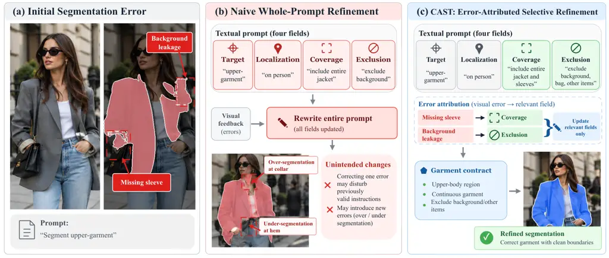
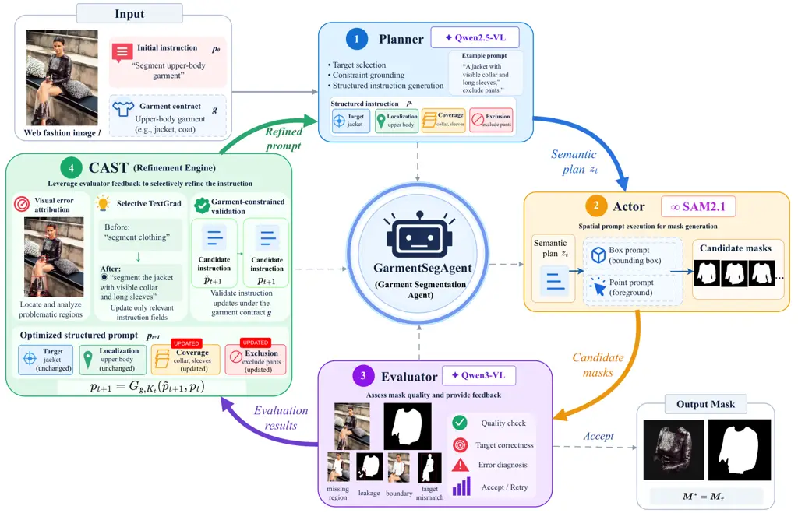
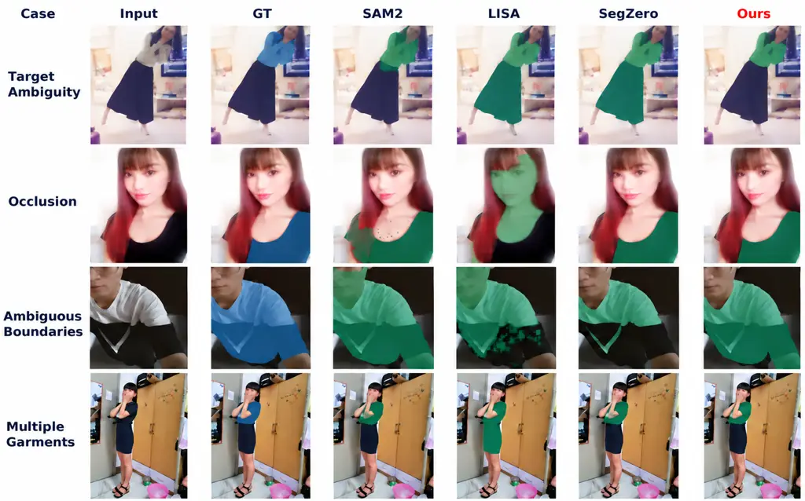
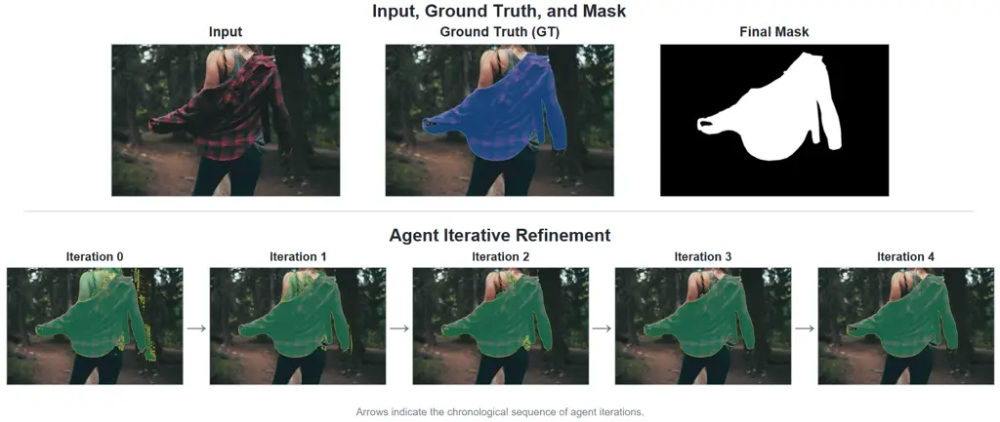
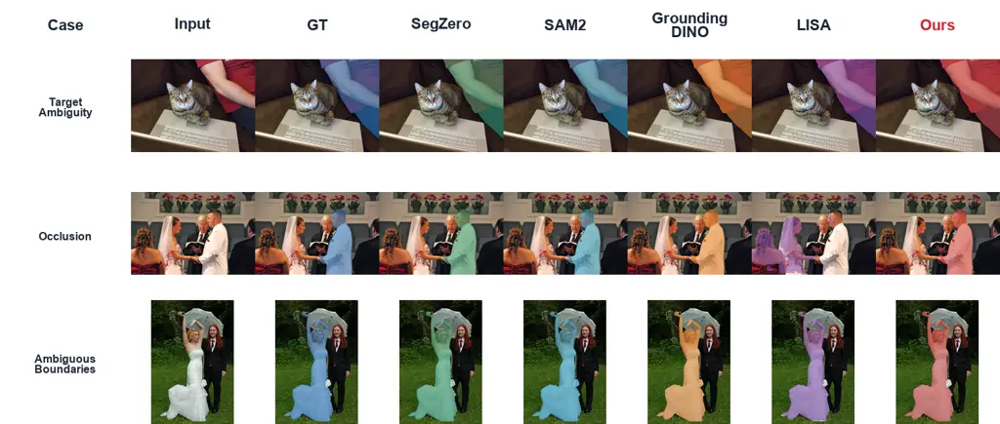

# GarmentSegAgent: Autonomous Garment Segmentation for Web Fashion Images via Textual Self-Refinement

Jia Chen^(1,2,\*), Chao Huang^(1,\*), Xinrong Hu¹, Mingdi Huang¹, Ruyang
Zhao¹, Jun Bai^(3,$`\dagger`$) Affiliation: ¹ School of Computer Science
and Artificial Intelligence, Wuhan Textile University, Wuhan, China  
² Engineering Research Center of Hubei Province for Clothing
Information, Wuhan Textile University, Wuhan, China  
³ Australian Institute for Machine Learning (AIML), Adelaide University,
Adelaide, Australia  
,

###### Abstract.

Web fashion images support applications such as visual product search
and consumer-to-shop matching, yet their visual heterogeneity makes
reliable garment segmentation challenging. Despite advances in
promptable segmentation, autonomously identifying and correcting
garment-specific errors without human-provided spatial prompts remains
difficult. We propose GarmentSegAgent, an autonomous framework that
integrates semantic planning, spatial execution, and visual evaluation
through iterative textual self-refinement. At its core, we introduce
CAST (Constrained Attribution-guided Selective TextGrad), which connects
visual error attribution with targeted textual optimization. CAST
identifies instruction components responsible for segmentation errors,
selectively updates them through textual gradients, and validates the
resulting instructions against garment-specific constraints. This
enables image-specific error correction at inference time while keeping
the underlying foundation models frozen. Experiments on DeepFashion2,
ModaNet, and Fashionpedia demonstrate consistent improvements in region
overlap and boundary accuracy, alongside more reliable refinement than
conventional TextGrad. By enabling visual feedback to guide controlled
instruction updates, GarmentSegAgent offers a promising direction for
autonomous garment understanding, with potential applications in
scalable fashion content analysis, visual retrieval, and
consumer-to-shop matching on the Web.

###### Keywords: 

garment segmentation, agentic segmentation, visual error attribution,
textual optimization, web fashion images

^(\*)^(\*)footnotetext: Jia Chen and Chao Huang contributed equally to
this work.^(†)^(†)footnotetext: Corresponding author: Jun Bai
(jun.bai@adelaide.edu.au).

## 1. Introduction

Fashion images are widespread across the Web and support applications
such as visual product search, fine-grained fashion retrieval, and
consumer-to-shop matching (Gao et al., 2020; Zhang et al., 2026; Ge et
al., 2019). Unlike curated product images, consumer-generated and
street-fashion photographs often contain cluttered backgrounds, diverse
viewpoints, occlusions, and overlapping garments, making individual
clothing instances difficult to localize and delineate  (Ge et al.,
2019; Jia et al., 2020). Accurate pixel-level garment segmentation helps
isolate clothing instances and preserve fine-grained spatial details for
downstream fashion understanding. However, reliable segmentation across
such heterogeneous imagery remains challenging, particularly when target
garments must be identified without human-provided spatial prompts.

Visual segmentation has progressed from garment-specific architectures,
such as FashionFormer (Xu et al., 2022), to promptable foundation models
 (Bommasani et al., 2021) including SAM (Kirillov et al., 2023) and SAM
2 (Ravi et al., 2025). Grounding DINO (Liu et al., 2024) and LISA (Lai
et al., 2024) further support language-guided object localization and
segmentation, respectively, while SAM-REF (Yu et al., 2025) improves
segmentation details through image-prompt interaction. Despite these
advances, generating accurate masks from spatial or textual prompts does
not necessarily address errors in the instructions guiding segmentation.
In heterogeneous Web fashion images, ambiguous targets, occlusions, and
overlapping garments can lead to incorrect target selection or
incomplete garment coverage. Reliable autonomous segmentation therefore
requires not only effective mask generation but also the ability to
diagnose intermediate errors and refine the guiding instructions without
human intervention.



Figure 1. Motivation for error-attributed selective textual refinement.
(a) Initial segmentation with missing garment regions and background
leakage. (b) Naive whole-prompt refinement may disrupt otherwise correct
instructions. (c) CAST maps visual errors to relevant instruction fields
for selective, garment-constrained textual refinement.

Recent studies have extended segmentation beyond single-pass prediction
by incorporating sequential reasoning and feedback. SegAgent (Zhu et
al., 2025) learns segmentation actions from human annotation
trajectories, while RSAgent (He et al., ) integrates multi-turn
reasoning and tool execution through supervised fine-tuning and
reinforcement learning. Other approaches explore collaborative
reflection in video segmentation (Jiang et al., 2026) and
guideline-consistent segmentation through a training-free
Worker–Supervisor framework (Vats et al., 2026). These developments
highlight the potential of agentic segmentation, yet a key challenge
remains: how should visual errors guide updates to specific segmentation
instructions? For example, the missing sleeve and background leakage in
Fig. 1(a) require distinct corrections to garment coverage and region
exclusion. This motivates connecting visual error diagnosis with
targeted instruction refinement.

Textual optimization provides a flexible means of refining instructions
through feedback without modifying model parameters (Bai et al., 2026;
Wang et al., 2026). ProTeGi (Pryzant et al., 2023) employs
natural-language gradients for prompt refinement, while OPRO (Yang et
al., 2024) uses language models to iteratively search for effective
instructions. TextGrad (Yuksekgonul et al., 2025) further enables
feedback-driven optimization of textual variables in compound AI systems
through language-based backpropagation. However, applying
general-purpose textual optimization to garment segmentation requires
accounting for the relationship between visual errors and individual
instruction components. The whole-prompt revision depicted in Fig. 1(b)
exemplifies how correcting localized errors may inadvertently disrupt
previously valid segmentation decisions. Effective refinement therefore
requires identifying error-relevant textual variables while maintaining
garment-specific constraints.

To enable error-specific and constraint-aware refinement, we propose
GarmentSegAgent, an autonomous garment segmentation framework
integrating semantic planning, spatial execution, and visual evaluation
within an iterative self-refinement process. At its core, CAST
(Constrained Attribution-guided Selective TextGrad) connects visual
segmentation errors with structured textual optimization. CAST
attributes observed errors to four instruction fields—target,
localization, coverage, and exclusion—and selectively applies TextGrad
updates to the relevant variables. For instance, CAST directs missing
garment regions to coverage refinement and background leakage to
exclusion refinement, while preserving unrelated instructions under
garment-specific constraints (Fig. 1(c)). The refined instructions
subsequently guide spatial prompt generation and segmentation, enabling
autonomous, image-specific refinement without human-provided spatial
prompts or fine-tuning the underlying foundation models.

Our main contributions are threefold. (1) Autonomous Garment
Segmentation. We introduce GarmentSegAgent, a feedback-driven framework
that enables autonomous, iterative garment segmentation without
human-provided spatial prompts or foundation-model fine-tuning. (2)
Error-Attributed Textual Refinement. We propose CAST, a task-aware
optimization mechanism that maps visual segmentation errors to relevant
textual variables and performs selective TextGrad updates under
garment-specific constraints. (3) Comprehensive Experimental Validation.
Experiments across three fashion benchmarks demonstrate superior region
and boundary accuracy, while refinement analyses and ablations establish
the effectiveness of CAST in improving optimization reliability.

## 2. Related Work

##### Agentic Segmentation

Agentic segmentation extends mask prediction through sequential
reasoning, tool interaction, and feedback-driven correction (Yao et al.,
2023; Wang et al., 2024). SegAgent (Zhu et al., 2025) learns multi-step
segmentation policies from human annotation trajectories, whereas
RSAgent (He et al., ) combines multi-turn tool use with supervised
fine-tuning and reinforcement learning. Other approaches emphasize agent
coordination and iterative evaluation. Refer-Agent (Jiang et al., 2026)
introduces collaborative reasoning and reflection for referring video
segmentation, while guideline-consistent segmentation (Vats et al., 2026) employs a Worker–Supervisor framework with guideline-based
feedback and adaptive termination. These approaches advance segmentation
through learned action policies, collaborative reasoning, and iterative
mask correction.

##### Textual Optimization

Language-based refinement has been explored through iterative
self-feedback, verbal reflection, and tool-assisted correction (Madaan
et al., 2023; Shinn et al., 2023; Gou et al., 2024). For prompt
optimization, ProTeGi (Pryzant et al., 2023) employs natural-language
gradients and beam search, while OPRO (Yang et al., 2024) uses language
models to optimize instructions based on previous evaluations.
TextGrad (Yuksekgonul et al., 2025) further extends textual optimization
to compound AI systems through language-based backpropagation across
textual variables. These methods provide general mechanisms for
optimizing instructions without differentiating through underlying
models. Applying such optimization to segmentation additionally requires
grounding visual errors in relevant instruction variables and
maintaining task-specific constraints during updates.

## 3. Methodology



Figure 2. Overview of GarmentSegAgent. The Planner generates a
garment-aware semantic plan, the Actor produces candidate masks, and the
Evaluator selects predictions and provides visual feedback. CAST
performs selective, garment-constrained textual refinement to guide
subsequent segmentation iterations.

### 3.1. Problem Formulation and Framework Overview

We consider autonomous garment segmentation in heterogeneous Web fashion
images. Given an input image $`I\in\mathbb{R}^{H\times W\times 3}`$ and
an initial textual instruction $`p_{0}`$, the objective is to extract a
target garment instance as a binary segmentation mask
$`M^{*}\in\{0,1\}^{H\times W}`$ without human-provided spatial prompts.
We formulate this task as an iterative process in which segmentation
predictions are evaluated and refined through visual feedback at
inference time.

To maintain task consistency, we introduce a garment extraction contract
$`g`$ specifying target-selection rules and segmentation constraints.
Given an instruction $`p`$, the Planner $`\mathcal{P}`$ generates a
semantic segmentation plan, which the Actor $`\mathcal{S}`$ converts
into spatial prompts to produce candidate masks:

```math
\mathcal{M}(p)=\mathcal{S}(I,\mathcal{P}(I,p,g)). \tag{1}
```

The visual Evaluator selects a mask $`M(p)`$ from $`\mathcal{M}(p)`$ and
provides feedback on segmentation errors. We formulate textual
self-refinement as a constrained test-time optimization problem:

```math
\max_{p\in\mathcal{C}(g)}\widehat{Q}(I,M(p),g), \tag{2}
```

where $`\widehat{Q}`$ denotes evaluator-estimated segmentation quality
and $`\mathcal{C}(g)`$ is the set of instructions satisfying the garment
contract. This objective guides feedback-driven refinement under a
finite inference budget.

To realize this formulation, we develop GarmentSegAgent, which
integrates semantic planning, spatial execution, visual evaluation, and
CAST-based textual optimization into a closed-loop framework, as shown
in Fig. 2. CAST attributes visual errors to relevant instruction
components and selectively refines them through TextGrad under
garment-specific constraints. The validated instructions guide
subsequent segmentation iterations, while all foundation models remain
frozen.

### 3.2. Garment-Aware Planning and Spatial Execution

We represent the segmentation instruction at iteration $`t`$ as four
structured textual variables:
$`p_{t}=(p_{t}^{tar},p_{t}^{loc},p_{t}^{cov},p_{t}^{exc})`$,
corresponding to target selection, spatial localization, garment
coverage, and region exclusion, respectively. These variables allow
individual instruction components to be selectively refined while
maintaining consistency with the garment extraction contract $`g`$.

Given the image $`I`$, current instruction $`p_{t}`$, and contract
$`g`$, the Planner employs Qwen2.5-VL (Bai et al., 2025b) to generate a
garment-aware semantic plan:

```math
z_{t}=\mathcal{P}(I,p_{t},g)=(c_{t},b_{t},\mathcal{R}_{t}^{+},\mathcal{R}_{t}^{-}), \tag{3}
```

where $`c_{t}`$ describes the target garment, $`b_{t}`$ denotes its
estimated bounding box, and $`\mathcal{R}_{t}^{+}`$ and
$`\mathcal{R}_{t}^{-}`$ specify candidate foreground and exclusion
regions, respectively.

The Actor translates this semantic plan into spatial prompts for SAM
2.1. Using the estimated bounding box and positive and negative point
configurations derived from the corresponding regions, it generates a
set of candidate masks:

```math
\mathcal{M}_{t}=\left\{\mathcal{S}(I,b_{t},P_{t,k}^{+},P_{t,k}^{-})\right\}_{k=1}^{B_{t}}, \tag{4}
```

where $`P_{t,k}^{+}`$ and $`P_{t,k}^{-}`$ denote the positive and
negative point sets for the $`k`$-th prompt configuration, and $`B_{t}`$
is the number of candidate configurations. The resulting masks are
passed to the Evaluator for candidate selection and visual error
diagnosis.

### 3.3. Visual Error Attribution

Despite garment-aware planning, the generated masks may contain target
mismatches, incomplete garment regions, or inaccurate boundaries. A
coarse quality assessment alone provides limited guidance for targeted
correction. We therefore introduce Visual Error Attribution (VEA) to
characterize segmentation errors as structured visual feedback for
subsequent textual optimization.

Given the image $`I`$, candidate masks $`\mathcal{M}_{t}`$, current
instruction $`p_{t}`$, and garment contract $`g`$, the visual Evaluator
selects a candidate mask and generates error-specific feedback:

```math
(M_{t},e_{t})=\mathcal{E}(I,\mathcal{M}_{t},p_{t},g), \tag{5}
```

where $`M_{t}\in\mathcal{M}_{t}`$ is the selected mask and $`e_{t}`$
denotes its structured visual feedback. VEA considers four error
categories: target mismatch, missing regions, region leakage, and
boundary errors. Each identified error is represented by

```math
e_{t}=\left\{(k_{t,i},r_{t,i},s_{t,i},c_{t,i},a_{t,i})\right\}_{i=1}^{N_{t}}, \tag{6}
```

where $`N_{t}`$ is the number of identified errors, $`k_{t,i}`$ denotes
the error category, $`r_{t,i}`$ specifies the affected visual region,
$`s_{t,i}`$ and $`c_{t,i}`$ represent error severity and evaluator
confidence, respectively, and $`a_{t,i}`$ describes a suggested
correction.

VEA infers these errors from the input image and predicted masks without
accessing ground-truth annotations. For instance, a missing sleeve
indicates insufficient garment coverage, whereas retained skin regions
suggest inadequate exclusion. These structured diagnostics provide
error-specific signals that CAST maps to relevant instruction variables
for selective textual refinement.

### 3.4. CAST: Constrained Attribution-Guided Selective TextGrad

Constrained Textual Optimization. TextGrad (Yuksekgonul et al., 2025)
enables feedback-driven optimization of textual variables, but
unrestricted instruction updates may disrupt previously valid components
when correcting localized segmentation errors. To address this issue, we
introduce CAST, which couples visual error attribution with selective
textual optimization under garment-specific constraints.

Let $`\mathcal{J}=\{tar,loc,cov,exc\}`$ index the four instruction
fields defined in Section 3.2, and let
$`\mathcal{K}_{t}\subseteq\mathcal{J}`$ denote the error-relevant fields
selected at iteration $`t`$. We formulate the desired refinement as

```math
\displaystyle\max_{p} \displaystyle\widehat{Q}(I,M(p),g) \tag{7}
```

```math
\displaystyle\text{s.t.} \displaystyle p\in\mathcal{C}(g),
```

```math
\displaystyle p^{(j)}=p_{t}^{(j)},\quad\forall j\in\mathcal{J}\setminus\mathcal{K}_{t}.
```

This formulation restricts updates to selected instruction fields while
requiring the resulting instruction to satisfy the garment contract.
CAST operationalizes this objective through error-to-instruction
routing, selective TextGrad updates, and garment-constrained validation.

Error-to-Instruction Routing. CAST identifies the instruction fields
requiring refinement based on the error categories detected by VEA.
Given the structured feedback $`e_{t}`$, the active instruction set is
determined by

```math
\mathcal{K}_{t}=\bigcup_{i=1}^{N_{t}}\mathcal{R}(k_{t,i}), \tag{8}
```

where $`\mathcal{R}`$ maps each error category to a subset of
instruction fields in $`\mathcal{J}`$. Specifically, target mismatches
activate target and localization; missing garment regions activate
coverage and localization; region leakage activates exclusion and
localization; and boundary inaccuracies activate coverage and
localization. When multiple errors are detected, their associated fields
are combined, while unrelated instruction components remain unchanged
during refinement.

Selective Textual Gradient Descent. Given the selected instruction
fields $`\mathcal{K}_{t}`$, CAST applies TextGrad to refine only the
variables associated with detected visual errors. For each
$`j\in\mathcal{K}_{t}`$, the corresponding error feedback is collected
as $`e_{t}^{(j)}=\{e_{t,i}\mid j\in\mathcal{R}(k_{t,i})\}`$. We
construct a component-specific textual loss:

```math
\ell_{t}^{(j)}=\mathcal{L}_{\mathrm{text}}(p_{t}^{(j)};e_{t}^{(j)},p_{t},g), \tag{9}
```

where $`\mathcal{L}_{\mathrm{text}}`$ produces an error-conditioned
assessment of the selected field in the context of the full instruction
and garment contract. The textual loss is propagated through the
language-based backward operator:

```math
\gamma_{t}^{(j)}=\mathcal{B}_{\mathrm{TG}}(\ell_{t}^{(j)};p_{t}^{(j)}), \tag{10}
```

where $`\mathcal{B}_{\mathrm{TG}}`$ denotes the textual backward
operator and $`\gamma_{t}^{(j)}`$ denotes the natural-language gradient
identifying potential corrections to the selected instruction field.
Unlike numerical gradients, this feedback provides semantic guidance for
instruction revision.

The resulting gradients drive selective textual updates:

```math
\tilde{p}_{t+1}^{(j)}=\begin{cases}\mathcal{U}_{\mathrm{TGD}}(p_{t}^{(j)},\gamma_{t}^{(j)}),&j\in\mathcal{K}_{t},\\
p_{t}^{(j)},&j\notin\mathcal{K}_{t},\end{cases} \tag{11}
```

where $`\mathcal{U}_{\mathrm{TGD}}`$ denotes the TextGrad optimizer
step. This operation updates only error-relevant fields while leaving
the remaining components unchanged. The resulting candidate instruction
$`\tilde{p}_{t+1}`$ is subsequently validated against the garment
contract

Garment-Constrained Update. Although selective TextGrad restricts
instruction updates to error-relevant fields, the resulting candidates
may still violate garment-specific requirements. We therefore introduce
a contract-aware validation operator:

```math
p_{t+1}=\mathcal{G}_{g,\mathcal{K}_{t}}(\tilde{p}_{t+1},p_{t}), \tag{12}
```

where $`\mathcal{G}_{g,\mathcal{K}_{t}}`$ checks the candidate
instruction against the garment contract and update scope. Compliant
updates are accepted, while violations are repaired when feasible or
rolled back to $`p_{t}`$. This process aims to maintain target identity,
coverage, and exclusion requirements without altering unselected
instruction fields.

Together, visual error attribution, selective TextGrad, and
garment-constrained validation enable CAST to refine instructions based
on localized segmentation errors. The validated instruction $`p_{t+1}`$
is returned to the Planner for the next segmentation iteration, while
all foundation models remain frozen. Theoretical analysis of update
locality and conditional constraint preservation is provided in
Appendix E.

### 3.5. Iterative Decision and Termination

At each iteration, the Evaluator determines whether the selected mask
$`M_{t}`$ requires further refinement based on its visual error feedback
$`e_{t}`$ and the garment contract $`g`$:

```math
d_{t}=\mathcal{D}(I,M_{t},e_{t},g)\in\{\mathrm{accept},\mathrm{retry}\}, \tag{13}
```

where $`\mathcal{D}`$ denotes the evaluator-based decision function. A
mask is accepted when the Evaluator judges it consistent with the
garment extraction requirements. Otherwise, CAST generates a validated
instruction $`p_{t+1}`$, which guides the Planner and Actor in producing
new segmentation candidates. The complete inference procedure is
summarized in Algorithm 1.

To bound inference cost, we allow at most $`T`$ segmentation iterations.
The process terminates upon acceptance or when the iteration budget is
exhausted. The stopping iteration $`\tau`$ and final segmentation mask
are defined as

```math
\displaystyle\tau \displaystyle=\min\left(\{t\mid d_{t}=\mathrm{accept}\}\cup\{T-1\}\right), \tag{14}
```

```math
\displaystyle M^{*} \displaystyle=M_{\tau},
```

where $`t\in\{0,\ldots,T-1\}`$. If no mask is accepted, the final
candidate is returned. Each image is processed independently, with all
foundation models remaining frozen.

1: Image $`I`$, initial instruction $`p_{0}`$, garment contract $`g`$,
iteration budget $`T`$

2: Segmentation mask $`M^{*}`$

3: for $`t=0,\ldots,T-1`$ do

4:   $`z_{t}\leftarrow\mathcal{P}(I,p_{t},g)`$

5:   $`\mathcal{M}_{t}\leftarrow\mathcal{S}(I,z_{t})`$

6:   $`(M_{t},e_{t})\leftarrow\mathcal{E}(I,\mathcal{M}_{t},p_{t},g)`$

7:   $`d_{t}\leftarrow\mathcal{D}(I,M_{t},e_{t},g)`$

8:   if $`d_{t}=\mathrm{accept}`$ or $`t=T-1`$ then

9:    return $`M_{t}`$

10:   end if

11:
  $`\mathcal{K}_{t}\leftarrow\bigcup_{i=1}^{N_{t}}\mathcal{R}(k_{t,i})`$

12:   $`\tilde{p}_{t+1}\leftarrow p_{t}`$

13:   for $`j\in\mathcal{K}_{t}`$ do

14:    $`e_{t}^{(j)}\leftarrow\{e_{t,i}\mid j\in\mathcal{R}(k_{t,i})\}`$

15:
   $`\ell_{t}^{(j)}\leftarrow\mathcal{L}_{\mathrm{text}}(p_{t}^{(j)};e_{t}^{(j)},p_{t},g)`$

16:
   $`\gamma_{t}^{(j)}\leftarrow\mathcal{B}_{\mathrm{TG}}(\ell_{t}^{(j)};p_{t}^{(j)})`$

17:
   $`\tilde{p}_{t+1}^{(j)}\leftarrow\mathcal{U}_{\mathrm{TGD}}(p_{t}^{(j)},\gamma_{t}^{(j)})`$

18:   end for

19:
  $`p_{t+1}\leftarrow\mathcal{G}_{g,\mathcal{K}_{t}}(\tilde{p}_{t+1},p_{t})`$

20: end for

Algorithm 1 GarmentSegAgent with CAST Optimization

## 4. Experiments

### 4.1. Experimental Setup

#### 4.1.1. Datasets and Evaluation Protocol

We evaluate GarmentSegAgent on three fashion segmentation benchmarks:
DeepFashion2 (Ge et al., 2019), ModaNet (Zheng et al., 2018), and
Fashionpedia (Jia et al., 2020). DeepFashion2 includes consumer and
commercial images with diverse garment appearances, viewpoints, and
occlusions. ModaNet features street-fashion imagery with cluttered
backgrounds and varied clothing configurations, while Fashionpedia
provides fine-grained annotations across garment categories and
attributes. Together, these datasets cover diverse visual conditions and
garment characteristics.

We adopt a unified upper-garment segmentation setting, evaluating 500
images from each benchmark. The objective is to extract a target
upper-garment instance as a binary mask. For images containing multiple
garments, a consistent target-selection and annotation-matching protocol
determines the evaluation target, as detailed in Appendix A.
GarmentSegAgent processes each image independently without
human-provided spatial prompts or access to ground-truth annotations.
Its refinement relies solely on the input image and intermediate visual
feedback, with ground-truth masks and evaluation metrics reserved for
offline assessment.

#### 4.1.2. Baselines

We compare GarmentSegAgent with representative baselines across spatial
prompting, vision-language segmentation, and reasoning-based or agentic
segmentation. Spatial prompting methods include SAM 2 (Ravi et al., 2025) with box prompts and Grounding DINO+SAM 2  (Liu et al., 2024),
which generates spatial prompts through object detection.
Vision-language segmentation methods include READ (Qian et al., 2025),
SEEM (Zou et al., 2023), and LISA (Lai et al., 2024). We further include
SegZero+SAM 2 (Liu et al., 2025) and SegAgent (Zhu et al., 2025) as
reasoning-based and agentic segmentation baselines, respectively. All
methods are evaluated on identical image subsets and target garment
definitions. We distinguish externally supplied spatial prompts from
automatically generated prompts to account for differences in prompting
requirements.

#### 4.1.3. Implementation Details

GarmentSegAgent employs Qwen2.5-VL as the Planner, SAM 2.1 as the
segmentation Actor, and Qwen3-VL (Bai et al., 2025a) as the visual
Evaluator. The Planner generates a garment-aware semantic plan, which
the Actor translates into bounding-box and positive/negative point
prompts for candidate mask generation. The Evaluator selects a mask and
provides structured visual feedback to CAST, which selectively refines
the target, localization, coverage, and exclusion instruction fields
under garment-specific constraints. All foundation models remain frozen,
and each image is processed independently without cross-image state
sharing. We allow at most five segmentation iterations, including the
initial prediction, with early termination upon evaluator acceptance.

#### 4.1.4. Evaluation Metrics

We assess segmentation quality using mean Intersection over Union
(mIoU), Dice coefficient (Milletari et al., 2016), Boundary IoU
(BIoU) (Cheng et al., 2021), precision, and recall. mIoU and Dice
quantify region-level agreement between predicted and ground-truth
garment masks, while BIoU measures boundary alignment, particularly for
fine garment structures and irregular contours. Precision and recall
further characterize foreground leakage and missing garment regions,
respectively. To evaluate textual self-refinement, we additionally
report IoU improvement from the initial prediction, improvement and
degradation rates, and inference costs in terms of refinement steps,
language-model calls, and execution time.

| Dataset      | Method                 | Source             | mIoU$`\uparrow`$ | Dice$`\uparrow`$ | Boundary IoU$`\uparrow`$ | Precision$`\uparrow`$ | Recall$`\uparrow`$ |
| ------------ | ---------------------- | ------------------ | ---------------- | ---------------- | ------------------------ | --------------------- | ------------------ |
| DeepFashion2 | SEEM                   | NeurIPS’23         | 0.4587           | 0.5619           | 0.2372                   | 0.4777                | 0.7862             |
|              | LISA                   | CVPR’24            | 0.6913           | 0.7761           | 0.4688                   | 0.7340                | 0.8828             |
|              | SAM 2 (box-only)       | ICLR’25            | 0.6328           | 0.7047           | 0.4124                   | 0.7130                | 0.7391             |
|              | Grounding DINO + SAM 2 | ECCV’24 / ICLR’25  | 0.2689           | 0.2889           | 0.2122                   | 0.3129                | 0.2759             |
|              | READ                   | CVPR’25            | 0.6067           | 0.6866           | 0.4008                   | 0.7728                | 0.6761             |
|              | SegAgent               | CVPR’25            | 0.4638           | 0.5675           | 0.2477                   | 0.5871                | 0.7178             |
|              | SegZero + SAM 2        | arXiv’25 / ICLR’25 | 0.7959           | 0.8629           | 0.6047                   | 0.8877                | 0.8765             |
|              | GarmentSegAgent (Ours) | –                  | 0.8124           | 0.8736           | 0.6318                   | 0.9156                | 0.8741             |
| ModaNet      | SEEM                   | NeurIPS’23         | 0.2624           | 0.4009           | 0.1391                   | 0.2645                | 0.9699             |
|              | LISA                   | CVPR’24            | 0.4538           | 0.5910           | 0.3380                   | 0.4634                | 0.9340             |
|              | SAM 2 (box-only)       | ICLR’25            | 0.5940           | 0.6765           | 0.5020                   | 0.6410                | 0.7590             |
|              | Grounding DINO + SAM 2 | ECCV’24 / ICLR’25  | 0.1304           | 0.1397           | 0.1146                   | 0.1433                | 0.1388             |
|              | READ                   | CVPR’25            | 0.5143           | 0.6292           | 0.3906                   | 0.5400                | 0.8138             |
|              | SegAgent               | CVPR’25            | 0.2996           | 0.4428           | 0.1812                   | 0.3122                | 0.9549             |
|              | SegZero + SAM 2        | arXiv’25 / ICLR’25 | 0.6683           | 0.7337           | 0.5814                   | 0.7105                | 0.8021             |
|              | GarmentSegAgent (Ours) | –                  | 0.6733           | 0.7476           | 0.6027                   | 0.7220                | 0.8301             |
| Fashionpedia | SEEM                   | NeurIPS’23         | 0.3043           | 0.4376           | 0.1685                   | 0.3059                | 0.9078             |
|              | LISA                   | CVPR’24            | 0.5326           | 0.6545           | 0.4086                   | 0.5456                | 0.9281             |
|              | SAM 2 (box-only)       | ICLR’25            | 0.6989           | 0.7627           | 0.6180                   | 0.7312                | 0.8642             |
|              | Grounding DINO + SAM 2 | ECCV’24 / ICLR’25  | 0.2191           | 0.2291           | 0.2012                   | 0.2299                | 0.2328             |
|              | READ                   | CVPR’25            | 0.4496           | 0.5412           | 0.3554                   | 0.5089                | 0.6350             |
|              | SegAgent               | CVPR’25            | 0.3558           | 0.5034           | 0.2063                   | 0.3613                | 0.9158             |
|              | SegZero + SAM 2        | arXiv’25 / ICLR’25 | 0.7426           | 0.8158           | 0.6662                   | 0.7706                | 0.9332             |
|              | GarmentSegAgent (Ours) | –                  | 0.7685           | 0.8375           | 0.6950                   | 0.7940                | 0.9410             |

Table 1. Quantitative comparison of upper-garment segmentation on
DeepFashion2, ModaNet, and Fashionpedia. The best score for each metric
within each dataset is highlighted in bold.

### 4.2. Main Results

|                       | DeepFashion2     |                  | ModaNet          |                  | Fashionpedia     |                  |
| --------------------- | ---------------- | ---------------- | ---------------- | ---------------- | ---------------- | ---------------- |
| Method                | mIoU$`\uparrow`$ | BIoU$`\uparrow`$ | mIoU$`\uparrow`$ | BIoU$`\uparrow`$ | mIoU$`\uparrow`$ | BIoU$`\uparrow`$ |
| One-pass              | 0.6961           | 0.6148           | 0.6145           | 0.5369           | 0.6982           | 0.6080           |
| Rule-based Refinement | 0.7014           | 0.6179           | 0.6399           | 0.5534           | 0.7080           | 0.6079           |
| Vanilla TextGrad      | 0.7568           | 0.6242           | 0.6001           | 0.5221           | 0.7235           | 0.6304           |
| All-field TextGrad    | 0.7491           | 0.6218           | 0.6283           | 0.5392           | 0.7128           | 0.6153           |
| Selective TextGrad    | 0.7836           | 0.6287           | 0.6454           | 0.5558           | 0.7339           | 0.6612           |
| Full CAST (Ours)      | 0.8124           | 0.6318           | 0.6733           | 0.6027           | 0.7685           | 0.6950           |

Table 2. Comparison of textual refinement strategies on three fashion
segmentation benchmarks. BIoU denotes Boundary IoU. All iterative
methods share the same foundation models and maximum refinement budget.

Table 1 compares GarmentSegAgent with representative baselines on
DeepFashion2, ModaNet, and Fashionpedia in terms of region overlap,
boundary accuracy, and foreground prediction quality. Additional
experiments evaluate GarmentSegAgent on COCO (Lin et al., 2014) person
segmentation and examine CAST performance across shop and consumer
images in DeepFashion2 (Appendix B Table 5, Fig. 6, and Table 6).

Performance on DeepFashion2. GarmentSegAgent achieves an mIoU of 0.8124,
outperforming the strongest baseline, SegZero+SAM 2, by 1.65 percentage
points. Boundary IoU also improves from 0.6047 to 0.6318, indicating
better preservation of garment boundaries. Moreover, GarmentSegAgent
achieves the highest precision (0.9156), reflecting reduced foreground
leakage. Although LISA attains slightly higher recall, its considerably
lower precision and mIoU suggest a less favorable balance between
garment coverage and background exclusion.

Performance on ModaNet. On ModaNet, the performance advantage is more
modest in region overlap but more evident in boundary accuracy. Compared
with SegZero+SAM 2, GarmentSegAgent improves mIoU from 0.6683 to 0.6733,
while Boundary IoU increases from 0.5814 to 0.6027, suggesting better
delineation of garment contours in street-fashion scenes. Although SEEM
and SegAgent achieve higher recall, their substantially lower precision
indicates greater foreground leakage. In contrast, GarmentSegAgent
achieves a precision of 0.7220 and recall of 0.8301, outperforming
SegZero+SAM 2 on both metrics and maintaining a better balance between
garment coverage and background exclusion.

Performance on Fashionpedia. Fashionpedia shows the most consistent
performance gains, with GarmentSegAgent outperforming all baselines
across five evaluation metrics. Compared with SegZero+SAM 2, mIoU and
Boundary IoU improve by 2.59 and 2.88 percentage points, reaching 0.7685
and 0.6950, respectively. Notably, precision and recall increase
simultaneously, indicating more complete garment coverage with reduced
foreground leakage. These results demonstrate improved region and
boundary accuracy in a benchmark featuring fine-grained garment
annotations.

Figure 3. Evolution of mIoU during iterative refinement on (a)
DeepFashion2, (b) ModaNet, and (c) Fashionpedia. Iteration 0 denotes the
initial prediction. Shaded regions indicate 95% bootstrap confidence
intervals. Predictions from early-terminated samples are retained for
subsequent iterations.

|              |                  | Refinement Outcomes       |                    |                      | Inference Cost           |                         |                            |
| ------------ | ---------------- | ------------------------- | ------------------ | -------------------- | ------------------------ | ----------------------- | -------------------------- |
| Dataset      | Method           | $`\Delta`$IoU$`\uparrow`$ | IR (%)$`\uparrow`$ | DR (%)$`\downarrow`$ | Avg. Steps$`\downarrow`$ | LLM Calls$`\downarrow`$ | Time (s/img)$`\downarrow`$ |
| DeepFashion2 | Vanilla TextGrad | +0.0607                   | 72.4               | 18.0                 | 2.2                      | 4.4                     | 7.8                        |
|              | Full CAST        | +0.1163                   | 88.7               | 6.4                  | 2.6                      | 6.1                     | 10.9                       |
| ModaNet      | Vanilla TextGrad | -0.0144                   | 43.8               | 48.2                 | 2.4                      | 4.8                     | 8.5                        |
|              | Full CAST        | +0.0588                   | 79.6               | 12.0                 | 2.7                      | 6.4                     | 11.8                       |
| Fashionpedia | Vanilla TextGrad | +0.0253                   | 61.5               | 29.2                 | 2.2                      | 4.4                     | 7.9                        |
|              | Full CAST        | +0.0703                   | 83.5               | 9.2                  | 2.5                      | 5.9                     | 10.6                       |

Table 3. Refinement outcomes and inference cost on three fashion
benchmarks. IR and DR denote the percentages of improved and degraded
predictions, respectively.

### 4.3. Textual Optimization Strategies

To investigate the effects of textual refinement, we compare five
optimization strategies against a One-pass reference without refinement.
Rule-based Refinement applies predefined corrections based on evaluator
feedback, while Vanilla TextGrad optimizes the entire instruction as a
single variable. All-field TextGrad independently updates all four
instruction fields, whereas Selective TextGrad updates only fields
associated with visual errors. Full CAST additionally incorporates
garment-contract validation. All iterative methods share the same
foundation models, initial instructions, evaluation protocol, and
iteration budget. Table 2 reports the results.

The results highlight the limitations of unrestricted textual
refinement. Although Vanilla TextGrad improves mIoU on DeepFashion2 and
Fashionpedia, it degrades performance on ModaNet from 0.6145 to 0.6001
relative to One-pass. Updating all instruction fields does not
consistently improve performance either. By contrast, Selective TextGrad
outperforms both variants across all three benchmarks, supporting the
effectiveness of error-conditioned field selection.

Full CAST further achieves the highest mIoU and Boundary IoU on every
benchmark. Relative to Selective TextGrad, its mIoU gains reach 2.88,
2.79, and 3.46 percentage points on DeepFashion2, ModaNet, and
Fashionpedia, respectively. Boundary IoU improvements are especially
notable on ModaNet and Fashionpedia, reaching 4.69 and 3.38 percentage
points. These results underscore the complementary roles of selective
instruction updates and garment-specific consistency validation in
reliable textual refinement.

### 4.4. Self-Refinement Analysis

Iterative Refinement Dynamics. Figure 3 compares the evolution of mIoU
across refinement iterations for Vanilla TextGrad and CAST under
identical initial predictions. On DeepFashion2 and Fashionpedia, both
methods improve through iterative refinement, with CAST achieving larger
gains. A contrasting trend appears on ModaNet, where Vanilla TextGrad
reduces mIoU from 0.6145 to 0.6001, whereas CAST progressively improves
it to 0.6733. These divergent trajectories demonstrate that repeated
refinement does not inherently improve segmentation; its effectiveness
depends on how visual errors guide textual updates. For early-terminated
samples, the final predictions are retained in subsequent plotted
iterations to maintain a consistent evaluation set. Further examples of
iterative mask evolution and instruction updates are provided in
Appendix B (Fig. 5) and Appendix C (Table 7), respectively. An
illustrative case study of error-attributed instruction refinement is
provided in Appendix D.



Figure 4. Qualitative comparison of upper-garment segmentation under
target ambiguity, occlusion, ambiguous boundaries, and multiple garments
(top to bottom). Columns show the input, ground truth (GT), and
predictions from SAM 2, LISA, SegZero + SAM 2, and GarmentSegAgent
(Ours). GT is used only for evaluation.

Refinement Reliability. Average segmentation gains alone do not capture
the risk of harmful instruction updates. We therefore report the mean
IoU change ($`\Delta`$IoU) between initial and final predictions, along
with improvement rate (IR) and degradation rate (DR), measuring the
proportions of samples with increased and decreased IoU, respectively.
As shown in Table 3, CAST consistently achieves larger IoU gains, higher
improvement rates, and lower degradation rates. The contrast is
particularly evident on ModaNet, where CAST increases IR from 43.8% to
79.6% while reducing DR from 48.2% to 12.0%. Similar reductions in
degradation are observed on DeepFashion2 and Fashionpedia, indicating
more reliable image-specific textual refinement.

Inference Cost. These reliability improvements incur additional
inference overhead. Compared with Vanilla TextGrad, CAST requires
approximately 1.5–1.7 more language-model calls per image, with average
inference time increasing by 2.7–3.3 seconds across the three
benchmarks. For instance, on ModaNet, inference time increases from 8.5
to 11.8 seconds per image, accompanied by a substantial reduction in
degradation rate. This trade-off reflects the additional computation
associated with error-attributed refinement and garment-constrained
validation, rather than improved inference efficiency.

### 4.5. Ablation Studies

We investigate the contributions of three core CAST mechanisms: visual
error attribution (VEA), selective routing, and garment-contract
validation. As shown in Table 4, removing VEA reduces mIoU from 0.8124
to 0.7128 and Boundary IoU from 0.6318 to 0.4924, highlighting the
importance of structured visual feedback. Disabling selective routing
similarly degrades mIoU to 0.7287 and Boundary IoU to 0.5121, supporting
the benefit of error-guided instruction updates. Without
garment-contract validation, mIoU drops to 0.7128, while the degradation
rate increases from 6.4% to 18.0%, indicating its role in mitigating
harmful updates. These findings demonstrate the complementary
contributions of error attribution, selective optimization, and
constraint validation. Additional validation statistics are provided in
Appendix C (Table 8).

|    Variant                   |    mIoU$`\uparrow`$    |    BIoU$`\uparrow`$    |    DR (%)$`\downarrow`$ |
| ---------------------------- | ---------------------- | ---------------------- | ----------------------- |
|    Full CAST                 |    0.8124              |    0.6318              |    6.4                  |
|    w/o VEA                   |    0.7128              |    0.4924              |    14.0                 |
|    w/o Selective Routing     |    0.7287              |    0.5121              |    14.0                 |
|    w/o Garment Validation    |    0.7128              |    0.4917              |    18.0                 |

Table 4. Ablation of CAST on DeepFashion2. DR: percentage of samples
with decreased final IoU.

### 4.6. Qualitative Comparison

Qualitative results demonstrate the effectiveness of GarmentSegAgent
under target ambiguity, occlusion, ambiguous boundaries, and multiple
garments. As shown in Fig. 4, GarmentSegAgent better preserves target
garment regions while reducing leakage into adjacent clothing and
backgrounds. In contrast, competing methods often omit garment parts or
include unrelated regions, highlighting the importance of accurate
target localization and region exclusion.

## 5. Limitations

Our evaluation focuses on single-target upper-garment segmentation in
Web fashion images. Extending GarmentSegAgent to broader garment
categories and multi-instance scenarios remains unexplored. Moreover,
CAST relies on visual feedback and candidate masks from frozen
foundation models, while garment-constrained validation cannot guarantee
pixel-level accuracy. Iterative refinement also introduces additional
inference overhead. Future work will investigate broader garment
understanding and more efficient refinement strategies.

## 6. Conclusion

We presented GarmentSegAgent, an autonomous framework for garment
segmentation in heterogeneous Web fashion images. Its core mechanism,
CAST, combines visual error attribution, selective textual optimization,
and garment-constrained validation to iteratively improve segmentation
without human-provided spatial prompts or fine-tuning. Experiments on
DeepFashion2, ModaNet, and Fashionpedia demonstrate consistent
improvements in region overlap and boundary accuracy over competitive
baselines. These findings highlight the potential of error- guided
textual optimization for coordinating frozen foundation models in visual
tasks.

## References

- Bai et al. (2026) J. Bai, R. Wang, and Y. Li FedEHR-agents: federated
  agentic optimization for automated ehr modeling. arXiv preprint
  arXiv:2608.27856. Cited by: §1.
- Bai et al. (2025a) S. Bai, Y. Cai, R. Chen, K. Chen, et al. Qwen3-VL
  Technical Report. arXiv preprint arXiv:2511.21631. Cited by: §4.1.3.
- Bai et al. (2025b) S. Bai, K. Chen, X. Liu, J. Wang, et al. Qwen2.5-VL
  Technical Report. arXiv preprint arXiv:2502.13923. Cited by: §3.2.
- Bommasani et al. (2021) R. Bommasani, D. A. Hudson, E. Adeli, et al.
  On the Opportunities and Risks of Foundation Models. arXiv preprint
  arXiv:2108.07258. Cited by: §1.
- Cheng et al. (2021) B. Cheng, R. Girshick, P. Dollár, A. C. Berg,
  and A. Kirillov Boundary IoU: Improving Object-Centric Image
  Segmentation Evaluation. In Proceedings of the IEEE/CVF Conference on
  Computer Vision and Pattern Recognition, pp. 15334–15342. External
  Links: [Document](https://dx.doi.org/10.1109/CVPR46437.2021.01508)
  Cited by: §4.1.4.
- Gao et al. (2020) D. Gao, L. Jin, B. Chen, M. Qiu, P. Li, Y. Wei, Y.
  Hu, and H. Wang Fashionbert: text and image matching with adaptive
  loss for cross-modal retrieval. In Proceedings of the 43rd
  International ACM SIGIR conference on research and development in
  information retrieval, pp. 2251–2260. Cited by: §1.
- Ge et al. (2019) Y. Ge, R. Zhang, X. Wang, X. Tang, and P. Luo
  Deepfashion2: a versatile benchmark for detection, pose estimation,
  segmentation and re-identification of clothing images. In 2019
  IEEE/CVF Conference on Computer Vision and Pattern Recognition (CVPR),
  pp. 5332–5340. Cited by: §1, §4.1.1.
- Gou et al. (2024) Z. Gou, Z. Shao, Y. Gong, Y. Shen, Y. Yang, N. Duan,
  and W. Chen CRITIC: Large Language Models Can Self-Correct with
  Tool-Interactive Critiquing. In International Conference on Learning
  Representations, Cited by: §2.
- \[9\] X. He, Y. Zhang, S. Gao, W. Li, L. Hong, M. Chen, K. Jiang, J.
  Fu, and W. Zhang RSAgent: learning to reason and act via multi-turn
  tool invocations for text-guided segmentation. In Forty-third
  International Conference on Machine Learning, Cited by: §1, §2.
- Jia et al. (2020) M. Jia, M. Shi, M. Sirotenko, Y. Cui, C. Cardie, B.
  Hariharan, H. Adam, and S. Belongie Fashionpedia: ontology,
  segmentation, and an attribute localization dataset. In European
  conference on computer vision, pp. 316–332. Cited by: §1, §4.1.1.
- Jiang et al. (2026) H. Jiang, T. Liang, W. Zheng, and J. Hu
  Refer-agent: a collaborative multi-agent system with reasoning and
  reflection for referring video object segmentation. In Proceedings of
  the IEEE/CVF Conference on Computer Vision and Pattern Recognition
  (CVPR), pp. 39508–39517. Cited by: §1, §2.
- Kirillov et al. (2023) A. Kirillov, E. Mintun, N. Ravi, H. Mao, C.
  Rolland, L. Gustafson, T. Xiao, S. Whitehead, A. C. Berg, W. Lo, et
  al. Segment anything. In 2023 IEEE/CVF international conference on
  computer vision (ICCV), pp. 3992–4003. Cited by: §1.
- Lai et al. (2024) X. Lai, Z. Tian, Y. Chen, Y. Li, Y. Yuan, S. Liu,
  and J. Jia Lisa: reasoning segmentation via large language model. In
  2024 IEEE/CVF Conference on Computer Vision and Pattern Recognition
  (CVPR), pp. 9579–9589. Cited by: §1, §4.1.2.
- Lin et al. (2014) T. Lin, M. Maire, S. Belongie, J. Hays, P.
  Perona, D. Ramanan, P. Dollár, and C. L. Zitnick Microsoft COCO:
  Common Objects in Context. In Computer Vision – ECCV 2014, Lecture
  Notes in Computer Science, Vol. 8693, pp. 740–755. External Links:
  [Document](https://dx.doi.org/10.1007/978-3-319-10602-1%5F48) Cited
  by: Appendix B, §4.2.
- Liu et al. (2024) S. Liu, Z. Zeng, T. Ren, F. Li, H. Zhang, J.
  Yang, Q. Jiang, C. Li, J. Yang, H. Su, et al. Grounding dino: marrying
  dino with grounded pre-training for open-set object detection. In
  European conference on computer vision, pp. 38–55. Cited by: §1,
  §4.1.2.
- Liu et al. (2025) Y. Liu, B. Peng, Z. Zhong, Z. Yue, F. Lu, B. Yu,
  and J. Jia Seg-zero: reasoning-chain guided segmentation via cognitive
  reinforcement. arXiv preprint arXiv:2503.06520. Cited by: §4.1.2.
- Madaan et al. (2023) A. Madaan, N. Tandon, P. Gupta, S. Hallinan, L.
  Gao, S. Wiegreffe, U. Alon, N. Dziri, S. Prabhumoye, Y. Yang, S.
  Gupta, B. P. Majumder, K. Hermann, S. Welleck, A. Yazdanbakhsh, and P.
  Clark Self-Refine: Iterative Refinement with Self-Feedback. In
  Advances in Neural Information Processing Systems, Vol. 36. Cited by:
  §2.
- Milletari et al. (2016) F. Milletari, N. Navab, and S. Ahmadi V-Net:
  Fully Convolutional Neural Networks for Volumetric Medical Image
  Segmentation. In 2016 Fourth International Conference on 3D Vision
  (3DV), pp. 565–571. External Links:
  [Document](https://dx.doi.org/10.1109/3DV.2016.79) Cited by: §4.1.4.
- Pryzant et al. (2023) R. Pryzant, D. Iter, J. Li, Y. Lee, C. Zhu,
  and M. Zeng Automatic prompt optimization with “gradient descent” and
  beam search. In Proceedings of the 2023 conference on empirical
  methods in natural language processing, pp. 7957–7968. Cited by: §1,
  §2.
- Qian et al. (2025) R. Qian, X. Yin, and D. Dou Reasoning to attend:
  try to understand how\< seg\> token works. In 2025 IEEE/CVF Conference
  on Computer Vision and Pattern Recognition (CVPR), pp. 24722–24731.
  Cited by: §4.1.2.
- Ravi et al. (2025) N. Ravi, V. Gabeur, Y. Hu, R. Hu, C. Ryali, T.
  Ma, H. Khedr, R. Rädle, C. Rolland, L. Gustafson, et al. Sam 2:
  segment anything in images and videos. In International Conference on
  Learning Representations, Vol. 2025, pp. 28085–28128. Cited by: §1,
  §4.1.2.
- Shinn et al. (2023) N. Shinn, F. Cassano, A. Gopinath, K. Narasimhan,
  and S. Yao Reflexion: Language Agents with Verbal Reinforcement
  Learning. In Advances in Neural Information Processing Systems, Vol. 36. Cited by: §2.
- Vats et al. (2026) V. Vats, A. Rathee, and J. Davis
  Guideline-consistent segmentation via multi-agent refinement. In
  Proceedings of the AAAI Conference on Artificial Intelligence, Vol.
  40, pp. 9612–9620. Cited by: §1, §2.
- Wang et al. (2024) L. Wang, C. Ma, X. Feng, Z. Zhang, H. Yang, J.
  Zhang, Z. Chen, J. Tang, X. Chen, Y. Lin, W. X. Zhao, Z. Wei, and J.
  Wen A Survey on Large Language Model Based Autonomous Agents.
  Frontiers of Computer Science 18. Note: Article 186345 External Links:
  [Document](https://dx.doi.org/10.1007/s11704-024-40231-1) Cited by:
  §2.
- Wang et al. (2026) R. Wang, B. Wang, E. Kourbatski, J. Bai, H.
  Chen, Z. Song, G. Boire, M. Hudson, and Y. Li DoctorAgents: an agentic
  framework to iteratively refine automl pipeline for small clinical
  temporal data. arXiv preprint arXiv:2608.05375. Cited by: §1.
- Xu et al. (2022) S. Xu, X. Li, J. Wang, G. Cheng, Y. Tong, and D. Tao
  Fashionformer: a simple, effective and unified baseline for human
  fashion segmentation and recognition. In European Conference on
  Computer Vision, pp. 545–563. Cited by: §1.
- Yang et al. (2024) C. Yang, X. Wang, Y. Lu, H. Liu, Q. V. Le, D. Zhou,
  and X. Chen Large language models as optimizers. In International
  Conference on Learning Representations, Vol. 2024, pp. 12028–12068.
  Cited by: §1, §2.
- Yao et al. (2023) S. Yao, J. Zhao, D. Yu, N. Du, I. Shafran, K. R.
  Narasimhan, and Y. Cao ReAct: Synergizing Reasoning and Acting in
  Language Models. In International Conference on Learning
  Representations, Cited by: §2.
- Yu et al. (2025) C. Yu, T. Liu, A. Li, X. Qu, C. Wu, L. Liu, and X. Hu
  SAM-ref: introducing image-prompt synergy during interaction for
  detail enhancement in the segment anything model. In 2025 IEEE/CVF
  Conference on Computer Vision and Pattern Recognition (CVPR),
  pp. 19356–19365. Cited by: §1.
- Yuksekgonul et al. (2025) M. Yuksekgonul, F. Bianchi, J. Boen, S.
  Liu, P. Lu, Z. Huang, C. Guestrin, and J. Zou Optimizing generative ai
  by backpropagating language model feedback. Nature 639 (8055),
  pp. 609–616. Cited by: §1, §2, §3.4.
- Zhang et al. (2026) S. Zhang, H. Mu, W. Zhang, D. Ma, and T. Liu
  Beyond patches: superpixel token-based transformers for
  attribute-specific fashion retrieval. In Proceedings of the ACM Web
  Conference 2026, pp. 6956–6964. Cited by: §1.
- Zheng et al. (2018) S. Zheng, F. Yang, M. H. Kiapour, and R. Piramuthu
  Modanet: a large-scale street fashion dataset with polygon
  annotations. In Proceedings of the 26th ACM international conference
  on Multimedia, pp. 1670–1678. Cited by: §4.1.1.
- Zhu et al. (2025) M. Zhu, Y. Tian, H. Chen, C. Zhou, Q. Guo, Y.
  Liu, M. Yang, and C. Shen Segagent: exploring pixel understanding
  capabilities in mllms by imitating human annotator trajectories. In
  2025 IEEE/CVF Conference on Computer Vision and Pattern Recognition
  (CVPR), pp. 3686–3696. Cited by: §1, §2, §4.1.2.
- Zou et al. (2023) X. Zou, J. Yang, H. Zhang, F. Li, L. Li, J. Wang, L.
  Wang, J. Gao, and Y. J. Lee Segment everything everywhere all at once.
  Advances in neural information processing systems 36, pp. 19769–19782.
  Cited by: §4.1.2.

## Appendix A Target Selection and Evaluation Protocol

For images containing multiple eligible upper-body garments, we
designate the visible instance with the largest garment area as the
segmentation target. This selection criterion establishes a consistent
target definition across evaluated methods, particularly in scenes
containing overlapping or adjacent garments. Predicted masks are
evaluated against the corresponding target-instance annotation rather
than other visible garment instances. Importantly, ground-truth masks
and instance annotations are not accessible to GarmentSegAgent during
planning, segmentation, evaluation, or textual refinement. They are used
exclusively for offline annotation matching and metric computation,
ensuring that visual feedback remains independent of reference
segmentation masks.



Figure 5. Visualization of iterative garment segmentation refinement.
The top row presents the input image, ground truth (GT), and final
prediction, while the bottom row shows the predicted masks across
Iterations 0–4. GT is used only for offline comparison.



Figure 6. Qualitative comparison of person segmentation on COCO under
target ambiguity, occlusion, and ambiguous boundaries.

## Appendix B Additional Experimental Results

Visualization of Iterative Refinement. To further illustrate the
refinement process, Fig. 5 presents the evolution of garment
segmentation across successive iterations. Starting from the initial
prediction, GarmentSegAgent progressively improves garment coverage and
boundary alignment, particularly around the sleeves and lower edges.
This example provides a visual illustration of how feedback-driven
textual refinement can correct localized segmentation errors without
modifying foundation-model parameters.

Cross-domain Person Segmentation on COCO. We further evaluate the
generalization of the agentic segmentation framework on COCO (Lin et
al., 2014) person segmentation, which differs from garment extraction in
both target semantics and image distribution. As shown in Table 5, the
TextGrad-based GarmentSegAgent achieves an mIoU of 0.7138, outperforming
SegZero by 1.68 percentage points. Improvements are also observed in
Dice, Boundary IoU, and precision, while the highest recall of 0.9045
indicates stronger foreground coverage. Grounding DINO + SAM 2 achieves
higher region and boundary accuracy, potentially benefiting from
detector-guided localization of the predefined person category. In
contrast, GarmentSegAgent relies on language-guided planning and general
textual refinement, without task-specific adaptation for person
segmentation.

| Method               | mIoU   | Dice   | BIoU   | Prec.  | Rec.   |
| -------------------- | ------ | ------ | ------ | ------ | ------ |
| READ                 | 0.5820 | 0.6720 | 0.4660 | 0.6460 | 0.6800 |
| SEEM                 | 0.6110 | 0.6560 | 0.4990 | 0.6610 | 0.7860 |
| LISA                 | 0.6420 | 0.7140 | 0.5250 | 0.7060 | 0.8830 |
| SegZero              | 0.6970 | 0.7520 | 0.5770 | 0.7610 | 0.8770 |
| Grounding DINO+SAM 2 | 0.7650 | 0.8210 | 0.6450 | 0.8320 | 0.8500 |
| GarmentSegAgent      | 0.7138 | 0.7826 | 0.6049 | 0.8017 | 0.9045 |

Table 5. Cross-domain person segmentation on COCO. BIoU denotes Boundary
IoU.

Qualitative results in Fig. 6 further illustrate the cross-domain
behavior of GarmentSegAgent under target ambiguity, occlusion, and
ambiguous boundaries. Despite being developed for garment segmentation,
GarmentSegAgent can identify and segment the target person across
diverse scenes, preserving visible foreground regions while limiting
interference from surrounding objects and individuals. These
observations suggest that its language-guided planning and textual
refinement can transfer beyond garment-specific segmentation tasks.

Performance across Fashion Image Sources. We further compare
segmentation performance between shop and consumer images in
DeepFashion2. As reported in Table 6, GarmentSegAgent with CAST
consistently outperforms its conventional TextGrad counterpart and
SegZero + SAM 2 across both domains. CAST improves mIoU over
conventional TextGrad by 0.9 and 0.7 percentage points on shop and
consumer images, respectively. All methods achieve lower accuracy on
consumer images, indicating greater segmentation difficulty in this
domain.

| Domain   | Method          | mIoU$`\uparrow`$ | BIoU$`\uparrow`$ |
| -------- | --------------- | ---------------- | ---------------- |
| Shop     | SegZero + SAM 2 | 0.808            | 0.625            |
|          | GSA (TextGrad)  | 0.817            | 0.638            |
|          | GSA (CAST)      | 0.826            | 0.650            |
| Consumer | SegZero + SAM 2 | 0.784            | 0.584            |
|          | GSA (TextGrad)  | 0.792            | 0.599            |
|          | GSA (CAST)      | 0.799            | 0.614            |

Table 6. Segmentation performance across shop and consumer images in
DeepFashion2 (500 images per domain). GSA denotes GarmentSegAgent, and
BIoU denotes Boundary IoU.

## Appendix C CAST Mechanism Analysis

Prompt Evolution Case Study. We examine the textual refinement process
by tracing how CAST transforms visual segmentation feedback into
targeted instruction updates. As illustrated in Table 7, the trace
records the attributed visual error, selected instruction fields,
textual gradient feedback, and instructions before and after
optimization. We also examine whether unselected fields remain unchanged
and how the proposed updates are handled by garment-contract validation.
The corresponding IoU change is measured offline to assess the effect of
refinement on segmentation quality.

| Component                      | Refinement Trace                                                                                                                                    |
| ------------------------------ | --------------------------------------------------------------------------------------------------------------------------------------------------- |
| Visual Errors                  | Missing jacket regions (torso, sleeves, collar, and hem), with erroneous inclusion of hands, skin, and a fur collar.                                |
| Selected Fields                | Coverage and exclusion.                                                                                                                             |
| Initial Instruction            | Preserve visible garment fabric and exclude body parts, other garments, and background.                                                             |
| Textual Feedback               | Re-examine incomplete jacket coverage and the inclusion of non-garment regions.                                                                     |
| Updated Fields                 | Coverage: retain the visible torso, sleeves, cuffs, collar, and hem. Exclusion: remove body parts, accessories, unrelated garments, and background. |
| Preserved Rule                 | Select the eligible upper-body garment with the largest visible fabric area.                                                                        |
| IoU                            |                                                                                                                                                     |
| (Before $`\rightarrow`$ After) | $`0.2247\rightarrow 0.8925`$ ($`\Delta=+0.6678`$).                                                                                                  |

Table 7. Condensed CAST refinement trace for Fashionpedia image 10324.
Textual entries summarize the recorded feedback and updates; IoU is
measured offline.

Garment-Contract Validation. We further examine the outcomes of
garment-contract validation across the three benchmarks. As reported in
Table 8, 26.0–31.8% of proposed updates require repair, while no
rollbacks are recorded. Independent assessment identifies residual
constraint-violation rates of 0.2–0.8%, suggesting that validation
substantially supports instruction consistency without ensuring perfect
constraint compliance.

| Dataset      | Updates | Direct (%) | Repair (%) | Rollback (%) | Viol. (%) |
| ------------ | ------- | ---------- | ---------- | ------------ | --------- |
| DeepFashion2 | 650     | 74.0       | 26.0       | 0.0          | 0.2       |
| ModaNet      | 640     | 71.9       | 28.1       | 0.0          | 0.3       |
| Fashionpedia | 530     | 68.2       | 31.8       | 0.0          | 0.8       |

Table 8. Garment-contract validation outcomes. Direct, Repair, and
Rollback denote the final handling of proposed updates; Viol. denotes
independently assessed constraint violations.

## Appendix D Case Study of Iterative Prompt Evolution

We illustrate iterative instruction refinement using Fashionpedia image
18374, featuring a red-and-black plaid overshirt. The case covers five
segmentation iterations, from initial garment localization to boundary
refinement. As the original textual logs were not retained, the
following prompts are illustrative reconstructions based on the
available segmentation masks and CAST protocol, rather than verbatim
execution records.


##### Analysis.

This illustrative sequence demonstrates how different visual errors can
activate distinct instruction fields during iterative refinement. Early
updates address background leakage and incomplete garment coverage,
while later refinements focus on localized boundaries and residual
errors. Throughout the sequence, the target instruction remains
unchanged, whereas localization, coverage, and exclusion are selectively
revised according to the attributed errors. Garment-contract validation
checks candidate instructions for task consistency before subsequent
execution. Although the reconstructed prompts are not verified execution
logs, they illustrate the intended interaction between visual error
attribution, selective TextGrad, and constrained instruction updates.

## Appendix E Theoretical Analysis of CAST

We analyze two structural properties of CAST: the locality of selective
textual updates and the preservation of garment-specific constraints.

Selective Update Locality. Let
$`p_{t}=(p_{t}^{(1)},\ldots,p_{t}^{(m)})`$ denote the structured
instruction at iteration $`t`$, where $`m=4`$ corresponds to the target,
localization, coverage, and exclusion fields. Given the error-attributed
active set $`\mathcal{K}_{t}\subseteq\{1,\ldots,m\}`$, CAST generates a
candidate update as

```math
\widetilde{p}_{t+1}^{(j)}=\begin{cases}\mathcal{U}_{\mathrm{TGD}}(p_{t}^{(j)},\gamma_{t}^{(j)}),&j\in\mathcal{K}_{t},\\
p_{t}^{(j)},&j\notin\mathcal{K}_{t}.\end{cases} \tag{15}
```

The final instruction is obtained through
$`p_{t+1}=\mathcal{G}_{g,\mathcal{K}_{t}}(\widetilde{p}_{t+1},p_{t})`$.

###### Proposition 0 (Update Locality).

Suppose the garment-constrained update operator preserves all inactive
fields, including during validation and repair. Then

```math
p_{t+1}^{(j)}=p_{t}^{(j)},\quad\forall j\notin\mathcal{K}_{t}, \tag{16}
```

and the number of modified instruction fields satisfies

```math
\left|\left\{j:p_{t+1}^{(j)}\neq p_{t}^{(j)}\right\}\right|\leq|\mathcal{K}_{t}|\leq m. \tag{17}
```

###### Proof.

By construction, selective TextGrad leaves every inactive field
unchanged. The assumed field-preserving validation operator does not
modify these fields. Consequently, only fields belonging to
$`\mathcal{K}_{t}`$ can change, establishing the bound. ∎

Garment-Contract Feasibility. Let $`\mathcal{C}(g)`$ denote the set of
instructions satisfying the garment contract $`g`$. CAST validates each
candidate instruction and accepts a direct or repaired update only when
it passes the contract check; otherwise, it restores the previous
instruction.

###### Proposition 0 (Constraint Preservation).

Assume (i) $`p_{0}\in\mathcal{C}(g)`$, (ii) the contract validator is
sound, such that every accepted instruction belongs to
$`\mathcal{C}(g)`$, and (iii) unsuccessful updates are rolled back to
$`p_{t}`$. Then

```math
p_{t}\in\mathcal{C}(g),\quad\forall t\in\{0,\ldots,T\}. \tag{18}
```

###### Proof.

The claim holds at $`t=0`$ by assumption. Suppose
$`p_{t}\in\mathcal{C}(g)`$. If the candidate or its repaired version
passes sound validation, the accepted instruction belongs to
$`\mathcal{C}(g)`$. Otherwise, rollback gives
$`p_{t+1}=p_{t}\in\mathcal{C}(g)`$. The result follows by induction. ∎

Scope of the Guarantees. These propositions characterize
instruction-level properties rather than segmentation accuracy.
Selective updates restrict which textual variables may change, but do
not bound the resulting mask variation. Similarly, contract preservation
does not guarantee that a revised instruction improves IoU. In practice,
language-model-based validation may also be imperfect, making the
feasibility guarantee conditional on validator soundness. We therefore
complement these properties with empirical analyses of refinement gains,
degradation rates, and validation outcomes.
