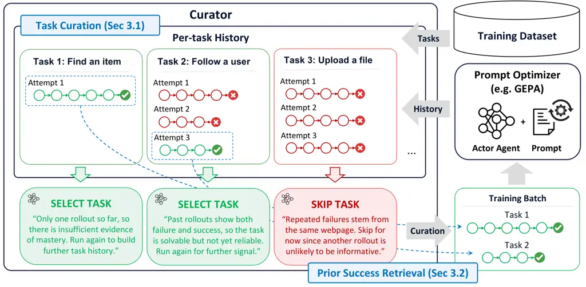

# GEPA-Curator: Curated Learning for Self Improving Agents

Zack Yu^(1\*), Nicholas Lee^(1\*), Minjae Lee⁴, Lakshya Agarwal¹, Luca
Manolache¹  
Wonjun Kang⁴, Matei Zaharia¹, Michael W. Mahoney^(1,2,3), Kurt
Keutzer¹  
Sehoon Kim^(5$`\dagger`$), Amir Gholami^(1,2$`\dagger`$)  
¹UC Berkeley  ²ICSI  ³LBNL  ⁴Furiosa AI  ⁵KAIST

###### Abstract

Large Language Models (LLMs) are increasingly used in multi-turn agentic
workloads that require sustained interaction with complex environments.
Existing reflective prompt optimizers such as GEPA learn from failed
rollouts, but agentic failures can also come from prompt weaknesses,
harness limitations, stochastic execution, or noisy judges. We argue
that such failures may not provide useful learning signal, and may even
be harmful; and thus it is essential to curate which tasks are provided
to the prompt optimizer for better performance. We introduce
GEPA-Curator, a framework that augments the prompt optimizer to select
which agent experiences should shape prompt optimization. In particular,
GEPA-Curator consists of two components: _task curation_, which filters
out tasks that are likely to provide noisy or unreliable learning
signals, and _prior success retrieval_, which selectively retrieves past
successful trajectories for a task and provides them as additional
context to the prompt optimizer. We evaluate GEPA-Curator on GoBrowse,
ALFWorld, AppWorld, and $`\tau`$-bench, using both Gemini 3.1 Pro and
Claude Opus 5 as optimizer models. GEPA-Curator matches or exceeds the
mean performance of both baselines, with gains of up to 20.7% over GEPA
and 21.2% over ACE.

|     |
| --- |
|     |

^(†)^(†)footnotetext: ^(∗)Equal contribution. ^(†)Equal Advising.
Correspondence to: Amir Gholami (amirgh@berkeley.edu).

## 1 Introduction

As interest in recursive self-improvement (RSI) grows, a central
question is how agents can reliably learn from their own experience to
improve future behavior (Favaro and Clark, 2026). Reflective prompt
optimization, where an agent acts with tools in an environment and a
Reflector uses the resulting trajectory or end state to identify lessons
and revise the agent’s prompt, offers one practical mechanism for this
form of self-improvement (Agrawal et al., 2026; Zhang et al., 2026). The
revised prompt is then used on subsequent tasks, creating a feedback
loop in which experience can progressively improve agent behavior. In
agentic settings, this approach rests on the assumption that experience
from previously attempted tasks contains signal and information that
generalize to future tasks.

However, it is often difficult for the Reflector to correctly attribute
the cause of a failure to the prompt. In agentic tasks, execution is
mediated by a harness interacting with an external environment, and
success is often assessed by LLM-as-a-judge (Zheng et al., 2023). A
failed rollout may therefore reveal a genuine prompt weakness, but it
may also arise from external factors such as unavailability of needed
tools, harness limitations, or even noise from execution or evaluation
environments. This problem is further exacerbated in real-world
settings, where tasks themselves may be ambiguous or infeasible,
introducing additional noisy signals to the Reflector. When revising the
prompt, the Reflector may nevertheless treat these potentially noisy
observations as valid learning signals for prompt
optimization (Kirichenko et al., 2025), causing it to misattribute the
associated failures to prompt deficiencies, thereby producing
unnecessary or harmful updates.

As an example, consider an agent asked to purchase an item from a
shopping website. If the agent fails because it overlooks a required
option before adding the item to the cart, the Reflector can usefully
revise the prompt to encourage checking required fields before
proceeding. In contrast, if the same task fails because it runs in a
broken environment where the purchase button in the webpage is
temporarily malfunctioning, treating this failure as evidence about the
prompt may lead the Reflector to introduce unnecessary or even harmful
changes. For example, it may conclude that the agent needs to seek
alternative ways to complete the purchase, while the button can become
functional for future tasks.

To mitigate such issues, recent work (Agrawal et al., 2026; Yang et al., 2026) uses a held-out validation set in order to guard against these
changes. If the prompt does poorly on the validation set after mutation,
the change can be rejected. GEPA (Agrawal et al., 2026) goes a step
further and evaluates the mutated prompt on the minibatch again to make
sure that the model performance does not degrade after such a mutation.
However, such validation-based gating mechanisms alone may not be
sufficient to prevent noisy signals, for two reasons. First, bad
mutations may be accepted and good ones rejected, e.g., because the
gating decision relies on aggregated evaluation scores, which can be
noisy due to stochasticity in execution or evaluation. Second, such
validation-based gating acts only after a mutation has been generated,
and therefore cannot fundamentally improve the quality of the reflection
or mutation itself. This motivates us to maintain and provide additional
contextual information in order to improve the capabilities of the
Reflector.

Based on these insights, we present GEPA-Curator, an agentic data
Curator which runs as a harness on top of existing prompt optimizers.
GEPA-Curator has two roles. The first is task curation, where instead of
randomly selecting tasks for the minibatch, the agent will curate a
minibatch which is likely to provide clean signal and discard tasks
which seem to be noisy or faulty. The second is a prior success
retrieval, where the Curator can selectively retrieve past successful
trajectories for a task and provide them as context to the prompt
optimizer to improve the quality of the mutation. Providing the
Reflector agent with successful exemplars is essential to give the model
the proper context to see why the prompt is failing now, and when it
succeeded in the past.

Overall, our contributions are as follows:

- •
  We introduce GEPA-Curator, an agentic harness for prompt optimization
  that improves mutation quality through adaptive task curation
  (Section 3.1) and selective retrieval (Section 3.2) of prior
  successful trajectories.
- •
  We evaluate GEPA-Curator on four WebArena websites (Zhou et al.,
  2024), ALFWorld, AppWorld, and $`\tau`$-bench. GEPA-Curator matches or
  exceeds the mean performance of the evaluated baselines, with gains of
  up to 20.7% over GEPA (Agrawal et al., 2026) and 21.2% over ACE (Zhang
  et al., 2026). These results suggest that the benefits of curation
  extend across optimizer models.

## 2 Related Work

#### LLM Agents.

As LLMs become ubiquitous, LLM-powered agents have been equipped with
tools and harnesses in order to interact and execute in external
environments. React (Yao et al., 2023) interwove reasoning with tool
execution to improve performance. Later work (Patil et al., 2024;
Erdogan et al., 2024; Schick et al., 2023; Shen et al., 2023; Xu et al.,
2023; Kim et al., 2024) used tool calling, where the model generates a
structured output which is parsed and used to execute functions to
affect the environment. This has led to LLM agents being used to control
and interact with different environments; and this has led to a variety
of different benchmarks (Trivedi et al., 2024; Shridhar et al., 2021;
Yao et al., 2024; Patil et al., 2024; Patil et al., 2025) to evaluate
LLMs at tool calling.

One example is using LLMs as webagents in order to explore and act in
web environments (Qi et al., 2025; Erdogan et al., 2025; Gür et al.,
2023; Kim et al., 2023; Yang et al., 2025). This has led to the
development of various browser and computer use benchmarks and
environments in this area (Zhou et al., 2024; Gandhi and Neubig, 2026;
He et al., 2024; Xue et al., 2025; Xie et al., 2024; Yuan et al., 2026;
Rawles et al., 2023). Webarena (Zhou et al., 2024) was one of the first
web environments and benchmarks to cover realistic websites such as
GitLab, Reddit, Shopping portals, etc.

#### Prompt Optimization.

Reflective optimizers use natural language feedback in place of
numerical gradients to revise textual components of an AI
system (Yuksekgonul et al., 2024; Agrawal et al., 2026; Yang et al.,
2026; Zhang et al., 2026; Zhou et al., 2023b; Yang et al., 2024; Pryzant
et al., 2023; Opsahl-Ong et al., 2024). In particular, GEPA (Agrawal et
al., 2026) applies reflection to system-level trajectories, using
evaluator feedback to diagnose failures and propose prompt mutations
within an evolutionary search. ACE (Zhang et al., 2026) introduced a
framework for agentic context adaptation to create structured playbooks
to organize and accumulate strategies at runtime. SkillOpt (Yang et al., 2026) similarly treats an agent’s skill document as trainable external
state; a separate optimizer analyzes scored rollouts and proposes
bounded add, delete, or replace edits. Meta-Harness (Lee et al., 2026)
extended this idea further by having an outer optimization loop on the
harness code which runs the agent instead of just the prompt. These
methods demonstrate that execution traces can provide substantially
richer optimization signals than scalar rewards alone. GEPA-Curator
addresses a complementary question: which agentic trajectories provide a
valid signal for reflection, and what historical evidence should
accompany them?

#### Curriculum Learning.

Curriculum Learning (Bengio et al., 2009; Fan et al., 2018) studies how
the selection and ordering of training data can improve optimization and
model training. Recent work (Zhou et al., 2023a; Chen et al., 2024; Wang
et al., 2024; Lee et al., 2024; Diao et al., 2024) has looked into how
this can affect LLM training and alignment. LIMA (Zhou et al., 2023a)
established how having poorer quality data can negatively affect LLM
alignment, and showed that a small amount of high-quality data can be as
effective as a large scale training set.

## 3 GEPA-Curator Methodology

In this section, we describe how GEPA-Curator integrates with existing
prompt optimizers. To do so, we first formulate a prompt optimizer by
its input-output interface. At each step, a prompt optimizer receives a
prompt, a minibatch of tasks, and optionally some input metadata. It
executes the tasks using an actor agent conditioned on the prompt and
returns an updated prompt, task-level agent trajectories, and evaluation
results (See Figure 1). Ordinary prompt optimizers randomly permute and
iterate through the tasks in the training dataset at each step. We
identify a few points in existing prompt optimizers where noisy
optimization signals can arise. When selecting tasks to execute, some
tasks may yield noisy or unhelpful trajectories. Furthermore, when
reflecting on execution results, some failures may be difficult to
attribute correctly from the failed trajectory alone. In Section 5.1, we
present motivating experiments showing how such noisy signals can
propagate through the optimization process and ultimately degrade
training.

GEPA-Curator runs as a harness on top of the optimizer, maintaining a
per-task history, including agent trajectories and evaluation outcomes
from previous optimization steps. The Curator uses this history to
address these sources of noise through two corresponding roles: (i) task
curation (Section 3.1), which selects tasks likely to provide useful
signal for prompt optimization to construct the next minibatch; and (ii)
prior success retrieval (Section 3.2), which retrieves relevant past
successful trajectories for tasks in the current minibatch to provide
the Reflector with concrete contextual references for failure diagnosis.
Note that these trajectories are provided to the prompt optimizer only
as additional input metadata, leaving the optimizer itself unchanged.
The full workflow is depicted in Figure 1. We have found that both of
these methods are critical for performance (Section 4.3).

Figure 1: GEPA-Curator system diagram. The prompt optimizer takes in a
minibatch of tasks at each iteration and invokes the actor agent to
execute them and performs reflective prompt optimization based on the
resulting trajectories. The Curator augments the prompt optimizer by
acting as an outer-loop process which traverses through the training
dataset and constructs each minibatch to pass into the prompt optimizer.
The Curator reads past execution trajectories for each task sampled from
the training dataset and decides to run the task if doing so is likely
to provide useful optimization signal (Section 3.1). The Curator can
also pass prior successful trajectories for failed tasks as context to
the prompt optimizer as a trusted reference example (Section 3.2). Once
the curated training batch of selected tasks and successful context is
constructed, it is passed to the prompt optimizer for execution and
optimization. The resulting trajectories and evaluation outcomes are
then written back to the task history for use in subsequent curation
rounds.

### 3.1 Task Curation

The Curator examines the training tasks and selects which tasks to run
at each optimization step. Underexplored tasks are initially prioritized
to build sufficient per-task history. As this history accumulates, the
Curator may skip a task when there is strong evidence that further
rollouts are unlikely to yield useful reflection signal for prompt
optimization. Such cases include repeated stable success, repeated
failures caused by factors outside the prompt (e.g., harness or
environment limitations), and inconsistent evaluations of similar
outcomes, which can be judged based on the accumulated per-task history.

Importantly, skipping is a temporary decision rather than a permanent
decision, and thus skipped tasks are reconsidered by the Curator at each
training epoch. This is necessary because tasks that were previously
solved may regress as the prompt is updated for other tasks, e.g.,
through prompt compression or the addition of potentially conflicting
rules. Conversely, tasks that were initially too difficult, and
therefore skipped after repeated failures, may become solvable as the
prompt improves and can be reintroduced into training.

### 3.2 Prior Success Retrieval

Normally, prompt optimizers reflect on failure examples in the current
minibatch and mutate the prompt based only on the failed trajectories
and their evaluations. Therefore, pairing a current failed execution
with prior successful executions of the same task allows the Reflector
to perform contrastive learning of the failed behavior against a known
and trusted reference. This provides the Reflector with a concrete basis
for correcting the behavior, rather than forcing it to diagnose the
failure by guessing.

The Curator is instructed to reason over the task history to select one
successful trajectory that provides the most reliable reference for the
current task. In particular, it favors successes supported by consistent
evaluation evidence and avoids using outcomes whose apparent success is
ambiguous or inconsistent with other observations in the history. When
no appropriate success is available, the Curator abstains and does not
provide this metadata to the Reflector. This approach prevents noisy
success trajectories from providing misleading positive examples, in the
same way that removing noisy failure trajectories prevents misleading
optimization signals. The prompt for task curation and prior success
retrieval is provided at Appendix B.2. Note that because task curation
and prior-success retrieval are performed jointly in a single Curator
call, the latter requires no additional LLM invocation.

In summary, these two components of GEPA-Curator (task curation and
prior success retrieval) work in unison to ensure that the prompt
optimizer gets cleaner and curated data to train on. By curating the
tasks in each minibatch, we maximize the amount of signal provided at
each step of the optimization loop through removing noisy or redundant
tasks. By providing reliable past successful trajectories to the
Reflector, we enable the Reflector to create better mutations with
grounded understanding instead of guessing the fix.

## 4 Empirical Evaluation

### 4.1 Experimental Setup

We compare GEPA-Curator against GEPA (Agrawal et al., 2026) and ACE
(Zhang et al., 2026). GEPA-Curator builds on a simplified, greedy
variant of GEPA that removes Pareto-based candidate selection. Rather
than evolving a candidate pool and sampling from the Pareto frontier on
validation set, GEPA-Curator maintains a single lineage in which each
mutation becomes the next checkpoint. We evaluate the prompt every 16
iterations unless specified on a held-out validation set and select the
final model based on the best validation score at the end. Because our
ablation showed little difference between GEPA with and without Pareto
selection, we adopt this greedy variant for simplicity.

The prompt-optimization experiments use gpt-oss-120b (Agarwal et al., 2025) as the actor agent. We evaluate two optimizer models, Gemini 3.1
Pro Preview (DeepMind, 2026) and Claude Opus 5 (Anthropic, 2026), using
the selected model for all optimizer-side agents, including the
Reflector and Curator, within each run. The minibatch size is 16. The
actor’s maximum context length is set to gpt-oss-120B’s native maximum
context length (131072) so we constrain the optimized prompt to fit
within this limit. All seed prompts used for optimization are manually
written. The evaluation numbers are averaged over 5 repeated runs.

For evaluation of optimization on noisy data, we experimented with tasks
from GoBrowse (Gandhi and Neubig, 2026): GitLab (720 tasks), Shopping
(585 tasks), Shopping Admin (750 tasks), and Reddit (585 tasks) in the
WebArena environment (Zhou et al., 2024). Each website is independently
split $`3{:}1{:}1`$ into train, validation, and held-out test sets. All
methods use the same seed prompt, evaluator, action limits, and
environment configuration. Each website/method uses 5,000 rollouts,
which has been chosen to ensure that all the methods can reach their
saturated success rate.

We additionally evaluated on more agentic datasets, namely ALFWorld
(Shridhar et al., 2021), AppWorld (Trivedi et al., 2024), and
$`\tau`$-bench (Yao et al., 2024). For ALFWorld, we sample 150 training
tasks and 50 validation tasks from official train and valid_seen splits
to train with 2000 rollouts, and evaluate on all 134 valid_unseen tasks.
For AppWorld, we use the official dataset splits with 1500 rollouts in
training, and report score based on Task Goal Completion. For
$`\tau`$-bench, we remove user interaction as done in (Sayana et al., 2026) by flattening all 115 interactive scenarios from the retail test
set into single requests, and partition them into 48 training tasks, 32
validation, and 35 held-out test tasks with 800 rollouts. The rollout
budget per benchmark was chosen to ensure that all methods can reach
their saturated success rate. $`\tau`$-bench specifically validates
every 4 iterations due to its small training data.

### 4.2 Main Results

#### WebArena Experiments.

With Gemini 3.1 Pro as the optimizer model, as shown in Table 1, GEPA
improves over the seed prompt by 6.3%, whereas GEPA-Curator improves by
9.7%. GEPA-Curator improves mean held-out test success over GEPA on all
four websites, with gains ranging from 1.6-7.4%. The aggregate
difference between the two optimized prompts is 3.4%. Based on the
displayed aggregate scores, GEPA-Curator achieves $`1.54\times`$ GEPA’s
optimization gain over the seed. This suggests that curation materially
increases how much performance can be improved from the same initial
prompt.

With Claude Opus 5 as the optimizer model, as shown in Table 1, GEPA
improves over the seed prompt by 6.4%, whereas GEPA-Curator improves by
11.4%. GEPA-Curator improves mean held-out test success over GEPA on all
four websites, with gains ranging from 0.6%-7.4%. The aggregate
difference between the two optimized prompts is 5.0%. Based on the
displayed aggregate scores, GEPA-Curator achieves $`1.78\times`$ GEPA’s
optimization gain over the seed.

Taken together, across both optimizer models and all WebArena domains,
GEPA-Curator consistently outperforms GEPA, with aggregate improvements
of 3.4% and 5.0% (and up to 7.4% for both) for Gemini 3.1 Pro and Claude
Opus 5, respectively. This consistency across tasks and optimizer model
choices suggests that the benefits of curation are robust rather than
specific to a particular run, domain or optimizer.

| Optimizer Model | Method       | GitLab                        | Shopping                      | Shopping Admin                | Reddit                        | Overall                       |
| --------------- | ------------ | ----------------------------- | ----------------------------- | ----------------------------- | ----------------------------- | ----------------------------- |
| Gemini 3.1 Pro  | Seed         | $`78.2`$ $`\pm`$ 2.5          | $`73.5`$ $`\pm`$ 11.8         | $`65.2`$ $`\pm`$ 6.2          | $`72.6`$ $`\pm`$ 2.2          | $`72.4`$ $`\pm`$ 2.4          |
|                 | GEPA         | $`82.1`$ $`\pm`$ 2.7          | $`83.8`$ $`\pm`$ 2.5          | $`71.5`$ $`\pm`$ 2.0          | $`77.6`$ $`\pm`$ 2.3          | $`78.7`$ $`\pm`$ 0.6          |
|                 | GEPA-Curator | $`\mathbf{84.6}`$ $`\pm`$ 1.5 | $`\mathbf{85.8}`$ $`\pm`$ 3.5 | $`\mathbf{73.1}`$ $`\pm`$ 1.9 | $`\mathbf{85.0}`$ $`\pm`$ 1.8 | $`\mathbf{82.1}`$ $`\pm`$ 1.7 |
| Claude Opus 5   | Seed         | $`79.6`$ $`\pm`$ 2.3          | $`73.9`$ $`\pm`$ 2.5          | $`67.7`$ $`\pm`$ 2.9          | $`71.3`$ $`\pm`$ 1.0          | $`73.1`$ $`\pm`$ 1.8          |
|                 | GEPA         | $`82.5`$ $`\pm`$ 1.8          | $`80.5`$ $`\pm`$ 3.2          | $`72.9`$ $`\pm`$ 2.4          | $`81.9`$ $`\pm`$ 1.5          | $`79.5`$ $`\pm`$ 1.2          |
|                 | GEPA-Curator | $`\mathbf{83.1}`$ $`\pm`$ 3.9 | $`\mathbf{86.5}`$ $`\pm`$ 3.9 | $`\mathbf{80.3}`$ $`\pm`$ 2.9 | $`\mathbf{88.2}`$ $`\pm`$ 1.6 | $`\mathbf{84.5}`$ $`\pm`$ 1.0 |

Table 1: Comparison of the success rate (% with std) on 4 different
domains (GitLab, Shopping, Shopping Admin, and Reddit) of the GoBrowse
benchmark on the WebArena environment. We evaluate using seed prompt, as
well as the prompt optimized by GEPA, and GEPA-Curator over held-out
test set. GEPA-Curator exceeds the success rate of all baseline methods
across the evaluated settings.

#### Additional Agentic Benchmarks.

The results of the additional agentic benchmarks are shown in Table 2.
With Gemini 3.1 Pro as the optimizer model, GEPA-Curator improves over
both baselines across all four test sets, with average gains of 14.3%
over GEPA and 5.0% over ACE. These results suggest that task curation
and prior success retrieval are general methods that can benefit
optimization beyond noisy datasets like GoBrowse.

With Claude Opus 5 as the optimizer model, GEPA-Curator improves over
GEPA by 2.6% on ALFWorld, 15.9% on AppWorld Test-N, and 13.9% on
AppWorld Test-C, while matching its mean success on $`\tau`$-bench.
Averaged across the four test sets, GEPA-Curator gains 8.1% over GEPA
and 12.6% over ACE. Together, the Gemini and Opus results suggest that
the benefits of curation extend across optimizer models, with magnitude
depending on the benchmark and optimizer model. Additional evaluation on
QA-type benchmarks from (Agrawal et al., 2026) can be found in
Appendix E.

| Optimizer Model | Method       | ALFWorld                      | AppWorld Test-N               | AppWorld Test-C               | $`\tau`$-bench                |
| --------------- | ------------ | ----------------------------- | ----------------------------- | ----------------------------- | ----------------------------- |
| –               | Seed         | $`66.9`$ $`\pm`$ 2.4          | $`8.9`$ $`\pm`$ 2.8           | $`5.6`$ $`\pm`$ 0.5           | $`52.0`$ $`\pm`$ 4.2          |
| Gemini 3.1 Pro  | GEPA         | $`82.4`$ $`\pm`$ 2.9          | $`38.0`$ $`\pm`$ 2.3          | $`27.8`$ $`\pm`$ 2.1          | $`75.4`$ $`\pm`$ 5.2          |
|                 | ACE          | $`90.1`$ $`\pm`$ 1.3          | $`55.7`$ $`\pm`$ 1.8          | $`34.5`$ $`\pm`$ 1.4          | $`80.6`$ $`\pm`$ 6.6          |
|                 | GEPA-Curator | $`\mathbf{91.8}`$ $`\pm`$ 1.4 | $`\mathbf{58.7}`$ $`\pm`$ 1.9 | $`\mathbf{46.2}`$ $`\pm`$ 2.1 | $`\mathbf{84.0}`$ $`\pm`$ 4.8 |
| Claude Opus 5   | GEPA         | $`95.8`$ $`\pm`$ 1.4          | $`52.9`$ $`\pm`$ 5.7          | $`32.5`$ $`\pm`$ 2.7          | $`\mathbf{82.9}`$ $`\pm`$ 2.0 |
|                 | ACE          | $`89.7`$ $`\pm`$ 2.7          | $`61.2`$ $`\pm`$ 1.7          | $`33.4`$ $`\pm`$ 0.8          | $`61.7`$ $`\pm`$ 5.9          |
|                 | GEPA-Curator | $`\mathbf{98.4}`$ $`\pm`$ 0.6 | $`\mathbf{68.8}`$ $`\pm`$ 1.9 | $`\mathbf{46.4}`$ $`\pm`$ 1.1 | $`\mathbf{82.9}`$ $`\pm`$ 2.9 |

Table 2: Comparison of the success rate (% with std) on additional
agentic benchmarks: ALFWorld, AppWorld, and $`\tau`$-bench. We evaluate
using seed prompt, as well as the prompt optimized by GEPA, ACE, and
GEPA-Curator over held-out test set. GEPA-Curator exceeds the success
rate of all baseline methods across the evaluated settings with only one
tie.

### 4.3 Ablations

| Method                       | Success (%)                   |
| ---------------------------- | ----------------------------- |
| Seed                         | $`78.2`$ $`\pm`$ 2.5          |
| GEPA                         | $`82.8`$ $`\pm`$ 1.6          |
| w/o Pareto selection         | $`82.5`$ $`\pm`$ 1.9          |
| GEPA-Curator (full)          | $`\mathbf{88.6}`$ $`\pm`$ 2.0 |
| Task curation only           | $`84.2`$ $`\pm`$ 2.9          |
| Prior success retrieval only | $`84.7`$ $`\pm`$ 3.1          |

Table 3: Ablation results (% with std) on 200 GitLab tasks.

#### Setting.

We conduct an ablation study over the GitLab subset of our WebArena
experiments. We randomly split the tasks into 520 for training, 200 for
validation, and we evaluate the optimized prompt on the validation set
over 5-repeats. The seed prompt, LLMs, number of rollouts, and minibatch
size are identical to our WebArena experiment setup.

Results. The results of this ablation are shown in Table 3. Both task
selection and success selection on their own beat the GEPA baseline,
with task selection winning by +1.4% and success selection winning by
+1.9%. Combining task selection with success selection yields the
strongest performance (88.6%), substantially exceeding either mechanism
in isolation. This suggests that the two mechanisms are complementary:
task selection improves which failures are used for optimization, while
success selection improves the context used to reflect on those
failures.

## 5 Discussion

### 5.1 Motivating Experiments

#### Dataset Compositions.

To understand how noisy learning signals from flaky or impossible tasks
can negatively impact agent learning by contaminating the prompt, we
categorize GoBrowse GitLab tasks into four groups: Easy, Optimizable,
Impossible, and Flaky. Easy tasks achieve constant success before
optimization. Optimizable tasks initially perform suboptimally but can
be improved through prompt optimization. Flaky tasks and Impossible
tasks are the ones that cannot be improved, with Impossible tasks
showing constant failure and Flaky tasks having mixed success due to
ambiguous task intent or judge flakiness.

We study how GEPA learns from Optimizable tasks under three different
compositional scenarios: Optimizable + Easy, Optimizable + Impossible,
and Optimizable + Flaky. Figure 2 shows the resulting learning curves.
When Optimizable tasks are combined with Easy tasks, GEPA achieves
near-perfect accuracy. In contrast, the accuracy only peaks at 12/16
when Optimizable tasks are mixed with Impossible or Flaky tasks. These
results suggest that learning signals from Impossible and Flaky tasks
can contaminate the prompt and hinder optimization. More details on how
these tasks are classified and a qualitative analysis of the failure
cases can be found in Appendices A.1 and A.2.

Figure 2: GEPA validation curves when Optimizable tasks are mixed with
Easy, Impossible, or Flaky tasks. Curves are evaluated on the training
set every four iterations and report tasks solved within each 16-task
group; labels mark initial, peak, and final performance.

| Method               | Success (%) |
| -------------------- | ----------- |
| GEPA                 | 66.2        |
| Numerical curriculum | 62.5        |
| Task curation only   | 67.4        |
| GEPA-Curator         | 70.2        |

Table 4: Success rate (%) on the dataset composition with Flaky tasks,
averaged over five evaluations of each optimized prompt. Task curation
only omits prior success retrieval, whereas GEPA-Curator uses both
components.

#### Numerical Curriculum Learning vs. GEPA-Curator.

To test whether task selection can rely solely on binary success-failure
histories, we construct a dataset containing 48 Easy, 54 Optimizable, 45
Impossible, and 21 Flaky tasks. We compare against a numerical
curriculum learning method that adjusts task selection using only
historical success and failure outcomes (detailed algorithm in
Appendix A.3).

As shown in Table 4, the numerical curriculum underperforms GEPA in this
setting, achieving 62.5% success compared with 66.2%. In contrast, our
task curation method alone achieves 67.4%, outperforming the numerical
curriculum by 4.9% and GEPA by 1.2%. The full GEPA-Curator method
further improves success to 70.2%, an additional gain of 2.8% over task
curation alone and 4.0% over GEPA.

These results support our hypothesis that binary outcomes alone are
insufficient for curating data in the presence of flaky tasks: both
flaky and prompt-sensitive tasks may exhibit mixed success and failure,
while their execution traces provide evidence that helps distinguish
evaluator or environment noise from actionable prompt failures.

### 5.2 Analysis of Task Selection

We quantitatively analyze the task-selection decisions made by the
Curator across the four GoBrowse runs. The decisions are shown in
Figure 3. During optimization, the Curator diagnosed 75 of the 1,581
training tasks (4.7%) as impossible or flaky at least once.

Figure 3: Diagnoses made by the Curator across the 1,581 GoBrowse
training tasks and the primary causes assigned to impossible and
evaluator-flaky tasks. Eight tasks received both impossible and flaky
diagnoses because their diagnoses changed across iterations. The
overview counts these overlaps as impossible, leaving 57 unique
flaky-only tasks, while panel (c) includes 65 flaky diagnoses.

Most impossible-task diagnoses are attributed to harness or environment
limitations, such as a required tool being unavailable. These
limitations also account for a substantial share of flaky-task
diagnoses, since an actor’s claim that a task is impossible may lead a
lenient judge to accept the outcome. However, ambiguous or faulty task
descriptions remain the most common cause of flaky-task diagnoses.
Further details are provided in Appendix C.

### 5.3 Meta-Harness-Curator

Recently, Meta-Harness (Lee et al., 2026) introduced an optimization
loop which acts on the harness code of agents in a similar manner to how
GEPA optimizes prompts. In this section, we extend the curation approach
of GEPA-Curator to Meta-Harness, which we call Meta-Harness-Curator, to
explore whether curation offers additional benefits when the optimizer
itself has greater autonomy.

Although the coding agent used in the default Meta-Harness can inspect
the full execution history, it must decide which failures to investigate
while also reasoning about and modifying the harness. Curation may help
by directing this investigation toward a focused set of tasks and
relevant prior successes, providing concrete evidence to guide code
changes. We hypothesize that this division of work becomes more useful
as the pool of training tasks and execution histories grows.

#### Implementation.

We augment Meta-Harness with a Curator that inspects candidate code,
training histories, and aggregate development scores to select a parent
harness and a subset of training tasks, together with a rationale. The
parent is freshly executed on these tasks, and the optimizer revises it
using the resulting feedback and the Curator’s rationale. Each child is
evaluated on the same tasks as its parent and on the full development
set, regardless of whether its training score improves. Both agents can
inspect prior training histories, including earlier modifications and
their outcomes. The Curator may also select historical successful
executions of the chosen tasks as references, which are passed to the
optimizer only when the corresponding fresh parent executions fail.
These references link to the original trajectories and the harnesses
that produced them. Training and development executions count toward the
search budget, and the candidate with the highest development score is
selected for final test evaluation.

#### Experimental setup.

We evaluate on the Math-RAG and online text classification settings
studied by Meta-Harness, with separate development sets for candidate
selection. Math-RAG uses 150 training, 100 development, and 200 test
tasks, with a budget of 15,000 training and development solver calls.
The test set comprises IMO-AnswerBench and IMO-ProofBench (Luong et al.,
2025), and the December 2025 and January 2026 releases of
ArXivMath (Dekoninck et al., 2026). Text classification covers USPTO-50k
(USPTO) (Schneider et al., 2016), Symptom2Disease (S2D) (Gretel AI,
2023), and LawBench (Law) (Fei et al., 2024), using 130 training, 92
development, and 320 test tasks in total and a budget of 10,000 training
and development actor calls. The labeled examples used to construct
classification memories are separate from these optimization tasks;
memory construction is excluded from the budget. Both methods share the
same splits and initial harnesses. We use gpt-oss-20B as the Math-RAG
solver and judge, gpt-oss-120B as the classification actor, and Codex
with GPT-6-Astra (OpenAI, 2026) for the optimizer and Curator. Actors
and coding agents use medium reasoning effort, while the math judge uses
high reasoning effort. We run one optimization experiment per method and
setting, then evaluate each development-selected harness with three
samples per test task.

#### Results.

Table 6 shows that adding the Curator improves Math-RAG overall test
accuracy from $`45.33\%`$ to $`46.33\%`$ and mean reward from
$`45.69\%`$ to $`47.26\%`$, where reward includes partial credit for
proof tasks. On text classification (Table 6), overall test accuracy,
averaged equally across the three datasets, increases from $`48.06\%`$
to $`51.04\%`$. The gains are concentrated in LawBench and
Symptom2Disease, while USPTO accuracy is slightly lower. These results
show modest improvements in held-out performance when curation is
applied to harness-code optimization.

|                     |          |            |
| ------------------- | -------- | ---------- |
| Metric              | Baseline | MH-Curator |
| Overall accuracy    | 45.33    | 46.33      |
| Overall reward      | 45.69    | 47.26      |
| AnswerBench acc.    | 59.33    | 60.33      |
| ProofBench acc.     | 35.56    | 33.89      |
| ProofBench reward   | 36.75    | 36.98      |
| ArXivMath Dec. acc. | 23.53    | 23.53      |
| ArXivMath Jan. acc. | 26.09    | 34.78      |

Table 5: Math-RAG test scores (%), averaged over three samples per task.
The baseline is Meta-Harness. Reward includes partial credit for proofs.
AnswerBench and ProofBench denote the IMO benchmarks. Bold marks the
best score, including ties. Accuracy only accounts for whether questions
are answered fully correctly, whereas reward additionally accounts for
partial credit.

| Accuracy | Baseline | MH-Curator |
| -------- | -------- | ---------- |
| Overall  | 48.06    | 51.04      |
| S2D      | 84.58    | 88.13      |
| Law      | 39.17    | 45.00      |
| USPTO    | 20.42    | 20.00      |

Table 6: Text classification test accuracy (%), averaged over three
samples per task. The baseline is Meta-Harness. Overall averages the
three datasets equally. S2D: Symptom2Disease; Law: LawBench; USPTO:
USPTO-50k. Bold marks the best score.

### 5.4 Efficiency optimization and Cost Analysis

While GEPA-Curator is designed with active agent involvement to
demonstrate the potential of agent-designed curriculum as a promising
direction for self-improvement, we also develope a more efficient
variant and conduct a cost analysis to evaluate its practicality for
cost-efficient deployment.

#### Implementation.

We introduce three modifications to improve the cost efficiency of
GEPA-Curator while preserving its effectiveness: (1) Skip interval
decision. Instead of making a skip decision at every epoch, the Curator
specifies the number of epochs to skip, eliminating repeated Curator
calls during the skip interval. (2) Compact task history. Each Curator
call receives full trajectories from a configurable number of recent
executions, while older executions are represented by compact summaries
containing their epoch numbers, outcomes, and previous Curator
assessments. This reduces the growth of the Curator’s input context as
optimization progresses. (3) Successful trajectory retention. Since
complete task history is no longer available, we retain an optional full
successful trajectory, which is always provided to the Reflector upon
each failure when available. During task curation, the Curator can
replace this reference with a better successful trajectory from recent
executions.

#### Experimental setup.

We evaluate Efficient GEPA-Curator on the four Webarena websites,
ALFWorld, AppWorld, and $`\tau`$-bench. The Efficient Curator retains
full histories for the latest four execution units per task on WebArena
and the latest one on the non-WebArena benchmarks. We use a shorter
history for non-WebArena benchmarks to reduce curation costs, as their
cleaner task environments require less complex considerations during
curation. All other setups are the same as Section 4.1.

#### Results.

Table 7 reports the efficient variant’s held-out test performance.
Despite the cost optimizations, the efficient variant maintains
performance comparable to GEPA-Curator across all benchmarks,
demonstrating that the computational overhead can be reduced without
sacrificing task success rates.

| Method                 | GitLab                        | Shopping                      | Shopping Admin                | Reddit                        |
| ---------------------- | ----------------------------- | ----------------------------- | ----------------------------- | ----------------------------- |
| GEPA-Curator           | $`\mathbf{84.6}`$ $`\pm`$ 1.5 | $`\mathbf{85.8}`$ $`\pm`$ 3.5 | $`73.1`$ $`\pm`$ 1.9          | $`85.0`$ $`\pm`$ 1.8          |
| Efficient GEPA-Curator | $`83.8`$ $`\pm`$ 2.4          | $`85.1`$ $`\pm`$ 1.4          | $`\mathbf{73.3}`$ $`\pm`$ 1.6 | $`\mathbf{86.8}`$ $`\pm`$ 2.8 |
| Method                 | ALFWorld                      | AppWorld Test-N               | AppWorld Test-C               | $`\tau`$-bench                |
| GEPA-Curator           | $`\mathbf{91.8}`$ $`\pm`$ 1.4 | $`58.7`$ $`\pm`$ 1.9          | $`46.2`$ $`\pm`$ 2.1          | $`\mathbf{84.0}`$ $`\pm`$ 4.8 |
| Efficient GEPA-Curator | $`90.0`$ $`\pm`$ 1.0          | $`\mathbf{67.1}`$ $`\pm`$ 3.9 | $`\mathbf{56.3}`$ $`\pm`$ 1.5 | $`\mathbf{84.0}`$ $`\pm`$ 3.3 |

Table 7: Comparison between GEPA-Curator and Efficient GEPA-Curator of
the success rate (% with std) on 4 different domains (GitLab, Shopping,
Shopping Admin, and Reddit) of the GoBrowse benchmark on the WebArena
environment and ALFWorld, AppWorld Test-N, AppWorld Test-C, and
$`\tau`$-bench.

| Method       | GitLab | Shopping | Shopping Admin | Reddit | Overall | Overall Acc. |
| ------------ | ------ | -------- | -------------- | ------ | ------- | ------------ |
| GEPA         | 144.01 | 156.10   | 152.05         | 141.89 | 594.05  | 78.7         |
| GEPA-Curator | 210.64 | 186.46   | 201.27         | 178.51 | 776.88  | 82.3         |

| Method       | ALFWorld | AppWorld | $`\tau`$-bench | Overall | Overall Acc. |
| ------------ | -------- | -------- | -------------- | ------- | ------------ |
| GEPA         | 55.66    | 61.78    | 15.21          | 132.65  | 55.9         |
| ACE          | 149.52   | 544.21   | 74.95          | 768.69  | 65.2         |
| GEPA-Curator | 58.75    | 76.77    | 38.46          | 173.98  | 74.4         |

Table 8: Estimated total optimization costs in USD. GEPA-Curator uses
the efficiency-optimized version. AppWorld Test-N and Test-C share one
optimization run. Overall Acc. (%) averages the four WebArena websites
or the four non-WebArena evaluation settings, counting AppWorld Test-N
and Test-C separately. The component breakdown is in Appendix D.

#### Cost analysis.

We estimate the optimization cost of GEPA and Efficient GEPA-Curator on
the four WebArena websites, ALFWorld, AppWorld, and $`\tau`$-bench, and
also include ACE on the three non-WebArena benchmarks. Costs include
training and validation for one run per method and benchmark, excluding
final test evaluations and WebArena hosting. AppWorld Test-N and Test-C
share one optimization run so cost are counted once.

Actor rollout costs use Together AI’s rates of \$0.15 per million input
tokens and \$0.60 per million output tokens.¹¹ 1 [Together AI pricing
for gpt-oss-120b](https://www.together.ai/models/gpt-oss-120b), accessed
October 18, 2026. Reflector and Curator costs use Gemini 3.1 Pro
Standard rates of \$2 and \$12 per million input and output tokens,
respectively, increasing to \$4 and \$18 for requests exceeding 200,000
input tokens.²² 2 [Gemini API
pricing](https://ai.google.dev/gemini-api/docs/pricing), accessed
October 18, 2026. WebArena judge costs use the same Gemini rates and are
included in rollout costs. Thinking tokens are included in output usage.

Table 8 shows that Efficient GEPA-Curator achieves substantially higher
accuracy than GEPA (+3.6% on WebArena and +18.5% on non-WebArena
benchmarks) with only a 1.31$`\times`$ increase in total optimization
cost. On the non-WebArena benchmarks, Efficient GEPA-Curator costs only
\$173.98, which is 4.42$`\times`$ less than ACE (\$768.69), while
achieving higher average accuracy (+9.2%). Note that our experiments use
a relatively cheap actor model. When optimizing a larger model, the cost
ratio between GEPA-Curator and GEPA would reduce significantly. See
Table 15 for a detailed breakdown of rollout, reflection, and curation
costs.

## 6 Conclusion

In conclusion, we introduce GEPA-Curator, a framework which augments
prompt optimization to select which agentic tasks should shape prompt
optimization. A Curator is used to agentically select and filter out
tasks based on whether they can provide noisy or reliable training
signals. Furthermore, the Curator can retrieve and provide prior
successful trajectories for failed tasks and gives them to the prompt
optimizer to act as an anchoring context for reflections. We show that
this technique achieves consistent performance improvements over GEPA
and ACE by up to 21.2% on Webarena, ALFWorld, AppWorld, and
$`\tau`$-bench. We further extend our method to Meta-Harness and show
that this agentic curation idea can even improve harness code as well.

### AI use statement

LLMs are a core component of our paper. Our method uses LLMs to curate
data, retrieve robust successful trajectories, and propose improvements
to prompts used by an LLM agent. These LLM-generated artifacts are part
of the system being studied and developed in the paper. Furthermore,
standard LLM tools were used for simple writing assistance such as
grammar and formatting.

### Ethics statement

This work presents a generic method for improving prompts for LLM
agents, rather than a system designed for a specific domain. Potential
positive impacts include making agentic systems more reliable,
adaptable, and accessible to researchers and practitioners. Potential
negative impacts are indirect: stronger LLM agents could be misused in
harmful ways, or could cause harm if deployed in high-risk environments
without proper human supervision. We emphasize that optimized agents
should be evaluated in the intended environment and used with
appropriate human oversight, monitoring, and controls.

### Reproducibility statement

The models, datasets, hyperparameters, and prompts that are used in the
paper have been detailed and documented in Appendix B and Section 4.1.

### Acknowledgements

We acknowledge gracious support from the FuriosaAI, Apple, NVIDIA,
Macronix, Citadel, Meta, and Panasonic. Furthermore, we appreciate
support from Google Cloud, the Google TRC team, and specifically
Jonathan Caton, Divvy Thakkar, and Prof. David Patterson. Prof.
Keutzer’s lab is also sponsored by funding through BDD, BAIR, and
Humanoid robotics. We also acknowledge support by the Director, Office
of Science, Office of Advanced Scientific Computing Research, of the
U.S. Department of Energy under Contract No. DE-AC02-05CH11231. Amir
Gholaminejad acknowledges DOE SciGPT grant and UCOP. Michael W. Mahoney
acknowledges DARPA, NSF, the DOE Competitive Portfolios grant, and the
DOE SciGPT grant. Our conclusions do not necessarily reflect the
position or the policy of our sponsors, and no official endorsement
should be inferred.

## References

- Agarwal et al. (2025) S. Agarwal, L. Ahmad, J. Ai, S. Altman, A.
  Applebaum, E. Arbus, R. K. Arora, Y. Bai, B. Baker, H. Bao, et al.
  Gpt-oss-120b & gpt-oss-20b model card. arXiv preprint
  arXiv:2508.10925. Cited by: 1st item, §4.1.
- Agrawal et al. (2026) L. A. Agrawal, S. Tan, D. Soylu, N. Ziems, R.
  Khare, K. Opsahl-Ong, A. Singhvi, H. Shandilya, M. J. Ryan, M. Jiang,
  et al. Gepa: reflective prompt evolution can outperform reinforcement
  learning. In International Conference on Learning Representations,
  Vol. 2026, pp. 8479–8565. Cited by: Appendix E, 1st item, 2nd item,
  §1, §1, §2, §4.1, §4.2.
- Anthropic (2026) Anthropic System card: claude opus 5. Technical
  report Anthropic. External Links:
  [Link](https://www-cdn.anthropic.com/b514064af1408018e64b1ad24e7d5e75850b4ffd/Claude%20Opus%205%20System%20Card.pdf)
  Cited by: §4.1.
- Balunovic et al. (2025) M. Balunovic, J. Dekoninck, I. Petrov, N.
  Jovanović, and M. Vechev Matharena: evaluating llms on uncontaminated
  math competitions. Advances in Neural Information Processing Systems 38. Cited by: Appendix E, 5th item.
- Bengio et al. (2009) Y. Bengio, J. Louradour, R. Collobert, and J.
  Weston Curriculum learning. In Proceedings of the 26th Annual
  International Conference on Machine Learning, ICML ’09, New York, NY,
  USA, pp. 41–48. External Links: ISBN 9781605585161,
  [Link](https://doi.org/10.1145/1553374.1553380),
  [Document](https://dx.doi.org/10.1145/1553374.1553380) Cited by: §2.
- Chen et al. (2024) L. Chen, S. Li, J. Yan, H. Wang, K. Gunaratna, V.
  Yadav, Z. Tang, V. Srinivasan, T. Zhou, H. Huang, et al. Alpagasus:
  training a better alpaca with fewer data. In International Conference
  on Learning Representations, Vol. 2024, pp. 34767–34797. Cited by: §2.
- DeepMind (2026) G. DeepMind Gemini 3.1 pro: model card. Technical
  report External Links:
  [Link](https://deepmind.google/models/model-cards/gemini-3-1-pro/)
  Cited by: Appendix E, 3rd item, §4.1.
- Dekoninck et al. (2026) J. Dekoninck, T. Gehrunger, and M. Vechev
  ArXivMath: evaluating LLMs on mathematical research problems from
  recent ArXiv papers. Note: MathArena External Links:
  [Link](https://matharena.ai/arxivmath/) Cited by: §5.3.
- Diao et al. (2024) S. Diao, P. Wang, Y. Lin, R. Pan, X. Liu, and T.
  Zhang Active prompting with chain-of-thought for large language
  models. In Proceedings of the 62nd Annual Meeting of the Association
  for Computational Linguistics (Volume 1: Long Papers), pp. 1330–1350.
  Cited by: §2.
- Erdogan et al. (2024) L. E. Erdogan, N. Lee, S. Jha, S. Kim, R.
  Tabrizi, S. Moon, C. R. C. Hooper, G. Anumanchipalli, K. Keutzer,
  and A. Gholami Tinyagent: function calling at the edge. In Proceedings
  of the 2024 Conference on Empirical Methods in Natural Language
  Processing: System Demonstrations, pp. 80–88. Cited by: §2.
- Erdogan et al. (2025) L. E. Erdogan, N. Lee, S. Kim, S. Moon, H.
  Furuta, G. Anumanchipalli, K. Keutzer, and A. Gholami Plan-and-act:
  improving planning of agents for long-horizon tasks. In Forty-second
  International Conference on Machine Learning, External Links:
  [Link](https://openreview.net/forum?id=ybA4EcMmUZ) Cited by: §2.
- Fan et al. (2018) Y. Fan, F. Tian, T. Qin, X. Li, and T. Liu Learning
  to teach. In International Conference on Learning Representations,
  External Links: [Link](https://openreview.net/forum?id=HJewuJWCZ)
  Cited by: §2.
- Favaro and Clark (2026) M. Favaro and J. Clark When ai builds itself.
  Note: Anthropic Institute blog post External Links:
  [Link](https://www.anthropic.com/institute/recursive-self-improvement)
  Cited by: §1.
- Fei et al. (2024) Z. Fei, X. Shen, D. Zhu, F. Zhou, Z. Han, A.
  Huang, S. Zhang, K. Chen, Z. Yin, Z. Shen, et al. Lawbench:
  benchmarking legal knowledge of large language models. In Proceedings
  of the 2024 conference on empirical methods in natural language
  processing, pp. 7933–7962. Cited by: §5.3.
- Gandhi and Neubig (2026) A. Gandhi and G. Neubig Go-browse: training
  web agents with structured exploration. In International Conference on
  Learning Representations, Vol. 2026, pp. 138973–138992. Cited by: 2nd
  item, §2, §4.1.
- Gretel AI (2023) Gretel AI Symptom to diagnosis dataset. Note: Hugging
  Face External Links:
  [Link](https://huggingface.co/datasets/gretelai/symptom_to_diagnosis)
  Cited by: §5.3.
- Gür et al. (2023) I. Gür, O. Nachum, Y. Miao, M. Safdari, A. Huang, A.
  Chowdhery, S. Narang, N. Fiedel, and A. Faust Understanding html with
  large language models. In Findings of the Association for
  Computational Linguistics: EMNLP 2023, pp. 2803–2821. Cited by: §2.
- He et al. (2024) H. He, W. Yao, K. Ma, W. Yu, Y. Dai, H. Zhang, Z.
  Lan, and D. Yu Webvoyager: building an end-to-end web agent with large
  multimodal models. In Proceedings of the 62nd Annual Meeting of the
  Association for Computational Linguistics (Volume 1: Long Papers),
  pp. 6864–6890. Cited by: §2.
- Jiang et al. (2020) Y. Jiang, S. Bordia, Z. Zhong, C. Dognin, M.
  Singh, and M. Bansal HoVer: a dataset for many-hop fact extraction and
  claim verification. In Findings of the Association for Computational
  Linguistics: EMNLP 2020, pp. 3441–3460. Cited by: Appendix E, 7th
  item.
- Kim et al. (2023) G. Kim, P. Baldi, and S. McAleer Language models can
  solve computer tasks. Advances in Neural Information Processing
  Systems 36, pp. 39648–39677. Cited by: §2.
- Kim et al. (2024) S. Kim, S. Moon, R. Tabrizi, N. Lee, M. W.
  Mahoney, K. Keutzer, and A. Gholami An LLM compiler for parallel
  function calling. In Forty-first International Conference on Machine
  Learning, External Links:
  [Link](https://openreview.net/forum?id=uQ2FUoFjnF) Cited by: §2.
- Kirichenko et al. (2025) P. Kirichenko, M. Ibrahim, K. Chaudhuri,
  and S. J. Bell AbstentionBench: reasoning llms fail on unanswerable
  questions. In Advances in Neural Information Processing Systems, Cited
  by: §1.
- Kwon et al. (2023) W. Kwon, Z. Li, S. Zhuang, Y. Sheng, L.
  Zheng, C. H. Yu, J. Gonzalez, H. Zhang, and I. Stoica Efficient memory
  management for large language model serving with pagedattention. In
  Proceedings of the 29th symposium on operating systems principles,
  pp. 611–626. Cited by: §B.1.
- Lee et al. (2024) N. Lee, T. Wattanawong, S. Kim, K. Mangalam, S.
  Shen, G. Anumanchipalli, M. Mahoney, K. Keutzer, and A. Gholami
  Llm2llm: boosting llms with novel iterative data enhancement. In
  Findings of the Association for Computational Linguistics: ACL 2024,
  pp. 6498–6526. Cited by: §2.
- Lee et al. (2026) Y. Lee, R. S. Nair, Q. Zhang, K. Lee, O. Khattab,
  and C. Finn Meta-harness: end-to-end optimization of model harnesses.
  In Third Conference on Language Modeling, External Links:
  [Link](https://openreview.net/forum?id=tmbOUyFx3R) Cited by: 2nd item,
  §2, §5.3.
- Luong et al. (2025) M. Luong, D. Hwang, H. H. Nguyen, G. Ghiasi, Y.
  Chervonyi, I. Seo, J. Kim, G. Bingham, J. Lee, S. Mishra, et al.
  Towards robust mathematical reasoning. In Proceedings of the 2025
  Conference on Empirical Methods in Natural Language Processing,
  pp. 35418–35442. Cited by: §5.3.
- OpenAI (2026) OpenAI GPT-6 Astra: A New Generation of Intelligence.
  Note:
  [https://openai.com/index/gpt-6-astra/](https://openai.com/index/gpt-6-astra/)Accessed:
  2026-09-25 Cited by: §5.3.
- Opsahl-Ong et al. (2024) K. Opsahl-Ong, M. J. Ryan, J. Purtell, D.
  Broman, C. Potts, M. Zaharia, and O. Khattab Optimizing instructions
  and demonstrations for multi-stage language model programs. In
  Proceedings of the 2024 Conference on Empirical Methods in Natural
  Language Processing, pp. 9340–9366. Cited by: §2.
- Patil et al. (2024) S. G. Patil, T. Zhang, X. Wang, and J. E. Gonzalez
  Gorilla: large language model connected with massive apis. Advances in
  Neural Information Processing Systems 37, pp. 126544–126565. Cited by:
  §2.
- Patil et al. (2025) S. G. Patil, H. Mao, C. Cheng-Jie Ji, F. Yan, V.
  Suresh, I. Stoica, and J. E. Gonzalez The berkeley function calling
  leaderboard (bfcl): from tool use to agentic evaluation of large
  language models. In Forty-second International Conference on Machine
  Learning, Cited by: §2.
- Pryzant et al. (2023) R. Pryzant, D. Iter, J. Li, Y. Lee, C. Zhu,
  and M. Zeng Automatic prompt optimization with “gradient descent” and
  beam search. In Proceedings of the 2023 conference on empirical
  methods in natural language processing, pp. 7957–7968. Cited by: §2.
- Pyatkin et al. (2025) V. Pyatkin, S. Malik, V. Graf, H. Ivison, S.
  Huang, P. Dasigi, N. Lambert, and H. Hajishirzi Generalizing
  verifiable instruction following. Advances in Neural Information
  Processing Systems 38. Cited by: Appendix E, 6th item.
- Qi et al. (2025) Z. Qi, X. Liu, I. L. Iong, H. Lai, X. Sun, J. Sun, X.
  Yang, Y. Yang, S. Yao, W. Xu, et al. Webrl: training llm web agents
  via self-evolving online curriculum reinforcement learning. In
  International Conference on Learning Representations, Vol. 2025,
  pp. 79791–79821. Cited by: §2.
- Rawles et al. (2023) C. Rawles, A. Li, D. Rodriguez, O. Riva, and T.
  Lillicrap Androidinthewild: a large-scale dataset for android device
  control. Advances in Neural Information Processing Systems 36,
  pp. 59708–59728. Cited by: §2.
- Sayana et al. (2026) K. Sayana, K. Todi, and A. Jash Prompting
  policies for multi-step reasoning and tool-use in black-box llms with
  iterative distillation of experience. arXiv preprint arXiv:2605.14443.
  Cited by: §4.1.
- Schick et al. (2023) T. Schick, J. Dwivedi-Yu, R. Dessì, R.
  Raileanu, M. Lomeli, E. Hambro, L. Zettlemoyer, N. Cancedda, and T.
  Scialom Toolformer: language models can teach themselves to use tools.
  Advances in neural information processing systems 36, pp. 68539–68551.
  Cited by: §2.
- Schneider et al. (2016) N. Schneider, N. Stiefl, and G. A. Landrum
  What’s what: the (nearly) definitive guide to reaction role
  assignment. Journal of chemical information and modeling 56 (12),
  pp. 2336–2346. Cited by: §5.3.
- Shen et al. (2023) Y. Shen, K. Song, X. Tan, D. Li, W. Lu, and Y.
  Zhuang Hugginggpt: solving ai tasks with chatgpt and its friends in
  hugging face. Advances in Neural Information Processing Systems 36,
  pp. 38154–38180. Cited by: §2.
- Shridhar et al. (2021) M. Shridhar, X. Yuan, M. Cote, Y. Bisk, A.
  Trischler, and M. Hausknecht ALFWorld: aligning text and embodied
  environments for interactive learning. In International Conference on
  Learning Representations, External Links:
  [Link](https://openreview.net/forum?id=0IOX0YcCdTn) Cited by: 4th
  item, §2, §4.1.
- Team (2025) Q. Team Qwen3 technical report. External Links:
  2505.09388, [Link](https://arxiv.org/abs/2505.09388) Cited by:
  Appendix E, 2nd item.
- Trivedi et al. (2024) H. Trivedi, T. Khot, M. Hartmann, R. Manku, V.
  Dong, E. Li, S. Gupta, A. Sabharwal, and N. Balasubramanian Appworld:
  a controllable world of apps and people for benchmarking interactive
  coding agents. In Proceedings of the 62nd Annual Meeting of the
  Association for Computational Linguistics (Volume 1: Long Papers),
  pp. 16022–16076. Cited by: 3rd item, §2, §4.1.
- Wang et al. (2024) F. Wang, N. Mehrabi, P. Goyal, R. Gupta, K. Chang,
  and A. Galstyan Data advisor: dynamic data curation for safety
  alignment of large language models. In Proceedings of the 2024
  Conference on Empirical Methods in Natural Language Processing,
  pp. 8089–8100. Cited by: §2.
- Xie et al. (2024) T. Xie, D. Zhang, J. Chen, X. Li, S. Zhao, R.
  Cao, T. J. Hua, Z. Cheng, D. Shin, F. Lei, et al. Osworld:
  benchmarking multimodal agents for open-ended tasks in real computer
  environments. Advances in Neural Information Processing Systems 37,
  pp. 52040–52094. Cited by: §2.
- Xu et al. (2023) B. Xu, Z. Peng, B. Lei, S. Mukherjee, Y. Liu, and D.
  Xu Rewoo: decoupling reasoning from observations for efficient
  augmented language models. arXiv preprint arXiv:2305.18323. Cited by:
  §2.
- Xue et al. (2025) T. Xue, W. Qi, T. Shi, C. H. Song, B. Gou, D.
  Song, H. Sun, and Y. Su An illusion of progress? assessing the current
  state of web agents. In Second Conference on Language Modeling,
  External Links: [Link](https://openreview.net/forum?id=6jZi4HSs6o)
  Cited by: §2.
- Yang et al. (2024) C. Yang, X. Wang, Y. Lu, H. Liu, Q. V. Le, D. Zhou,
  and X. Chen Large language models as optimizers. In International
  Conference on Learning Representations, Vol. 2024, pp. 12028–12068.
  Cited by: §2.
- Yang et al. (2025) K. Yang, Y. Liu, S. Chaudhary, R. Fakoor, P. A.
  Chaudhari, G. Karypis, and H. Rangwala Agentoccam: a simple yet strong
  baseline for llm-based web agents. In International Conference on
  Learning Representations, Vol. 2025, pp. 97533–97565. Cited by: §2.
- Yang et al. (2026) Y. Yang, Z. Gong, W. Huang, Q. Yang, Z. Zhou, Z.
  Huang, Y. Li, X. Gao, Q. Dai, B. Liu, et al. Skillopt: executive
  strategy for self-evolving agent skills. arXiv preprint
  arXiv:2605.23904. Cited by: §1, §2.
- Yang et al. (2018) Z. Yang, P. Qi, S. Zhang, Y. Bengio, W. Cohen, R.
  Salakhutdinov, and C. D. Manning HotpotQA: a dataset for diverse,
  explainable multi-hop question answering. In Proceedings of the 2018
  conference on empirical methods in natural language processing,
  pp. 2369–2380. Cited by: Appendix E, 8th item.
- Yao et al. (2024) S. Yao, N. Shinn, P. Razavi, and K. Narasimhan
  $`\tau`$-Bench: a benchmark for tool-agent-user interaction in
  real-world domains. arXiv preprint arXiv:2406.12045. Cited by: 9th
  item, §2, §4.1.
- Yao et al. (2023) S. Yao, J. Zhao, D. Yu, N. Du, I. Shafran, K. R.
  Narasimhan, and Y. Cao ReAct: synergizing reasoning and acting in
  language models. In The Eleventh International Conference on Learning
  Representations, External Links:
  [Link](https://openreview.net/forum?id=WE_vluYUL-X) Cited by: §2.
- Yuan et al. (2026) M. Yuan, Z. Zhou, X. Xiong, W. Wu, J. Sun, J.
  Song, K. Cui, B. Wang, H. Wu, Y. Li, et al. OSWorld 2.0: benchmarking
  computer use agents on long-horizon real-world tasks. arXiv preprint
  arXiv:2606.29537. Cited by: §2.
- Yuksekgonul et al. (2024) M. Yuksekgonul, F. Bianchi, J. Boen, S.
  Liu, Z. Huang, C. Guestrin, and J. Zou Textgrad: automatic
  ”differentiation” via text. arXiv preprint arXiv:2406.07496. Cited by:
  §2.
- Zhang et al. (2026) Q. Zhang, C. Hu, S. Upasani, B. Ma, F. Hong, V.
  Kamanuru, J. Rainton, C. Wu, M. Ji, H. Li, et al. Agentic context
  engineering: evolving contexts for self-improving language models. In
  International Conference on Learning Representations, Vol. 2026,
  pp. 86069–86100. Cited by: 3rd item, 2nd item, §1, §2, §4.1.
- Zheng et al. (2023) L. Zheng, W. Chiang, Y. Sheng, S. Zhuang, Z.
  Wu, Y. Zhuang, Z. Lin, Z. Li, D. Li, E. Xing, et al. Judging
  llm-as-a-judge with mt-bench and chatbot arena. Advances in neural
  information processing systems 36, pp. 46595–46623. Cited by: §1.
- Zhou et al. (2023a) C. Zhou, P. Liu, P. Xu, S. Iyer, J. Sun, Y.
  Mao, X. Ma, A. Efrat, P. Yu, L. Yu, et al. Lima: less is more for
  alignment. Advances in Neural Information Processing Systems 36,
  pp. 55006–55021. Cited by: §2.
- Zhou et al. (2024) S. Zhou, F. F. Xu, H. Zhu, X. Zhou, R. Lo, A.
  Sridhar, X. Cheng, T. Ou, Y. Bisk, D. Fried, et al. Webarena: a
  realistic web environment for building autonomous agents. In
  International Conference on Learning Representations, Vol. 2024,
  pp. 15585–15606. Cited by: 1st item, 2nd item, §2, §4.1.
- Zhou et al. (2023b) Y. Zhou, A. I. Muresanu, Z. Han, K. Paster, S.
  Pitis, H. Chan, and J. Ba Large language models are human-level prompt
  engineers. In The Eleventh International Conference on Learning
  Representations, External Links:
  [Link](https://openreview.net/forum?id=92gvk82DE-) Cited by: §2.

## Appendix A Details about Motivating Experiments

### A.1 Selection of Dataset Composition

Before constructing the experimental datasets for the motivating
examples, we use logs from several preliminary GitLab experiments to
identify tasks corresponding to different labels. For Easy tasks, we
select tasks that already achieve consistently high success rates with
the seed prompt. For Optimizable tasks, we first identify tasks that
achieve consistent success with the optimized prompt from at least one
preliminary GEPA run, and then select, from this subset, those with the
lowest success rates under the seed prompt. For Impossible tasks, we
select tasks with the lowest success rates across all rollouts. For
Flaky tasks, we first identify tasks that achieve roughly 50% success
with both the seed prompt and the optimized prompts returned by the
preliminary GEPA runs. We then manually inspect these tasks and
prioritize cases where the LLM-as-a-judge produces inconsistent success
and failure judgments despite similar or identical end states,
particularly when even the best attainable end state does not yield
consistently successful judgments.

### A.2 A Concrete Example of Negative Transfer

We trace an accepted prompt mutation from iteration 7 of the
Optimizable + Impossible condition. Two tasks from the Impossible
partition had failed under the parent prompt. For “View the
split_silence.py example for audio processing,” global search returned
no useful result, and the evaluator suggested manually browsing projects
and groups. For “Expand a subgroup in the hierarchy list to view nested
subgroups,” the actor searched public groups containing no expandable
subgroup, and the evaluator suggested checking the actor’s own groups
instead. Both tasks are considered Impossible because their
underspecified intents identify neither a target repository nor a group,
leaving the actor to explore without direction, frequently exhausting
its step budget before succeeding and making the tasks difficult to
optimize through prompting. Reflection converted this feedback into a
stronger exhaustive-search instruction:

> Exhaustive Exploration: Global code search is often limited or
> disabled. If a search yields no results, manually navigate through
> groups, projects, and repository file trees. Always check “Your
> groups”, “Your projects”, and your personal dashboard before
> defaulting to public “Explore” tabs, as task resources are usually
> associated with your account.

Its exhaustive-search instruction caused a regression on the Optimizable
task “Check the guide to WCAG documents and standards.” Immediately
before the mutation, the actor recognized The A11Y Project on its
starting page, opened the repository, used Find file to search for WCAG,
and reached src/posts/wcag2-documents.md in five actions. With the
mutated prompt, instead of opening the visible A11Y Project directly,
the actor first filtered its personal projects, then traversed Explore,
Topics, Help, global search, and group pages. After eventually returning
to the A11Y Project, it inspected the README and Wiki and manually
traversed the repository tree. It exhausted all 30 actions in the src
directory without reaching the guide.

The exhaustive-search instruction caused the regression by replacing the
short repository-level search path with broad exploration across site
sections and the repository tree. Nevertheless, the aggregate minibatch
score increased from 8 to 9, so the mutation was accepted as candidate 5. This example provides a concrete mechanism for the trend in Figure 2:
feedback from difficult tasks can elicit an overgeneralized search
strategy whose aggregate gain masks a regression on a solvable task.

### A.3 Implementation of Numerical Curriculum

1: Input: task set $`\mathcal{D}`$, $`b`$, $`k`$

2: Initialize: $`s_{t}\leftarrow 0`$ for all $`t\in\mathcal{D}`$

3: for each outcome $`(t,r)`$ do

4:   if $`r`$ is failure then

5:    $`s_{t}\leftarrow s_{t}+1`$

6:   else

7:    $`s_{t}\leftarrow\max(0,s_{t}-k)`$   

8:   if $`s_{t}>b`$ then

9:    $`\mathcal{D}\leftarrow\mathcal{D}\setminus\{t\}`$   

Algorithm 1 Numerical curriculum

The numerical curriculum modifies GEPA’s dataset sampling procedure to
progressively remove tasks that repeatedly fail during optimization. The
intuition is that persistently unsuccessful tasks may contribute
unhelpful feedback and cause the optimized prompt to grow unnecessarily
without yielding corresponding performance gains. To identify such
tasks, we maintain a running score $`s_{t}`$ for each task $`t`$.
Whenever a task fails, its score is incremented by one; when it
succeeds, the score is decreased by $`k`$, lower bounded at zero. This
allows occasional failures to be tolerated while assigning larger scores
to tasks that fail consistently over time. Once $`s_{t}`$ exceeds a
threshold $`b`$, the task is removed from the sampling pool for
subsequent optimization iterations.

## Appendix B Implementation Details

### B.1 Model Deployment

We served both openai/gpt-oss-120b and Qwen/Qwen3-8B using vLLM (Kwon et
al., 2023) on a single Nvidia 8$`\times`$H100-96GB machine for Gemini
3.1 Pro experiments and on a Nvidia 4$`\times`$H200-141GB machine for
Claude Opus 5 experiments. In both deployments, each model replica used
tensor parallelism of 1, with data parallelism spanning all available
GPUs (DP=8 and DP=4, respectively). Since WebArena experiments are
time-sensitive, runs on the H200 node may have a slight advantage due to
faster actor execution from its higher memory bandwidth. This is
reflected in the seed evaluation, where the Claude Opus 5 experiment
achieves a 0.7% higher overall score.

We used temperature $`1.0`$ for generation. The maximum sequence length
was set by the model configuration: 131,072 tokens for gpt-oss-120b and
40,960 tokens for Qwen3-8B. All other vLLM settings were left at their
defaults.

For experiments using Gemini 3.1 Pro as the optimizer model, we used the
hosted Gemini API on GCP. Gemini calls used temperature $`1.0`$ and high
thinking level. The context length, serving parallelism, and all other
inference settings were left at the provider defaults.

For experiments using Claude Opus 5 as the optimizer model, we used the
anthropic API. Opus 5 calls used temperature $`1.0`$, and xhigh
reasoning strength.

### B.2 Curator Prompts

The Curator agent in the full method makes task-selection and
success-selection decisions jointly in one LLM call. For readability, we
separate the shared task-selection prefix from the success-selection
instructions appended when success evidence is enabled.

### B.3 Seed Prompts

### B.4 Judge Prompts

## Appendix C Details of Curator Decisions

### C.1 Analysis of Task Selection

We analyze the task-selection decisions made by the Curator across the
four GoBrowse runs with Gemini 3.1 pro as optimizer. Table 9 reports
tasks that the Curator explicitly described as impossible or flaky (and
thus were not selected for the corresponding training batch) at any
point during optimization. The two diagnosis categories overlap for 8
tasks: 18 impossible and 65 flaky diagnoses cover 75 unique tasks in
total.

| Website        | Training tasks       | Impossible               | Flaky                    |
| -------------- | -------------------- | ------------------------ | ------------------------ |
| GitLab         | $`432`$              | $`6\;(1.4\%)`$           | $`14\;(3.2\%)`$          |
| Shopping       | $`351`$              | $`5\;(1.4\%)`$           | $`16\;(4.6\%)`$          |
| Shopping Admin | $`449`$              | $`4\;(0.9\%)`$           | $`17\;(3.8\%)`$          |
| Reddit         | $`349`$              | $`3\;(0.9\%)`$           | $`18\;(5.2\%)`$          |
| Overall        | $`\mathbf{1{,}581}`$ | $`\mathbf{18\;(1.1\%)}`$ | $`\mathbf{65\;(4.1\%)}`$ |

Table 9: Tasks that the Curator deemed impossible or flaky at any point
during optimization. Counts in the two diagnosis columns are not
mutually exclusive.

We further manually classify each impossible diagnosis according to its
primary cause. As shown in Table 10, most impossible diagnoses arise
from limitations of the execution harness or deployed environment, such
as a missing feature, unavailable state, or unsupported action. Faulty
tasks instead omit necessary information, impose an infeasible scope, or
otherwise fail to specify a satisfiable objective. We separately retain
speculative diagnoses and diagnoses later overturned by additional
evidence.

| Primary cause                  | Tasks           | Share              |
| ------------------------------ | --------------- | ------------------ |
| Harness/environment limitation | $`12`$          | $`66.7\%`$         |
| Faulty or underspecified task  | $`4`$           | $`22.2\%`$         |
| Speculative diagnosis          | $`1`$           | $`5.6\%`$          |
| Reversed after revisit         | $`1`$           | $`5.6\%`$          |
| Total                          | $`\mathbf{18}`$ | $`\mathbf{100\%}`$ |

Table 10: Primary causes of tasks that the Curator deemed impossible
during optimization. Diagnoses are counted if they occurred at any point
in the task history.

We apply the same cause analysis to the 65 tasks that the Curator
described as having flaky evaluation. Table 11 shows that faulty or
underspecified tasks constitute the largest group, followed by harness
or environment limitations, which can lead judges to accept an actor’s
claim that it cannot complete the task. We also identify four tasks with
a reliable, reproducible success behavior for which the evaluator
occasionally produced false negatives by applying harsher or shifting
criteria.

| Primary cause                                    | Tasks           | Share              |
| ------------------------------------------------ | --------------- | ------------------ |
| Harness/environment limitation                   | $`19`$          | $`29.2\%`$         |
| Faulty or underspecified task                    | $`30`$          | $`46.2\%`$         |
| Speculative diagnosis                            | $`7`$           | $`10.8\%`$         |
| Reversed after revisit                           | $`5`$           | $`7.7\%`$          |
| Reliable success with occasional false negatives | $`4`$           | $`6.2\%`$          |
| Total                                            | $`\mathbf{65}`$ | $`\mathbf{100\%}`$ |

Table 11: Primary causes of tasks that the Curator deemed to have a
flaky or broken evaluator. False negatives denote cases where reliable
success behavior was sometimes rejected under harsher or shifting
evaluation criteria.

Taken together, these analyses suggest that GEPA-Curator can identify
tasks whose outcomes are unlikely to provide reliable optimization
signals. Many of the tasks diagnosed as impossible or flaky are affected
by inherent limitations of the execution harness or environment, or by
faulty or underspecified task descriptions. By withholding these tasks
from the corresponding training batches, GEPA-Curator prevents their
potentially misleading outcomes from influencing those optimization
steps.

Importantly, an impossible or flaky diagnosis does not permanently
retire a task. The diagnosis may be uncertain, and subsequent prompt
updates or further actor exploration may reveal that a task previously
considered impossible is solvable. The Curator therefore reconsiders
skipped tasks in subsequent epochs.

To analyze this behavior, we divide the complete training epochs into
three phases and measure the consecutive skipped epochs preceding each
rerun. As shown in Table 12, impossible tasks are deferred the longest,
with their mean skip streak increasing from 5.50 to 8.75 epochs.
Mastered tasks are also deferred longer over time because repeated
stable successes reduce the expected value of additional rollouts,
although they are periodically revisited to detect regressions. Flaky
tasks are revisited more frequently to resolve uncertainty. Thus,
curation adjusts task frequency rather than permanently excluding tasks.
Furthermore, skip streaks generally increase as task histories
accumulate, making the Curator more confident that rerunning a task at
the current stage is unlikely to provide new information for prompt
optimization.

While the Curator diagnosed 75 of the 1,581 training tasks (4.7%) as
impossible or flaky at least once during optimization, its effect on
optimization is non-trivial. Under uniform minibatch sampling, as in
GEPA, a minibatch of 16 tasks contains at least one such task with
probability $`1-(1-0.047)^{16}\approx 54\%`$. Moreover, reflection is
driven by failures, and these tasks fail far more often than the rest of
the training set, assuming impossible tasks fail consistently and flaky
tasks roughly half the time. As Appendix A.2 illustrates, even one or
two such failures can elicit an overgeneralized mutation that passes
minibatch gating while regressing a solvable task.

| Curator diagnosis | Early    | Middle   | Late     |
| ----------------- | -------- | -------- | -------- |
| Mastered          | $`3.13`$ | $`5.18`$ | $`5.81`$ |
| Impossible        | $`5.50`$ | $`7.67`$ | $`8.75`$ |
| Flaky             | $`1.33`$ | $`5.00`$ | $`3.92`$ |

Table 12: Mean length of the completed skip streak immediately preceding
a task rerun, grouped by rerun phase. Open streaks and reruns in partial
final epochs are excluded.

### C.2 Analysis of Success Selection

As optimization progresses, successful trajectories accumulate and
become available as reflection anchors (see Table 13). The proportion of
failed reflection instances paired with a retrieved successful
trajectory increases from 6.9% in the early phase to approximately 50%
in the middle and late phases. Early failures are predominantly unpaired
because no historical success exists ($`75.5\%`$), whereas among late
failures, $`31.1\%`$ still have no historical success and $`18.6\%`$
have an available success pool but receive no anchor because the Curator
abstains.

|                | Early              |                     |                     | Middle              |                     |                     | Late                |                     |                     |
| -------------- | ------------------ | ------------------- | ------------------- | ------------------- | ------------------- | ------------------- | ------------------- | ------------------- | ------------------- |
| Website        | Paired             | No hist.            | Abst.               | Paired              | No hist.            | Abst.               | Paired              | No hist.            | Abst.               |
| GitLab         | $`5/144`$          | $`111/144`$         | $`28/144`$          | $`174/296`$         | $`51/296`$          | $`71/296`$          | $`88/132`$          | $`18/132`$          | $`26/132`$          |
| Shopping       | $`22/169`$         | $`109/169`$         | $`38/169`$          | $`206/273`$         | $`55/273`$          | $`12/273`$          | $`58/94`$           | $`31/94`$           | $`5/94`$            |
| Shopping Admin | $`5/235`$          | $`211/235`$         | $`19/235`$          | $`32/387`$          | $`249/387`$         | $`106/387`$         | $`86/375`$          | $`192/375`$         | $`97/375`$          |
| Reddit         | $`18/180`$         | $`119/180`$         | $`43/180`$          | $`194/267`$         | $`29/267`$          | $`44/267`$          | $`167/193`$         | $`6/193`$           | $`20/193`$          |
| Overall        | $`\mathbf{6.9\%}`$ | $`\mathbf{75.5\%}`$ | $`\mathbf{17.6\%}`$ | $`\mathbf{49.6\%}`$ | $`\mathbf{31.4\%}`$ | $`\mathbf{19.1\%}`$ | $`\mathbf{50.3\%}`$ | $`\mathbf{31.1\%}`$ | $`\mathbf{18.6\%}`$ |

Table 13: Historical-success pairing among failed reflection instances.
_Paired_ indicates that a historical success was selected and supplied
to reflection; _No hist._ (No history) indicates that the task had no
prior successful trajectory; and _Abst._ (Abstention) indicates that a
non-empty success pool existed but the Curator selected no anchor.
Training iterations are divided into approximately equal thirds
separately for each website.

We analyze success-state selection over the 554 unique tasks for which a
failed rollout entered reflection while at least one historical success
state was already available (see Table 14). A selection is considered
_relevant_ when, at the time of selection, the history contains both a
reliable success state and at least one noisy success state (e.g.
evaluator leniency, contaminated environment state) and the Curator
selects the reliable state. We identify 17 such tasks ($`3.1\%`$).

We separately count _meaningful abstention_: cases in which the
historical success pool is non-empty, but the Curator selects no anchor
because it explicitly identifies the available score-positive states as
untrustworthy, contradictory, state-contaminated, evaluator-lenient, or
unsupported by a consistent reproducible success mode. We exclude
abstentions caused only by a Curator-output validation failure, as well
as generic cases where a single success merely lacked a second
corroborating rollout. Under this conservative definition, meaningful
abstention occurs for 50 tasks ($`9.0\%`$).

The two categories overlap for three tasks. This is not contradictory:
the Curator made the two judgments at different optimization iterations
as additional evidence accumulated. Initially, it could abstain because
the available successes did not establish a trustworthy mode; later,
after obtaining cleaner or corroborating evidence, it could select a
reliable anchor. Taking the deduplicated union, the Curator made a
semantically meaningful decision about the success pool for 64 of 554
eligible tasks ($`11.6\%`$).

| Website        | Eligible         | Relevant selection       | Meaningful abstention    | Either                    |
| -------------- | ---------------- | ------------------------ | ------------------------ | ------------------------- |
| GitLab         | $`155`$          | $`3\;(1.9\%)`$           | $`10\;(6.5\%)`$          | $`12\;(7.7\%)`$           |
| Shopping       | $`144`$          | $`5\;(3.5\%)`$           | $`9\;(6.3\%)`$           | $`13\;(9.0\%)`$           |
| Shopping Admin | $`102`$          | $`4\;(3.9\%)`$           | $`24\;(23.5\%)`$         | $`27\;(26.5\%)`$          |
| Reddit         | $`153`$          | $`5\;(3.3\%)`$           | $`7\;(4.6\%)`$           | $`12\;(7.8\%)`$           |
| Overall        | $`\mathbf{554}`$ | $`\mathbf{17\;(3.1\%)}`$ | $`\mathbf{50\;(9.0\%)}`$ | $`\mathbf{64\;(11.6\%)}`$ |

Table 14: Task-level analysis of the Curator’s use of historical success
states. Eligible tasks are those for which a failed rollout entered
reflection while the task had a non-empty historical success pool.
Either is the deduplicated union of relevant selection and meaningful
abstention.

## Appendix D Details of Cost Analysis

|                         |              |         |           |         |        |
| ----------------------- | ------------ | ------- | --------- | ------- | ------ |
| Benchmark               | Method       | Rollout | Reflector | Curator | Total  |
| GoBrowse GitLab         | GEPA         | 133.20  | 10.81     | –       | 144.01 |
|                         | GEPA-Curator | 161.38  | 24.47     | 24.80   | 210.64 |
| GoBrowse Shopping       | GEPA         | 147.41  | 8.69      | –       | 156.10 |
|                         | GEPA-Curator | 138.30  | 22.78     | 25.38   | 186.46 |
| GoBrowse Shopping Admin | GEPA         | 140.69  | 11.36     | –       | 152.05 |
|                         | GEPA-Curator | 150.58  | 26.10     | 24.60   | 201.27 |
| GoBrowse Reddit         | GEPA         | 131.47  | 10.42     | –       | 141.89 |
|                         | GEPA-Curator | 128.21  | 25.52     | 24.77   | 178.51 |
| WebArena overall        | GEPA         | 552.77  | 41.27     | –       | 594.05 |
|                         | GEPA-Curator | 578.47  | 98.87     | 99.54   | 776.88 |
| ALFWorld                | GEPA         | 51.33   | 4.33      | –       | 55.66  |
|                         | ACE          | 60.58   | 88.94     | –       | 149.52 |
|                         | GEPA-Curator | 37.00   | 6.66      | 15.08   | 58.75  |
| AppWorld                | GEPA         | 57.17   | 4.60      | –       | 61.78  |
|                         | ACE          | 99.35   | 444.86    | –       | 544.21 |
|                         | GEPA-Curator | 52.79   | 8.83      | 15.15   | 76.77  |
| $`\tau`$-bench          | GEPA         | 7.39    | 7.82      | –       | 15.21  |
|                         | ACE          | 15.50   | 59.45     | –       | 74.95  |
|                         | GEPA-Curator | 8.02    | 16.06     | 14.38   | 38.46  |
| Non-WebArena overall    | GEPA         | 115.90  | 16.75     | –       | 132.65 |
|                         | ACE          | 175.43  | 593.25    | –       | 768.69 |
|                         | GEPA-Curator | 97.81   | 31.55     | 44.62   | 173.98 |

Table 15: Estimated optimization costs in USD, separated into rollouts,
reflection, and curation. Rollout costs include WebArena judge calls.
Overall rows sum the costs within each benchmark group. Totals are
computed before rounding. For ACE, the Reflector column combines
reflection and playbook curation. GEPA-Curator refers to the version
optimized for efficiency. The Curator column covers task scheduling and
success anchor updates.

## Appendix E QA-Type Benchmarks from the GEPA Paper

#### Setting.

We additionally evaluate AIME 2025 (Balunovic et al., 2025), IFBench
(Pyatkin et al., 2025), HoVer (Jiang et al., 2020), and HotpotQA (Yang
et al., 2018) using the benchmark programs, evaluators, data splits, and
per-benchmark metric-call budgets released with the GEPA artifact
(Agrawal et al., 2026). All optimized methods use the same Qwen3-8B
(Team, 2025) actor and Gemini 3.1 Pro Preview (DeepMind, 2026) Reflector
under matched settings. AIME (Balunovic et al., 2025) uses 45 training
and 45 validation problems, followed by five evaluations of its
30-problem test set; IFBench (Pyatkin et al., 2025) uses 300 training,
300 validation, and 294 test instances; and HoVer (Jiang et al., 2020)
and HotpotQA (Yang et al., 2018) each use 150 training, 300 validation,
and 300 test instances. Because these QA tasks provide simple reference
answers, we apply task curation without selected-success evidence. To
avoid bloating the Curator’s context, we only track the ten most recent
history entries per task. The Seed row reports the Qwen3-8B baseline
published by GEPA, while the GEPA and GEPA-Curator rows report our
matched runs.

|              | AIME 2025         | IFBench           | HoVer             | HotpotQA          |
| ------------ | ----------------- | ----------------- | ----------------- | ----------------- |
| Seed         | $`27.3`$          | $`36.9`$          | $`35.3`$          | $`42.3`$          |
| GEPA         | $`64.7`$          | $`45.2`$          | $`51.0`$          | $`\mathbf{66.3}`$ |
| GEPA-Curator | $`\mathbf{65.3}`$ | $`\mathbf{45.9}`$ | $`\mathbf{55.3}`$ | $`65.0`$          |

Table 16: Test performance (%) on QA benchmarks from the GEPA evaluation
suite.

#### Observations.

GEPA-Curator matches or outperforms GEPA on three of four benchmarks,
with modest gains on AIME and IFBench and a larger $`+4.3\%`$ gain on
HoVer, while underperforming by $`1.3\%`$ on HotpotQA. The displayed
benchmark scores average to $`35.5`$ for the seed, $`56.8`$ for GEPA,
and $`57.9`$ for GEPA-Curator. Thus, GEPA improves over the seed by
$`21.3\%`$ and GEPA-Curator by $`22.4\%`$, yielding a $`+1.1\%`$
advantage for GEPA-Curator. This corresponds to approximately
$`1.05\times`$ GEPA’s optimization gain. The smaller improvement than on
WebArena suggests that curation is less beneficial for structured QA,
where evaluation already provides a relatively clean optimization
signal.

## Appendix F Licenses

- •
  Code.
  - –
    GEPA (Agrawal et al., 2026): source:
    [gepa-ai/gepa](https://github.com/gepa-ai/gepa); license: [MIT
    License](https://github.com/gepa-ai/gepa/blob/main/LICENSE).
  - –
    Meta-Harness (Lee et al., 2026): source: [stanford-iris-lab/
    meta-harness](https://github.com/stanford-iris-lab/meta-harness);
    license: [MIT
    License](https://github.com/stanford-iris-lab/meta-harness/blob/main/LICENSE).
  - –
    ACE (Zhang et al., 2026): source:
    [ace-agent/ace](https://github.com/ace-agent/ace); license:
    [Apache-2.0
    license](https://github.com/ace-agent/ace/blob/main/LICENSE.txt).

- •
  Models.
  - –
    gpt-oss-120b (Agarwal et al., 2025): source:
    [openai/gpt-oss-120b](https://huggingface.co/openai/gpt-oss-120b);
    license: [Apache License
    2.0](https://huggingface.co/openai/gpt-oss-120b/blob/main/LICENSE).
  - –
    Qwen3-8B (Team, 2025): source:
    [Qwen/Qwen3-8B](https://huggingface.co/Qwen/Qwen3-8B); license:
    [Apache License
    2.0](https://huggingface.co/Qwen/Qwen3-8B/blob/main/LICENSE).
  - –
    Gemini 3.1 Pro (DeepMind, 2026): source: [Google DeepMind model
    card](https://deepmind.google/models/model-cards/gemini-3-1-pro/);
    use governed by the [Gemini API Additional Terms of
    Service](https://ai.google.dev/gemini-api/terms).

- •
  Datasets and benchmarks.
  - –
    WebArena (Zhou et al., 2024): source:
    [web-arena-x/webarena](https://github.com/web-arena-x/webarena);
    license: [Apache License
    2.0](https://github.com/web-arena-x/webarena/blob/main/LICENSE).
  - –
    GoBrowse / Go-Browse-WA (Gandhi and Neubig, 2026): source:
    [apurvaga/go-browse-wa](https://huggingface.co/datasets/apurvaga/go-browse-wa)
    and [ApGa/Go-Browse](https://github.com/ApGa/Go-Browse); license:
    [MIT License](https://github.com/ApGa/Go-Browse/blob/main/LICENSE).
  - –
    AppWorld (Trivedi et al., 2024): source:
    [StonyBrookNLP/appworld](https://github.com/StonyBrookNLP/appworld);
    license: [Apache License 2.0, with additional redistribution
    requirements for protected bundled
    portions](https://github.com/StonyBrookNLP/appworld#-license).
  - –
    ALFWorld (Shridhar et al., 2021): source:
    [alfworld/alfworld](https://github.com/alfworld/alfworld); license:
    [MIT License for ALFWorld/TextWorld components and GPL v3.0 for Fast
    Downward](https://github.com/alfworld/alfworld#license).
  - –
    AIME 2025 (Balunovic et al., 2025): source:
    [MathArena/aime_2025](https://huggingface.co/datasets/MathArena/aime_2025);
    license: [CC BY-NC-SA
    4.0](https://huggingface.co/datasets/MathArena/aime_2025/blob/main/README.md).
  - –
    IFBench (Pyatkin et al., 2025): source:
    [allenai/IFBench](https://github.com/allenai/IFBench); data license:
    [ODC-BY-1.0](https://github.com/allenai/IFBench#licensing); code
    license: [Apache License
    2.0](https://github.com/allenai/IFBench/blob/main/LICENSE).
  - –
    HoVer (Jiang et al., 2020): source: [HoVer dataset
    homepage](https://hover-nlp.github.io/); license: [CC BY-SA
    4.0](https://hover-nlp.github.io/).
  - –
    HotpotQA (Yang et al., 2018): source:
    [hotpotqa/hotpot_qa](https://huggingface.co/datasets/hotpotqa/hotpot_qa)
    and [HotpotQA homepage](https://hotpotqa.github.io/); license: [CC
    BY-SA
    4.0](https://huggingface.co/datasets/hotpotqa/hotpot_qa/blob/main/README.md).
  - –
    $`\tau`$-bench(Yao et al., 2024): source:
    [sierra-research/tau-bench](https://github.com/sierra-research/tau-bench);
    license: [MIT
    License](https://github.com/sierra-research/tau-bench/blob/main/LICENSE).
