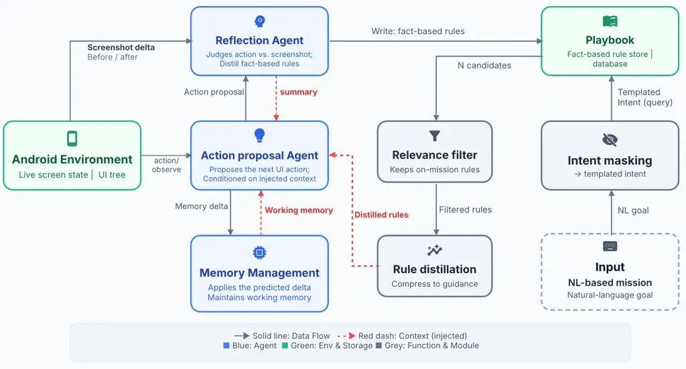
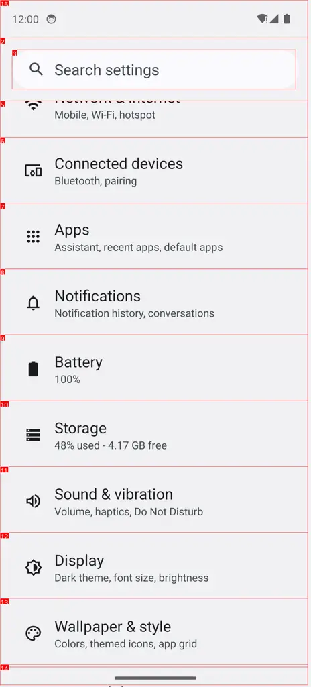
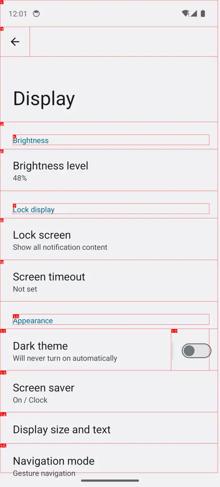
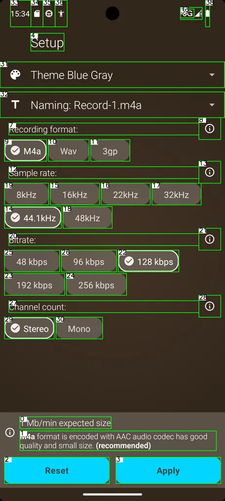

\workshoptitle

VLM4RWD

# MAPLE: A Multimodal Mobile Agent with Playbook-Learned Experience

Jun Wang Email: [junw@wustl.edu](mailto:) Affiliation: Google
Affiliation: Washington University in St. Louis    Aurora Wei
Email: [ioannisk@wustl.edu](mailto:) Affiliation: Google    Lucas
Spangher Email: [aurorawei@google.com](mailto:) Affiliation: Google   
Ming Zhang Email: [spangher@google.com](mailto:) Affiliation: Google   
Eugene Ie    Yiannis Kantaros Email: [mingzhang@google.com](mailto:)
Affiliation: Google Affiliation: Washington University in St. Louis
Email: [eugeneie@google.com](mailto:)

###### Abstract

Autonomous agents powered by vision-language models (VLMs) show great
potential in navigating mobile graphical user interfaces (GUIs) to
complete complex tasks. However, existing paradigms face fundamental
scalability bottlenecks: fine-tuning requires massive high-fidelity
datasets or prohibitive training time and compute, while gradient-free
approaches rely on custom static heuristics or costly trial-and-error
trajectory exploration where feedback is deferred until the end of
execution. To address these limitations, we introduce MAPLE (Multimodal
Agent with Playbook-Learned Experience), a novel gradient-free
multi-agent framework that enables dynamic, step-wise experience sharing
and execution-time prompt evolution. Unlike traditional
action-reflection architectures that depend on costly, post-hoc
self-reflection, MAPLE enables agents to cross-reference and distribute
runtime insights in real time at each operational step. This dynamic
exchange eliminates blind trial-and-error looping and steers agents
along direct, grounded interaction paths. Extensive evaluations on the
AndroidWorld and MobileWorld benchmarks demonstrate that MAPLE achieves
state-of-the-art performance on complex, long-horizon mobile tasks,
while proving scalable and adaptable across novel environments.

## 1 Introduction

Despite significant advancements in intuitive interface design, mobile
devices remain challenging or inaccessible to large segments of the
population, particularly the elderly and individuals with visual
impairments. With the rapid evolution of Vision-Language Models
(VLMs) \[3\], GUI-based autonomous agents have emerged as a
transformative paradigm to bridge this accessibility gap and democratize
access to essential modern technology. By empowering users to delegate
complex, multi-application tasks via natural language, these agents hold
immense potential to transform digital autonomy. Consequently,
substantial research has focused on deploying foundation models as
interactive reasoning engines across mobile platforms \[23, 4, 22, 6,
7\], accompanied by comprehensive benchmarks \[14, 8, 19\] designed to
evaluate the frontiers of agentic capabilities.

However, developing autonomous agents for mobile UI navigation requires
balancing generalizability, online interaction overhead, and offline
data curation costs. Existing paradigms struggle to strike this balance:
gradient-based reinforcement learning requires prohibitively expensive
environment rollouts, while zero-shot inference frameworks remain
handicapped by static prompts or brittle, text-bound memory structures
that fail to capture the visual nuances of dynamic mobile interfaces. In
opaque, highly dynamic mobile GUIs, purely memorizing procedural step
sequences is insufficient; an agent must dynamically reverse-engineer
interface mechanics through visual transitions.

To bridge this fundamental gap, we introduce the Multimodal Agent with
Playbook-Learned Experience (MAPLE). Designed as a cold-start, continual
learning system, MAPLE adapts the principles of step-level reflection
and cross-episodic playbooks specifically for the multimodal mobile
domain. Rather than relying on massive pre-curated datasets or text-only
procedural memory, MAPLE leverages explicit visual state transitions
(e.g., before-and-after screenshots) to autonomously distill declarative
UI rules on the fly. By decoupling intra-episodic state tracking from
cross-episodic knowledge accumulation and grounding retrieved priors in
the active visual interface, MAPLE achieves robust, cold-start
generalization across unseen mobile applications.

In summary, the primary contributions of this work are three-fold:

- •
  Dual-Memory Cognitive Architecture: We introduce MAPLE, a cold-start,
  gradient-free mobile agent architecture built around two complementary
  memory streams: (1) a bounded Working Memory instantiated as a dynamic
  key-value store that tracks transient, within-episode task state
  (e.g., extracted data and sub-goal checklists), and (2) a persistent
  Playbook that accumulates reusable, declarative UI mechanics across
  episodes. Coupled within a factorized step-level reasoning loop, these
  two memories coordinate short-term task execution with long-term
  interface priors without offline datasets or task-specific heuristics.
- •
  Self-Supervised Hindsight Distillation & Grounded Retrieval: We design
  a closed-loop mechanism to populate and query the Playbook entirely on
  the fly. By comparing post-action screenshot transitions against
  predicted visual outcomes, MAPLE autonomously distills and
  deduplicates universal action-effect facts, then retrieves them via
  intent masking and greedy visual anchor matching so injected guidance
  stays anchored to the active screen layout.
- •
  Extensive Evaluation & State-of-the-Art Performance: We evaluate MAPLE
  on two open-domain mobile benchmarks (AndroidWorld \[14\] and
  MobileWorld \[8\]) across six Vision-Language Models spanning
  open-weight to frontier scales. Powered by Gemini-3-Flash, MAPLE
  reaches 75.9% Success Rate on AndroidWorld and 60.25% on MobileWorld
  (including a record 68.18% on interactive tasks), demonstrating
  superior navigational directness and strong cross-model
  generalization.

## 2 Related Work

Developing autonomous agents for mobile UI navigation requires balancing
policy generalizability, online interaction overhead, and offline
curation costs. Existing literature generally bifurcates into
gradient-based policy optimization and inference-only framework
orchestration.

### 2.1 Gradient-Based Policy Optimization in GUIs

The first lineage leverages gradient-based reinforcement learning (RL)
to cast GUI task execution as a policy optimization problem. Frameworks
such as K²-Agent \[24\], MobileRL \[25\], SoLS \[12\], and the GUI-R1
family \[10\] explicitly fine-tune foundation models via algorithms such
as Group Relative Policy Optimization (GRPO) \[16\] or off-policy
actor-critic methods with experience replay. While these approaches can
discover robust interface policies, their scalability remains
bottlenecked by severe sample inefficiency, as policy convergence
demands extensive environmental interaction. On mobile platforms,
executing rollouts over high-dimensional GUI state spaces inside live
Android emulators incurs steep computational latency and infrastructure
overhead, making large-scale, emulator-in-the-loop RL post-training
prohibitively expensive.

### 2.2 Gradient-Free & Static Inference-Based Agents

To bypass gradient optimization, a second lineage focuses on
gradient-free, inference-based architectures leveraging zero-shot
foundation models. While computationally lightweight, their adaptability
to unseen domains is often hindered by reliance on static priors. Early
approaches depended on handcrafted prompt templates or pre-collected UI
exploration graphs (e.g., AppAgent \[27\], AutoDroid \[23\]). Recent
efforts like GEPA \[1\] automate prompt tuning via offline genetic
optimization. However, these strategies rely on mini-batch sampling,
parallel environment cloning, and static state assumptions—conditions
that rarely hold across dynamic, stateful mobile applications.

### 2.3 Dynamic Memory & Continual Learning in Agents

To eliminate offline curation, recent works explore continuous learning
and dynamic memory architectures that update agent logic on the fly. For
instance, Agentic Context Engineering (ACE) \[28\] constructs a
persistent, cross-session playbook to mitigate context collapse, while
SCOPE \[13\] introduces dual-stream tactical and strategic updates to
recover from mid-task failures.

Despite these advances, adapting text-centric memory frameworks like ACE
and SCOPE to mobile GUIs reveals a fundamental limitation: they
accumulate procedural task strategies (memorizing specific action
sequences) suited primarily for transparent, text-based environments. In
opaque, highly dynamic visual GUIs, procedural memory generalizes poorly
across UI updates and layout shifts. In contrast, MAPLE transitions from
procedural memorization to causal rule distillation. By evaluating
multimodal state transitions (e.g., screenshot diffs), MAPLE
autonomously extracts declarative facts about UI mechanics to construct
a localized, visually-grounded world model.



Figure 1: Overview of the MAPLE framework. MAPLE integrates
intra-episodic UI execution with a cross-episodic learning loop. Given a
user goal, the agent retrieves visually grounded priors from a
persistent Playbook and conditions on short-term Working Memory to
execute actions. Post-execution reflection updates local state tracking
while distilling generalizable rules back into the Playbook for
continuous knowledge accumulation.

## 3 Multimodal Agent with Playbook-Learned Experience (MAPLE)

Figure 1 illustrates the overall execution and learning loop of MAPLE.
We first formalize mobile GUI navigation as a dual-memory POMDP
(Section 3.1), then detail intra-episodic state tracking and factorized
action selection (Sections 3.2–3.3), followed by cross-episodic Playbook
distillation and visually grounded retrieval (Sections 3.4–3.5).

### 3.1 Problem Formulation

We formalize mobile GUI navigation as a goal-conditioned Partially
Observable Markov Decision Process (POMDP), defined by the tuple
$`\mathcal{M}=\langle\mathcal{S},\mathcal{A},\mathcal{T},\Omega,\mathcal{O},\mathcal{G},\mathcal{R}\rangle`$,
where $`\mathcal{S}`$ denotes the unobservable system state space
(including internal app variables and off-screen widgets),
$`\mathcal{T}`$ the state transition dynamics, $`\Omega`$ the
observation space, and $`\mathcal{G}`$ the space of natural-language
user goals. At step $`t`$, given latent state $`s_{t}\in\mathcal{S}`$,
the observation process $`\mathcal{O}`$ coupled with Set-of-Marks (SoM)
grounding converts the raw screen and view hierarchy into a multimodal
observation $`o_{t}=(\tilde{I}_{t},E_{t})\in\Omega`$, pairing the
tag-annotated screenshot $`\tilde{I}_{t}`$ with the parsed set of
interactable UI elements $`E_{t}`$. Accordingly, the action space
$`\mathcal{A}`$ comprises parameterized UI and dialogue operations
(e.g., tap, swipe, text input, user query) indexed directly over
$`e\in E_{t}`$, avoiding continuous coordinate regression. Because
$`s_{t}`$ is latent, a standard agent conditions its policy
$`a_{t}\sim\pi(a_{t}\mid h_{t},g)`$ on the sampled goal
$`g\in\mathcal{G}`$ and interaction history
$`h_{t}=(o_{0},a_{0},\dots,o_{t})`$ to generate an episode trajectory
$`\tau=(s_{0},o_{0},a_{0},\dots,s_{T})`$ toward a terminal state
$`s_{T}`$ satisfying $`g`$.

While task completion is evaluated only at episode termination via a
sparse binary reward
$`\mathcal{R}(s_{T},g)=\mathbb{I}(s_{T}\models g)\in\{0,1\}`$, a
training-free VLM agent cannot optimize $`\pi`$ directly over full
trajectories; instead, global task success depends on sequentially
selecting well-grounded actions at each step $`t`$. Conditioning
step-wise inference on the raw, append-only history $`h_{t}`$, however,
accumulates irrelevant visual clutter and compounding false
premises—early misinterpretations persist in context and derail
downstream decisions—while purely myopic selection from $`o_{t}`$ alone
gets trapped in unfamiliar UI layouts. To make step-wise action
selection reliable over horizon $`T`$ without parameter updates, MAPLE
reshapes the conditioning context through two complementary memory
streams: (1) a persistent, cross-episodic Playbook
$`\mathcal{D}_{\ell}`$ (initialized cold-start at
$`\mathcal{D}_{0}=\emptyset`$), updated after each episode trajectory
$`\tau_{\ell}`$ with reusable UI transition rules distilled via
self-supervised hindsight reflection; and (2) a bounded, intra-episodic
Working Memory $`m_{t}=\Phi(m_{t-1},\Delta m_{t-1})`$ (reset each
episode at $`m_{0}=\emptyset`$), where a deterministic parser $`\Phi`$
merges autoregressive key-value updates $`\Delta m_{t-1}`$ (insertions,
modifications, or deletions) emitted at the previous step. At step
$`t`$, combining $`m_{t}`$ with screen-grounded priors
$`\mathcal{P}_{t}`$ retrieved from $`\mathcal{D}`$ forms a bounded
context $`C_{t}=\langle g,o_{t},m_{t},\mathcal{P}_{t}\rangle`$, yielding
the active policy $`\pi(a_{t}\mid h_{t},g)\approx\pi(a_{t}\mid C_{t})`$.

### 3.2 Bounded Working Memory

Rather than appending uncurated observation history, MAPLE instantiates
the Working Memory ($`m_{t}`$) as a bounded, dynamic dictionary of
semantic key-value pairs (e.g., {"clipboard": "code*1", "item_2_status":
"checked"}). Crucially, rather than relying on predefined schemas, both
the keys and values (e.g., active sub-goals, runtime variables, and
checklist states) are generated on-the-fly: at step $`t`$, the policy
autoregressively predicts a schema update $`\Delta m*{t}`$, which the
deterministic parser $`\Phi`$ merges into $`m\_{t}`$. This design
replaces linearly growing raw screenshot histories with a compact,
editable key-value state representation that remains interpretable and
dynamically adapts to the active UI task.

### 3.3 Autoregressive Policy Factorization

Directly predicting actions via monolithic probability distributions
$`P(a_{t}\mid C_{t})`$ frequently leads to spatial ungrounding and
temporal myopia. MAPLE factorizes the policy output into an
autoregressive sequence of cognitive artifacts:

```math
\begin{split}P(a_{t},\hat{o}_{t+1},z_{t},\Delta m_{t}\mid C_{t})&=P(\Delta m_{t}\mid C_{t})\cdot P(z_{t}\mid C_{t},\Delta m_{t})\\
&\quad\cdot P(\hat{o}_{t+1}\mid C_{t},\Delta m_{t},z_{t})\cdot P(a_{t}\mid C_{t},\Delta m_{t},z_{t},\hat{o}_{t+1})\end{split} \tag{1}
```

Under this factorized bottleneck, the VLM generates a rigorous reasoning
chain: (1) Memory Modulation ($`\Delta m_{t}`$): The policy emits memory
deltas to iteratively update the working memory state
$`m_{t+1}=\Phi(m_{t},\Delta m_{t})`$, appending, updating, or deleting
semantic trackers; (2) Chain-of-Thought Rationale ($`z_{t}`$):
Conditioned on the updated state, the policy generates a localized
rationale aligning immediate visual evidence with the retrieved Playbook
priors $`\mathcal{P}_{t}`$; (3) Forward Dynamics Prediction
($`\hat{o}_{t+1}`$): Crucially, the policy must explicitly hypothesize
the semantic visual consequence of its intended action prior to
execution (e.g., predicting the appearance of a dropdown menu); and (4)
Action Execution ($`a_{t}`$): Only after establishing this reasoning
sequence does the policy emit the final parameterized interaction
$`a_{t}\in\mathcal{A}`$ mapped to a discrete SoM element (e.g.,
tap(element*14)). By architecturally requiring forward dynamics
prediction ($`\hat{o}*{t+1}`$) and explicit state tracking
($`\Delta m\_{t}`$) before mechanical execution, MAPLE ensures that
physical interactions are strictly grounded in both episodic intent and
historical knowledge, reducing the risk of blind, repetitive looping
behaviors commonly observed in unbottlenecked vision-language policies.

### 3.4 Self-Supervised Hindsight Distillation & Playbook Consolidation

Following action execution $`a_{t}`$ and environment stabilization to
observation $`o_{t+1}`$, MAPLE enters the hindsight reflection phase.
While intra-episodic Working Memory ($`m_{t}`$) tracks transient task
variables, cross-episodic learning requires evaluating observed state
transitions to extract generalizable knowledge. MAPLE achieves this
through a self-supervised reflection mechanism that distills transition
dynamics into a dual-output hindsight artifact, consolidating universal
interface mechanics into a persistent, non-parametric database termed
the Playbook.

#### Playbook Database Formalization.

We define the Playbook $`\mathcal{D}=\{d_{1},d_{2},\dots,d_{N}\}`$ as a
vector-indexed knowledge repository of verified UI mechanics, where each
entry is a 5-tuple $`d_{i}=(k_{i},A_{i},f_{i},\mathbf{v}_{i},c_{i})`$
comprising a generalized task intent template $`k_{i}`$, structural
layout anchors $`A_{i}`$ (e.g., textual and state element descriptors)
for spatial grounding, a natural-language declarative fact $`f_{i}`$
with dense semantic embedding $`\mathbf{v}_{i}`$, and an empirical
confidence counter $`c_{i}\in\mathbb{N}^{+}`$ tracking rule verification
and recurrence across episodes.

#### Dual-Output Hindsight Distillation.

To evaluate environmental feedback autonomously, a reflection module
compares the empirical transition tuple $`(o_{t},a_{t},o_{t+1})`$
against the agent’s prior visual expectation $`\hat{o}_{t+1}`$. From
this comparison, it distills two complementary outputs
$`(\text{sum}_{t},f_{\text{new}})`$:

1.  1.  Localized Episodic Summary ($`\text{sum}_{t}`$): A concise temporal
        description of the immediate transition (e.g., “Tapped ‘Filter’,
        expanding the options dropdown”). The summary $`\text{sum}_{t}`$
        updates the intra-episodic trajectory history, providing immediate
        sequential context for subsequent steps in the active mission.
2.  2.  Universal Declarative Fact ($`f_{\text{new}}`$): An abstracted,
        third-person action-effect rule defining an invariant UI property
        (e.g., “The vertical ellipsis icon expands the app configuration
        menu”). By omitting task-specific instance details,
        $`f_{\text{new}}`$ functions as a modular world-model heuristic
        designed for zero-shot transfer across tasks.

#### Semantic Consolidation and Deduplication.

Newly distilled facts $`f_{\text{new}}`$ are packaged into a candidate
entry
$`d_{\text{new}}=\big(k_{\text{intent}},A(o_{t}),f_{\text{new}},\mathbf{v}_{\text{new}},1\big)`$
using the masked goal intent $`k_{\text{intent}}=\psi(g)`$, pre-action
screen anchors $`A(o_{t})`$, and dense fact embedding
$`\mathbf{v}_{\text{new}}`$, then routed through a multi-stage
consolidation pipeline before commitment to $`\mathcal{D}`$. Restricting
to existing entries with matching intent
$`\{d_{i}\in\mathcal{D}\mid k_{i}=k_{\text{intent}}\}`$, the system
finds the nearest neighbor
$`i^{*}=\arg\max_{i:\,k_{i}=k_{\text{intent}}}\cos(\mathbf{v}_{\text{new}},\mathbf{v}_{i})`$
with peak similarity
$`S_{\text{cos}}^{*}=\cos(\mathbf{v}_{\text{new}},\mathbf{v}_{i^{*}})`$
(setting $`S_{\text{cos}}^{*}=0`$ if no entry yet shares
$`k_{\text{intent}}`$). Integration into $`\mathcal{D}`$ is governed by
dual similarity thresholds $`\gamma_{\text{novel}}`$ and
$`\gamma_{\text{dup}}`$
($`0<\gamma_{\text{novel}}<\gamma_{\text{dup}}<1`$):

```math
\mathcal{D}\leftarrow\begin{cases}\text{Update: }c_{i^{*}}\leftarrow c_{i^{*}}+1,&\text{if }S_{\text{cos}}^{*}\geq\gamma_{\text{dup}}\quad\text{(Redundant)}\\
\text{Insert: }\mathcal{D}\cup\{d_{\text{new}}\},&\text{if }S_{\text{cos}}^{*}<\gamma_{\text{novel}}\quad\text{(Novel)}\\
\text{Resolve}(\mathcal{D},d_{\text{new}},i^{*}),&\text{otherwise }(\gamma_{\text{novel}}\leq S_{\text{cos}}^{*}<\gamma_{\text{dup}}),\end{cases} \tag{2}
```

where $`\text{Resolve}(\cdot)`$ triggers an auxiliary semantic
verification check. Specifically, the model evaluates whether
$`f_{\text{new}}`$ and $`f_{i^{*}}`$ convey functionally identical UI
mechanics. If deemed equivalent, the existing rule’s confidence counter
is incremented ($`c_{i^{*}}\leftarrow c_{i^{*}}+1`$); otherwise,
$`d_{\text{new}}`$ is inserted into $`\mathcal{D}`$ as a distinct rule.
Through this closed-loop reflection and consolidation process, MAPLE
maintains immediate episodic awareness while progressively accumulating
a clean, deduplicated repository of reusable UI knowledge.

### 3.5 Intent-Masked and Visually-Grounded Retrieval

Prior to action execution at each decision step $`t`$, MAPLE queries the
Playbook $`\mathcal{D}`$ using the goal $`g`$ and current observation
$`o_{t}`$ to construct the heuristic prior $`\mathcal{P}_{t}`$. Naive
prior retrieval using raw text or unconstrained features causes context
saturation and hallucinations. To ensure retrieved priors are physically
actionable on the active screen, MAPLE filters the Playbook
$`\mathcal{D}`$ through a sequential two-stage retrieval pipeline:

1. Semantic Intent Masking: Raw user objectives $`g`$ often contain
   volatile, instance-specific entities (e.g., names, dates) that hinder
   direct matching. To enable cross-task generalization, MAPLE applies an
   abstraction function $`k_{\text{intent}}=\psi(g)`$ that maps specific
   inputs to canonical placeholders (e.g., “Send ‘123’ to John” becomes
   “Send ⟨MESSAGE⟩ to ⟨RECIPIENT⟩”). Using $`k_{\text{intent}}`$ as a
   high-level query key, we retrieve a task-relevant candidate subset
   $`\mathcal{D}_{\text{cand}}=\{d_{i}\in\mathcal{D}\mid k_{i}=k_{\text{intent}}\}`$.

2. Greedy Visual Anchor Matching: To guarantee that candidates in
   $`\mathcal{D}_{\text{cand}}`$ are physically applicable to the current
   interface, we evaluate their structural congruence with the active
   screen. We extract a set of active layout anchors
   $`A(o_{t})=\{u_{1},\dots,u_{M}\}`$ from the observation $`o_{t}`$, where
   each anchor represents a visible UI element
   $`u_{j}=\langle\text{class},\text{text},\text{state}\rangle`$. For each
   candidate $`d_{i}\in\mathcal{D}_{\text{cand}}`$ containing historically
   recorded anchors $`A_{i}`$, we compute a directed visual alignment score
   using a greedy maximum-similarity mapping:
   $`S_{\text{anchor}}(A(o_{t}),A_{i})=\frac{1}{|A_{i}|}\sum_{u\in A_{i}}\max_{u^{\prime}\in A(o_{t})}\text{sim}(u,u^{\prime})`$,
   where $`\text{sim}(\cdot,\cdot)\in[0,1]`$ is a bounded semantic
   similarity score over anchor attributes. Candidates are pruned unless
   they satisfy a global visual congruence threshold:
   $`S_{\text{anchor}}\geq\gamma_{\text{anchor}}`$.

Dynamic Prior Distillation. If no candidate satisfies
$`\gamma_{\text{anchor}}`$ (e.g., at cold start), we set
$`\mathcal{P}_{t}=\emptyset`$. When multiple candidates qualify,
injecting raw, disjoint rules directly into the prompt can cause context
redundancy or conflicting guidance. To resolve this, MAPLE ranks the
qualified candidates by their visual score $`S_{\text{anchor}}`$ and
historical confidence $`c_{i}`$, isolating the top-$`K`$ subset of
declarative facts $`\mathcal{F}_{\text{top-}K}`$. An auxiliary model
then synthesizes the top-$`K`$ facts $`\mathcal{F}_{\text{top-}K}`$,
conditioned on $`g`$ and active anchors $`A(o_{t})`$, into a single
cohesive heuristic prior $`\mathcal{P}_{t}`$. This distilled prior is
appended directly to the action formulation context tuple
$`C_{t}=\langle g,o_{t},m_{t},\mathcal{P}_{t}\rangle`$. By coupling
semantic abstraction with real-time layout verification, this pipeline
ensures that injected playbook guidance remains grounded in the active
visual observation.

## 4 Experiments

### 4.1 Experimental Setup

#### Evaluation Benchmarks & Setup.

We evaluate MAPLE on two standardized mobile environments: (1)
AndroidWorld \[14\], comprising 116 programmatic tasks across 20
applications with dynamic task parameterization; and (2)
MobileWorld \[8\], a harder suite testing multi-app orchestration
(averaging 27.8 steps vs. 14.3 in AndroidWorld) and interactive
ambiguity. We evaluate on MobileWorld’s 161 core tasks across its
GUI-Only (117 tasks) and Agent-User Interaction (44 tasks) splits.
Across both benchmarks, agents issue parameterized UI actions over
Set-of-Marks grounded elements. An episode terminates upon the agent
signaling completion or exhausting the step budget $`T`$, with task
success $`\mathbb{I}(s_{T}\models g)`$ verified deterministically by
native benchmark evaluators auditing ground-truth system states (e.g.,
querying SQLite databases).

#### Metrics & Protocol.

An evaluation episode terminates upon the agent issuing a completion
action or exhausting the pre-allocated step budget $`T`$. Following
standard benchmark conventions, we evaluate performance across two
primary metrics:

- •
  Task Success Rate (SR, %): The proportion of tasks deterministically
  completed within $`t\leq T`$ steps, as verified by native benchmark
  environment evaluators.
- •
  Average Trajectory Length (Steps): The average number of physical UI
  interactions required for task completion, quantifying navigational
  directness and the agent’s ability to reach target states without
  trial-and-error looping.

For cold-start evaluation, the Playbook starts completely empty
($`\mathcal{D}_{0}=\emptyset`$) at the beginning of each benchmark
suite, accumulates distilled rules sequentially across a single pass in
the benchmark’s default task order (while Working Memory resets every
episode, $`m_{0}=\emptyset`$), and is wiped cleanly between model
backbones and ablation runs to prevent cross-run leakage. Complete
implementation details—including VLM hyper-parameters, exact step
budgets, and prompt templates—are provided in Appendix A.6.

#### Baselines.

We benchmark MAPLE against two agent categories: (1) Adapted M3A
(Controlled Baseline): We adapt the M3A framework \[14\], which uses an
Observe-Think-Act-Reflect loop similar to Reflexion \[17\] and
Voyager \[21\]. To evaluate true cross-app generalization, we remove
handcrafted per-task guidelines while upgrading M3A with the same
structured prompting (including the Discoverability Protocol;
Appendix A.2), Set-of-Marks grounding, and dialogue actions as MAPLE.
Sharing the identical VLM backbone but lacking Working Memory
($`m_{t}`$), forward dynamics prediction ($`\hat{o}_{t+1}`$), and the
Playbook ($`\mathcal{D}`$), this baseline directly isolates the gains of
our architecture. (2) Inference-Only SOTA: We compare against published
leaderboard baselines, including Agent-SAMA \[5\] and MobileUse \[9\],
which execute actions via static prompt contexts without dynamic memory
or hindsight distillation.

| (a) AndroidWorld Benchmark (116 Tasks)                                                                                               |                        |                       |             |                    |                  |
| ------------------------------------------------------------------------------------------------------------------------------------ | ---------------------- | --------------------- | ----------- | ------------------ | ---------------- |
| Method / Agent                                                                                                                       |                        | Backbone Model        |             | Paradigm           | Success Rate (%) |
| Unrestricted Leaderboard Frontiers^(‡)                                                                                               |                        |                       |             |                    |                  |
| MobileUseAgent \[20\]                                                                                                                |                        | Seed1.8-GUI           |             | Unrestricted Agent | 97.4             |
| AutoDevice \[2\]                                                                                                                     |                        | Gemini-3-Pro + Sonnet |             | Unrestricted Agent | 94.8             |
| Controlled Academic Baselines (Gradient-Free)                                                                                        |                        |                       |             |                    |                  |
| Stable Planner \[11\]                                                                                                                |                        | Qwen2.5-VL-72B        |             | Zero-Shot          | 63.8             |
| Agent-SAMA \[5\]                                                                                                                     |                        | GPT-4o + Qwen-VL      |             | Zero-Shot          | 63.7             |
| MobileUse \[9\]                                                                                                                      |                        | Qwen2.5-VL-72B        |             | Zero-Shot          | 62.9             |
| M3A Baseline (Adapted) \[14\]                                                                                                        |                        | Gemini-3-Flash        |             | Zero-Shot          | 71.6             |
| MAPLE (Ours)                                                                                                                         |                        | Gemini-3-Flash        |             | Dual-Memory        | 75.9             |
| Controlled Academic Baselines (Gradient-Based)                                                                                       |                        |                       |             |                    |                  |
| K²-Agent \[24\]                                                                                                                      |                        | Qwen2.5-VL-72B        |             | RL (Upper Bound)   | 76.7             |
|                                                                                                                                      |                        |                       |             |                    |                  |
| (b) MobileWorld Benchmark (161 Tasks: 117 GUI-Only + 44 User-Interactive)                                                            |                        |                       |             |                    |                  |
| Method / Agent                                                                                                                       | Backbone Model         | Type                  | Overall (%) | GUI-Only (%)       | User-Int. (%)    |
| Heavyweight & Multi-Model Frontiers                                                                                                  |                        |                       |             |                    |                  |
| MagicGUI-Agent \[18\]                                                                                                                | GPT-5.4 + Seed-1.8     | Agentic               | 66.5        | 66.7               | 65.9             |
| Seed-2.0-Pro \[15\]                                                                                                                  | Seed-2.0-Pro           | General               | 62.7        | 63.2               | 61.4             |
| Claude-Opus-4.7                                                                                                                      | Claude-Opus-4.7        | General               | 57.1        | 56.4               | 59.1             |
| GPT-5 + UI-Ins-7B                                                                                                                    | GPT-5 + UI-Ins-7B      | Agentic               | 56.2        | 54.0               | 62.2             |
| Controlled Comparison (Lightweight Backbone)                                                                                         |                        |                       |             |                    |                  |
| Gemini-3.1-Pro-Preview                                                                                                               | Gemini-3.1-Pro-Preview | General               | 48.4        | 58.1               | 22.7             |
| M3A Baseline (Adapted)                                                                                                               | Gemini-3-Flash         | Agentic               | 53.42       | 53.85              | 52.27            |
| MAPLE (Ours)                                                                                                                         | Gemini-3-Flash         | Dual-Memory           | 60.25       | 57.26              | 68.18^(†)        |
| ^(‡) Unrestricted entries frequently utilize heavy manual heuristics or closed-source system hacks, serving as environment ceilings. |                        |                       |             |                    |                  |
| ^(†) Denotes Rank \#1 SOTA on the public MobileWorld User-Interactive benchmark.                                                     |                        |                       |             |                    |                  |
| Model Types: Agentic: planner-executor systems with a grounding module. General: end-to-end LMMs without GUI fine-tuning.            |                        |                       |             |                    |                  |

Table 1: Main Results on Mobile Agent Benchmarks. MAPLE demonstrates
superior execution across AndroidWorld ($`1\times`$ step budget) and
MobileWorld (161 tasks). In AndroidWorld, MAPLE significantly
outperforms all strictly zero-shot/gradient-free academic baselines,
performing on par with gradient-based RL frameworks. In the highly
complex MobileWorld environment, despite utilizing a lightweight Flash
backbone, MAPLE achieves Rank \#3 Overall and secures the Rank \#1 SOTA
on User-Interactive tasks across the entire public leaderboard.

### 4.2 Main Results

Our empirical evaluation investigates two central questions: (1) Does
MAPLE’s integrated dual-memory architecture outperform static zero-shot
frameworks without relying on handcrafted, task-specific heuristics? and
(2) How effectively does MAPLE generalize across long-horizon,
multi-app, and interactive mobile workflows? Table 1 summarizes
end-to-end performance on AndroidWorld and MobileWorld using
Gemini-3-Flash as the primary VLM backbone.

#### State-of-the-Art Generalization on AndroidWorld.

As shown in Table 1(a), while unrestricted leaderboard entries (e.g.,
MobileUseAgent, AutoDevice) achieve high ceilings, they frequently rely
on heavy environment-specific scaffolding, bespoke tool pipelines, or
hardcoded per-app heuristic overrides. In contrast, operating strictly
through standard Set-of-Marks observations without task- or app-specific
guidance, MAPLE sets a strong bar for training-free mobile agents. MAPLE
achieves a 75.9% Success Rate (SR), significantly outperforming
competitive gradient-free academic frameworks including MobileUse
($`62.9\%`$), Agent-SAMA ($`63.7\%`$), and Stable Planner ($`63.8\%`$).
Remarkably, without requiring parameter updates or offline environment
rollouts, MAPLE performs competitively with compute-intensive,
gradient-fine-tuned reinforcement learning baselines such as
$`K^{2}`$-Agent ($`76.7\%`$).

#### Strong Multi-App Performance on MobileWorld.

MobileWorld introduces challenging long-horizon dependencies across
multiple applications. As presented in Table 1(b), MAPLE achieves an
Overall SR of 60.25%, securing Rank 3 Overall on the public MobileWorld
benchmark. Powered by a lightweight Gemini-3-Flash backbone, MAPLE’s
dual-memory architecture surpasses unaugmented frontier models including
Gemini-3.1-Pro-Preview ($`48.4\%`$) and Claude-Opus-4.7 ($`57.1\%`$), as
well as specialized agentic setups utilizing GPT-5 ($`56.2\%`$).

| Model               | Method       | Overall SR (%) | GUI-Only (%) | User-Int. (%) | Trajectory Length |
| ------------------- | ------------ | -------------- | ------------ | ------------- | ----------------- |
| Gemini-3-Flash      | MAPLE (Ours) | 60.25          | 57.26        | 68.18         | 24.14             |
|                     | M3A Baseline | 53.42          | 53.85        | 52.27         | 25.65             |
| Gemini-3-Flash-Lite | MAPLE (Ours) | 39.13          | 35.04        | 50.00         | 19.13             |
|                     | M3A Baseline | 31.68          | 31.62        | 31.82         | 21.11             |
| Qwen3.6-35B         | MAPLE (Ours) | 27.95          | 28.21        | 27.27         | 26.17             |
|                     | M3A Baseline | 25.47          | 27.35        | 20.45         | 25.23             |
| Gemma4-26B-A4B      | MAPLE (Ours) | 27.95          | 27.35        | 29.55         | 34.00             |
|                     | M3A Baseline | 14.29          | 17.09        | 6.82          | 45.60             |

Table 2: Ablation Study on Model Generalization. With identical
Discoverability Protocol prompting (Appendix A.2), MAPLE improves
success rates over the M3A baseline across all four VLM backbones while
reducing trajectory steps on three.

#### Robustness under Interactive Ambiguity.

By coordinating explicit state tracking ($`m_{t}`$), meta-cognitive
ambiguity triggers, and grounded Playbook priors ($`\mathcal{P}_{t}`$),
MAPLE prevents futile exploratory loops and preserves context bandwidth
for resolving multi-turn dialogue ambiguity. Consequently, MAPLE
achieves 68.18% SR on User-Interactive tasks—a +15.91% absolute
improvement over the Adapted M3A baseline (52.27%). This establishes the
highest score recorded to date on this split, outperforming specialized
frameworks such as MagicGUI-Agent (65.9%).

#### Model Generalization Across Scales.

To validate that MAPLE’s gains are model-agnostic, we evaluate across
proprietary (Gemini-3-Flash, Gemini-3-Flash-Lite) and open-weight
(Qwen3.6-35B, Gemma4-26B-A4B) backbones against the controlled Adapted
M3A baseline (Table 2) on MobileWorld. Across all model tiers, MAPLE
consistently boosts task success while steering agents toward shorter,
more direct interaction paths on three of the four backbones (and adding
less than one step on Qwen3.6-35B despite completing substantially more
multi-turn interactive tasks). The architectural gains are most
pronounced on the ambiguous User-Interactive split: MAPLE elevates
Gemini-3-Flash to a peak 68.18% SR ($`+15.91\%`$), while on
Gemma4-26B-A4B, it rescues the policy from catastrophic failure,
quadrupling interactive success ($`6.82\%\to 29.55\%`$) and cutting
trajectory steps by $`25.4\%`$ ($`45.60\to 34.00`$). Consistent gains
also hold across all six evaluated backbones on AndroidWorld
(Appendix B.2).

#### The Scaffolding Paradox and Limitations.

When scaled to frontier models on MobileWorld, MAPLE plateaus or
slightly regresses in overall success rate (matching Claude-Opus-4.8 at
$`63.35\%`$ and dipping from $`62.73\%`$ to $`59.63\%`$ on
Gemini-3.6-Flash), even though it continues to boost both models on
deterministic AndroidWorld tasks (Appendix B.2). We attribute this
saturation to the Scaffolding Paradox: frontier models possess strong
intrinsic reasoning and naturally excel at exploratory recovery (“smart
wandering”) under UI ambiguity. Imposing structured Playbook priors acts
as an overly rigid constraint, narrowing the model’s search space and
impeding opportunistic problem-solving. Crucially, MAPLE still shortens
average trajectory length across both models ($`23.24\to 22.20`$ and
$`21.70\to 20.40`$ steps), confirming that it enforces a direct
navigation policy; however, for frontier models, aggressively pruning
exploratory rollouts removes the exact trial-and-error mechanism
required to resolve complex edge cases. Details in Appendix A.5.

## 5 Conclusion and Future Work

In this work, we presented MAPLE (Multimodal Agent with Playbook-Learned
Experience), a gradient-free architecture designed for cold-start,
continual experience accumulation across mobile GUIs. By decoupling
intra-episodic state tracking via bounded Working Memory ($`m_{t}`$)
from cross-episodic distillation via a persistent Playbook
($`\mathcal{D}`$), MAPLE transitions the mobile agent paradigm from
brittle procedural memorization to the transfer of grounded, declarative
UI mechanics. Comprehensive evaluations on AndroidWorld and MobileWorld
demonstrate that MAPLE achieves leading training-free success
rates—including top performance on user-interactive workflows—while
guiding agents along more direct and purposeful execution trajectories.
Crucially, our scaling analysis reveals that MAPLE’s structured
scaffolding provides disproportionate gains for lightweight and
open-weight VLMs, preventing compounding failures under interactive
ambiguity. Future work will explore adaptive scaffolding mechanisms to
alleviate the Scaffolding Paradox on frontier models, as well as
extending MAPLE’s grounded experience-accumulation framework to broader
digital control domains, including web browsing and cross-platform
desktop automation.

## References

- \[1\] Lakshya A Agrawal, Shangyin Tan, Dilara Soylu, Noah Ziems, Rishi
  Khare, Krista Opsahl-Ong, Arnav Singhvi, Herumb Shandilya, Michael J
  Ryan, Meng Jiang, et al. Gepa: Reflective prompt evolution can
  outperform reinforcement learning. In First Workshop on Foundations of
  Reasoning in Language Models, 2025.
- \[2\] AutoDevice. Androidworld benchmark evaluation results.
  [https://autodevice.io/benchmark/](https://autodevice.io/benchmark/), 2026.
  Accessed: 2026-07-28.
- \[3\] Florian Bordes, Richard Yuanzhe Pang, Anurag Ajay, Alexander C
  Li, Adrien Bardes, Suzanne Petryk, Oscar Mañas, Zhiqiu Lin, Anas
  Mahmoud, Bargav Jayaraman, et al. An introduction to vision-language
  modeling. arXiv preprint arXiv:2405.17247, 2024.
- \[4\] Xiang Deng, Yu Gu, Boyuan Zheng, Shijie Chen, Sam Stevens, Boshi
  Wang, Huan Sun, and Yu Su. Mind2web: Towards a generalist agent for
  the web. Advances in Neural Information Processing Systems,
  36:28091–28114, 2023.
- \[5\] Linqiang Guo, Wei Liu, Yi Wen Heng, Tse-Hsun Peter Chen, and
  Yang Wang. Agent-sama: State-aware mobile assistant. In Proceedings of
  the AAAI Conference on Artificial Intelligence, volume 40, pages
  29459–29467, 2026.
- \[6\] Wenyi Hong, Weihan Wang, Qingsong Lv, Jiazheng Xu, Wenmeng Yu,
  Junhui Ji, Yan Wang, Zihan Wang, Yuxiao Dong, Ming Ding, et al.
  Cogagent: A visual language model for gui agents. In Proceedings of
  the IEEE/CVF conference on computer vision and pattern recognition,
  pages 14281–14290, 2024.
- \[7\] Yangqin Jiang and Chao Huang. Openphone: Mobile agentic
  foundation models. In Findings of the Association for Computational
  Linguistics: ACL 2026, pages 30362–30380, 2026.
- \[8\] Quyu Kong, Xu Zhang, Zhenyu Yang, Nolan Gao, Chen Liu, Panrong
  Tong, Chenglin Cai, Hanzhang Zhou, Jianan Zhang, Liangyu Chen, et al.
  Mobileworld: Benchmarking autonomous mobile agents in agent-user
  interactive and mcp-augmented environments. In Proceedings of the 64th
  Annual Meeting of the Association for Computational Linguistics
  (Volume 1: Long Papers), pages 6142–6167, 2026.
- \[9\] Ning Li, Xiangmou Qu, Jiamu Zhou, Jun Wang, Muning Wen,
  Kounianhua Du, Xingyu Lou, Qiuying Peng, and Weinan Zhang. Mobileuse:
  A gui agent with hierarchical reflection for autonomous mobile
  operation. arXiv preprint arXiv:2507.16853, 2025.
- \[10\] Run Luo, Lu Wang, Wanwei He, Longze Chen, Jiaming Li, and
  Xiaobo Xia. Gui-r1: A generalist r1-style vision-language action model
  for gui agents. arXiv preprint arXiv:2504.10458, 2025.
- \[11\] Fanglin Mo, Junzhe Chen, Haoxuan Zhu, and Xuming Hu. Building a
  stable planner: An extended finite state machine based planning module
  for mobile gui agent. arXiv preprint arXiv:2505.14141, 2025.
- \[12\] Georgios Papoudakis, Thomas Coste, Jianye Hao, Jun Wang, and
  Kun Shao. Succeed or learn slowly: Sample efficient off-policy
  reinforcement learning for mobile app control. Advances in Neural
  Information Processing Systems, 38:125031–125054, 2026.
- \[13\] Zehua Pei, Hui-Ling Zhen, Shixiong Kai, Sinno Jialin Pan, Yunhe
  Wang, Mingxuan Yuan, and Bei Yu. Scope: Prompt evolution for enhancing
  agent effectiveness. arXiv preprint arXiv:2512.15374, 2025.
- \[14\] Chris Rawles, Sarah Clinckemaillie, Yifan Chang, Jonathan
  Waltz, Gabrielle Lau, Marybeth Fair, Alice Li, William Bishop, Wei Li,
  Folawiyo Campbell-Ajala, et al. Androidworld: A dynamic benchmarking
  environment for autonomous agents. In International Conference on
  Learning Representations, volume 2025, pages 406–441, 2025.
- \[15\] Bytedance Seed. Seed2. 0 model card: Towards intelligence
  frontier for real-world complexity. arXiv preprint
  arXiv:2607.00248, 2026.
- \[16\] Zhihong Shao, Peiyi Wang, Qihao Zhu, Runxin Xu, Junxiao Song,
  Xiao Bi, Haowei Zhang, Mingchuan Zhang, YK Li, Yang Wu, et al.
  Deepseekmath: Pushing the limits of mathematical reasoning in open
  language models. Causal and Object-Centric Representations for
  Robotics (CORR) Workshop at CVPR, 2024.
- \[17\] Noah Shinn, Federico Cassano, Ashwin Gopinath, Karthik
  Narasimhan, and Shunyu Yao. Reflexion: Language agents with verbal
  reinforcement learning. In Advances in Neural Information Processing
  Systems (NeurIPS), volume 36, pages 8634–8652, 2023.
- \[18\] Liujian Tang, Shaokang Dong, Yijia Huang, Minqi Xiang, Hongtao
  Ruan, Bin Wang, Shuo Li, Zhiheng Xi, Zhihui Cao, Hailiang Pang, et al.
  Magicgui: A foundational mobile gui agent with scalable data pipeline
  and reinforcement fine-tuning. arXiv preprint arXiv:2508.03700, 2025.
- \[19\] Harsh Trivedi, Tushar Khot, Mareike Hartmann, Ruskin Manku,
  Vinty Dong, Edward Li, Shashank Gupta, Ashish Sabharwal, and Niranjan
  Balasubramanian. Appworld: A controllable world of apps and people for
  benchmarking interactive coding agents. In Proceedings of the 62nd
  Annual Meeting of the Association for Computational Linguistics
  (Volume 1: Long Papers), pages 16022–16076, 2024.
- \[20\] Volcengine. vephone mobileuse: Cloud phone python examples.
  [https://github.com/volcengine/vePhone/tree/main/Quick%20Start/MobileUse](https://github.com/volcengine/vePhone/tree/main/Quick%20Start/MobileUse), 2024.
  Accessed: 2026-07-28.
- \[21\] Guanzhi Wang, Yuqi Xie, Yunfan Jiang, Ajay Mandlekar, Chaowei
  Xiao, Yuke Zhu, Linxi Fan, and Anima Anandkumar. Voyager: An
  open-ended embodied agent with large language models. arXiv preprint
  arXiv:2305.16291, 2023.
- \[22\] Junyang Wang, Haiyang Xu, Jiabo Ye, Ming Yan, Weizhou Shen,
  Ji Zhang, Fei Huang, and Jitao Sang. Mobile-agent: Autonomous
  multi-modal mobile device agent with visual perception. The Fourteenth
  International Conference on Learning Representations (ICLR), 2024.
- \[23\] Hao Wen, Yuanchun Li, Guohong Liu, Shanhui Zhao, Tao Yu, Toby
  Jia-Jun Li, Shiqi Jiang, Yunhao Liu, Yaqin Zhang, and Yunxin Liu.
  Autodroid: Llm-powered task automation in android. In Proceedings of
  the 30th annual international conference on Mobile computing and
  networking, pages 543–557, 2024.
- \[24\] Zhe Wu, Donglin Mo, Hongjin Lu, Junliang Xing, Jianheng Liu,
  Yuheng Jing, Kai Li, Kun Shao, Jianye Hao, and Yuanchun Shi. Kˆ
  2-agent: Co-evolving know-what and know-how for hierarchical mobile
  device control. The Fourteenth International Conference on Learning
  Representations (ICLR), 2026.
- \[25\] Yifan Xu, Xiao Liu, Xinghan Liu, Jiaqi Fu, Hanchen Zhang, Bohao
  Jing, Shudan Zhang, Yuting Wang, Wenyi Zhao, and Yuxiao Dong.
  Mobilerl: Online agentic reinforcement learning for mobile gui agents.
  arXiv preprint arXiv:2509.18119, 2025.
- \[26\] Jianwei Yang, Hao Zhang, Feng Li, Xueyan Zou, Chunyuan Li, and
  Jianfeng Gao. Set-of-mark prompting unleashes extraordinary visual
  grounding in gpt-4v. arXiv preprint arXiv:2310.11441, 2023.
- \[27\] Chi Zhang, Zhao Yang, Jiaxuan Liu, Yanda Li, Yucheng Han, Xin
  Chen, Zebiao Huang, Bin Fu, and Gang Yu. Appagent: Multimodal agents
  as smartphone users. In Proceedings of the 2025 CHI Conference on
  Human Factors in Computing Systems, pages 1–20, 2025.
- \[28\] Qizheng Zhang, Changran Hu, Shubhangi Upasani, Boyuan Ma,
  Fenglu Hong, Vamsidhar Kamanuru, Jay Rainton, Chen Wu, Mengmeng Ji,
  Hanchen Li, Urmish Thakker, James Zou, and Kunle Olukotun. Agentic
  context engineering: Evolving contexts for self-improving language
  models, 2025.

Appendix: Supplementary Material

## Appendix Overview

To assist readers in navigating the supplementary material, this
appendix provides comprehensive experimental details, extended analyses,
and full system configurations for the MAPLE framework. The content is
structurally partitioned into two main sections corresponding to our
primary evaluation environments:

- •
  Section A: MobileWorld (Interactive & Long-Horizon Evaluation). This
  section details our primary testbed for handling ambiguity and
  cross-application workflows.
  - –
    Benchmark & Setup: Section A.1 defines the task taxonomy, while
    Section A.6 lists all exact VLM hyperparameters.
  - –
    Ablation Studies: We provide in-depth analyses on the impact of
    user-interactive triggering (Section A.2), cross-architecture
    generalizability (Section A.3), and the necessary VLM cognitive
    bandwidth/thinking budgets required for dynamic memory processing
    (Section A.4).
  - –
    Limitations: Section A.5 explores the “scaffolding paradox,”
    discussing where explicit memory constraints cause performance
    saturation in frontier models.
  - –
    Prompts & Visuals: Section A.7 provides the complete, unedited
    system prompts for all MAPLE modules, followed by a visual example
    of Set-of-Mark (SoM) grounding in Section A.8.

- •
  Section B: AndroidWorld (Deterministic & Zero-Shot Evaluation). This
  section outlines our validation on standard, heavily parameterized
  autonomous control tasks.
  - –
    Ablations & Benchmark Nuances: Following benchmark details in
    Section B.1, we present further cross-architecture validations
    (Section B.2) and investigate how relaxing step budgets impacts
    autonomous error recovery (Section B.3).
  - –
    Systemic Limitations Audit: Section B.4 provides a critical,
    programmatic audit of 13 “hard-to-complete” missions, detailing
    where benchmark rigidities and false negatives decouple from true
    agent reasoning.
  - –
    Configurations & Visuals: We detail our zero-shot hyperparameter and
    prompt adaptations in Sections B.5 and B.6, concluding with a
    step-by-step visual demonstration of a successful task trajectory in
    Section B.7.

## Appendix A Mobile World

### A.1 Benchmark Details

To rigorously evaluate the generalization and multi-step reasoning
capabilities of our proposed MAPLE agent, we utilize MobileWorld \[8\],
a recently introduced, highly challenging benchmarking environment for
autonomous mobile agents. While prior benchmarks like AndroidWorld have
driven significant progress, their saturation (with state-of-the-art
models exceeding 90% success rates) and reliance on short-horizon tasks
limit their utility for evaluating production-grade autonomy.
MobileWorld directly addresses these shortcomings by emphasizing
long-horizon workflows and introducing interactive, ambiguity-driven
task paradigms.

#### Task Taxonomy and Scope

MobileWorld consists of tasks spanning 20 third-party applications,
authentically replicating real-world usage patterns. For our evaluation,
we focus on the core subset comprising 161 tasks, which is structurally
partitioned into two primary categories:

- •
  GUI-Only (117 tasks): Traditional visual navigation and interface
  manipulation tasks, demanding precise visual grounding, memory
  retention, and spatial reasoning over extended trajectories.
- •
  Agent-User Interaction (44 tasks): A novel paradigm featuring
  deliberate instructional ambiguity. In these tasks, critical
  information is intentionally omitted from the initial prompt,
  requiring the agent to proactively trigger an ask_user action rather
  than failing silently or hallucinating.

(Note: We deliberately omit the 40 MCP-Augmented hybrid API tasks, as
MAPLE is fundamentally designed to optimize cross-episodic visual GUI
navigation and semantic intent masking.)

MobileWorld introduces severe cross-application complexity:
approximately 62.2% of its tasks require orchestrating workflows across
multiple apps. Consequently, the average trajectory length extends to
27.8 steps—nearly doubling AndroidWorld’s average. This extended horizon
strictly tests an agent’s working memory capacity and resilience against
cascading errors, directly motivating our introduction of the dynamic
Playbook memory in MAPLE.

#### Deterministic Evaluation Framework

MobileWorld operates within a containerized environment with full
backend state access for deterministic evaluation. Task success is
verified programmatically via backend database inspection (47.3%) and
local system storage analysis (36.8%), completely bypassing fragile
LLM-as-a-judge heuristics and ensuring absolute reliability in
multi-stage transaction outcomes.

### A.2 Ablation Study on User-Interactive Triggering: Analyzing Benchmark Sensitivity and Meta-Cognitive Boundaries

A critical challenge in interactive mobile agent benchmarks such as
MobileWorld is governing when an agent should act autonomously versus
when it must solicit user clarification. In preliminary evaluations, we
observed that agents confronted with ambiguous instructions or absent
parameters frequently engaged in unproductive trial-and-error
behaviors—such as searching on-device contacts, browsing local settings,
or guessing missing values—rather than asking the user directly.

To regulate this decision boundary, we introduced the Discoverability
Protocol into the agent’s system prompt (detailed in Appendix A.7). The
protocol explicitly forbids unprompted parameter hunting and enforces an
immediate ask_user action across three mutually exclusive conditions:

1.  1.  Subjective Preferences: Vague or under-specified criteria (e.g.,
        “clean up useless files”) requiring explicit user definition before
        interaction.
2.  2.  Missing Hard Data: Unspecified prerequisite credentials or
        identifiers (e.g., phone numbers, PINs) that must not be inferred
        via on-device search.
3.  3.  Execution Blocks: Hard roadblocks such as authentication walls or
        dead-end queries where repeated autonomous retries induce loops.

Furthermore, the protocol assigns this clarification check top priority
in the agent’s decision hierarchy, overriding standard navigational
heuristics.

| Method                 | Discoverability Protocol | User-Int. SR (%) | Solved Tasks |
| ---------------------- | ------------------------ | ---------------- | ------------ |
| M3A Baseline (Adapted) | Disabled                 | 31.82            | 14 / 44      |
| M3A Baseline (Adapted) | Enabled (Table 2)        | 52.27            | 23 / 44      |
| MAPLE (Ours)           | Enabled (Table 2)        | 68.18            | 30 / 44      |

Table 3: Ablation on the Discoverability Protocol on MobileWorld
User-Interactive tasks (44 tasks, Gemini-3-Flash). The last two rows
match Table 1(b) and Table 2.

The ablation results in Table 3 reveal two primary findings:

1.  1.  Explicit clarification rules resolve ambiguity bottlenecks: Without
        the three-rule Discoverability Protocol, the Adapted M3A baseline
        attains only a 31.82% Success Rate (SR) on User-Interactive tasks.
        Introducing the protocol increases baseline SR to 52.27% (+20.45 pp,
        as reported in Tables 1(b) and 2). This substantial gain confirms
        that explicit meta-cognitive triggers are indispensable for
        suppressing premature trial-and-error under under-specified
        instructions.
2.  2.  MAPLE delivers significant orthogonal improvements: To maintain
        strict parity, the Discoverability Protocol is uniformly enabled
        across all baselines and MAPLE variants in our primary evaluations.
        With this baseline constraint held constant, MAPLE’s holistic
        architecture—integrating bounded working memory ($`m_{t}`$),
        predictive dynamics ($`\hat{o}_{t+1}`$), and structured playbook
        memory ($`\mathcal{D}`$)—further boosts User-Interactive SR from
        52.27% to 68.18% (+15.91 pp).

These results highlight the necessity of standardizing clarification
directives when benchmarking interactive agents. Moreover, because both
models share the identical protocol, MAPLE’s downstream margins reflect
architectural synergy across memory and world modeling rather than
prompt-level clarification incentives alone.

### A.3 Ablation Study: Cross-Architecture Robustness and Generalization

A critical benchmark for any agentic framework is demonstrating that its
performance gains are intrinsic to MAPLE’s coupled dual-memory and
reflective reasoning architecture, rather than artifacts of a specific
underlying Vision-Language Model’s (VLM) capabilities. To rigorously
validate the architectural generalizability of MAPLE, we conduct an
ablation study across a diverse spectrum of model families, encompassing
both proprietary (Gemini-3-Flash, Gemini-3-Flash-Lite) and open-weight
(Qwen3.6-35B, Gemma4-26B-A4B) backbones.

As detailed in Table 2, integrating MAPLE consistently yields a
universal performance lift across all tested architectures, strongly
corroborating its model-agnostic robustness. Importantly, these
improvements scale effectively across different model capacities.

The framework’s impact is most profound in the highly complex User
Interactive split, which heavily penalizes models lacking robust
meta-cognitive policies. For the highly capable Gemini-3-Flash model,
MAPLE pushes performance to state-of-the-art levels, yielding a 15.91%
absolute increase in success rate. Even more compelling is MAPLE’s
ability to “rescue” smaller open-weight models from compounding errors
in ambiguous scenarios. When utilizing Gemma4-26B-A4B, the M3A baseline
nearly collapses on interactive tasks (6.82% SR); however, the
introduction of MAPLE’s dynamic priors completely stabilizes the policy,
resulting in a near-quadrupling of the success rate to 29.55%.

Finally, MAPLE improves task success while finding shorter, more direct
interaction paths on three of the four evaluated backbones. Rather than
relying on brute-force exploration, the harness helps the agent reason
more effectively about UI state transitions and avoid repetitive
sub-goal loops. Most strikingly, Gemma4-26B-A4B nearly doubles its
overall success rate while requiring 25.4% fewer interaction steps
(45.60 to 34.00). On Qwen3.6-35B, higher completion rates on complex
User-Interactive workflows (20.45% to 27.27%) are achieved with a
negligible shift in trajectory length (25.23 to 26.17 steps). Across
backbones, these results indicate that MAPLE improves success not by
taking more exploratory actions, but by steering the policy along
cleaner, higher-precision decision paths.

### A.4 Ablation Study: Cognitive Bandwidth and Thinking Budget Prerequisites

A fundamental consideration when deploying advanced agentic frameworks
is the computational overhead and cognitive bandwidth required to
maintain and query dynamic memory structures. To investigate the
dependency of MAPLE on the underlying Vision-Language Model’s (VLM)
internal reasoning capacity, we conducted an ablation study modulating
the explicit “thinking budget” of the lightweight Gemini-3-Flash-Lite
model on the MobileWorld benchmark.

The results, detailed in Table 4, reveal a critical architectural
prerequisite: MAPLE requires a sufficient internal thinking budget to
effectively process its cross-episodic Playbook and multi-stage
reflection pipeline.

Under a Minimal thinking budget, MAPLE experiences a performance
inversion, underperforming the M3A Baseline in Overall Success Rate
(22.36% vs. 29.19%). This indicates that in severely
compute-constrained, highly reactive settings, the additional context
from intent-masked retrieval and visual grounding can overwhelm the
model’s limited reasoning capacity, leading to context collapse or
superficial action formulation.

However, this initial limitation highlights MAPLE’s distinct advantage
in compute scaling. When the reasoning constraints are lifted (High
thinking budget), the M3A Baseline exhibits marginal gains, plateauing
from 29.19% to 31.68%. In stark contrast, MAPLE’s architecture
efficiently channels the increased cognitive bandwidth, surging to a
39.13% Overall Success Rate. This scaling is most pronounced in the
complex User-Interactive split, where MAPLE jumps from 25.00% to 50.00%.

Ultimately, this ablation demonstrates that while MAPLE introduces a
baseline requirement for cognitive bandwidth, it fundamentally unlocks
the VLM’s ability to translate increased compute into superior
long-horizon planning and ambiguity resolution—capabilities where
standard zero-shot baselines simply plateau.

| Budget  | Method       | Overall SR (%) | GUI-Only SR (%) | User-Int. SR (%) | Avg. Steps |
| ------- | ------------ | -------------- | --------------- | ---------------- | ---------- |
| Minimal | MAPLE (Ours) | 22.36          | 21.37           | 25.00            | 15.24      |
|         | M3A Baseline | 29.19          | 29.91           | 27.27            | 17.05      |
| High    | MAPLE (Ours) | 39.13          | 35.04           | 50.00            | 19.13      |
|         | M3A Baseline | 31.68          | 31.62           | 31.82            | 21.11      |

Table 4: Ablation on VLM Thinking Budget using Gemini-3-Flash-Lite on
the MobileWorld benchmark. MAPLE strictly requires a High thinking
budget to process its dynamic memory, effectively unlocking performance
scaling where the baseline plateaus.

### A.5 Limitations: The Scaffolding Paradox and Frontier Model Saturation

While Section A.4 demonstrates MAPLE’s efficacy in unlocking
capabilities for lightweight and mid-tier models, it is equally
important to define the operational boundaries of explicit memory
scaffolding. To this end, we evaluate MAPLE using true frontier models,
specifically Claude-Opus-4.8 and Gemini-3.6-Flash, to investigate how
state-of-the-art internal reasoning interacts with strict external
memory constraints.

The results, presented in Table 5, illustrate a phenomenon commonly
referred to in agentic literature as the “scaffolding paradox.” For
highly advanced frontier models, the explicit, rule-based constraints
imposed by MAPLE’s Playbook memory yield diminishing returns and, in
some cases, performance regressions.

For Claude-Opus-4.8, MAPLE achieves an identical Overall Success Rate to
the baseline (63.35%), with minor trade-offs between GUI-Only and
User-Interactive tasks. However, for Gemini-3.6-Flash, introducing MAPLE
results in a measurable regression in Overall SR (from 62.73% down to
59.63%).

We attribute this saturation to the vast implicit reasoning and
zero-shot exploration capabilities inherent to frontier models. These
models naturally excel at “smart wandering”—utilizing dynamic, nuanced
exploration to recover from UI ambiguities. By imposing strict,
cross-episodic Playbook rules, MAPLE acts as an overly rigid prior,
effectively over-constraining the model’s natural policy space and
preventing creative, ad-hoc problem resolution.

Notably, despite the success rate regression, MAPLE continues to
strictly reduce the average Trajectory Length (e.g., dropping from 21.7
to 20.4 for Gemini-3.6-Flash). This indicates that MAPLE still
successfully enforces a more direct, streamlined navigational policy;
however, for frontier models, pruning exploratory steps ultimately
removes the very mechanism they use to succeed in edge cases.

Ultimately, this ablation defines MAPLE’s optimal deployment domain: it
is not intended to augment massive, ultra-expensive frontier models.
Rather, MAPLE serves as a critical bridge architecture, endowing highly
efficient, on-device compatible models (like Gemini-3-Flash and Gemma)
with the structured reasoning required to match or exceed baseline
frontier performance.

| Model            | Method       | Overall (%) | GUI-Only (%) | User-Int. (%) | Avg. Steps |
| ---------------- | ------------ | ----------- | ------------ | ------------- | ---------- |
| Claude-Opus-4.8  | MAPLE (Ours) | 63.35       | 64.96        | 59.09         | 22.20      |
|                  | M3A Baseline | 63.35       | 64.10        | 61.36         | 23.24      |
| Gemini-3.6-Flash | MAPLE (Ours) | 59.63       | 58.12        | 63.64         | 20.40      |
|                  | M3A Baseline | 62.73       | 62.39        | 63.64         | 21.70      |

Table 5: Frontier Model Saturation. Evaluating MAPLE on state-of-the-art
frontier models. Explicit playbook scaffolding causes performance to
plateau or regress (the “scaffolding paradox”) by over-constraining the
models’ native zero-shot exploratory capabilities, though trajectory
lengths continue to strictly decrease.

### A.6 Hyperparameters Set in the Run

The rigorous hyperparameter configurations utilized across all evaluated
Large Vision-Language Models (LVLMs) are detailed in Table 6. For
reasoning models such as Gemma 4 and Qwen 3.6, 75% of the total token
limit (6144 tokens) is strictly allocated to the internal
Chain-of-Thought scratchpad.

| Model               | Temperature           | Top-$`p`$ | Top-$`k`$ | Max Tokens | Thinking Budget   |
| ------------------- | --------------------- | --------- | --------- | ---------- | ----------------- |
| Gemini 3.6 Flash    | Default               | Default   | \-        | Default    | Default (Medium)  |
| Gemini 3 Flash      | 0.0                   | 0.95      | \-        | 8192       | Default (High)    |
| Gemini 3 Flash-Lite | 0.0                   | 0.95      | \-        | 8192       | High              |
| Claude Opus 4.8     | Default               | \-        | \-        | 8192       | Adaptive          |
| Gemma 4-26B-A4B     | 1.0                   | 0.95      | 64        | 8192       | 6144 tokens (75%) |
| Qwen 3.6-35B        | 0.6 (MM) / 0.7 (Text) | 0.95      | \-        | 8192       | 6144 tokens (75%) |

Table 6: Hyperparameter configurations across evaluated VLMs. Endpoint
and special configuration details are elaborated in the text.

API Endpoints and Special Configurations:

- •
  Gemini 3.6 Flash: Accessed via the Google REST API with the
  temperature parameter omitted from the request to rely on server
  defaults.
- •
  Gemini 3 Flash: Executed via the Google REST API using greedy decoding
  configured through runtime_conf.
- •
  Gemini 3 Flash-Lite: Utilizes the Google REST API with a thinking
  budget of 2048 tokens (thinkingBudget: 2048 / reasoning_effort: high).
- •
  Claude Opus 4.8: Hosted on Anthropic Vertex with an adaptive thinking
  budget and summarized display settings (thinking: {type: adaptive,
  display: summarized}).
- •
  Gemma 4-26B-A4B: Deployed on a Vertex Dedicated endpoint with
  enable_thinking: True specified in the chat template.
- •
  Qwen 3.6-35B: Deployed on a Vertex Dedicated endpoint, utilizing a
  presence penalty of 0.5 for multimodal (MM) inputs and 1.5 for
  text-only processing.

### A.7 MAPLE Prompt

#### Action Proposal

Serves as the central execution policy, defining the agent’s admissible
action space and enforcing the Discoverability Protocol to govern
human-in-the-loop interventions. Additionally, it manages the allocation
of short-term working memory (e.g., clipboard, checklists) to sustain
context across multi-step trajectories prior to generating strict
JSON-formatted actions.


#### Visual Reflection & Rule Extraction

Executed immediately post-action, this module evaluates the physical
state transition by comparing pre- and post-interaction visual
observations. It forces the agent to distill localized UI changes into
universal, objective declarative facts, which are subsequently stored in
the long-term Playbook memory.


#### Playbook Rule Distillation

Acts as a memory consolidation mechanism during the retrieval phase. To
prevent context bloat and resolve potential contradictions, it
synthesizes multiple overlapping rules retrieved via intent and visual
anchor matching into a single, cohesive navigational heuristic for the
current state.


#### Intent Abstraction (Goal Masking)

A lightweight pre-processing module utilized prior to memory storage or
retrieval. It isolates the core semantic intent by masking specific,
ephemeral entities (e.g., names, dates) with generalized placeholders,
thereby maximizing the cross-task generalizability of the learned
Playbook rules.


#### Deduplication upon Rule Insertion

Serves as a strict gatekeeper for the long-term Playbook memory to
prevent context bloat. When a newly extracted rule is flagged by vector
cosine similarity as marginally similar to an existing entry—falling
into a “gray area” where embedding similarity is ambiguous—this module
explicitly queries the LLM to evaluate their functional equivalence. If
the model determines both rules describe the same underlying UI
mechanic, the existing rule’s confidence counter is incremented and the
duplicate discarded; otherwise, it is appended as a distinct, novel
fact.


### A.8 MobileWorld Observation Example

To illustrate the visual grounding process within MobileWorld, Figure 2
demonstrates a sequential step utilizing Set-of-Mark (SoM)
prompting \[26\]. Here, numerical red bounding boxes overlay the
interactive UI elements on the screen. For instance, when executing a
task to adjust screen brightness, the agent inspects the initial state
(left) and identifies the target control element marked with index
$`12`$. By issuing a click action on this index, the agent interacts
precisely with the center of the display setting, resulting in the
updated interface state shown on the right.



(a) Before action (index 12 targeted)



(b) After action (state transition)

Figure 2: Set-of-Mark (SoM) visual grounding example in MobileWorld.

## Appendix B Android World

### B.1 Benchmark Details

To establish a foundational baseline for our proposed MAPLE framework,
we evaluate its performance on AndroidWorld \[14\], a comprehensive and
highly reproducible environment designed for autonomous computer control
agents. While MobileWorld (Section A) tests extreme long-horizon and
ambiguous interactive capabilities, AndroidWorld serves as the standard
proving ground for precise visual grounding, tool use, and
parameter-driven execution within a live Android emulator.

Task Taxonomy and Dynamic Instantiation: The benchmark consists of 116
diverse, hand-crafted tasks spanning 20 real-world applications. A
defining feature of AndroidWorld is its dynamic task instantiation
system. Rather than testing on static, pre-recorded scenarios, the
environment generates millions of unique task variations by randomizing
operational parameters (e.g., specific contact names, phone numbers, or
target application settings) during initialization. This strict
randomization explicitly prevents models from memorizing spatial
trajectories or overfitting to static prompts, ensuring that the agent’s
performance reflects genuine, generalized UI comprehension.

Evaluation Protocol and Systemic Bottlenecks: A defining characteristic
of AndroidWorld is its departure from fragile LLM-as-a-judge heuristics,
relying instead on programmatic, deterministic reward signals extracted
directly from the system state (e.g., verifying SQLite database entries
or system logs). While this strict programmatic approach establishes a
highly objective baseline, it concurrently introduces a double-edged
sword: the risk of evaluation rigidity. In practice, rigid programmatic
assertions can occasionally become decoupled from true task success,
yielding false negatives when an agent executes a valid alternative
workflow, or failing entirely due to brittle task parameterization. To
provide a comprehensive understanding of the benchmark’s boundaries, we
explicitly analyze these limitations in our subsequent System-Level
Hard-To-Complete Mission Discussion, detailing 13 specific instances
where mission design or metric alignment introduces problematic
evaluation bottlenecks.

### B.2 Ablation Study: Cross-Architecture Robustness on AndroidWorld

While Section B.1 establishes AndroidWorld as a rigorous, deterministic
evaluation environment, it is crucial to demonstrate that MAPLE’s
architectural benefits are not restricted to handling the long-horizon
ambiguity of MobileWorld. A common concern with explicit memory
frameworks is that the cognitive overhead of retrieving and processing
historical rules might degrade performance or induce roundabout
navigation in shorter, highly programmatic tasks. To address this, we
conduct a cross-architecture ablation study on AndroidWorld.

As presented in Table 7, we evaluate MAPLE against the M3A Baseline
across six distinct Vision-Language Models. This diverse suite
encompasses state-of-the-art frontier models (Claude-Opus-4.8,
Gemini-3.6-Flash), mid-tier and lightweight proprietary models
(Gemini-3-Flash, Gemini-3-Flash-Lite), and open-weight models
(Qwen3.6-35B, Gemma4-26B-A4B).

The empirical results confirm that MAPLE operates as a universal,
model-agnostic enhancement in deterministic environments, consistently
improving the Success Rate (SR) across every evaluated backbone. Unlike
in highly ambiguous environments where explicit scaffolding can
occasionally over-constrain frontier models, the rigid and programmatic
nature of AndroidWorld tasks rewards strict rule adherence.
Consequently, even highly capable frontier models like Claude-Opus-4.8
see an absolute SR improvement of +4.30% (from 77.60% to 81.90%) when
augmented with MAPLE’s dynamic Playbook.

Notably, this performance lift remains remarkably stable across the
entire capacity spectrum, yielding absolute SR improvements ranging from
+3.00% (Gemini-3.6-Flash) to +6.40% (Gemma4-26B-A4B). This consistency
indicates that MAPLE’s intent-masked Playbook successfully grounds
models of all sizes in universal UI paradigms, preventing catastrophic
failures even in rigid, parameterized tasks.

Furthermore, MAPLE simultaneously enforces navigational directness.
Across all six models, the integration of MAPLE strictly reduces the
Average Trajectory Length. For resource-constrained models, MAPLE trims
over 1.5 steps off the average execution path, and even for frontier
models, it consistently reduces step counts by eliminating unforced
errors. Given AndroidWorld’s strict programmatic step budgets, this
universal reduction in futile exploratory loops is a primary driver of
the observed success rate improvements.

| Model               | Method       | Success Rate (%) | Avg. Steps |
| ------------------- | ------------ | ---------------- | ---------- |
| Claude-Opus-4.8     | MAPLE (Ours) | 81.90            | 11.47      |
|                     | M3A Baseline | 77.60            | 11.94      |
| Gemini-3.6-Flash    | MAPLE (Ours) | 80.00            | 11.81      |
|                     | M3A Baseline | 77.00            | 11.96      |
| Gemini-3-Flash      | MAPLE (Ours) | 75.90            | 12.75      |
|                     | M3A Baseline | 71.60            | 13.11      |
| Gemini-3-Flash-Lite | MAPLE (Ours) | 65.00            | 12.05      |
|                     | M3A Baseline | 59.00            | 13.59      |
| Qwen3.6-35B         | MAPLE (Ours) | 60.80            | 12.66      |
|                     | M3A Baseline | 55.60            | 12.75      |
| Gemma4-26B-A4B      | MAPLE (Ours) | 51.70            | 13.12      |
|                     | M3A Baseline | 45.30            | 14.70      |

Table 7: Cross-Architecture Generalization on AndroidWorld. Evaluating
MAPLE across six distinct VLM families on the deterministic AndroidWorld
benchmark. MAPLE acts as a universal enhancement, consistently
delivering absolute Success Rate improvements while strictly reducing
trajectory lengths across both lightweight and state-of-the-art frontier
models.

### B.3 Ablation Study: The Impact of Step Budgets on Autonomous Recovery

Standardized UI benchmarks fundamentally evaluate two coupled
dimensions: task success capability and navigational directness. In
AndroidWorld, the maximum step budget for each task is rigidly
constrained—historically scaled to an annotated difficulty score, and
recently calibrated to approximately twice the average human completion
time to strictly penalize brute-force exploration. While this strict 1X
budget is essential for establishing an objective baseline, it conflates
fundamental reasoning failures with minor navigational detours (e.g.,
failing to recover from a single misclick before the budget expires).

To decouple reasoning capacity from strict step-horizon constraints, we
conduct an ablation study relaxing the step budget to 3X the default
allocation using the Gemini-3-Flash backbone. The objective is to
observe whether MAPLE utilizes the extended horizon for random, unguided
exploration (which would drastically inflate trajectory lengths) or for
deliberate autonomous error recovery.

As detailed in Table 8, relaxing the step budget unlocks a
state-of-the-art Success Rate of 81.00% (a +5.10% absolute increase)
entirely autonomously, without any manual guidance or human-in-the-loop
intervention.

Crucially, this substantial gain in task success is achieved with only a
marginal increase in the Average Trajectory Length, shifting from 12.75
to 15.39 steps. If the agent were relying on stochastic guessing to
exploit the larger budget, the average trajectory length would exhibit a
massive proportional spike, as failed runs would exhaust the heavily
extended 3X limit. The modest addition of roughly 2.6 steps indicates
that MAPLE’s explicit memory mechanisms inherently govern the agent’s
policy, preventing infinite loops. Instead, the agent utilizes the
relaxed constraint precisely as intended: executing deliberate,
multi-step self-correction pathways to recover from ambiguous UI states
or unexpected application behaviors that would have otherwise triggered
a premature budget timeout.

Ultimately, this ablation demonstrates that while strict budgets are
necessary for standardized evaluation, MAPLE possesses a highly robust,
underlying capability for long-horizon task completion and autonomous
recovery when temporal constraints are relaxed.

| Budget Setting       | Method       | Success Rate (%) | Avg. Trajectory Length |
| -------------------- | ------------ | ---------------- | ---------------------- |
| 1X Budget (Standard) | MAPLE (Ours) | 75.90            | 12.75                  |
| 3X Budget (Relaxed)  | MAPLE (Ours) | 81.00            | 15.39                  |

Table 8: Ablation on Step Budgets. Evaluating the MAPLE framework (using
Gemini-3-Flash) under standard and relaxed step constraints on
AndroidWorld. The 3X budget yields a state-of-the-art 81.00% Success
Rate. The minimal increase in trajectory length proves the extra budget
is utilized for deliberate error correction rather than stochastic
guessing.

### B.4 System-Level Hard-To-Complete Mission Discussion

While AndroidWorld provides a highly objective, programmatic evaluation
baseline (as discussed in Section B.1), empirical auditing reveals that
its deterministic reward signals occasionally decouple from true task
success. Specifically, we identify a subset of 13 missions (out of 116)
that suffer from systemic evaluation bottlenecks, emulator instability,
or intractable task designs. For these specific tasks, failures are
generally not indicative of an agent’s reasoning deficit, but rather a
structural flaw within the benchmark’s execution environment. We
categorize these 13 problematic missions into three distinct failure
modes:

1. Brittle Programmatic Validation (False Negatives) In these tasks, the
   agent successfully executes the human-intended goal, but the
   deterministic validator fails it due to overly rigid or flawed
   string-matching heuristics:

- •
  ExpenseAddMultipleFromMarkor: The evaluation script modifies the
  target string by appending “. Reimbursable.” during setup, yet the
  validator strictly expects the original, unmodified text.
- •
  MarkorMergeNotes: The target application automatically appends a .md
  or .txt extension upon file creation. However, the validator searches
  for the exact filename string without the extension, failing to
  recognize the successfully created file.
- •
  MarkorAddNoteHeader: The validation heuristic demands a strict,
  exact-match string comparison that inexplicably requires trailing
  newlines, failing perfectly valid semantic executions.
- •
  RecipeDeleteMultipleRecipesWithConstraint: The benchmark generator
  occasionally hallucinates constraints using ingredients that do not
  exist in the base application database (e.g., instructing the agent to
  delete recipes containing “black garlic”), making the precondition
  impossible to satisfy.

2. Environment and Application Instability Certain tasks consistently
   fail due to software bugs within the target applications or the
   underlying Android emulator itself, halting agent trajectories
   regardless of the chosen action:

- •
  VlcCreatePlaylist & VlcCreateTwoPlaylists: The VLC media scanner
  consistently hangs on an infinite “loading” screen when processing
  injected video files.
- •
  FilesDeleteFile: The Android emulator frequently hangs or reports “Not
  Responding” immediately after the agent successfully completes the
  deletion operation.

3. Intractable UI Constraints and Misaligned Budgets These tasks are
   fundamentally misaligned with UI-based agent evaluation. They require
   $`O(N)`$ or $`O(N^{2})`$ manual clicking operations to parse hidden
   information, effectively treating the visual agent like a backend SQL
   script and guaranteeing a step-budget timeout:

- •
  RecipeDeleteDuplicateRecipes2 & RecipeDeleteDuplicateRecipes3: The
  agent is forced to tap in and out of 5 identically-named recipes to
  play “spot the difference” in the cooking directions. A human would
  find this tedious; for an agent, it creates a massive
  memory/navigation loop that mathematically exceeds the step budget.
- •
  OsmAndMarker & OsmAndTrack: The in-app search function fails to index
  small, preloaded locations. The agent is forced to manually pan and
  zoom across a global map, which exhausts the trajectory limit.
- •
  RetroPlaylistDuration: Track durations are hidden from the main view.
  The agent must click into every single track individually, memorize
  the duration, and calculate a running total, leading to inevitable
  timeouts.
- •
  SportsTrackerTotalDistanceForCategoryOverInterval: Activity icons lack
  accessible text labels or content descriptions. The agent cannot
  filter activities visually and must click into every historical entry
  to verify the category.

The Solvable Subset Performance To provide a more accurate reflection of
true reasoning and navigational capabilities, we establish the Solvable
Subset (103 tasks), removing the noise introduced by the aforementioned
flawed missions. As detailed in Table 9, we recalculate the Success Rate
for MAPLE and available baselines where public trajectory data allows
for subset filtering.

Evaluated on this purified subset, MAPLE achieves an impressive 84.47%
Success Rate. Notably, our purely gradient-free, inference-time
framework performs highly competitively against $`K^{2}`$, a heavily
fine-tuned, gradient-based architecture that utilizes RL and
self-evolution. This underscores the decision precision and robustness
of MAPLE’s cognitive architecture when decoupled from systemic benchmark
noise.

|                |               |                         |                    |         |           |
| -------------- | ------------- | ----------------------- | ------------------ | ------- | --------- |
| Agent          | Paradigm      | Model                   | Method             | Full SR | Subset SR |
| Baseline       | Gradient-Free | Gemini-3.1-Flash        | Minimal Guidance   | 73.30%  | 82.50%    |
| MAPLE (Ours)   | Gradient-Free | Gemini-3.1-Flash + Lite | Playbook + Context | 76.70%  | 84.47%    |
| MobileUse      | Gradient-Free | Qwen2.5-VL-72B-Inst     | Hierarchical Refl. | 62.90%  | N/A       |
| Agent-SAMA     | Gradient-Free | GPT-4o + Qwen-VL+       | Dynamic FSM        | 63.70%  | N/A       |
| Stable Planner | Gradient-Free | Qwen2.5-VL-72B          | EFSM Traversal     | 63.80%  | N/A       |
| $`K^{2}`$      | Fine-Tuned    | Qwen2.5-VL (72B+7B)     | RL + Self-Evolve   | 76.70%  | 86.40%    |

Table 9: Performance on the Full Benchmark vs. the Solvable Subset.
Comparing Success Rates (SR) on the standard 116-task suite and the
purified 103-task Solvable Subset (omitting missions with systemic
validation/emulator flaws). Note: This audit evaluates a hybrid
Gemini-3.1-Flash setup (pairing Flash-Lite for auxiliary memory modules
in MAPLE), so Full SR differs slightly from the uniform single-backbone
Gemini-3-Flash setup in Table 1(a). Subset SR is reported only for
baselines with publicly available trajectories.

### B.5 Hyperparameter Configurations: Benchmark-Agnostic Tuning

To rigorously evaluate the generalization capabilities of MAPLE and
ensure a fair, unbiased comparison across fundamentally different
environments, we deliberately avoided benchmark-specific hyperparameter
tuning. We strictly maintained the exact same configurations utilized in
the MobileWorld experiments.

Consequently, all models evaluated on AndroidWorld utilize the identical
generation parameters (e.g., Temperature, Top-$`p`$, explicit Thinking
Budgets) and API endpoint settings detailed previously in Appendix A.6
and Table 6. The ability of MAPLE to achieve strong performance across
both ambiguous (MobileWorld) and highly deterministic (AndroidWorld)
tasks without requiring dataset-specific prompt or parameter adjustments
strongly corroborates its robust, “plug-and-play” architectural design.

### B.6 Prompt Configurations: Environmental Adaptations

While MAPLE’s hyperparameter configurations remain strictly uniform
across benchmarks (Section B.5), adapting the framework from the
open-ended MobileWorld to the rigid, deterministic AndroidWorld
environment requires a specific modular adjustment to the prompt suite.

Crucially, the core cognitive engine of MAPLE—comprising the Visual
Reflection, Playbook Rule Distillation, Intent Abstraction, and
Deduplication prompts detailed in Appendix A.7—remains completely
identical. The framework’s ability to extract, synthesize, and retrieve
rules requires zero domain-specific prompt engineering.

However, a necessary adaptation is applied to the Action Proposal
prompt. Because AndroidWorld is fundamentally designed as a zero-shot,
non-interactive evaluation suite, the dynamic human-in-the-loop
mechanisms (specifically the Discoverability Protocol and
user-interactive Q&A triggers) utilized in MobileWorld are explicitly
disabled. The agent is restricted to generating direct UI interactions
or declaring task completion/infeasibility, perfectly aligning with
AndroidWorld’s programmatic constraints.

### B.7 Successful Trajectory Example: Audio Recorder

To visually illustrate the agent’s step-by-step execution and
deterministic UI interactions within the AndroidWorld benchmark,
Figure 3 presents a complete, successful trajectory for the task:
“Record an audio clip using Audio Recorder app and save it.”

In this sequence, the agent autonomously bypasses manual home-screen
navigation by directly invoking the application. It then seamlessly
interacts with the app’s initial setup constraints, initiates the
recording, terminates the session, and successfully saves the generated
artifact before declaring task completion. This trajectory highlights
the agent’s ability to ground specific UI indices and transition
smoothly between discrete application states over a multi-step horizon.


{"action_type": "open_app",  
"app_name": "Audio Recorder"}


{"action_type": "click",  
"index": 1}



{"action_type": "click",  
"index": 3}


{"action_type": "click",  
"index": 6}


{"action_type": "click",  
"index": 8}


{"action_type": "click",  
"index": 4}


{"action_type": "status",  
"goal_status": "complete"}

Figure 3: A complete, 7-step successful trajectory in AndroidWorld for
recording and saving an audio clip. The captions denote the exact JSON
action generated by the agent at each respective step, demonstrating
precise visual grounding and action formatting.
