∎

# ProtoFusion: Protocol-Guided Prompt Refinement for Generative Infrared and Visible Image Fusion

Journal: ProtoFusion

Pengwei Liang    Junjun Jiang Affiliation: School of Computer Science
and Technology, Harbin Institute of Technology, Harbin, 150001, China

Corresponding author: Junhui Hou E-mail: <jiangjunjun@hit.edu.cn>   
Junhui Hou Affiliation: Pengwei Liang Affiliation: Department of
Computer Science, City University of Hong Kong, Hong Kong SAR, China
E-mail: [erfect2020@gmail.com;
jh.hou@cityu.edu.hk](mailto:erfect2020@gmail.com;%20jh.hou@cityu.edu.hk)

###### Abstract

Infrared and visible image fusion integrates complementary information
from both modalities to provide a more comprehensive representation of
the scene. We propose ProtoFusion, a protocol-guided generative
framework for infrared and visible image fusion. Instead of relying on
fixed fusion operators, hand-crafted objectives, or manually specified
one-shot prompts, ProtoFusion formulates fusion as _protocol-constrained
generation_. It represents fusion intent with a structured protocol,
consisting of environment state cards, grounding principles, and a style
profile, which explicitly specifies which evidence should be preserved
or suppressed and which properties the fused result should satisfy. To
optimize this protocol, we introduce protocol-guided prompt refinement,
a closed-loop learning framework that iteratively performs generation,
evaluation, and revision under multimodal evidence. Once learned, the
optimized protocol is fixed at inference time and directly guides fusion
generation. To address residual source inconsistencies, we further
incorporate structured belief construction, which organizes modality
reliability, scene evidence, and cross-modal conflicts into a structured
representation for conservative correction after generation. Extensive
experiments on standard benchmarks show that ProtoFusion improves
quantitative performance, achieves favorable results in aesthetic
evaluation, and produces visually coherent fusion outputs. Project Page:
[https://erfect2020.github.io/ProtoFusion/](https://erfect2020.github.io/ProtoFusion/).

###### Keywords: 

Multi-modal image fusion Generative image fusion Prompt optimization
Structured protocol optimization

## 1 Introduction

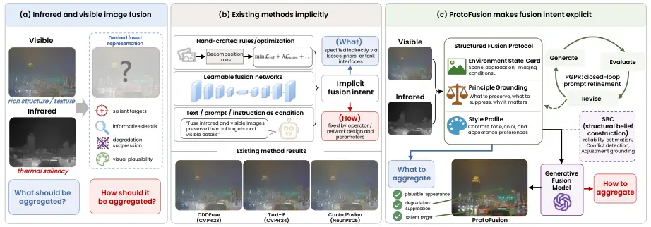

Figure 1: From implicit fusion biases to explicit protocol-constrained
generation. (a) Fusion combines infrared thermal saliency with visible
structure and texture. (b) Existing methods encode fusion intent
implicitly through rules, networks, or conditioning. (c) ProtoFusion
makes this intent explicit through an editable protocol specifying what
to preserve and how to render it, with iterative refinement and optional
structured belief correction.

Infrared and visible image fusion aims to combine the complementary
strengths of infrared and visible imagery into a single representation
that is more informative than either modality alone. As illustrated in
Fig. 1(a), infrared images provide robust thermal saliency under poor
illumination and challenging visibility conditions, whereas visible
images preserve richer structures and textures. Therefore, a desirable
fused image should highlight thermally significant targets while
retaining informative visible details for human inspection and
subsequent perception in surveillance, autonomous systems, and other
challenging environments (Ma et al., 2019a; Zhang et al., 2021; Zhang
and Demiris, 2023). This goal naturally involves two coupled questions:
what information should be aggregated from each modality, and how it
should be aggregated into a coherent image. In practice, answering these
questions is difficult because useful evidence must be separated from
sensor noise, low-light corruption, and uninformative modality
responses. This difficulty is compounded by the absence of ground-truth
fused images, which forces most methods to rely on indirect objectives
to define the desired fusion target (Liu et al., 2026; Bai et al.,
2025a; Zhao et al., 2026).

As summarized in Fig. 1(b), existing methods address this problem
through fixed inductive biases. Classical fusion methods rely on
hand-crafted decomposition rules or explicit optimization objectives,
while deep models replace them with learned networks whose fusion
behavior is still largely determined by architecture design, training
data, and loss functions (Li and Wu, 2019; Ma et al., 2019b; Xu et al.,
2022; Ma et al., 2022; Zhao et al., 2023b). More recent methods move
toward semantic-, task-, and prompt-aware fusion by incorporating
detection or segmentation cues, or by conditioning the model on text and
instructions (Liu et al., 2022; Tang et al., 2022; Tang et al., 2023;
Zhao et al., 2023a; Liu et al., 2024b; Yi et al., 2024b; Liu et al.,
2025a; Cheng et al., 2025b; Zhao et al., 2024; Wang et al., 2024a; Yang
et al., 2025). These designs improve adaptivity and controllability, but
the underlying intent of fusion remains implicit. In particular, the
what is typically specified indirectly through losses, priors, or task
interfaces, while the how is constrained by fixed operators, network
design, or one-shot conditioning mechanisms. As a result, text
conditioning is incorporated into the pipeline, but the fusion intent
itself is rarely represented as an explicit, editable, and optimizable
object.

To address this limitation, we propose ProtoFusion, a protocol-guided
generative framework. As shown in Fig. 1(c), ProtoFusion makes the
fusion intent explicit by introducing a structured fusion protocol. The
protocol specifies what evidence should be aggregated, what content
should be suppressed, and what visual properties the fused result should
satisfy. Under this formulation, fusion is cast as protocol-constrained
generation: a multimodal generative fusion model synthesizes the fused
image under the guidance of the protocol. This view is particularly
attractive for modern multimodal generators, whose expressive synthesis
space can accommodate target enhancement, detail recovery, degradation
mitigation, and visually coherent fusion within a unified
framework (Zhao et al., 2023c; Yue et al., 2023; Yi et al., 2024a; Shi
et al., 2025; Cao et al., 2025).

The proposed ProtoFusion framework uses a structured protocol with three
components: environment state cards, grounding principles, and a style
profile. Based on this representation, we develop protocol-guided prompt
refinement (PGPR), an offline refinement procedure that iteratively
updates protocol slots through generation, evaluation, and revision
under multimodal evidence. After refinement, the learned protocol is
fixed and used directly to guide fusion generation at inference time. To
further improve robustness on difficult cases, we additionally introduce
structured belief construction (SBC) as an optional correction module
applied after PGPR. SBC analyzes residual modality imbalance and
cross-modal inconsistency in the PGPR output and applies a conservative
prompt-level correction when doing so is beneficial. Through this
design, ProtoFusion shifts generative fusion from fixed operator design
to structured protocol optimization under multimodal evidence.

Our contributions are summarized as follows.

- •
  We propose ProtoFusion, a protocol-guided generative framework that
  represents fusion intent with a structured fusion protocol and
  formulates image fusion as protocol-constrained generation.
- •
  We develop PGPR, an offline refinement procedure that optimizes the
  structured fusion protocol through iterative generation, evaluation,
  and revision under multimodal evidence. To further improve robustness,
  we introduce SBC as an optional correction module.
- •
  Extensive experiments on standard infrared and visible image fusion
  benchmarks show that ProtoFusion achieves strong quantitative
  performance, consistently higher aesthetic scores, and superior visual
  quality under challenging visible degradations.

The remainder of this paper is organized as follows. Section 2 reviews
conventional and learning-based fusion methods, task- and
language-guided approaches, generative fusion, and prompt optimization.
Section 3 introduces the structured fusion protocol, details the
iterative optimization process of PGPR, and describes how SBC identifies
and corrects residual source inconsistencies. Section 4 presents
quantitative and qualitative comparisons, evaluates downstream semantic
segmentation and source consistency, and provides ablation studies,
cross-generator transfer analysis, runtime evaluation, and limitations.
Finally, Section 5 concludes the paper.

## 2 Related Work

### 2.1 Infrared and Visible Image Fusion

Early fusion methods rely on image decomposition and hand-designed
fusion rules, while learning-based approaches use reconstruction,
adversarial learning, and cross-modal feature interaction to combine
infrared and visible information (Ma et al., 2019a; Zhang et al., 2021;
Zhang and Demiris, 2023; Li and Wu, 2019; Ma et al., 2019b; Xu et al.,
2022; Zhao et al., 2023b). Recent methods further model shared and
modality-specific information or learn cross-modal dependencies (Liu et
al., 2024a; Tang et al., 2025b; Kang et al., 2025). Other approaches
focus on preserving complementary source information through specialized
fusion mechanisms (Wang et al., 2024b; Bai et al., 2025b; Wang et al.,
2026). Without ground-truth fused images, most methods rely on indirect
objectives, such as intensity, gradient, and feature preservation. These
objectives help retain source information but offer limited flexibility
in specifying fusion behavior across different scenes, degradations, and
user requirements.

### 2.2 Task-aware, Semantic-aware, and Controllable Fusion

Task-aware fusion uses detection and segmentation feedback to improve
downstream perception (Liu et al., 2022; Tang et al., 2022; Tang et al.,
2023; Zhao et al., 2023a; Liu et al., 2024b). Other methods employ
discriminative learning or object-level priors to emphasize important
targets and their context (Liu et al., 2025b; Zhang et al., 2026; Li et
al., 2025). Language-guided approaches introduce more explicit control
over desired content, regions, and degradation conditions (Yi et al.,
2024b; Wang et al., 2024a; Tang et al., 2025a). Vision-language
descriptions and learned semantic prompts further guide multimodal
feature fusion (Zhao et al., 2024; Liu et al., 2025a; Wang et al.,
2025). These methods introduce flexible semantic and task guidance, but
primarily apply it through learned representations or prompt-conditioned
fusion networks. More importantly, the ability of vision-language
foundation models to first interpret paired sources and then formulate
and refine explicit fusion instructions remains underexplored.

### 2.3 Generative and Diffusion-based Image Fusion

Diffusion models and large generative priors have recently opened a new
direction for image fusion. DDFM formulates multimodal fusion with
denoising diffusion models (Zhao et al., 2023c), while Dif-Fusion and
Diff-IF explore diffusion priors for infrared and visible image fusion
and fusion-knowledge-aware generation (Yue et al., 2023; Yi et al.,
2024a). More general diffusion-based fusion frameworks further suggest
that pretrained generative models can provide a rich synthesis space for
handling multiple fusion tasks and degradations (Shi et al., 2025; Cao
et al., 2025; Shi et al., 2026). Across these designs, a central issue
is how to constrain generation so that perceptually plausible results
retain source evidence. Preference alignment introduces another
dimension of control: DPOFusion adapts a latent diffusion model to
human, vision-language-model, and task-driven preferences (Su et al.,
2026). These methods demonstrate the value of generative priors for
perceptual realism and restoration capability. Unlike existing
generative fusion methods that mainly rely on latent optimization,
sampling constraints, or model-specific guidance, our framework uses the
generative model as a fusion engine and optimizes structured protocols
and prompts under multimodal evidence.

### 2.4 Prompt Optimization and Iterative Refinement

Our work is also related to automatic prompt engineering and iterative
self-refinement. Automatic prompt optimization improves instructions
through task feedback. APE searches for effective instructions (Zhou et
al., 2023), while OPRO uses language models to iteratively optimize
prompts (Yang et al., 2024). Related approaches refine model outputs or
image-editing controls: Self-Refine revises generated responses through
feedback (Madaan et al., 2023), Prompt-to-Prompt controls text-driven
image editing through cross-attention (Hertz et al., 2023), and
FusionBooster analyzes and enhances initial fusion results using learned
modules (Cheng et al., 2025a). Inspired by these ideas, we introduce
closed-loop prompt optimization into a generative framework for infrared
and visible image fusion. Unlike generic prompt optimization for
language tasks or prompt editing for single-image generation, our
protocol-guided refinement is grounded in paired infrared and visible
observations, modality reliability, cross-modal conflicts, and
fusion-specific preservation requirements. PGPR differs from general
prompt optimization by restricting updates to structured fusion
instructions and evaluating each proposal against paired source images.
This allows the optimized protocol to be reused across image pairs
without updating the generator.

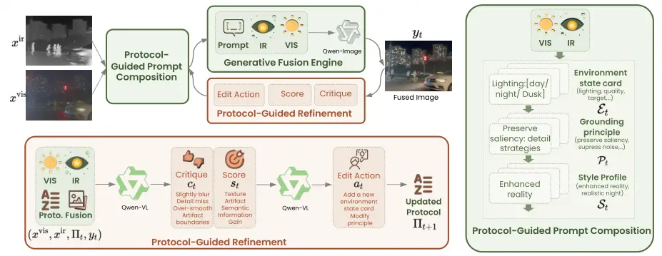

Figure 2: Flowchart of protocol-guided prompt refinement (PGPR). PGPR is
the main fusion loop. At each round, it composes a prompt from a
structured protocol, generates a fused image, diagnoses the current
proto-fusion result, predicts a structured edit action, and updates the
protocol for the next round. The right panel expands protocol-guided
prompt composition, where the protocol is organized into environment
state cards, grounding principles, and a style profile. The bottom panel
expands protocol-guided refinement, where diagnosis and protocol editing
are performed in two stages.

## 3 Proposed Protocol-guided Generative Fusion

Overview. Given a visible image $`x^{\mathrm{vis}}`$ and an infrared
image $`x^{\mathrm{ir}}`$, our goal is to generate a fused image that
preserves thermal saliency from the infrared modality, retains
informative visible structures, and remains visually realistic. Our
framework consists of a main refinement pipeline, _protocol-guided
prompt refinement_ (PGPR), and an optional correction module applied
after PGPR, _structured belief construction_ (SBC).

As shown in Fig. 2, PGPR is the core fusion procedure. It iteratively
refines a structured fusion protocol, which serves as the explicit
carrier of fusion intent. At each round, the protocol is converted into
a prompt, the prompt is used by the generative fusion engine to produce
a fused image, and the resulting image is analyzed to update the
protocol for the next round. The protocol is organized into three parts:
environment state cards, grounding principles, and a style profile.
Together, these components describe the source conditions, the desired
fusion principles, and the target rendering style. This design makes the
refinement process explicit and editable, because each round revises the
protocol rather than rewriting the prompt in an unconstrained manner.
After several rounds, PGPR selects the best prompt–image pair from the
refinement trajectory. As shown in Fig. 3, SBC is applied only after
this selection step. Given the source images and the selected PGPR
output, SBC constructs a belief state to identify residual errors that
may remain after PGPR. It then predicts a conservative prompt correction
and performs one additional generation step to produce the final fused
image.

### 3.1 Protocol-guided Prompt Refinement

As depicted in Fig. 2, PGPR contains three components: protocol-guided
prompt composition, a generative fusion engine, and protocol-guided
refinement. The following loop describes an offline refinement episode
on a training pair. At round $`t`$, the process can be summarized as

```math
\displaystyle\Pi_{t} \displaystyle\xrightarrow{\mathrm{PGPC}}p_{t}\xrightarrow{\mathrm{GFE}}y_{t}\xrightarrow{\mathrm{diag}}(c_{t},s_{t})\xrightarrow{\mathrm{edit}}a_{t}\xrightarrow{\mathrm{update}}\Pi_{t+1}. \tag{1}
```

Here, PGPC denotes protocol-guided prompt composition, GFE denotes the
generative fusion engine, and $`\mathrm{diag}`$, $`\mathrm{edit}`$, and
$`\mathrm{update}`$ denote source-grounded diagnosis, constrained edit
prediction, and validated protocol update, respectively. The variables
$`\Pi_{t}`$, $`p_{t}`$, and $`y_{t}`$ are the protocol, composed prompt,
and fused candidate; $`(c_{t},s_{t})`$ are its critique and score, and
$`a_{t}`$ is the proposed edit. Equation 1 depicts a proposal cycle; the
acceptance rule below determines which protocol is inherited.

Protocol-guided Prompt Composition. The protocol serves as the
structured carrier of fusion intent in PGPR. At round $`t`$, we write it
as

```math
\Pi_{t}=(\mathcal{E}_{t},\mathcal{P}_{t},\mathcal{S}_{t}), \tag{2}
```

where $`\mathcal{E}_{t}`$, $`\mathcal{P}_{t}`$, and $`\mathcal{S}_{t}`$
denote environment state cards, grounding principles, and the style
profile, respectively, as illustrated in Fig. 2. Environment cards
define which source conditions to examine, while prompt composition
fills in the corresponding information from each image pair. Therefore,
the protocol remains reusable, while its image-specific content adapts
to each input. The initial protocol template is given in Appendix A.3.
Given the source pair $`(x^{\mathrm{vis}},x^{\mathrm{ir}})`$ and the
current protocol $`\Pi_{t}`$, PGPC produces the prompt $`p_{t}`$ by
combining image-specific information obtained according to
$`\mathcal{E}_{t}`$ with the grounding principles $`\mathcal{P}_{t}`$
and the style profile $`\mathcal{S}_{t}`$.

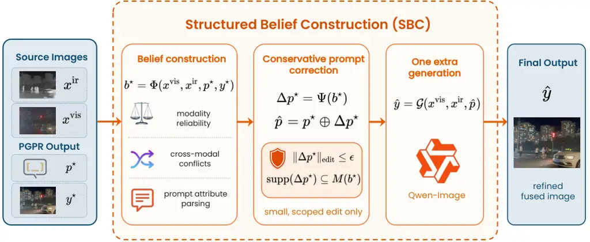

Figure 3: Overview of structured belief construction (SBC). Given the
source images and the selected PGPR output $`(p^{\star},y^{\star})`$,
SBC extracts finer-grained region-level evidence and organizes it into a
belief state. This belief state captures modality reliability,
cross-modal conflicts, and prompt attribute parsing. A conservative
prompt correction is then predicted under a small, scoped edit
constraint and used for an additional generation step.

Generative Fusion Engine. Given the current prompt, the generative
fusion engine produces the fused image as

```math
y_{t}=\mathcal{G}(x^{\mathrm{vis}},x^{\mathrm{ir}},p_{t}), \tag{3}
```

where $`\mathcal{G}`$ denotes the image generator. As illustrated in
Fig. 2, the generator takes the visible image, the infrared image, and
the composed prompt as input, and outputs the current fusion result.
This stage realizes the fusion intent encoded by the current
protocol-guided prompt.

Protocol-guided Refinement. After generating $`y_{t}`$, PGPR diagnoses
the current result and converts the diagnosis into a structured protocol
edit. The updated protocol is then used to compose the next prompt. As
shown in the bottom panel of Fig. 2, this refinement module operates in
two stages. Specifically, in the first stage, a diagnostic model
analyzes the current proto-fusion result and produces a textual critique
together with a scalar score:

```math
(c_{t},s_{t})=\mathcal{R}_{\mathrm{diag}}(x^{\mathrm{vis}},x^{\mathrm{ir}},\Pi_{t},y_{t}), \tag{4}
```

where $`c_{t}`$ identifies the main deficiencies, such as missing
complementary information, cross-modal inconsistencies, and visual
artifacts, while $`s_{t}`$ summarizes the fusion quality for candidate
selection. The critic applies predefined checks with binary judgments
and confidence estimates, which are combined into a weighted score
covering semantic fidelity, artifact control, texture, information gain,
and protocol compliance. A fatal rejection rule excludes results
containing content unsupported by either source image, regardless of
their scores. The remaining candidates are ranked by their scores. A
strict pass additionally requires satisfying all checks and reaching a
predefined score threshold, but does not automatically terminate
refinement. Although these constraints reduce source inconsistencies,
the critic may still miss violations.

In the second stage, the refinement module converts the diagnosis into a
structured edit action:

```math
a_{t}=\mathcal{R}_{\mathrm{edit}}(x^{\mathrm{vis}},x^{\mathrm{ir}},\Pi_{t},y_{t},c_{t},s_{t}), \tag{5}
```

where $`a_{t}`$ is restricted to one of three actions: add an
environment-state item, revise an existing principle, or add one new
principle. The style profile is not edited. A deterministic validator
rejects malformed, empty, repeated, or ineffective edits, as well as
edits with invalid conditions. For an accepted edit, only the specified
slot changes; all other slots are inherited unchanged.

The protocol is then updated by

```math
\Pi_{t+1}=\mathcal{U}(\Pi_{t},a_{t}), \tag{6}
```

where $`\mathcal{U}(\cdot)`$ applies a validated edit. The resulting
proposal is generated and diagnosed before it can replace the incumbent.
Invalid edits leave the incumbent unchanged.

Best-so-far Selection. Let $`\mathcal{J}_{T}`$ be the set of candidates
actually generated and evaluated under a refinement budget $`T`$. The
selected index is
$`t^{\star}=\arg\max_{\{t\in\mathcal{J}_{T},\;s_{t}\neq-1\}}\{s_{t}\}`$,
with $`p^{\star}=p_{\{t^{\star}\}}`$ and
$`y^{\star}=y_{\{t^{\star}\}}`$. A worse or fatal proposal is discarded,
and the next edit starts from the best non-fatal state found so far.
Candidate scores may rise or fall; only the retained critic score is
non-decreasing. This property does not imply monotonic improvement in
true image quality. The selected pair is passed to SBC when correction
is enabled. The framework can use a black-box generator with the
required paired-image and prompt interface. Appendix A.2 summarizes the
refinement procedure and the remaining implementation specification.

### 3.2 Structured Belief Construction

SBC is an optional correction module, as shown in Fig. 3. It receives
the prompt–image pair to be corrected, denoted $`(p^{\star},y^{\star})`$
below. This is the selected candidate when inspecting a refinement
episode, or the output generated with the fixed learned protocol at test
time. SBC applies at most one conservative prompt correction and does
not restart PGPR.

Belief Construction. Given the source images and the selected PGPR
output $`(p^{\star},y^{\star})`$, SBC first constructs a belief state

```math
b^{\star}=\Phi(x^{\mathrm{vis}},x^{\mathrm{ir}},p^{\star},y^{\star}), \tag{7}
```

where $`\Phi(\cdot)`$ extracts finer-grained region-level evidence from
the source images and the selected PGPR result. In this way, SBC moves
from the coarse protocol-level evidence used in PGPR to a more localized
evidence representation for correction. As shown in Fig. 3, it captures
three aspects: modality reliability, cross-modal conflicts, and prompt
attribute parsing. Intuitively, it identifies which modality is
underused or over-trusted, where the remaining inconsistency lies, and
which prompt attributes are most likely responsible for the current
error.

Conservative Prompt Correction. Based on the belief state, SBC predicts
a conservative prompt correction:

```math
\Delta p^{\star}=\Psi(b^{\star}),\qquad\hat{p}=p^{\star}\oplus\Delta p^{\star}, \tag{8}
```

where $`\hat{p}`$ is the corrected prompt. This correction is
intentionally local. SBC applies a small and well-scoped modification to
the selected PGPR prompt, rather than regenerating a new prompt from
scratch. This constraint is written as

```math
\|\Delta p^{\star}\|_{\mathrm{edit}}\leq\epsilon,\qquad\mathrm{supp}(\Delta p^{\star})\subseteq M(b^{\star}), \tag{9}
```

where $`\epsilon`$ is a small edit budget and $`M(b^{\star})`$ denotes
the prompt-edit scope inferred from the belief state.

One Extra Generation. Using the corrected prompt, SBC performs one
additional generation step to obtain
$`\hat{y}=\mathcal{G}(x^{\mathrm{vis}},x^{\mathrm{ir}},\hat{p})`$, where
$`\hat{y}`$ denotes the refined fused image. In the absence of a valid
correction, the selected PGPR output is retained as the final result,
_i.e._, $`\hat{y}=y^{\star}`$. The correction is applied once after the
PGPR selection stage.

## 4 Experiments

FMB

| Method      | Venue      | CLIPIQA$`\uparrow`$ | MUSIQ$`\uparrow`$ | PAQ2PIQ$`\uparrow`$ | MANIQA$`\uparrow`$ | BRISQUE$`\downarrow`$ | TReS$`\uparrow`$ | EN$`\uparrow`$ | SD$`\uparrow`$ | SF$`\uparrow`$ |
| ----------- | ---------- | ------------------- | ----------------- | ------------------- | ------------------ | --------------------- | ---------------- | -------------- | -------------- | -------------- |
| CDDFuse     | CVPR’23    | 0.1912              | 54.6762           | 71.5954             | 0.2624             | 24.9722               | 62.7958          | 6.9440         | 38.5810        | 14.6180        |
| DDFM        | ICCV’23    | 0.1622              | 50.9695           | 69.5429             | 0.2801             | 30.1938               | 53.1768          | 6.8254         | 31.8910        | 8.8404         |
| TIMFusion   | TPAMI’24   | 0.2200              | 51.3741           | 71.0020             | 0.2909             | 35.3702               | 55.9598          | 6.5551         | 28.6934        | 10.9298        |
| Text-IF     | CVPR’24    | 0.1610              | 54.2197           | 71.9926             | 0.2581             | 27.7682               | 61.4601          | 6.9249         | 36.4667        | 14.3592        |
| C2RF        | IJCV’25    | 0.1732              | 50.2157           | 70.9624             | 0.2507             | 27.9849               | 56.5410          | 6.8284         | 35.7855        | 12.0213        |
| DCEvo       | CVPR’25    | 0.1964              | 53.7623           | 71.6616             | 0.2651             | 25.9477               | 62.4378          | 6.8569         | 36.3743        | 13.8186        |
| Deno-IF     | NeurIPS’25 | 0.2747              | 44.9853           | 67.7207             | 0.2700             | 42.4478               | 50.4824          | 6.0450         | 32.1501        | 9.7676         |
| LUT-Fuse    | ICCV’25    | 0.1688              | 53.0099           | 70.9631             | 0.2563             | 19.2857               | 62.0295          | 6.7783         | 35.1191        | 15.3193        |
| DRFusion    | CVPR’26    | 0.1456              | 53.3829           | 70.7716             | 0.2786             | 43.1575               | 57.7663          | 6.5361         | 32.8442        | 10.9689        |
| ISFuse      | CVPR’26    | 0.1726              | 56.3705           | 71.4491             | 0.2677             | 21.8904               | 67.5581          | 6.8184         | 34.2582        | 14.9685        |
| ProtoFusion |            | 0.4189              | 64.6367           | 72.5243             | 0.3861             | 14.7842               | 71.4666          | 7.0029         | 48.3840        | 17.0478        |

MSRS

| Method      | Venue      | CLIPIQA$`\uparrow`$ | MUSIQ$`\uparrow`$ | PAQ2PIQ$`\uparrow`$ | MANIQA$`\uparrow`$ | BRISQUE$`\downarrow`$ | TReS$`\uparrow`$ | EN$`\uparrow`$ | SD$`\uparrow`$ | SF$`\uparrow`$ |
| ----------- | ---------- | ------------------- | ----------------- | ------------------- | ------------------ | --------------------- | ---------------- | -------------- | -------------- | -------------- |
| CDDFuse     | CVPR’23    | 0.1557              | 36.5769           | 64.9346             | 0.1440             | 32.0331               | 32.5303          | 6.7854         | 43.9108        | 11.6324        |
| DDFM        | ICCV’23    | 0.1396              | 33.5653           | 62.3264             | 0.1433             | 33.8187               | 30.4202          | 6.3479         | 30.0831        | 7.6653         |
| TIMFusion   | TPAMI’24   | 0.1267              | 33.5586           | 63.1841             | 0.1291             | 44.4031               | 30.1763          | 5.8837         | 40.5809        | 9.3600         |
| Text-IF     | CVPR’24    | 0.1593              | 36.3373           | 65.2339             | 0.1399             | 32.1248               | 31.9896          | 6.7995         | 45.2395        | 11.8888        |
| C2RF        | IJCV’25    | 0.1363              | 32.9537           | 64.2354             | 0.1304             | 32.9751               | 30.3190          | 6.5330         | 40.7909        | 10.7847        |
| DCEvo       | CVPR’25    | 0.1299              | 36.1123           | 65.0804             | 0.1398             | 29.8427               | 32.1065          | 6.7200         | 43.4812        | 11.5661        |
| Deno-IF     | NeurIPS’25 | 0.1822              | 32.0591           | 62.9750             | 0.1460             | 46.0174               | 28.5986          | 6.7202         | 41.5688        | 9.5035         |
| LUT-Fuse    | ICCV’25    | 0.1576              | 36.3014           | 65.2470             | 0.1361             | 28.6357               | 35.9565          | 6.6918         | 42.7811        | 12.7832        |
| DRFusion    | CVPR’26    | 0.1066              | 35.9042           | 64.3925             | 0.1452             | 44.9263               | 35.0311          | 6.5544         | 41.9877        | 9.9147         |
| ISFuse      | CVPR’26    | 0.1813              | 38.6243           | 65.7127             | 0.1550             | 26.3307               | 37.1416          | 6.4172         | 32.8123        | 12.0573        |
| ProtoFusion |            | 0.3213              | 52.2836           | 68.0771             | 0.2759             | 23.3807               | 60.7874          | 6.8341         | 44.4990        | 14.6222        |

RoadScene

| Method      | Venue      | CLIPIQA$`\uparrow`$ | MUSIQ$`\uparrow`$ | PAQ2PIQ$`\uparrow`$ | MANIQA$`\uparrow`$ | BRISQUE$`\downarrow`$ | TReS$`\uparrow`$ | EN$`\uparrow`$ | SD$`\uparrow`$ | SF$`\uparrow`$ |
| ----------- | ---------- | ------------------- | ----------------- | ------------------- | ------------------ | --------------------- | ---------------- | -------------- | -------------- | -------------- |
| CDDFuse     | CVPR’23    | 0.1642              | 50.4400           | 68.8432             | 0.2066             | 24.8106               | 53.7425          | 7.5463         | 56.5661        | 18.9072        |
| DDFM        | ICCV’23    | 0.1788              | 42.8392           | 65.1028             | 0.1808             | 29.3473               | 40.0075          | 7.2811         | 42.5732        | 10.7103        |
| TIMFusion   | TPAMI’24   | 0.1666              | 35.0450           | 63.4439             | 0.1391             | 34.8574               | 35.1014          | 7.0091         | 37.9820        | 9.1101         |
| Text-IF     | CVPR’24    | 0.2174              | 45.0695           | 67.8238             | 0.1771             | 26.1162               | 44.3801          | 7.4537         | 50.6812        | 16.0900        |
| C2RF        | IJCV’25    | 0.1791              | 45.3342           | 67.0446             | 0.1854             | 24.1367               | 47.4413          | 7.3007         | 45.1677        | 14.4741        |
| DCEvo       | CVPR’25    | 0.1662              | 46.9107           | 67.9385             | 0.1967             | 25.6482               | 51.5769          | 7.2845         | 45.2938        | 14.9509        |
| Deno-IF     | NeurIPS’25 | 0.1789              | 37.4117           | 64.9687             | 0.1489             | 41.9599               | 36.1046          | 7.4220         | 47.5066        | 12.7819        |
| LUT-Fuse    | ICCV’25    | 0.1455              | 42.9383           | 66.7781             | 0.1645             | 24.8089               | 54.5410          | 6.9438         | 45.7622        | 19.6108        |
| DRFusion    | CVPR’26    | 0.1348              | 38.1821           | 65.4178             | 0.1587             | 38.9396               | 42.3365          | 7.0046         | 42.3950        | 10.0322        |
| ISFuse      | CVPR’26    | 0.1584              | 47.5480           | 67.9547             | 0.2108             | 23.3311               | 56.5832          | 7.0224         | 37.8520        | 15.1578        |
| ProtoFusion |            | 0.3765              | 62.2376           | 73.1191             | 0.3220             | 19.2434               | 77.0120          | 7.3201         | 54.6165        | 18.8520        |

Table 1: Quantitative comparison on FMB (top), MSRS (middle), and
RoadScene (bottom). ProtoFusion uses PGPR+SBC on all three datasets.
Best and second-best results are highlighted in bold and underlined,
respectively.

### 4.1 Experimental Setup

Experimental Protocol. ProtoFusion uses a single protocol shared by all
benchmarks. We refine this protocol offline on the FMB training split
with PGPR. During refinement, each training image pair is processed with
a refinement loop of $`T=6`$ rounds, while all model parameters remain
frozen and only the protocol slots are updated. After refinement, the
resulting protocol is fixed. For the base inference path,
Qwen3-VL-8B-Instruct (Bai et al., 2025c) composes a prompt from the
fixed protocol, and Qwen-Image-Edit (Wu et al., 2025) generates one
fused image. PGPR runs offline, and inference uses the fixed optimized
protocol. The PGPR+SBC variant additionally constructs a belief state
and performs one corrective generation when a valid correction is
available. In the primary Qwen-Image-Edit experiments, we use 40
image-generation sampling steps and disable sampling in the VLM-driven
modules. The ProtoFusion results in Tables 1 and 2 use PGPR+SBC on all
three datasets. Results labeled PGPR in the ablations refer to the base
path without SBC. The component and refinement-budget studies are
evaluated on the FMB test pairs; Full PGPR and $`T=6`$ use the same base
PGPR results as the SBC ablation. The main benchmark comparisons and
downstream segmentation use the full test sets specified below.

Datasets and Compared Methods. We evaluate ProtoFusion on the full test
sets of three widely used infrared and visible image fusion benchmarks:
FMB (Liu et al., 2023), MSRS (Tang et al., 2022), and RoadScene (Xu et
al., 2020), containing 280, 361, and 221 image pairs, respectively. We
compare against representative state-of-the-art methods, including
CDDFuse (Zhao et al., 2023b), DDFM (Zhao et al., 2023c), TIMFusion (Liu
et al., 2024b), Text-IF (Yi et al., 2024b), C2RF (Tang et al., 2025b),
DCEvo (Liu et al., 2025b), Deno-IF (Xu et al., 2025), LUT-Fuse (Yi et
al., 2025), DRFusion (Shi et al., 2026), and ISFuse (Wang et al., 2026).

|             |            | FMB     |         |         |         | MSRS    |         |         |         | RoadScene |         |         |         |
| ----------- | ---------- | ------- | ------- | ------- | ------- | ------- | ------- | ------- | ------- | --------- | ------- | ------- | ------- |
| Method      | Venue      | IAA     | IQA     | ISTA    | Overall | IAA     | IQA     | ISTA    | Overall | IAA       | IQA     | ISTA    | Overall |
| CDDFuse     | CVPR’23    | 21.0344 | 26.1464 | 39.4317 | 28.8708 | 27.6337 | 28.9799 | 41.5625 | 32.7254 | 18.5933   | 19.3558 | 26.8066 | 21.5852 |
| DDFM        | ICCV’23    | 22.0183 | 25.7826 | 38.4991 | 28.7667 | 26.6704 | 26.9214 | 38.7362 | 30.7760 | 23.2981   | 24.1244 | 35.1307 | 27.5177 |
| TIMFusion   | TPAMI’24   | 24.9254 | 27.8087 | 38.1953 | 30.3098 | 24.7261 | 26.4986 | 34.1963 | 28.4737 | 18.9853   | 19.1075 | 25.3255 | 21.1394 |
| Text-IF     | CVPR’24    | 22.8638 | 29.2772 | 41.5920 | 31.2443 | 26.6080 | 28.0942 | 41.1446 | 31.9489 | 18.9019   | 19.7031 | 27.0297 | 21.8782 |
| C2RF        | IJCV’25    | 19.1790 | 23.4826 | 36.4092 | 26.3569 | 25.1766 | 26.2832 | 37.9217 | 29.7939 | 18.4992   | 18.5967 | 22.2783 | 19.7914 |
| DCEvo       | CVPR’25    | 19.1839 | 22.9107 | 34.2859 | 25.4602 | 26.8705 | 28.1842 | 40.6603 | 31.9050 | 18.2865   | 18.4621 | 20.9072 | 19.2186 |
| Deno-IF     | NeurIPS’25 | 20.9625 | 25.6165 | 37.5344 | 28.0378 | 23.4865 | 25.7680 | 36.7133 | 28.6559 | 17.6776   | 18.5082 | 22.9827 | 19.7229 |
| LUT-Fuse    | ICCV’25    | 19.2929 | 23.2551 | 35.4638 | 26.0039 | 26.2642 | 27.1285 | 41.0203 | 31.4710 | 17.8954   | 18.4497 | 17.2435 | 17.8628 |
| DRFusion    | CVPR’26    | 20.0379 | 23.9324 | 35.7415 | 26.5706 | 26.0350 | 27.2722 | 39.9891 | 31.0987 | 18.7291   | 18.9649 | 24.2574 | 20.6505 |
| ISFuse      | CVPR’26    | 19.2496 | 21.8127 | 33.5917 | 24.8847 | 35.7133 | 29.7798 | 43.7417 | 36.4116 | 19.0317   | 18.8529 | 19.9400 | 19.2749 |
| ProtoFusion |            | 42.0143 | 53.7696 | 51.7683 | 49.1841 | 43.7136 | 44.0845 | 48.7273 | 45.5085 | 50.6442   | 54.3835 | 52.0622 | 52.3633 |

Table 2: UniPercept evaluation on FMB, MSRS, and RoadScene. ProtoFusion
uses PGPR+SBC on all three datasets. Higher is better; best and
second-best results are bold and underlined, respectively.

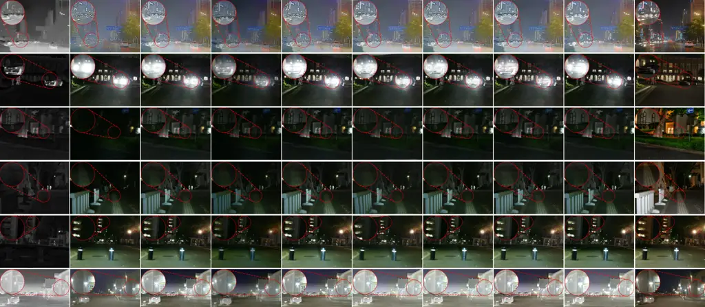

|          |         |                 |              |                 |              |               |                    |                  |              |
| -------- | ------- | --------------- | ------------ | --------------- | ------------ | ------------- | ------------------ | ---------------- | ------------ |
| Infrared | Visible | CDDFuse CVPR'23 | DDFM ICCV'23 | Text-IF CVPR'24 | C2RF IJCV'25 | DCEvo CVPR'25 | Deno-IF NeurIPS'25 | LUT-Fuse ICCV'25 | Proto Fusion |

Figure 4: Representative visual comparison on FMB, MSRS, and RoadScene.
The examples illustrate target visibility and rendering under visible
degradations.

| Method      | Venue      | mIoU  | mAcc  | Road  |       | Building |       | Sky   |       | Car   |       | Truck |       | Bus   |       | Veg.  |       | Pole  |       |
| ----------- | ---------- | ----- | ----- | ----- | ----- | -------- | ----- | ----- | ----- | ----- | ----- | ----- | ----- | ----- | ----- | ----- | ----- | ----- | ----- |
|             |            |       |       | IoU   | Acc   | IoU      | Acc   | IoU   | Acc   | IoU   | Acc   | IoU   | Acc   | IoU   | Acc   | IoU   | Acc   | IoU   | Acc   |
| CDDFuse     | CVPR’23    | 0.510 | 0.632 | 0.560 | 0.811 | 0.575    | 0.700 | 0.679 | 0.692 | 0.631 | 0.884 | 0.450 | 0.499 | 0.622 | 0.837 | 0.465 | 0.474 | 0.100 | 0.160 |
| DDFM        | ICCV’23    | 0.472 | 0.588 | 0.536 | 0.724 | 0.585    | 0.709 | 0.692 | 0.704 | 0.555 | 0.786 | 0.269 | 0.343 | 0.565 | 0.797 | 0.485 | 0.497 | 0.089 | 0.144 |
| TIMFusion   | TPAMI’24   | 0.511 | 0.627 | 0.560 | 0.798 | 0.555    | 0.671 | 0.607 | 0.621 | 0.633 | 0.896 | 0.487 | 0.551 | 0.676 | 0.839 | 0.472 | 0.482 | 0.100 | 0.157 |
| Text-IF     | CVPR’24    | 0.513 | 0.637 | 0.565 | 0.807 | 0.579    | 0.706 | 0.675 | 0.687 | 0.641 | 0.888 | 0.439 | 0.518 | 0.643 | 0.864 | 0.471 | 0.481 | 0.095 | 0.147 |
| C2RF        | IJCV’25    | 0.482 | 0.605 | 0.534 | 0.781 | 0.573    | 0.703 | 0.607 | 0.615 | 0.607 | 0.865 | 0.410 | 0.485 | 0.607 | 0.820 | 0.443 | 0.450 | 0.080 | 0.124 |
| DCEvo       | CVPR’25    | 0.492 | 0.623 | 0.550 | 0.806 | 0.568    | 0.698 | 0.688 | 0.702 | 0.628 | 0.888 | 0.385 | 0.475 | 0.567 | 0.793 | 0.454 | 0.463 | 0.099 | 0.157 |
| Deno-IF     | NeurIPS’25 | 0.432 | 0.524 | 0.486 | 0.663 | 0.484    | 0.572 | 0.558 | 0.566 | 0.610 | 0.831 | 0.424 | 0.466 | 0.392 | 0.532 | 0.410 | 0.416 | 0.092 | 0.146 |
| LUT-Fuse    | ICCV’25    | 0.491 | 0.615 | 0.512 | 0.756 | 0.566    | 0.695 | 0.667 | 0.679 | 0.605 | 0.882 | 0.379 | 0.414 | 0.621 | 0.852 | 0.476 | 0.487 | 0.100 | 0.157 |
| DRFusion    | CVPR’26    | 0.458 | 0.591 | 0.530 | 0.790 | 0.555    | 0.681 | 0.658 | 0.678 | 0.604 | 0.902 | 0.283 | 0.351 | 0.505 | 0.730 | 0.423 | 0.431 | 0.105 | 0.169 |
| ISFuse      | CVPR’26    | 0.507 | 0.618 | 0.538 | 0.769 | 0.577    | 0.703 | 0.634 | 0.641 | 0.633 | 0.875 | 0.456 | 0.503 | 0.668 | 0.838 | 0.450 | 0.459 | 0.096 | 0.152 |
| ProtoFusion |            | 0.554 | 0.684 | 0.610 | 0.842 | 0.587    | 0.726 | 0.699 | 0.711 | 0.662 | 0.923 | 0.502 | 0.605 | 0.725 | 0.938 | 0.547 | 0.562 | 0.101 | 0.169 |

Table 3: Semantic segmentation results on FMB. Best and second-best
results are highlighted in bold and underlined, respectively.

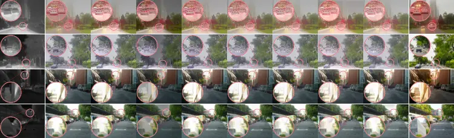

|          |         |                 |              |                 |              |               |                    |                  |              |
| -------- | ------- | --------------- | ------------ | --------------- | ------------ | ------------- | ------------------ | ---------------- | ------------ |
| Infrared | Visible | CDDFuse CVPR'23 | DDFM ICCV'23 | Text-IF CVPR'24 | C2RF IJCV'25 | DCEvo CVPR'25 | Deno-IF NeurIPS'25 | LUT-Fuse ICCV'25 | Proto Fusion |

Figure 5: Qualitative comparisons on degraded daytime scenes with haze
and strong illumination.

Evaluation Metrics. We report six learned perceptual quality metrics,
namely CLIPIQA (Wang et al., 2023), MUSIQ (Ke et al., 2021),
PAQ2PIQ (Ying et al., 2020), MANIQA (Yang et al., 2022), BRISQUE (Mittal
et al., 2012), and TReS (Golestaneh et al., 2022), together with three
statistical fusion metrics, EN, SD, and SF (Wang et al., 2008). In
addition, we report scores from UniPercept (Cao et al., 2026), a
perceptual evaluation model that assesses fused images along three
complementary dimensions: image aesthetics (IAA), image quality (IQA),
and structure and texture (ISTA). In addition to these three scores, we
report the Overall score provided by UniPercept as its aggregate
assessment. Higher values are conventionally preferred for all these
metrics except BRISQUE, for which lower values are better. Beyond image
quality, we evaluate semantic utility through downstream segmentation
using mean intersection over union (mIoU) and mean accuracy (mAcc) with
a frozen model. We further assess source fidelity through
expert-reviewed image-level source inconsistency rates. Additional CE,
$`Q_{AB/F}`$, and VIF results are reported in Appendix B.1.

Implementation Details. We instantiate the generative fusion engine
$`\mathcal{G}`$ with Qwen-Image-Edit and use Qwen3-VL-8B-Instruct to
implement the protocol-side modules, including protocol initialization
$`\mathcal{I}`$, prompt composition $`\mathcal{C}`$, diagnosis
$`\mathcal{R}_{\mathrm{diag}}`$, edit prediction
$`\mathcal{R}_{\mathrm{edit}}`$, belief construction $`\Phi`$, and
prompt correction $`\Psi`$. All model parameters remain frozen
throughout both protocol refinement and inference. The Qwen-Image-Edit
experiments are conducted in PyTorch on two BW3000 DCUs with 64 GB of
memory each. Additional details on prompt templates, model inputs, and
inference settings are provided in Appendix A.

### 4.2 Performance Comparison

Quantitative Results. Table 1 compares ProtoFusion with ten competing
methods on FMB, MSRS, and RoadScene. ProtoFusion achieves the best
results on all six image quality metrics across the three benchmarks and
leads all nine reported metrics on FMB. For the statistical metrics,
Text-IF achieves the highest SD on MSRS, while CDDFuse leads EN and SD
and LUT-Fuse leads SF on RoadScene. Notably, ProtoFusion maintains its
advantage in perceptual quality on MSRS and RoadScene using the same
protocol optimized on FMB, demonstrating its effectiveness across
datasets without dataset-specific protocol refinement.

UniPercept Evaluation. Table 2 provides a complementary perceptual
evaluation using UniPercept. ProtoFusion achieves the highest IAA, IQA,
ISTA, and Overall scores across all three datasets. Its Overall scores
reach 49.18, 45.51, and 52.36 on FMB, MSRS, and RoadScene, outperforming
the strongest competing methods by 17.94, 9.10, and 24.85 points,
respectively. These consistent gains across all three evaluation
dimensions further support the perceptual quality of the generated
fusion results.

Qualitative Results. As shown in Fig. 4, qualitative comparisons cover
challenging visible conditions, including overexposure, low
illumination, and noise. Across these scenes, ProtoFusion deliberately
renders the fused images in a natural visible-light style, as specified
by its structured protocol. This design allows infrared information to
enhance salient targets and reveal obscured structures while maintaining
a coherent visual appearance. Compared with competing methods that often
retain visible degradations or produce indistinct target boundaries,
ProtoFusion renders clearer targets, suppresses noise, and improves the
overall scene appearance. Additional nighttime comparisons are provided
in Appendix B.2.

We further examine daytime scenes with small vehicles and strong
backlighting, as shown in Fig. 5. In the first two rows, several
competing methods introduce bright artifacts or doubled contours around
vehicles, whereas ProtoFusion produces clearer vehicle boundaries and
better separation from the road. In the last two rows, strong
illumination obscures building structures in the visible inputs, while
ProtoFusion renders more distinct rooflines and wall boundaries with a
natural appearance. These comparisons highlight the central advantage of
ProtoFusion: its optimized protocol explicitly controls what information
to preserve or suppress from each modality and how the fused result
should appear. This enables the generative model to exploit
complementary infrared information and mitigate visible degradations
while maintaining the intended visible-light appearance.

### 4.3 Downstream Semantic Segmentation

We evaluate downstream semantic segmentation on the FMB test pairs using
the same frozen CLIPer model (Sun et al., 2025) for each fusion method.
FMB category names serve as text prompts, and the predicted segmentation
maps are evaluated against pixel-level annotations.

Table 3 presents the results against ten competing methods. ProtoFusion
achieves an mIoU of 0.554 and an mAcc of 0.684, improving upon the
strongest competitor, Text-IF, by 4.1 and 4.7 percentage points,
respectively. ProtoFusion also achieves the highest IoU in seven of the
eight reported classes, including car, truck, and bus. These results
demonstrate improved semantic segmentation performance under the same
frozen evaluation model. A key design choice helps explain these gains:
ProtoFusion deliberately renders fused images with a natural
visible-light appearance. This design preserves familiar visible colors,
textures, and scene structures while using infrared information to
enhance salient targets and obscured details. The resulting images are
better suited to the visual representations learned by the frozen CLIPer
model, helping explain the improvements across both object and scene
segmentation.

### 4.4 Hallucination Study

We evaluate image-level source inconsistencies on all FMB test pairs
through a two-stage assessment. First, GPT-6 Astra examines each fused
image alongside its infrared and visible sources to identify potential
inconsistencies. Domain experts then manually review all fused results,
including those initially judged error-free by the model, and determine
the final error labels. All reported error rates are based on this
comprehensive human review.

Error Categories. We consider four categories of source inconsistencies.
Content alteration includes unsupported additions or changes to
source-supported semantic attributes, text, symbols, or states.
Geometric distortion covers erroneous shape, count, duplication, or
spatial arrangement beyond source registration differences. Information
omission denotes the loss of meaningful source-supported objects or
structures. Appearance artifacts include newly introduced or amplified
halos, ghosting, noise, smearing, or unnatural rendering. The categories
may overlap; _Any error_ denotes their image-level union.

As shown in Tab. 4, PGPR reduces the image-level _Any error_ rate from
53.93% to 38.21%, while SBC further lowers it to 19.64%. PGPR mitigates
recurring generation errors by optimizing a structured fusion protocol
through source-grounded diagnosis and constrained edits, improving
control over modality contributions, structural preservation, and visual
appearance. SBC complements this shared protocol with region-level
analysis of modality reliability and cross-modal conflicts, enabling
conservative prompt corrections tailored to residual errors in each
image. Together, these mechanisms reduce appearance artifacts from
25.36% to 3.57%, geometric distortion from 5.00% to 0.71%, and content
alteration from 36.43% to 14.29%.

| Error category       | Human Prompt | PGPR  | PGPR+SBC |
| -------------------- | ------------ | ----- | -------- |
| Content alteration   | 36.43        | 26.43 | 14.29    |
| Geometric distortion | 5.00         | 1.79  | 0.71     |
| Information omission | 4.64         | 3.93  | 2.86     |
| Appearance artifacts | 25.36        | 11.43 | 3.57     |
| Any error            | 53.93        | 38.21 | 19.64    |

Table 4: Image-level error rates (%) on FMB; lower is better. Categories
may overlap; Any error is their union. Only definite errors enter the
numerator.

Residual errors. The fatal gate rejects source violations identified by
the critic, while undetected errors can persist in the generated
results. Appendix C.2 traces an example in which an unsupported _white
umbrella_ interpretation propagates into the fused output.

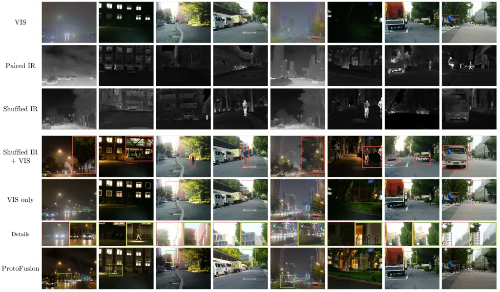

Figure 6: Ablation study on the influence of infrared input. Each group
shows the original IR/VIS inputs, a shuffled IR input, and the results
generated under VIS-only, shuffled IR+VIS, and IR+VIS settings.

### 4.5 Ablation Study

| Setting           | IAA     | IQA     | ISTA    | Overall |
| ----------------- | ------- | ------- | ------- | ------- |
| Human Prompt      | 29.1049 | 39.2397 | 46.0433 | 38.1293 |
| Initial Protocol  | 31.6094 | 40.7125 | 45.5683 | 39.2967 |
| Principles Only   | 30.6170 | 40.6623 | 45.9330 | 39.0708 |
| w/o State Cards   | 34.4786 | 44.3286 | 48.4580 | 42.4217 |
| w/o Style Profile | 35.3647 | 45.3844 | 48.7804 | 43.1765 |
| Full PGPR         | 39.8040 | 52.3004 | 51.2281 | 47.7775 |

Table 5: Protocol components on the FMB test pairs (UniPercept; higher
is better; best in bold).

| Budget  | IAA     | IQA     | ISTA    | Overall |
| ------- | ------- | ------- | ------- | ------- |
| $`T=1`$ | 31.6094 | 40.7125 | 45.5683 | 39.2967 |
| $`T=3`$ | 32.6509 | 44.7830 | 48.3902 | 41.9414 |
| $`T=6`$ | 39.8040 | 52.3004 | 51.2281 | 47.7775 |
| $`T=9`$ | 40.0701 | 51.5103 | 51.2759 | 47.6188 |

Table 6: Refinement budget on all FMB test pairs (UniPercept; higher is
better; best in bold).

Protocol Representation and Refinement. Table 5 evaluates the
contributions of protocol design and offline refinement using the same
inputs, VLM, generator, random seeds, and generation settings. Overall
improves from 38.13 with Human Prompt to 39.30 with Initial Protocol,
and further reaches 47.78 with Full PGPR. Protocol initialization
provides a modest gain of 1.17 points, whereas offline refinement
contributes an additional 8.48 points. This substantial improvement
highlights the importance of refining fusion instructions based on
diagnosed failures, rather than relying on a fixed protocol. Notably,
these gains are achieved without modifying the underlying generative
models. Appendix C.1 illustrates the fixed-prompt failure modes
associated with this comparison.

The component ablations further demonstrate the importance of the
protocol structure. Removing either state cards or the style profile
reduces the Overall score by more than four points, with consistent
declines in IAA, IQA, and ISTA. State cards help adapt fusion
instructions to source conditions and modality reliability, while the
style profile provides explicit control over the target appearance. The
Principles Only setting also performs substantially worse than Full
PGPR, indicating that grounding principles alone are insufficient.
Together, these results highlight the complementary roles of
source-conditioned guidance, grounding principles, and appearance
control in determining what information to preserve and how to present
it.

Refinement Budget. As shown in Table 6, increasing the offline
refinement budget from $`T=1`$ to $`T=6`$ improves Overall from 39.30 to
47.78, demonstrating the benefit of iterative diagnosis and protocol
refinement. Further increasing $`T`$ to 9 yields only marginal gains in
some evaluation dimensions, while Overall slightly decreases. We
therefore adopt $`T=6`$ to balance fusion performance and offline
refinement cost. Since protocol optimization is performed offline, the
inference procedure remains unchanged across different refinement
budgets.

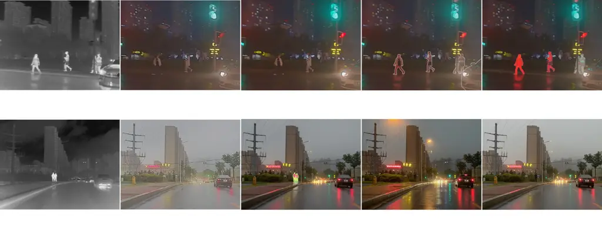

|          |         |                                                                                                      |                                                                                                     |                                                                                                                          |
| -------- | ------- | ---------------------------------------------------------------------------------------------------- | --------------------------------------------------------------------------------------------------- | ------------------------------------------------------------------------------------------------------------------------ |
| Infrared | Visible | … Increase luminance/contrast of pedestrian regions for saliency while preserving visible realism. … | … Enhance luminance and contrast of pedestrian shapes from IR while preserving their VIS geometry … | … prioritize IR for defining sharp, crisp boundaries of the pedestrians. Inject IR saliency into luminance and contrast. |


|          |         |                                                                                                              |                                        |                                                                                                           |
| -------- | ------- | ------------------------------------------------------------------------------------------------------------ | -------------------------------------- | --------------------------------------------------------------------------------------------------------- |
| Infrared | Visible | … Overlay thermal saliency from the IR image to highlight pedestrians and vehicles as bright, crisp shapes … | … Night urban street scene with rain … | View Mode: enhanced reality. Preserve IR target shapes and boundaries; avoid turning targets into blobs … |

Figure 7: Visualization of the PGPR refinement trajectory. From left to
right, we show the intermediate fused results across refinement rounds.

| Method               | IAA     | IQA     | ISTA    | Overall |
| -------------------- | ------- | ------- | ------- | ------- |
| Human Prompt         | 29.1049 | 39.2397 | 46.0433 | 38.1293 |
| VLM-optimized Prompt | 37.5263 | 38.2645 | 43.3942 | 39.7283 |
| PGPR                 | 39.8040 | 52.3004 | 51.2281 | 47.7775 |
| PGPR+SBC             | 42.0143 | 53.7696 | 51.7683 | 49.1841 |

Table 7: Prompt optimization and SBC comparison on the full FMB test set
using UniPercept. Higher is better.

Protocol Optimization. We further compare PGPR with open-ended VLM-based
prompt optimization to examine the benefits of structured protocol
refinement. Starting from the Human Prompt, the VLM-optimized Prompt
baseline iteratively revises the prompt through unconstrained VLM-guided
search, without predefined protocol slots or validated edit operations.
As shown in Tab. 7, this baseline improves IAA but reduces IQA and ISTA,
yielding only a modest gain in Overall. In contrast, PGPR improves all
three dimensions and achieves an Overall score of 47.78, outperforming
the VLM-optimized Prompt baseline by more than eight points. By refining
structured fusion instructions through source-grounded diagnosis and
validated edits, PGPR provides more consistent control over modality
contributions, structural preservation, and visual appearance.

Role of the Infrared Input. As shown in Fig. 6, we compare VIS-only,
shuffled IR+VIS, and original IR+VIS generation under the same optimized
protocol and generation settings. In the shuffled IR+VIS setting, we
replace the original infrared input with an unrelated infrared image
from another scene, while keeping the visible input unchanged. VIS-only
generation can improve visual appearance but often misses
infrared-salient targets and structures obscured in the visible input.
In contrast, shuffled IR introduces substantial content alterations,
including unrelated pedestrians, vehicles, and background structures
that are absent from the original scene. Using the original IR input
enables ProtoFusion to recover complementary infrared information while
maintaining a coherent visible-light appearance. These comparisons
demonstrate that infrared information directly influences the generated
scene content, rather than merely serving as auxiliary guidance for
visible image enhancement. The destructive effects of shuffled IR
further highlight the importance of source-grounded guidance and
cross-modal consistency control in generative image fusion.

Refinement Dynamics. To better understand how PGPR improves the fusion
result, we visualize the intermediate outputs along the refinement
trajectory in Fig. 7. The refinement trajectories illustrate how PGPR
adjusts modality contributions in response to diagnosed generation
errors.

In the first trajectory, the early outputs preserve the visible
appearance but under-emphasize thermally salient pedestrians. Through
protocol refinement, the prompt progressively strengthens the use of
infrared evidence for pedestrian regions, leading to clearer target
responses and more distinguishable boundaries. In the second trajectory,
directly injecting infrared saliency improves target visibility but may
also introduce over-enhanced or blob-like structures. PGPR then
introduces more constrained instructions, encouraging the model to
preserve infrared target shapes while avoiding unnatural target
appearance. Together, these examples show how PGPR adjusts both target
emphasis and rendering constraints through iterative refinement.

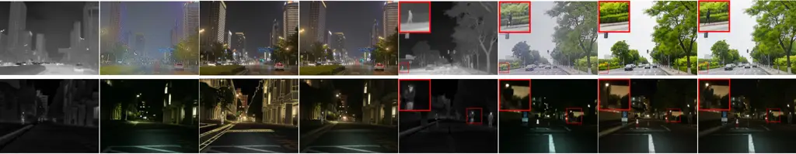

|          |         |      |          |
| -------- | ------- | ---- | -------- |
| Infrared | Visible | PGPR | PGPR+SBC |

Figure 8: Visual comparison of PGPR and PGPR+SBC on representative
cases. SBC adjusts local target emphasis and appearance through a single
prompt correction.

SBC Correction. SBC further complements PGPR by addressing
image-specific errors that remain after protocol optimization. It
analyzes region-level modality reliability and cross-modal conflicts to
guide conservative prompt corrections. As shown in Fig. 8, SBC adjusts
target emphasis and appearance in representative cases, further
improving Overall to 49.18 in Tab. 7. The PGPR baseline matches Full
PGPR in Tab. 5 and $`T=6`$ in Tab. 6, with all three studies evaluated
on the FMB test set. These results highlight the complementary benefits
of structured protocol optimization and targeted correction of residual
errors.

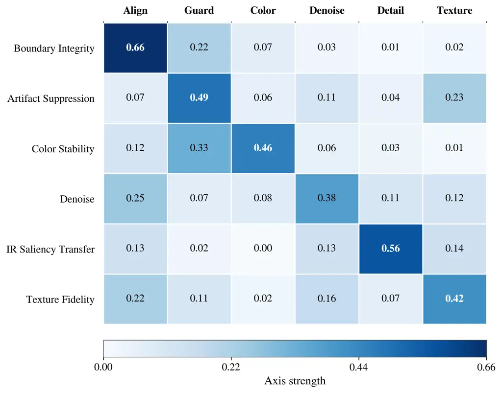

(a) Intrinsic functional factors

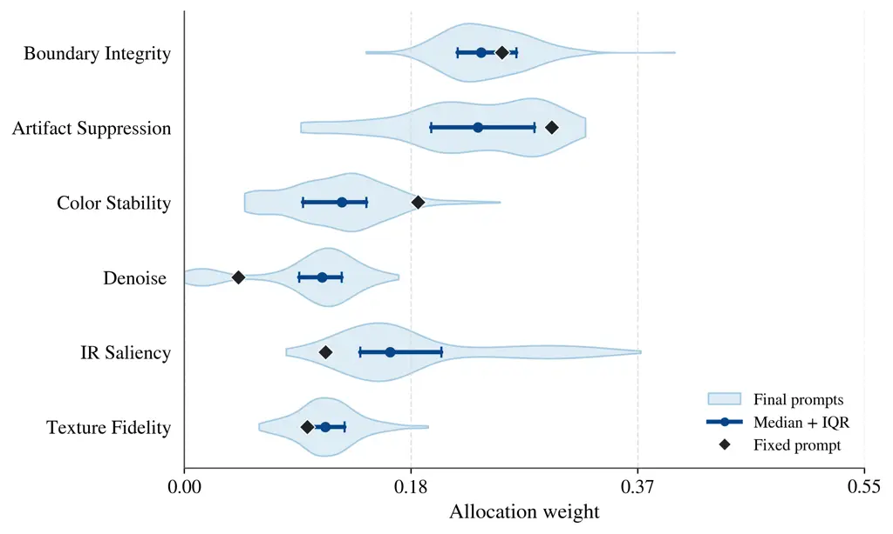

(b) Prompt-level control allocation

Figure 9: Analysis of the learned protocol. (a) Intrinsic functional
factors. (b) Prompt-level control allocation. Blue distributions show
the final prompts; blue points and bars show the median and
interquartile range; black diamonds denote the human-crafted prompt.

Protocol Analysis. We analyze the learned protocol in terms of both its
intrinsic functional structure and its prompt-level instantiation. The
protocol is decomposed into intermediate functional components,
projected into a shared functional signature space, and clustered into
intrinsic factors. As shown in Fig. 9(a), the most informative pattern
is the $`<`$IR Saliency Transfer$`>`$ factor, which is concentrated on
the detail axis and largely decoupled from color-related behavior. This
suggests that the learned protocol assigns IR information a selective
role, contributing salient structural details while leaving visible
appearance regulation to color-related controls.

We further parse the final prompts for the FMB dataset into semantic
control units and normalize them over the same functional axes.
Figure 9(b) shows that protocol-derived prompts occupy a bounded
allocation range around the human-crafted prompt, with variations
concentrated on specific control axes. Together, these results indicate
that the learned protocol organizes fusion intent into separable
functional factors and instantiates them as controlled prompt-level
reweighting before generation.

### 4.6 Cross-generator Protocol Transfer

The main quantitative experiments use Qwen-Image-Edit as the image
generator. To examine whether the learned protocol can be reused with
another generator, we replace Qwen-Image-Edit with GPT-Image-2 while
retaining the same optimized protocol. We directly reuse the protocol
optimized with Qwen-Image-Edit for GPT-Image-2. This comparison
therefore examines cross-generator reuse of a fixed learned protocol
within the ProtoFusion formulation.

Figure 10 compares the two instantiations on the same infrared and
visible image pairs. Both produce visible-style outputs that emphasize
infrared-supported targets, while the underlying generator affects their
appearance. In these nighttime examples, the GPT-Image-2 outputs show
cleaner local structures and sharper rendering around pedestrians,
building contours, roadside signs, and street-light regions. The
differences indicate that protocol guidance and generator capability
jointly influence the final result.

| Generator configuration | Time (s/pair) |
| ----------------------- | ------------- |
| Qwen-Image-Edit         | $`\sim`$188   |
| Qwen-Image-2.1-Turbo    | $`\sim`$9     |

Table 8: Inference latency per image pair, including prompt composition
and one image-generation step (excluding optional SBC).


Figure 10: Comparison of image generators under a fixed learned
protocol. The columns show the infrared and visible inputs, followed by
ProtoFusion with Qwen-Image-Edit and GPT-Image-2. The protocol learned
with Qwen-Image-Edit is reused without reoptimization.

These examples support a modular interpretation of ProtoFusion: the
learned protocol specifies _what_ evidence should be preserved,
emphasized, or suppressed, while the generator determines _how_ these
instructions are rendered. Reusing the protocol without reoptimization
demonstrates its applicability to a second generator in the illustrated
cases. These examples demonstrate that the optimized protocol can guide
different image generators. A matched quantitative evaluation would
further assess cross-generator performance in perceptual quality, source
consistency, and downstream utility.

### 4.7 Inference Runtime

ProtoFusion optimizes a shared fusion protocol offline and reuses it
across test images, avoiding repeated protocol refinement during
inference. With the optimized protocol fixed, inference requires only
prompt composition and image generation.

As shown in Tab. 8, the Qwen-Image-Edit implementation takes
approximately 188 s per image pair, including 38 s for prompt
composition and 150 s for image generation. We further evaluate
Qwen-Image-2.1-Turbo (Qwen, 2026), a newer and more lightweight
generative model with a 7B-parameter image generation backbone and only
eight denoising steps. Under a separate execution configuration, prompt
composition and image generation together take approximately 9 s per
pair. These results show that image generation dominates the
computational cost in the original implementation, while the optimized
protocol can be reused with more efficient generative models.

### 4.8 Limitations and Discussion

Hallucination and fidelity. ProtoFusion aims to generate fused images
with a natural visible appearance for practical visual interpretation.
Under severe visible degradation, infrared inputs can reveal salient
structures but cannot fully determine their visible appearance. The
generator may therefore introduce visually plausible details that are
unsupported by either source. Although PGPR and SBC reduce source
inconsistencies, residual errors persist (Table 4). Recent advances in
image editing, such as GPT-Image-2.5, have improved reference-image
preservation and editing precision (OpenAI, 2026). As visual grounding
and instruction following improve, such hallucinations may become less
frequent without changing the core PGPR formulation.

Protocol feedback and control. PGPR relies on VLM diagnoses and proxy
scores that may overlook source inconsistencies. Its best-so-far
selection ensures a non-decreasing retained proxy score, but cannot
guarantee improved source fidelity. SBC further identifies residual
errors through region-level analysis, yet implements corrections through
language instructions rather than direct image constraints.
Consequently, a narrowly scoped prompt edit may alter image regions
beyond its intended scope. Stronger image-level constraints and
verification could make these corrections more reliable.

Computational cost. The current Qwen-Image-Edit implementation requires
approximately 188 s per image pair for prompt composition and
generation. With the newer Qwen-Image-2.1-Turbo, the observed base-path
latency drops to approximately 9 s (Section 4.7). Although these
measurements exclude the optional SBC module and real-time fusion
remains challenging, this substantial improvement highlights the
potential of more efficient generative backbones. Continued advances in
generative foundation models are expected to further improve the
inference efficiency and practical applicability of ProtoFusion.

## 5 Conclusion

We presented ProtoFusion, a protocol-guided generative framework for
infrared and visible image fusion. ProtoFusion replaces fixed fusion
operator design with protocol-constrained generation and uses offline
refinement to optimize a structured fusion protocol that is fixed at
inference time. The optional SBC module further addresses residual
source inconsistencies through targeted corrections. Experiments on
standard benchmarks show that this design yields strong quantitative
performance, higher UniPercept scores, and better visual quality,
particularly when the visible modality is degraded.

More broadly, ProtoFusion introduces a new paradigm for image fusion. It
makes fusion intent explicit and optimizes a structured protocol to
guide foundation-model generation. This shifts the focus from designing
fixed fusion operators to controlling what information to preserve and
how to present it. Source fidelity and computational cost remain
challenges. However, continued advances in foundation models may further
improve fusion quality, reliability, and efficiency. ProtoFusion can
benefit from these advances without changing its core framework. We hope
this paradigm inspires further research on foundation-model-driven image
fusion.

## Data Availability

The FMB, MSRS, and RoadScene datasets used in this study are publicly
available.

## Conflict of Interest

The authors affirm that there are no commercial or associative
relationships that could be perceived as a conflict of interest related
to the submitted work.

## References

- Bai et al. (2025a) H. Bai, J. Zhang, Z. Zhao, Y. Wu, L. Deng, Y.
  Cui, T. Feng, and S. Xu Task-driven image fusion with learnable fusion
  loss. In Proceedings of the Computer Vision and Pattern Recognition
  Conference, pp. 7457–7468. Cited by: §1.
- Bai et al. (2025b) H. Bai, Z. Zhao, J. Zhang, Y. Wu, L. Deng, Y.
  Cui, B. Jiang, and S. Xu ReFusion: learning image fusion from
  reconstruction with learnable loss via meta-learning. International
  Journal of Computer Vision 133 (5), pp. 2547–2567. External Links:
  [Document](https://dx.doi.org/10.1007/s11263-024-02256-8) Cited by:
  §2.1.
- Bai et al. (2025c) S. Bai, Y. Cai, R. Chen, K. Chen, X. Chen, Z.
  Cheng, L. Deng, W. Ding, C. Gao, C. Ge, W. Ge, Z. Guo, Q. Huang, J.
  Huang, F. Huang, B. Hui, S. Jiang, Z. Li, M. Li, M. Li, K. Li, Z.
  Lin, J. Lin, X. Liu, J. Liu, C. Liu, Y. Liu, D. Liu, S. Liu, D. Lu, R.
  Luo, C. Lv, R. Men, L. Meng, X. Ren, X. Ren, S. Song, Y. Sun, J.
  Tang, J. Tu, J. Wan, P. Wang, P. Wang, Q. Wang, Y. Wang, T. Xie, Y.
  Xu, H. Xu, J. Xu, Z. Yang, M. Yang, J. Yang, A. Yang, B. Yu, F.
  Zhang, H. Zhang, X. Zhang, B. Zheng, H. Zhong, J. Zhou, F. Zhou, J.
  Zhou, Y. Zhu, and K. Zhu Qwen3-VL technical report. External Links:
  2511.21631, [Link](https://arxiv.org/abs/2511.21631) Cited by: §4.1.
- Cao et al. (2025) L. Cao, H. Zhang, C. Li, and J. Ma
  Projection-manifold regularized latent diffusion for robust general
  image fusion. In Advances in Neural Information Processing Systems,
  Cited by: §1, §2.3.
- Cao et al. (2026) S. Cao, J. Li, X. Li, Y. Pu, K. Zhu, Y. Gao, S.
  Luo, Y. Xin, Q. Qin, Y. Zhou, X. Chen, W. Zhang, B. Fu, Y. Qiao,
  and Y. Liu UniPercept: towards unified perceptual-level image
  understanding across aesthetics, quality, structure, and texture. In
  Proceedings of the International Conference on Machine Learning, Cited
  by: §4.1.
- Cheng et al. (2025a) C. Cheng, T. Xu, X. Wu, H. Li, X. Li, and J.
  Kittler FusionBooster: a unified image fusion boosting paradigm.
  International Journal of Computer Vision 133 (5), pp. 3041–3058.
  External Links:
  [Document](https://dx.doi.org/10.1007/s11263-024-02266-6) Cited by:
  §2.4.
- Cheng et al. (2025b) C. Cheng, T. Xu, X. Wu, H. Li, X. Li, Z. Tang,
  and J. Kittler TextFusion: unveiling the power of textual semantics
  for controllable image fusion. Information Fusion 117, pp. 102790.
  External Links:
  [Document](https://dx.doi.org/10.1016/j.inffus.2024.102790) Cited by:
  §1.
- Golestaneh et al. (2022) S. A. Golestaneh, S. Dadsetan, and K. M.
  Kitani No-reference image quality assessment via transformers,
  relative ranking, and self-consistency. In Proceedings of the IEEE/CVF
  Winter Conference on Applications of Computer Vision, pp. 3209–3218.
  Cited by: §4.1.
- Hertz et al. (2023) A. Hertz, R. Mokady, J. Tenenbaum, K. Aberman, Y.
  Pritch, and D. Cohen-Or Prompt-to-prompt image editing with
  cross-attention control. In Proceedings of the International
  Conference on Learning Representations, Cited by: §2.4.
- Kang et al. (2025) H. Kang, H. Li, T. Xu, X. Wu, R. Wang, C. Cheng,
  and J. Kittler SMLNet: a SPD manifold learning network for infrared
  and visible image fusion. International Journal of Computer Vision 133
  (12), pp. 8642–8663. External Links:
  [Document](https://dx.doi.org/10.1007/s11263-025-02578-1) Cited by:
  §2.1.
- Ke et al. (2021) J. Ke, Q. Wang, Y. Wang, P. Milanfar, and F. Yang
  MUSIQ: multi-scale image quality transformer. In Proceedings of the
  IEEE/CVF International Conference on Computer Vision, pp. 5148–5157.
  Cited by: §4.1.
- Li et al. (2025) H. Li, C. Bian, Z. Zhang, X. Song, X. Li, and X. Wu
  OCCO: LVM-guided infrared and visible image fusion framework based on
  object-aware and contextual contrastive learning. International
  Journal of Computer Vision 133 (9), pp. 6611–6635. External Links:
  [Document](https://dx.doi.org/10.1007/s11263-025-02507-2) Cited by:
  §2.2.
- Li and Wu (2019) H. Li and X. Wu DenseFuse: a fusion approach to
  infrared and visible images. IEEE Transactions on Image Processing 28
  (5), pp. 2614–2623. External Links:
  [Document](https://dx.doi.org/10.1109/TIP.2018.2887342) Cited by: §1,
  §2.1.
- Liu et al. (2022) J. Liu, X. Fan, Z. Huang, G. Wu, R. Liu, W. Zhong,
  and Z. Luo Target-aware dual adversarial learning and a multi-scenario
  multi-modality benchmark to fuse infrared and visible for object
  detection. In Proceedings of the IEEE/CVF Conference on Computer
  Vision and Pattern Recognition, pp. 5802–5811. Cited by: §1, §2.2.
- Liu et al. (2026) J. Liu, X. Li, Q. Mei, H. Xu, Z. Jiang, L. Ma, R.
  Liu, and X. Fan Bridging human evaluation to infrared and visible
  image fusion. In Proceedings of the IEEE/CVF Conference on Computer
  Vision and Pattern Recognition, Cited by: §1.
- Liu et al. (2025a) J. Liu, X. Li, Z. Wang, Z. Jiang, W. Zhong, W. Fan,
  and B. Xu PromptFusion: harmonized semantic prompt learning for
  infrared and visible image fusion. IEEE/CAA Journal of Automatica
  Sinica 12 (3), pp. 502–515. External Links:
  [Document](https://dx.doi.org/10.1109/JAS.2024.124878) Cited by: §1,
  §2.2.
- Liu et al. (2024a) J. Liu, R. Lin, G. Wu, R. Liu, Z. Luo, and X. Fan
  CoCoNet: coupled contrastive learning network with multi-level feature
  ensemble for multi-modality image fusion. International Journal of
  Computer Vision 132 (5), pp. 1748–1775. External Links:
  [Document](https://dx.doi.org/10.1007/s11263-023-01952-1) Cited by:
  §2.1.
- Liu et al. (2023) J. Liu, Z. Liu, G. Wu, L. Ma, R. Liu, W. Zhong, Z.
  Luo, and X. Fan Multi-interactive feature learning and a full-time
  multi-modality benchmark for image fusion and segmentation. In
  Proceedings of the IEEE/CVF International Conference on Computer
  Vision, pp. 8115–8124. Cited by: §4.1.
- Liu et al. (2025b) J. Liu, B. Zhang, Q. Mei, X. Li, Y. Zou, Z.
  Jiang, L. Ma, R. Liu, and X. Fan DCEvo: discriminative
  cross-dimensional evolutionary learning for infrared and visible image
  fusion. In Proceedings of the IEEE/CVF Conference on Computer Vision
  and Pattern Recognition, pp. 2226–2235. Cited by: §2.2, §4.1.
- Liu et al. (2024b) R. Liu, Z. Liu, J. Liu, X. Fan, and Z. Luo A
  task-guided, implicitly-searched and meta-initialized deep model for
  image fusion. IEEE Transactions on Pattern Analysis and Machine
  Intelligence 46 (10), pp. 6594–6609. Cited by: §1, §2.2, §4.1.
- Ma et al. (2019a) J. Ma, Y. Ma, and C. Li Infrared and visible image
  fusion methods and applications: a survey. Information Fusion 45,
  pp. 153–178. External Links:
  [Document](https://dx.doi.org/10.1016/j.inffus.2018.02.004) Cited by:
  §1, §2.1.
- Ma et al. (2022) J. Ma, L. Tang, F. Fan, J. Huang, X. Mei, and Y. Ma
  SwinFusion: cross-domain long-range learning for general image fusion
  via swin transformer. IEEE/CAA Journal of Automatica Sinica 9 (7),
  pp. 1200–1217. External Links:
  [Document](https://dx.doi.org/10.1109/JAS.2022.105686) Cited by: §1.
- Ma et al. (2019b) J. Ma, W. Yu, P. Liang, C. Li, and J. Jiang
  FusionGAN: a generative adversarial network for infrared and visible
  image fusion. Information Fusion 48, pp. 11–26. External Links:
  [Document](https://dx.doi.org/10.1016/j.inffus.2018.09.004) Cited by:
  §1, §2.1.
- Madaan et al. (2023) A. Madaan, N. Tandon, P. Gupta, S. Hallinan, L.
  Gao, S. Wiegreffe, U. Alon, N. Dziri, S. Prabhumoye, Y. Yang, S.
  Gupta, B. P. Majumder, K. Hermann, S. Welleck, A. Yazdanbakhsh, and P.
  Clark Self-refine: iterative refinement with self-feedback. In
  Advances in Neural Information Processing Systems, Cited by: §2.4.
- Mittal et al. (2012) A. Mittal, A. K. Moorthy, and A. C. Bovik
  No-reference image quality assessment in the spatial domain. IEEE
  Transactions on Image Processing 21 (12), pp. 4695–4708. External
  Links: [Document](https://dx.doi.org/10.1109/TIP.2012.2214050) Cited
  by: §4.1.
- OpenAI (2026) OpenAI Introducing chatgpt images 2.5. External Links:
  [Link](https://openai.com/index/introducing-chatgpt-images-2-5/) Cited
  by: §4.8.
- Qwen (2026) Qwen Qwen-Image-2.1-Turbo. Note: Hugging Face model
  repositoryReleased 2026-10-09. Accessed 2026-10-21 External Links:
  [Link](https://huggingface.co/Qwen/Qwen-Image-2.1-Turbo) Cited by:
  §4.7.
- Shi et al. (2025) Y. Shi, Y. Liu, J. Cheng, Z. J. Wang, and X. Chen
  VDMUFusion: a versatile diffusion model-based unsupervised framework
  for image fusion. IEEE Transactions on Image Processing 34,
  pp. 441–454. External Links:
  [Document](https://dx.doi.org/10.1109/TIP.2024.3512365) Cited by: §1,
  §2.3.
- Shi et al. (2026) Y. Shi, Y. Liu, Z. Wu, J. Cheng, H. Li, and X. Chen
  Degradation-Robust Fusion: An Efficient Degradation-Aware Diffusion
  Framework for Multimodal Image Fusion in Arbitrary Degradation
  Scenarios. In Proceedings of the IEEE/CVF Conference on Computer
  Vision and Pattern Recognition, Cited by: §2.3, §4.1.
- Su et al. (2026) W. Su, S. Zhang, Y. Han, J. Zhuang, Y. Huang, and Q.
  Zhang Fusion in Your Way: Aligning Image Fusion with Heterogeneous
  Demands via Direct Preference Optimization. In Proceedings of the
  IEEE/CVF Conference on Computer Vision and Pattern Recognition,
  pp. 41499–41509. Cited by: §2.3.
- Sun et al. (2025) L. Sun, J. Cao, J. Xie, X. Jiang, and Y. Pang
  Cliper: hierarchically improving spatial representation of clip for
  open-vocabulary semantic segmentation. In Proceedings of the IEEE/CVF
  International Conference on Computer Vision, pp. 23199–23209. Cited
  by: §4.3.
- Tang et al. (2025a) L. Tang, Y. Wang, Z. Cai, J. Jiang, and J. Ma
  ControlFusion: a controllable image fusion network with
  language-vision degradation prompts. In Advances in Neural Information
  Processing Systems, Cited by: §2.2.
- Tang et al. (2025b) L. Tang, Q. Yan, X. Xiang, L. Fang, and J. Ma
  C2RF: bridging multi-modal image registration and fusion via
  commonality mining and contrastive learning. International Journal of
  Computer Vision 133 (8), pp. 5262–5280. External Links:
  [Document](https://dx.doi.org/10.1007/s11263-025-02427-1) Cited by:
  §2.1, §4.1.
- Tang et al. (2022) L. Tang, J. Yuan, and J. Ma Image fusion in the
  loop of high-level vision tasks: a semantic-aware real-time infrared
  and visible image fusion network. Information Fusion 82, pp. 28–42.
  External Links:
  [Document](https://dx.doi.org/10.1016/j.inffus.2021.12.004) Cited by:
  §1, §2.2, §4.1.
- Tang et al. (2023) L. Tang, H. Zhang, H. Xu, and J. Ma Rethinking the
  necessity of image fusion in high-level vision tasks: a practical
  infrared and visible image fusion network based on progressive
  semantic injection and scene fidelity. Information Fusion 99,
  pp. 101870. External Links:
  [Document](https://dx.doi.org/10.1016/j.inffus.2023.101870) Cited by:
  §1, §2.2.
- Wang et al. (2024a) H. Wang, H. Zhang, X. Yi, X. Xiang, L. Fang,
  and J. Ma TeRF: text-driven and region-aware flexible visible and
  infrared image fusion. In Proceedings of the 32nd ACM International
  Conference on Multimedia, pp. 935–944. External Links:
  [Document](https://dx.doi.org/10.1145/3664647.3680971) Cited by: §1,
  §2.2.
- Wang et al. (2023) J. Wang, K. C. K. Chan, and C. C. Loy Exploring
  CLIP for assessing the look and feel of images. In Proceedings of the
  AAAI Conference on Artificial Intelligence, Vol. 37, pp. 2555–2563.
  External Links:
  [Document](https://dx.doi.org/10.1609/aaai.v37i2.25353) Cited by:
  §4.1.
- Wang et al. (2008) Q. Wang, Y. Shen, and J. Jin Performance evaluation
  of image fusion techniques. In Image Fusion: Algorithms and
  Applications, pp. 469–492. Cited by: §4.1.
- Wang et al. (2024b) W. Wang, L. Deng, R. Ran, and G. Vivone A general
  paradigm with detail-preserving conditional invertible network for
  image fusion. International Journal of Computer Vision 132 (4),
  pp. 1029–1054. External Links:
  [Document](https://dx.doi.org/10.1007/s11263-023-01924-5) Cited by:
  §2.1.
- Wang et al. (2026) X. Wang, Z. Guan, W. Qian, C. Wang, and R. Ma
  Multi-modal image fusion via intervention-stable feature learning. In
  Proceedings of the IEEE/CVF Conference on Computer Vision and Pattern
  Recognition, pp. 33827–33837. Cited by: §2.1, §4.1.
- Wang et al. (2025) Z. Wang, L. Zhao, J. Zhang, R. Song, H. Song, J.
  Meng, and S. Wang Multi-text guidance is important: multi-modality
  image fusion via large generative vision-language model. International
  Journal of Computer Vision 133 (7), pp. 4646–4668. External Links:
  [Document](https://dx.doi.org/10.1007/s11263-025-02409-3) Cited by:
  §2.2.
- Wu et al. (2025) C. Wu, J. Li, J. Zhou, J. Lin, K. Gao, K. Yan, S.
  Yin, S. Bai, X. Xu, Y. Chen, Y. Chen, Z. Tang, Z. Zhang, Z. Wang, A.
  Yang, B. Yu, C. Cheng, D. Liu, D. Li, H. Zhang, H. Meng, H. Wei, J.
  Ni, K. Chen, K. Cao, L. Peng, L. Qu, M. Wu, P. Wang, S. Yu, T. Wen, W.
  Feng, X. Xu, Y. Wang, Y. Zhang, Y. Zhu, Y. Wu, Y. Cai, and Z. Liu
  Qwen-Image technical report. External Links: 2508.02324,
  [Link](https://arxiv.org/abs/2508.02324) Cited by: §4.1.
- Xu et al. (2025) H. Xu, Y. Li, Y. Deng, J. Ma, and G. Liu Deno-IF:
  unsupervised noisy visible and infrared image fusion method. In
  Advances in Neural Information Processing Systems, Cited by: §4.1.
- Xu et al. (2022) H. Xu, J. Ma, J. Jiang, X. Guo, and H. Ling U2Fusion:
  a unified unsupervised image fusion network. IEEE Transactions on
  Pattern Analysis and Machine Intelligence 44 (1), pp. 502–518.
  External Links:
  [Document](https://dx.doi.org/10.1109/TPAMI.2020.3012548) Cited by:
  §1, §2.1.
- Xu et al. (2020) H. Xu, J. Ma, Z. Le, J. Jiang, and X. Guo FusionDN: a
  unified densely connected network for image fusion. In proceedings of
  the Thirty-Fourth AAAI Conference on Artificial Intelligence, Cited
  by: §4.1.
- Yang et al. (2024) C. Yang, X. Wang, Y. Lu, H. Liu, Q. V. Le, D. Zhou,
  and X. Chen Large language models as optimizers. In Proceedings of the
  International Conference on Learning Representations, Cited by: §2.4.
- Yang et al. (2022) S. Yang, T. Wu, S. Shi, S. Lao, Y. Gong, M. Cao, J.
  Wang, and Y. Yang MANIQA: multi-dimension attention network for
  no-reference image quality assessment. In Proceedings of the IEEE/CVF
  Conference on Computer Vision and Pattern Recognition Workshops,
  pp. 1190–1199. Cited by: §4.1.
- Yang et al. (2025) Z. Yang, Y. Zhang, H. Li, and Y. Liu
  Instruction-driven fusion of infrared-visible images: tailoring for
  diverse downstream tasks. Information Fusion 121, pp. 103148. External
  Links: [Document](https://dx.doi.org/10.1016/j.inffus.2025.103148)
  Cited by: §1.
- Yi et al. (2024a) X. Yi, L. Tang, H. Zhang, H. Xu, and J. Ma Diff-IF:
  multi-modality image fusion via diffusion model with fusion knowledge
  prior. Information Fusion 110, pp. 102450. External Links:
  [Document](https://dx.doi.org/10.1016/j.inffus.2024.102450) Cited by:
  §1, §2.3.
- Yi et al. (2024b) X. Yi, H. Xu, H. Zhang, L. Tang, and J. Ma Text-IF:
  leveraging semantic text guidance for degradation-aware and
  interactive image fusion. In Proceedings of the IEEE/CVF Conference on
  Computer Vision and Pattern Recognition, pp. 27026–27035. Cited by:
  §1, §2.2, §4.1.
- Yi et al. (2025) X. Yi, Y. Zhang, X. Xiang, Q. Yan, H. Xu, and J. Ma
  LUT-Fuse: towards extremely fast infrared and visible image fusion via
  distillation to learnable look-up tables. In Proceedings of the
  IEEE/CVF International Conference on Computer Vision, pp. 14559–14568.
  Cited by: §4.1.
- Ying et al. (2020) Z. Ying, H. Niu, P. Gupta, D. Mahajan, D.
  Ghadiyaram, and A. Bovik From patches to pictures (PaQ-2-PiQ): mapping
  the perceptual space of picture quality. In Proceedings of the
  IEEE/CVF Conference on Computer Vision and Pattern Recognition,
  pp. 3575–3585. Cited by: §4.1.
- Yue et al. (2023) J. Yue, L. Fang, S. Xia, Y. Deng, and J. Ma
  Dif-Fusion: toward high color fidelity in infrared and visible image
  fusion with diffusion models. IEEE Transactions on Image Processing
  32, pp. 5705–5720. External Links:
  [Document](https://dx.doi.org/10.1109/TIP.2023.3322046) Cited by: §1,
  §2.3.
- Zhang et al. (2021) H. Zhang, H. Xu, X. Tian, J. Jiang, and J. Ma
  Image fusion meets deep learning: a survey and perspective.
  Information Fusion 76, pp. 323–336. External Links:
  [Document](https://dx.doi.org/10.1016/j.inffus.2021.06.008) Cited by:
  §1, §2.1.
- Zhang and Demiris (2023) X. Zhang and Y. Demiris Visible and infrared
  image fusion using deep learning. IEEE Transactions on Pattern
  Analysis and Machine Intelligence 45 (8), pp. 10535–10554. External
  Links: [Document](https://dx.doi.org/10.1109/TPAMI.2023.3261282) Cited
  by: §1, §2.1.
- Zhang et al. (2026) Z. Zhang, H. Li, T. Xu, X. Wu, M. Awais, and J.
  Kittler A color information driven collaborative training of dual task
  parallel network for visible and thermal infrared image fusion and
  saliency object detection. International Journal of Computer Vision
  134 (5), pp. Article 227. External Links:
  [Document](https://dx.doi.org/10.1007/s11263-026-02793-4) Cited by:
  §2.2.
- Zhao et al. (2023a) W. Zhao, S. Xie, F. Zhao, Y. He, and H. Lu
  MetaFusion: infrared and visible image fusion via meta-feature
  embedding from object detection. In Proceedings of the IEEE/CVF
  Conference on Computer Vision and Pattern Recognition,
  pp. 13955–13965. Cited by: §1, §2.2.
- Zhao et al. (2023b) Z. Zhao, H. Bai, J. Zhang, Y. Zhang, S. Xu, Z.
  Lin, R. Timofte, and L. Van Gool CDDFuse: correlation-driven
  dual-branch feature decomposition for multi-modality image fusion. In
  Proceedings of the IEEE/CVF Conference on Computer Vision and Pattern
  Recognition, pp. 5906–5916. Cited by: §1, §2.1, §4.1.
- Zhao et al. (2023c) Z. Zhao, H. Bai, Y. Zhu, J. Zhang, S. Xu, Y.
  Zhang, K. Zhang, D. Meng, R. Timofte, and L. Van Gool DDFM: denoising
  diffusion model for multi-modality image fusion. In Proceedings of the
  IEEE/CVF International Conference on Computer Vision, pp. 8082–8093.
  Cited by: §1, §2.3, §4.1.
- Zhao et al. (2026) Z. Zhao, Y. Cui, L. Deng, H. Bai, H. Qin, T. Feng,
  and K. Schindler MambaVF: state space model for efficient video
  fusion. External Links: 2602.06017,
  [Link](https://arxiv.org/abs/2602.06017) Cited by: §1.
- Zhao et al. (2024) Z. Zhao, L. Deng, H. Bai, Y. Cui, Z. Zhang, Y.
  Zhang, H. Qin, D. Chen, J. Zhang, P. Wang, and L. Van Gool Image
  fusion via vision-language model. In Proceedings of the 41st
  International Conference on Machine Learning, Proceedings of Machine
  Learning Research, Vol. 235, pp. 60749–60765. Cited by: §1, §2.2.
- Zhou et al. (2023) Y. Zhou, A. I. Muresanu, Z. Han, K. Paster, S.
  Pitis, H. Chan, and J. Ba Large language models are human-level prompt
  engineers. In Proceedings of the International Conference on Learning
  Representations, Cited by: §2.4.

## Appendix

Appendix A gives the implementation details and prompt templates.
Appendix B supplements the main evaluation with source-referenced
fidelity metrics and additional nighttime comparisons. Appendix C
examines fixed-prompt failures and hallucination propagation. The
component, refinement-budget, and SBC ablations use the FMB test pairs;
the remaining benchmark comparisons use the test-set sizes stated in
Section 4.1.

## Appendix A Implementation and Prompt Details

### A.1 Region-level Evidence for SBC

#### Structured Belief Construction.

In our implementation, SBC constructs the belief state in Eq. 7 through
a hybrid region-level diagnosis. We first use SAM to obtain candidate
regions and treat them only as local analysis units rather than fusion
masks. For each region, we extract aligned crops from the visible image,
infrared image, and the selected PGPR output. SBC then computes
traditional visual cues to provide grounded evidence, including
sharpness, contrast, brightness balance, cleanliness, edge density,
thermal dynamic range, hotspot fraction, and hotspot compactness. These
measurements are used to describe whether the visible modality provides
reliable texture and appearance, whether the infrared modality provides
compact thermal targets and clear boundaries, and whether the PGPR
output preserves or distorts the source evidence. In parallel,
Qwen3-VL-8B-Instruct parses the same region crops into structured
semantic evidence, including presence, location, appearance, shape, and
consistency cues, together with reliability, conflict-risk, and
confidence estimates. The final belief combines measurable regional cues
with semantic interpretation from Qwen3-VL-8B-Instruct.

After obtaining the region-level belief state, SBC maps it to the
conservative prompt correction defined in Eq. 8. The belief state is
summarized into image-level statistics, such as modality reliability,
average confidence, average conflict, infrared-supported regions,
high-confidence regions, and ambiguous regions. These statistics
determine a conservative correction policy, including how strongly
infrared evidence should be exposed, how strictly boundaries should be
preserved, and whether the global appearance should follow the visible
image, the PGPR prior, or a balanced rendering strategy. A small number
of representative regions are further selected as local anchors, such as
infrared-supported salient targets, stable structural boundaries,
texture-supported visible regions, or ambiguous cross-modal regions.
Finally, Qwen3-VL-8B-Instruct compiles these global policies and local
anchor hints into a revised prompt, while treating the selected PGPR
prompt as the authoritative base prompt. Thus, SBC only performs a
scoped correction after PGPR: it may strengthen missing thermal targets,
suppress thermal blobs, protect boundaries, or avoid visible degradation
leakage, but SBC preserves the global fusion intent and applies a scoped
correction to the selected prompt.

### A.2 Diagnostic and Update Rules

The diagnostic score combines semantic fidelity, artifact control,
texture, information gain, and protocol compliance with weights 0.30,
0.25, 0.20, 0.15, and 0.10, respectively. Nine source-grounded checks
return binary judgments and confidence estimates. Detected fatal source
violations receive a score of $`-1`$ and are excluded from inheritance;
a strict pass requires passing all nine checks and achieving a score of
at least 0.80.

Starting from an evaluated non-fatal incumbent, the editor proposes one
allowed slot edit: add an environment-state item, revise a principle, or
add a principle. The style profile stays fixed. The validator rejects
malformed, empty, repeated, or ineffective edits, as well as edits with
invalid conditions. A valid proposal is composed, generated, and
diagnosed before selection. Lower-scoring or fatal candidates do not
replace the incumbent; later edits start from a best-scoring valid
state. The acceptance rule tracks the retained critic score, while
source fidelity is evaluated separately.

### A.3 Protocol and Prompt Details

This section presents the fixed prompt baseline and the initial protocol
used by ProtoFusion. The fixed human-crafted prompt is used in the
failure examples in Fig. 12 and the controlled prompt/protocol
comparison in Table 5. It is directly fed to the generative fusion model
and kept unchanged for all image pairs. In contrast, ProtoFusion starts
from an initial structured protocol, which specifies the environment
variables, fusion principles, and style constraints for prompt
composition. This protocol is subsequently optimized by PGPR via
iterative evaluation-guided protocol refinement, and the optimized
protocol is fixed for inference.

Fixed Human-crafted Prompt. The fixed prompt is used to evaluate
one-shot prompting without protocol refinement. The human-crafted prompt
applies the same fusion instructions to every image pair, whereas PGPR
combines image-specific prompt composition with an optimized fusion
protocol.

You are doing image fusion.

Inputs:

- Image 1: Color visible (VIS)

- Image 2: Grayscale infrared (IR)

Goal:

Generate ONE fused image.

Rules:

1. Use the VIS image to define scene structure, layout, edges,

and background whenever possible.

2. If the VIS image is overexposed, underexposed, or low-contrast,

use IR luminance to add texture,

but render these details with a neutral visible appearance.

3. No thermal colors (red, orange, or yellow). No glow. No halo.

4. Do not let the IR image define global structure or background.

5. Keep VIS colors, textures, and fine details as the main appearance.

6. The result should look like a normal visible-light photograph.

7. No IR-style background, no double edges, no noise, and no ghosting.

Initial Protocol for PGPR. PGPR starts from the following structured
protocol. In contrast to the fixed prompt, the protocol is not itself
the final generation instruction. It first extracts an environment state
from the input pair, applies condition-dependent fusion principles,
defines the target visual style, and then assembles an operational
prompt for the generator. During refinement, PGPR updates the protocol
slots and principle descriptions according to multimodal evaluation
feedback, so that later prompts are composed from an optimized protocol
rather than from a fixed manually written instruction.

Role: You are the Fusion Logic Engine.

Input: Image 1 (Visible/Vis), Image 2 (Infrared/IR).

Goal: Analyze the images and generate a specific prompt for a
Text/Image-to-Image

model (Qwen-Image) to create a fused image that preserves:

(1) Vis color/texture realism,

(2) clean, single boundaries (no ghosting/bleed/smear), and

(3) information gain (saliency vs Vis, detail vs IR).

Phase 1: Perception Layer (Variable Extraction)

Observe visible and infrared images and fill in the \[Environment State
Card\].

Do not describe; just extract values.

\[Environment State Card\]

1. {Lighting_Condition}: \[Day / Dusk / Evening / Night /
   Artificial_Light\]

- Condition: only rely on Vis image to judge.

2. {Vis_Quality}: \[High_Fidelity / Overexposed / Low_Light_Noise\]

3. {IR_Targets}: \[None / Pedestrians / Vehicles / Machinery\]

4. {Information_Dominance}: \[Balanced / Vis_Lead / IR_Lead\]

5. {Vis_Edge_Reliability}: \[Reliable / Unreliable\]

- Reliable: edges are crisp and consistent (not dominated by
  noise/overexposure).

6. {Chroma_Bleed_Risk}: \[Low / High\]

- High: strong colored light sources (neon, brake lights, traffic
  lights)

likely to bleed.

7. {Alignment_Risk}: \[Low / High\]

- High: IR and Vis structures appear slightly shifted or mismatched
  around

object boundaries.

Phase 2: Decision Layer (Principle Application)

Based on Phase 1 variables, apply the following Fusion Principles.

Write the final prompt as a short, operational plan:

clear steps + a compact list of constraints.

Principle A (Night Robustness and Noise Control):

IF {Lighting_Condition} is Night AND {Vis_Quality} is Low_Light_Noise:

- Strategy:

1.  Use Vis as the base for overall scene appearance (global tone and
    colors),

but treat very dark/noisy Vis regions as low-trust for fine texture.

2. Preserve IR target shapes and boundaries; avoid turning targets into
   blobs.

3. Apply edge-preserving denoise (remove grain without smearing edges or
   textures).

- Constraint:

- No painterly smoothing or texture smear.

- No synthetic grain; do not amplify noise.

- Preserve crisp edges; do not blur boundaries.

Principle B (Thermal Saliency with Color Discipline):

IF {IR_Targets} exist:

- Strategy:

1.  Make IR targets easier to spot by increasing luminance/contrast of
    the

target regions (saliency), while keeping Vis realism.

2. Preserve target geometry (shape and boundary consistency) without
   double

contours.

3. If {Chroma_Bleed_Risk} is High: lock chroma to Vis; inject IR only
   into

luminance/contrast (avoid colored thermal halos).

- Constraint:

- No hallucinated objects or structures absent in both IR and Vis.

- No colored halos around targets; no color leakage across boundaries
  when

{Chroma_Bleed_Risk} is High.

Principle C (Texture Preservation without Smear):

IF {Vis_Quality} is High_Fidelity:

- Strategy:

1.  Preserve Vis micro-textures (text, lines, road texture) and natural
    color

statistics.

2. Add IR saliency without washing out high-frequency Vis details.

3. Prefer sharp detail preservation over global smoothing.

- Constraint:

- No over-smoothing; no oil-painting look.

- Do not wash out fine Vis details when adding IR saliency.

Principle D (Boundary Alignment Policy):

IF {IR_Targets} exist OR {Alignment_Risk} is High:

- Strategy:

1.  Enforce a single contour per object (avoid double edges /
    semi-transparent

outlines).

2. If {Vis_Edge_Reliability} is Reliable AND {Alignment_Risk} is Low:

anchor object boundaries to Vis edges (hard anchor).

Else: use a soft alignment; prioritize one boundary source

(prefer IR boundary for targets) and suppress secondary contours.

3. Prevent offset blending of contours; keep boundaries geometrically
   consistent.

- Constraint:

- No ghost edges, double contours, or transparent overlays.

- No offset blending that creates duplicated boundaries.

Phase 3: Stylization Layer (Visual Definition)

Define the artistic parameters:

- View Mode: Realistic Night Vision / Enhanced Reality

- Color Palette: Natural Vis colors

- Clarity: 4K Resolution, Sharp Edges

Phase 4: Construction Layer (Prompt Assembly)

Output the Final Prompt based on the previous layers.

\[Final Prompt\]: \<Write the English prompt here\>

## Appendix B Additional Experimental Results

Table 9: Additional source-referenced evaluation. Lower CE and higher
$`Q_{AB/F}`$ and VIF are better. Best and second-best results are bold
and underlined, respectively.

|             |            | FMB              |                      |                 | MSRS             |                      |                 | RoadScene        |                      |                 |
| ----------- | ---------- | ---------------- | -------------------- | --------------- | ---------------- | -------------------- | --------------- | ---------------- | -------------------- | --------------- |
| Method      | Venue      | CE$`\downarrow`$ | $`Q_{AB/F}\uparrow`$ | VIF$`\uparrow`$ | CE$`\downarrow`$ | $`Q_{AB/F}\uparrow`$ | VIF$`\uparrow`$ | CE$`\downarrow`$ | $`Q_{AB/F}\uparrow`$ | VIF$`\uparrow`$ |
| CDDFuse     | CVPR’23    | 1.8371           | 0.3500               | 0.2150          | 1.0234           | 0.3721               | 0.3171          | 0.9237           | 0.2460               | 0.1810          |
| DDFM        | ICCV’23    | 1.8333           | 0.1131               | 0.0437          | 1.2518           | 0.2632               | 0.2482          | 1.4241           | 0.1282               | 0.0583          |
| TIMFusion   | TPAMI’24   | 2.1071           | 0.2698               | 0.1481          | 1.7597           | 0.2552               | 0.2019          | 0.6055           | 0.1978               | 0.1559          |
| Text-IF     | CVPR’24    | 1.7777           | 0.3621               | 0.2259          | 1.0391           | 0.3778               | 0.3269          | 0.8612           | 0.2759               | 0.1967          |
| C2RF        | IJCV’25    | 1.8749           | 0.1847               | 0.1158          | 1.2196           | 0.1587               | 0.1348          | 1.0004           | 0.2652               | 0.1693          |
| DCEvo       | CVPR’25    | 1.9175           | 0.3527               | 0.2153          | 1.0867           | 0.3769               | 0.3128          | 1.0545           | 0.2683               | 0.1792          |
| Deno-IF     | NeurIPS’25 | 2.1191           | 0.2758               | 0.1747          | 1.3868           | 0.3098               | 0.2848          | 0.9421           | 0.2484               | 0.1851          |
| LUT-Fuse    | ICCV’25    | 2.0738           | 0.2973               | 0.1886          | 1.2540           | 0.3380               | 0.2864          | 1.3454           | 0.2194               | 0.1610          |
| APTP        | CVPR’26    | 1.9288           | 0.3345               | 0.1993          | 1.0084           | 0.3437               | 0.2870          | 1.0902           | 0.2402               | 0.1867          |
| DPOFusion   | CVPR’26    | 2.1022           | 0.2371               | 0.1664          | 3.3510           | 0.1931               | 0.2612          | 0.9711           | 0.2065               | 0.1679          |
| DRFusion    | CVPR’26    | 1.8506           | 0.2595               | 0.1556          | 1.4457           | 0.2575               | 0.1974          | 0.4930           | 0.2062               | 0.1473          |
| ISFuse      | CVPR’26    | 2.3855           | 0.3102               | 0.1802          | 1.3161           | 0.3257               | 0.2618          | 1.7310           | 0.2368               | 0.1509          |
| ProtoFusion |            | 1.2906           | 0.3641               | 0.2253          | 1.1521           | 0.3943               | 0.3052          | 0.9346           | 0.3220               | 0.2908          |

![[Uncaptioned
image]](arxiv-2611-02877v1--fd7b6761f9fb.figures/figure-14.webp)![[Uncaptioned
image]](arxiv-2611-02877v1--fd7b6761f9fb.figures/figure-15.webp)![[Uncaptioned
image]](arxiv-2611-02877v1--fd7b6761f9fb.figures/figure-16.webp)![[Uncaptioned
image]](arxiv-2611-02877v1--fd7b6761f9fb.figures/figure-17.webp)![[Uncaptioned
image]](arxiv-2611-02877v1--fd7b6761f9fb.figures/figure-18.webp)![[Uncaptioned
image]](arxiv-2611-02877v1--fd7b6761f9fb.figures/figure-19.webp)![[Uncaptioned
image]](arxiv-2611-02877v1--fd7b6761f9fb.figures/figure-20.webp)![[Uncaptioned
image]](arxiv-2611-02877v1--fd7b6761f9fb.figures/figure-21.webp)

|          |         |                 |              |                 |              |               |                    |                  |              |
| -------- | ------- | --------------- | ------------ | --------------- | ------------ | ------------- | ------------------ | ---------------- | ------------ |
| Infrared | Visible | CDDFuse CVPR'23 | DDFM ICCV'23 | Text-IF CVPR'24 | C2RF IJCV'25 | DCEvo CVPR'25 | Deno-IF NeurIPS'25 | LUT-Fuse ICCV'25 | Proto Fusion |

Figure 11: Qualitative comparisons on degraded nighttime scenes.

### B.1 Traditional Fusion Metrics

Traditional fusion metrics mainly assess how much low-level information
a fused image preserves from its infrared and visible sources. This
evaluation only partly matches the objective of ProtoFusion. Our
framework deliberately generates images with a natural visible-light
appearance. It uses infrared information to guide the rendering of
salient targets and structures, instead of directly reproducing infrared
pixel intensities. Consequently, metrics that favor low-level agreement
with both sources may not fully capture the information conveyed by the
generated images. We report CE, $`Q_{AB/F}`$, and VIF on three
benchmarks to evaluate source discrepancy, edge transfer, and visual
information fidelity, respectively.

Despite this difference, ProtoFusion achieves the highest $`Q_{AB/F}`$
on all three datasets, the lowest CE on FMB, and the highest VIF on
RoadScene, as shown in Tab. 9. It also achieves the second-highest VIF
on FMB. The consistent advantage in $`Q_{AB/F}`$ is particularly
notable, showing that our visible-light rendering can still preserve
important edge information from both modalities. Although CE and VIF
vary across datasets, these results demonstrate that ProtoFusion can
retain substantial source information while pursuing a different visual
representation. This highlights the potential of protocol-guided
generative fusion beyond conventional pixel-level fusion.

### B.2 Additional Nighttime Comparisons

In Fig. 11, the nighttime scenes are mainly affected by low
illumination, haze-like degradation, light glare, and reduced contrast.
Although the infrared images provide clear responses for salient objects
such as pedestrians and vehicles, directly introducing infrared
information may lead to unnatural brightness, color shifts, or excessive
thermal responses.

Existing methods often produce washed-out regions around light sources
and road surfaces, or weaken structural details in dark and hazy areas.
In contrast, ProtoFusion maintains a better balance between thermal
saliency and visible appearance, preserving important targets while
producing cleaner illumination, more stable colors, and clearer scene
structures.

## Appendix C Failure Case Analysis


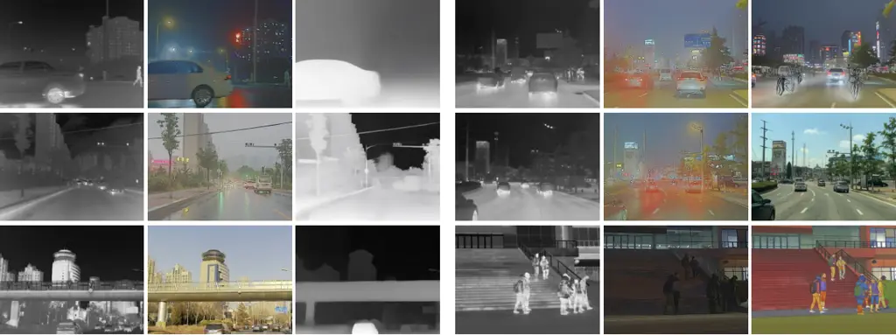

|          |         |              |          |         |              |          |         |              |
| -------- | ------- | ------------ | -------- | ------- | ------------ | -------- | ------- | ------------ |
| Infrared | Visible | Fusion Image | Infrared | Visible | Fusion Image | Infrared | Visible | Fusion Image |

Figure 12: Failure cases of fixed prompting for infrared and visible
image fusion. Although the same handcrafted prompt is used for all image
pairs, the generated results show diverse failure modes, including
structure collapse, modality domination, loss of visible scene texture,
hallucinated objects, unrealistic illumination changes, and severe style
drift. These failures show that one-shot fixed prompting cannot reliably
constrain the large synthesis space of a generative fusion model,
motivating protocol-guided prompt refinement.

### C.1 Limitations of Fixed Prompting in Generative Image Fusion

A simple way to use a multimodal generative model for infrared and
visible image fusion is to provide a fixed, manually designed prompt
that asks the model to preserve infrared thermal targets, retain visible
textures, and produce a natural fused image. Although this strategy is
intuitive, we find that it is not reliable in practice. As shown in
Fig. 12, the same fixed prompt can produce substantially different
failure modes across image pairs. In some cases, the generated image
collapses into an over-smoothed or low-contrast result, where visible
structures and infrared targets are both weakened. In other cases, the
output is dominated by one modality; for example, it may resemble an
infrared response map that lacks visible color and scene texture. More
seriously, the generative model may change the scene itself,
hallucinating unsupported objects, converting a rainy or nighttime scene
into a bright daytime scene, or producing cartoon-like colorization and
unnatural target rendering.

These examples show that the limitation of fixed prompting lies not only
in weak control, but also in its inability to specify
image-pair-dependent fusion constraints. Infrared and visible image
fusion must simultaneously preserve thermal targets, retain
source-consistent visible structures, suppress degradations, and avoid
hallucinated content or style drift. However, the dominant failure mode
varies across image pairs: infrared evidence may be underused, thermal
responses may be over-transferred, visible degradations may leak into
the result, or the generative prior may rewrite the scene. Therefore, we
treat the prompt as an optimizable interface rather than a fixed
instruction. Through protocol-guided prompt refinement, the current
result is diagnosed and the structured protocol is updated accordingly,
enabling the next prompt to correct concrete failures such as modality
imbalance, structure loss, thermal overpainting, and appearance drift
while keeping the fusion intent explicit and interpretable.


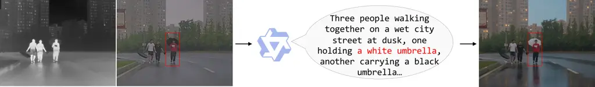


|          |         |             |
| -------- | ------- | ----------- |
| Infrared | Visible | Fused Image |

VLM interpretation: “Three people walking together on a wet city street
at dusk, one holding a white umbrella, another carrying a black
umbrella…”

Figure 13: Qualitative example of hallucination propagation in
generative infrared and visible image fusion. A hallucinated “white
umbrella” in the interpretation of the visible image is propagated into
the fused result, producing a source-inconsistent semantic artifact.

### C.2 Hallucination in Image Fusion

ProtoFusion formulates infrared and visible image fusion as
protocol-constrained generation, where the fused image is produced under
protocol-guided prompt control by a multimodal image generator. This
formulation provides strong semantic flexibility, but it also introduces
a characteristic failure mode: hallucinated semantics may be propagated
into the fusion result. In our current implementation, this risk is
intrinsic to the generation pipeline, since the image generator already
involves an internal visual understanding stage. As a result, once the
internal understanding stage produces an incorrect semantic
interpretation, the downstream generator may render this error as if it
were valid scene evidence.

Figure 13 shows a representative failure case. The interpretation of the
visible image incorrectly introduces a non-existent “white umbrella,”
which is then materialized in the fused image as a semantic artifact.
This artifact is not supported by the infrared or visible inputs;
instead, it arises because the generative fusion process follows a
semantically plausible but source-inconsistent cue. The example reveals
a key limitation of generative fusion: semantic guidance can improve
controllability and interpretability, but erroneous visual understanding
may also inject false content into the fused result.

This failure case is consistent with the limitation discussed in the
main paper, namely that pretrained multimodal generative models may
produce hallucinated structures or source-inconsistent details in
difficult cases. For infrared and visible image fusion, this issue is
particularly important because the objective is not only visual
coherence, but also faithfulness to cross-modal evidence. It therefore
motivates stronger source-grounded semantic verification and cross-modal
consistency control in future generative fusion systems.
