marginparsep has been altered.  
topmargin has been altered.  
marginparwidth has been altered.  
marginparpush has been altered.

The page layout violates the ICML style.

Please do not change the page layout, or include packages like geometry,
savetrees, or fullpage, which change it for you.

We’re not able to reliably undo arbitrary changes to the style. Please
remove the offending package(s), or layout-changing commands and try
again.

 

ModelBlaster: Closing the Performance Gap through Learning-Augmented
Agents Across Models, Kernels and Hardware Backends

 

Kris Shengjun Dong^(1,2), Dima Nikiforov², Sahil Modi¹, Sana Damani¹,  
Edward Lin¹, Siva Kumar Sastry Hari¹, Christos Kozyrakis¹  
¹NVIDIA, ²University of California, Berkeley

###### Abstract

Optimizing accelerator code across hardware architectures is difficult.
ML compilers typically search predefined spaces of schedules and
micro-kernels. Large language model (LLM)-guided kernel optimization can
explore a broader design space, including alternative algorithms,
operator decompositions, and hardware-specific techniques, achieving
better performance than ML compilers on many problems. However, existing
LLM agents generate solutions that are tied to a single programming
interface, vendor toolchain, or accelerator family, and target
kernel-level optimizations that don’t leverage model-level transforms.
Additionally, most of the experience gathered on one hardware target
cannot be reused on another.

We present ModelBlaster, a Memory-Augmented In-Context Reinforcement
Learning (MAIC-RL) framework that optimizes data-parallel kernels across
heterogeneous SIMD and SIMT accelerator targets. Its mutable policy is a
persistent knowledge base, updated at inference time by Actor–Critic
Textual Gradient Descent (AC-TGD). Its structured Knowledge Base maps
performance states to actions, outcomes, and constraints, so experience
gathered on one kernel, model, or hardware target can be reused on
another. A model-level optimizer extends the kernel agent to whole
models, so kernel-level knowledge can inform model-level decisions. The
same loop and schema serve CUDA on NVIDIA GPUs, OpenCL on Qualcomm GPUs,
and RVV intrinsics on RISC-V vector cores.

Leveraging the cross-target accumulated knowledge, ModelBlaster achieves
geometric-mean speedups of 1.85$`\times`$, 5.58$`\times`$, and
5.18$`\times`$ on KernelBench Levels 1–3 on an L40S GPU, and
1.69$`\times`$ on SOL-ExecBench Levels 1 and 2 on a B200 GPU, comparing
to PyTorch. On Qualcomm Adreno GPUs it reaches 5.8$`\times`$ over the
vendor SDK and 1.7$`\times`$ over Apache TVM, and on RISC-V vector cores
2.7$`\times`$ over ExecuTorch with XNNPACK across 70 KernelBench
problems.

## 1 Introduction

The demand for machine-learning (ML) applications has exploded, and a 1%
efficiency gain is now worth hundreds of millions of dollars a year in
electricity alone U.S. Energy Information Administration (2025);
International Energy Agency (2025); Deloitte (2025). Kernel optimization
is a major lever on that efficiency. On H100 GPUs, software
optimizations including GEMM and attention kernel optimizations and
kernel fusions raised Llama 2 70B throughput by up to 1.5$`\times`$ in
one year Eassa et al. (2025), and a single attention kernel redesign
gave GPT-2 a 3$`\times`$ end-to-end speedup Dao et al. (2022).

Capturing these gains is hard because hardware and models keep changing.
New deep neural network (DNN) architectures and dynamic workloads
invalidate tuned kernels, so software stacks must maintain specialized
kernel libraries Sevilla et al. (2022); Chen et al. (2025a), which takes
substantial engineering effort and delays the use of new hardware
capabilities Petrovič et al. (2020).

ML compilers automate the translation from models to kernels. Many
integrate graph optimization and code generation through shared dialects
and feedback passes, with autotuners such as Ansor and XLA’s XTAT adding
measured feedback Zheng et al. (2020); Phothilimthana et al. (2021).
However, _what a compiler can find is limited by what it can express._
Halide and TVM are constrained by predefined search spaces, scheduling
primitives, and handcrafted rules Yu et al. (2026b), and they optimize
inside a fixed space defined by human-crafted templates Xing et al.
(2026). Autotuners search numeric parameters such as tile sizes inside a
fixed kernel structure, so they cannot change a kernel’s algorithm, data
types, or fusion Spoczynski et al. (2026), and they struggle when a gain
needs a structural code edit Che & Peng (2026). A tile-level fusion that
overlaps activation work with matrix multiplication shows the cost:
torch.compile cannot replicate it and is 3 to 7 times slower than the
hand-crafted kernels Jangda et al. (2026). Even within the expressible
space, stochastic search is sample-inefficient and misses
transformations that pay off only in combination Tang et al. (2025), and
hand-tuned microkernels perform better in mixed-precision
calculations Ahmad et al. (2025).

Large language model (LLM) agents offer a way around those abstractions.
They can customize, check, and profile kernels during optimization,
including restructurings that no predefined schedule family
contains Lange et al. (2025a); Novikov et al. (2025); Zhang et al.
(2026a), and they can outperform ML compilers on individual
kernels Poddar et al. (2026); Nagaitsev et al. (2025); Gim et al.
(2025); Lin et al. (2025); Sharma (2025); Baronio et al. (2025); Cummins
et al. (2025); Taneja et al. (2025). However, most existing agents
optimize each kernel in isolation. They sample candidate
implementations, observe execution feedback, and revise the code, but
the lessons stay inside the task: when it ends, most of the experience
is discarded, so the next kernel or target starts with little prior
knowledge Gao et al. (2026); Yu et al. (2026b). Many of these agents are
also tied to a single programming interface, vendor toolchain, or
accelerator family Yu et al. (2026b); Sereda et al. (2026).

This limits heterogeneous optimization, where the agent must reason over
backend-independent concepts such as locality, occupancy, tiling,
vectorization, and fusion while emitting backend-specific code and
reading backend-specific profiling signals Yu et al. (2026b); Sereda
et al. (2026). Search, prompt-optimization, and evolutionary methods
keep some optimization signal but generally lack an executable,
persistent memory of profile-grounded state, action, and outcome
evidence that transfers across kernels and targets. These agents also
work on one kernel at a time, since a whole model does not fit in one
prompt Yu et al. (2026b); Zeng et al. (2026); Ouyang et al. (2025).

ModelBlaster introduces a _Memory-Augmented In-Context Reinforcement
Learning_ (MAIC-RL) framework for cross-task code optimization. Instead
of updating model weights, it maintains a persistent Knowledge Base of
performance states, optimization actions, target constraints, textual
critiques, and measured outcomes. An actor generates memory-guided
transformations, while a critic evaluates correctness, performance, and
profiling feedback to produce text-based rewards that update the
Knowledge Base with successful and failed experiences.

Extending from kernels to whole models, ModelBlaster extracts a PyTorch
computation graph, proposes transformations through versioned hints, and
dispatches selected partitions to the kernel agent. Graph changes are
retained only when verified, optimized kernels improve measured
whole-model performance. This feedback is necessary because dynamically
generated kernels can alter the relative costs of fusion and
partitioning decisions.

We evaluate ModelBlaster across heterogeneous languages, ISAs, and
hardware: CUDA C++ on NVIDIA GPUs, OpenCL C on Qualcomm GPUs, and RVV
intrinsics on RISC-V vector cores. The shared optimization methodology
requires no target-specific training data, supporting low-resource
architectures. On B200, ModelBlaster achieves geometric-mean speedups of
1.85$`\times`$, 5.58$`\times`$, and 5.18$`\times`$ over PyTorch on
KernelBench Levels 1–3, respectively, and 1.69$`\times`$ on
SOL-ExecBench Lin et al. (2026) Levels 1–2. It also achieves
5.8$`\times`$ over QNN and 1.7$`\times`$ over Apache TVM on Qualcomm
Adreno, and 2.7$`\times`$ over ExecuTorch/XNNPACK on RISC-V vector
cores.

The contributions of this paper are:

1.  1.  One framework for graph and kernel optimization, with feedback from
        kernels to graph. Because AI-generated kernels change the
        implementation space during the search, graph rewrites create kernel
        tasks, and the verified kernels that come back can confirm or
        reverse decisions made from earlier cost estimates, within a fixed
        search budget.
2.  2.  One harness across heterogeneous targets. The same data structures,
        Knowledge Base schema, and method run on RISC-V vector cores,
        Qualcomm mobile GPUs, and NVIDIA GPUs, with only lowering,
        compilation, validation, and profiling specific to each backend.
3.  3.  An actor and critic agent architecture for policy improvement.
        Scalar execution outcomes and natural-language critiques, derived
        from compilation, correctness, profiling, and performance-gap
        evidence, act as textual gradients that update memory and guide
        later actions.
4.  4.  A reusable long-term memory. A structured database of what was tried
        and measured, including failures, is indexed by hardware-profile
        state and reusable across tasks, targets, and languages. Entries
        learned on one vendor’s hardware may not help on another vendor’s or
        on a different instruction set.

The full code base, including the agentic pipeline, baseline kernels,
initialized databases, and test harnesses, has been open-sourced.¹¹ 1
The code base is released at
[https://github.com/ucb-bar/ModelBlaster](https://github.com/ucb-bar/ModelBlaster).

## 2 Background and Related Work

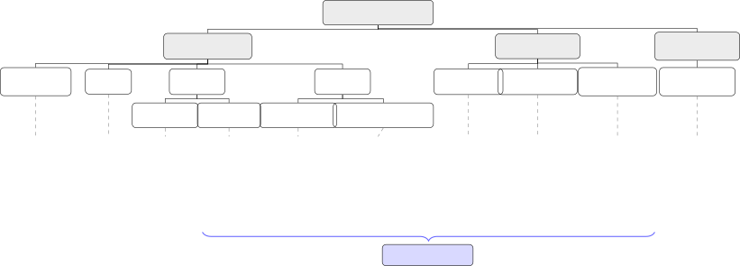

Figure 1: Taxonomy of approaches to ML code optimization. ModelBlaster,
at the bottom, combines long-term memory, textual-gradient learning, and
the kernel-level and graph-level functions of ML compilers.

### 2.1 Compilers and Autotuning

Kernel autotuning. Conventional ML compilers apply fusion and layout
rules, guided by heuristics and cost models, then instantiate each fused
operator from micro-kernel specifications, library calls, or schedule
templates whose parameters an autotuner searches with measured
feedback Chen et al. (2018); Zheng et al. (2020); Phothilimthana et al.
(2021). A feedback loop exists, but the search space is fixed in advance
by the abstraction. Kernel-level autotuners such as TorchInductor with
max-autotune, TVM, Ansor, and Triton profile several template-based
implementations and keep the fastest Ansel et al. (2024); Chen et al.
(2018); Zheng et al. (2020); Tillet et al. (2019). LLM-era frameworks
add analytical models and search: WaveTune Zhang et al. (2026b) uses
wave-aware performance models for tuning on fixed kernel sets,
KernelBand Ran et al. (2025) uses hierarchical bandits with
profiling-aware clustering, and AutoKernel Jaber & Jaber (2026) uses
edit-and-benchmark loops with curated playbooks. These target deep
single-backend tuning, while ModelBlaster targets broader operator
coverage and cross-target reuse through a persistent memory of states
and actions.

LLM-assisted compilation. Reasoning Compiler Tang et al. (2025) pairs
LLM-proposed transformations with Monte Carlo tree search to reduce the
sample inefficiency of stochastic compiler search, and GraphGlue Wang
et al. (2025a) uses an LLM to repair graph-capture breaks so the
compiler sees more of the program. AgentCompile Li et al. (2026b)
combines compiler-derived region summaries with LLM-generated kernels
for transformer inference on CUDA and is the closest of these to our
setting. LLM assistance inside a compiler is thus established.

Graph-level optimization. Fusion, splitting, tiling, and layout changes
pay off only given the kernels available for the target. Souffle Xia
et al. (2024) splits a global tensor-dependency graph into subprograms
across operator boundaries, Korch Hu et al. (2024) assigns operator
primitives to kernels with binary linear programming, and Mirage Wu
et al. (2025) searches algebraic and scheduling transformations together
with custom kernel generation. Mirage is the closest to our view that
graph and kernel spaces are coupled, but it uses a different
superoptimization and verification approach. MPK Cheng et al. (2026)
runs inference as one persistent mega-kernel, Neptune Zhao et al. (2026)
fuses reduction-heavy operators by rewriting dependencies, and
FlashFuser Huang et al. (2026) fuses operators whose intermediates
exceed shared memory using H100 distributed shared memory. OptiFX Wang
et al. (2025c) and XNNC Canesche et al. (2025) search for aggressive
fusion, DyPARS Qian et al. (2026) finds dynamic-shape graph variants
with Pareto-aware tree search, and OPass Yu et al. (2026a) orders TVM
graph passes to cut memory. These systems show that sophisticated fusion
and joint graph and kernel search are not new by themselves, and they
rely on predefined transformation rules, templates, or implementation
spaces. With a fixed kernel library, graph choices can be made before
specialization. When agents generate the kernels, the set of
implementations grows during the search, so a new kernel can reverse an
earlier graph decision. ModelBlaster connects a graph stage with an
LLM-generated kernel search checked by execution, keeps experience
across tasks and targets, and lets an external graph compiler take the
graph stage.

### 2.2 Agentic Solutions

Agentic systems for code optimization are broadly categorized as shown
in Figure 1. We focus on inference-time methods that avoid weight
updates and use frontier LLMs. They differ mainly in what adapts across
attempts: prompt engineering keeps hand-written heuristics, search keeps
candidate trajectories within a task, memory keeps records of earlier
attempts, and semantic learning keeps candidate programs (evolutionary)
or textual feedback (textual gradients).

Prompt engineering. Early LLM-based optimization systems use fixed
prompts with manually engineered heuristics Zhang et al. (2025); Wang
et al. (2025b), and prompt optimizers search over instructions:
MIPRO Opsahl-Ong et al. (2024), GEPA with reflective prompt evolution
and Pareto-based selection Agrawal et al. (2026), and MPCO with
meta-prompting that generates task-specific prompts for each LLM Gong
et al. (2025). Their behavior is mostly fixed by the prompt, so a new
architecture, toolchain, or workload often needs a redesigned prompt,
which limits reuse of experience gathered during inference.

Search-based optimization. Search-based systems generate several
candidate kernels and keep high-performing variants using compilation,
testing, and timing feedback Hong et al. (2025); Che & Peng (2026);
Poddar et al. (2026); Spoczynski et al. (2026). Pruning and
budget-aware, coarse-to-fine search improve sample efficiency over
exhaustive enumeration. StitchCUDA Li et al. (2026a) organizes the
search as a multi-agent loop of a planner, a coder, and a verifier that
profiles with Nsys and NCU, and it can run with a closed model. The
learning is usually task-local: each new kernel starts another search,
and few bottleneck-level lessons transfer between tasks.

Memory-based optimization. Short-term memory keeps the history of one
task. CUDA-LLM Chen et al. (2025b) refines kernels over rounds of
compilation, correctness, and timing feedback, and the history is
discarded when the task ends. Long-term memory carries records across
tasks: AccelOpt Zhang et al. (2026a) keeps a memory of slow and fast
kernel candidates and uses beam search for AI-accelerator kernels, and
FlashInfer-Bench Xing et al. (2026) connects agent-generated kernels,
benchmarking, and deployment into serving engines. ModelBlaster indexes
memory by hardware-profile state (Section 3.1.2).

Evolutionary coding agents. Systems such as AI CUDA Engineer Lange
et al. (2025a); Lange et al. (2025b), KernelEvolve Liao et al. (2025),
AlphaEvolve Novikov et al. (2025), OpenEvolve Sharma (2025),
CodeEvolve Assumpção et al. (2025), and EvoEngineer Guo et al. (2025)
keep populations of candidate programs and improve them through
LLM-generated variation and evaluator feedback. AVO Chen et al. (2026)
replaces fixed mutation and crossover with a coding agent that uses the
kernel lineage, a knowledge base, and execution feedback. Their memory
is usually full programs or elite candidates, which help reuse
implementations but can hide why an optimization worked. ModelBlaster
instead stores compact, bottleneck-level records of state, action, and
outcome, including negative evidence, so retrieval follows the
performance state and not only source-code similarity.

Textual gradients. TextGrad Yuksekgonul et al. (2024) uses
natural-language feedback as an analogue of gradients over textual
variables, and STACKFEED Kirtania et al. (2025) uses text as a gradient
in an actor and critic loop but edits retrieval knowledge for question
answering. These methods mainly adapt to one task and often must be
optimized again when the task distribution, toolchain, or environment
changes, which limits transfer across systems tasks where one
optimization concept appears under different languages, backends, and
profiling interfaces. ModelBlaster builds on the textual-gradient idea
and changes the target: textual gradients update a persistent Knowledge
Base of state, action, and outcome records that later tasks can retrieve
and reuse. Our ablations separate the effect of memory from the effect
of profiling and from a minimal agent (Appendix B).

Kernel agents and whole models. LLM-guided optimization removes the
restriction to a predefined space. An agent can propose algorithmic
restructurings, different operator decompositions, and hardware-specific
techniques that no predefined dimension covers Yu et al. (2026b). Most
agentic systems, however, work on one kernel or one small task at a time
and treat a whole model as a set of independent kernel tasks, so no
stage decides which partitions deserve a generated kernel. Generated
kernels also have limited reach where libraries already sit near the
hardware limit, such as the GEMM and attention kernels that dominate
transformer runtime Dao et al. (2022); Agarwal et al. (2026), so a
model-level view has to decide where a generated kernel is worth
writing. None of these kernel agents optimizes the model graph.
ModelBlaster adds a model-level optimizer that proposes graph
transformations, sends the resulting partitions to the kernel agent, and
keeps a change only if the verified kernels lower the measured
whole-model cost.

## 3 System Design

ModelBlaster optimizes accelerator code with a kernel-level agent and
extends it to whole models with a model-level optimizer. Both share a
persistent Knowledge Base and a harness that compiles, validates, and
profiles (Figure 2). Section 3.1 describes the kernel agent, Section 3.2
its extension to whole models, and Section 3.3 the interfaces between
the parts.

1:  Input: Initial policy params $`\theta_{0}`$, env. $`\mathcal{E}`$,
policy $`\pi_{\theta}`$

2:  Initialize replay buffer $`\mathcal{D}\leftarrow\emptyset`$

3:  for iteration $`k=0,1,2,\ldots`$ do

4:   Sample initial state $`s_{0}\sim\mathcal{E}`$

5:   Initialize trajectory $`\tau\leftarrow[]`$

6:   $`s\leftarrow s_{0}`$

7:   for step $`t=0`$ to $`T`$ do

8:    Sample action $`a_{t}\sim\pi_{\theta_{k}}(a_{t}\mid s_{t})`$

9:    Append $`(s_{t},a_{t})`$ to trajectory $`\tau`$

10:    Set $`s_{t+1}\leftarrow\texttt{EnvStep}(s_{t},a_{t})`$

11:    Set $`r_{t}=R(s_{t},a_{t})`$

12:   end for

13:   Evaluate return $`R(\tau)=\sum_{t}r_{t}`$

14:   Store $`(\tau,R(\tau))`$ in buffer $`\mathcal{D}`$

15:   Estimate policy gradient:

16:
  $`\nabla_{\theta}J(\theta_{k})\leftarrow\frac{1}{|\mathcal{D}|}\sum_{(\tau,R)}\sum_{t}\nabla_{\theta}\log\pi_{\theta}(a_{t}\mid s_{t})R(\tau)`$

17:   Update policy:
$`\theta_{k+1}\leftarrow\theta_{k}+\alpha\nabla_{\theta}J(\theta_{k})`$

18:  end for

Algorithm 1 REINFORCE

1:  Input: Initial Knowledge Base $`\theta_{0}`$, env. $`\mathcal{E}`$,
LLM policy $`\pi_{\theta}`$

2:  Initialize replay buffer $`\mathcal{D}\leftarrow\emptyset`$

3:  for iteration $`k=0,1,2,\ldots`$ do

4:   Sample code task $`s_{0}\sim\mathcal{E}`$ {Initial code}

5:   Initialize rollout trajectory $`\tau\leftarrow[]`$

6:   $`s\leftarrow s_{0}`$

7:   for step $`t=0`$ to $`T`$ do

8:    Generate optimized code
$`a_{t}\sim\pi_{\theta_{k}}(a_{t}\mid s_{t})`$

9:    Append $`(s_{t},a_{t})`$ to trajectory $`\tau`$

10:    Set $`s_{t+1}\leftarrow a_{t}`$ {Set new code as state}

11:    Set $`r_{t}=R(s_{t+1})`$ {Profile-based reward}

12:   end for

13:   Evaluate total reward $`R(\tau)`$

14:   Store $`(\tau,R(\tau))`$ in buffer $`\mathcal{D}`$

15:
  $`g_{k}\leftarrow\texttt{PolicyEvaluation}(\mathcal{D},\theta_{k})`$

16:   $`p_{k}\leftarrow\texttt{PerfGapAnalysis}(g_{k})`$

17:
  $`\theta_{k+1}\leftarrow\texttt{ParameterUpdate}(\theta_{k},p_{k})`$

18:  end for

Algorithm 2 LLM-Based Policy Opt. via Reward-Guided Rollouts

 

### 3.1 Kernel-Level Optimization with MAIC-RL

ModelBlaster optimizes code through inference-time reinforcement
learning with persistent memory. Each optimization problem is an
environment interaction: the agent observes a program state, samples an
optimization action, lowers it into executable code, receives scalar and
textual feedback from validation and profiling, and updates a persistent
Knowledge Base. Model weights do not change; the policy improves through
memory retrieval and rewriting.

#### 3.1.1 Problem Formulation

We formulate ModelBlaster as inference-time policy improvement over
code-optimization tasks. At each rollout step, the actor proposes a
transformation from the current state and retrieved memory, and the
critic turns correctness and performance evidence into scalar and
text-based rewards and updates the persistent Knowledge Base. Table 1
gives the notation.

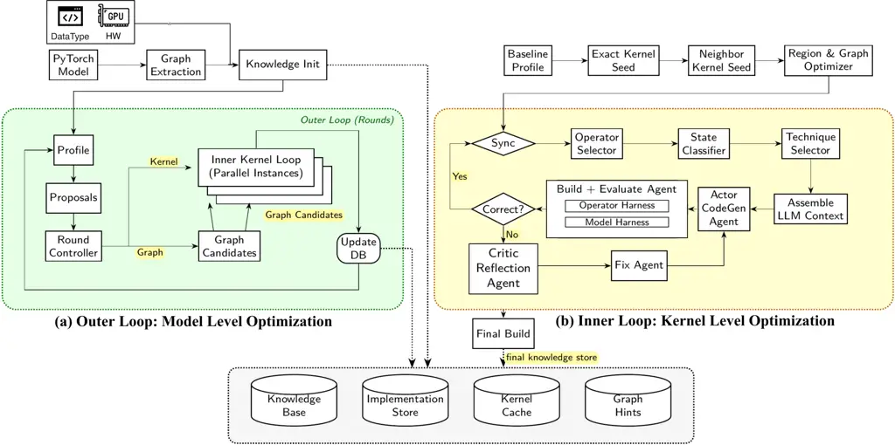

Figure 2: The two loops of ModelBlaster. (a) The outer loop extracts and
profiles the model graph, proposes graph and kernel optimizations, and
dispatches parallel inner loops that update shared databases. (b) The
inner loop selects an operator, classifies its performance state,
chooses a technique, and generates and validates code using operator and
model harnesses. Failures trigger critic reflection and repair. Dotted
arrows indicate writes to the shared knowledge base, implementation
store, kernel cache, and graph hints.

|               |                                                                                                                                                                                                                     |
| ------------- | ------------------------------------------------------------------------------------------------------------------------------------------------------------------------------------------------------------------- |
| Component     | Definition                                                                                                                                                                                                          |
| Task          | $`\tau=(x,y,b,m)`$, where $`x`$ is the input program or model fragment, $`y`$ is a reference implementation, $`b`$ is the backend, and $`m`$ is the measurement interface.                                          |
| State         | $`s_{t}=\phi(x_{t},c_{t},p_{t},h_{t})`$, where $`x_{t}`$ is the current implementation, $`c_{t}`$ is compiler and validation feedback, $`p_{t}`$ is timing or profiling evidence, and $`h_{t}`$ is rollout history. |
| Actor action  | $`a_{t}\sim\pi_{\theta}(a\mid s_{t},\mathcal{K}_{t})`$, where $`a_{t}`$ is a code transformation or implementation plan and $`\mathcal{K}_{t}`$ is the set of retrieved Knowledge Base entries.                     |
| Reward signal | $`(r_{t},z_{t})=R(x_{t+1},y,b,m)`$, where $`r_{t}`$ is the correctness-gated scalar performance reward and $`z_{t}`$ is the text-based reward signal.                                                               |
| Memory update | $`\mathcal{K}_{k+1}=U\!\left(\mathcal{K}_{k},\tau,\{(s_{t},a_{t},r_{t},z_{t})\}_{t=0}^{T}\right)`$, where the critic incorporates rollout outcomes into persistent long-term memory.                                |

Table 1: Problem formulation for ModelBlaster’s Memory-Augmented
In-Context Reinforcement Learning (MAIC-RL) loop.

The scalar reward $`r_{t}`$ captures correctness-gated performance, and
the text-based reward $`z_{t}`$ explains the performance gap, failure
mode, violated assumptions, and target constraints. The policy
parameters available to the LLM at inference time therefore include the
retrieved and updated Knowledge Base as well as the prompt template.

#### 3.1.2 Hardware-Aware Profiling and Performance States

After compilation and correctness validation, the harness profiles each
candidate using backend-specific tools: Nsight Compute (NCU) NVIDIA
Corporation (2023) on CUDA provides a 15-dimensional signature capturing
throughput, occupancy, cache behavior, pipeline utilization, and warp
scheduling; RVV exposes hardware counters and cycle counts; and Qualcomm
GPUs use per-operator OpenCL Khronos Group (2026) event timing with
fewer available signals. The State Classifier maps these signatures to
hierarchical bottleneck states (e.g., memory-bound/cache thrashing or
latency-bound/low parallelism), conditioned on hardware constraints.
These states guide technique retrieval, while the critic uses profiling
evidence to generate performance-gap critiques as text-based rewards. On
KernelBench Level 2, NCU feedback improves speedup from 1.22$`\times`$
with latency-only feedback to 1.57$`\times`$ (Appendix B.2). Clustering
NCU signatures also identifies six interpretable optimization regimes
(Appendix C).

The Technique Selector combines shared techniques (coalescing,
vectorization, tiling, unrolling, reductions, scans) with
architecture-specific optimizations. NVIDIA techniques include mma.sync
(Ampere/Ada), warpgroup MMA and TMA (Hopper), and tcgen05 with Tensor
Memory (Blackwell), informed by SM count, shared memory, L2 capacity,
DRAM bandwidth, and tensor-core throughput. Adreno techniques include
texture-path reads, register tiling, full-wave subgroups, and FP16
arithmetic (2$`\times`$ FP32 throughput). RVV techniques include
vector-length-agnostic strip mining with LMUL, segment loads, widening
multiply-accumulate, and vector reductions. Starting from only four RVV
techniques, the knowledge base expands through measured outcomes,
enabling optimization on targets with limited existing code (Section 4).

#### 3.1.3 Persistent Long-Term Memory

The Knowledge Base stores performance states, techniques, hypotheses,
evidence-backed claims, outcomes, and verified implementations. Its
compact optimization entries take the form

```math
e_{i}=\langle s_{i},(a_{i},q_{i},z_{i},c_{i})\rangle,
```

where $`s_{i}`$ denotes the performance state, $`a_{i}`$ the
optimization action, $`q_{i}`$ its measured or predicted score,
$`z_{i}`$ the textual critique, and $`c_{i}`$ the target, numerical, and
failure constraints. Rather than relying on source-code similarity,
retrieval matches performance states and hardware scopes, enabling reuse
across different kernels and targets while respecting
architecture-specific constraints. Scoped semantic updates preserve
successful and failed transformations, their causes, and performance
changes across optimization trajectories, providing compact,
transferable experience without storing full programs for every attempt.

#### 3.1.4 Actor–Critic Textual Gradient Descent

ModelBlaster instantiates MAIC-RL as _Actor-Critic Textual Gradient
Descent_ (AC-TGD), an inference-time learning architecture in which
natural-language critiques serve as policy-update signals. AC-TGD
follows the REINFORCE-like ICRL procedure in Algorithm 2. Instead of
updating weights by gradient descent, it treats the LLM context and the
retrieved Knowledge Base entries as mutable policy parameters
$`\theta`$. Two kinds of update act on them: the scalar reward updates
the statistics that rank techniques, and textual gradients edit the
claims, states, and hypotheses that the actor reads. Figure 2(b) shows
the inner loop that implements this flow.

|                         |                                          |                                                                                                                                          |
| ----------------------- | ---------------------------------------- | ---------------------------------------------------------------------------------------------------------------------------------------- |
| Component               | RL counterpart                           | Functionality                                                                                                                            |
| Knowledge Base          | Parameters $`\theta`$                    | Store of states, techniques, hypotheses, claims, outcomes, and verified implementations; with the prompt it forms the policy parameters. |
| Operator Selector       |                                          | Picks the next kernel slot by time share, stall decay, and exploration.                                                                  |
| State Classifier        | State $`s_{t}`$                          | Assigns the deepest matching performance state from the profiling signature, with the program, feedback, and rollout history.            |
| Technique Selector      | Policy $`\pi_{\theta}(a_{t}\mid s_{t})`$ | Picks a technique for the state with a UCB rule over reward statistics.                                                                  |
| Actor CodeGen Agent     | Action $`a_{t}`$                         | Rewrites the selected slot using claims, similar kernels, and past attempts.                                                             |
| Fix Agent               |                                          | Repairs candidates that fail the correctness check, revising the action.                                                                 |
| Build + Evaluate Agent  | Reward $`r_{t}`$                         | Checks correctness and times against the incumbent; the gain is the scalar reward.                                                       |
| Critic Reflection Agent | Policy evaluation                        | Every eight outcomes, checks proposed lessons against the records they cite; supported lessons are the text-based reward $`z_{t}`$.      |
| Knowledge update        | Policy update                            | Logs each outcome, updates reward statistics, and applies validated edits to claims, states, and hypotheses.                             |

Table 2: Components of the ModelBlaster agentic workflow and their
counterparts in the RL formulation.

Technique Selector. In each inner-loop step, the Operator Selector
samples a kernel slot based on its partition-time contribution,
stagnation decay, and exploration bonus. The State Classifier identifies
its bottleneck, and the Technique Selector uses an upper confidence
bound (UCB) multi-armed bandit to balance exploitation of effective
techniques against exploration of uncertain ones:

```math
a_{t}=\arg\max_{a}\left[\hat{\mu}_{s,a}+c\sqrt{\frac{\ln(N_{s}+1)}{N_{s,a}+1}}\right],
```

where $`\hat{\mu}_{s,a}`$ is the estimated reward for technique $`a`$ in
state $`s`$, $`N_{s,a}`$ its selection count, $`N_{s}`$ the total state
visits, and $`c`$ the exploration coefficient. Sparse estimates shrink
toward parent-scope statistics to transfer prior evidence across
targets.

Actor CodeGen Agent and Fix Agent. The actor rewrites only the selected
slot using neighboring signatures, reference code, tensor shapes, stored
implementations, retrieved claims, and search history. Smaller models
handle mechanical optimizations and stronger models handle structural
transformations. When a candidate fails, the Fix Agent revises it in a
bounded repair loop and escalates the final attempt to the stronger
model. Both produce the action $`a_{t}`$.

Build + Evaluate Agent. Correct candidates are compared against the
incumbent using alternating, same-process CUDA-graph replay of the
deployed partition. The gain is
$`1-\operatorname{median}(T_{\mathrm{cand}}/T_{\mathrm{best}})`$. Gains
of at least 1% are remeasured against the best composite of all slots,
with $`r_{t}`$ defined as the smaller measured gain; smaller changes
receive neutral reward.

Critic Reflection Agent. After every eight outcomes, the critic reviews
technique applications, state transitions, metric changes, speedups, and
errors. It proposes evidence-backed edits covering technique
effectiveness, pitfalls, interactions, parameters, state refinements,
and performance explanations. Unsupported edits are rejected; accepted
claims track supporting and contradicting evidence, decay over time, and
retire when contradicted. Claims are scoped by hardware, operator,
state, or technique and retrieved in subsequent prompts, forming the
text-based reward $`z_{t}`$ alongside scalar reward $`r_{t}`$.

#### 3.1.5 Uniform Harness and Cross-Task Instantiation Across Targets

To test whether the same persistent memory and text-based reward support
cross-task reasoning, we instantiate the same actor and critic loop on
problems whose targets differ in instruction-set architecture (ISA),
source language, and execution model: CUDA C++ on NVIDIA GPUs, OpenCL C
on Qualcomm GPUs, and RVV intrinsic code on RISC-V vector cores. All
three share the MAIC-RL and AC-TGD learning schema, the Knowledge Base,
the Actor CodeGen Agent’s prompt schema, the Critic Reflection Agent’s
textual-gradient format, and the memory-retrieval mechanism. Only
lowering, compilation, validation, and profiling are backend-specific,
which isolates the learning contribution from each target’s engineering.
Appendix D shows generated code for backend-specific transformations the
agent discovers, such as Tensor Core utilization, MMA layout, and
software warp specialization.

### 3.2 From Kernels to Whole Models

Figure 2 illustrates how the kernel agent integrates with the
whole-model optimization flow. Graph Extraction converts a PyTorch
model, weights, and reference I/O into a graph encoding operator
dependencies, shapes, and layouts for target-specific code generation.
Knowledge Init initializes the Knowledge Base using hardware and
datatype information. Each outer-loop round profiles the current graph,
generates graph and kernel proposals, and ranks them by measured
per-operator latency. Kernel tasks and graph candidates are dispatched
to parallel Inner Kernel Loops, while Update DB persists verified
implementations and learned optimization knowledge for subsequent
rounds.

Unlike fixed-template compilers, LLM-generated kernels have unknown
costs until generated, validated, and profiled. Thus, ModelBlaster
minimizes measured whole-model latency under a search budget spanning
LLM inference, compilation, and hardware evaluation. The outer loop
evaluates original and transformed variants back-to-back under identical
seeds and kernel-search budgets, retaining changes only when they
improve whole-model latency without violating accuracy constraints.
Accepted changes take effect in the next round; optimization terminates
when no changes are accepted and no new tasks remain, followed by
end-to-end verification. Kernel specialization can reverse earlier graph
decisions, while the search budget limits candidate exploration.
Currently, ModelBlaster prioritizes partitions by measured cost; learned
ranking remains future work.

##### Inner Kernel Loop.

Each instance runs the kernel agent (Section 3.1) on one task,
initialized by Baseline Profile, Exact Kernel Seed, Neighbor Kernel
Seed, and Region & Graph Optimizer. Each iteration begins at Sync with
shared databases. Operator Selector chooses a slot, State Classifier
identifies its profiling state (Section 3.1.2), and Technique Selector
retrieves an optimization from the Knowledge Base. Assemble LLM Context
constructs the prompt for Actor CodeGen Agent, whose output is compiled
and validated by Build + Evaluate Agent using the Operator Harness
(reference correctness) and Model Harness (whole-model correctness).
Valid candidates return to Sync; failures invoke Critic Reflection Agent
and Fix Agent for repair and regeneration. Finally, Final Build emits
the selected kernel, and the final knowledge store persists new
knowledge.

##### Graph Hints.

All graph changes pass through a versioned graph_hints/v1 schema in the
Graph Hints database. Each hint specifies a transformation (e.g.,
fusion, splitting, or core-width assignment), affected operators, and
its source (Inner Kernel Loop or Proposals). A shared backend-aware
routine applies each rewrite, validates reference correctness, and
measures performance. Independent hints are evaluated in parallel, while
cached acceptance and rejection decisions support resumable execution.

### 3.3 Modular Interfaces

The Outer Loop and Inner Loop run as separate processes, exchanging
on-disk Graph Hints, Kernel Cache, Implementation Store, Knowledge Base,
per-dispatch profiles, and kernel-task plans. Either loop operates
independently: the inner loop optimizes standalone kernels, while the
outer loop can use a fixed kernel library. An external graph compiler
can replace the graph optimizer by consuming Graph Hints and returning
graph mappings and measurements. New frameworks and hardware targets
require only a frontend or declarative backend description, isolating
target-specific behavior.

## 4 Evaluation

We organize our cross-target and baseline comparisons around four
research questions: Q1. Are the resulting implementations competitive
with existing baselines? Q2. Does persistent memory improve cross-task
optimization? Q3. Do text-based reward signals carry information beyond
a scalar reward? Q4. Does the same memory schema transfer across
heterogeneous targets?

[TABLE]

Table 3: ModelBlaster’s speedup across NVIDIA, Qualcomm, and RISC-V
backends. Baselines are PyTorch eager Ansel et al. (2024) (NVIDIA), QNN
SDK (Adreno), and scalar kernels or ExecuTorch/XNNPACK (RISC-V). Share
denotes the percentage of solved benchmark problems.

### 4.1 Experimental Setup

We evaluate ModelBlaster on KernelBench Levels 1–3 Ouyang et al. (2025)
and SOL-ExecBench Lin et al. (2026) across CUDA/NVIDIA, OpenCL Khronos
Group (2026)/Qualcomm, and RVV/RISC-V, using a shared actor–critic loop
and memory schema with target-specific compilation, validation, and
profiling. SOL-ExecBench contains 235 problems from 124 AI models
targeting Blackwell; we evaluate Level 1 (94 single-operation blocks)
and Level 2 (82 fused blocks) in BF16/FP32, reporting speedup over
PyTorch eager rather than speed-of-light scores.

Valid solutions must compile, execute, and pass reference correctness
checks; performance statistics include only valid solutions. We report
$`\mathit{fast}_{p}`$ as the fraction of correct solutions achieving at
least $`p`$ speedup, unlike KernelBench’s denominator over all problems.
NVIDIA results compare against PyTorch eager and prior CUDA agents;
Qualcomm results against QNN SDK and Apache TVM Chen et al. (2018) using
on-device GPU timing; and RVV results against ExecuTorch/XNNPACK and
scalar kernels, measured in cycles on a single-core Saturn V256D128 Zhao
et al. (2024) simulated in FireSim Karandikar et al. (2018). Table 3
summarizes results, and a soft-verification agent prevents PyTorch
dispatch and external-library shortcuts (Appendix C.5).

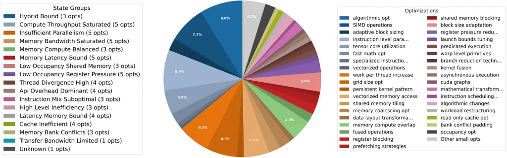

Figure 3: Distribution of 3972 CUDA optimization applications across
performance states.

|                     |          |                                                      |                                                             |                                 |                                                          |                                                                                                                                                                                                 |
| ------------------- | -------- | ---------------------------------------------------- | ----------------------------------------------------------- | ------------------------------- | -------------------------------------------------------- | ----------------------------------------------------------------------------------------------------------------------------------------------------------------------------------------------- |
| System              | Language | Agent’s Models                                       | Hardware Setup                                              | Dataset                         | Hyperparameter                                           | Test Harness                                                                                                                                                                                    |
| ModelBlaster (Ours) | CUDA     | GPT-5.0-mini, GPT-4.1, GPT-5.0, Sonnet 4.6, Opus 4.6 | NVIDIA A6000, A100, H100, L40S; RISC-V Vector core (Saturn) | KernelBench L1–3, SOL-ExecBench | 10 iterations, 10 rollout steps per iteration            | Functionality Check: passing kernels are compiled and executed on GPUs; outputs are compared to PyTorch baselines with multiple randomized seeds to ensure correctness and prevent overfitting. |
| AI CUDA Engineer    | CUDA     | O4-mini, Sonnet 3.7, Gemini 2.5 Pro, GPT-4.1, O3     | NVIDIA H100                                                 | KernelBench L1–2                | 10 generations; 10 proposals/generation; top 4 evaluated | LLM Soft-Verification: an LLM scans each kernel for likely compilation, memory, or numerical errors, filtering bad code before GPU execution.                                                   |
| StitchCUDA          | CUDA     | Opus 4.6 (our run)                                   | NVIDIA L40S (our run)                                       | KernelBench L1–2                | 15 attempts per problem with 2 replans                   | Verifier agent: checks correctness and profiles with Nsys and NCU; speedup over PyTorch is measured as wall-clock time in its own harness.                                                      |
| QNN SDK Compiler    | OpenCL   | N/A                                                  | Qualcomm Adreno 650                                         | KernelBench L1                  | N/A                                                      | (SDK-internal validation)                                                                                                                                                                       |

Table 4: Comparison among ModelBlaster (Ours), AI CUDA Engineer, and
StitchCUDA.

### 4.2 Evaluating Generality across Hardware Generations

Level 2 gains are larger than Level 1 gains on the L40S because composed
operators allow multi-step transformations such as fusion and layout
changes. Level 1 problems are single operators with nothing to fuse, and
the KernelBench harness does not allow ahead-of-time weight packing.

We ran StitchCUDA Li et al. (2026a), a multi-agent CUDA framework, with
the same model (Opus 4.6), GPU, and problem sizes as ours and its search
budget exhausted (15 attempts per problem). Over PyTorch eager,
ModelBlaster reaches 1.85x on Level 1 and 5.58x on Level 2, against
1.335x and 2.177x for StitchCUDA Li et al. (2026a) (Table 3 and
Figure 4). On Level 1, 33 of its 98 solutions return PyTorch operations
or call libraries instead of generating kernels, and its 65 generated
kernels average 1.496x. ModelBlaster gains more on Level 2 because its
memory reuses fusion and layout transformations across kernels. We
compare mainly on CUDA because most public agentic baselines target it,
and the other targets test retargetability.

On the 115 SOL-ExecBench problems with a measured eager time,
ModelBlaster reaches a 1.69$`\times`$ geometric-mean speedup over
PyTorch eager (median 1.47$`\times`$). Gains concentrate on small
problems: 4.03$`\times`$ on the small set, 1.30$`\times`$ on the large
set, and 0.98$`\times`$ above our size cap.

Figure 4: $`\mathit{fast}_{p}`$ curves on an L40S for KernelBench
Levels 1 and 2: the share of problems with a correct result whose
speedup over PyTorch eager is at least $`r`$. All three systems are
measured as end-to-end wall-clock time. $`n`$ is the number of problems
with valid results; AI CUDA Engineer has kernels that directly call
external libraries excluded.

### 4.3 Evaluate Cross-Target Transferability

We evaluate ModelBlaster beyond CUDA by running the same learning loop
on OpenCL/Qualcomm and RVV/RISC-V which is programmed with different
language, execution model, and measurement interface.

On 42 KernelBench Level 1 problems on a Qualcomm Adreno 650,
ModelBlaster reaches a 5.80x geometric-mean speedup over QNN (median
9.18x). The largest gains are on reduction-axis operators, where the
learned strategy maps a reduction bottleneck to cooperative local-memory
reduction and vectorized global I/O. As an optimization-based baseline
we use Apache TVM Chen et al. (2018) with its default Adreno pipeline
(rule-based schedules with texture memory, no per-operator autotuning)
on the same device. On the 39 operators that both systems cover,
ModelBlaster is 1.69x faster in geometric mean and 2.30x faster on the
16 compute-bound operators (Appendix A.1). TVM is faster on BatchNorm,
LayerNorm, and matrix-vector multiplication. Autotuning would improve
TVM at a large offline search cost, which we leave to future work.

On RVV we measure cycles on a single-core Saturn V256D128 Zhao et al.
(2024) in FireSim Karandikar et al. (2018). Against the scalar reference
kernels, ModelBlaster reaches a 6.99x geometric-mean speedup over 83
problems (median 6.8x). Against ExecuTorch with XNNPACK, a production
framework with hand-tuned RVV microkernels, it reaches 2.74x on the 70
problems that both cover (median 1.39x), and Appendix A.2 lists the
operator classes. ModelBlaster is faster on every class except
convolution, where XNNPACK ships im2col and microkernel paths that the
KernelBench harness does not let a generated kernel use. XNNPACK also
has no kernel for 10 problems that ModelBlaster handles. On Level 1,
ModelBlaster is therefore stronger on Qualcomm and RVV than on the L40S,
where the harness limits above apply, and the same memory-augmented
agent remains useful when the implementation language and hardware
execution model change.

### 4.4 Adapt to Full-Model and Subgraph Optimization

On 46 KernelBench Level 3 models on an L40S, ModelBlaster reaches a
5.18$`\times`$ geometric-mean speedup over PyTorch eager (Table 3).
Gains are largest on LeNet5 (10.6$`\times`$), ResNetBasicBlock
(3.2$`\times`$), and DenseNet121DenseBlock (2.7$`\times`$), and only
about 1.1$`\times`$ on the plain MLPs. Level 1 and Level 2 memory
entries carry over to Level 3 through cross-layer fusion, activation
reuse, and algebraic simplification. Per-model results and generated
code are in Appendix D.3. Whole-model code generation adds long
boilerplate, heterogeneous bottlenecks, and weaker performance signals.
Hierarchical decomposition, where the critic selects subgraphs or
kernels for further optimization, addresses this, and the model-level
optimizer (Section 3) takes this role.

### 4.5 Distribution of Optimizations learned in Persistent Memory

We analyze the Knowledge Base’s composition and cross-task reuse
potential. The active learned Knowledge Base occupies approximately 10
MB and organizes techniques by performance state. Across 3,972
optimization applications on KernelBench L1+L2 (A6000), no state
accounts for more than 20% of applications (Figure 3), and kernels
traverse 5.5 states on average, requiring state reassessment throughout
optimization.

L40S trajectories reveal diminishing returns from repeated micro-tuning
(e.g., instruction_level_parallelism, grid_size_optimization), but
stronger gains from ordered cross-family transformations:
shared_memory_tiling before tensor_core_utilization achieves
2.41$`\times`$ median speedup, and layout transformation before fusion
achieves 1.95$`\times`$. The Knowledge Base preserves these action
sequences and state transitions, which cannot be derived directly from
the final implementation.

## 5 Conclusion

We present ModelBlaster, a memory-augmented in-context reinforcement
learning framework for code optimization across heterogeneous
accelerators. Rather than updating model weights, ModelBlaster uses
execution-grounded textual feedback to maintain a persistent knowledge
base of optimization states, actions, outcomes, and constraints. Its
actor–critic loop accumulates reusable experience across tasks, while a
model-level optimizer extends kernel optimization to graph
transformations guided by measured whole-model performance.

Across NVIDIA GPUs, Qualcomm Adreno GPUs, and RISC-V vector cores,
ModelBlaster achieves substantial speedups over existing frameworks and
optimization agents without target-specific training data. These results
demonstrate the effectiveness of a shared optimization methodology
across programming languages, architectures, and profiling interfaces,
including low-resource targets. By connecting kernel-level learning with
graph-level decisions, ModelBlaster provides a unified approach to
optimization beyond individual kernels.

## References

- Agarwal et al. (2026) Agarwal, G., Garg, A., and Singhal, I. How much
  of a real workload can LLM-generated GPU kernels actually
  reach?, 2026. URL
  [https://arxiv.org/abs/2609.21058](https://arxiv.org/abs/2609.21058).
  arXiv:2609.21058.
- Agrawal et al. (2026) Agrawal, L. A., Tan, S., Soylu, D., Ziems, N.,
  Khare, R., Opsahl-Ong, K., Singhvi, A., Shandilya, H., Ryan, M. J.,
  Jiang, M., Potts, C., Sen, K., Dimakis, A. G., Stoica, I., Klein, D.,
  Zaharia, M., and Khattab, O. Gepa: Reflective prompt evolution can
  outperform reinforcement learning. ICLR 2026 (Oral);
  arXiv:2507.19457, 2026. URL
  [https://arxiv.org/abs/2507.19457](https://arxiv.org/abs/2507.19457).
- Ahmad et al. (2025) Ahmad, A., Kamal, A. T., Amir, N., Zafar, B., and
  Nasir, S. B. Accelerating GenAI workloads by enabling RISC-V
  microkernel support in IREE, 2025. arXiv:2508.14899.
- Ansel et al. (2024) Ansel, J., Yang, E., He, H., Gimelshein, N., Jain,
  A., Voznesensky, M., Bao, B., Bell, P., Berard, D., Burovski, E.,
  Chauhan, G., Chourdia, A., Constable, W., Desmaison, A., DeVito, Z.,
  Ellison, E., Feng, W., Gong, J., Gschwind, M., Hirsh, B., Huang, S.,
  Kalambarkar, K., Kirsch, L., Lazos, M., Lezcano, M., Liang, Y., Liang,
  J., Lu, Y., Luk, C., Maher, B., Pan, Y., Puhrsch, C., Reso, M.,
  Saroufim, M., Siraichi, M. Y., Suk, H., Suo, M., Tillet, P., Wang, E.,
  Wang, X., Wen, W., Zhang, S., Zhao, X., Zhou, K., Zou, R., Mathews,
  A., Chanan, G., Wu, P., and Chintala, S. PyTorch 2: Faster machine
  learning through dynamic python bytecode transformation and graph
  compilation. In _Proceedings of the 29th ACM International Conference
  on Architectural Support for Programming Languages and Operating
  Systems_, pp. 929–947, 2024. doi: 10.1145/3620665.3640366.
- Assumpção et al. (2025) Assumpção, H., Ferreira, D., Campos, L., and
  Murai, F. Codeevolve: An open source evolutionary coding agent for
  algorithmic discovery and optimization. _arXiv preprint
  arXiv:2510.14150_, 2025. Open-source framework combining an
  islands-based genetic algorithm with modular LLM orchestration and
  execution feedback for selection and task-specific metrics.
- Baronio et al. (2025) Baronio, C., Marsella, P., Pan, B., and
  Alberti, S. Kevin-32b: Multi-turn rl for writing cuda kernels.
  [https://cognition.ai/blog/kevin-32b](https://cognition.ai/blog/kevin-32b), 2025.
  Cognition AI Blog. Accessed: May 19, 2025.
- Canesche et al. (2025) Canesche, M., do Rosario, V. M., Borin, E., and
  Pereira, F. M. Q. Fusion of operators of computational graphs via
  greedy clustering: The XNNC experience. In _Proceedings of the 34th
  ACM SIGPLAN International Conference on Compiler Construction
  (CC)_, 2025. URL
  [https://conf.researchr.org/details/CC-2025/CC-2025-main-conference/11/Fusion-of-Operators-of-Computational-Graphs-via-Greedy-Clustering-The-XNNC-Experienc](https://conf.researchr.org/details/CC-2025/CC-2025-main-conference/11/Fusion-of-Operators-of-Computational-Graphs-via-Greedy-Clustering-The-XNNC-Experienc).
- Che & Peng (2026) Che, S. and Peng, G. KernelBrain: Coarse-to-fine,
  budget-aware search for agentic GPU kernel optimization, 2026.
  arXiv:2608.02611.
- Chen et al. (2025a) Chen, S., Lu, Z., and Zhang, Q. Evolution of
  kernels: Automated RISC-V kernel optimization with large language
  models, 2025a. URL
  [https://arxiv.org/abs/2509.14265](https://arxiv.org/abs/2509.14265).
- Chen et al. (2018) Chen, T., Moreau, T., Jiang, Z., Zheng, L., Yan,
  E., Cowan, M., Shen, H., Wang, L., Hu, Y., Ceze, L., Guestrin, C., and
  Krishnamurthy, A. TVM: An automated end-to-end optimizing compiler for
  deep learning. In _Proceedings of the 13th USENIX Symposium on
  Operating Systems Design and Implementation_, pp. 578–594. USENIX
  Association, 2018.
- Chen et al. (2026) Chen, T., Ye, Z., Xu, B., Ye, Z., Liu, T., Hassani,
  A., Chen, T., Kerr, A., Wu, H., Xu, Y., Chen, Y.-J., Chen, H., Kane,
  A., Krashinsky, R., Liu, M.-Y., Grover, V., Ceze, L., Bringmann, R.,
  Tran, J., Liu, W., Xie, F., Lightstone, M., and Shi, H. AVO: Agentic
  variation operators for autonomous evolutionary search, 2026.
  arXiv:2603.24517.
- Chen et al. (2025b) Chen, W., Zhu, J., Fan, Q., Ma, Y., and Zou, A.
  Cuda-llm: Llms can write efficient cuda kernels. Preprint,
  arXiv:2506.09092, 2025b. URL
  [https://arxiv.org/abs/2506.09092v1](https://arxiv.org/abs/2506.09092v1).
- Cheng et al. (2026) Cheng, X., Zhang, Z., Zhou, Y., Ji, J., Jiang, J.,
  Zhao, Z., Xiao, Z., Ye, Z., Huang, Y., Lai, R., Jin, H., Hou, B., Wu,
  M., Dong, Y., Yip, A., Wang, S., Yang, W., Miao, X., Chen, T., and
  Jia, Z. MPK: A compiler and runtime for mega-kernelizing tensor
  programs. In _20th USENIX Symposium on Operating Systems Design and
  Implementation (OSDI 26)_. USENIX Association, 2026. URL
  [https://www.usenix.org/conference/osdi26/presentation/cheng](https://www.usenix.org/conference/osdi26/presentation/cheng).
  Preprint: arXiv:2512.22219.
- Cummins et al. (2025) Cummins, C., Seeker, V., Grubisic, D., Roziere,
  B., Gehring, J., Synnaeve, G., and Leather, H. LLM compiler:
  Foundation language models for compiler optimization. In _Proceedings
  of the 34th ACM SIGPLAN International Conference on Compiler
  Construction_, pp. 141–153, 2025.
- Dao et al. (2022) Dao, T., Fu, D. Y., Ermon, S., Rudra, A., and Ré, C.
  FlashAttention: Fast and memory-efficient exact attention with
  IO-awareness, 2022. arXiv:2205.14135.
- Deloitte (2025) Deloitte. Deloitte 2026 tmt predictions. Deloitte
  Newsroom press release, 2025. URL
  [https://www.deloitte.com/us/en/about/press-room/deloitte-2026-tmt-predictions.html](https://www.deloitte.com/us/en/about/press-room/deloitte-2026-tmt-predictions.html).
- Eassa et al. (2025) Eassa, A., Aubrey, K., Nanjappa, A., Jiang, Z.,
  Khubaib, K., and Simmons, X. NVIDIA Blackwell delivers massive
  performance leaps in MLPerf inference v5.0.
  [https://developer.nvidia.com/blog/nvidia-blackwell-delivers-massive-performance-leaps-in-mlperf-inference-v5-0/](https://developer.nvidia.com/blog/nvidia-blackwell-delivers-massive-performance-leaps-in-mlperf-inference-v5-0/), 2025.
  NVIDIA Technical Blog.
- Gao et al. (2026) Gao, R., Yang, J., Lyu, B., Jin, H., and Bleier, N.
  Rethinking agentic kernel generation for emerging accelerators, 2026.
  arXiv:2608.00894.
- Gim et al. (2025) Gim, I., Ma, Z., seob Lee, S., and Zhong, L. Pie: A
  programmable serving system for emerging llm applications. In
  _Proceedings of the ACM SIGOPS 31st Symposium on Operating Systems
  Principles (SOSP ’25)_, 2025. URL
  [https://arxiv.org/abs/2510.24051](https://arxiv.org/abs/2510.24051).
- Gong et al. (2025) Gong, J., Giavrimis, R., Brookes, P., Voskanyan,
  V., Wu, F., Ashiga, M., Truscott, M., Basios, M., Kanthan, L., Xu, J.,
  and Wang, Z. Tuning LLM-based code optimization via meta-prompting: An
  industrial perspective, 2025. arXiv:2508.01443; ASE 2025 Industry
  Showcase.
- Guo et al. (2025) Guo, P., Zhu, C., Chen, S., Liu, F., Lin, X., Lu,
  Z., and Zhang, Q. Evoengineer: Mastering automated cuda kernel code
  evolution with large language models. _arXiv preprint
  arXiv:2510.03760_, 2025. URL
  [https://arxiv.org/abs/2510.03760](https://arxiv.org/abs/2510.03760).
- Hong et al. (2025) Hong, C., Bhatia, S., Cheung, A., and Shao, Y. S.
  Autocomp: A powerful and portable code optimizer for tensor
  accelerators, 2025. URL
  [https://arxiv.org/abs/2505.18574](https://arxiv.org/abs/2505.18574).
- Hu et al. (2024) Hu, M., Venkatram, A., Biswas, S., Marimuthu, B.,
  Hou, B., Oliaro, G., Wang, H., Zheng, L., Miao, X., Zhai, J., and
  Jia, Z. Optimal kernel orchestration for tensor programs with Korch.
  In _Proceedings of the 29th ACM International Conference on
  Architectural Support for Programming Languages and Operating Systems
  (ASPLOS)_, pp. 755–769, 2024. doi: 10.1145/3620666.3651383.
  arXiv:2406.09465.
- Huang et al. (2026) Huang, Z., Zhou, Y., Liu, Z., Luo, X., Diao, Y.,
  Guo, M., Zhai, J., Feng, Y., Zhang, C., Wu, A., and Leng, J.
  FlashFuser: Expanding the scale of kernel fusion for compute-intensive
  operators via inter-core connection. In _IEEE International Symposium
  on High-Performance Computer Architecture (HPCA)_, 2026.
  arXiv:2512.12949.
- International Energy Agency (2025) International Energy Agency. Energy
  and AI. Technical report, IEA, Paris, 2025. URL
  [https://www.iea.org/reports/energy-and-ai](https://www.iea.org/reports/energy-and-ai).
- Jaber & Jaber (2026) Jaber, J. and Jaber, O. AutoKernel: Autonomous
  gpu kernel optimization via iterative agent-driven search, 2026. URL
  [https://arxiv.org/abs/2603.21331](https://arxiv.org/abs/2603.21331).
- Jangda et al. (2026) Jangda, A., Sorensen, T., Burckhardt, S., Ye, J.,
  Li, C., and Gupta, A. Tile-level activation overlap for efficient LLM
  inference, 2026. URL
  [https://arxiv.org/abs/2607.02521](https://arxiv.org/abs/2607.02521).
  arXiv:2607.02521.
- Karandikar et al. (2018) Karandikar, S., Mao, H., Kim, D., Biancolin,
  D., Amid, A., Lee, D., Pemberton, N., Amaro, E., Schmidt, C., Chopra,
  A., et al. Firesim: Fpga-accelerated cycle-exact scale-out system
  simulation in the public cloud. In _2018 ACM/IEEE 45th Annual
  International Symposium on Computer Architecture (ISCA)_, pp. 29–42.
  IEEE, 2018.
- Khronos Group (2026) Khronos Group. OpenCL: The open standard for
  parallel programming of heterogeneous systems, 2026. URL
  [https://www.khronos.org/opencl](https://www.khronos.org/opencl).
  OpenCL overview and specification resources.
- Kirtania et al. (2025) Kirtania, S., Gupta, N., Gupta, P., Gulwani,
  S., Iyer, A., Iyengar, S. P., Radhakrishna, A., Rajamani, S. K., and
  Soares, G. STACKFEED: Structured textual actor-critic knowledge base
  editing with feedback. In _Proceedings of the 2025 Conference on
  Empirical Methods in Natural Language Processing: Industry Track_, pp.
  2588–2606, Suzhou, China, November 2025. Association for Computational
  Linguistics. doi: 10.18653/v1/2025.emnlp-industry.176. URL
  [https://aclanthology.org/2025.emnlp-industry.176/](https://aclanthology.org/2025.emnlp-industry.176/).
- Lange et al. (2025a) Lange, R. T., Prasad, A., Sun, Q., Faldor, M.,
  Tang, Y., and Ha, D. The AI CUDA engineer: Agentic CUDA kernel
  discovery, optimization and composition.
  [https://pub.sakana.ai/ai-cuda-engineer](https://pub.sakana.ai/ai-cuda-engineer),
  2025a. Sakana AI technical report.
- Lange et al. (2025b) Lange, R. T., Sun, Q., Prasad, A., Faldor, M.,
  Tang, Y., and Ha, D. Towards robust agentic CUDA kernel benchmarking,
  verification, and optimization, 2025b. arXiv:2509.14279.
- Li et al. (2026a) Li, S., Zhang, Z., Chen, W., Luo, Y., Hong, M., and
  Ding, C. StitchCUDA: An automated multi-agents end-to-end GPU
  programing framework with rubric-based agentic reinforcement learning.
  In _Proceedings of the 43rd International Conference on Machine
  Learning (ICML)_, volume 306 of _Proceedings of Machine Learning
  Research_, pp. 72290–72314, 2026a. arXiv:2603.02637.
- Li et al. (2026b) Li, X., Weng, Z., Zhu, Z., and Hou, J. AgentCompile:
  An LLM-guided compiler for direct CUDA inference, 2026b. URL
  [https://arxiv.org/abs/2606.07665](https://arxiv.org/abs/2606.07665).
  arXiv:2606.07665.
- Liao et al. (2025) Liao, G., Qin, H., Wang, Y., Golden, A., et al.
  Kernelevolve: Scaling agentic kernel coding for heterogeneous ai
  accelerators at meta. _arXiv preprint arXiv:2512.23236_, 2025. URL
  [https://arxiv.org/abs/2512.23236](https://arxiv.org/abs/2512.23236).
- Lin et al. (2026) Lin, E., Modi, S., Hari, S. K. S., Huang, Q., Ye,
  Z., Qin, N., Zhou, F., Zhang, Y., Wang, J., Damani, S., et al.
  SOL-ExecBench: Speed-of-light benchmarking for real-world GPU kernels
  against hardware limits, 2026. URL
  [https://arxiv.org/abs/2603.19173](https://arxiv.org/abs/2603.19173).
- Lin et al. (2025) Lin, H., Maas, M., Roquemore, M., Hasanzadeh, A.,
  et al. Eco: An llm-driven efficient code optimizer for warehouse scale
  computers. _arXiv preprint arXiv:2503.15669_, 2025. URL
  [https://arxiv.org/abs/2503.15669](https://arxiv.org/abs/2503.15669).
- Nagaitsev et al. (2025) Nagaitsev, K., Grbcic, L., Williams, S., and
  Iancu, C. Optimizing PyTorch inference with LLM-based multi-agent
  systems, 2025. URL
  [https://arxiv.org/abs/2511.16964](https://arxiv.org/abs/2511.16964).
  arXiv:2511.16964.
- Novikov et al. (2025) Novikov, A., Vũ, N., Eisenberger, M., Dupont,
  E., Huang, P.-S., Wagner, A. Z., Shirobokov, S., Kozlovskii, B.,
  Ruiz, F. J. R., Mehrabian, A., Kumar, M. P., See, A., Chaudhuri, S.,
  Holland, G., Davies, A., Nowozin, S., Kohli, P., and Balog, M.
  Alphaevolve: A coding agent for scientific and algorithmic discovery.
  _arXiv preprint arXiv:2506.13131_, 2025.
- NVIDIA Corporation (2023) NVIDIA Corporation. Nvidia nsight compute.
  [https://docs.nvidia.com/nsight-compute/](https://docs.nvidia.com/nsight-compute/), 2023.
  Interactive kernel profiler for CUDA applications.
- Opsahl-Ong et al. (2024) Opsahl-Ong, K., Ryan, M. J., Purtell, J.,
  Broman, D., Potts, C., Zaharia, M., and Khattab, O. Optimizing
  instructions and demonstrations for multi-stage language model
  programs. _Proceedings of the 2024 Conference on Empirical Methods in
  Natural Language Processing (EMNLP)_, 2024. URL
  [https://arxiv.org/abs/2406.11695](https://arxiv.org/abs/2406.11695).
  arXiv:2406.11695.
- Ouyang et al. (2025) Ouyang, A., Guo, S., Arora, S., Zhang, A. L., Hu,
  W., Ré, C., and Mirhoseini, A. KernelBench: Can LLMs write efficient
  GPU kernels? In _International Conference on Machine Learning
  (ICML)_, 2025. arXiv:2502.10517.
- Petrovič et al. (2020) Petrovič, F., Střelák, D., Hozzová, J., Ol’ha,
  J., Trembecký, R., Benkner, S., and Filipovič, J. A benchmark set of
  highly-efficient CUDA and OpenCL kernels and its dynamic autotuning
  with kernel tuning toolkit. _Future Generation Computer Systems_,
  108:161–177, 2020. doi: 10.1016/j.future.2020.02.069. URL
  [https://doi.org/10.1016/j.future.2020.02.069](https://doi.org/10.1016/j.future.2020.02.069).
- Phothilimthana et al. (2021) Phothilimthana, P. M., Sabne, A., Sarda,
  N., Murthy, K. S., Zhou, Y., Angermueller, C., et al. A flexible
  approach to autotuning multi-pass machine learning compilers. In _30th
  International Conference on Parallel Architectures and Compilation
  Techniques (PACT)_, pp. 1–16, 2021. doi: 10.1109/PACT52795.2021.00008.
  URL
  [https://ieeexplore.ieee.org/abstract/document/9563030/](https://ieeexplore.ieee.org/abstract/document/9563030/).
- Poddar et al. (2026) Poddar, A., Prasad, S., Samanta, A., Chakraborty,
  S., Goyal, V., and Rathaur, R. S. KernelOPT: Dispatch-aware agentic
  search for GPU kernel optimization, 2026. arXiv:2609.30059.
- Qian et al. (2026) Qian, H., Li, G., Yu, Q., Wang, X., and Xue, J.
  DyPARS: Dynamic-shape DNN optimization via pareto-aware MCTS for graph
  variants. In _IEEE/ACM International Symposium on Code Generation and
  Optimization (CGO)_, pp. 603–616, 2026.
- Ran et al. (2025) Ran, D., Xie, S., Ji, M., Hua, Z., Wu, M., Cao, Y.,
  Guo, Y., Hao, Y., Li, L., Hu, Y., and Xie, T. KernelBand: Boosting
  llm-based kernel optimization with a hierarchical and hardware-aware
  multi-armed bandit, 2025. URL
  [https://arxiv.org/abs/2511.18868](https://arxiv.org/abs/2511.18868).
  arXiv v1 title and author list.
- Sereda et al. (2026) Sereda, T., Bartan, B., Nayak, A., St.John, T.,
  Serrino, N., and Asgar, Z. KForge: LLM-driven cross-platform kernel
  generation for AI accelerators, 2026. arXiv:2606.02963.
- Sevilla et al. (2022) Sevilla, J., Heim, L., Ho, A., Besiroglu, T.,
  Hobbhahn, M., and Villalobos, P. Compute trends across three eras of
  machine learning. In _2022 international joint conference on neural
  networks (IJCNN)_, pp. 1–8. IEEE, 2022. doi:
  10.1109/IJCNN55064.2022.9891914.
- Sharma (2025) Sharma, A. Openevolve: an open-source evolutionary
  coding agent, 2025. URL
  [https://github.com/algorithmicsuperintelligence/openevolve](https://github.com/algorithmicsuperintelligence/openevolve).
- Spoczynski et al. (2026) Spoczynski, M., Fleischer, D., Berchansky,
  M., Stan, G. B.-M., Guskin, S., Xu, W., Siemieniuk, A., and
  Heinecke, A. Xe-Forge: Multi-stage LLM-powered kernel optimization for
  Intel GPU, 2026. arXiv:2605.26118.
- Taneja et al. (2025) Taneja, J., Laird, A., Yan, C., Musuvathi, M.,
  and Lahiri, S. K. Llm-vectorizer: Llm-based verified loop vectorizer.
  In _Proceedings of the 23rd ACM/IEEE International Symposium on Code
  Generation and Optimization_, pp. 137–149, 2025. URL
  [https://arxiv.org/abs/2406.04693](https://arxiv.org/abs/2406.04693).
- Tang et al. (2025) Tang, A. S., Priebe, C., Mahapatra, R., Qin, L.,
  and Esmaeilzadeh, H. REASONING COMPILER: LLM-guided optimizations for
  efficient model serving. In _Advances in Neural Information Processing
  Systems (NeurIPS)_, volume 38, pp. 106904–106930, 2025.
  arXiv:2506.01374.
- Tillet et al. (2019) Tillet, P., Kung, H. T., and Cox, D. Triton: An
  intermediate language and compiler for tiled neural network
  computations. In _Proceedings of the 3rd ACM SIGPLAN International
  Workshop on Machine Learning and Programming Languages_, pp. 10–19.
  ACM, 2019. doi: 10.1145/3315508.3329973.
- U.S. Energy Information Administration (2025) U.S. Energy Information
  Administration. Electricity sales, revenue, and average price, table
  4, 2025. URL
  [https://www.eia.gov/electricity/sales_revenue_price/pdf/table_4.pdf](https://www.eia.gov/electricity/sales_revenue_price/pdf/table_4.pdf).
  Annual data for 2024.
- Wang et al. (2025a) Wang, H., Sui, Y., Xie, Y., Liu, Y., Sun, Y., Shi,
  C., and Zhang, Y. Fixing broken graphs: LLM-powered automatic code
  optimization for DNN programs. In _40th IEEE/ACM International
  Conference on Automated Software Engineering (ASE)_, pp. 1718–1730,
  2025a. doi: 10.1109/ASE63991.2025.00144.
- Wang et al. (2025b) Wang, L. et al. Kernelfalcon: Deep agent
  architecture for autonomous gpu kernel generation. PyTorch Blog,
  November 2025b. URL
  [https://pytorch.org/blog/kernelfalcon-autonomous-gpu-kernel-generation-via-deep-agents/](https://pytorch.org/blog/kernelfalcon-autonomous-gpu-kernel-generation-via-deep-agents/).
  Blog post.
- Wang et al. (2025c) Wang, X., Li, S., Qian, H., Luo, F., Hao, Z., Wu,
  T., Xu, R., Cui, H., Feng, X., Li, G., and Xue, J. OptiFX: Automatic
  optimization for convolutional neural networks with aggressive
  operator fusion on GPUs. _ACM Transactions on Architecture and Code
  Optimization_, 22(2), 2025c. doi: 10.1145/3716876.
- Wu et al. (2025) Wu, M., Cheng, X., Liu, S., Shi, C., Ji, J., Ao,
  M. K., Velliengiri, P., Miao, X., Padon, O., and Jia, Z. Mirage: A
  multi-level superoptimizer for tensor programs. In _19th USENIX
  Symposium on Operating Systems Design and Implementation (OSDI 25)_,
  pp. 21–38, Boston, MA, 2025. USENIX Association. URL
  [https://www.usenix.org/conference/osdi25/presentation/wu-mengdi](https://www.usenix.org/conference/osdi25/presentation/wu-mengdi).
- Xia et al. (2024) Xia, C., Zhao, J., Sun, Q., Wang, Z., Wen, Y., Yu,
  T., Feng, X., and Cui, H. Optimizing deep learning inference via
  global analysis and tensor expressions. In _Proceedings of the 29th
  ACM International Conference on Architectural Support for Programming
  Languages and Operating Systems (ASPLOS)_, pp. 286–301, 2024. doi:
  10.1145/3617232.3624858.
- Xing et al. (2026) Xing, S., Zhai, Y., Jiang, A., Dong, Y., Wu, Y.,
  Ye, Z., Ruan, C. F., Huang, Y., Zhang, Y., Yin, L., Bayyapu, A., Ceze,
  L., and Chen, T. FlashInfer-Bench: Building the virtuous cycle for
  AI-driven LLM systems. In _Proceedings of Machine Learning and Systems
  (MLSys)_, volume 8, pp. 2016–2064, 2026. URL
  [https://arxiv.org/abs/2601.00227](https://arxiv.org/abs/2601.00227).
  arXiv:2601.00227.
- Yu et al. (2026a) Yu, Q., Nie, P., Wang, Z., Wan, C., Lin, Z., Jiang,
  H., Zhao, J., Qiao, L., Chen, L., and Chen, Y. Orchestrating
  optimization passes of machine learning compiler for reducing memory
  footprints of computation graphs. _Journal of Systems Architecture_,
  173, 2026a. doi: 10.1016/j.sysarc.2026.103694.
- Yu et al. (2026b) Yu, Y., Zang, P., Tsai, C. H., Wu, H., Shen, Y.,
  Zhang, J., Wang, H., Xiao, Z., Shi, J., Luo, Y., Zhang, W., Men, C.,
  Liu, G., and Lin, Y. Towards automated kernel generation in the era of
  LLMs. In _Proceedings of the Thirty-Fifth International Joint
  Conference on Artificial Intelligence (IJCAI), Survey Track_, pp.
  8069–8077, 2026b. doi: 10.24963/ijcai.2026/895. arXiv:2601.15727.
- Yuksekgonul et al. (2024) Yuksekgonul, M., Bianchi, F., Boen, J., Liu,
  S., Huang, Z., Guestrin, C., and Zou, J. TextGrad: Automatic
  “differentiation” via text, 2024. arXiv:2406.07496.
- Zeng et al. (2026) Zeng, H., Yang, P., Chen, Y., Ju, F., and Wei, X.
  LLM4LLM: Bridging kernel benchmarks and real deployment via
  closed-loop agentic optimization, 2026. URL
  [https://arxiv.org/abs/2608.21836](https://arxiv.org/abs/2608.21836).
  arXiv:2608.21836.
- Zhang et al. (2026a) Zhang, G., Zhu, S., Wei, A., Song, Z., Nie, A.,
  Jia, Z., Vijaykumar, N., Wang, Y., and Olukotun, K. AccelOpt: A
  self-improving LLM agentic system for AI accelerator kernel
  optimization. In _Proceedings of Machine Learning and Systems
  (MLSys)_, volume 8, pp. 541–568, 2026a. arXiv:2511.15915.
- Zhang et al. (2026b) Zhang, K., Ding, C., Qian, S., Wang, L., Cao, J.,
  Xue, G., Huang, C., Yang, G., and Zhang, L. WaveTune: Wave-aware
  bilinear modeling for efficient gpu kernel auto-tuning, 2026b. URL
  [https://arxiv.org/abs/2604.10187](https://arxiv.org/abs/2604.10187).
- Zhang et al. (2025) Zhang, Z., Wang, R., Li, S., Luo, Y., Hong, M.,
  and Ding, C. Cudaforge: An agent framework with hardware feedback for
  cuda kernel optimization. _arXiv preprint arXiv:2511.01884_, 2025. URL
  [https://arxiv.org/abs/2511.01884](https://arxiv.org/abs/2511.01884).
- Zhao et al. (2024) Zhao, J., Grubb, D., Rusch, M., Wei, T., Anderson,
  K., Nikolic, B., and Asanovic, K. Instruction scheduling in the saturn
  vector unit. _arXiv preprint arXiv:2412.00997_, 2024.
- Zhao et al. (2026) Zhao, Y., Johnson, E., Chatarasi, P., Adve, V., and
  Misailovic, S. Neptune: Advanced ML operator fusion for locality and
  parallelism on GPUs. _Proceedings of the ACM on Programming
  Languages_, 10(PLDI):1278–1302, 2026. URL
  [https://pldi26.sigplan.org/details/pldi-2026-papers/55/Neptune-Advanced-ML-Operator-Fusion-for-Locality-and-Parallelism-on-GPUs](https://pldi26.sigplan.org/details/pldi-2026-papers/55/Neptune-Advanced-ML-Operator-Fusion-for-Locality-and-Parallelism-on-GPUs).
  Preprint: arXiv:2510.08726.
- Zheng et al. (2020) Zheng, L., Jia, C., Sun, M., Wu, Z., Yu, C. H.,
  Haj-Ali, A., Wang, Y., Yang, J., Zhuo, D., Sen, K., Gonzalez, J. E.,
  and Stoica, I. Ansor: Generating high-performance tensor programs for
  deep learning. In _14th USENIX Symposium on Operating Systems Design
  and Implementation (OSDI 20)_, pp. 863–879. USENIX Association, 2020.

## Appendix

This appendix is organized as follows. Appendix A gives additional
baseline comparisons: TVM and QNN on the Adreno 650, and ExecuTorch with
XNNPACK on RVV. Appendix B reports ablations of the memory, the
profiling data, the agent design, and the flow components. Appendix C
contains additional analyses of search breadth, cost, optimization
distributions, state clustering, verification, and limitations.
Appendix D shows generated code and per-model results.

## Appendix A Additional Baseline Comparisons

### A.1 Adreno 650: TVM and QNN

On the Qualcomm Adreno 650, ModelBlaster is compared with QNN, the
commercial OpenCL toolchain of Qualcomm, on 52 KernelBench Level 1
operators in FP16. We add Apache TVM (opencl -device=adreno) as the
open-source, optimization-based baseline that emits OpenCL for the same
device. TVM uses its default Adreno pipeline, with rule-based schedules
and texture memory and without per-operator autotuning. It covers 42 of
the 52 operators, 34 on the optimized pipeline and 8 through fallback
schedules. Table 5 reports pairwise geometric-mean speedups on the
operators that both systems cover.

|                                                |                           |                           |
| ---------------------------------------------- | ------------------------- | ------------------------- |
| Comparison                                     | All overlapping           | Compute-bound             |
| ModelBlaster over TVM                          | 1.69$`\times`$ ($`n=39`$) | 2.30$`\times`$ ($`n=16`$) |
| ModelBlaster over TVM, optimized pipeline only | 1.50$`\times`$ ($`n=32`$) |                           |
| ModelBlaster over QNN                          | 5.80$`\times`$ ($`n=42`$) |                           |
| TVM over QNN                                   | 3.36$`\times`$ ($`n=37`$) | 1.21$`\times`$ ($`n=8`$)  |

Table 5: Pairwise geometric-mean speedups on the Adreno 650 on
KernelBench Level 1 (FP16). $`n`$ is the number of operators covered by
both systems. Compute-bound operators are a subset of the overlap.

TVM is faster than ModelBlaster on BatchNorm, LayerNorm, and
matrix-vector multiplication, where the gap reaches 0.3$`\times`$ for
the matrix-vector case. These losses are included in the geometric
means.

### A.2 RVV: ExecuTorch with XNNPACK

On RISC-V vector cores we measure cycles on a single-core Saturn
V256D128 in FireSim and compare with ExecuTorch with XNNPACK, a
production framework with hand-tuned RVV microkernels. On the 70
problems that both systems cover, ModelBlaster is faster on 44 (63%)
with a 2.74$`\times`$ geometric-mean speedup and a median of
1.39$`\times`$. Table 6 and Figure 5 break the comparison down by
operator class.

|                       |                      |                 |
| --------------------- | -------------------- | --------------- |
| Operator class        | ModelBlaster faster  | Speedup         |
| Matrix multiplication | 14 of 16             | 3.13$`\times`$  |
| Reductions            | 6 of 6               | 251.7$`\times`$ |
| Normalizations        | 8 of 8               | 47.2$`\times`$  |
| Activations           | 11 of 13             | 10.0$`\times`$  |
| Conv2d                | 1 of 11              | 0.09$`\times`$  |
| Conv1d                | 0 of 5               | 0.06$`\times`$  |
| Conv3d                | split by shape class | 0.49$`\times`$  |

Table 6: ModelBlaster against ExecuTorch with XNNPACK on RVV by operator
class: the number of problems where ModelBlaster is faster, and the
geometric-mean speedup over ExecuTorch.

Figure 5: Geometric-mean speedup of ModelBlaster over ExecuTorch with
XNNPACK on RVV by operator class (log scale; values above 1 mean
ModelBlaster is faster). Labels give the speedup and the number of
problems where ModelBlaster is faster out of the class total.

The advantage on activations arises because this XNNPACK build has no
tuned activation kernels. The losses on convolutions come from the
KernelBench harness. It allows no ahead-of-time weight packing, no
per-shape microkernel dispatch, and no scratch tensor, while XNNPACK
ships im2col and microkernel paths tuned for these shapes.

## Appendix B Additional Ablation Studies

### B.1 Impact of Learning on Performance

The memory, profiling, and minimal-agent ablations in this section were
run with an earlier version of the flow on KernelBench Level 1 and 2.
Their numbers are not comparable with the L40S sweeps in Section 4. The
last subsection of this section reports the current flow. To understand
the impact of ModelBlaster’ Knowledge Base on code optimization
performance, we conduct a study by limiting the ability of ModelBlaster’
MAIC-RL flow to learn from experience effectively. As described in
Section 4.5, it is critical to develop and explore a wide range of
optimization strategies when optimizing a diverse codebase. However,
this diversity relies on ModelBlaster’s ability to mutate its Knowledge
Base by modifying and expanding entries.

We provide an example of states within the Knowledge Base in
Figure 7(a). First, we study the impact of developing a Knowledge Base
from scratch, compared to iterating upon a partially-trained data
structure. The comparison between Figure 6(a) and Figure  6(b) shows the
rate at which optimizations are applied while optimizing the KernelBench
Level 1 dataset. As seen in the left plot, although the first round to
construct a Knowledge Base is expensive, future optimization passes can
benefit from much faster coverage of optimizations. Furthermore, these
generated databases can be reused across scenarios; The right plot
demonstrates how a Knowledge Base trained on an A6000 GPU can be used
for optimization runs across different GPU platforms.

To isolate the contribution of long-term memory from that of profiling,
we further compare against a fresh-memory agent that has full
target-specific profiling but starts with an empty Knowledge Base and no
state-conditioned reuse. This agent is 1.67$`\times`$ slower than the
full system. Profiling information alone therefore gives meaningful
gains, and the strongest gains come from combining profile-grounded
feedback with persistent, state-aware memory.

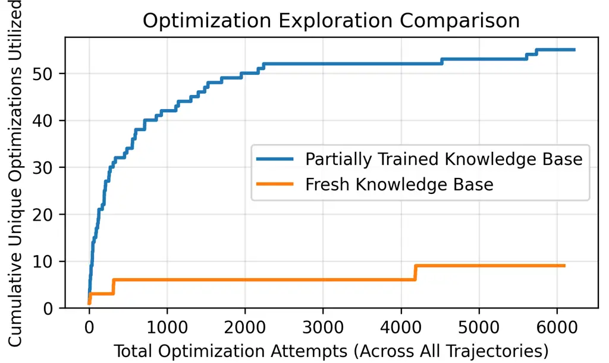

(a) Pretrained vs. empty Knowledge Base.

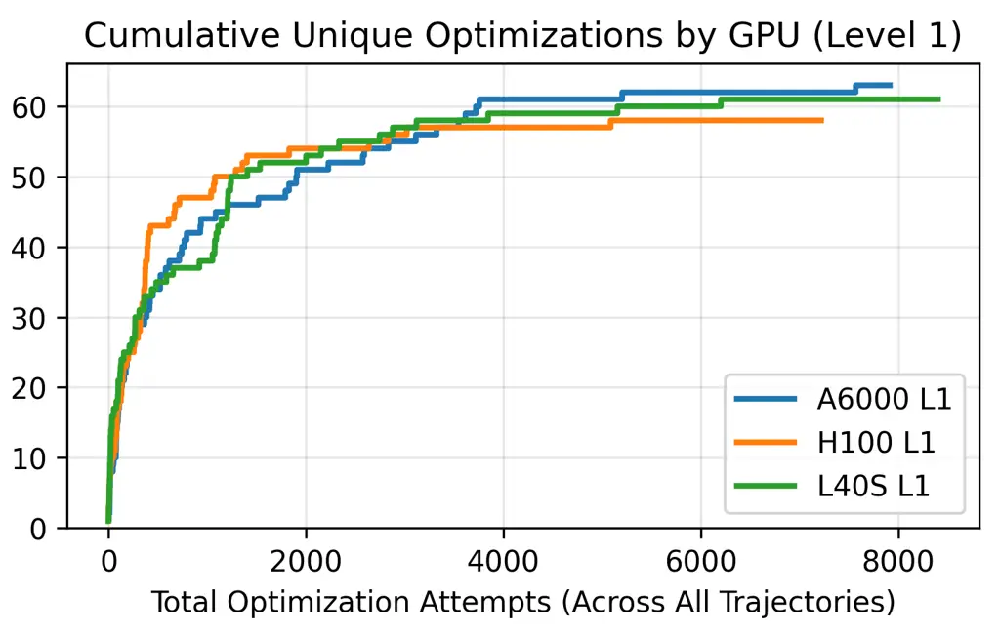

(b) Pretrained Knowledge Base reused across GPUs.

Figure 6: Reusable persistent memory: (a) discovery and application of
new optimizations with a pretrained vs. empty Knowledge Base; (b) the
same Knowledge Base trained on an A6000 transfers across other NVIDIA
GPU platforms.

### B.2 Impact of Semantic Profiling Data on Agent Performance

To understand the impact of profiling fidelity, we conducted ablation
studies against an Actor CodeGen Agent agent that only recieves latency
rewards instead of detailed NCU profiles. The cycle-only agent
underperforms approaches that use NCU (1.22x speedup over PyTorch on
Level-2 compared to 1.57x with NCU data, shown in Figure 7(b)),
indicating that scalar latency alone is insufficient to infer why a
kernel is slow or which optimization direction to pursue. Furthermore,
in addition to limiting performance in the inner Actor CodeGen Agent
loop, stripping semantic data prevents the Critic Reflection Agent from
effectively learning from past experience.

### B.3 Comparison Against Minimal Agent

Finally, we compare against a minimal agent. At each iteration, this
agent directly takes in CUDA code and NCU profiling data and outputs
optimized code. When running 10 trajectories of length 10, this agent
requires 2.4x tokens compared to ModelBlaster. We observe this is due to
two primary causes. First, because it has no access to a Knowledge Base
and a guided reasoning process, this agent must devote more tokens
up-front for reasoning about the optimizations. Second, the minimal
agent requires more retrievals for correctness compared to ModelBlaster.

Compared to ModelBlaster, this minimal agent has 0.379x performance
improvement per token. Furthermore, ModelBlaster achieves better
performance in 71% of cases compared to the simplified agent.

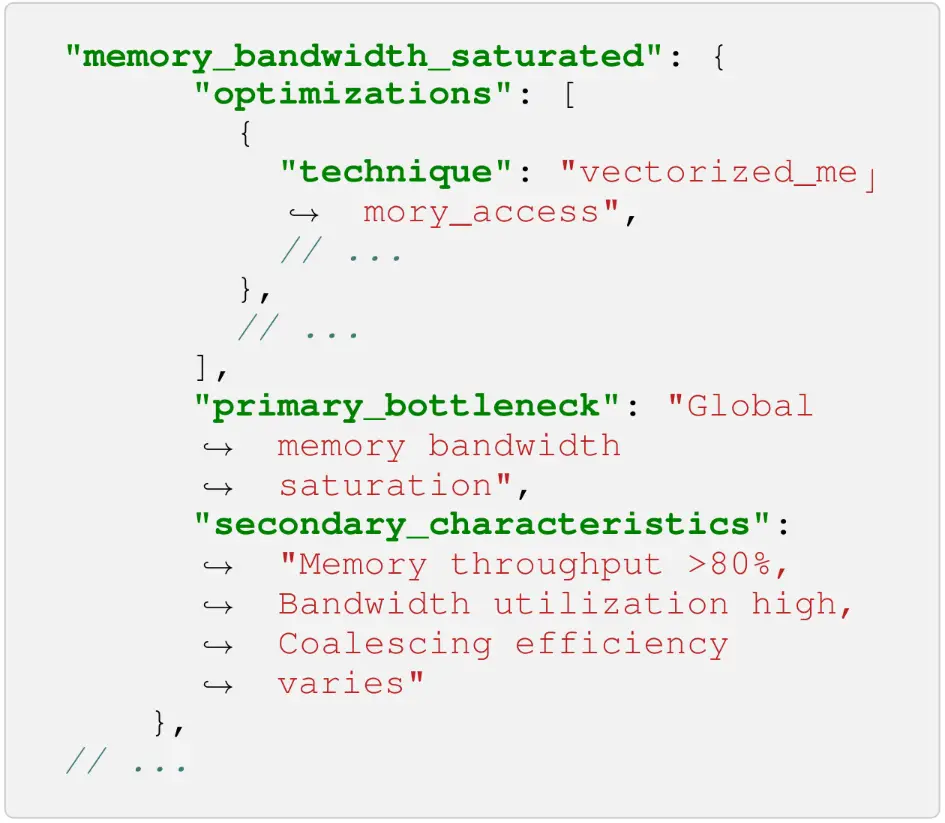

(a) A sample of the Knowledge Base data structure, specifying discovered
states.

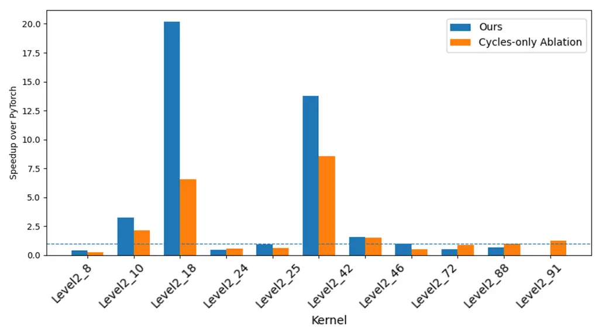

(b) Speedup over PyTorch: full text-based reward vs. a cycles-only
ablation.

Figure 7: Memory contents and text-based reward ablation. (a) The
learned memory does not collapse to a single transformation family: no
state exceeds 20% of applications, justifying state-conditioned
retrieval. (b) Replacing text-based critiques with cycle-only scalar
feedback degrades optimization across most kernels (1.22$`\times`$ vs.
1.57$`\times`$ on Level 2), confirming that language carries information
scalar timing cannot.

### B.4 Flow Components on Level 3 (L40S)

We ablate the components of the model-level flow on eight Level 3
problems (VanillaRNNHidden, SqueezeNetFireModule, DenseNet121DenseBlock,
DenseNet121, NetVladWithGhostClusters, NetVladNoGhostClusters,
ResNetBasicBlock, and GoogleNetInceptionV1) on an L40S, with one seed
per cell. A0 is the baseline flow. A1 adds the round controller, A2 adds
a graph-first round (three rounds in total), A3 merges sibling
convolutions, A4 adds region windows, and A5 adds the region loop. A6
combines the round controller, sibling-convolution merging, region
windows, and the region loop. Table 7 reports the geometric-mean speedup
of the final model over PyTorch eager and over a CUDA graph. A6 is
faster than eager on all eight problems and at least 2$`\times`$ faster
on seven. With eight problems and one seed per cell, differences of
about 10% between arms are within the noise, and A0 and A1 gave the same
geometric mean.

|                       |                |                |
| --------------------- | -------------- | -------------- |
| Arm                   | vs eager       | vs CUDA graph  |
| A0 baseline           | 2.79$`\times`$ | 1.59$`\times`$ |
| A1 round controller   | 2.79$`\times`$ | 1.59$`\times`$ |
| A2 graph-first round  | 3.46$`\times`$ | 1.97$`\times`$ |
| A3 sibling-conv merge | 3.47$`\times`$ | 1.98$`\times`$ |
| A4 region windows     | 4.08$`\times`$ | 2.33$`\times`$ |
| A5 region loop        | 2.90$`\times`$ | 1.65$`\times`$ |
| A6 all of the above   | 5.68$`\times`$ | 3.23$`\times`$ |

Table 7: Flow-component ablation on eight KernelBench Level 3 problems
on an L40S: geometric-mean speedup of the final model over PyTorch eager
and over a CUDA graph.

## Appendix C Additional Analysis

### C.1 Search Breadth and Search Depth

The key search hyperparameters are trajectory count and trajectory
length. Increasing trajectory count improves exploration, but we observe
diminishing returns beyond eight trajectories for median and
upper-quartile kernels. Lower-quartile kernels continue to benefit from
additional breadth, suggesting that difficult kernels require broader
exploration. Increasing trajectory length shows similar diminishing
returns beyond four transformations for most kernels, although
high-upside kernels can still benefit from longer sequences.

These results support the actor–critic structure. The actor needs enough
breadth to explore transformations, while the critic should decide when
additional rollouts are unlikely to pay off. This prevents the method
from becoming an unbounded

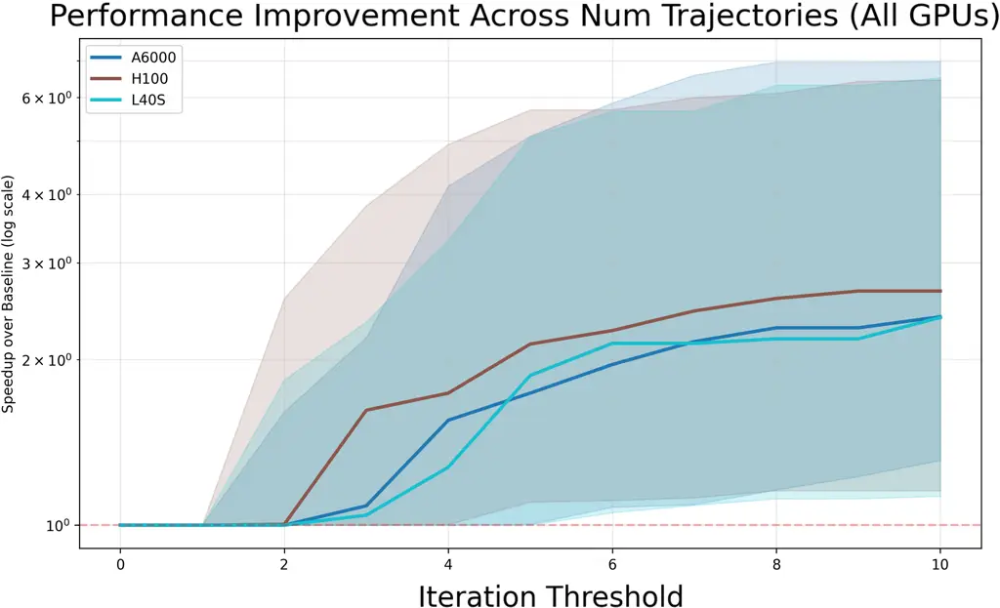

(a) Performance vs. trajectory count (search breadth).

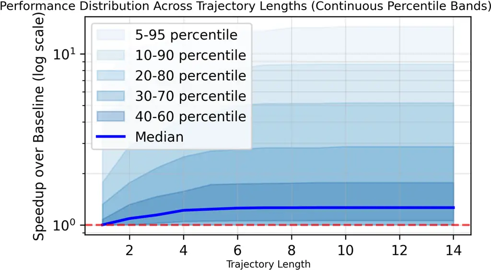

(b) Performance vs. trajectory length (search depth).

Figure 8: The impact of hyperparameter tuning on search dynamics: shaded
regions show the inter-quartile range of optimized kernels. Breadth and
depth both exhibit diminishing returns.

### C.2 Cost and Efficiency

Because token prices vary across model, date, and currency, we report
token usage directly. The figures below come from the per-problem cost
logs of 22 CUDA problems run with gpt-5.1. On KernelBench Levels 1
and 2, ModelBlaster consumes geometric means of 2,297,652 and 1,600,997
tokens per problem, respectively. Level 2 therefore costs 30% fewer
tokens, while the speedups of those runs were higher (2.50$`\times`$
against 1.43$`\times`$), because the Critic Reflection Agent ends
trajectories earlier when improvements arrive quickly. Token count
varies with code size, number of profiled kernels, and optimization
complexity. Cost is tracked separately for kernels that were optimized
successfully and kernels that were not, and failed attempts account for
most of the wasted spend. In the current flow, the Level 3 headline
sweep on the L40S (48 problems) cost about \$3,500 in LLM spend at list
prices, about \$73 per problem. A further metric is speedup per
persistent learning signal, since each rollout contributes scalar
outcomes and textual critiques that later tasks can reuse.

Quality depends on the search budget more weakly than the default budget
suggests. The median speedup saturates at about four transformations per
trajectory, so the default depth of ten steps is roughly 2.5 times
deeper than necessary, and a configuration of 8 trajectories with 4
steps each retains most of the median speedup of the full budget at
about 32% of the tokens (see the search breadth and depth analysis
above). Relative to a minimal agent that receives the same CUDA code and
NCU data, ModelBlaster uses 2.4 times fewer tokens and achieves about
2.6 times more performance improvement per token (Appendix B.3).

### C.3 Optimization Distribution on Secondary HW Targets

In addition to characterization the optimization distribution on the
primary NVIDIA GPU targets, we also provide a summary of the
optimization distribution on Qualcomm targets in Figure 9. Compared to
NVIDIA GPUs, we observe a smaller set of optimizations dominating total
optimization usage. This is due to the fact that the OpenCL compilation
process requires greater hand tuning, whereas certain optimizations can
be implemented directly by the CUDA compilation process. Additionally,
we observe certain CUDA specific optimizations selected in the Qualcomm
flow (such as tensor core utilization). While these are initially
discovered and attempted, they do not result in code with improved
performance, and no longer dominate optimization attempts.

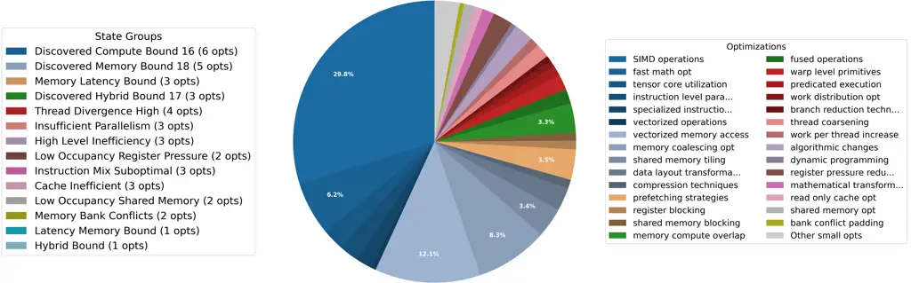

Figure 9: Distribution of Qualcomm optimization applications across
performance states (KernelBench L1, Adreno 650 GPU).

### C.4 Optimization/State Clustering Analysis

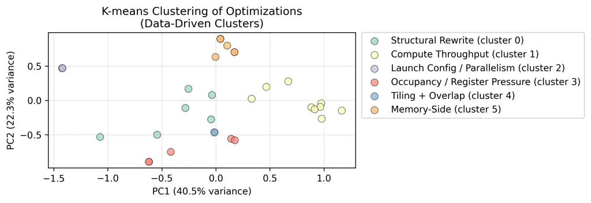

Figure 10: Synthetic Clustering of Top Optimizations

We use the trajectories stored in ModelBlaster’s Knowledge Base to
validate the state abstraction used by MAIC-RL. Each successful CUDA
action is represented by its pre-application profiler state, a
15-dimensional Nsight Compute bottleneck signature covering memory and
compute throughput, occupancy, cache behavior, pipeline utilization, and
warp scheduling. K-means clustering over these signatures recovers six
interpretable action regimes: memory-side fixes, launch/parallelism
fixes, occupancy and register-pressure interventions, tiling with
compute-memory overlap, instruction-level compute tuning, and structural
rewrites. This state-conditioned view is substantially more informative
than clustering actions by usage frequency or binary success vectors,
which mostly separate outliers from the rest. The clusters also align
with the Knowledge Base’s manual state taxonomy: memory-bandwidth states
select memory-side actions, compute-throughput states select
instruction-level tuning, balanced memory-compute states select
tiling/overlap, and insufficient-parallelism states select
launch-configuration changes. The only heterogeneous regime is
structural rewrite, whose pre-action signatures are saturated across
many metrics, consistent with its role as a last-resort intervention.
This analysis suggests that ModelBlaster should retrieve and update
actions through profiler-derived macro-states, while allowing the critic
to refine or merge finer manual states when trajectory evidence does not
support them.

### C.5 Correctness, Verification, and Cheating Prevention

To prevent shortcut behaviors such as calling PyTorch or emitting
non-vanilla-CUDA code, we employ a soft-verification agent that compares
the optimized kernel against the original KernelBench baseline. In
addition to our test harness checking numerical correctness, we use an
LLM agent that detects reward hacking (such as eliminating or moving
operations out of profiled regions) and calling external optimized
libraries, directly addressing concerns about cheating in
agent-generated kernels. Finally, we verifiy verification agent’s
robustness by measuring its agreement with expert human reviewers.

However, the protocol does not constitute a proof of behavioral
equivalence and has several limitations that should be acknowledged.
First, the verification agent is itself an LLM and inherits the
underlying model’s reliability characteristics: it can produce both
false positives (rejecting legitimate optimizations whose surface form
resembles a known cheating pattern, such as algebraic simplifications
that genuinely eliminate redundant operations) and false negatives
(missing novel evasion strategies that do not match the prompt’s
enumerated cheat templates). Second, the cheat-pattern catalog is
anchored to the KernelBench/CUDA setting (e.g., dispatching to PyTorch,
calling cuDNN/cuBLAS, hoisting operations out of the timed region); the
OpenCL/Adreno and RVV/RISC-V backends use the same conceptual checks,
but their cheat patterns have not been independently audited and may
differ. Fourth, compiler-level shortcuts are outside the agent’s view:
if the emitted CUDA is structured such that NVCC, the driver, or a
vendor library substitutes a fast-path implementation internally, the
verification agent does not observe that substitution.

Finally, a stronger protocol would combine LLM-level pattern detection
with deterministic static analysis (e.g., checking the call graph for
forbidden symbols) and randomized differential testing across broader
input distributions. We document these limitations explicitly so that
the verification step is auditable rather than represented as
eliminating reward hacking entirely.

### C.6 Limitations

ModelBlaster’s system also exposes limitations for future work.
Full-model optimization requires hierarchical decomposition because
whole-network code generation introduces long boilerplate and
heterogeneous performance states. Cross-target optimization requires
stronger profiling abstractions so that bottlenecks can be compared
across vendors and execution models. Persistent memories produced by
many agents could also become high-signal datasets for training future
models, converting short-term in-context adaptation into durable
model-level capability. More broadly, ModelBlaster suggests a path
toward optimization agents that learn from deployment feedback, retain
domain knowledge across tasks, and adapt to new hardware targets without
retraining.

## Appendix D Representative Code Samples

### D.1 Algebraic Fusion: (KernelBench Level 2, problem 72)

In KernelBench Level 2 problem 72 (ConvTranspose3d, BatchNorm, AvgPool,
AvgPool), the whole model in the L40S sweep takes 33.8 $`\mu`$s against
10,632 $`\mu`$s for PyTorch eager (315$`\times`$), 10,620 $`\mu`$s for a
CUDA graph, and 8,406 $`\mu`$s for torch.compile (249$`\times`$). The
seed implementation takes 33.3 ms. The model applies a transposed 3D
convolution (kernel 3, stride 2, padding 1), a BatchNorm, and two
$`2\times 2\times 2`$ average pools. With BatchNorm folded to a
per-channel scale and shift, every step after the convolution is linear,
so the pooled output equals a $`3\times 3\times 3`$ stride-2 convolution
of the input with folded weights. The kernel computes that fold
directly. For each of the 81 pairs of input channel and tap and each of
the 16 output channels, it sums the transposed-convolution taps that
land in the same $`4\times 4\times 4`$ pooling window, applies the
BatchNorm scale, divides by 64, and keeps the result in shared memory.
Each thread then computes one output position for all 16 channels in
fp32 and adds the folded bias and shift. The rewrite is exact up to fp16
rounding, and it holds when BatchNorm runs in inference mode, which is
how both the flow and the eager baseline evaluate the model. The
34 $`\mu`$s run reads about 13 MB and writes about 7 MB.

1 // KernelBench Level 2, problem 72 (ConvTranspose3d, BatchNorm,
AvgPool, AvgPool), L40S sweep, final slot

2 \#include \<cuda_fp16.h\>

3 \#include \<stdint.h\>

4

5 // Fused slot: conv_transpose(+bias) -\> BN(scale,shift) -\>
avgpool(2) -\> avgpool(2).

6 // Per output (n, oc, z, y, x), z,y,x in \[0,15):

7 // out = scale\[oc\] \* sum\_{ic, a,b,c in 0..2}
x\[n,ic,2z+a,2y+b,2x+c\] \* Gs\[ic,oc,a,b,c\]

8 // + (scale\[oc\]\*bias\[oc\] + shift\[oc\])

9 // Gs = (1/64) \* sum of convT weights over taps landing in the 4x4x4
pool window.

10 // Each thread computes one spatial output position for all 16
channels in fp32.

11

12 \_\_global\_\_ void \_\_launch_bounds\_\_(256)

13 k_fused(const \_\_half\* \_\_restrict\_\_ x, const \_\_half\*
\_\_restrict\_\_ w,

14 const \_\_half\* \_\_restrict\_\_ bias, const \_\_half\*
\_\_restrict\_\_ scale,

15 const \_\_half\* \_\_restrict\_\_ shift, \_\_half\* \_\_restrict\_\_
out) {

16 \_\_shared\_\_ \_\_align\_\_(16) float Gs\[81\]\[16\]; // \[ic\*27 +
a\*9 + b\*3 + c\]\[oc\], scale folded in

17 \_\_shared\_\_ float cst\[16\]; // scale\*bias + shift

18

19 const int tid = threadIdx.x;

20

21 // ---- fold weights for the 81 effective input taps ----

22 for (int idx = tid; idx \< 81 \* 16; idx += 256) {

23 const int kg = idx \>\> 4;

24 const int oc = idx & 15;

25 const int ic = kg / 27;

26 const int t = kg - ic \* 27;

27 const int a = t / 9;

28 const int b = (t / 3) % 3;

29 const int c = t % 3;

30 const int alo = (a == 0) ? 1 : 0, ahi = (a == 2) ? 0 : 2;

31 const int blo = (b == 0) ? 1 : 0, bhi = (b == 2) ? 0 : 2;

32 const int clo = (c == 0) ? 1 : 0, chi = (c == 2) ? 0 : 2;

33 const \_\_half\* wp = w + (size_t)(ic \* 16 + oc) \* 27;

34 float s = 0.f;

35 for (int kz = alo; kz \<= ahi; kz++)

36 for (int ky = blo; ky \<= bhi; ky++)

37 for (int kx = clo; kx \<= chi; kx++)

38 s += \_\_half2float(\_\_ldg(wp + kz \* 9 + ky \* 3 + kx));

39 const float sc = \_\_half2float(scale\[oc\]);

40 Gs\[kg\]\[oc\] = s \* (1.0f / 64.0f) \* sc;

41 }

42 if (tid \< 16) {

43 cst\[tid\] = \_\_half2float(scale\[tid\]) \*
\_\_half2float(bias\[tid\]) + \_\_half2float(shift\[tid\]);

44 }

45 \_\_syncthreads();

46

47 const int gid = blockIdx.x \* 256 + tid;

48 const int total = 64 \* 15 \* 15 \* 15;

49 if (gid \>= total) return;

50

51 // decode (n, z, y, x)

52 const int n = gid / 3375;

53 int r = gid - n \* 3375;

54 const int z = r / 225;

55 const int r2 = r - z \* 225;

56 const int y = r2 / 15;

57 const int xx = r2 - y \* 15;

58

59 float acc\[16\];

60 \#pragma unroll

61 for (int oc = 0; oc \< 16; oc++) acc\[oc\] = 0.f;

62

63 const \_\_half2\* x2 = reinterpret_cast\<const \_\_half2\*\>(x);

64

65 \#pragma unroll

66 for (int ic = 0; ic \< 3; ic++) {

67 \#pragma unroll

68 for (int a = 0; a \< 3; a++) {

69 \#pragma unroll

70 for (int b = 0; b \< 3; b++) {

71 // row start (in elements) for input plane (n,ic), depth 2z+a, row
2y+b; col 2xx..2xx+2

72 const int rowbase = ((n \* 3 + ic) \* 32768 + (2 \* z + a) \* 1024 +
(2 \* y + b) \* 32) \>\> 1;

73 const \_\_half2 p0 = \_\_ldg(x2 + rowbase + xx); // cols 2xx, 2xx+1

74 const \_\_half2 p1 = \_\_ldg(x2 + rowbase + xx + 1); // cols 2xx+2,
2xx+3

75 const float2 f0 = \_\_half22float2(p0);

76 const float v\[3\] = { f0.x, f0.y, \_\_low2float(p1) };

77 \#pragma unroll

78 for (int c = 0; c \< 3; c++) {

79 const int kg = ic \* 27 + a \* 9 + b \* 3 + c;

80 const float vc = v\[c\];

81 \#pragma unroll

82 for (int q = 0; q \< 4; q++) {

83 const float4 g = \*reinterpret_cast\<const float4\*\>(&Gs\[kg\]\[q \*
4\]);

84 acc\[q \* 4 + 0\] = fmaf(vc, g.x, acc\[q \* 4 + 0\]);

85 acc\[q \* 4 + 1\] = fmaf(vc, g.y, acc\[q \* 4 + 1\]);

86 acc\[q \* 4 + 2\] = fmaf(vc, g.z, acc\[q \* 4 + 2\]);

87 acc\[q \* 4 + 3\] = fmaf(vc, g.w, acc\[q \* 4 + 3\]);

88 }

89 }

90 }

91 }

92 }

93

94 const size_t obase = (size_t)n \* 16 \* 3375 + (size_t)z \* 225 + y \* 15 + xx;

95 \#pragma unroll

96 for (int oc = 0; oc \< 16; oc++) {

97 out\[obase + (size_t)oc \* 3375\] = \_\_float2half_rn(acc\[oc\] +
cst\[oc\]);

98 }

99 }

100

101 void kernel_region\_\_all\_\_9d141d8c2c_f16(const \_\_half\* in_x,
const \_\_half\* w_conv_transpose_weight, const \_\_half\*
w_conv_transpose_bias, \_\_half\* scratch_conv_transpose, const
\_\_half\* in_batch_norm\_\_scale, \_\_half\* scratch_batch_norm\_\_g1,
const \_\_half\* in_batch_norm\_\_shift, \_\_half\* scratch_batch_norm,
\_\_half\* scratch_avg_pool1, \_\_half\* out_avg_pool2) {

102 const int total = 64 \* 15 \* 15 \* 15;

103 const int blocks = (total + 255) / 256;

104 k_fused\<\<\<blocks, 256\>\>\>(in_x, w_conv_transpose_weight,
w_conv_transpose_bias,

105 in_batch_norm\_\_scale, in_batch_norm\_\_shift, out_avg_pool2);

106 }

### D.2 Tensor Core GEMM with Fused Epilogue: (KernelBench Level 2, problem 37)

In KernelBench Level 2 problem 37 (Matmul, Swish, Sum, GroupNorm), the
final model takes 1,897 $`\mu`$s on the L40S, against 6,048 $`\mu`$s for
PyTorch eager (3.19$`\times`$), 5,998 $`\mu`$s for a CUDA graph, and
2,170 $`\mu`$s for torch.compile (1.14$`\times`$). The problem
multiplies a $`32768\times 1024`$ input by a $`1024\times 4096`$ weight
matrix and applies a bias, Swish, a second bias, and GroupNorm. The
kernel computes the GEMM with $`128\times 128`$ block tiles and eight
warps, two along $`M`$ and four along $`N`$, each owning a
$`64\times 32`$ tile. Operand tiles stream through a three-stage
cp.async pipeline into XOR-swizzled shared memory, are loaded with
ldmatrix, and are multiplied with mma.sync m16n8k16 instructions on fp16
inputs with fp32 accumulation. The epilogue never writes the
intermediate matrix to global memory. It adds the bias, applies the
sigmoid and the multiplication of Swish with intermediate values rounded
to fp16, adds the second bias, stages the tile in shared memory,
computes GroupNorm over each 64-channel group with one thread per row
and group, and writes the result with coalesced 16-byte stores. The
listing is highlighted: small helper wrappers, the accumulator
initialization, and the launch-attribute setup are omitted.

1 // KernelBench Level 2, problem 37 (Matmul, Swish, Sum, GroupNorm),
L40S sweep, final slot; highlighted

2 // (cp.async, commit/wait and rounding helpers, accumulator
initialization and launch-attribute setup are omitted)

3 \#define BM 128

4 \#define BN 128

5 \#define BK 32

6 \#define LDS 32

7 \#define STG 3

8 \#define KD 1024

9 \#define ND 4096

10 \#define MD 32768

11 \#define LDCS 136

12 \#define THR 256

13

14 \_\_device\_\_ \_\_forceinline\_\_ void ldm4(uint32_t\* r, uint32_t
a) {

15 asm volatile("ldmatrix.sync.aligned.m8n8.x4.shared.b16 {%0,%1,%2,%3},
\[%4\];\n"

16 : "=r"(r\[0\]), "=r"(r\[1\]), "=r"(r\[2\]), "=r"(r\[3\]) : "r"(a));

17 }

18 \_\_device\_\_ \_\_forceinline\_\_ void mma(float\* c, const
uint32_t\* a, uint32_t b0, uint32_t b1) {

19 asm volatile("mma.sync.aligned.m16n8k16.row.col.f32.f16.f16.f32
{%0,%1,%2,%3}, {%4,%5,%6,%7}, {%8,%9}, {%0,%1,%2,%3};\n"

20 : "+f"(c\[0\]), "+f"(c\[1\]), "+f"(c\[2\]), "+f"(c\[3\])

21 : "r"(a\[0\]), "r"(a\[1\]), "r"(a\[2\]), "r"(a\[3\]), "r"(b0),
"r"(b1));

22 }

23

24 // 128x128 block tile, 8 warps (2 along M x 4 along N), each warp
64x32.

25 \_\_global\_\_ void \_\_launch_bounds\_\_(THR, 2)

26 k_fused(const \_\_half\* \_\_restrict\_\_ X, const \_\_half\*
\_\_restrict\_\_ W, const \_\_half\* \_\_restrict\_\_ Bl,

27 const \_\_half\* \_\_restrict\_\_ Bi, const \_\_half\*
\_\_restrict\_\_ gam, const \_\_half\* \_\_restrict\_\_ bet,

28 \_\_half\* \_\_restrict\_\_ Y) {

29 extern \_\_shared\_\_ \_\_align\_\_(16) unsigned char smem\[\];

30 \_\_half\* sA = (\_\_half\*)smem; // STG \* BM \* LDS

31 \_\_half\* sB = sA + STG \* BM \* LDS; // STG \* BN \* LDS

32 const int tid = threadIdx.x, lane = tid & 31, wid = tid \>\> 5;

33 const int wm = wid & 1, wn = wid \>\> 1; // wn in 0..3

34 const int nt = blockIdx.x & 31, mt = blockIdx.x \>\> 5;

35 const \_\_half\* Xb = X + (size_t)mt \* BM \* KD;

36 const \_\_half\* Wb = W + (size_t)nt \* BN \* KD;

37

38 auto load = \[&\](int st, int kt) {

39 \_\_half\* a = sA + st \* BM \* LDS;

40 \_\_half\* b = sB + st \* BN \* LDS;

41 const int k0 = kt \* BK;

42 \#pragma unroll

43 for (int i = 0; i \< 2; i++) {

44 const int c = tid + i \* THR;

45 const int r = c \>\> 2, cc = (c & 3) \* 8;

46 cp16(a + r \* LDS + ((((c & 3) ^ ((r \>\> 1) & 3))) \<\< 3), Xb +
(size_t)r \* KD + k0 + cc);

47 }

48 \#pragma unroll

49 for (int i = 0; i \< 2; i++) {

50 const int c = tid + i \* THR;

51 const int r = c \>\> 2, cc = (c & 3) \* 8;

52 cp16(b + r \* LDS + ((((c & 3) ^ ((r \>\> 1) & 3))) \<\< 3), Wb +
(size_t)r \* KD + k0 + cc);

53 }

54 };

55

56

57 // ... accumulator tile acc\[4\]\[4\]\[4\] zero-initialized

58

59 const int KT = KD / BK;

60 load(0, 0); cpc();

61 load(1, 1); cpc();

62 for (int kt = 0; kt \< KT; kt++) {

63 cpw\<1\>();

64 \_\_syncthreads();

65 if (kt + 2 \< KT) load((kt + 2) % STG, kt + 2);

66 cpc();

67 const \_\_half\* a = sA + (kt % STG) \* BM \* LDS;

68 const \_\_half\* b = sB + (kt % STG) \* BN \* LDS;

69 \#pragma unroll

70 for (int kk = 0; kk \< 2; kk++) {

71 uint32_t af\[4\]\[4\], bf\[2\]\[4\];

72 \#pragma unroll

73 for (int i = 0; i \< 4; i++) {

74 const int r = wm \* 64 + i \* 16 + (lane & 15);

75 const int ch = (kk \* 2 + (lane \>\> 4)) ^ ((r \>\> 1) & 3);

76 ldm4(af\[i\], su32(a + r \* LDS + ch \* 8));

77 }

78 \#pragma unroll

79 for (int j = 0; j \< 2; j++) {

80 const int r = wn \* 32 + j \* 16 + (lane & 7) + ((lane \>\> 4) \<\<
3);

81 const int ch = (kk \* 2 + ((lane \>\> 3) & 1)) ^ ((r \>\> 1) & 3);

82 ldm4(bf\[j\], su32(b + r \* LDS + ch \* 8));

83 }

84 \#pragma unroll

85 for (int i = 0; i \< 4; i++)

86 \#pragma unroll

87 for (int j = 0; j \< 2; j++) {

88 mma(acc\[i\]\[2 \* j\], af\[i\], bf\[j\]\[0\], bf\[j\]\[1\]);

89 mma(acc\[i\]\[2 \* j + 1\], af\[i\], bf\[j\]\[2\], bf\[j\]\[3\]);

90 }

91 }

92 }

93 cpw\<0\>();

94 \_\_syncthreads();

95

96 // epilogue 1: bias, sigmoid, mul, add -\> smem (fp16)

97 \_\_half\* sC = (\_\_half\*)smem;

98 \#pragma unroll

99 for (int j = 0; j \< 4; j++) {

100 const int col = wn \* 32 + j \* 8 + (lane & 3) \* 2;

101 const int gc = nt \* BN + col;

102 float2 bl = \_\_half22float2(\*(const \_\_half2\*)(Bl + gc));

103 float2 bi = \_\_half22float2(\*(const \_\_half2\*)(Bi + gc));

104 \#pragma unroll

105 for (int i = 0; i \< 4; i++) {

106 \#pragma unroll

107 for (int h = 0; h \< 2; h++) {

108 const int row = wm \* 64 + i \* 16 + (lane \>\> 2) + h \* 8;

109 float v0 = rh(acc\[i\]\[j\]\[2 \* h\] + bl.x), v1 =
rh(acc\[i\]\[j\]\[2 \* h + 1\] + bl.y);

110 float s0 = rh(\_\_fdividef(1.0f, 1.0f + \_\_expf(-v0)));

111 float s1 = rh(\_\_fdividef(1.0f, 1.0f + \_\_expf(-v1)));

112 float m0 = rh(s0 \* v0), m1 = rh(s1 \* v1);

113 \*(\_\_half2\*)(sC + row \* LDCS + col) = \_\_floats2half2_rn(m0 +
bi.x, m1 + bi.y);

114 }

115 }

116 }

117 \_\_syncthreads();

118

119 // epilogue 2: group norm per (row, 64-channel group), in place in
smem.

120 // 256 threads cover 128 rows x 2 groups in one pass.

121 {

122 const int row = tid \>\> 1, g = tid & 1;

123 float v\[64\];

124 \#pragma unroll

125 for (int c = 0; c \< 8; c++) {

126 const int cr = (c + 2 \* g) & 7;

127 uint4 q = \*(const uint4\*)(sC + row \* LDCS + g \* 64 + cr \* 8);

128 const \_\_half2\* hq = (const \_\_half2\*)&q;

129 \#pragma unroll

130 for (int e = 0; e \< 4; e++) {

131 float2 f = \_\_half22float2(hq\[e\]);

132 v\[c \* 8 + 2 \* e\] = f.x; v\[c \* 8 + 2 \* e + 1\] = f.y;

133 }

134 }

135 float s = 0.f;

136 \#pragma unroll

137 for (int e = 0; e \< 64; e++) s += v\[e\];

138 const float mean = s \* (1.0f / 64.0f);

139 float qv = 0.f;

140 \#pragma unroll

141 for (int e = 0; e \< 64; e++) { float d = v\[e\] - mean; qv += d \*
d; }

142 const float inv = rsqrtf(qv \* (1.0f / 64.0f) + 1e-5f);

143 \#pragma unroll

144 for (int c = 0; c \< 8; c++) {

145 const int cr = (c + 2 \* g) & 7;

146 const int ch = nt \* BN + g \* 64 + cr \* 8;

147 uint4 gq = \_\_ldg((const uint4\*)(gam + ch));

148 uint4 bq = \_\_ldg((const uint4\*)(bet + ch));

149 const \_\_half2\* gh = (const \_\_half2\*)&gq;

150 const \_\_half2\* bh = (const \_\_half2\*)&bq;

151 uint4 o; \_\_half2\* oh = (\_\_half2\*)&o;

152 \#pragma unroll

153 for (int e = 0; e \< 4; e++) {

154 float2 gg = \_\_half22float2(gh\[e\]), bb =
\_\_half22float2(bh\[e\]);

155 float y0 = (v\[c \* 8 + 2 \* e\] - mean) \* inv \* gg.x + bb.x;

156 float y1 = (v\[c \* 8 + 2 \* e + 1\] - mean) \* inv \* gg.y + bb.y;

157 oh\[e\] = \_\_floats2half2_rn(y0, y1);

158 }

159 \*(uint4\*)(sC + row \* LDCS + g \* 64 + cr \* 8) = o;

160 }

161 }

162 \_\_syncthreads();

163

164 // coalesced store

165 \#pragma unroll 1

166 for (int i = tid; i \< BM \* 16; i += THR) {

167 const int r = i \>\> 4, cc = i & 15;

168 uint4 q = \*(const uint4\*)(sC + r \* LDCS + cc \* 8);

169 \*(uint4\*)(Y + (size_t)(mt \* BM + r) \* ND + nt \* BN + cc \* 8) =
q;

170 }

171 }

172

173 void kernel_region\_\_all\_\_6723b6a1a9_f16(const \_\_half\* in_x,
const \_\_half\* w_matmul_weight, const \_\_half\* w_matmul_bias,
\_\_half\* scratch_matmul, \_\_half\* scratch_sigmoid, \_\_half\*
scratch_mul, const \_\_half\* in_bias, \_\_half\* scratch_add, const
\_\_half\* w_group_norm_weight, const \_\_half\* w_group_norm_bias,
\_\_half\* out_group_norm) {

174 // ... dynamic shared-memory size and launch attribute setup omitted

175 k_fused\<\<\<(MD / BM) \* (ND / BN), THR, smem\>\>\>(in_x,
w_matmul_weight, w_matmul_bias, in_bias,

176 w_group_norm_weight, w_group_norm_bias, out_group_norm);

177 }

### D.3 Level 3 Full Models

To better understand how ModelBlaster behaves on end-to-end workloads,
we analyze several representative KernelBench Level 3 problems in
detail. Table 8 gives the speedups of these models in the L40S sweep
behind Table 3, over PyTorch eager.

|                                  |                 |
| -------------------------------- | --------------- |
| Model                            | Speedup         |
| LeNet5                           | 10.58$`\times`$ |
| SwinMLP                          | 4.07$`\times`$  |
| ResNetBasicBlock                 | 3.19$`\times`$  |
| DenseNet121DenseBlock            | 2.72$`\times`$  |
| SqueezeNetFireModule             | 2.41$`\times`$  |
| MLP                              | 1.07$`\times`$  |
| All 46 problems (geometric mean) | 5.18$`\times`$  |

Table 8: Speedup of ModelBlaster on representative KernelBench Level 3
models on an L40S, over PyTorch eager. The last row is the geometric
mean over all 46 problems.

##### LeNet5.

For the Level 3 network LeNet5, the final model takes 51.2 $`\mu`$s on
the L40S against 5,712 $`\mu`$s for its seed, and runs 10.6$`\times`$
faster than PyTorch eager. The kernel below fuses the second
convolution, the ReLU, and the $`2\times 2`$ max pool into one
tensor-core kernel. The convolution (6 input channels, 16 output
channels, $`5\times 5`$ filters) is lowered to a GEMM in which each row
is an image position at an even output column. The six-wide input window
of that row feeds the even output column and, with the weights shifted
by one, the next odd column, so the GEMM has $`N=32`$ (16 channels times
two column parities) and $`K=180`$ padded to 192. The horizontal part of
the pooling is a maximum of two accumulator fragments, and the vertical
part is a warp shuffle between lanes that hold adjacent rows. The
weights stay in registers as MMA fragments, the inputs arrive through
cp.async into double-buffered chunks of eight images, and persistent
blocks loop over the chunks. The listing is highlighted: the helper that
counts SMs, the naive fallback kernels, and the shape check are omitted.

1 // KernelBench Level 3, 4_LeNet5, L40S sweep, final fused conv +
ReLU + maxpool slot (variant v1); highlighted

2 // (the SM-count helper, the naive fallback kernels, and the
shape-dependent dispatch details are omitted)

3 // conv(16x6x5x5,s1) + relu + maxpool(2x2,s2), fp16 io / fp32 acc on
tensor cores.

4 // GEMM row = (img, oh, ow_e even); its 6-wide input window (3 aligned
words per

5 // (ic,kh)) feeds both ow_e (even weight set, kw 0..4) and ow_e+1 (odd
weight set,

6 // shifted by one) -\> N = 32, K = 6\*5\*6 = 180 (pad 192). A loads
are 32-bit, aligned.

7 // Persistent blocks, cp.async double-buffered 8-image chunks.

8

9 \_\_device\_\_ \_\_forceinline\_\_ void fz_mma(float \*c, const
unsigned \*a, unsigned b0, unsigned b1) {

10 asm volatile(

11 "mma.sync.aligned.m16n8k16.row.col.f32.f16.f16.f32 {%0,%1,%2,%3},
{%4,%5,%6,%7}, {%8,%9}, {%0,%1,%2,%3};\n"

12 : "+f"(c\[0\]), "+f"(c\[1\]), "+f"(c\[2\]), "+f"(c\[3\])

13 : "r"(a\[0\]), "r"(a\[1\]), "r"(a\[2\]), "r"(a\[3\]), "r"(b0),
"r"(b1));

14 }

15 \_\_device\_\_ \_\_forceinline\_\_ void fz_cp16(unsigned sa, const
void \*src) {

16 asm volatile("cp.async.cg.shared.global \[%0\], \[%1\], 16;\n" ::
"r"(sa), "l"(src));

17 }

18

19 \#define FZ_IMGS 8

20 \#define FZ_WORDS (FZ_IMGS \* 588)

21

22 \_\_device\_\_ \_\_forceinline\_\_ int fz_rowbase(int R) {

23 int img = R / 50, lr = R - img \* 50;

24 int ph = lr / 10, rem = lr - ph \* 10;

25 int pw = rem \>\> 1, ohb = rem & 1;

26 int oh = 2 \* ph + ohb;

27 return img \* 588 + oh \* 7 + pw;

28 }

29

30 \_\_global\_\_ void \_\_launch_bounds\_\_(128, 2)

31 k_fused_fast(const \_\_half \*\_\_restrict\_\_ x, const \_\_half
\*\_\_restrict\_\_ w, const \_\_half \*\_\_restrict\_\_ bias,

32 \_\_half \*\_\_restrict\_\_ y, int nch) {

33 \_\_shared\_\_ \_\_align\_\_(16) unsigned sIn\[2\]\[FZ_WORDS\];

34 \_\_shared\_\_ \_\_align\_\_(16) \_\_half sOut\[FZ_IMGS \* 400\];

35 \_\_shared\_\_ int2 sOff2\[48\];

36

37 const int tid = threadIdx.x, lane = tid & 31, warp = tid \>\> 5;

38 const int g = lane \>\> 2, t = lane & 3;

39

40 int chunk = blockIdx.x;

41 if (chunk \>= nch) return;

42

43 const unsigned sBase =
(unsigned)\_\_cvta_generic_to_shared(&sIn\[0\]\[0\]);

44 auto load = \[&\](int ch, int st) {

45 const char \*src = reinterpret_cast\<const char \*\>(x + (long)ch \*
(FZ_IMGS \* 1176));

46 unsigned dst = sBase + st \* (FZ_WORDS \* 4);

47 for (int i = tid; i \< FZ_WORDS / 4; i += 128) fz_cp16(dst + i \* 16,
src + (long)i \* 16);

48 };

49 load(chunk, 0);

50 asm volatile("cp.async.commit_group;\n" ::);

51

52 // word offset table: kwd -\> ic\*98 + kh\*7 + q

53 if (tid \< 48) {

54 int ks = tid \>\> 2, tt = tid & 3;

55 int o\[2\];

56 \#pragma unroll

57 for (int j = 0; j \< 2; j++) {

58 int kwd = ks \* 8 + tt + 4 \* j;

59 int v = 0;

60 if (kwd \< 90) {

61 int ic = kwd / 15, r = kwd - ic \* 15, kh = r / 3, q = r - kh \* 3;

62 v = ic \* 98 + kh \* 7 + q;

63 }

64 o\[j\] = v;

65 }

66 sOff2\[tid\] = make_int2(o\[0\], o\[1\]);

67 }

68

69 // weight fragments

70 unsigned bw\[12\]\[4\]\[2\];

71 \#pragma unroll

72 for (int ks = 0; ks \< 12; ks++)

73 \#pragma unroll

74 for (int nt = 0; nt \< 4; nt++) {

75 int n = nt \* 8 + g;

76 int oc = n & 15, par = n \>\> 4;

77 \#pragma unroll

78 for (int j = 0; j \< 2; j++) {

79 unsigned pk = 0u;

80 \#pragma unroll

81 for (int h = 0; h \< 2; h++) {

82 int k = ks \* 16 + 2 \* t + 8 \* j + h;

83 int kwd = k \>\> 1;

84 unsigned hv = 0u;

85 if (kwd \< 90) {

86 int ic = kwd / 15, r = kwd - ic \* 15, kh = r / 3, q = r - kh \* 3;

87 int p = 2 \* q + h;

88 int kw = par ? p - 1 : p;

89 if (kw \>= 0 && kw \< 5)

90 hv = (unsigned)\_\_half_as_ushort(w\[((oc \* 6 + ic) \* 5 + kh) \*
5 + kw\]);

91 }

92 pk \|= hv \<\< (16 \* h);

93 }

94 bw\[ks\]\[nt\]\[j\] = pk;

95 }

96 }

97 float bv\[2\]\[2\];

98 \#pragma unroll

99 for (int nt = 0; nt \< 2; nt++) {

100 int oc0 = nt \* 8 + 2 \* t;

101 bv\[nt\]\[0\] = bias ? \_\_half2float(bias\[oc0\]) : 0.f;

102 bv\[nt\]\[1\] = bias ? \_\_half2float(bias\[oc0 + 1\]) : 0.f;

103 }

104

105 for (int it = 0; chunk \< nch; it++, chunk += gridDim.x) {

106 const int s = it & 1;

107 asm volatile("cp.async.wait_group 0;\n" ::);

108 \_\_syncthreads();

109 int nxt = chunk + gridDim.x;

110 if (nxt \< nch) load(nxt, s ^ 1);

111 asm volatile("cp.async.commit_group;\n" ::);

112

113 const unsigned \*S = sIn\[s\];

114 for (int tile = warp; tile \< 25; tile += 4) {

115 const int R0 = tile \* 16 + g;

116 const int b0 = fz_rowbase(R0), b1 = fz_rowbase(R0 + 8);

117 float c\[4\]\[4\];

118 \#pragma unroll

119 for (int nt = 0; nt \< 4; nt++) {

120 c\[nt\]\[0\] = bv\[nt & 1\]\[0\]; c\[nt\]\[1\] = bv\[nt & 1\]\[1\];

121 c\[nt\]\[2\] = bv\[nt & 1\]\[0\]; c\[nt\]\[3\] = bv\[nt & 1\]\[1\];

122 }

123 \#pragma unroll

124 for (int ks = 0; ks \< 12; ks++) {

125 int2 o = sOff2\[ks \* 4 + t\];

126 unsigned a\[4\];

127 a\[0\] = S\[b0 + o.x\];

128 a\[1\] = S\[b1 + o.x\];

129 a\[2\] = S\[b0 + o.y\];

130 a\[3\] = S\[b1 + o.y\];

131 \#pragma unroll

132 for (int nt = 0; nt \< 4; nt++) fz_mma(c\[nt\], a,
bw\[ks\]\[nt\]\[0\], bw\[ks\]\[nt\]\[1\]);

133 }

134 \#pragma unroll

135 for (int nt = 0; nt \< 2; nt++)

136 \#pragma unroll

137 for (int e = 0; e \< 4; e++) {

138 float v = fmaxf(c\[nt\]\[e\], c\[nt + 2\]\[e\]);

139 v = fmaxf(v, \_\_shfl_xor_sync(0xffffffffu, v, 4));

140 v = fmaxf(v, 0.f);

141 if ((g & 1) == 0) {

142 int R = R0 + 8 \* (e \>\> 1);

143 int img = R / 50, lr = R - img \* 50;

144 int ph = lr / 10, rem = lr - ph \* 10, pw = rem \>\> 1;

145 int oc = nt \* 8 + 2 \* t + (e & 1);

146 sOut\[img \* 400 + oc \* 25 + ph \* 5 + pw\] = \_\_float2half_rn(v);

147 }

148 }

149 }

150 \_\_syncthreads();

151 uint4 \*gy = reinterpret_cast\<uint4 \*\>(y + (long)chunk \*
(FZ_IMGS \* 400));

152 const uint4 \*sy = reinterpret_cast\<const uint4 \*\>(sOut);

153 for (int i = tid; i \< FZ_IMGS \* 400 / 8; i += 128) gy\[i\] =
sy\[i\];

154 }

155 }

156

157 // ... naive fallback kernels (k_gen_conv, k_gen_relu, k_gen_pool)
omitted

158

159 void kernel_fused\_\_conv2d_f16\_\_relu_f16\_\_maxpool2d_f16(const
\_\_half\* a_input, const \_\_half\* a_weight, const \_\_half\* a_bias,
\_\_half\* a_output, int a_N, int a_IC, int a_IH, int a_IW, int a_OC,
int a_KH, int a_KW, int a_SH, int a_SW, int a_PH, int a_PW, int a_DH,
int a_DW, \_\_half\* b_output, int b_n, \_\_half\* c_output, int c_N,
int c_C, int c_IH, int c_IW, int c_KH, int c_KW, int c_SH, int c_SW, int
c_PH, int c_PW, int c_DH, int c_DW) {

160 // ... shape check against the LeNet5 conv2 + pool configuration
(fast) omitted

161 if (fast) {

162 int nch = a_N / FZ_IMGS;

163 int grid = fz_sm_count() \* 2;

164 if (grid \> nch) grid = nch;

165 k_fused_fast\<\<\<grid, 128\>\>\>(a_input, a_weight, a_bias,
c_output, nch);

166 return;

167 }

168 // ... fallback launches omitted

169 }

##### DenseNet121DenseBlock.

In the DenseNet121 dense block, the final model takes 4,016 $`\mu`$s
against 315,792 $`\mu`$s for its seed, and runs 2.72$`\times`$ faster
than PyTorch eager. Dense blocks concatenate the outputs of earlier
layers before every BatchNorm and ReLU. The kernel below fuses a
two-input concatenation, the folded BatchNorm affine, and the ReLU into
one pass. The concatenation costs no extra memory traffic: for each
16-byte chunk the index arithmetic selects the first or the second
source tensor, so the concatenated tensor is never materialized. Each
thread handles two chunks of eight fp16 values with block-strided
indexing, so every warp access is coalesced and two loads are in flight
before any compute. The per-channel scale and bias use the read-only
path, and the streamed activations use evict-first loads and stores. The
listing omits the scalar fallback kernel and the host-side size and
alignment checks.

1 // KernelBench Level 3, 14_DenseNet121DenseBlock, L40S sweep, final
fused concat + BatchNorm + ReLU slot; highlighted

2 // (the scalar fallback kernel and the alignment and size checks of
the host code are omitted)

3 // Fused cat2 -\> batchnorm2d (folded affine) -\> relu, single pass.

4 // Vectorised: each thread handles two 16-byte (8 x fp16) chunks,
block-strided

5 // (chunk base+t and base+256+t) so every warp instruction is fully
coalesced and

6 // two 16B loads are in flight per thread before any compute/store.

7 // Per-channel scale/bias go through the read-only path (\_\_ldg, tiny
& reused);

8 // bulk streamed data uses evict-first loads/stores.

9 // Intermediates (a_output, b_output) are scratch and not
materialised.

10

11 \_\_device\_\_ \_\_forceinline\_\_ uint4 mb_fuse8(uint4 v, float sc,
float bb) {

12 uint4 o;

13 const \_\_half2 \*h = reinterpret_cast\<const \_\_half2 \*\>(&v);

14 \_\_half2 \*oh = reinterpret_cast\<\_\_half2 \*\>(&o);

15 \#pragma unroll

16 for (int k = 0; k \< 4; k++) {

17 float2 f = \_\_half22float2(h\[k\]);

18 f.x = fmaxf(fmaf(sc, f.x, bb), 0.0f);

19 f.y = fmaxf(fmaf(sc, f.y, bb), 0.0f);

20 oh\[k\] = \_\_floats2half2_rn(f.x, f.y);

21 }

22 return o;

23 }

24

25 \_\_device\_\_ \_\_forceinline\_\_ const uint4 \*mb_src(const uint4
\*\_\_restrict\_\_ a, const uint4 \*\_\_restrict\_\_ b,

26 unsigned v, unsigned Ca, unsigned Cb, unsigned C,

27 unsigned HW, unsigned &c) {

28 unsigned e = v \* 8u;

29 unsigned rowsz = C \* HW;

30 unsigned n = e / rowsz;

31 unsigned rem = e - n \* rowsz;

32 c = rem / HW;

33 unsigned p = rem - c \* HW;

34 if (c \< Ca) {

35 unsigned idx = n \* Ca \* HW + c \* HW + p;

36 return a + (idx \>\> 3);

37 } else {

38 unsigned idx = n \* Cb \* HW + (c - Ca) \* HW + p;

39 return b + (idx \>\> 3);

40 }

41 }

42

43 \_\_global\_\_ void \_\_launch_bounds\_\_(256)
k_fused_cat_bn_relu_vec2(

44 const uint4 \*\_\_restrict\_\_ a, const uint4 \*\_\_restrict\_\_ b,

45 uint4 \*\_\_restrict\_\_ y, const \_\_half \*\_\_restrict\_\_ s,
const \_\_half \*\_\_restrict\_\_ bi,

46 unsigned nv, unsigned Ca, unsigned Cb, unsigned HW) {

47 unsigned C = Ca + Cb;

48 unsigned v0 = blockIdx.x \* 512u + threadIdx.x;

49 unsigned v1 = v0 + 256u;

50 if (v0 \>= nv) return;

51 bool has1 = v1 \< nv;

52 unsigned c0, c1 = 0;

53 const uint4 \*p0 = mb_src(a, b, v0, Ca, Cb, C, HW, c0);

54 const uint4 \*p1 = has1 ? mb_src(a, b, v1, Ca, Cb, C, HW, c1) : p0;

55 uint4 x0 = \_\_ldcs(p0);

56 uint4 x1 = make_uint4(0, 0, 0, 0);

57 if (has1) x1 = \_\_ldcs(p1);

58 float s0 = \_\_half2float(\_\_ldg(s + c0)), b0 =
\_\_half2float(\_\_ldg(bi + c0));

59 \_\_stcs(y + v0, mb_fuse8(x0, s0, b0));

60 if (has1) {

61 float s1 = \_\_half2float(\_\_ldg(s + c1)), b1 =
\_\_half2float(\_\_ldg(bi + c1));

62 \_\_stcs(y + v1, mb_fuse8(x1, s1, b1));

63 }

64 }

65

66 // ... scalar fallback kernel (k_fused_cat_bn_relu_scalar) omitted

67

68 void kernel_fused\_\_cat2_c1_f16\_\_batchnorm2d_f16\_\_relu_f16(const
\_\_half\* a_a, const \_\_half\* a_b, \_\_half\* a_output, int a_N, int
a_H, int a_W, int a_Ca, int a_Cb, const \_\_half\* b_scale, const
\_\_half\* b_bias, \_\_half\* b_output, int b_N, int b_C, int b_H, int
b_W, \_\_half\* c_output, int c_n) {

69 // ... size and alignment checks for the vectorized path omitted
(vec)

70 if (vec) {

71 unsigned nv = (unsigned)(total / 8);

72 unsigned blocks = (nv + 511) / 512;

73 k_fused_cat_bn_relu_vec2\<\<\<blocks, 256\>\>\>(

74 reinterpret_cast\<const uint4 \*\>(a_a), reinterpret_cast\<const
uint4 \*\>(a_b),

75 reinterpret_cast\<uint4 \*\>(c_output), b_scale, b_bias,

76 nv, (unsigned)Ca, (unsigned)Cb, (unsigned)HW);

77 }

78 // ... scalar fallback launch omitted

79 }

##### Observed Scaling Limitations.

Despite these improvements, several limitations emerge when optimizing
full-model workloads.

First, Level 3 models contain many kernels with diverse performance
states and optimization opportunities. Because the current optimization
pipeline processes a single optimization target per iteration,
improvements to the overall model are limited by the sequential
exploration process.

Second, implementing full networks directly in CUDA results in
substantially larger source files compared to the concise Python
representations used in KernelBench. The resulting verbosity introduces
significant boilerplate code, which increases context length and reduces
the clarity of performance-relevant signals for the LLM agent.

These observations suggest that future extensions of ModelBlaster should
incorporate hierarchical preprocessing of the model graph, allowing the
agent to operate on fused sub-blocks or groups of kernels. Given the
performance improvements observed on Level 2 fused operators, such
decomposition would likely improve optimization efficiency for
full-model workloads.

### D.4 Qualcomm OpenCL Example

We illustrate ModelBlaster’s OpenCL optimization flow on KernelBench L1
problem 33, BatchNorm over a 4D activation tensor with 64 feature
channels. Across ten parallel rollouts under the gpt-5-mini-2025-08-07
policy, the best verified kernel runs in 294.52 ms on the Adreno 650
versus 1030.26 ms for the seed kernel, a 3.50x end-to-end speedup
measured with warm-cache, post-warmup OpenCL event profiling. We use
this example because it exercises the learned reduction-and-broadcast
optimization template and represents a parallelism-strategy rewrite
rather than a standard matmul tiling case.

The seed kernel maps one work-item to each output channel and performs
three sequential scalar passes over the $`N\times H\times W`$ slice:
mean accumulation, variance accumulation, and normalized affine
writeback. This underutilizes the Adreno 650: only 64 work-items are
launched, SIMD lanes and compute units remain mostly idle, global memory
is accessed through scalar half-precision loads, and the channel slice
is read three times.

The optimized kernel changes the mapping to one workgroup per channel.
Work-items cooperatively accumulate both sum and sum-of-squares in one
pass, compute variance using $`\mathrm{Var}[x]=E[x^{2}]-E[x]^{2}`$,
reduce through a \_\_local float2 buffer, broadcast the resulting mean
and inverse standard deviation, and fuse normalization into the same
kernel. The reduction loop uses half8 vector loads for 128-bit global
I/O, converts to float8 for mixed-precision accumulation, and uses
masked tail handling for non-multiple-of-eight slices. Shape constants
such as -DFEATURES=64 allow the OpenCL JIT to unroll and constant-fold
indexing.

This kernel combines five recurring OpenCL optimization patterns
discovered by ModelBlaster: vectorized 128-bit global I/O, cooperative
\_\_local reduction, mixed-precision arithmetic, compile-time shape
specialization, and explicit tail masking. Problem 33 is a compact
example where all five appear together, and the emitted natural-language
rationale in the optimized .cl file makes the hardware reasoning
auditable.

1 \#pragma OPENCL EXTENSION cl_khr_fp16 : enable

2

3 /\*

4 \* batchnorm - widened vectorized implementation (half8 / float8)

5 \* - Uses half8 vload8/vstore8 for 128-bit global transactions

6 \* - Converts to float8 for math, splits into float4 pairs for dot/mad

7 \* - Tail handling builds a masked half8, does vector math, then
scalar-stores only valid lanes

8 \* - Cooperative reduction in \_\_local remains, barriers minimized to
required locations

9 \*

10 \* Notes:

11 \* - Host should choose a local size that is a multiple of 32 for
Adreno GPUs (wave size).

12 \* - Keep local_size \<= 512 as guarded below.

13 \*/

14

15 \_\_kernel void batchnorm(

16 \_\_global const half\* x,

17 \_\_global const half\* weight,

18 \_\_global const half\* bias,

19 \_\_global half\* y,

20 const int N,

21 const int H,

22 const int W)

23 {

24 const int C = (int)get_num_groups(0); /\* number of groups expected =
channels \*/

25 const int local_id = get_local_id(0);

26 const int local_size = get_local_size(0);

27 const int group_id = get_group_id(0); /\* channel index (one group
per channel) \*/

28 const int HW = H \* W;

29 const int NHW = N \* HW;

30

31 /\* Safety guards (as in original) \*/

32 if (local_size \> 512) return;

33 if (group_id \>= C) return;

34 const int c = group_id;

35

36 /\* Vectorisation params: half8 / float8 (8 lanes = 128 bits) \*/

37 const int VECTOR_LEN = 8; /\* half8 / float8 lanes \*/

38 const int TILE_STRIDE = local_size \* VECTOR_LEN;

39

40 /\* local buffer: one float2 per work-item: .x = sum, .y = sumsq \*/

41 \_\_local float2 lacc\[512\];

42

43 /\* local params to broadcast mean, inv_mul (inv_std\*weight), bias
\*/

44 \_\_local float lparams\[3\]; /\* \[0\]=mean, \[1\]=inv_mul,
\[2\]=bias \*/

45

46 const float4 ones4 = (float4)(1.0f, 1.0f, 1.0f, 1.0f);

47 const float eps = 1e-5f;

48

49 /\* --- single pass: accumulate sum and sumsq per-thread --- \*/

50 float thread_sum = 0.0f;

51 float thread_sumsq = 0.0f;

52

53 for (int n = 0; n \< N; ++n) {

54 const \_\_global half\* base_ptr = x + (n \* C + c) \* HW; /\* start
of this channel slice \*/

55

56 for (int tile = 0; tile \< HW; tile += TILE_STRIDE) {

57 int hw_idx = tile + local_id \* VECTOR_LEN;

58

59 /\* Fast path: full-vector safe load \*/

60 if (hw_idx + VECTOR_LEN - 1 \< HW) {

61 int vload_index = hw_idx / VECTOR_LEN; /\* vload8 uses index in
groups of 8 elements \*/

62 half8 h8 = vload8(vload_index, base_ptr); /\* single 128-bit load \*/

63 float8 f8 = convert_float8(h8);

64

65 /\* split into two float4 vectors for dot ops \*/

66 float4 f4a = (float4)(f8.s0, f8.s1, f8.s2, f8.s3);

67 float4 f4b = (float4)(f8.s4, f8.s5, f8.s6, f8.s7);

68

69 thread_sum += dot(f4a, ones4) + dot(f4b, ones4);

70

71 float4 f4a_sq = f4a \* f4a;

72 float4 f4b_sq = f4b \* f4b;

73 thread_sumsq += dot(f4a_sq, ones4) + dot(f4b_sq, ones4);

74 } else {

75 /\* Tail: build a masked half8 (zero for OOB lanes), do vector math,
accumulate \*/

76 half8 tmp_h8;

77 /\* initialize to zero to be safe \*/

78 tmp_h8.s0 = (half)0; tmp_h8.s1 = (half)0; tmp_h8.s2 = (half)0;
tmp_h8.s3 = (half)0;

79 tmp_h8.s4 = (half)0; tmp_h8.s5 = (half)0; tmp_h8.s6 = (half)0;
tmp_h8.s7 = (half)0;

80

81 for (int e = 0; e \< VECTOR_LEN; ++e) {

82 int idx = hw_idx + e;

83 if (idx \< HW) {

84 tmp_h8.s0 += (half)0; /\* no-op to keep compiler happy about .sN
usage on some toolchains \*/

85 /\* assign each component explicitly \*/

86 if (e == 0) tmp_h8.s0 = base_ptr\[idx\];

87 else if (e == 1) tmp_h8.s1 = base_ptr\[idx\];

88 else if (e == 2) tmp_h8.s2 = base_ptr\[idx\];

89 else if (e == 3) tmp_h8.s3 = base_ptr\[idx\];

90 else if (e == 4) tmp_h8.s4 = base_ptr\[idx\];

91 else if (e == 5) tmp_h8.s5 = base_ptr\[idx\];

92 else if (e == 6) tmp_h8.s6 = base_ptr\[idx\];

93 else if (e == 7) tmp_h8.s7 = base_ptr\[idx\];

94 }

95 }

96

97 float8 f8 = convert_float8(tmp_h8);

98 float4 f4a = (float4)(f8.s0, f8.s1, f8.s2, f8.s3);

99 float4 f4b = (float4)(f8.s4, f8.s5, f8.s6, f8.s7);

100

101 thread_sum += dot(f4a, ones4) + dot(f4b, ones4);

102 float4 f4a_sq = f4a \* f4a;

103 float4 f4b_sq = f4b \* f4b;

104 thread_sumsq += dot(f4a_sq, ones4) + dot(f4b_sq, ones4);

105 }

106 }

107 }

108

109 /\* store into local accumulators and perform cooperative reduction
\*/

110 lacc\[local_id\] = (float2)(thread_sum, thread_sumsq);

111 barrier(CLK_LOCAL_MEM_FENCE);

112

113 int stride = local_size \>\> 1;

114 while (stride \> 0) {

115 if (local_id \< stride) {

116 float2 other = lacc\[local_id + stride\];

117 float2 cur = lacc\[local_id\];

118 cur.x += other.x;

119 cur.y += other.y;

120 lacc\[local_id\] = cur;

121 }

122 barrier(CLK_LOCAL_MEM_FENCE);

123 stride \>\>= 1;

124 }

125

126 /\* thread 0 computes final per-channel statistics and broadcasts
them \*/

127 if (local_id == 0) {

128 float total_sum = lacc\[0\].x;

129 float total_sumsq = lacc\[0\].y;

130 float mean = total_sum / (float)NHW;

131 float ex2 = total_sumsq / (float)NHW;

132 float var = ex2 - mean \* mean;

133 if (var \< 0.0f) var = 0.0f; /\* guard numerical noise \*/

134 float inv_std = native_rsqrt(var + eps);

135

136 /\* read weight/bias once and precompute inv_mul = inv_std \* weight
\*/

137 float wc = (float)weight\[c\];

138 float bc = (float)bias\[c\];

139 float inv_mul = inv_std \* wc;

140

141 lparams\[0\] = mean;

142 lparams\[1\] = inv_mul;

143 lparams\[2\] = bc;

144 }

145 barrier(CLK_LOCAL_MEM_FENCE); /\* ensure all threads see lparams \*/

146

147 /\* load broadcasted params into registers \*/

148 const float mean = lparams\[0\];

149 const float inv_mul = lparams\[1\];

150 const float bc = lparams\[2\];

151

152 /\* Prepare float8 broadcast vectors \*/

153 const float8 mean8 = (float8)(mean, mean, mean, mean, mean, mean,
mean, mean);

154 const float8 inv_mul8 = (float8)(inv_mul, inv_mul, inv_mul, inv_mul,
inv_mul, inv_mul, inv_mul, inv_mul);

155 const float8 bc8 = (float8)(bc, bc, bc, bc, bc, bc, bc, bc);

156

157 /\* --- final pass: normalise, scale, bias, and write output --- \*/

158 for (int n = 0; n \< N; ++n) {

159 const \_\_global half\* xbase = x + (n \* C + c) \* HW;

160 \_\_global half\* ybase = y + (n \* C + c) \* HW;

161

162 for (int tile = 0; tile \< HW; tile += TILE_STRIDE) {

163 int hw_idx = tile + local_id \* VECTOR_LEN;

164

165 if (hw_idx + VECTOR_LEN - 1 \< HW) {

166 int vload_index = hw_idx / VECTOR_LEN;

167 half8 h8 = vload8(vload_index, xbase); /\* 128-bit load \*/

168 float8 f8 = convert_float8(h8);

169

170 /\* y = (x - mean) \* inv_mul + bc -\> use mad vector form \*/

171 float8 y8 = mad((f8 - mean8), inv_mul8, bc8);

172

173 half8 out_h8 = convert_half8_rte(y8); /\* convert back to half8 with
rounding-to-nearest-even \*/

174 vstore8(out_h8, vload_index, ybase); /\* 128-bit store \*/

175 } else {

176 /\* Tail: build masked half8, vector compute, then scalar-store
valid lanes \*/

177 half8 tmp_h8;

178 tmp_h8.s0 = (half)0; tmp_h8.s1 = (half)0; tmp_h8.s2 = (half)0;
tmp_h8.s3 = (half)0;

179 tmp_h8.s4 = (half)0; tmp_h8.s5 = (half)0; tmp_h8.s6 = (half)0;
tmp_h8.s7 = (half)0;

180

181 for (int e = 0; e \< VECTOR_LEN; ++e) {

182 int idx = hw_idx + e;

183 if (idx \< HW) {

184 if (e == 0) tmp_h8.s0 = xbase\[idx\];

185 else if (e == 1) tmp_h8.s1 = xbase\[idx\];

186 else if (e == 2) tmp_h8.s2 = xbase\[idx\];

187 else if (e == 3) tmp_h8.s3 = xbase\[idx\];

188 else if (e == 4) tmp_h8.s4 = xbase\[idx\];

189 else if (e == 5) tmp_h8.s5 = xbase\[idx\];

190 else if (e == 6) tmp_h8.s6 = xbase\[idx\];

191 else if (e == 7) tmp_h8.s7 = xbase\[idx\];

192 }

193 }

194

195 float8 f8 = convert_float8(tmp_h8);

196 float8 y8 = mad((f8 - mean8), inv_mul8, bc8);

197 half8 out_h8 = convert_half8_rte(y8);

198

199 /\* write back only valid lanes to avoid OOB writes (still fewer
scalar stores than fully scalar code overall) \*/

200 for (int e = 0; e \< VECTOR_LEN; ++e) {

201 int idx = hw_idx + e;

202 if (idx \< HW) {

203 if (e == 0) ybase\[idx\] = out_h8.s0;

204 else if (e == 1) ybase\[idx\] = out_h8.s1;

205 else if (e == 2) ybase\[idx\] = out_h8.s2;

206 else if (e == 3) ybase\[idx\] = out_h8.s3;

207 else if (e == 4) ybase\[idx\] = out_h8.s4;

208 else if (e == 5) ybase\[idx\] = out_h8.s5;

209 else if (e == 6) ybase\[idx\] = out_h8.s6;

210 else if (e == 7) ybase\[idx\] = out_h8.s7;

211 }

212 }

213 }

214 }

215 }

216 }

### D.5 Blackwell Tensor Core Kernel: (SOL-ExecBench Level 1, problem 054)

On B200 the flow uses Blackwell-specific instructions in some of its
final kernels. We scanned the final build units of the A6 SOL-ExecBench
runs, ignoring comments. Of the 129 problems with a final kernel, 31
contain tcgen05 instructions, 18 use TMA tensor copies, 19 use thread
block clusters, and none uses wgmma. The 27 of these problems with a
measured eager time have a median speedup of 1.05$`\times`$, so the
instructions alone do not predict large gains. The example below is one
of the best cases. The problem computes three projections (query, key,
and value) of a $`512\times 1024`$ fp32 input with $`1024\times 1024`$
weights, normalizes the query and key outputs over groups of 128
channels, and scales them by a learned weight. The final model takes
27.6 $`\mu`$s against 129.6 $`\mu`$s for PyTorch eager (4.69$`\times`$)
and 50.1 $`\mu`$s for a CUDA graph (1.81$`\times`$). The A0
configuration of the flow reaches only 1.08$`\times`$ over eager on the
same problem.

The implementation uses two kernels. The first, k_split, splits every
fp32 value into an fp16 high part and an fp16 residual. The second,
k_gemm_tc, computes all three projections in one launch with one
projection per grid.z slice, $`128\times 128`$ output tiles, and 128
threads per block. A single thread issues tcgen05.mma instructions that
accumulate in tensor memory (tcgen05.alloc, 128 columns). For each
64-wide slice of $`K`$ it issues three MMAs (high$`\times`$high,
high$`\times`$low, low$`\times`$high), which recovers most of the fp32
input precision with fp16 tensor core operations. Operand tiles reach
shared memory through a three-stage cp.async pipeline with an XOR
swizzle, and tcgen05.commit signals an mbarrier that lets the next load
reuse a stage. The epilogue reads the accumulator with tcgen05.ld,
computes the per-row sum of squares over the tile for the query and key
outputs, applies the normalization and the weight vector, and writes
coalesced results through a padded shared-memory transpose. This kernel
uses no TMA copies. The listing is highlighted: the descriptor and wait
helpers, the shared-memory setup, and the final deallocation are omitted
and marked with ellipses.

1 // SOL-ExecBench Level 1, problem 054 (audio attention QKV projection
with normalization), B200

2 // highlighted: shared-memory setup, descriptor helpers and the plain
write-back are omitted (marked with ...)

3

4 \#define KD 1024

5 \#define ND 1024

6 \#define MD 512

7 \#define TC_STAGES 3

8 \#define TC_STAGE_BYTES 65536

9 \#define TC_TILE_BYTES 16384

10

11 \_\_device\_\_ \_\_forceinline\_\_ void split2(float x, float y,
uint32_t& hi, uint32_t& lo) {

12 \_\_half2 h = \_\_floats2half2_rn(x, y);

13 float hx = \_\_low2float(h), hy = \_\_high2float(h);

14 \_\_half2 l = \_\_floats2half2_rn(x - hx, y - hy);

15 hi = \*reinterpret_cast\<uint32_t\*\>(&h);

16 lo = \*reinterpret_cast\<uint32_t\*\>(&l);

17 }

18 // k_split (omitted): converts A and the three weight matrices into
fp16 hi/lo arrays with split2

19

20 \_\_device\_\_ \_\_forceinline\_\_ void umma(uint32_t tmem, uint64_t
ad, uint64_t bd, uint32_t idesc, uint32_t acc) {

21 asm volatile("{\n.reg .pred p;\nsetp.ne.b32 p, %4, 0;\n"

22 "tcgen05.mma.cta_group::1.kind::f16 \[%0\], %1, %2, %3, p;\n}\n"

23 :: "r"(tmem), "l"(ad), "l"(bd), "r"(idesc), "r"(acc) : "memory");

24 }

25 // ... omitted helpers: cpa16s (16-byte cp.async), mkdesc
(shared-memory matrix descriptor),

26 // mbar_wait (mbarrier parity wait), tld32 (tcgen05.ld wrapper)

27

28 \_\_global\_\_ void \_\_launch_bounds\_\_(128, 1) k_gemm_tc(const
\_\_half\* \_\_restrict\_\_ hi, const \_\_half\* \_\_restrict\_\_ lo,

29 long nA, long nB,

30 float\* \_\_restrict\_\_ O0, float\* \_\_restrict\_\_ O1, float\*
\_\_restrict\_\_ O2,

31 const float\* \_\_restrict\_\_ w0, const float\* \_\_restrict\_\_ w1)

32 {

33 // ... shared-memory pointer setup and the per-projection
(blockIdx.z) output and weight selection omitted

34

35 if (tid == 0) {

36 for (int s = 0; s \< TC_STAGES; s++)

37 asm volatile("mbarrier.init.shared::cta.b64 \[%0\], 1;" :: "r"(mb0 +
8 \* s) : "memory");

38 asm volatile("fence.mbarrier_init.release.cluster;" ::: "memory");

39 }

40 if (warp == 0) {

41 uint32_t slot = (uint32_t)\_\_cvta_generic_to_shared(&tmem_slot);

42 asm volatile("tcgen05.alloc.cta_group::1.sync.aligned.shared::cta.b32
\[%0\], 128;" :: "r"(slot) : "memory");

43 asm
volatile("tcgen05.relinquish_alloc_permit.cta_group::1.sync.aligned;"
::: "memory");

44 }

45 asm volatile("tcgen05.fence::before_thread_sync;" ::: "memory");

46 \_\_syncthreads();

47 asm volatile("tcgen05.fence::after_thread_sync;" ::: "memory");

48 const uint32_t tmem = tmem_slot;

49

50 const \_\_half\* gAh = hi + (long)m0 \* KD;

51 const \_\_half\* gAl = lo + (long)m0 \* KD;

52 const \_\_half\* gBh = hi + nA + (long)z \* nB + (long)n0 \* KD;

53 const \_\_half\* gBl = lo + nA + (long)z \* nB + (long)n0 \* KD;

54

55 auto load_stage = \[&\](int s, int kt) {

56 uint32_t st = sb + s \* TC_STAGE_BYTES;

57 int ko = kt \* 64;

58 \#pragma unroll

59 for (int i = 0; i \< 8; i++) {

60 int q = tid + 128 \* i;

61 int r = q \>\> 3, c = q & 7;

62 uint32_t off = r \* 128 + ((c ^ (r & 7)) \<\< 4);

63 long goff = (long)r \* KD + ko + c \* 8;

64 cpa16s(st + off, gAh + goff);

65 cpa16s(st + TC_TILE_BYTES + off, gAl + goff);

66 cpa16s(st + 2 \* TC_TILE_BYTES + off, gBh + goff);

67 cpa16s(st + 3 \* TC_TILE_BYTES + off, gBl + goff);

68 }

69 };

70

71 const int NT = KD / 64;

72 const uint32_t idesc = (1u \<\< 4) \| ((128u \>\> 3) \<\< 17) \|
((128u \>\> 4) \<\< 24);

73

74 \#pragma unroll

75 for (int s = 0; s \< TC_STAGES - 1; s++) {

76 load_stage(s, s);

77 asm volatile("cp.async.commit_group;" ::: "memory");

78 }

79

80 for (int kt = 0; kt \< NT; kt++) {

81 asm volatile("cp.async.wait_group %0;" :: "n"(TC_STAGES - 2) :
"memory");

82 asm volatile("fence.proxy.async.shared::cta;" ::: "memory");

83 \_\_syncthreads();

84 const int s = kt % TC_STAGES;

85 if (tid == 0) {

86 asm volatile("tcgen05.fence::after_thread_sync;" ::: "memory");

87 uint32_t st = sb + s \* TC_STAGE_BYTES;

88 \#pragma unroll

89 for (int k = 0; k \< 4; k++) {

90 uint64_t dAh = mkdesc(st + k \* 32);

91 uint64_t dAl = mkdesc(st + TC_TILE_BYTES + k \* 32);

92 uint64_t dBh = mkdesc(st + 2 \* TC_TILE_BYTES + k \* 32);

93 uint64_t dBl = mkdesc(st + 3 \* TC_TILE_BYTES + k \* 32);

94 umma(tmem, dAh, dBh, idesc, (kt \| k) != 0 ? 1u : 0u);

95 umma(tmem, dAh, dBl, idesc, 1u);

96 umma(tmem, dAl, dBh, idesc, 1u);

97 }

98 asm
volatile("tcgen05.commit.cta_group::1.mbarrier::arrive::one.shared::cluster.b64
\[%0\];"

99 :: "r"(mb0 + 8 \* s) : "memory");

100 }

101 int nk = kt + TC_STAGES - 1;

102 if (nk \< NT) {

103 if (kt \>= 1) {

104 int pk = kt - 1;

105 mbar_wait(mb0 + 8 \* (pk % TC_STAGES), (uint32_t)((pk / TC_STAGES) &
1));

106 }

107 load_stage(nk % TC_STAGES, nk);

108 }

109 asm volatile("cp.async.commit_group;" ::: "memory");

110 }

111 asm volatile("cp.async.wait_group 0;" ::: "memory");

112 {

113 int pk = NT - 1;

114 mbar_wait(mb0 + 8 \* (pk % TC_STAGES), (uint32_t)((pk / TC_STAGES) &
1));

115 }

116 asm volatile("tcgen05.fence::after_thread_sync;" ::: "memory");

117 \_\_syncthreads();

118

119 // epilogue

120 const uint32_t tbase = tmem + ((uint32_t)(warp \* 32) \<\< 16);

121 uint32_t v\[32\];

122 float d = 1.0f;

123 if (z \< 2) {

124 float ss = 0.f;

125 \#pragma unroll

126 for (int ch = 0; ch \< 4; ch++) {

127 tld32(v, tbase + ch \* 32);

128 \#pragma unroll

129 for (int j = 0; j \< 32; j++) { float x = \_\_uint_as_float(v\[j\]);
ss = fmaf(x, x, ss); }

130 }

131 d = sqrtf(ss / 128.0f + 1e-6f);

132 }

133 float\* tb = sgen + warp \* (32 \* 33);

134 \#pragma unroll

135 for (int ch = 0; ch \< 4; ch++) {

136 tld32(v, tbase + ch \* 32);

137 \#pragma unroll

138 for (int j = 0; j \< 32; j++) {

139 float x = \_\_uint_as_float(v\[j\]);

140 tb\[lane \* 33 + j\] = (z \< 2) ? (x / d) : x;

141 }

142 \_\_syncwarp();

143 int col = n0 + ch \* 32 + lane;

144 // weight is length-128 vector indexed by position within each
128-group

145 float wc = (z \< 2) ? \_\_ldg(wv + (col & 127)) : 1.0f;

146 \#pragma unroll 8

147 for (int i = 0; i \< 32; i++) {

148 float val = tb\[i \* 33 + lane\];

149 if (z \< 2) val \*= wc;

150 O\[(long)(m0 + warp \* 32 + i) \* ND + col\] = val;

151 }

152 \_\_syncwarp();

153 }

154

155 // ... final tcgen05 fences and tcgen05.dealloc omitted

156 }

157

158 void kernel_region\_\_ops\_\_32b476c416(const float\* in_x0, const
float\* in_x1, float\* scratch_matmul, const float\* in_x2, float\*
scratch_matmul_1, const float\* in_x3, float\* scratch_matmul_2, float\*
out_view_2, float\* scratch_pow_1, float\* scratch_mean, float\*
scratch_add, float\* scratch_sqrt, float\* scratch_truediv, const
float\* in_x4, float\* out_mul, float\* scratch_pow_2, float\*
scratch_mean_1, float\* scratch_add_1, float\* scratch_sqrt_1, float\*
scratch_truediv_1, const float\* in_x5, float\* out_mul_1)

159 {

160 // ... scratch buffer allocation and launch-attribute setup omitted

161 \_\_half\* hi = buf;

162 \_\_half\* lo = buf + total;

163 long nth = total / 8;

164 int blocks = (int)((nth + 255) / 256);

165 k_split\<\<\<blocks, 256, 0, 0\>\>\>(in_x0, in_x1, in_x2, in_x3, hi,
lo, nA, nB, total);

166 dim3 grid(ND / 128, MD / 128, 3);

167 k_gemm_tc\<\<\<grid, 128, smemBytes, 0\>\>\>(hi, lo, nA, nB,
out_mul, out_mul_1, out_view_2, in_x4, in_x5);

168 }

### D.6 RVV Vectorization: (KernelBench Level 1, problem 36 RMSNorm)

On the Saturn V256D128 core, RMSNorm over a $`1\times 64\times 8192`$
fp32 tensor takes 1,685,881 cycles in the best kernel the flow found.
The initial kernel takes 105,065,488 cycles (62.3$`\times`$ slower) and
ExecuTorch with XNNPACK takes 197,999,510 cycles (117$`\times`$ slower).
The kernel normalizes each of the 8192 columns over the 64 rows of the
reduced dimension. It strip-mines the columns with vsetvl at LMUL 8, so
each chunk keeps its running sum of squares in one vector register
group, and the reduction over the 64 rows is a chain of vfmacc
instructions that needs no horizontal reduction. It then turns the mean
into a reciprocal square root with vfrsqrt7 followed by two
Newton–Raphson steps in vector registers, and a second pass over the
same chunk multiplies the input by this factor and stores the result.
Prefetch instructions run four rows ahead on both the loads and the
stores. The listing is highlighted: long design comments, an unused
scalar helper, and the repeated second Newton–Raphson step are omitted.

1 // KernelBench Level 1, problem 36 (RMSNorm), RVV best kernel;
highlighted, comments abridged

2 \#include \<riscv_vector.h\>

3

4 void kernel_rms_norm_kb_36_RMSNorm(const float \*input, float
\*output,

5 int outer, int reduce, int inner, float eps) {

6 const float reduce_f = (float)reduce;

7 const float eps_norm = eps;

8 const float inv_reduce = 1.0f / reduce_f;

9 for (int o = 0; o \< outer; o++) {

10 const long row_base = (long)o \* reduce \* inner;

11 for (size_t i = 0; i \< (size_t)inner; ) {

12 size_t vl = \_\_riscv_vsetvl_e32m8((size_t)inner - i);

13

14 // pass 1: running sum of squares over the 64 rows, one vfmacc per
row, no horizontal reduction

15 vfloat32m8_t vsum = \_\_riscv_vfmv_v_f_f32m8(0.0f, vl);

16 for (int r = 0; r \< reduce; r++) {

17 const long idx = row_base + (long)r \* inner + (long)i;

18 /\* Prefetch next iteration’s data \*/

19 if (\_\_builtin_expect(r + 4 \< reduce, 1)) {

20 const long pf_idx = row_base + ((long)r + 4) \* inner + (long)i;

21 \_\_builtin_prefetch(&input\[pf_idx\], 0, 0);

22 }

23 vfloat32m8_t vx = \_\_riscv_vle32_v_f32m8(&input\[idx\], vl);

24 vsum = \_\_riscv_vfmacc_vv_f32m8(vsum, vx, vx, vl);

25 }

26

27 // mean + eps, then rsqrt: vfrsqrt7 estimate refined by
Newton-Raphson, all in vector registers

28 vsum = \_\_riscv_vfmul_vf_f32m8(vsum, inv_reduce, vl);

29 vsum = \_\_riscv_vfadd_vf_f32m8(vsum, eps_norm, vl);

30 vfloat32m8_t vmean = vsum;

31 vfloat32m8_t vy = \_\_riscv_vfrsqrt7_v_f32m8(vmean, vl);

32 vfloat32m8_t vt = \_\_riscv_vfmul_vv_f32m8(vy, vy, vl); /\* y\*y \*/

33 vt = \_\_riscv_vfmul_vv_f32m8(vt, vmean, vl); /\* x\*y\*y \*/

34 vfloat32m8_t v1_5 = \_\_riscv_vfmv_v_f_f32m8(1.5f, vl);

35 vt = \_\_riscv_vfmul_vf_f32m8(vt, -0.5f, vl); /\* -0.5\*x\*y\*y \*/

36 vt = \_\_riscv_vfadd_vv_f32m8(vt, v1_5, vl); /\* 1.5 - 0.5\*x\*y\*y
\*/

37 vy = \_\_riscv_vfmul_vv_f32m8(vy, vt, vl); /\* y \* (...) \*/

38 // second Newton-Raphson iteration: the same statements repeated

39

40 // pass 2: scale the input by the per-column factor and store

41 for (int r = 0; r \< reduce; r++) {

42 const long idx = row_base + (long)r \* inner + (long)i;

43 vfloat32m8_t vx = \_\_riscv_vle32_v_f32m8(&input\[idx\], vl);

44 vx = \_\_riscv_vfmul_vv_f32m8(vx, vy, vl);

45 \_\_builtin_prefetch(&output\[idx + (long)4 \* inner\], 1, 0);

46 \_\_riscv_vse32_v_f32m8(&output\[idx\], vx, vl);

47 }

48 i += vl;

49 }

50 }

51 }

### D.7 Adreno Texture Path: (KernelBench Level 3, ResNetBasicBlock convolution)

On the Adreno 650 the flow found a convolution kernel that moves its
operands through the texture path. This kernel is the final conv2d slot
(variant v2) of KernelBench Level 3 ResNetBasicBlock from a later run of
the OpenCL flow that has the harness patch adding the MB_SCRATCH_IMAGE
helper. In that run the whole model takes 27.8 ms on the board against
60.4 ms for its seed (2.17$`\times`$), and the batch norm and residual
add are fused into one kernel.

The fast path handles 3$`\times`$3 stride-1 convolutions. A packing
kernel (k_padimg) writes the zero-padded input into an RGBA
half-precision image in which each texel holds four horizontally
adjacent pixels, and a second kernel (k_wpackimg) writes the weights
into another image with two texels per tap, covering eight output
channels. The convolution kernel (k_conv3i) reads both images with
read_imagef through the texture path. This path converts half to float
without extra instructions, goes through the read-only L1 cache, and
needs no bounds checks, because the padding is already part of the
image. Each work-item computes two output rows of four pixels for eight
output channels in eight-wide fp32 accumulators, and reads four input
rows per channel to produce them. The host code creates both images with
MB_SCRATCH_IMAGE, which returns a buffer view for the packing kernels,
an image view for the convolution kernel, and the row pitch. Shapes
beyond the image size limit (16,384 texels per side) fall back to the
buffer path or the generic kernel. The listing is highlighted: the
buffer-path kernels, the store macros, and the fallback host code are
omitted and marked with ellipses.

1 // Qualcomm Adreno 650 (OpenCL), KernelBench Level 3 ResNetBasicBlock,
final conv2d slot (variant v2); highlighted:

2 // the buffer-layout fallbacks (k_wpack, k_wpack8, k_pad, k_conv3p,
k_conv), the store macros and the host-side

3 // fallback paths are omitted (marked with ...)

4 // ----------------------------------------------------------------
conv2d (groups = 1, any stride / pad / dilation)

5 // Fast path (3x3, stride 1, dilation 1): input zero-padded into an
RGBA-half image (4 pixels / texel, channels laid

6 // side by side horizontally), weights packed into an RGBA-half image
(\[ocb\] rows, \[ic\]\[tap\]\[8\] -\> 2 texels per tap).

7 // The conv kernel reads both through the texture (read-only L1) path
with read_imagef: no convert instructions,

8 // 2 texel reads per input row (6 pixels), 2 texel reads per weight
tap (8 channels).

9 static mb_program cl_conv2d = MB_CL_OPTS("-DMB_OT=8", R"CL(

10 \#pragma OPENCL EXTENSION cl_khr_fp16 : enable

11

12 \_\_constant sampler_t smp = CLK_NORMALIZED_COORDS_FALSE \|
CLK_ADDRESS_NONE \| CLK_FILTER_NEAREST;

13

14 // ... k_wpack and k_wpack8 (weight packing for the buffer paths)
omitted

15

16 // image-packed weights: row ocb, half offset k\*8 + j (texel (k\*2 +
j/4, ocb))

17 \_\_kernel void k_wpackimg(\_\_global const half \*w, \_\_global
const half \*b, \_\_global half \*wb, \_\_global half \*bp,

18 int pitchH, int OC, int OCp, int K) {

19 int e = (int)get_global_id(0);

20 int tot = OCp \* K;

21 if (e \< tot) {

22 int j = e & 7;

23 int t = e \>\> 3;

24 int k = t % K, ocb = t / K;

25 int o = ocb \* 8 + j;

26 wb\[ocb \* pitchH + k \* 8 + j\] = (o \< OC) ? w\[o \* K + k\] :
(half)0;

27 }

28 if (e \< OCp) bp\[e\] = (b && e \< OC) ? b\[e\] : (half)0;

29 }

30

31 // padded input image: texel (ic\*TW + tx, n\*IHp + ph) holds
x\[n\]\[ic\]\[ph-PH\]\[tx\*4 + j - PW\], j = 0..3 (zero outside)

32 \_\_kernel void k_padimg(\_\_global const half \*restrict x,
\_\_global half \*restrict xb, int pitchH,

33 int IC, int IH, int IW, int IHp, int TW, int PH, int PW, int total) {

34 int e = (int)get_global_id(0);

35 if (e \>= total) return;

36 int tx = e % TW; int t = e / TW;

37 int ph = t % IHp; t = t / IHp;

38 int ic = t % IC; int n = t / IC;

39 int ih = ph - PH;

40 half4 v = (half4)((half)0);

41 if (ih \>= 0 && ih \< IH) {

42 \_\_global const half \*xr = x + ((long)(n \* IC + ic) \* IH + ih) \*
IW;

43 int iw = tx \* 4 - PW;

44 v.s0 = (iw + 0 \>= 0 && iw + 0 \< IW) ? xr\[iw + 0\] : (half)0;

45 v.s1 = (iw + 1 \>= 0 && iw + 1 \< IW) ? xr\[iw + 1\] : (half)0;

46 v.s2 = (iw + 2 \>= 0 && iw + 2 \< IW) ? xr\[iw + 2\] : (half)0;

47 v.s3 = (iw + 3 \>= 0 && iw + 3 \< IW) ? xr\[iw + 3\] : (half)0;

48 }

49 vstore4(v, 0, xb + (long)(n \* IHp + ph) \* pitchH + (long)(ic \*
TW + tx) \* 4);

50 }

51

52 // ... k_pad (buffer-path input padding) omitted

53

54 \#define RM(A0, A1, A2, A3, L, M, R, W0, W1, W2) \\

55 A0 = mad((float8)(L), W0, A0); A1 = mad((float8)(M.s0), W0, A1); \\

56 A2 = mad((float8)(M.s1), W0, A2); A3 = mad((float8)(M.s2), W0, A3);
\\

57 A0 = mad((float8)(M.s0), W1, A0); A1 = mad((float8)(M.s1), W1, A1);
\\

58 A2 = mad((float8)(M.s2), W1, A2); A3 = mad((float8)(M.s3), W1, A3);
\\

59 A0 = mad((float8)(M.s1), W2, A0); A1 = mad((float8)(M.s2), W2, A1);
\\

60 A2 = mad((float8)(M.s3), W2, A2); A3 = mad((float8)(R), W2, A3);

61

62 // ... ST and STROW (vectorized stores of the eight output channels)
omitted

63

64 \#define WLD(T) (float8)(read_imagef(wi, smp, (int2)(wx + 2 \* (T),
ocb)), read_imagef(wi, smp, (int2)(wx + 2 \* (T) + 1, ocb)))

65

66 \_\_kernel void k_conv3i(\_\_read_only image2d_t xi, \_\_read_only
image2d_t wi,

67 \_\_global const half \*restrict bp, \_\_global half \*restrict y,

68 int IC, int IHp, int TW, int OC, int OH, int OW, int OCB, int nxb) {

69 int g0 = (int)get_global_id(0);

70 int ocb = g0 % OCB, xb = g0 / OCB;

71 int oh0 = (int)get_global_id(1) \* 2, n = (int)get_global_id(2);

72 int ow0 = xb \* 4;

73 if (xb \>= nxb \|\| ow0 \>= OW \|\| oh0 \>= OH) return;

74 int oc0 = ocb \* 8;

75 float8 bv = convert_float8(vload8(0, bp + oc0));

76 float8 a00 = bv, a01 = bv, a02 = bv, a03 = bv;

77 float8 a10 = bv, a11 = bv, a12 = bv, a13 = bv;

78 int yb = n \* IHp + oh0;

79 int xc = xb;

80 int wx = 0;

81 for (int ic = 0; ic \< IC; ic++) {

82 float4 p0 = read_imagef(xi, smp, (int2)(xc, yb)), q0 =
read_imagef(xi, smp, (int2)(xc + 1, yb));

83 float4 p1 = read_imagef(xi, smp, (int2)(xc, yb + 1)), q1 =
read_imagef(xi, smp, (int2)(xc + 1, yb + 1));

84 float4 p2 = read_imagef(xi, smp, (int2)(xc, yb + 2)), q2 =
read_imagef(xi, smp, (int2)(xc + 1, yb + 2));

85 float4 p3 = read_imagef(xi, smp, (int2)(xc, yb + 3)), q3 =
read_imagef(xi, smp, (int2)(xc + 1, yb + 3));

86 float L0 = p0.s0, R0 = q0.s1; float4 m0 = (float4)(p0.s123, q0.s0);

87 float L1 = p1.s0, R1 = q1.s1; float4 m1 = (float4)(p1.s123, q1.s0);

88 float L2 = p2.s0, R2 = q2.s1; float4 m2 = (float4)(p2.s123, q2.s0);

89 float L3 = p3.s0, R3 = q3.s1; float4 m3 = (float4)(p3.s123, q3.s0);

90 {

91 float8 w0 = WLD(0), w1 = WLD(1), w2 = WLD(2);

92 RM(a00, a01, a02, a03, L0, m0, R0, w0, w1, w2)

93 RM(a10, a11, a12, a13, L1, m1, R1, w0, w1, w2)

94 }

95 {

96 float8 w0 = WLD(3), w1 = WLD(4), w2 = WLD(5);

97 RM(a00, a01, a02, a03, L1, m1, R1, w0, w1, w2)

98 RM(a10, a11, a12, a13, L2, m2, R2, w0, w1, w2)

99 }

100 {

101 float8 w0 = WLD(6), w1 = WLD(7), w2 = WLD(8);

102 RM(a00, a01, a02, a03, L2, m2, R2, w0, w1, w2)

103 RM(a10, a11, a12, a13, L3, m3, R3, w0, w1, w2)

104 }

105 xc += TW;

106 wx += 18;

107 }

108 int pl = OH \* OW;

109 int nv = OW - ow0;

110 \_\_global half \*ybase = y + ((long)n \* OC + oc0) \* pl + ow0;

111 { \_\_global half \*yr = ybase + oh0 \* OW; STROW(a00, a01, a02,
a03) }

112 if (oh0 + 1 \< OH) { \_\_global half \*yr = ybase + (oh0 + 1) \* OW;
STROW(a10, a11, a12, a13) }

113 }

114

115 // ... k_conv3p (buffer path for padding of at most 4) and k_conv
(generic fallback) omitted

116 )CL");

117

118 void kernel_conv2d_f16(const \_\_half \*input, const \_\_half
\*weight, const \_\_half \*bias, \_\_half \*output,

119 int N, int IC, int IH, int IW, int OC, int KH, int KW,

120 int SH, int SW, int PH, int PW, int DH, int DW) {

121 // ... output size, channel padding and the argument guards omitted

122 if (KH == 3 && KW == 3 && SH == 1 && SW == 1 && DH == 1 && DW == 1
&& PW \>= 0 && PH \>= 0 && IC \> 0) {

123 int OCB = OCp / OT;

124 int OWr = (OW + 3) / 4 \* 4, OHr = (OH + 1) / 2 \* 2;

125 int IHp = OHr + 2;

126 int nxb = OWr / 4;

127 int TW = nxb + 1;

128 long imgW = (long)IC \* TW, imgH = (long)N \* IHp;

129 long wW = (long)IC \* 18;

130 if (imgW \<= 16384 && imgH \<= 16384 && wW \<= 16384 && OCB \<= 16384) {

131 // ---------------- texture path

132 mb_image xim = MB_SCRATCH_IMAGE(cl_conv2d, 0, (int)imgW, (int)imgH,
CL_RGBA, CL_HALF_FLOAT);

133 mb_image wim = MB_SCRATCH_IMAGE(cl_conv2d, 1, (int)wW, OCB, CL_RGBA,
CL_HALF_FLOAT);

134 \_\_half \*bp = (\_\_half \*)MB_SCRATCH(cl_conv2d, (size_t)OCp \*
sizeof(\_\_half));

135 int wpitchH = (int)(wim.pitch_bytes / 2);

136 int xpitchH = (int)(xim.pitch_bytes / 2);

137 int npk = OCp \* K \> OCp ? OCp \* K : OCp;

138 mb_launch(MB_KERNEL(cl_conv2d, k_wpackimg), mb_grid(npk), weight,
bias, wim.buf, bp,

139 wpitchH, OC, OCp, K);

140 int total = N \* IC \* IHp \* TW;

141 mb_launch(MB_KERNEL(cl_conv2d, k_padimg), mb_grid(total), input,
xim.buf, xpitchH,

142 IC, IH, IW, IHp, TW, PH, PW, total);

143 long gx = ((long)OCB \* nxb + 63) / 64 \* 64;

144 long gy = ((OHr / 2) + 1) / 2 \* 2;

145 mb_launch(MB_KERNEL(cl_conv2d, k_conv3i), mb_range3(gx, gy, (long)N,
64, 2, 1),

146 xim.img, wim.img, (const \_\_half \*)bp, output,

147 IC, IHp, TW, OC, OH, OW, OCB, nxb);

148 return;

149 }

150 // ... buffer-path and generic fallbacks omitted

151 }

152 }
