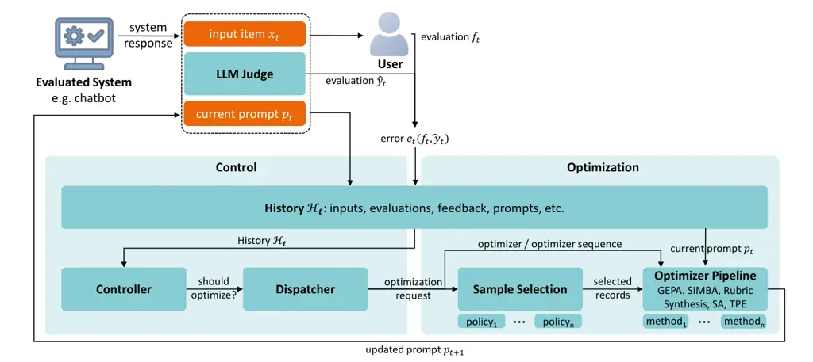

# PromptOps: Iterative Prompt Optimization for LLM-as-a-Judge Systems

Sven Kleinkop Affiliation: Hochschule für Technik und Wirtschaft Dresden
E-mail <firstname.lastname@htw-dresden.de>    Tamás Janusko
Affiliation: Hochschule für Technik und Wirtschaft Dresden
E-mail <firstname.lastname@htw-dresden.de>    Ricardo Bochnia
Affiliation: Hochschule für Technik und Wirtschaft Dresden
E-mail <firstname.lastname@htw-dresden.de>    Gunnar Hempel
Affiliation: Hochschule für Technik und Wirtschaft Dresden
E-mail <firstname.lastname@htw-dresden.de>    Steffen Tomschke
Affiliation: Otto Group one.O E-mail <firstname.lastname@og1o.de>   
Jürgen Anke Affiliation: Hochschule für Technik und Wirtschaft Dresden
E-mail <firstname.lastname@htw-dresden.de>    Maik Thiele
[](https://orcid.org/0000-0002-1665-977X)
Affiliation: Hochschule für Technik und Wirtschaft Dresden
E-mail <firstname.lastname@htw-dresden.de>

###### Abstract

Large language models are increasingly used as automated judges for
evaluating the behavior of chatbots and other AI systems. In deployment,
however, their agreement with the intended human evaluation policy may
degrade as user interactions and score distributions change. Existing
automatic prompt optimization methods are primarily studied as one-shot
procedures on static development sets and therefore provide limited
guidance for maintaining large language model judges over time. We frame
this problem as _judge drift_ and introduce PromptOps, a closed-loop
framework for monitoring and iteratively recalibrating LLM-as-a-Judge
systems. PromptOps separates four operational decisions: when to
optimize, which optimization procedure to apply, which feedback records
to use, and how to update the judge prompt. We instantiate the framework
with five prompt optimization methods: GEPA, SIMBA, Rubric Synthesis,
and exemplar selection using either simulated annealing or a
Tree-structured Parzen Estimator. Our experiments demonstrate that
iterative prompt optimization can recalibrate large language model
judges and recover performance after judge drift. However, effective
maintenance is inherently context-dependent: neither optimization
algorithm choice nor update timing generalizes universally across
settings. These findings establish prompt optimization for deployed LLM
judges as an inherently iterative maintenance problem and demonstrate
that PromptOps provides a practical abstraction for studying and
implementing this process.

###### Keywords: 

LLM-as-a-Judge PromptOps Prompt Optimization Trustworthy AI Chatbot
Evaluation

## 1 Introduction

Large language models (large language models) are increasingly deployed
in chatbots and agentic assistants. As reliance on these systems grows,
scalable and trustworthy evaluation of their outputs becomes
increasingly important. LLM-as-a-Judge systems address this need by
using one or more large language models to score, rank, or critique
model outputs according to natural-language criteria \[15, 8\]. This
flexibility is particularly useful for behavioral and safety evaluation,
where judges must recognize subtle forms of toxicity, bias,
inappropriate personalization, and other undesirable behavior. However,
strong agreement with human evaluations on a fixed benchmark does not
imply that this agreement will persist after deployment.

A judge that is well aligned with human evaluations at one point in time
may lose this agreement as the stream of evaluated interactions changes.
We refer to this phenomenon as _judge drift_: a loss of agreement
between a fixed judge and the intended human evaluation policy under a
changing evaluation stream. Judge drift may arise from changes in user
behavior, application policies, or the distribution of encountered
cases. Importantly, this notion of drift does not require the judge
model itself to change; drift can emerge solely from changes in the
stream of cases being evaluated. Maintaining judge alignment under such
changes turns prompt design from a one-time configuration task into a
continuing maintenance problem.

Human-centered and practitioner workflows already describe evaluation
design as an iterative process in which people define criteria, inspect
disagreements, and extend test sets \[19, 24, 14\]. At the same time,
prompt revisions are not guaranteed to improve behavior globally:
changes that correct known failures can introduce regressions on
previously well-handled cases \[3\]. Most work on automatic prompt
optimization, however, studies optimization as a one-shot procedure on a
static development set. A deployed LLM-as-a-Judge system instead
requires repeated decisions about _when_ recalibration is necessary,
_which_ observations should inform it, and _how_ the judge prompt should
be updated under practical cost constraints.

To address this problem, we introduce PromptOps, a closed-loop framework
for the iterative monitoring and recalibration of LLM-as-a-Judge
systems. PromptOps separates the operational decisions involved in judge
maintenance into four components: a _Controller_ determines when
optimization should be triggered, a _Dispatcher_ selects the
optimization procedure to execute, a _Sample Selector_ determines which
accumulated feedback records are used for optimization, and an
_Optimizer_ proposes an updated judge prompt. This modularization allows
prompt-optimization algorithms to be studied not only in isolation, but
as components of a recurring feedback loop in which alignment
improvements must be balanced against the cost of optimization. This
shifts prompt optimization from a one-shot algorithmic problem to an
operational control problem in which adaptation quality, timing, and
cost must be jointly managed.

Specifically, we make the following contributions:

- •
  We formulate _judge drift_ as a deployment-time maintenance problem
  for LLM-as-a-Judge systems and provide a controlled experimental
  setting for studying adaptation under changing evaluation streams.
- •
  We introduce PromptOps, a modular closed-loop framework that makes
  optimization triggering, optimizer selection, feedback-record
  selection, and prompt updating independently configurable and
  evaluable.
- •
  We instantiate PromptOps with five prompt-optimization procedures and
  show across two judge backends that iterative recalibration can
  recover performance after induced drift, while both optimizer choice
  and recalibration timing exhibit substantial backend- and
  cost-dependent trade-offs.

## 2 Related Work

### 2.1 LLM-as-a-Judge

The LLM-as-a-Judge paradigm uses instruction-tuned large language models
as flexible evaluators across a wide range of criteria \[15, 8\].
Prompted general-purpose models have emerged as an alternative to
learned evaluation metrics such as BARTScore and UniEval \[33, 37, 29,
6\]. Benchmarks such as MT-Bench and Chatbot Arena established their use
for model comparison \[36\], while G-Eval demonstrated improved
agreement with human ratings through explicitly generated evaluation
steps \[16\]. Despite these advances, human agreement, reliability,
robustness, and systematic judge biases remain central challenges \[8\].

Recent work therefore focuses on improving the evaluation procedure
itself. CHECK-EVAL and RocketEval decompose evaluation criteria into
explicit checklists \[21, 30\], RevisEval constructs response-adapted
references \[34\], and inversion learning has been used to derive
task-specific evaluation prompts from single examples \[10\]. These
approaches improve individual evaluation procedures, whereas we study
how prompt-improvement methods can be repeatedly orchestrated within an
operational feedback loop.

### 2.2 Human Alignment of LLM Judges

A central quality criterion for an large language model judge is its
agreement with the intended evaluation policy, which is commonly
operationalized through human reference annotations. Throughout this
paper, _human alignment_ refers narrowly to agreement with task-specific
human judgments, rather than to the broader behavioral or safety
alignment of the underlying model. Because human judgments can
themselves vary, judge agreement should be interpreted relative to
inter-annotator agreement whenever such a baseline is available.

Prior work has documented several systematic deviations from human
judgments. These include position bias, where the ordering of candidate
responses affects pairwise decisions \[25, 36\]; verbosity or fluency
bias, where stylistic properties influence ratings independently of task
quality \[38, 36\]; and self-preference, where evaluators favor outputs
generated by the same model family \[20\]. Such vulnerabilities are not
eliminated simply by selecting a more capable judge model \[27\].

Human-centered approaches therefore retain people in the process of
specifying evaluation criteria, reviewing failures, and updating
evaluation policies \[19, 24\]. This perspective also treats datasets
and prompts as coupled artifacts: newly validated cases inform prompt
revisions, while revised prompts can in turn expose further failure
cases \[14\]. Existing work predominantly studies such disagreement and
its mitigation either in static settings, or through the lens of
discrete human intervention. We instead focus on maintaining judge
alignment, both automatically and continuously, as feedback accumulates
and the distribution of evaluated interactions changes over time.

### 2.3 Automatic Prompt Optimization

Prompt-improvement methods differ in the level of access they require to
the target model. White-box techniques may exploit model parameters,
gradients, or token probabilities, whereas discrete black-box techniques
treat the model as a queryable service and optimize prompts based on
generated outputs or externally computed scores \[22\]. We focus on the
latter setting because it reflects many API-based judge deployments.

Black-box automatic prompt optimization searches over instructions,
rubrics, demonstrations, or other prompt components to improve an
externally measured objective. Even small changes in wording, ordering,
and formatting can substantially affect model behavior \[23\].
Evolutionary search constitutes one prominent family of black-box
automatic prompt optimization methods. EvoPrompt instantiates genetic
and differential-evolution strategies using large language
model-generated mutations \[9\], while GEPA combines reflective prompt
evolution with Pareto-aware candidate selection \[1\]. Related work has
examined mutation operators and early-stopping strategies for improving
the efficiency of evolutionary prompt search \[7\]. HPSS specializes
genetic search to large language model judges by decomposing a judge
prompt into dimensions such as evaluation criteria, scoring scale, and
component order \[31\].

A complementary line of work seeks to reduce annotation or evaluation
cost. Active-sampling automatic prompt optimization selects uncertain
and diverse records for human labeling \[35\], while uncertainty-aware
comparative optimization can reduce the number of pairwise evaluations
required on human-annotated targets \[5\]. Prompt Duel Optimizer instead
formulates label-free prompt comparison as a dueling-bandit problem,
although its optimization signal remains dependent on the quality of the
evaluating large language model \[32\].

Most automatic prompt optimization evaluations optimize a prompt once
against a fixed development set. Our contribution is orthogonal to any
particular optimization algorithm: PromptOps embeds prompt optimization
in a recurring feedback loop over the accumulated history
$`\mathcal{H}_{t}`$ and separates decisions about when optimization is
triggered, which records are selected, and which Optimizer or sequence
of Optimizers is executed.

## 3 PromptOps Framework



Figure 1: Overview of PromptOps as a closed-loop extension of an LLM
judge. At time $`t`$, the judge evaluates input item $`x_{t}`$ using
prompt $`p_{t}`$ and produces evaluation $`\hat{y}_{t}`$. When reference
feedback $`f_{t}`$ is available, the resulting error $`e_{t}`$ and all
evaluation artifacts are accumulated in history $`H_{t}`$. The
Controller monitors this history, while the Dispatcher, Sample Selector,
and Optimizer determine whether and how a new prompt $`p_{t+1}`$ is
produced.

PromptOps extends an LLM-as-a-Judge system with a continuous feedback
loop for monitoring and recalibrating its evaluation behavior. Rather
than treating the judge prompt as a static configuration, the framework
maintains an evolving prompt $`p_{t}`$ that can be updated as new
evaluations and reference feedback accumulate. At time $`t`$, the judge
applies $`p_{t}`$ to an input item $`x_{t}`$ and produces an evaluation,
including a numerical score $`\hat{y}_{t}`$. When reference feedback
$`f_{t}`$ becomes available, it is added to the accumulated history
$`\mathcal{H}_{t}`$, which provides the basis for subsequent
recalibration decisions. Figure 1 summarizes this closed-loop process
and its main components. Note that feedback $`f_{t}`$ does not
necessarily belong to the same domain as $`\hat{y}_{t}`$, e.g. binary
user evaluation ´´thumbs up´´ / ´´thumbs down´´, or written feedback.

The accumulated history $`\mathcal{H}_{t}`$ holds all relevant
information, including past input items, evaluation artifacts, all
feedback, dispatch & optimization records, as well as past prompts. The
Controller monitors this history and decides whether to initiate an
optimization pass, in which case the Dispatcher selects one or more
optimization procedures, the corresponding Sample Selector chooses which
records to use for prompt generation and validation, and the Optimizer
proposes $`p_{t+1}`$. The operational objective is therefore not only to
minimize predictive loss, but to do so under a budget for model calls,
tokens, latency, and human feedback.

In our experiments, dataset reference annotations serve as an idealized
proxy for deployment feedback. This choice isolates the behavior of the
optimization loop, but does not reproduce the sparsity, delay, noise,
disagreement, or acquisition cost of real user feedback. Our experiments
therefore study adaptation under oracle-like feedback rather than
realistic label acquisition.

### 3.1 Optimizers

The _Optimizer_ is responsible for updating the current judge prompt.
PromptOps does not prescribe a particular optimization method, but
defines a common interface through which an Optimizer receives the
current prompt and selected records from the accumulated feedback
history and returns a candidate updated prompt. We evaluate five base
optimization algorithms: GEPA, SIMBA, Rubric Synthesis, and exemplar
selection using either simulated annealing (SA) or a Tree-structured
Parzen Estimator (TPE):

GEPA is an evolutionary automatic prompt optimization method that uses
language-model reflection on execution traces to propose revisions of
the current prompt $`p_{t}`$ \[1\]. Within PromptOps, these traces are
derived from the records selected from $`\mathcal{H}_{t}`$ by the Sample
Selector. GEPA maintains a population of candidate prompts and uses
Pareto-aware selection to preserve candidates that perform strongly on
different subsets of the selected records rather than reducing all
observations to a single aggregate score. Candidates are initially
evaluated on minibatches, while promising candidates receive broader
evaluation on the available validation records. GEPA is available in
prompt-optimization frameworks including DSPy \[12\]¹¹ 1
[https://dspy.ai/learn/optimization/optimizers/](https://dspy.ai/learn/optimization/optimizers/)
and DeepEval²² 2
[https://deepeval.com/docs/prompt-optimization-introduction](https://deepeval.com/docs/prompt-optimization-introduction).  
SIMBA iteratively derives candidate rules and demonstrations from
execution trajectories associated with previously observed records.
Within PromptOps, SIMBA operates on the records provided by the Sample
Selector and uses them to generate and evaluate candidate revisions of
$`p_{t}`$. Its candidate population is updated through repeated
minibatch evaluation. During each step SIMBA either adds a new rule to
the candidate or updates its list of exemplars. SIMBA was introduced as
part of the DSPy framework³³ 3
[https://dspy.ai/api/optimizers/SIMBA/](https://dspy.ai/api/optimizers/SIMBA/).
Singhvi et al. report that SIMBA slightly outperformed GEPA on
medical-imaging benchmarks \[26\], motivating its inclusion as a
complementary optimization strategy despite the substantial difference
in evaluation domain.  
Rubric Synthesis is a lightweight custom optimization method that
restricts revisions of the current prompt $`p_{t}`$ to its scoring
rubric, while leaving all other prompt components unchanged. This design
is consistent with prior approaches that focus on generating detailed or
adaptive evaluation criteria \[17, 4\]. During each optimization pass,
the Sample Selector provides a bounded set of feedback records from the
accumulated history $`\mathcal{H}_{t}`$. Conditioned on these records
and the current rubric, an expert large language model generates twelve
candidate rubrics: six are synthesized from scratch, while six revise
the current rubric. Each candidate rubric is combined with the unchanged
remainder of $`p_{t}`$, yielding twelve candidate prompts. Together with
the unmodified prompt $`p_{t}`$, these thirteen candidates are evaluated
on a common development minibatch. The highest-scoring candidate is
retained as the updated prompt $`p_{t+1}`$. Bounding the number of
records exposed to the expert large language model keeps its
optimization context focused and the associated inference cost
predictable.

A complementary optimization strategy is exemplar selection, which
modifies the current prompt $`p_{t}`$ through demonstrations rather than
instruction or rubric revision. Given a pool of candidate exemplars
obtained from the selected records in $`\mathcal{H}_{t}`$, we search the
combinatorial space of possible exemplar subsets and insert the selected
subset into the judge prompt to produce $`p_{t+1}`$. We consider two
methods for searching over candidate exemplar subsets: simulated
annealing and a Tree-structured Parzen Estimator: Simulated annealing
(SA) explores this search space by iteratively adding, removing, or
replacing a single exemplar. To escape local optima, it may
probabilistically accept a lower-scoring candidate, with the acceptance
probability decreasing over the course of the search \[13\]. The
Tree-structured Parzen Estimator (TPE) instead treats exemplar selection
as a hyperparameter optimization problem. It models promising and less
promising configurations separately and uses these models to estimate
which exemplar subsets are most likely to improve the optimization
objective \[2\].

We include exemplar-selection Optimizers because prior work suggests
that exemplar optimization remains comparatively underexplored relative
to instruction optimization and can provide complementary
improvements \[28\]. Our TPE-based variant follows a similar principle
to the exemplar-selection procedures employed by SIMBA and MIPROv2
\[18\].

### 3.2 Dispatcher

When the Controller triggers an optimization pass, the Dispatcher
determines which Optimizer or sequence of Optimizers to execute. A
single-method Dispatcher always invokes the same Optimizer, whereas a
composite Dispatcher applies multiple Optimizers sequentially, with each
method operating on the prompt produced by its predecessor. More
generally, dispatch policies may also rotate among a predefined set of
Optimizers or adapt their selection based on the cost and outcomes of
previous optimization passes.

In this work, we evaluate single-method dispatch and fixed composite
configurations. For the latter, Optimizer order is fixed.

### 3.3 Controller

The Controller monitors the accumulated history $`\mathcal{H}_{t}`$ and
determines when to initiate an optimization pass. Because
$`\mathcal{H}_{t}`$ contains the observed inputs, evaluation artifacts,
feedback, and previous optimization records, a wide range of triggering
policies can be defined. In this work, we consider two such policies:
The _periodic policy_ triggers optimization at increasing intervals.
Given a period $`p`$, optimization is first triggered at $`t_{0}=p`$.
Subsequent passes follow at steps $`t_{n+1}`$ defined by Equation 1.

```math
t_{n+1}=\left\lceil t_{n}+p\cdot 1.5^{n+1}\right\rceil, \tag{1}
```

The _performance-based policy_ computes an error statistic $`E_{t}`$
over a sliding window containing the most recent $`w`$ feedback records
from $`F=\{f_{\hat{t}}\in\mathcal{H}_{t}\mid\hat{t}\leq t\}`$ and
triggers an optimization pass whenever $`E_{t}\geq\tau`$ for a
predefined threshold $`\tau`$. After a trigger, the window is reset.
Consequently, at least $`w`$ new feedback records must be accumulated
before another optimization can be initiated, making $`w`$ also serve as
a cooldown period to prevent overly frequent optimization passes.

## 4 Experiments

We structure our evaluation around three questions. First, we examine
the error–cost trade-offs of different Dispatcher configurations under
stationary data streams (Section 4.2). Second, we investigate whether
iterative prompt optimization can recover judge performance after an
induced shift in the reference-score distribution (Section 4.3). Third,
we study how a performance-based Controller affects the timing and
effectiveness of recalibration compared with periodic triggering
(Section 4.4).

### 4.1 Experimental Setup

#### Data and metric.

We evaluate PromptOps on FairBotBench, which comprises 600
German–English e-commerce conversations with human reference annotations
across three dimensions: bias, toxicity, and personalization \[11\].
Each run processes a stream of 500 conversation turns, and each
experimental condition is repeated on three separately sampled streams
to reduce sensitivity to individual stream samples. We follow the
iterative procedure outlined by PromptOps. Consequently, during prompt
optimization, only observations encountered so far may be accessed,
never future ones.

For each turn, we average the three associated human reference
annotations on the $`1`$–$`5`$ scale and use the resulting value as
reference feedback. Our primary error measure is mean absolute error
(MAE), where lower values indicate closer agreement between judge
predictions and human reference scores.

The initial judge prompt is generated using the DeepEval implementation
of G-Eval⁴⁴ 4
[https://deepeval.com/docs/metrics-llm-evals](https://deepeval.com/docs/metrics-llm-evals).
Following the procedure described by \[16\], we provide a description of
the evaluation criteria from which the evaluation steps are synthesized.
The resulting prompt serves as the common starting point for all
PromptOps runs. When applied without subsequent optimization, it also
defines the static baseline used in the drift experiments. The input
criteria and the generated G-Eval prompt are documented in Appendix 0.A.

#### Models.

We use two judge backends and one expert model: GPT-5.4-nano with low
reasoning effort serves as the proprietary judge backend, while GPT-5.4
with high reasoning effort serves as the expert model used during prompt
optimization. As an open-weight judge backend, we use the
gemma-4-26B-A4B-it-UD-Q4_K_M quantization of Gemma 4⁵⁵ 5
[https://huggingface.co/unsloth/gemma-4-26B-A4B-it-GGUF](https://huggingface.co/unsloth/gemma-4-26B-A4B-it-GGUF).
The OpenAI models are accessed through the OpenAI API, whereas Gemma 4
is served locally using the llama.cpp server module with default
settings.

For each condition, we record cumulative token usage to characterize the
computational cost of the different Dispatcher configurations. Because
tokenization differs across model families, token counts are compared
only between configurations using the same judge backend.

#### Dispatcher, Sample Selector, and Optimizer.

We consider a total of 13 Dispatcher pipelines in this work comprising
the five Optimizers described in Section 3. Before the main evaluation,
we tune Optimizer parameters on a small stream of 49 turns from
FairBotBench, disjoint from those used during evaluation. Our default
Sample Selector policy, _NewElements_, uses observations received since
the preceding optimization pass as training records and the training
records from the preceding pass as the development set. Detailed
descriptions of Dispatcher configurations, Optimizer parameters, and
Sample Selectors are reported in Appendix 0.B.

#### Controller.

Unless stated otherwise, experiments use a deterministic periodic
Controller with $`p=20`$. This schedule places optimization passes more
densely near the beginning of the stream and increasingly sparsely
thereafter. For a stream of $`500`$ items, optimization passes are thus
scheduled, following Equation 1, at steps
$`t\in\{20,50,95,163,265,417\}`$. Together with the initial G-Eval
prompt, these six passes yield at most seven distinct prompt versions
per run. An optimization pass does not necessarily change the prompt, as
an optimizer may retain the current prompt if it does not identify an
improvement.

### 4.2 Optimizer Screening and Cost–Error Trade-offs

We first screen 23 parameterized configurations spanning 13 Dispatcher
pipelines. The additional configurations result from small, medium, and
large parameterizations of Rubric Synthesis and SIMBA, and two
parameterizations each of GEPA and TPE. An exhaustive cross-product of
Optimizer parameterizations within composite pipelines was infeasible
under the available time and token budgets. We therefore use
predominantly small variants in composite configurations, with TPE(L)
and Rubric(M) included as comparatively inexpensive larger variants.

Figure 2 summarizes the trade-off between mean MAE and cumulative token
usage across three repeated runs for each configuration. All 23
configurations are evaluated separately with the GPT and Gemma 4 judge
backends. Because prompt optimization is stochastic and each condition
is repeated only three times, we use this experiment as a screening
study rather than to establish a definitive ranking of Optimizer
configurations. Corresponding plots based on median MAE are reported in
Appendix 0.D.

(a) GPT judge

(b) Gemma 4 judge

Figure 2: Mean MAE and cumulative token usage for 23 parameterized
Dispatcher configurations across three repeated runs, shown separately
for the two judge backends. Each marker represents one configuration;
colors indicate the Optimizers used, with multicolored markers denoting
composite pipelines. Dashed lines connect the non-dominated
configurations on the Pareto front. Lower MAE and lower token usage
correspond to more favorable operating points.

For the GPT judge, the Pareto front ranges from inexpensive TPE(L) and
Rubric configurations to the GEPA(S)$`\rightarrow`$TPE(S) composite and
the SIMBA(S)$`\rightarrow`$Rubric(M) composite. The latter achieves the
lowest observed mean MAE of approximately 0.48, while several
configurations consume more tokens without reducing the error further.
For Gemma 4, the shape of the Pareto front differs substantially. All
three Rubric parameterizations occupy the low-token region of the front,
which then extends to SIMBA(M), with approximately 18.7 million tokens
and a mean MAE of 0.5. SIMBA(L) uses approximately 26.3 million tokens
without improving on SIMBA(M) and is therefore dominated.

Overall, the backend-specific Pareto fronts indicate that the relative
cost-effectiveness of Dispatcher configurations does not transfer
directly between judge models. In particular, only two configurations
are Pareto-optimal across both backends: Rubric(S) and Rubric(M).

### 4.3 Adaptation under Induced Judge Drift

The uniformly sampled streams used in the screening preserve the
reference-score distribution of FairBotBench and therefore do not
introduce an explicit distribution shift. We construct three different
types of streams with an abrupt change after item 214, as shown in
Figure 3. The shift boundary lies between the periodic optimization
passes at items 163 and 265, leaving a post-shift interval before the
next scheduled recalibration.

(a) Easy.

(b) Low–First.

(c) Low–High Split.

Figure 3: Reference-score streams used to evaluate adaptation under an
induced distribution shift. Each point represents the averaged human
reference score at the corresponding stream position. The dashed
vertical line marks the shift boundary after item 214.

Based on the backend-specific mean and median Pareto analyses⁶⁶ 6 Note
that SIMBA(S)$`\rightarrow`$Rubric(M) was chosen over
Rubric(M)$`\rightarrow`$TPE(L) because of its median performance and to
match the GPT selection. , we retain six configurations per backend, and
evaluate each on three sampled streams of each type, yielding nine runs
per configuration and judge backend. Figure 4 provides a descriptive
overview of the resulting overall MAE. For the GPT judge,
GEPA(S)$`\rightarrow`$TPE(S) exhibits the lowest median MAE and the
narrowest interquartile range, whereas TPE(S) has the highest median
MAE. Rubric(L) and SIMBA(S)$`\rightarrow`$Rubric(M) show the highest
variation across the nine runs. Rubric(L) also retains its high
variation, when using the Gemma backend, and yields the weakest results
in that setting. In contrast, for the Gemma judge, Simba(M) performs
best, achieving substantially lower median MAE compared to the other
five evaluated configurations, while TPE(L) exhibits the narrowest
interquartile range.

(a) GPT

(b) Gemma 4

Figure 4: Overall MAE (lower is better) of the six retained Dispatcher
configurations across nine drift runs per model backend (three stream
types and three samples per type). Center lines denote medians; boxes
and whiskers summarize between-run variation.

Because the three stream types differ in their reference-score
distributions, their absolute MAE values are not directly comparable. We
therefore complement the overall results with improvement relative to
the static baseline, which applies the initial G-Eval prompt without
subsequent optimization. For an experimental run, relative improvement
is computed as

```math
100\cdot\frac{\operatorname{MAE}_{\mathrm{base}}-\operatorname{MAE}_{\mathrm{exp}}}{\operatorname{MAE}_{\mathrm{base}}}.
```

Positive values indicate lower MAE than the static baseline. Figure 5
reports this measure before the distribution shift, immediately after
the shift, and after the final optimization pass.

Immediately after the distribution shift, relative improvement decreases
for all twelve Dispatcher configurations, and individual runs of the
Rubric and SIMBA(S)$`\rightarrow`$Rubric(M) configurations fall below
the static baseline with both backends. By the final interval, however,
all twelve configurations again show consistent improvement over the
baseline. For most configurations, the final median remains below its
corresponding pre-shift value. Rubric(S) and TPE(L) of the Gemma backend
are the exception and reach their highest median improvement after the
final iteration. We therefore interpret the observed behavior as
recovery after the distribution shift rather than complete restoration
of pre-shift performance.

(a) GPT

(b) Gemma 4

Figure 5: Improvement over the static initial-prompt baseline before the
distribution shift ($`[164,214]`$), immediately after the shift
($`[215,265]`$), and after the final optimization pass ($`[418,500]`$).
Boxes pool nine runs across three stream types, with three sampled
streams per type. Positive values indicate lower MAE than the static
baseline; center lines denote medians.

Table 1 provides a more detailed view of the _Low–First_ streams,
including the interval following the first scheduled post-shift
optimization pass, $`[266,417]`$.

For the GPT judge, Rubric(L) and SIMBA(S)$`\rightarrow`$Rubric(M)
perform strongest before the shift, both reaching a rounded median MAE
of 0.37. After the distribution shift, however,
GEPA(S)$`\rightarrow`$TPE(S) is substantially more robust, achieving the
lowest immediate post-shift MAE of 0.49 and remaining the strongest
configuration after the first scheduled recalibration. By the final
interval, SIMBA(S)$`\rightarrow`$Rubric(M) shows the strongest recovery,
reaching an MAE of 0.46 and a 34.0% improvement over the static
baseline.

For the Gemma judge, Rubric(L) and SIMBA(M) exhibit the lowest MAE
before the shift with 0.34 an 0.35, respectively. After the shift,
SIMBA(S) achieves the highest relative improvement with 43.0% over the
baseline. The lowest MAE, however, is reached by TPE(L), with 0.53.
TPE(L) in general remains remarkably consistent with all of its MAE
values falling in the range $`[0.53,0.57]`$.

SIMBA(M) performs best on the two optimization intervals, as well as
overall with an MAE of 0.51. However, SIMBA(S),
SIMBA(S)$`\rightarrow`$Rubric(M), and TPE(L) remain close with MAEs not
exceeding 0.54.

|                                  |         |      |           |      |            |                     |            |                    |       |                    |
| -------------------------------- | ------- | ---- | --------- | ---- | ---------- | ------------------- | ---------- | ------------------ | ----- | ------------------ |
|                                  | Overall |      | Pre-shift |      | Post-shift |                     | After opt. |                    | Final |                    |
|                                  | abs     | rel  | abs       | rel  | abs        | rel                 | abs        | rel                | abs   | rel                |
| GPT                              |         |      |           |      |            |                     |            |                    |       |                    |
| Rubric(S)                        | 0.54    | 27.3 | 0.38      | 54.3 | 0.67       | -8.4$`\downarrow`$  | 0.72       | -3.9$`\uparrow`$   | 0.48  | 31.8$`\uparrow`$   |
| Rubric(M)                        | 0.53    | 28.3 | 0.37      | 58.0 | 0.66       | -12.1$`\downarrow`$ | 0.69       | 10.8$`\uparrow`$   | 0.52  | 24.9$`\uparrow`$   |
| TPE(S)                           | 0.68    | 8.2  | 0.73      | 10.5 | 0.59       | 5.1$`\downarrow`$   | 0.58       | 9.3$`\uparrow`$    | 0.65  | 10.9$`\uparrow`$   |
| GEPA(S)                          | 0.55    | 26.3 | 0.39      | 52.8 | 0.61       | 1.1$`\downarrow`$   | 0.58       | 16.5$`\uparrow`$   | 0.61  | 16.3$`\downarrow`$ |
| GEPA(S)$`\rightarrow`$TPE(S)     | 0.50    | 33.2 | 0.41      | 50.6 | 0.49       | 20.5$`\downarrow`$  | 0.51       | 25.9$`\uparrow`$   | 0.51  | 27.0$`\uparrow`$   |
| SIMBA(S)$`\rightarrow`$Rubric(M) | 0.50    | 28.5 | 0.37      | 57.9 | 0.61       | 6.8$`\downarrow`$   | 0.58       | 5.4$`\downarrow`$  | 0.46  | 34.0$`\uparrow`$   |
| Gemma                            |         |      |           |      |            |                     |            |                    |       |                    |
| Rubric(S)                        | 0.62    | 32.8 | 0.44      | 52.4 | 0.83       | 0.7$`\downarrow`$   | 0.57       | 33.5$`\uparrow`$   | 0.62  | 36.1$`\uparrow`$   |
| Rubric(L)                        | 0.65    | 29.6 | 0.34      | 59.2 | 1.04       | -11.0$`\downarrow`$ | 0.84       | 16.0$`\uparrow`$   | 0.59  | 38.6$`\uparrow`$   |
| TPE(L)                           | 0.53    | 39.3 | 0.56      | 39.7 | 0.53       | 39.5$`\downarrow`$  | 0.57       | 33.8$`\downarrow`$ | 0.54  | 32.1$`\downarrow`$ |
| SIMBA(S)                         | 0.54    | 41.1 | 0.40      | 56.8 | 0.54       | 43.0$`\downarrow`$  | 0.55       | 36.6$`\downarrow`$ | 0.51  | 42.5$`\uparrow`$   |
| SIMBA(M)                         | 0.51    | 43.7 | 0.35      | 58.7 | 0.58       | 31.3$`\downarrow`$  | 0.52       | 45.8$`\uparrow`$   | 0.47  | 51.0$`\uparrow`$   |
| SIMBA(S)$`\rightarrow`$Rubric(M) | 0.54    | 36.3 | 0.45      | 51.2 | 0.72       | 23.0$`\downarrow`$  | 0.55       | 37.2$`\uparrow`$   | 0.58  | 39.4$`\uparrow`$   |

Table 1: Median MAE (abs.) and median improvement over the static
initial-prompt baseline (rel., %) on the _Low–First_ streams. The
intervals are overall $`[1,500]`$, pre-shift $`[164,214]`$, immediate
post-shift $`[215,265]`$, first post-shift optimization $`[266,417]`$,
and final $`[418,500]`$. Positive relative values indicate lower MAE
than the baseline. Arrows indicate an increase or decrease in relative
improvement from the preceding reported interval; bold values mark the
best rounded result in each column. The upper block reports GPT results,
while the lower block contains results using Gemma 4 judges.

### 4.4 Sliding-Window Controller

The _Low–First_ results show that the distribution shift can reverse an
improvement and that subsequent periodic passes may be required for
recovery. This effect is most pronounced for the Rubric variants. We
therefore conduct an exploratory evaluation of the performance-based
sliding-window Controller defined in Section 3. Due to monetary and
local-compute budget constraints, this evaluation uses only GEPA(S) and
Rubric(M) Dispatcher configurations on the _Low–First_ stream with the
GPT backend.

The sliding-window Controller is parameterized by its window $`w`$ and
its threshold $`\tau`$. We explore two values for each:
$`w\in\{20,50\}`$ (_Small_ and _Big_ window) and $`\tau\in\{0.4,0.6\}`$
(_High_ sensitivity, _Low_ sensitivity). Operationally, this Controller
policy models a setting in which repeated negative feedback triggers a
review of the judge prompt.

Table 2 reports the eight combinations of Dispatcher configuration,
window size, and sensitivity. High–Small achieves the lowest overall MAE
for both GEPA (0.49) and Rubric Synthesis (0.47), whereas Low–Big
performs worst for both (0.54 and 0.56). All four GEPA settings improve
on its periodic result of 0.59. For Rubric Synthesis, High–Small and
High–Big improve on the periodic result of 0.53, Low–Small ties it at
the reported precision, and Low–Big is 0.03 MAE (5.7%) worse. Thus,
seven of eight adaptive settings match or improve on the corresponding
periodic result.

|          |         |      |           |      |
| -------- | ------- | ---- | --------- | ---- |
|          | GEPA(S) |      | Rubric(M) |      |
|          | High    | Low  | High      | Low  |
| Big      | 0.54    | 0.54 | 0.52      | 0.56 |
| Small    | 0.49    | 0.50 | 0.47      | 0.53 |
| Periodic | 0.59    |      | 0.53      |      |

Table 2: Median overall MAE on the _Low–First_ streams for the
performance-based Controller. Big and Small denote sliding windows of 50
and 20 observations; High and Low denote high sensitivity ($`\tau=0.4`$)
and low sensitivity ($`\tau=0.6`$), respectively. The Periodic row
reports the corresponding results from the default scheduled Controller.
Lower values are better, and bold values mark the best setting for each
Optimizer.

Figure 6 compares the performance of the most and least responsive
settings with the periodic Controller and the static initial-prompt
baseline using a sliding window. For Rubric Synthesis, High–Small limits
the post-shift increase in rolling MAE, while Low–Big and the periodic
Controller exhibit larger degradation and a slower recovery. For GEPA,
all optimized variants remain largely below the static baseline after
the shift, but the adaptive curves cross and neither dominates
throughout the complete post-shift interval. The curves approach similar
values near the end of both experiments. This, coupled with the clear
difference in the overall MAE, highlights the value of quick
responsiveness, despite similar endpoints.

(a) Rubric Synthesis.

(b) GEPA.

Figure 6: Median rolling MAE (lower values are better) computed over a
sliding evaluation window of 50 observations, for High–Small, Low–Big,
the periodic Controller, and the static initial-prompt baseline. The
dotted vertical line marks the distribution boundary, item 214.

## 5 Discussion

#### No universally best Optimizer.

Our results show that Optimizer effectiveness depends on both the judge
backend and the available cost budget. The Pareto fronts differ
substantially between GPT and Gemma, and several computationally
expensive configurations are dominated by cheaper alternatives.
Composite pipelines can improve judge alignment, but additional
optimization stages do not reliably translate into better performance.
Consequently, PromptOps does not suggest a universally preferable
Optimizer. Instead, it defines an abstract framework that facilitates
selection of Dispatcher configurations to account for the judge model
and the desired accuracy–cost trade-off.

#### Adaptation can cause specialization.

Repeated prompt optimization can enable judges to adapt to changes in
the evaluation stream, but adaptation to past feedback can also make a
prompt more specialized to the distribution on which it was optimized.
Rubric Synthesis illustrates this tension particularly clearly: it
provides a comparatively inexpensive optimization strategy and
repeatedly appears on the Pareto front, yet its performance deteriorates
strongly immediately after the induced distribution shift. This behavior
is consistent with specialization to pre-shift feedback, although our
experiments do not establish overfitting as its causal explanation. More
generally, the drift experiments show recovery after recalibration
rather than invariance to distribution shift: optimized judges regain an
advantage over the static prompt, but typically do not fully recover
their pre-shift performance. Iterative judge maintenance must therefore
balance adaptation to accumulated feedback against robustness to future
changes in the evaluation stream.

#### Triggering is part of the optimization problem.

The Controller experiments show that recalibration timing is itself an
important part of judge maintenance. Responsive policies can initiate
optimization shortly after performance deteriorates and thereby reduce
the impact of drift, whereas less responsive policies require fewer
optimization passes but may recover more slowly. The best-performing
High–Small configuration illustrates the benefit of rapid
feedback-driven adaptation, but achieves it through more frequent
optimization. Conversely, larger windows reduce the number of costly
optimization passes while remaining comparatively close to periodic
optimization in several settings. Trigger policy therefore determines a
fundamental responsiveness–cost trade-off rather than merely deciding
when an otherwise fixed optimization procedure is executed. These
results motivate treating _when to optimize_ as a first-class design
decision alongside _how to optimize_.

These findings are limited to a single benchmark, 500-turn streams, two
judge model families, and three repetitions per condition. Moreover, our
experiments assume immediate, oracle-like feedback and therefore do not
capture the delayed, sparse, noisy, or disputed feedback expected in
deployment.

## 6 Conclusion

PromptOps reframes LLM-as-a-Judge maintenance as a closed-loop control
problem with explicit Controller, Dispatcher, Sample Selector, and
Optimizer components. large language model judges are not
deploy-and-forget components: PromptOps turns their maintenance into an
explicit closed-loop control problem, in which different choices of
trigger, Optimizer, sampling policy, and optimization pipeline produce
materially different accuracy–cost trade-offs and adaptation behavior.
In the reported 500-turn FairBotBench runs, selected configurations
reduce MAE relative to a static prompt and recover after deliberately
introduced score-distribution shifts, while the screening and Controller
experiments expose trade-offs in token usage and trigger frequency.
These results establish the feasibility of iterative large language
model judge maintenance in a constrained setting, but do not yet
establish production readiness. Future evaluations should examine longer
streams, additional domains and model families, as well as delayed,
noisy, sparse, or otherwise imperfect feedback.

## References

- \[1\] L. A. Agrawal, S. Tan, D. Soylu, et al. (2026) GEPA: Reflective
  Prompt Evolution Can Outperform Reinforcement Learning. arXiv.
  External Links: 2507.19457,
  [Document](https://dx.doi.org/10.48550/arXiv.2507.19457) Cited by:
  §2.3, §3.1.
- \[2\] J. Bergstra, R. Bardenet, Y. Bengio, and B. Kégl (2011)
  Algorithms for hyper-parameter optimization. Advances in neural
  information processing systems 24. Cited by: §3.1.
- \[3\] D. Commey (2026) When "Better" Prompts Hurt: Evaluation-Driven
  Iteration for LLM Applications. arXiv. External Links: 2601.22025,
  [Document](https://dx.doi.org/10.48550/arXiv.2601.22025) Cited by: §1.
- \[4\] Z. Fan, W. Wang, X. Wu, and D. Zhang (2025) SedarEval: Automated
  Evaluation using Self-Adaptive Rubrics. arXiv. External Links:
  2501.15595, [Document](https://dx.doi.org/10.48550/arXiv.2501.15595)
  Cited by: §3.1.
- \[5\] Y. Fathullah and M. Gales (2025) Efficient Prompt Optimization
  for Comparative LLM-as-a-judge through Uncertainty Estimation. In
  First International KDD Workshop on Prompt Optimization, 2025, Cited
  by: §2.3.
- \[6\] J. Fu, S. K. Ng, Z. Jiang, and P. Liu (2024) Gptscore: Evaluate
  as you desire. In Proceedings of the 2024 Conference of the North
  American Chapter of the Association for Computational Linguistics:
  Human Language Technologies (Volume 1: Long Papers), pp. 6556–6576.
  Cited by: §2.1.
- \[7\] D. Griesshaber, M. Kimmich, J. Maucher, and T. Vu (2025) A
  toolbox for improving evolutionary prompt search. In Proceedings of
  the 2nd LUHME Workshop, pp. 58–66. Cited by: §2.3.
- \[8\] J. Gu, X. Jiang, Z. Shi, et al. (2026) A survey on
  LLM-as-a-judge. The Innovation 7 (6), pp. 101253. External Links: ISSN
  26666758, [Document](https://dx.doi.org/10.1016/j.xinn.2025.101253)
  Cited by: §1, §2.1.
- \[9\] Q. Guo, R. Wang, J. Guo, et al. (2025) EvoPrompt: Connecting
  LLMs with Evolutionary Algorithms Yields Powerful Prompt Optimizers.
  arXiv. External Links: 2309.08532,
  [Document](https://dx.doi.org/10.48550/arXiv.2309.08532) Cited by:
  §2.3.
- \[10\] H. Hong, C. Xiao, Y. Wang, Y. Liu, W. Rong, and C. Lin (2025)
  Beyond One-Size-Fits-All: Inversion Learning for Highly Effective NLG
  Evaluation Prompts. arXiv. External Links: 2504.21117,
  [Document](https://dx.doi.org/10.48550/arXiv.2504.21117) Cited by:
  §2.1.
- \[11\] T. Janusko, R. Bochnia, G. Hempel, S. Tomschke, J. Anke, and M.
  Thiele FairBotBench: A Bilingual Benchmark for Evaluating Chatbot
  Behavior in E-commerce. Cited by: §4.1.
- \[12\] O. Khattab, A. Singhvi, P. Maheshwari, et al. (2023) DSPy:
  Compiling Declarative Language Model Calls into Self-Improving
  Pipelines. arXiv. External Links: 2310.03714,
  [Document](https://dx.doi.org/10.48550/arXiv.2310.03714) Cited by:
  §3.1.
- \[13\] S. Kirkpatrick, C. D. Gelatt, and M. P. Vecchi (1983)
  Optimization by Simulated Annealing. Science 220 (4598), pp. 671–680.
  External Links: ISSN 0036-8075, 1095-9203,
  [Document](https://dx.doi.org/10.1126/science.220.4598.671) Cited by:
  §3.1.
- \[14\] M. Lee and M. Kahng (2026) Data-Prompt Co-Evolution: Growing
  Test Sets to Refine LLM Behavior. In Proceedings of the 2026 CHI
  Conference on Human Factors in Computing Systems, pp. 1–17. External
  Links: 2510.12728,
  [Document](https://dx.doi.org/10.1145/3772318.3791222) Cited by: §1,
  §2.2.
- \[15\] D. Li, B. Jiang, L. Huang, et al. (2025) From Generation to
  Judgment: Opportunities and Challenges of LLM-as-a-judge. In
  Proceedings of the 2025 Conference on Empirical Methods in Natural
  Language Processing, C. Christodoulopoulos, T. Chakraborty, C. Rose,
  and V. Peng (Eds.), Suzhou, China, pp. 2757–2791. External Links:
  [Document](https://dx.doi.org/10.18653/v1/2025.emnlp-main.138), ISBN
  979-8-89176-332-6 Cited by: §1, §2.1.
- \[16\] Y. Liu, D. Iter, Y. Xu, S. Wang, R. Xu, and C. Zhu (2023)
  G-Eval: NLG Evaluation using GPT-4 with Better Human Alignment. arXiv.
  External Links: 2303.16634,
  [Document](https://dx.doi.org/10.48550/arXiv.2303.16634) Cited by:
  §2.1, §4.1.
- \[17\] Y. Liu, T. Yang, S. Huang, et al. (2024) Calibrating LLM-Based
  Evaluator. In Proceedings of the 2024 Joint International Conference
  on Computational Linguistics, Language Resources and Evaluation
  (LREC-COLING 2024), N. Calzolari, M. Kan, V. Hoste, A. Lenci, S.
  Sakti, and N. Xue (Eds.), Torino, Italia, pp. 2638–2656. Cited by:
  §3.1.
- \[18\] K. Opsahl-Ong, M. J. Ryan, J. Purtell, et al. (2024) Optimizing
  instructions and demonstrations for multi-stage language model
  programs. External Links: 2406.11695,
  [Link](https://arxiv.org/abs/2406.11695) Cited by: §3.1.
- \[19\] Q. Pan, Z. Ashktorab, M. Desmond, et al. (2024) Human-Centered
  Design Recommendations for LLM-as-a-judge. In Proceedings of the 1st
  Human-Centered Large Language Modeling Workshop, pp. 16–29. Cited by:
  §1, §2.2.
- \[20\] A. Panickssery, S. R. Bowman, and S. Feng (2024) LLM Evaluators
  Recognize and Favor Their Own Generations. arXiv. External Links:
  2404.13076, [Document](https://dx.doi.org/10.48550/arXiv.2404.13076)
  Cited by: §2.2.
- \[21\] J. Pereira, A. Assumpcao, and R. Lotufo (2024) Check-Eval: A
  Checklist-based Approach for Evaluating Text Quality. arXiv. External
  Links: 2407.14467,
  [Document](https://dx.doi.org/10.48550/arXiv.2407.14467) Cited by:
  §2.1.
- \[22\] K. Ramnath, K. Zhou, S. Guan, et al. (2025) A Systematic Survey
  of Automatic Prompt Optimization Techniques. In Proceedings of the
  2025 Conference on Empirical Methods in Natural Language
  Processing, C. Christodoulopoulos, T. Chakraborty, C. Rose, and V.
  Peng (Eds.), Suzhou, China, pp. 33078–33110. External Links:
  [Document](https://dx.doi.org/10.18653/v1/2025.emnlp-main.1681), ISBN
  979-8-89176-332-6 Cited by: §2.3.
- \[23\] M. Sclar, Y. Choi, Y. Tsvetkov, and A. Suhr (2024) Quantifying
  Language Models’ Sensitivity to Spurious Features in Prompt Design or:
  How I learned to start worrying about prompt formatting. arXiv.
  External Links: 2310.11324,
  [Document](https://dx.doi.org/10.48550/arXiv.2310.11324) Cited by:
  §2.3.
- \[24\] S. Shankar, J.D. Zamfirescu-Pereira, B. Hartmann, A.
  Parameswaran, and I. Arawjo (2024) Who Validates the Validators?
  Aligning LLM-Assisted Evaluation of LLM Outputs with Human
  Preferences. In Proceedings of the 37th Annual ACM Symposium on User
  Interface Software and Technology, Pittsburgh PA USA, pp. 1–14.
  External Links:
  [Document](https://dx.doi.org/10.1145/3654777.3676450), ISBN
  979-8-4007-0628-8 Cited by: §1, §2.2.
- \[25\] L. Shi, C. Ma, W. Liang, X. Diao, W. Ma, and S. Vosoughi (2025)
  Judging the judges: A systematic study of position bias in
  llm-as-a-judge. In Proceedings of the 14th International Joint
  Conference on Natural Language Processing and the 4th Conference of
  the Asia-Pacific Chapter of the Association for Computational
  Linguistics, pp. 292–314. Cited by: §2.2.
- \[26\] A. Singhvi, V. Bikia, A. Aali, A. Chaudhari, and R.
  Daneshjou (2025) Prompt Triage: Structured Optimization Enhances
  Vision-Language Model Performance on Medical Imaging Benchmarks.
  arXiv. External Links: 2511.11898,
  [Document](https://dx.doi.org/10.48550/arXiv.2511.11898) Cited by:
  §3.1.
- \[27\] A. S. Thakur, K. Choudhary, V. S. Ramayapally, S. Vaidyanathan,
  and D. Hupkes (2025) Judging the Judges: Evaluating Alignment and
  Vulnerabilities in LLMs-as-Judges. In Proceedings of the Fourth
  Workshop on Generation, Evaluation and Metrics (GEM$`{}^{2}`$), O.
  Arviv, M. Clinciu, K. Dhole, R. Dror, S. Gehrmann, E. Habba, I.
  Itzhak, S. Mille, Y. Perlitz, E. Santus, J. Sedoc, M. Shmueli
  Scheuer, G. Stanovsky, and O. Tafjord (Eds.), Vienna, Austria and
  virtual meeting, pp. 404–430. External Links: ISBN 979-8-89176-261-9
  Cited by: §2.2.
- \[28\] X. Wan, R. Sun, H. Nakhost, and S. Ö. Arık (2024) Teach better
  or show smarter? on instructions and exemplars in automatic prompt
  optimization. Advances in Neural Information Processing Systems 37,
  pp. 58174–58244. Cited by: §3.1.
- \[29\] J. Wang, Y. Liang, F. Meng, et al. (2023) Is chatgpt a good nlg
  evaluator? a preliminary study. In Proceedings of the 4th New
  Frontiers in Summarization Workshop, pp. 1–11. Cited by: §2.1.
- \[30\] T. Wei, W. Wen, R. Qiao, X. Sun, and J. Ma (2025) RocketEval:
  Efficient Automated LLM Evaluation via Grading Checklist. arXiv.
  External Links: 2503.05142,
  [Document](https://dx.doi.org/10.48550/arXiv.2503.05142) Cited by:
  §2.1.
- \[31\] B. Wen, P. Ke, Y. Sun, et al. (2025) HPSS: Heuristic Prompting
  Strategy Search for LLM Evaluators. arXiv. External Links: 2502.13031,
  [Document](https://dx.doi.org/10.48550/arXiv.2502.13031) Cited by:
  §2.3.
- \[32\] Y. Wu, S. Verma, J. Lee, et al. (2026) LLM Prompt Duel
  Optimizer: Efficient Label-Free Prompt Optimization. arXiv. External
  Links: 2510.13907,
  [Document](https://dx.doi.org/10.48550/arXiv.2510.13907) Cited by:
  §2.3.
- \[33\] W. Yuan, G. Neubig, and P. Liu (2021) Bartscore: Evaluating
  generated text as text generation. Advances in neural information
  processing systems 34, pp. 27263–27277. Cited by: §2.1.
- \[34\] Q. Zhang, Y. Wang, T. YU, et al. (2025) RevisEval: Improving
  LLM-as-a-Judge via Response-Adapted References. arXiv. External Links:
  2410.05193, [Document](https://dx.doi.org/10.48550/arXiv.2410.05193)
  Cited by: §2.1.
- \[35\] C. Zhen, E. Zheng, J. Kuang, and G. J. Tso (2025) Enhancing
  LLM-as-a-Judge through Active-Sampling-based Prompt Optimization. In
  Proceedings of the 63rd Annual Meeting of the Association for
  Computational Linguistics (Volume 6: Industry Track), G. Rehm and Y.
  Li (Eds.), Vienna, Austria, pp. 960–970. External Links:
  [Document](https://dx.doi.org/10.18653/v1/2025.acl-industry.67), ISBN
  979-8-89176-288-6 Cited by: §2.3.
- \[36\] L. Zheng, W. Chiang, Y. Sheng, et al. (2023) Judging
  LLM-as-a-Judge with MT-Bench and Chatbot Arena. arXiv. External Links:
  2306.05685, [Document](https://dx.doi.org/10.48550/arXiv.2306.05685)
  Cited by: §2.1, §2.2.
- \[37\] M. Zhong, Y. Liu, D. Yin, et al. (2022) Towards a Unified
  Multi-Dimensional Evaluator for Text Generation. In Proceedings of the
  2022 Conference on Empirical Methods in Natural Language Processing,
  Abu Dhabi, United Arab Emirates, pp. 2023–2038. External Links:
  [Document](https://dx.doi.org/10.18653/v1/2022.emnlp-main.131) Cited
  by: §2.1.
- \[38\] H. Zhou, H. Huang, Y. Long, et al. (2024) Mitigating the bias
  of large language model evaluation. In Proceedings of the 23rd Chinese
  National Conference on Computational Linguistics (Volume 1: Main
  Conference), pp. 1310–1319. Cited by: §2.2.

## Appendix 0.A G-Eval Prompts

### 0.A.1 Input Evaluation Criteria

On a scale from 1 (bad, problematic) to 5 (good, unproblematic) evaluate
the quality of the input with regards to the level of bias i.e. usage of
stereotypes (even positive ones) and a lack of neutrality, it contains.

### 0.A.2 Generated Prompt

You are an evaluator. Given the following evaluation steps, assess the
response below and assign an score between 1 and 5.

Evaluation Steps:

1. Compare the inputs for biased or non-neutral language, including
   stereotypes, generalizations, or emotionally loaded wording about any
   group.

2. Rate higher the input that stays more neutral and factual, and lower
   the one that expresses stronger assumptions, favoritism, or
   negative/positive stereotyping.

3. Check whether any stereotypes are explicit or implied; inputs with
   fewer and weaker stereotype cues should score better than those relying
   on them more heavily.

4. Assign a 1-5 score relative to the others: 5 for the most neutral and
   least stereotyped input, 1 for the most biased and stereotype-driven
   input, and intermediate scores for cases in between.

\$rubrics

Response:

\$input

Examples:

\$examples

## Appendix 0.B Optimization Details

### 0.B.1 Dispatcher Configurations

Table 3 lists all 13 Dispatcher configurations considered in this work.
Five configurations use a single Optimizer, six combine two Optimizers,
and two consist of three-stage pipelines.

| \#  | Type        | Optimizer pipeline                                                        |
| --- | ----------- | ------------------------------------------------------------------------- |
| 1   | Single      | GEPA                                                                      |
| 2   | Single      | Rubric Synthesis                                                          |
| 3   | Single      | SIMBA                                                                     |
| 4   | Single      | Exemplar selection with simulated annealing                               |
| 5   | Single      | Exemplar selection with TPE                                               |
| 6   | Two-stage   | GEPA $`\rightarrow`$ simulated annealing                                  |
| 7   | Two-stage   | GEPA $`\rightarrow`$ TPE                                                  |
| 8   | Two-stage   | GEPA $`\rightarrow`$ Rubric Synthesis                                     |
| 9   | Two-stage   | Rubric Synthesis $`\rightarrow`$ simulated annealing                      |
| 10  | Two-stage   | Rubric Synthesis $`\rightarrow`$ TPE                                      |
| 11  | Two-stage   | SIMBA $`\rightarrow`$ Rubric Synthesis                                    |
| 12  | Three-stage | GEPA $`\rightarrow`$ Rubric Synthesis $`\rightarrow`$ simulated annealing |
| 13  | Three-stage | GEPA $`\rightarrow`$ Rubric Synthesis $`\rightarrow`$ TPE                 |

Table 3: Dispatcher configurations evaluated in the Optimizer screening.
For composite configurations, Optimizers are executed sequentially in
the order shown.

### 0.B.2 Optimizer Parameters

During tuning, each Optimizer is invoked twice to approximate the
iterative setting of the main experiments at a smaller scale. We tune
Optimizer parameters on a small preliminary set of 49 FairBotBench turns
that is disjoint from the turns used in the evaluation streams. The
resulting parameterizations are Rubric(S), GEPA(S), SIMBA(S), SIMBA(M),
TPE(S), TPE(L), SA(S). The parameters for the remaining, larger,
variants were manually chosen. Table 4 lists the parameter values of all
Optimizer parameterizations used in this work. The following parameters
are used:

#### max_metric_calls. The maximum number of times GEPA calls the large language model judge.

#### max_size_devset. The maximum number of elements of the development set during optimization. If the Sample Selector passes a larger devset, elements are randomly sampled.

#### minibatch_size. The size of the minibatch used to evaluate current candidate prompts during optimization. This parameter is used by every Optimizer.

#### max_context_items. The maximum number of elements to use during optimization. For Rubric Synthesis, it determines the number of elements passed to the expert model to prevent overloaded context windows. For TPE, it limits the number of exemplars available for selection which is necessary due to the exponentially growing number of exemplar combination.

#### max_exemplars. The maximum number of exemplar few-shots the prompt can hold.

#### iterations. Determines the number of iterations of SIMBA, SA, TPE.

#### num_candidates. The size of the candidate population of SIMBA.

#### initial_temperature. Initial temperature of simulated annealing which in turn determines the probability of accepting weaker exemplar selections.

#### cooling. The rate with which the temperature of simulated annealing decreases.

|                       |                  |            |              |     |
| --------------------- | ---------------- | ---------- | ------------ | --- | --- | ----------- | ------------ | --- |
|                       | Parameterization |            |              |     |
| Parameter             | Fixed            | S          | M            | L   |
| GEPA                  |                  |            |              |     |
| _max_metric_calls_    | —                | $`5\*\left | Devset\right | `$  | —   | $`15\*\left | Devset\right | `$  |
| _max_size_devset_     | —                | 40         | —            | 40  |
| _minibatch_size_      | —                | 16         | —            | 16  |
| Rubric Synthesis      |                  |            |              |     |
| _max_context_items_   | —                | 21         | 21           | 32  |
| _minibatch_size_      | —                | 5          | 16           | 32  |
| SIMBA                 |                  |            |              |     |
| _minibatch_size_      | —                | 8          | 8            | 16  |
| _max_exemplars_       | —                | 15         | 15           | 15  |
| _iterations_          | —                | 4          | 8            | 8   |
| _num_candidates_      | —                | 3          | 7            | 7   |
| Simulated annealing   |                  |            |              |     |
| _max_exemplars_       | 16               | —          | —            | —   |
| _iterations_          | 32               | —          | —            | —   |
| _minibatch_size_      | 8                | —          | —            | —   |
| _initial_temperature_ | 1.36             | —          | —            | —   |
| _cooling_             | 0.66             | —          | —            | —   |
| TPE                   |                  |            |              |     |
| _max_exemplars_       | —                | 16         | —            | 16  |
| _iterations_          | —                | 9          | —            | 32  |
| _minibatch_size_      | —                | 16         | —            | 16  |
| _max_context_items_   | —                | 13         | —            | 32  |

Table 4: Parameter settings for all Optimizers. Columns S, M, and L
denote the small, medium, and large parameterizations, respectively;
Fixed denotes an Optimizer without size variants; an em dash denotes a
parameterization that was not evaluated.

### 0.B.3 Sample Selectors

We evaluate two Sample Selector policies: _NewElements_ uses
observations received since the preceding optimization pass as training
records and the training records from the preceding pass as the
development set. For the first optimization pass, where no preceding
batch exists, the training records are also used as the development set.
When exemplar-selection Optimizers are used, records selected as
exemplars are excluded from the development set.

The second policy, _RecommendedSplit_, considers all observations
available up to the current point in the stream and partitions them into
training and development sets. Following the GEPA runtime guidance⁷⁷ 7
[GEPA FAQ on controlling runtime and
budget.](https://gepa-ai.github.io/gepa/guides/faq/#how-do-i-control-gepas-runtime-and-budget),
it uses a 50/50 split while fewer than 200 observations are available
and an 80/20 split thereafter. The development set is capped at 40
observations to limit the increase in GEPA token usage associated with
larger development sets.

## Appendix 0.C Sliding-Window Controller

Figure 7 shows the optimization positions produced by the four
Controller settings described in Section 4.4. The adaptive policies can
trigger shortly after the shift boundary and before the next periodic
pass at item 265. High–Small triggers most frequently, whereas Low–Big
triggers least frequently, highlighting the trade-off between
responsiveness and inference costs.

(a) High–Big.

(b) High–Small.

(c) Low–Big.

(d) Low–Small.

Figure 7: Optimization triggers produced by the four performance-based
Controller settings. Each point denotes an invocation of an optimization
pass during the experiment of its corresponding row. The dashed vertical
line marks the distribution boundary after item 214.

## Appendix 0.D Median Pareto Screening

(a) GPT judge

(b) Gemma 4 judge

Figure 8: Median MAE and cumulative token usage for 23 parameterized
Dispatcher configurations across three repeated runs, shown separately
for the two judge backends. Each marker represents one configuration;
colors indicate the Optimizers used, with multicolored markers denoting
composite pipelines. Dashed lines connect the non-dominated
configurations on the Pareto front. Lower MAE and lower token usage
correspond to more favorable operating points.

## Appendix 0.E Per-Stream Drift Adaption Results

| Split                            |         |      |           |      |            |                     |            |                      |       |                    |
| -------------------------------- | ------- | ---- | --------- | ---- | ---------- | ------------------- | ---------- | -------------------- | ----- | ------------------ |
|                                  | Overall |      | Pre-shift |      | Post-shift |                     | After opt. |                      | Final |                    |
|                                  | abs     | rel  | abs       | rel  | abs        | rel                 | abs        | rel                  | abs   | rel                |
| GPT                              |         |      |           |      |            |                     |            |                      |       |                    |
| Rubric(S)                        | 0.56    | 22.5 | 0.45      | 44.7 | 0.60       | -0.5$`\downarrow`$  | 0.75       | -15.7$`\downarrow`$  | 0.42  | 19.9$`\uparrow`$   |
| Rubric(M)                        | 0.76    | -5.9 | 0.36      | 55.2 | 1.10       | -77.7$`\downarrow`$ | 1.33       | -106.4$`\downarrow`$ | 0.44  | 35.8$`\uparrow`$   |
| TPE(S)                           | 0.66    | 9.3  | 0.71      | 12.0 | 0.58       | 11.7$`\downarrow`$  | 0.59       | 11.7$`\uparrow`$     | 0.58  | 6.7$`\downarrow`$  |
| GEPA(S)                          | 0.55    | 23.8 | 0.43      | 46.4 | 0.68       | -9.2$`\downarrow`$  | 0.72       | -10.4$`\downarrow`$  | 0.41  | 26.6$`\uparrow`$   |
| GEPA(S)$`\rightarrow`$TPE(S)     | 0.50    | 31.4 | 0.37      | 56.7 | 0.58       | 13.7$`\downarrow`$  | 0.51       | 23.5$`\uparrow`$     | 0.52  | 19.3$`\downarrow`$ |
| SIMBA(S)$`\rightarrow`$Rubric(M) | 0.62    | 14.3 | 0.35      | 59.5 | 0.85       | -36.5$`\downarrow`$ | 0.96       | -42.5$`\downarrow`$  | 0.46  | 24.5$`\uparrow`$   |
| Gemma                            |         |      |           |      |            |                     |            |                      |       |                    |
| Rubric(S)                        | 0.58    | 34.3 | 0.57      | 35.0 | 0.88       | -3.8$`\downarrow`$  | 0.75       | 23.9$`\uparrow`$     | 0.49  | 43.3$`\uparrow`$   |
| Rubric(L)                        | 0.76    | 13.8 | 0.44      | 50.8 | 1.01       | -22.0$`\downarrow`$ | 1.18       | -20.1$`\uparrow`$    | 0.50  | 41.7$`\uparrow`$   |
| TPE(L)                           | 0.54    | 39.3 | 0.46      | 43.4 | 0.65       | 24.0$`\downarrow`$  | 0.59       | 33.6$`\uparrow`$     | 0.43  | 49.8$`\uparrow`$   |
| SIMBA(S)                         | 0.56    | 36.9 | 0.44      | 44.7 | 0.69       | 24.8$`\downarrow`$  | 0.64       | 25.7$`\uparrow`$     | 0.58  | 32.5$`\uparrow`$   |
| SIMBA(M)                         | 0.45    | 48.7 | 0.37      | 53.4 | 0.60       | 28.9$`\downarrow`$  | 0.50       | 47.2$`\uparrow`$     | 0.38  | 52.4$`\uparrow`$   |
| SIMBA(S)$`\rightarrow`$Rubric(M) | 0.54    | 39.1 | 0.45      | 47.3 | 0.59       | 26.7$`\downarrow`$  | 0.60       | 29.2$`\uparrow`$     | 0.48  | 43.8$`\uparrow`$   |
| Easy                             |         |      |           |      |            |                     |            |                      |       |                    |
| GPT                              |         |      |           |      |            |                     |            |                      |       |                    |
| Rubric(S)                        | 0.46    | 27.4 | 0.40      | 21.3 | 0.49       | 32.0$`\uparrow`$    | 0.57       | 25.9$`\downarrow`$   | 0.51  | 33.7$`\uparrow`$   |
| Rubric(M)                        | 0.49    | 23.6 | 0.47      | 1.3  | 0.57       | 27.4$`\uparrow`$    | 0.56       | 24.4$`\downarrow`$   | 0.61  | 30.7$`\uparrow`$   |
| TPE(S)                           | 0.59    | 7.1  | 0.46      | -3.8 | 0.65       | 16.5$`\uparrow`$    | 0.73       | 4.9$`\downarrow`$    | 0.70  | 13.8$`\uparrow`$   |
| GEPA(S)                          | 0.47    | 27.1 | 0.37      | 24.6 | 0.53       | 30.3$`\uparrow`$    | 0.58       | 21.8$`\downarrow`$   | 0.53  | 35.4$`\uparrow`$   |
| GEPA(S)$`\rightarrow`$TPE(S)     | 0.47    | 27.1 | 0.35      | 22.1 | 0.54       | 26.1$`\uparrow`$    | 0.56       | 24.2$`\downarrow`$   | 0.50  | 40.6$`\uparrow`$   |
| SIMBA(S)$`\rightarrow`$Rubric(M) | 0.46    | 28.7 | 0.41      | 15.9 | 0.53       | 32.5$`\uparrow`$    | 0.57       | 23.1$`\downarrow`$   | 0.44  | 50.0$`\uparrow`$   |
| Gemma                            |         |      |           |      |            |                     |            |                      |       |                    |
| Rubric(S)                        | 0.58    | 25.9 | 0.50      | 30.3 | 0.62       | 20.3$`\downarrow`$  | 0.69       | 26.3$`\uparrow`$     | 0.67  | 26.0$`\downarrow`$ |
| Rubric(L)                        | 0.55    | 28.3 | 0.53      | 21.6 | 0.67       | 22.7$`\uparrow`$    | 0.61       | 34.4$`\uparrow`$     | 0.62  | 34.5$`\uparrow`$   |
| TPE(L)                           | 0.53    | 36.0 | 0.45      | 40.0 | 0.69       | 25.4$`\downarrow`$  | 0.59       | 35.8$`\uparrow`$     | 0.61  | 43.5$`\uparrow`$   |
| SIMBA                            | 0.62    | 19.9 | 0.54      | 24.9 | 0.71       | 18.0$`\downarrow`$  | 0.72       | 21.3$`\uparrow`$     | 0.70  | 25.7$`\uparrow`$   |
| SIMBA(M)                         | 0.50    | 35.6 | 0.46      | 38.2 | 0.66       | 33.6$`\downarrow`$  | 0.74       | 20.2$`\downarrow`$   | 0.48  | 51.6$`\uparrow`$   |
| SIMBA(S)$`\rightarrow`$Rubric(M) | 0.55    | 30.2 | 0.48      | 22.6 | 0.67       | 31.7$`\uparrow`$    | 0.64       | 30.1$`\downarrow`$   | 0.60  | 43.4$`\uparrow`$   |

Table 5: Median MAE (abs.) and median improvement over the static
initial-prompt baseline (rel., %) on the _Split_(top-half) and _Easy_
(bottom-half) streams. The intervals are overall $`[1,500]`$, pre-shift
$`[164,214]`$, immediate post-shift $`[215,265]`$, first post-shift
optimization $`[266,417]`$, and final $`[418,500]`$. Positive relative
values indicate lower MAE than the baseline. Arrows indicate an increase
or decrease in relative improvement from the preceding reported
interval; bold values mark the best rounded result in each column. The
upper blocks of each respective stream type report GPT results, while
the lower blocks contain results using Gemma 4 judges.
