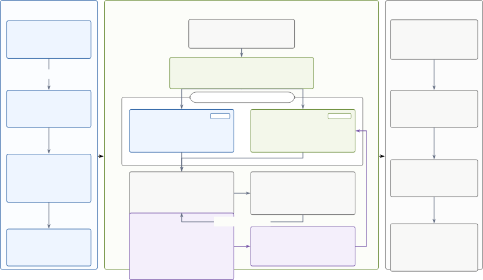

# FinEvolveKG: Controlled and Attributable Prompt Evolution for Financial Knowledge Graph Construction

Abhinav Arun Note: Both authors contributed equally to this research.
Affiliation: Domyn, New York, USA email: <abhinav.arun@domyn.com> ,
Jayita Bhattacharyya Affiliation: Domyn, Bengaluru, India email:
<jayita.bhattacharyya@domyn.com> , Fabrizio Dimino Affiliation: Domyn,
New York, USA email: <fabrizio.dimino@domyn.com> , Bhaskarjit Sarmah
Affiliation: Domyn, Gurugram, India email: <bhaskarjit.sarmah@domyn.com>
and Stefano Pasquali Affiliation: Domyn, New York, USA email:
<stefano.pasquali@domyn.com>

###### Abstract.

Financial institutions construct knowledge graphs (KGs) from shared SEC
10-Ks to serve risk analysis, portfolio management, and investment
research, whose analytical needs differ. Extraction must adapt to
evolving needs without fragmenting shared grounding, typing, and
temporal rules. Hand-authored persona prompts scale poorly, and
persona-specific fine-tuning adds cost. Weight-free prompt optimization
offers an alternative, but unconstrained evolution of a monolithic
prompt can rewrite shared rules alongside persona guidance, obscuring
changes and complicating review. To bound this change surface, we
introduce FinEvolveKG, a KG-construction harness that separates a
reusable general block from a persona-policy block and mechanically
confines GEPA, a reflective prompt optimizer, to the designated block.
During persona adaptation, the approved general block remains
byte-stable and every optimizer edit is localized to a separately
versioned persona policy. A dual objective balances generic temporal-KG
quality with persona-relevant facts, motifs, and multi-hop connectivity.
We evaluate five mutation scopes on ticker-disjoint 10-K splits, with
three seeds for the persona-conditioned arms (v3–v5) across three
personas. On the three-seed mean, the complete two-stage
block-constrained workflow (v4) improves over the frozen prompt baseline
(v1) by 19.4–30.9% and over the tested unconstrained full-prompt
workflow (v5) by 2.2–6.4%, leading v5 on both objective components and
winning all nine paired-seed comparisons while remaining the most
seed-stable arm in every persona. Without further optimization, v4 also
exceeds v5 across all evaluated out-of-distribution (OOD) shifts. An SME
audit supports using the generated triplets as ground truth; a blinded
two-SME audit favors v4 over v5 in 70.1% of contrast-enriched judgments.
These results show that mechanically attributable evolution can coexist
with strong empirical performance, without attributing the gains
causally to the boundary.

###### Keywords: 

Financial Knowledge Graphs, Prompt Optimization, Candidate Selection,
Large Language Models, SEC Filings

## 1. Introduction

Financial institutions rarely use an information-extraction system for
one homogeneous consumer. The same SEC 10-K may support a risk function
tracing litigation, regulation, and downside transmission; a portfolio
team monitoring performance drivers and forward guidance; and a research
team mapping products, segments, partners, and competitors. All three
require source-grounded facts, consistent entity and relation types, and
correct temporal scope, yet they value different subgraphs and different
paths through the evidence. As analytical mandates, downstream
applications, and filing distributions change, the extraction policy
must evolve without fragmenting the evidence rules shared across the
institution.

This creates two linked requirements: _evidence integrity_ and
_analytical utility_. Existing financial KG pipelines and evaluation
frameworks emphasize generic properties such as faithfulness, precision,
relevance, comprehensiveness, schema validity, and temporal
quality (Arun et al., 2025a; Dimino et al., 2025). Those properties are
necessary, but a graph can satisfy them while omitting or disconnecting
the structures a particular analyst uses. We therefore treat
persona-relevant fact recovery, topicality, and motif connectivity as
optimization-time structural proxies for analyst usability, while
retaining generic KG quality as a separate objective component. These
proxies complement rather than replace downstream question-answering or
retrieval evaluation. For financial deployment, both components must
remain visible: improving one analyst’s view should not silently weaken
the shared evidence contract.

Hand-authoring a prompt for every persona creates costly, independently
maintained forks, while persona-specific fine-tuning adds training,
versioning, and deployment overhead. Prompt evolution offers a
weight-free middle path. GEPA reflects over sampled LM-program outputs
and evaluator feedback to propose instruction updates (Agrawal et al.,
2026); FinReflectKG provides a finance-specific precedent for
reflection-driven KG construction and evaluation (Arun et al., 2025a).
We extend this principle from refining individual graph outputs to
evolving the reusable instructions that govern extraction. Weight-free
evolution, however, is not inherently controlled. In a monolithic
prompt, generic grounding, typing, and temporal rules can change
together with persona priorities. Although the resulting diff records
what changed, it does not assign each edit to a stable functional
concern.

This ambiguity matters in finance because extraction policies are reused
across filings, analysts, and downstream applications, and production
changes must be reviewable. We introduce FinEvolveKG to make the change
boundary explicit. It separates a reusable General KG-Construction Block
from a Use-Case & Persona Block and mechanically exposes only the
designated block to GEPA. During persona adaptation, the approved
general block remains a named, byte-stable dependency, so optimizer
edits are localized to the persona policy and can be reviewed or
released independently. The mechanical guarantee is deliberately narrow:
it establishes _edit attribution_, not which phrase caused a score
change or whether end-to-end behavior remained invariant. Persona
instructions can still affect graph density, typing, and temporal
output. FinEvolveKG therefore combines generic and persona objectives,
structured financial-KG feedback, ticker-aware sampling, and
diversity-aware search, and evaluates five mutation-scope arms (Table 1)
to characterize behavior under different editable surfaces. We study
three questions:

1.  (1)
    Does the complete FinEvolveKG workflow (v4) deliver strong generic
    KG quality and persona utility relative to a frozen prompt (v1) and
    the tested unconstrained workflow (v5)?
2.  (2)
    What edit-control, attribution, and reviewability properties follow
    from mechanically bounded persona adaptation, and what extraction
    policies emerge?
3.  (3)
    How well do the optimized prompt artifacts generalize across
    sector/temporal shifts without further optimization?

Across three optimization seeds, v4 improves over both v1 and v5 for
every persona and wins all nine paired-seed comparisons. Without further
optimization, canonical seed-42 v4 also exceeds v5 across all evaluated
out-of-distribution (OOD) shifts. These descriptive results support
coexistence of control and performance rather than universal dominance.
By construction, each v4 artifact pairs a fixed general-block version
with an independently reviewable persona-block diff.

Our key contributions are:

- •
  Finance-specific formulation. We formulate persona adaptation as
  evolving one financial KG-construction pipeline toward different
  financial personas while retaining shared evidence-integrity
  requirements.
- •
  Controlled architecture. We introduce a mechanically enforced
  two-block design that confines edits and packages block versions,
  diffs, and scores as a reviewable artifact.
- •
  Persona-aware optimization. We develop a GEPA harness that combines
  generic KG quality with persona facts, topicality, and motif
  connectivity, using structured feedback and diversity-aware search
  over ticker-stratified data.
- •
  Empirical evaluation. Across five arms on ticker-disjoint splits and
  three personas (v3–v5 over three seeds; v1 and v2 fixed by design), v4
  leads v1 and v5 in-domain and, at the canonical seed-42, exceeds v5 in
  all 15 OOD comparisons. A stratified SME audit supports the generated
  triplet sets as optimization targets, and a blinded two-SME audit
  favors v4 over v1 and v5 on contrast-enriched cases.

## 2. Related Work

#### Financial KG construction and evaluation.

LLM-based KG systems increasingly separate extraction, schema induction,
canonicalization, and consolidation. EDC formalizes an
extract–define–canonicalize pipeline (Zhang and Soh, 2024); AutoSchemaKG
induces schemas at scale (Bai et al., 2026); and KGGen emphasizes
information retention and graph consolidation (Mo et al., 2025).
Financial systems construct dynamic graphs from news or event-enhanced
graphs from research text (Li and Sanna Passino, 2024; Li et al., 2026).
FinReflectKG targets source-grounded temporal graphs from SEC filings,
with EvalBench providing multi-dimensional assessment (Arun et al.,
2025a; Dimino et al., 2025). Its reflection-driven agentic loop is the
closest financial-domain inspiration for our use of GEPA; FinEvolveKG
shifts the reflective search target to a mechanically bounded prompt
block and studies controlled adaptation of one extraction pipeline for
multiple consumers. Hyper-KGGen is the closest KG-specific
self-improvement framework: it evolves a global skill library from
stability-based feedback for document-level hypergraph extraction (Huang
et al., 2026). FinEvolveKG instead targets typed temporal financial
graphs and separates reusable construction rules from persona policies
with different mutation and review lifecycles.

#### Prompt and context optimization.

APE generates and selects instructions, OPRO uses an LLM as the
optimizer, and ProTeGi and TextGrad turn natural-language feedback into
textual update signals (Zhou et al., 2023; Yang et al., 2024; Pryzant et
al., 2023; Yuksekgonul et al., 2025). DSPy and MIPRO extend optimization
from single prompts to instructions and demonstrations within LM
programs (Khattab et al., 2024; Opsahl-Ong et al., 2024). GEPA combines
reflection over sampled program executions with evolutionary,
Pareto-based candidate selection (Agrawal et al., 2026). ACE and
SkillOpt similarly improve external context artifacts without modifying
task-model weights (Zhang et al., 2025; Yang et al., 2026). FinEvolveKG
adopts this weight-free adaptation paradigm but makes the permitted
mutation region a financial system-design and experimental variable.

#### Controlled and modular prompt optimization.

Modular Prompt Optimization applies section-local textual gradients
within a fixed prompt schema, while Adaptive Prompt Structure
Factorization discovers semantic factors and uses interventional
factor-level scoring to select one for update (Sharma and Henley, 2026;
Liu et al., 2026). Both address limitations of monolithic rewriting.
FinEvolveKG’s distinction is a predefined, domain-owned boundary between
shared financial-KG rules and persona policy, mechanical freezing
through a separate program input, and sequential reuse of an already
optimized shared block. The resulting guarantee concerns where edits can
occur; effects on composed-program behavior remain empirical.

#### Persona-relative KG utility.

Intrinsic graph scores do not establish usefulness to a downstream
consumer. KGrEaT evaluates KGs through applications (Heist et al.,
2023), while KGCQual measures interpretable construction properties
including entity completeness, resolution, connectivity, and predicate
preservation (Misra et al., 2026). In finance, FinReflectKG-MultiHop
shows that recurring two- and three-hop paths support analyst-style
questions with compact evidence contexts (Arun et al., 2025b).
FinEvolveKG moves this structural signal inside the optimization loop:
persona motifs and connectivity reward graphs likely to support a
consumer’s reasoning pattern, but remain proxies rather than substitutes
for downstream task validation.

## 3. Problem Formulation

Let $`d`$ be a filing chunk and $`\rho`$ a consumer persona. The
extractor produces a typed temporal graph

```math
G_{\rho}(d)=f_{\theta}\!\left(d;\mathcal{B}_{g},\mathcal{B}_{\rho}\right), \tag{1}
```

where $`\mathcal{B}_{g}`$ contains general construction instructions and
$`\mathcal{B}_{\rho}`$ contains use-case and persona instructions. Each
triplet has head and tail entities and types, a relation, start and end
timestamps, and a timestamp-source flag.

#### Two instruction layers.

$`\mathcal{B}_{g}`$ defines the canonical evidence behavior: grounding,
permitted schema, naming and deduplication, temporal treatment, and
output structure. $`\mathcal{B}_{\rho}`$ defines the utility view:
business purpose, priority entity and relation types, and characteristic
graph motifs. A persona changes what supported information is emphasized
or materialized; it does not authorize a different financial truth.

#### Edit guarantees and behavioral effects.

The block boundary provides two mechanical guarantees: GEPA can modify
only the designated block, and every resulting textual edit is
attributable to that block. These guarantees concern the prompt
artifact, not the extracted graph. Because the LLM interprets the
general and persona instructions jointly, persona-block changes may
still affect generic extraction behavior. We therefore measure generic
quality after adaptation rather than assume behavioral preservation.

#### Optimization objective.

For general quality $`\mathcal{Q}_{g}`$ and persona utility
$`\mathcal{Q}_{\rho}`$, persona adaptation maximizes

```math
\mathcal{Q}(G_{\rho})=w\,\mathcal{Q}_{g}(G_{\rho})+(1-w)\,\mathcal{Q}_{\rho}(G_{\rho}),\qquad w=0.5. \tag{2}
```

Including $`\mathcal{Q}_{g}`$ makes generic degradation visible to
candidate selection and penalizes it in the blended score. This is a
soft trade-off rather than a hard preservation constraint: a
sufficiently large persona gain may still offset lower generic quality,
so behavioral preservation remains empirical.

## 4. FinEvolveKG Methodology

FinEvolveKG combines a bounded instruction architecture,
teacher-generated reference graphs and dual evaluation, and a reflective
search harness. We describe these components in the order needed to
interpret the five mutation scopes.

### 4.1. Mechanically Bounded Evolution

GEPA rewrites a DSPy predictor’s signature.instructions. FinEvolveKG
places the mutable block in that field and supplies the frozen block
through fixed_guidelines, an input to every call. For each extraction
call, the task model receives both blocks. However, only the block
assigned to signature.instructions is represented in GEPA’s candidate
state; fixed_guidelines is injected unchanged into every call. Assigning
the general or persona block to the mutable field therefore changes the
permitted edit surface while holding the extractor, data path, and
output schema fixed.



Figure 1. FinEvolveKG optimization and deployment lifecycle. v2 creates
a named, reusable general block; v4 freezes that block while GEPA
evolves a persona policy from structured KG feedback. Released blocks
carry their version and persona diff and are composed with their
decomposed scores for production KG construction and downstream analyst
workflows.A three-stage flow diagram. First, the generic ground-truth
dataset for SEC 10-K training chunks optimizes and versions the reusable
general KG-construction block. Second, a filing chunk and one of three
financial personas enter a two-block extraction program containing the
frozen general block and a mutable persona block. A frozen
language-model extractor produces a typed temporal graph, which is
compared with the corresponding persona ground-truth KG under both
component metrics. Structured error feedback enters GEPA, which rewrites
only the persona block. Third, released blocks are composed – carrying
the general-block version, persona-block version and diff, and generic
and persona scores – for production KG extraction, yielding a financial
knowledge graph consumed by risk, portfolio, investment-research, and
retrieval workflows.

#### Sequential reuse.

As summarized in fig. 1, the workflow has three lifecycle stages
comprising four operational steps. First, optimize $`\mathcal{B}_{g}`$
on the dedicated generic ground-truth dataset and select the best
validation candidate. Second, complete the first stage by recording that
artifact as a named general-block version. Third, for each persona,
instantiate an extractor whose fixed*guidelines equals that version and
expose only $`\mathcal{B}*{\rho}`$ to GEPA. Finally, evaluate the
composed program on held-out filings and release the block versions with
their scores, persona diff, and source configuration for production KG
construction and downstream analyst workflows. The result is a versioned
prompt artifact rather than a fine-tuned checkpoint. A new persona
repeats only the final two steps; changing the general block requires
its dependent persona blocks to be re-evaluated.

### 4.2. Ground-Truth Generation and Validation

We generate four ground-truth (GT) KG datasets. The dedicated generic
dataset applies core KG-construction instructions with a general
financial-user context and supplies the references used to optimize v2.
The other three datasets correspond to risk analysis, portfolio
management, and investment research. Each persona dataset applies the
same generic instructions together with detailed persona instructions.
Every chunk in a persona dataset is additionally tagged as
persona-relevant or non-relevant. Regardless of this tag, both
$`\mathcal{Q}_{g}`$ and $`\mathcal{Q}_{\rho}`$ are computed for every
per-chunk persona KG, and v3–v5 optimization uses all available persona
records without filtering or rebalancing by it; the tag only defines the
secondary persona-relevant subset used for a canonical-run diagnostic.
For a given persona, v3, v4, and v5 use exactly the same chunks and
reference KGs. Their differences therefore arise from mutation scope
and, for v4, the inherited v2 artifact rather than different corpus
slices. Test and OOD reference KGs are used only for final scoring and
are never exposed to GEPA.

A parameterized generation template varies domain, use case, goal,
application, and end-user context without requiring a separately
authored extraction template for every persona. Exhaustive manual
construction and triplet-level validation of financial KGs is
prohibitively costly at corpus scale. We compared Claude Sonnet-4-6,
GPT-4o, and DeepSeek-V4-Flash on five of the eight 2024 IT training
tickers using the GEPA metric families, excluding self-match F1. Claude
led each persona on the equal-weight blend: .939 for risk analysis, .921
for portfolio management, and .858 for investment research. Its mean
blended score across the three personas was .906, exceeding GPT-4o’s
.791 and DeepSeek’s .690. This relative result motivated generator
selection but does not independently establish reference validity.

We therefore conducted a stratified audit of 50 chunks balanced across
five IT tickers and five major 10-K sections, with two chunks per
ticker–section cell, while avoiding administrative boilerplate. A
financial-domain SME blindly evaluated each Claude-generated triplet set
against its source chunk under the generic and three persona
configurations, covering 200 chunk-level evaluations. Each triplet set
was rated _acceptable_, _requiring minor correction_, or _unreliable_.
Acceptable required all reported triplets to be grounded and
semantically correct; isolated duplicates or relation/entity-type
semantic errors received a minor-correction rating, whereas multiple
grounding, directionality, or fabrication errors were unreliable.
Missing unrelated facts alone did not trigger a downgrade. Verdict
counts (acceptable/minor/unreliable) were 43/7/0 for generic, 45/5/0 for
risk analysis, 45/3/2 for portfolio management, and 45/4/1 for
investment research—178/19/3 overall. Thus, 98.5% were acceptable or
required only localized correction; the three unreliable cases involved
ungrounded or fabricated content or inverted critical relations. This
stratified audit supports using Claude-generated triplet sets as
optimization targets but does not constitute exhaustive corpus-wide
validation.

### 4.3. Five Mutation Scopes

Table 1 defines five arms evaluated across three personas. v2 optimizes
the general block once on generic GT. v3–v5 use every chunk from the
corresponding persona GT and the blended objective in eq. 2; they differ
in which blocks GEPA may edit and which general-block version is fixed.

| Arm | Mutable     | Fixed        | GT data       | Selection objective |
| --- | ----------- | ------------ | ------------- | ------------------- |
| v1  | –           | both at seed | –             | no search           |
| v2  | general     | persona seed | generic       | $`\mathcal{Q}_{g}`$ |
| v3  | persona     | general seed | persona (all) | $`\mathcal{Q}`$     |
| v4  | persona     | general v2   | persona (all) | $`\mathcal{Q}`$     |
| v5  | full prompt | –            | persona (all) | $`\mathcal{Q}`$     |

Table 1. Mutation scopes and optimization conditions.

The primary system comparison is v1 versus v4 versus v5. v2 exposes v4’s
shared-block optimization stage, whereas v3 provides a persona-only
control initialized from the frozen general seed. For each persona,
v3–v5 use matched persona-stage data, evaluation, and budget; v3 and v4
edit only the persona block, whereas v5 edits the full seed prompt. v4
additionally inherits the v2 general block and its preceding search,
whose cost is amortized across personas. Thus, v4 versus v5 compares
complete workflows rather than causally isolating the block boundary,
initialization, or optimization history.

### 4.4. Persona Policies

Each persona policy specifies an analytical goal, priority entity and
relation types, and a catalog of one- and two-hop motifs. Table 2
summarizes each persona’s functional ownership and a representative
motif. Motifs do not require the extractor to invent missing edges; they
reward the completion of supported paths when both facts occur in the
source. The catalogs contain 10 two-hop risk motifs, eight portfolio
motifs, and eight research motifs, in addition to one-hop patterns.

| Persona               | Owns                     | Key types / relations                                                  | Example motif                                         |
| --------------------- | ------------------------ | ---------------------------------------------------------------------- | ----------------------------------------------------- |
| risk_analyst          | downside & compliance    | RISK_FACTOR, LITIGATION, ORG_REG; Negatively_Impacts, Faces, Regulates | RISK_FACTOR$`\to`$Negatively_Impacts$`\to`$FIN_METRIC |
| portfolio_mgr         | quantitative performance | FIN_METRIC, FIN_INST, SEGMENT; Discloses, Guides_On                    | SEGMENT$`\to`$Discloses$`\to`$FIN_METRIC              |
| investment_researcher | strategic / competitive  | PRODUCT, COMP, SECTOR; Produces, Partners_With                         | ORG$`\to`$Partners_With$`\to`$COMP                    |

Table 2. Persona ownership: what each persona prioritizes over the same
underlying schema.

### 4.5. Generic Quality and Analyst Salience

#### Generic quality.

$`\mathcal{Q}_{g}`$ is a normalized weighted average of overlap F1
(.35), temporal accuracy (.25), entity-type accuracy (.15), source
support (.15), density (.10), reconstruction (.10), naming quality
(.08), relation specificity (.04), and deduplication (.03).
$`\mathcal{Q}_{g}`$ is computed for every chunk. Weights are normalized
by their active sum (1.25 when complete). If a submetric cannot be
computed for a record, that term is omitted and the remaining weights
are renormalized; the record itself remains in the evaluation. Per
chunk, schema/structure and grounding scores below .90 multiplicatively
reduce the result. They are gates rather than near-saturated reward
terms, so format or grounding failures cannot be cheaply offset by
semantic gains. Naming consistency is reported only as a diagnostic.
Feedback identifies missed facts, unsupported predictions, relation/type
confusions, timestamp errors, and the largest weighted sub-score gaps.

#### Analyst salience.

Let $`Y_{\rho}`$ denote the persona-relevant triplet and motif view
within a per-chunk reference KG. This graph-level view is distinct from
the binary chunk-level relevance tag. The Analyst Salience Index is

```math
\mathcal{Q}_{\rho}=0.50\,F1_{\rho}+0.30\,C_{\rho}+0.20\,T_{\rho}. \tag{3}
```

$`F1_{\rho}`$ uses partial-credit semantic matching over the triplets in
$`Y_{\rho}`$. $`C_{\rho}`$ rewards recovery of one-hop motifs and
realized two-hop paths whose adjacent edges share the same intermediate
entity. For example, a risk path may connect
ORG$`\xrightarrow{\textsc{Faces}}`$RISK*FACTOR
$`\xrightarrow{\textsc{Negatively\_Impacts}}`$FIN_METRIC; a portfolio
path connects a disclosed segment to its metric; and a research path
connects a partner to a product. $`T*{\rho}`$ measures density-aware
semantic topicality relative to the persona description. Equation (3) is
evaluated for every chunk, irrespective of its relevance tag. If a
component is not applicable to a record—for example, because no
reference motif exists—that term is omitted and the remaining weights
are renormalized. The result is then gated when output schema/structure
falls below .70, grounding falls below .90, or fewer than .90 of
predicted chains are backed by matched gold facts. The last gate
prevents an optimizer from earning connectivity credit by joining
unsupported edges. The reported $`\mathcal{Q}\_{\rho}`$ is the mean of
these gated per-chunk scores, so it need not equal the weighted sum of
corpus-level mean sub-metrics. Persona recall, persona temporal
accuracy, and persona type accuracy are feedback-only diagnostics; they
do not enter the composite or its gates. This keeps temporal and type
correctness in generic quality while still providing targeted reflection
feedback.

### 4.6. Reflective Search and Feedback

FinEvolveKG configures the GEPA loop in four ways. First, mutation is
mechanically routed to a named block as described in section 4.1.
Second, each evaluation returns both a scalar score and structured
natural-language feedback. Stable error tags—including MISSED,
UNGROUNDED, WRONG_TYPE, and TIMESTAMP—precede the largest weighted
sub-score gaps and concrete missed or near-match triplets. Thus,
reflection receives a domain-specific diagnosis rather than a single
reward. Third, a ticker-stratified sampler round-robins companies so a
minibatch is not dominated by one filing. Fourth, search includes
lineage-aware parent selection, bounded candidate merges, and
no-improvement stopping to limit redundant late-stage rewrites. GEPA
normally samples parents by Pareto coverage over validation examples;
the reported run adds lineage diversity to discourage closely related
selections. Exact merge and stopping settings are reported in table 3.
Because these search extensions are not ablated against default GEPA, we
treat them as shared infrastructure rather than attributing arm-level
gains to them. For each persona, v3–v5 receive the same three fixed,
training-only demonstrations, sampled from different tickers to exhibit
persona motifs and connected two-hop paths. The demonstrations remain
outside GEPA’s candidate state, so demonstration choice is matched
across arms; GEPA still optimizes and evaluates over all available
records.

## 5. Experimental Setup

#### Data and splits.

We define the company universe primarily from S&P 100 constituents and
GICS sector labels (S&P Dow Jones Indices, 2026), with KMB additionally
included in the Consumer Staples OOD set. Reference graphs were
generated from 2024 SEC 10-K filings for the 20 Information Technology
(IT) constituents. The primary partition is ticker-disjoint: eight
tickers for training, four for GEPA validation, and eight for reporting
(Table 3). All chunks from a ticker remain in one split, preventing
filing-specific leakage. The completed test sets contain 757 portfolio,
761 risk, and 756 research chunks. Of these, 475, 286, and 257,
respectively, are tagged as persona-relevant. These labels define the
secondary held-out subsets; they do not remove any chunks from v3–v5
optimization.

We additionally evaluate the saved programs without further optimization
on five OOD slices (table 3). To provide heterogeneous rather than
representative sector coverage, the sector shift uses four constituents
from each of three unseen 2024 GICS sectors: Financials, Health Care,
and Consumer Staples. The temporal slice uses four 2025 IT filings whose
2024 counterparts span the training, validation, and held-out splits,
isolating a new filing year under mixed company exposure. The combined
slice uses 2025 Financials filings, where both sector and year are
unseen during optimization.

#### Models and optimization.

Claude Sonnet-4-6 supplies reference graphs; google/gemma-4-31B-it is
the frozen extractor; and deepseek-ai/DeepSeek-V4-Flash proposes GEPA
reflections. Table 3 summarizes the search configuration. Validation
scores plateau within the 3,000-call budget for most persona–arm runs,
consistent with the ticker split providing sufficient signal.

[TABLE]

Table 3. Primary experimental configuration.

#### Reporting.

Both $`\mathcal{Q}_{g}`$ and $`\mathcal{Q}_{\rho}`$ are computed for
every test chunk before aggregation. We report generic, persona, and
equally weighted blended scores on the complete test distribution,
measuring end-to-end behavior under natural prevalence. The relevance
tag defines only a secondary canonical-run diagnostic and never filters
or rebalances optimization data: all v3–v5 arms use the complete chunk
distribution. Semantic matching is enabled; temporal scoring uses
filing-default timestamps and skips extracted timestamps. In-domain
v3–v5 results are reported over three optimization seeds; v1 is
unoptimized and v2 is the single selected shared artifact reused across
personas and seeds. Detailed submetric and OOD analyses use the
canonical seed-42 artifacts. We plan to release supporting experimental
artifacts, learning curves, audit materials, and complete seed-level
results in a future revision.

#### Blinded SME output audit.

To avoid uninformative comparisons between near-identical outputs, we
selected 50 held-out chunks—10 per ticker from five randomly selected IT
tickers—from each ticker’s top 30% by absolute v4–v5 blended-score gap.
Selection ignored gap direction: among the resulting 150 chunk–persona
cases, v4 scored higher in 56.7% and v5 in 43.3%, so both directions
were well represented. For each chunk and persona, v1, v4, and v5
triplet sets were generated, and two independent financial-domain SMEs
blindly evaluated the v4–v1 and v4–v5 pairs with model scores and arm
identities concealed. On this contrast-enriched sample, v4 was preferred
over v1 in 93.0% of judgments and over v5 in 70.1%, with substantial
inter-rater agreement (93.3% raw agreement; Cohen’s $`\kappa=.78`$).
Thus, the audit provides independent human support for v4’s output
quality when outputs differ meaningfully rather than estimating
preference across all test chunks.

## 6. Results

### 6.1. In-Domain Held-Out Ticker Performance

Table 4 reports the completed three-persona test. The primary
system-level comparison is v1 versus v4 versus v5: a frozen prompt, the
complete sequential FinEvolveKG workflow, and the tested unconstrained
full-prompt workflow. We retain v2 and v3 to expose the shared-only and
persona-on-seed stages used to construct and interpret v4. The complete
test sets contain 761 risk, 757 portfolio, and 756 research chunks. For
the complete-workflow comparison, v4 improves over v1 by 27.4% for risk,
30.9% for portfolio, and 19.4% for research on the mean blended score.
Relative to v5, the gains are 6.4%, 4.3%, and 2.2%, respectively. Every
optimized arm exceeds v1 on all three reported headline scores in every
full-distribution persona condition. As a secondary diagnostic, the
canonical seed-42 v4-over-v5 ordering also holds when the same per-chunk
metrics are aggregated over the tagged persona-relevant subset.

|                       |     |                     |                        |                            |
| --------------------- | --- | ------------------- | ---------------------- | -------------------------- |
| Persona               | Arm | $`\mathcal{Q}_{g}`$ | $`\mathcal{Q}_{\rho}`$ | $`\mathcal{Q}`$            |
| Risk analyst          | v1  | .7187               | .1186                  | .4186                      |
|                       | v2  | .8108               | .1678                  | .4893                      |
|                       | v3  | $`.8190\pm.0132`$   | $`.2078\pm.0137`$      | $`.5134\pm.0135`$          |
|                       | v4  | $`.8120\pm.0000`$   | $`.2543\pm.0000`$      | $`\mathbf{.5331\pm.0001}`$ |
|                       | v5  | $`.8069\pm.0120`$   | $`.1955\pm.0105`$      | $`.5012\pm.0034`$          |
| Portfolio manager     | v1  | .7258               | .2061                  | .4659                      |
|                       | v2  | .8109               | .3570                  | .5839                      |
|                       | v3  | $`.8293\pm.0016`$   | $`.3848\pm.0370`$      | $`.6071\pm.0179`$          |
|                       | v4  | $`.8237\pm.0000`$   | $`.3962\pm.0002`$      | $`\mathbf{.6099\pm.0001}`$ |
|                       | v5  | $`.8154\pm.0183`$   | $`.3541\pm.0251`$      | $`.5848\pm.0212`$          |
| Investment researcher | v1  | .7559               | .2945                  | .5252                      |
|                       | v2  | .8344               | .3606                  | .5975                      |
|                       | v3  | $`.8195\pm.0055`$   | $`.3775\pm.0029`$      | $`.5985\pm.0042`$          |
|                       | v4  | $`.8343\pm.0017`$   | $`.4203\pm.0029`$      | $`\mathbf{.6273\pm.0023}`$ |
|                       | v5  | $`.8219\pm.0106`$   | $`.4054\pm.0195`$      | $`.6136\pm.0151`$          |

Table 4. Eight-ticker held-out scores over all chunks. v1 is the frozen
baseline and v2 the single selected shared artifact; v3–v5 report mean
$`\pm`$ sample SD over seeds 7, 42, and 123. Bold arm labels identify
the primary comparison; bold values mark the best blended score.

The equal-budget v3–v5 contrast controls for search effort: both start
from the same seed prompt and share the data, objective, demonstrations,
and 3,000-call budget, but v3 freezes the general block and edits only
the persona block, whereas v5 may rewrite the full prompt. On the
three-seed mean, v3 exceeds v5 for risk analysis (.5134 versus .5012)
and portfolio management (.6071 versus .5848), while v5 leads investment
research (.6136 versus .5985). Thus, enlarging the editable surface does
not reliably improve the tested finite-budget search, although this
comparison is not a causal estimate of the constraint’s effect.

### 6.2. Multi-Seed Robustness Check

Across seeds 7, 42, and 123, with v1 and the selected v2 artifact fixed
by design, v4 exceeds v5 in all nine paired comparisons; the mean
blended-score gaps are .0319 for risk analysis, .0252 for portfolio
management, and .0137 for investment research. v4 exceeds v3 in eight of
nine comparisons—the exception is portfolio seed 123—and has the lowest
observed blended-score SD in every persona (.0001, .0001, and .0023,
versus v5’s .0034, .0212, and .0151). These $`n=3`$ comparisons are
descriptive rather than formal significance tests and measure
persona-stage variation conditional on the selected shared artifact.

### 6.3. Objective Components and Submetric Analysis

While table 4 reports multi-seed headline estimates, we use the
canonical seed-42 artifacts for diagnostic analysis. For risk analysis,
portfolio management, and investment research, respectively, the v4/v5
generic scores are .8120/.8075, .8237/.8186, and .8333/.8280; the
corresponding persona scores are .2543/.1883, .3960/.3457, and
.4186/.4165. Thus, v4 leads both objective components in all three
comparisons, so its blended advantage does not trade away the shared
objective, although the investment-research persona comparison is close.
Relative submetric changes show different patterns: risk has 40.7%
higher topicality but 12.5% lower F1 and 5.3% lower connectivity;
portfolio improves all three by 2.9%, 6.1%, and 12.5%; and research
improves F1 and connectivity by 1.6% and 8.5%, while topicality is
effectively tied (+0.1%). Across personas, v4 improves generic temporal
accuracy by 2.2–5.9% and deduplication by 9.6–16.0%, but trails
specificity by 3.2–8.2%. Because gates operate per chunk, these
corpus-level changes diagnose trade-offs rather than additively
decompose $`\mathcal{Q}`$.

### 6.4. Out-of-Distribution Generalization

We apply the canonical seed-42 artifacts without further optimization to
the five OOD conditions in table 5, each comprising four filings and
yielding 415–1,162 evaluated chunks, depending on the condition and
persona. v4 exceeds v5 in all 15 OOD persona–condition comparisons and
ranks first among all five arms in 11. It leads v5 on both objective
components for risk analysis and portfolio management throughout. For
investment research, v4 leads generic quality in all six displayed
conditions but persona utility in only two, so its generic advantage
drives the higher blended score. The four exceptions to v4’s best-arm
ranking occur in portfolio sector shifts, where the fixed shared-only v2
artifact leads; v4 remains best under the pure temporal shift. These
descriptive results support consistent v4-over-v5 transfer across the
tested sectors and years, not universal best-arm performance or
generalization.

|                       |     | In-domain | Sector shift (’24) |             |                  | Temporal shift | Sector + temporal |
| --------------------- | --- | --------- | ------------------ | ----------- | ---------------- | -------------- | ----------------- |
| Persona               | Arm | IT ’24    | Financials         | Health Care | Consumer Staples | IT ’25         | Financials ’25    |
| Risk analyst          | v1  | .4186     | .3458              | .3629       | .3446            | .4021          | .3900             |
|                       | v2  | .4893     | .4177              | .4349       | .4261            | .4883          | .4724             |
|                       | v3  | .4978     | .3925              | .3683       | .3891            | .4698          | .4383             |
|                       | v4  | .5331     | .4344              | .4552       | .4427            | .5256          | .5039             |
|                       | v5  | .4979     | .3914              | .4098       | .3980            | .4695          | .4479             |
| Portfolio manager     | v1  | .4659     | .4587              | .4555       | .4709            | .4448          | .4453             |
|                       | v2  | .5839     | .5743              | .5559       | .5851            | .5608          | .5849             |
|                       | v3  | .6047     | .5704              | .5523       | .5642            | .5573          | .5726             |
|                       | v4  | .6098     | .5488              | .5421       | .5780            | .5776          | .5831             |
|                       | v5  | .5822     | .5260              | .5164       | .5389            | .5269          | .5309             |
| Investment researcher | v1  | .5252     | .3944              | .4569       | .4141            | .4806          | .4387             |
|                       | v2  | .5975     | .4716              | .5331       | .5059            | .5693          | .5351             |
|                       | v3  | .5958     | .4672              | .5209       | .4854            | .5611          | .5267             |
|                       | v4  | .6260     | .4952              | .5573       | .5362            | .5973          | .5633             |
|                       | v5  | .6223     | .4826              | .5491       | .5155            | .5899          | .5415             |

Table 5. Blended score $`\mathcal{Q}`$ for the canonical seed-42
artifacts across in-domain and OOD evaluations, without further
optimization. v1 is unoptimized and v2 is the fixed shared artifact;
seed 42 identifies the v3–v5 optimization runs. Bold marks the best arm.

### 6.5. Qualitative Prompt Analysis

Saved prompt artifacts distinguish optimizer-written instructions from
attached demonstrations and show where each arm changes; the excerpts
establish edit attribution, not phrase-level causation.

The v2 general block turns v1’s broad request for _“ALL relevant
temporal triplets that capture domain-specific knowledge”_ into
operational rules for line, table-row, and footnote coverage, entity
typing, and grounding. It requires that _“Every entity in a triplet MUST
co-occur with the other entity in the same sentence or directly adjacent
sentences”_ and organizes failures as _Low Density_, _Duplicates_, _No
Co-occurrence_, _Wrong Entity Types_, and _Temporal Errors_, mirroring
evaluator feedback. v4 reuses this named, byte-stable general block
across all personas, making the location of subsequent persona-specific
edits explicit.

In v4, bounded persona evolution produces distinct policies without
rewriting the shared block. Investment research allows Partners_With
_“ONLY if the text explicitly uses ‘partner’ or clearly indicates a
strategic collaboration.”_ Portfolio management identifies a _“Chain
Broken”_ failure and directs the extractor to _“extract both hops”_ from
a company to a financial metric and from the metric to its reported
value. This rule converts quantitative table rows into connected KG
triplets, addressing a table-to-KG extraction challenge documented by
FinReflectKG (Arun et al., 2025a). The risk block remains at its seed
value, showing that the boundary records both substantive persona edits
and an explicit no-change outcome.

The v5 artifacts show how unconstrained full-prompt optimization weakens
review control by removing edit separation. All three change the shared
temporal rule for point-in-time facts: v2 spans the default start
through the observed month, whereas v5 uses that month as both
endpoints. Risk v5 also replaces v2’s Discloses relation for broad risk
factors with Faces; investment-research v5 types named equity plans as
PRODUCT and connects them with Produces. These revisions may be useful
individually, but their interleaving with persona edits in a monolithic
prompt prevents a reviewer from retaining previously approved temporal,
typing, and relation policies while accepting only the persona
adaptation. Only portfolio v5 labels a separate “Portfolio Manager
Lens”; ownership remains implicit in the risk and investment-research
artifacts.

## 7. Conclusion

FinEvolveKG frames persona adaptation of financial KG construction as
controlled evolution of a reusable extraction program. Its two-block
design versions a shared general policy and confines each persona run to
a separately reviewable local policy, providing edit control and
attribution without updating model weights. On held-out IT filings, v4
improves over v1 by 27.4%, 30.9%, and 19.4% and over the tested
unconstrained v5 workflow by 6.4%, 4.3%, and 2.2% on the three-seed
mean, winning all nine paired comparisons. Applied unchanged, the
canonical seed-42 v4 artifacts also exceed v5 in all 15 OOD comparisons.
Artifact analysis shows that v4 preserves a named shared block, whereas
v5 interleaves shared and persona edits. These results show that
reviewable edit control can coexist with strong empirical performance
under the tested conditions; they do not establish that the boundary
causes the gains or eliminate the need for output validation. By
producing versioned prompt artifacts rather than persona-specific
checkpoints or full-prompt forks, FinEvolveKG offers financial
institutions a lightweight way to evolve a shared KG-construction
harness as analyst needs and filing distributions evolve while
preserving reviewable ownership of production changes.

## 8. Limitations and Future Work

The multi-seed analysis varies persona-stage optimization over $`n=3`$
seeds while holding the selected v2 shared artifact fixed. This matches
the intended reuse of one shared block but leaves variability in
shared-block selection unmeasured. OOD evaluation uses only the
canonical seed-42 artifacts and a limited set of sectors and filing
years; future work will expand both sector and temporal coverage.
Reference-KG validity was assessed by one SME, while the two-SME
output-preference audit targeted contrast-enriched cases; larger
stratified audits will broaden both validation layers.

Analyst usability is currently proxied through persona-relevant schema
elements and KG motifs rather than downstream decisions. Future work
will evaluate downstream task utility directly using Graph-RAG agents on
representative analyst-oriented QA benchmarks and test sensitivity to
the fixed blend weight. Finally, the current boundary guarantees edit
location, not semantic separation or causal performance effects; future
work will investigate semantic ownership constraints that prevent
mutable blocks from restating or overriding shared guidance.

## References

- Agrawal et al. (2026) L. A. Agrawal, S. Tan, D. Soylu, N. Ziems, R.
  Khare, K. Opsahl-Ong, A. Singhvi, H. Shandilya, M. J. Ryan, M.
  Jiang, C. Potts, K. Sen, A. G. Dimakis, I. Stoica, D. Klein, M.
  Zaharia, and O. Khattab GEPA: reflective prompt evolution can
  outperform reinforcement learning. In Proceedings of the International
  Conference on Learning Representations (ICLR), External Links:
  [Link](https://openreview.net/forum?id=RQm2KQTM5r) Cited by: §1, §2.
- Arun et al. (2025a) A. Arun, F. Dimino, T. P. Agarwal, B. Sarmah,
  and S. Pasquali FinReflectKG: agentic construction and evaluation of
  financial knowledge graphs. Proceedings of the 6th ACM International
  Conference on AI in Finance. External Links:
  [Document](https://dx.doi.org/10.1145/3768292.3770363) Cited by: §1,
  §1, §2, §6.5.
- Arun et al. (2025b) A. Arun, R. R. Harsh, B. Sarmah, and S. Pasquali
  FinReflectKG–MultiHop: financial qa benchmark for reasoning with
  knowledge graph evidence. arXiv preprint. External Links:
  [Link](https://arxiv.org/abs/2510.02906) Cited by: §2.
- Bai et al. (2026) J. Bai, W. Fan, Q. Hu, Q. Zong, C. Li, H. T.
  Tsang, H. Luo, Y. Yim, H. Huang, X. Zhou, F. Qin, T. Zheng, X.
  Peng, X. Yao, H. Yang, L. Wu, Y. Ji, G. Zhang, R. Chen, and Y. Song
  AutoSchemaKG: autonomous knowledge graph construction through dynamic
  schema induction from web-scale corpora. In Proceedings of the 64th
  Annual Meeting of the Association for Computational Linguistics
  (Volume 1: Long Papers), pp. 20557–20584. External Links:
  [Document](https://dx.doi.org/10.18653/v1/2026.acl-long.942) Cited by:
  §2.
- Dimino et al. (2025) F. Dimino, A. Arun, B. Sarmah, and S. Pasquali
  FinReflectKG–EvalBench: benchmarking financial kg with
  multi-dimensional evaluation. arXiv preprint. External Links:
  [Link](https://arxiv.org/abs/2510.05710) Cited by: §1, §2.
- Heist et al. (2023) N. Heist, S. Hertling, and H. Paulheim KGrEaT: a
  framework to evaluate knowledge graphs via downstream tasks. In
  Proceedings of the 32nd ACM International Conference on Information
  and Knowledge Management, pp. 3938–3942. External Links:
  [Document](https://dx.doi.org/10.1145/3583780.3615241) Cited by: §2.
- Huang et al. (2026) R. Huang, Y. Feng, R. Xue, S. Ying, J. Yong, C.
  Shi, S. Du, and Y. Gao Hyper-KGGen: a skill-driven knowledge extractor
  for high-quality knowledge hypergraph generation. In Proceedings of
  the 32nd ACM SIGKDD Conference on Knowledge Discovery and Data Mining
  V.2, External Links:
  [Document](https://dx.doi.org/10.1145/3770855.3818198) Cited by: §2.
- Khattab et al. (2024) O. Khattab, A. Singhvi, P. Maheshwari, Z.
  Zhang, K. Santhanam, S. Vardhamanan, S. Haq, A. Sharma, T. T.
  Joshi, H. Moazam, H. Miller, M. Zaharia, and C. Potts DSPy: compiling
  declarative language model calls into state-of-the-art pipelines. In
  Proceedings of the International Conference on Learning
  Representations (ICLR), External Links:
  [Link](https://openreview.net/forum?id=sY5N0zY5Od) Cited by: §2.
- Li et al. (2026) X. Li, P. Sun, W. Zhou, Z. Wei, Y. Zhang, and X. Chu
  FinKario: event-enhanced automated construction of financial knowledge
  graph. In Proceedings of the 64th Annual Meeting of the Association
  for Computational Linguistics (Volume 1: Long Papers), pp. 9826–9845.
  External Links:
  [Document](https://dx.doi.org/10.18653/v1/2026.acl-long.446) Cited by:
  §2.
- Li and Sanna Passino (2024) X. V. Li and F. Sanna Passino FinDKG:
  dynamic knowledge graphs with large language models for detecting
  global trends in financial markets. In Proceedings of the 5th ACM
  International Conference on AI in Finance, pp. 573–581. External
  Links: [Document](https://dx.doi.org/10.1145/3677052.3698603) Cited
  by: §2.
- Liu et al. (2026) H. Liu, Z. Wang, Y. Guo, H. Shou, and X. Tang
  Adaptive prompt structure factorization: a framework for
  self-discovering and optimizing compositional prompt programs. In
  Proceedings of the 64th Annual Meeting of the Association for
  Computational Linguistics (Volume 1: Long Papers), pp. 11690–11714.
  External Links:
  [Document](https://dx.doi.org/10.18653/v1/2026.acl-long.537) Cited by:
  §2.
- Misra et al. (2026) N. Misra, V. Udandarao, A. Gupta, Y. Kumar, M.
  Mukherjee, and R. Mutharaju KGCQual: an interpretable framework for
  evaluating the knowledge graph construction quality from text. arXiv
  preprint. External Links: [Link](https://arxiv.org/abs/2607.10212)
  Cited by: §2.
- Mo et al. (2025) B. Mo, K. Yu, J. Kazdan, P. Mpala, L. Yu, C.
  Cundy, C. Kanatsoulis, and S. Koyejo KGGen: extracting knowledge
  graphs from plain text with language models. In Advances in Neural
  Information Processing Systems 38, External Links:
  [Document](https://dx.doi.org/10.52202/085713-1010) Cited by: §2.
- Opsahl-Ong et al. (2024) K. Opsahl-Ong, M. J. Ryan, J. Purtell, D.
  Broman, C. Potts, M. Zaharia, and O. Khattab Optimizing instructions
  and demonstrations for multi-stage language model programs. In
  Proceedings of the 2024 Conference on Empirical Methods in Natural
  Language Processing, pp. 9340–9366. External Links:
  [Document](https://dx.doi.org/10.18653/v1/2024.emnlp-main.525) Cited
  by: §2.
- Pryzant et al. (2023) R. Pryzant, D. Iter, J. Li, Y. T. Lee, C. Zhu,
  and M. Zeng Automatic prompt optimization with “gradient descent” and
  beam search. In Proceedings of the 2023 Conference on Empirical
  Methods in Natural Language Processing, pp. 7957–7968. External Links:
  [Document](https://dx.doi.org/10.18653/v1/2023.emnlp-main.494) Cited
  by: §2.
- S&P Dow Jones Indices (2026) S&P Dow Jones Indices S&P 100. Note:
  Accessed August 1, 2026 External Links:
  [Link](https://www.spglobal.com/spdji/en/indices/equity/sp-100/) Cited
  by: §5.
- Sharma and Henley (2026) P. Sharma and A. Z. Henley Modular prompt
  optimization: optimizing structured prompts with section-local textual
  gradients. arXiv preprint. External Links:
  [Link](https://arxiv.org/abs/2601.04055) Cited by: §2.
- Yang et al. (2024) C. Yang, X. Wang, Y. Lu, H. Liu, Q. V. Le, D. Zhou,
  and X. Chen Large language models as optimizers. In Proceedings of the
  International Conference on Learning Representations (ICLR), External
  Links: [Link](https://openreview.net/forum?id=Bb4VGOWELI) Cited by:
  §2.
- Yang et al. (2026) Y. Yang, Z. Gong, W. Huang, Q. Yang, Z. Zhou, Z.
  Huang, Y. Li, X. Gao, Q. Dai, B. Liu, K. Qiu, Y. Yang, D. Chen, X.
  Yang, and C. Luo SkillOpt: executive strategy for self-evolving agent
  skills. arXiv preprint. External Links:
  [Link](https://arxiv.org/abs/2605.23904) Cited by: §2.
- Yuksekgonul et al. (2025) M. Yuksekgonul, F. Bianchi, J. Boen, S.
  Liu, P. Lu, Z. Huang, C. Guestrin, and J. Zou Optimizing generative AI
  by backpropagating language model feedback. Nature 639 (8055),
  pp. 609–616. External Links:
  [Document](https://dx.doi.org/10.1038/s41586-025-08661-4) Cited by:
  §2.
- Zhang and Soh (2024) B. Zhang and H. Soh Extract, define,
  canonicalize: an LLM-based framework for knowledge graph construction.
  In Proceedings of the 2024 Conference on Empirical Methods in Natural
  Language Processing, pp. 9820–9836. External Links:
  [Document](https://dx.doi.org/10.18653/v1/2024.emnlp-main.548) Cited
  by: §2.
- Zhang et al. (2025) Q. Zhang, C. Hu, S. Upasani, B. Ma, F. Hong, V.
  Kamanuru, J. Rainton, C. Wu, M. Ji, H. Li, U. Thakker, J. Zou, and K.
  Olukotun Agentic context engineering: evolving contexts for
  self-improving language models. arXiv preprint. External Links:
  [Link](https://arxiv.org/abs/2510.04618) Cited by: §2.
- Zhou et al. (2023) Y. Zhou, A. I. Muresanu, Z. Han, K. Paster, S.
  Pitis, H. Chan, and J. Ba Large language models are human-level prompt
  engineers. In Proceedings of the International Conference on Learning
  Representations (ICLR), External Links:
  [Link](https://openreview.net/forum?id=92gvk82DE-) Cited by: §2.
