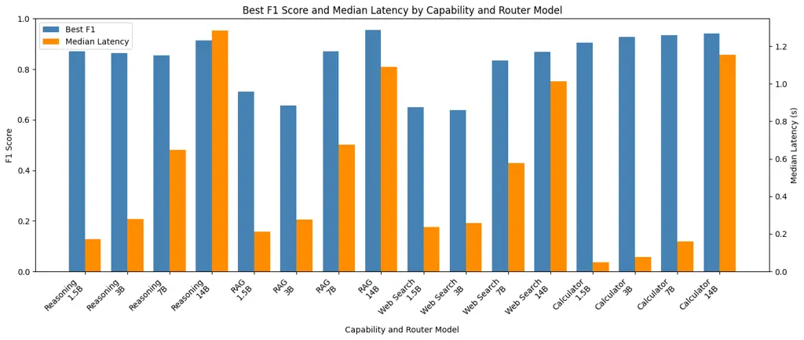
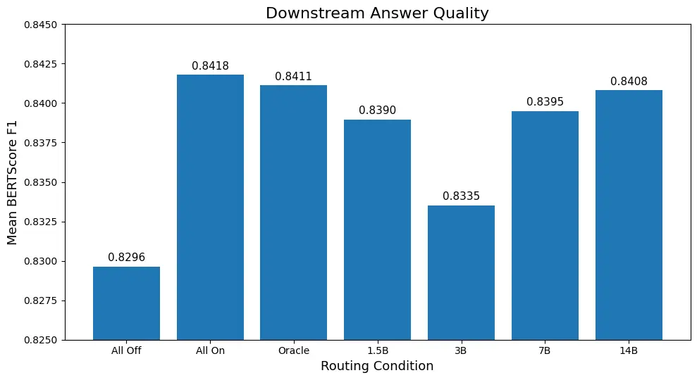
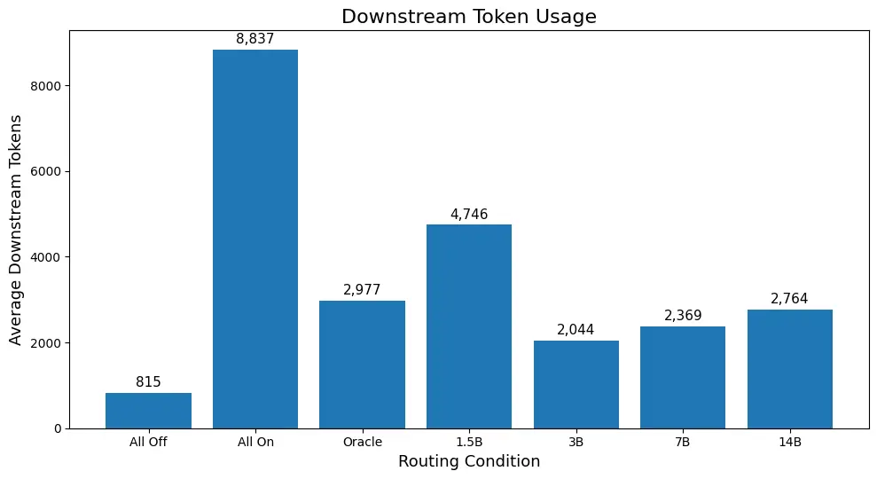
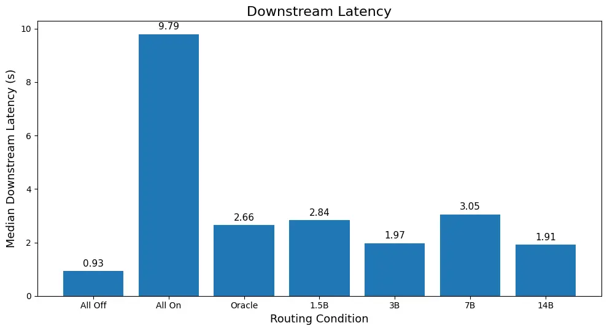
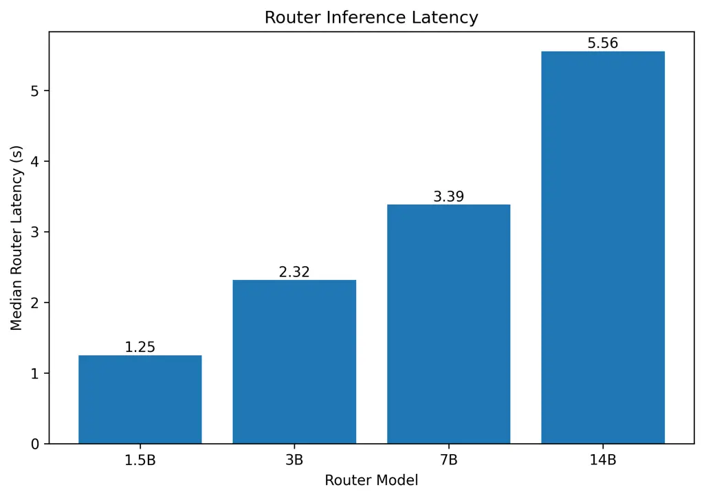

# Small Language Models for Inference-Capability Routing: Effects of Model Capacity and Prompt Optimization on Downstream Quality and Efficiency

Sailendra Kolluru Note: These authors contributed equally to this work.
Affiliation: CORTEXA Innovations Pvt Ltd., Hyderabad, India email:
<sailendra.kolluru.int@cortexa.global> and Maheshkumar Duvvarapu
Affiliation: CORTEXA Innovations Pvt Ltd., Hyderabad, India email:
<Mahesh.duvvarapu@cortexa.global>

###### Abstract.

Optional reasoning, retrieval, web search, and tool use can improve
large language model responses but incur unnecessary computation when
activated indiscriminately. This study investigates whether prompt
optimization can compensate for limited router capacity and whether
classification gains translate into downstream efficiency. The proposed
framework uses prompt-driven small language models to make four
independent capability decisions, allowing multiple capabilities to be
selected per query. Qwen2.5 routers ranging from 1.5B to 14B parameters
are compared across five prompting strategies, followed by an evaluation
of capability-specific optimized configurations using a fixed
GPT-OSS-120B downstream model on 127 questions. Under minimal prompting,
increasing router capacity does not consistently improve classification
performance. Prompt optimization narrows the capacity gap for reasoning
and calculator routing, whereas RAG and web search retain larger
benefits from higher capacity. Similar classification F1 scores do not
necessarily imply equivalent downstream behavior: false-positive
activations increase unnecessary computation, while missed capabilities
can reduce answer quality. The 14B router achieves a mean BERTScore F1
of 0.8408, compared with 0.8418 when all capabilities are enabled, while
reducing average downstream token consumption by 68.7% (8,837 to 2,764
tokens) and median downstream latency by 80.5% (9.79 to 1.91 seconds).
These savings exclude router overhead, which is measured separately in a
different inference environment and increases with router capacity. The
findings demonstrate that the relationship between router capacity,
prompt design, and downstream efficiency is capability-dependent.
Consequently, router selection must consider error profiles and routing
overhead alongside classification performance.

###### Keywords: 

Capability routing, small language models, prompt optimization,
inference efficiency

## 1. Introduction

Large language models (LLMs) increasingly operate within inference
pipelines that combine generation with retrieval, reasoning, and
external actions. These mechanisms address different information and
computational requirements. Retrieval-augmented generation (RAG)
supplies external evidence, web search provides access to online
information, and calculator tools support arithmetic execution.
Additional reasoning effort can help with difficult tasks, although its
benefits depend on the input and downstream model. Studies on adaptive
retrieval and selective reasoning therefore motivate allocating
inference resources according to query requirements rather than enabling
every mechanism uniformly (Jeong et al., 2024; Guo et al., 2026a).

This allocation creates a capability-routing problem: which inference
capabilities should be enabled for a given query before downstream
answer generation? Activating an unnecessary capability can introduce
additional context, execution steps, and token consumption. Conversely,
omitting a useful capability can deprive the downstream model of
relevant evidence or computational support (Jeong et al., 2024; Guo et
al., 2026a). Routing must therefore be evaluated in terms of both
decision quality and downstream execution consequences. Existing
research addresses several forms of adaptive inference. Adaptive-RAG
selects among retrieval strategies according to question complexity
(Jeong et al., 2024). Think When Needed selects between reasoning and
direct inference for ranking tasks (Guo et al., 2026a), while HRBench
compares thinking-mode switching strategies across models and reasoning
domains (Ning et al., 2026). Select-then-Solve examines selection among
complete inference paradigms (Zhou et al., 2026). These studies
establish the importance of adaptive inference, but their routing
targets differ from the independent selection of multiple capabilities
for the same query.

A closely related line of work evaluates small language models (SLMs) as
prompt-driven routers. Guarded Query Routing demonstrates that prompt
optimization can improve endpoint selection and out-of-distribution
rejection without updating model weights (Šléher et al., 2026). This
motivates a further question: when an optimized smaller router
approaches a larger router in classification performance, does it also
produce comparable downstream answer quality and computational
requirements? The answer may vary across capabilities. Moreover, similar
aggregate classification scores can conceal different false-positive and
false-negative profiles, resulting in different capability activation
patterns.

This study investigates these questions using Qwen2.5 routers with 1.5B,
3B, 7B, and 14B parameters (Yang et al., 2024) under five prompting
strategies. A single model family is used to reduce cross-family
variation when comparing router capacity. Each router makes four
independent binary decisions: whether to enable additional reasoning
effort, RAG, web search, and calculator access. This formulation permits
multiple capabilities to be enabled for the same query. In the
downstream implementation, reasoning routing selects high or low
reasoning effort, whereas calculator routing controls tool availability.
The downstream model determines whether to invoke the available
calculator.

The evaluation separates router classification from downstream
execution. First, router capacity and prompting strategies are compared
on capability-specific classification tasks. Next, the selected prompt
configuration for each capability and router size is fixed, and the
resulting decisions are evaluated using a fixed GPT-OSS-120B downstream
model. Routed configurations are compared against all-capabilities-on,
all-capabilities-off, and annotation-based oracle conditions. Answer
quality is assessed using BERTScore (Zhang et al., 2020) against
reference answers, while downstream token consumption and latency are
measured to characterize execution requirements. Router overhead is
reported separately because routing and downstream generation were
measured in different inference environments.

The results indicate that increasing router capacity does not
consistently improve classification performance under minimal prompting.
Prompt optimization narrows the capacity gap for reasoning and
calculator routing, whereas RAG and web search retain larger benefits
from higher capacity. Downstream evaluation further demonstrates that
comparable classification performance does not necessarily imply
comparable execution behavior. The 14B configuration achieves a mean
BERTScore F1 of 0.8408, compared with 0.8418 when all capabilities are
enabled, while reducing average downstream token consumption by 68.7%.
This finding concerns downstream computation and does not establish a
corresponding reduction in total system cost after accounting for router
overhead.

This study addresses three research questions, each associated with a
corresponding contribution:

- •
  RQ1: How does router capacity affect classification performance across
  reasoning, RAG, web-search, and calculator-access decisions?
  Contribution: A within-family comparison of four Qwen2.5 model sizes
  under a common baseline prompt, examining how sensitivity to router
  capacity differs across capabilities.
- •
  RQ2: How do prompting strategies affect classification performance,
  and to what extent can prompt optimization compensate for smaller
  router capacity across capability tasks? Contribution: A comparative
  evaluation of five prompting strategies across router sizes and
  capabilities, identifying where prompt optimization narrows the
  performance gap between smaller and larger routers.
- •
  RQ3: How do the selected router configurations affect downstream
  answer quality, token consumption, and latency? Contribution: A
  downstream evaluation using a fixed language model that relates
  routing decisions and error profiles to reference-answer similarity,
  token consumption, and latency, with router overhead reported
  separately.

Together, these contributions support evaluating capability routers
through their downstream execution consequences alongside their
classification performance.

## 2. Related Work

### 2.1. Selective Computation in LLM Systems

The benefit of additional inference-time computation varies across
queries. Some questions can be answered directly, whereas others benefit
from retrieval, extended reasoning, or interaction with external tools.
This variation motivates routing policies that allocate computation
selectively. For retrieval, (Jeong et al., 2024) train a small language
model to choose among no retrieval, single-step retrieval, and iterative
retrieval. Their approach connects the routing target to the outcomes of
alternative retrieval strategies, rather than assuming that every
question requires external evidence.

A similar consideration applies to reasoning. In ranking tasks, (Guo et
al., 2026a) demonstrate that reasoning is not uniformly beneficial and
use a lightweight router head to select between direct inference and
reasoning. Their policy accounts for ranking utility and token
consumption, making the decision sensitive to both task performance and
execution cost. The broader evaluation by (Ning et al., 2026) also finds
that the effectiveness of thinking-mode switching depends on the model,
task domain, and switching strategy. These findings suggest that the
value of a routing policy cannot be established independently of the
setting in which its decisions are executed.

Routing decisions can also be made after an initial response. (He and
Feng, 2026) use a concise answer and associated evidence to determine
whether deeper reasoning is warranted. This differs from the setting
considered in this study, where capability selection occurs before
downstream answer generation. Consequently, the routers cannot use the
quality or confidence of an initial answer as a decision signal.

### 2.2. Routing Targets and Router Design

Existing systems route at different levels of an inference pipeline.
(Guo et al., 2026b) route decomposed questions to appropriate knowledge
sources within an agentic RAG system. (Tiparadi et al., 2026) instead
select among specialized agents for corrective retrieval, planning, and
workflow execution. Both approaches adapt processing to the query, but
their routing targets are sources or workflows rather than individual
capability activations.

Selection among complete inference strategies offers another form of
adaptation. (Zhou et al., 2026) compare six inference paradigms and find
that no single paradigm performs best across tasks. A learned
embedding-based router exploits this variation by selecting a paradigm
before execution. Their comparison with self-routing also shows that
asking an LLM to choose a strategy does not necessarily produce a
reliable selection policy.

The proposed routing formulation operates at a different level.
Reasoning, RAG, web search, and calculator access are predicted
separately, allowing multiple capabilities to be enabled for the same
query. These decisions are evaluated independently at the classification
stage, but their downstream effects need not be independent. For
example, an answer may depend on retrieved evidence as well as the
reasoning applied to it. Consequently, a capability-level classification
error cannot be assumed to produce a fixed change in answer quality or
computational cost.

### 2.3. Prompt Optimization and Downstream Evaluation

The closest methodological work is that of (Šléher et al., 2026), who
evaluate small language models for domain routing and
out-of-distribution rejection. They show that prompt optimization can
improve routing performance without weight updates and can bring some
smaller models close to larger unoptimized models. They also identify
output-format adherence as a practical source of failure. This makes
prompt design relevant to both classification quality and the
reliability of obtaining an executable routing decision.

The present study builds on this evidence by examining whether
compensation for smaller router capacity varies across capability
decisions and carries through to downstream execution. Classification
performance alone does not resolve this question. Two routers with
similar F1 scores may differ in which queries they misclassify and in
their balance of false positives and false negatives. These differences
can change the capabilities made available, the context supplied to the
downstream model, and the amount of computation performed.

Router capacity and prompting strategies are therefore evaluated within
a single model family, followed by downstream execution using the
selected capability configurations with a fixed language model. This
connects router-level measurements to reference-answer similarity,
downstream token consumption, and latency. Router overhead is reported
separately. The resulting comparison examines when a smaller,
prompt-optimized router remains competitive after its decisions are
executed, rather than treating comparable classification scores as
sufficient evidence of equivalent system behavior.

## 3. Methodology

### 3.1. Experiment Design

The methodology consists of two primary stages. The first stage
evaluates capability routing as a binary classification problem and
encompasses RQ1 and RQ2. For each question, the router independently
determines whether reasoning, RAG, web search, and calculator/tool
execution are required. Each predicted capability label is compared
against an expert-reviewed reference annotation. The second stage
evaluates the consequences of these routing decisions during downstream
generation and corresponds to RQ3. Rather than assessing only the
correctness of routing labels, RQ3 executes the selected capabilities
and measures the quality and computational characteristics of the
resulting downstream responses. This separation between classification
and downstream execution is important because a routing error does not
necessarily produce a corresponding change in response quality. For
example, a false positive may activate an unnecessary capability and
primarily increase computation, whereas a false negative may omit
required context and reduce response quality.

The routing problem is decomposed into four independent binary
classification tasks. For an input query $`q`$, the routing vector is
represented as:

```math
\mathcal{R}(q)=\begin{bmatrix}r_{\mathrm{reason}}\\
r_{\mathrm{rag}}\\
r_{\mathrm{web}}\\
r_{\mathrm{calc}}\end{bmatrix},
```

where each value is binary:

```math
r_{i}\in\{0,1\}.
```

A value of 1 indicates that the corresponding capability should be
enabled, whereas 0 indicates that it should remain disabled. This
formulation permits multiple capabilities to be enabled simultaneously.
For example, a query may require both reasoning and web search, or RAG
together with calculator execution. Using four independent binary
decisions also avoids treating every possible capability combination as
a separate class. With four binary capabilities, a unified classifier
would otherwise require representing up to $`2^{4}=16`$ different
configurations.


Figure 1. Capability-routing workflow. Four binary predictions control
downstream reasoning effort, document retrieval, web search, and
calculator availability. Retrieved context and available tools are
supplied to a fixed downstream LLM. RQ3 evaluates reference-answer
similarity, downstream token consumption, and latency, with router
overhead reported separately.An input query passes through four
capability classifiers, producing binary decisions for reasoning,
document retrieval, web search, and calculator access. These decisions
configure the inputs and settings of a fixed downstream language model.
The resulting response is evaluated for reference-answer similarity,
token consumption, and latency, while router overhead is measured
separately.

============================================================

### 3.2. Datasets

Two evaluation datasets were assembled: a multi-domain
capability-classification dataset for RQ1 and RQ2, and a pharmaceutical
regulatory question-answering benchmark for RQ3. The datasets were
assembled separately but were not fully disjoint. The RQ1/RQ2 dataset
combines questions from multiple domains, including pharmaceutical and
regulatory content supplied by a subject-matter expert (SME). Source
files containing questions and capability annotations were consolidated
and normalized into four capability-specific datasets. These records do
not constitute a common set of questions annotated for all four
capabilities. The RQ3 benchmark was assembled from an initial set of 74
questions provided by the SME, supplemented with additional questions
from other datasets supplied by the same SME to broaden capability
coverage. Where reference answers were unavailable, candidate answers
were generated using GPT-6 and subsequently reviewed and verified by the
domain expert. The resulting benchmark contains 127 unique questions,
each associated with four capability labels and a reference answer.

Capability annotations for pharmaceutical-domain questions were manually
assigned by the SME based on each question’s requirements for reasoning,
RAG, web search, and calculator/tool use. Domain expertise was
particularly important for interpreting pharmaceutical regulatory
questions and distinguishing their information and computational
requirements.

For a subset of domain-agnostic questions, ChatGPT was used to generate
initial capability annotations. These annotations were subsequently
reviewed by the SME, who identified and corrected inconsistencies or
errors where necessary. The LLM-generated annotations served only as
preliminary labels and were not treated as independently established
ground truth.

The original RQ1/RQ2 dataset contained 3,573 capability-specific
records. A post-experiment consistency audit identified 25 duplicated
question-capability pairs with conflicting labels, corresponding to 58
records. All occurrences of these pairs were excluded rather than
retaining one of the conflicting labels. The resulting dataset contains
3,515 records: 875 reasoning, 1,003 RAG, 642 web search, and 995
calculator examples. Classification metrics were recomputed using the
retained test records.

| Capability | Total | Train | Validation | Test  |
| ---------- | ----- | ----- | ---------- | ----- |
| Reasoning  | 875   | 94    | 29         | 752   |
| RAG        | 1,003 | 100   | 30         | 873   |
| Web Search | 642   | 100   | 30         | 512   |
| Calculator | 995   | 100   | 30         | 865   |
| Total      | 3,515 | 394   | 119        | 3,002 |

Table 1. Final RQ1/RQ2 capability-classification dataset and splits.

Training and validation examples were used for prompt development and
optimization without updating router model weights. Test examples were
used for classification evaluation. The exclusions affected the
reasoning training and validation partitions, removing six training
examples and one validation example. The training and validation
partitions for RAG, Web Search, and Calculator remained unchanged. One
excluded reasoning training example had been selected as a DSPy few-shot
demonstration for the 3B and 14B routers. The corresponding prompt
artifacts therefore reflect development before the consistency audit.
Recomputing metrics on the retained test records does not remove the
influence of this demonstration. Results for these configurations are
interpreted with this limitation. The RQ3 benchmark contains 127
pharmaceutical regulatory questions, each with a reference answer and
four capability annotations. It evaluates routing on a domain-specific
workload rather than establishing generalization across domains. Some
questions also occur in the RQ1/RQ2 datasets. Table 2 reports annotation
agreement for comparable overlapping question-capability pairs before
label harmonization.

| Capability | Overlap | Matching | Different | Agreement (%) |
| ---------- | ------- | -------- | --------- | ------------- |
| Calculator | 83      | 78       | 5         | 93.98         |
| RAG        | 87      | 87       | 0         | 100.00        |
| Reasoning  | 80      | 53       | 27        | 66.25         |
| Web Search | 87      | 61       | 26        | 70.11         |

Table 2. Agreement between overlapping RQ2 and RQ3 capability labels
before harmonization.

For inconsistent overlapping pairs, RQ3 annotations were harmonized with
the retained RQ2 annotations. This changed 58 capability labels across
46 questions: 27 reasoning, 26 web search, and 5 calculator labels. No
RAG labels were changed. This procedure establishes consistency between
the two annotation sets; it does not, by itself, establish the
correctness of the selected reference labels. The final RQ3 ground-truth
distribution was:

| Capability | Required | Not Required |
| ---------- | -------- | ------------ |
| Reasoning  | 83       | 44           |
| RAG        | 97       | 30           |
| Web Search | 10       | 117          |
| Calculator | 29       | 98           |

Table 3. Final corrected RQ3 ground-truth capability distribution.

Router predictions from the original RQ3 runs were retained and
reevaluated against the corrected ground truth. However, because the
ORACLE condition directly uses the ground-truth capability vector to
control downstream execution, the 46 affected ORACLE runs were rerun
using the corrected labels, and their downstream quality metrics were
recomputed.

### 3.3. Router Classification

Four Qwen2.5 models were used as routers to evaluate RQ1 and RQ2:
Qwen2.5-1.5B, Qwen2.5-3B, Qwen2.5-7B, and Qwen2.5-14B (Yang et al.,
2024). Using models from the same family reduces architectural variation
and enables comparisons of router capacity. All models were executed
through Ollama in Google Colab using an NVIDIA T4 GPU. For each model,
routing was evaluated independently for reasoning, RAG, web search, and
calculator use under five prompting strategies: Minimal Baseline,
Descriptive SME, DSPy Baseline, DSPy Few-Shot, and GEPA. The Minimal
Baseline contained only the essential classification instruction and
output constraint. The Descriptive SME prompt introduced manually
designed capability-selection rules, while DSPy-based methods employed
structured prompting and optimized few-shot demonstrations (Khattab et
al., 2024). GEPA further optimized the routing instructions through a
generator-evaluator process (Agrawal et al., 2025). RQ1 was evaluated by
comparing the four router sizes under the same Minimal Baseline prompt,
thereby isolating the effect of model capacity. RQ2 was evaluated by
comparing prompting strategies within each router size and capability.
Where prompt optimization required training or validation examples, only
the designated training and validation partitions were used, while final
performance was measured on the corrected held-out test sets. The
RQ1/RQ2 workflow is illustrated in Figure 2.


Figure 2. RQ1 and RQ2 capability-classification workflow. Each input
question is evaluated across router-model and prompt-strategy
configurations for reasoning, RAG, web search, and calculator use, and
predictions are compared with the corresponding ground-truth labels.An
input question is classified for four capabilities: reasoning,
retrieval-augmented generation, web search, and calculator use. Router
model sizes and prompting strategies are varied, and the predicted
capability labels are compared with reference annotations to evaluate
classification performance.

#### 3.3.1. Router-Level Evaluation Metrics

Router performance was evaluated separately for reasoning, RAG, web
search, and calculator use. The evaluation considered classification
performance, output reliability, and computational overhead.

##### Classification performance.

F1 and balanced accuracy were used as the primary classification
metrics. F1 summarizes precision and recall for the capability-required
class, while balanced accuracy assigns equal weight to sensitivity and
specificity:

```math
\mathrm{F1}=\frac{2TP}{2TP+FP+FN},
```

```math
\mathrm{Balanced\ Accuracy}=\frac{1}{2}\left(\frac{TP}{TP+FN}+\frac{TN}{TN+FP}\right).
```

Here, $`TP`$, $`TN`$, $`FP`$, and $`FN`$ denote true positives, true
negatives, false positives, and false negatives, respectively. Both
metrics were reported because class imbalance can obscure routing
behavior. In particular, F1 does not account for true negatives, whereas
balanced accuracy reflects discrimination across both classes. Accuracy,
precision, recall, specificity, and false-positive and false-negative
rates were retained as supplementary measures. Confusion counts were
also reported to distinguish unnecessary capability activations from
missed activations.

##### Output reliability.

Unknown predictions and parsing or execution errors were recorded
separately from valid binary predictions. Their rates were calculated
relative to the total number of evaluated records:

```math
\mathrm{Unknown\ Rate}=\frac{N_{\mathrm{unknown}}}{N},\qquad\mathrm{Error\ Rate}=\frac{N_{\mathrm{error}}}{N}.
```

The number of successfully classified records was retained to make the
coverage of the classification metrics explicit.

##### Computational overhead.

Router latency was summarized using the mean, median, and 95th
percentile. Router token consumption and model runtime statistics were
retained where available. These measurements characterize the overhead
introduced by capability selection and were reported separately from
downstream generation.

### 3.4. End-to-End Capability Routing

RQ3 evaluates how capability-based routing affects downstream answer
quality and computational efficiency. Rather than carrying forward a
single best router configuration, RQ3 compares four router sizes: 1.5B,
3B, 7B, and 14B. For each router size, the prompting strategy for each
capability was selected based on the highest F1 score observed in the
RQ2 experiments. Consequently, each router size represents a
capability-specific combination of prompting strategies rather than a
single prompting method applied uniformly across all four routing
decisions. The prompting configurations used in RQ3 are summarized in
Table 4.

| Size | Reasoning | RAG  | Web  | Calculator |
| ---- | --------- | ---- | ---- | ---------- |
| 1.5B | Few-Shot  | GEPA | GEPA | SME        |
| 3B   | Few-Shot  | GEPA | GEPA | Minimal    |
| 7B   | Few-Shot  | GEPA | GEPA | SME        |
| 14B  | Few-Shot  | GEPA | GEPA | Few-Shot   |

Table 4. Prompting strategies used for each router size and capability
in RQ3.

These four router configurations were evaluated as separate routing
conditions in the downstream experiment. Because the prompting strategy
for each capability was selected using the final RQ2 evaluation results
rather than an independent validation set, the RQ3 comparison is
interpreted as exploratory rather than as an independently validated
estimate of generalization performance. The downstream model was kept
fixed across all conditions so that differences in answer quality, token
consumption, and latency could be attributed primarily to differences in
capability selection. The downstream model was openai.gpt-oss-120b-1:0,
accessed through AWS Bedrock. For each input question, the router
independently determined whether each of four optional inference
capabilities should be enabled: extended reasoning, RAG retrieval, web
search, and calculator access. Thus, RQ3 evaluates the downstream
behavior of the four optimized router-size configurations alongside the
non-routed and oracle baselines.

#### 3.4.1. Experimental Conditions

Seven downstream conditions were evaluated: ALL_OFF, ALL_ON, ORACLE,
ROUTER_1.5B, ROUTER_3B, ROUTER_7B, and ROUTER_14B. The ALL_OFF condition
disables all optional capabilities and provides a low-computation
baseline. The ALL_ON condition enables all available capabilities for
every question and represents a high-computation baseline.

The ORACLE condition uses the benchmark ground-truth capability labels
directly as the routing vector. It represents perfect agreement with the
benchmark annotations but should not be interpreted as a proven
minimum-cost routing policy or an upper bound on downstream answer
quality. The four ROUTER conditions use the capability decisions
generated by the corresponding Qwen2.5 routers.

For downstream execution, invalid router outputs were handled using a
conservative fallback policy. If a router returned an unknown prediction
or encountered an execution error, the corresponding capability was
enabled for that question. No retry was performed. This ensured that
invalid routing outputs did not suppress potentially required
capabilities, although such cases could increase downstream
computational cost.

#### 3.4.2. Reasoning Execution

The reasoning decision controls the reasoning effort assigned to the
downstream model. When reasoning is enabled, reasoning_effort is set to
high; otherwise, it is set to low. This setting is passed directly as a
downstream inference parameter rather than being appended to the textual
prompt.

#### 3.4.3. RAG Execution

When RAG is enabled, the input question is used to retrieve relevant
information from the experiment’s retrieval index. The RAG system uses a
FAISS-based vector index (Douze et al., 2024) containing the available
reference documents, with sentence embeddings generated using the
Sentence-Transformers framework (Reimers and Gurevych, 2019).

The retrieved passages are converted into contextual information and
appended to the downstream prompt. When RAG is disabled, no retrieval
operation is performed, and no RAG context is included.

#### 3.4.4. Web Search Execution

When web search is enabled, the question is submitted to the Tavily
search API. The returned search results are processed into web context
and supplied to the downstream model. When web search is disabled, no
Tavily request is executed, and no web-search context is added to the
prompt.

#### 3.4.5. Calculator Execution

When calculator access is enabled, the calculator/tool component is made
available to the downstream model, which determines whether a
calculation is necessary. If invoked, the calculator executes the
relevant mathematical operation and returns the computed result to the
downstream model. When calculator access is disabled, the calculator
tool is unavailable.

#### 3.4.6. Downstream Prompt Construction

The downstream prompt combines the original question with any context
produced by enabled RAG and web-search capabilities. Calculator results
are incorporated when the available tool is invoked. Reasoning is
handled separately through the model’s reasoning_effort parameter rather
than as additional prompt text. The complete RQ3 execution workflow is
shown in Figure 3.


Figure 3. RQ3 end-to-end routing workflow. The selected configuration
determines whether reasoning, RAG, web search, and calculator
capabilities are enabled before the resulting context is passed to the
fixed downstream LLM.An input question is processed under a baseline,
oracle, or SLM-routed capability configuration. The configuration
controls reasoning effort, document retrieval, web search, and
calculator access for a fixed downstream language model. Generated
responses are evaluated for reference-answer similarity, token
consumption, and latency.

### 3.5. RQ3 Evaluation Metrics

RQ3 evaluates both response quality and computational efficiency.
Generated answers were compared with the available reference answers
using BERTScore (Zhang et al., 2020). The primary response-quality
metric was BERTScore F1. BERTScore estimates semantic similarity between
generated and reference responses using contextual token representations
and is less dependent on exact lexical overlap than traditional
string-matching metrics. Token consumption was recorded separately for
routing and downstream generation. The downstream analysis included
input tokens, output tokens, and total downstream tokens. Router token
consumption was retained separately to allow examination of routing
overhead without combining it with downstream model usage. Latency
measurements included router latency, downstream latency, RAG latency,
web-search latency, calculator latency, and end-to-end execution
characteristics. Mean, median, and 95th-percentile (P95) latency
statistics were calculated where appropriate.

## 4. Reproducibility and Data Quality

All routing experiments were executed in Google Colab using an NVIDIA T4
GPU. Because the experimental matrix required a large number of router
and downstream inference calls, intermediate predictions and outputs
were continuously saved to Excel checkpoints. This allowed interrupted
runs to resume from previously completed examples and enabled evaluation
to be repeated using stored outputs without rerunning the full inference
pipeline. A post-experiment consistency audit identified conflicting
labels within the RQ1/RQ2 dataset and inconsistencies between
overlapping RQ2 and RQ3 annotations. Conflicting question-capability
pairs were excluded, and all affected RQ1/RQ2 classification metrics
were recalculated using the corrected test sets. These corrections
produced only minor changes in classification metrics and did not alter
the main RQ1 capacity trends or the overall prompt-selection patterns
observed in RQ2. The audit also identified one excluded reasoning
example that had previously been selected as a DSPy Few-Shot
demonstration for the 3B and 14B reasoning routers. Because the
corresponding prompts and evaluations had already been completed, these
configurations were neither regenerated nor rerun. Their results were
therefore retained but should be interpreted as exploratory, with this
prompt exposure acknowledged as a limitation of the study. For RQ3,
overlapping capability labels were harmonized with the corrected RQ2
annotations. Existing router predictions were retained and reevaluated
against the corrected ground truth to isolate the effect of label
corrections without introducing new router outputs. The ORACLE condition
required separate treatment because its downstream capability
configuration was determined directly by the ground-truth routing
vector. Consequently, the 46 affected ORACLE runs were rerun, after
which BERTScore values and downstream summary statistics were
recomputed. All subsequent RQ3 analyses were generated using these
corrected outputs.

The detailed software, model, and inference configurations are provided
in Tables 11 and 12 in the Appendix.

## 5. Results and Analysis

All classification metrics were recalculated following the label and
example audit. Precision, recall, F1 score, balanced accuracy, and
standard accuracy were computed using the conventional confusion-matrix
definitions over valid classified predictions; outputs marked as unknown
or error were excluded from these calculations. Strict accuracy
additionally accounted for invalid outputs by treating unknown and error
cases as incorrect predictions, thereby measuring performance across the
full set of examples. An output was marked as unknown when the router
produced a response that could not be mapped to a permitted
classification label, such as “none of the above.” Errors were recorded
when inference failed to produce a valid prediction, for example because
of a token-limit exceedance, timeout, or termination without a usable
response. Consequently, the number of examples included in the standard
classification metrics may be smaller than the full dataset for
configurations with unknown or error outputs, whereas strict accuracy
includes these cases in its denominator.

### 5.1. RQ1: Effect of Router Capacity

RQ1 examined how router classification performance varied with model
capacity under the Minimal Baseline prompt. Table 5 reports F1 score and
balanced accuracy.

| Capability | Metric            | 1.5B  | 3B    | 7B    | 14B   |
| ---------- | ----------------- | ----- | ----- | ----- | ----- |
| Calculator | F1                | 0.644 | 0.928 | 0.917 | 0.888 |
|            | Balanced Accuracy | 0.644 | 0.936 | 0.924 | 0.903 |
| RAG        | F1                | 0.678 | 0.602 | 0.196 | 0.579 |
|            | Balanced Accuracy | 0.509 | 0.604 | 0.484 | 0.624 |
| Reasoning  | F1                | 0.745 | 0.771 | 0.809 | 0.768 |
|            | Balanced Accuracy | 0.500 | 0.569 | 0.663 | 0.559 |
| Web Search | F1                | 0.351 | 0.487 | 0.484 | 0.533 |
|            | Balanced Accuracy | 0.500 | 0.712 | 0.707 | 0.753 |

Table 5. RQ1 performance under the Minimal Baseline prompt.

Under minimal prompting, increasing router capacity did not produce a
consistent improvement in classification performance. The 3B and 7B
models matched or exceeded the 14B model on several measures,
particularly for calculator and reasoning routing, whereas RAG and web
search results were more variable. Overall, model size alone was not a
reliable predictor of routing performance.

| Capability | 1.5B | 3B  | 7B  | 14B |
| ---------- | ---- | --- | --- | --- |
| Reasoning  | 0    | 0   | 0   | 0   |
| RAG        | 0    | 0   | 0   | 0   |
| Web Search | 0    | 0   | 0   | 0   |
| Calculator | 0    | 0   | 0   | 24  |

Table 6. Unknown predictions under the Minimal Baseline prompt.

An additional difference emerged in output reliability under minimal
prompting. While the smaller routers returned valid labels across all
four tasks, the 14B model produced 24 unknown outputs for calculator
routing, often returning responses such as “none of the above” rather
than one of the required labels. This suggests that additional model
capacity does not necessarily ensure adherence to a strict binary output
format under minimal prompting.

### 5.2. RQ2: Effect of Prompt Engineering

Prompting strategy substantially affected routing performance, although
the most effective strategy varied by capability. GEPA consistently
achieved the strongest results for RAG and Web Search, while DSPy
Few-Shot performed best for Reasoning. Calculator routing showed a
different pattern, with Minimal, Descriptive SME, and Few-Shot prompts
each performing best at different model sizes.

| Capability | 1.5B  | 3B    | 7B    | 14B   |
| ---------- | ----- | ----- | ----- | ----- |
| Calculator | 0.905 | 0.928 | 0.934 | 0.941 |
| RAG        | 0.712 | 0.657 | 0.870 | 0.955 |
| Reasoning  | 0.871 | 0.865 | 0.855 | 0.913 |
| Web Search | 0.651 | 0.639 | 0.834 | 0.868 |

Table 7. Best RQ2 F1 score for each capability and router size.

Unlike the Minimal Baseline results, for which increasing capacity did
not consistently improve performance, the best-prompt configurations
showed a clearer capacity effect: the 14B router achieved the highest F1
for all four capabilities. However, the size of this advantage was
task-dependent. For reasoning and calculator routing, smaller routers
remained close to the 14B model, suggesting that prompt optimization can
substantially narrow the capacity gap. In contrast, RAG and Web Search
showed larger gains at higher capacities, indicating that prompting
could not fully compensate for limited model capacity on these tasks.
Overall, prompt optimization substantially improved several routing
tasks, particularly RAG and Web Search, but its effect remained
capability-dependent. More complex prompting was therefore not
universally superior; the strongest configuration depended on both the
routing task and model capacity.

| Method           | 1.5B | 3B  | 7B  | 14B |
| ---------------- | ---- | --- | --- | --- |
| Minimal Baseline | 0    | 0   | 0   | 24  |
| Descriptive SME  | 0    | 0   | 0   | 6   |
| DSPy Baseline    | 358  | 6   | 0   | 0   |
| DSPy Few-Shot    | 53   | 6   | 0   | 1   |
| GEPA             | 32   | 6   | 0   | 1   |

Table 8. Unknown predictions by prompting strategy and router model.

Although optimized prompting improved F1 for several configurations, its
effect on output reliability depended strongly on model capacity.
Unknown predictions were concentrated in the 1.5B router under DSPy and
GEPA, whereas the 7B model produced no unknown outputs across any
prompting strategy. The 14B model showed the opposite pattern, with most
unknowns occurring under the Minimal Baseline. These findings suggest
that prompt complexity and model capacity interact in both
classification performance and the reliability of producing valid
routing labels.



Figure 4. Best F1 score and median router latency for the
highest-performing prompt configuration at each capability and model
size.

As shown in Figure 4, the best-performing configurations also exhibited
a capability-dependent performance-latency trade-off. For reasoning and
calculator routing, smaller routers approached the F1 performance of the
14B model at substantially lower median latency. In contrast, RAG and
Web Search showed larger gains at higher capacities, making the
additional router latency more justifiable for these tasks.

### 5.3. RQ3: Router Performance on the Downstream Benchmark

Before downstream answer quality and efficiency were evaluated, the
router configurations were assessed on the corrected RQ3 benchmark.
Table 9 reports F1 score and balanced accuracy (BA) for each capability
and router size.

| Capability | Metric | 1.5B  | 3B    | 7B    | 14B   |
| ---------- | ------ | ----- | ----- | ----- | ----- |
| Reasoning  | F1     | 0.607 | 0.676 | 0.740 | 0.716 |
|            | BA     | 0.556 | 0.698 | 0.684 | 0.755 |
| RAG        | F1     | 0.580 | 0.328 | 0.715 | 0.953 |
|            | BA     | 0.661 | 0.598 | 0.778 | 0.908 |
| Web Search | F1     | 0.243 | 0.143 | 0.118 | 0.194 |
|            | BA     | 0.715 | 0.537 | 0.524 | 0.573 |
| Calculator | F1     | 0.446 | 0.667 | 0.792 | 0.846 |
|            | BA     | 0.627 | 0.760 | 0.828 | 0.874 |

Table 9. Router classification performance on the corrected RQ3
benchmark.

Because reasoning-required questions are relatively prevalent in the
corrected RQ3 benchmark (83 of 127 questions), an analytical
always-positive classifier would obtain an F1 score of approximately
0.790, which exceeds the reported Reasoning F1 values of all four
routers. This baseline does not account for the computational cost of
unnecessarily enabling high reasoning effort, but it provides important
context for interpreting the router F1 scores.

Router performance varied considerably across capabilities. The 14B
router achieved the strongest results for RAG and Calculator and the
highest Balanced Accuracy for Reasoning, while the 7B router obtained
the highest Reasoning F1. Web search remained the weakest capability
across all router sizes, with low F1 despite comparatively higher
balanced accuracy. Overall, the 14B configuration provided the strongest
and most consistent performance across the four routing decisions,
although the results remained capability-dependent.

### 5.4. RQ3: Downstream Quality and Efficiency

RQ3 evaluates whether capability routing can reduce downstream
computation while maintaining similar reference-answer similarity scores
on the benchmark. Figure 5 compares downstream BERTScore F1 across the
baseline, oracle, and routed configurations.



Figure 5. Mean downstream BERTScore F1 across routing conditions.

Mean BERTScore F1 values were numerically close across most
configurations despite substantial differences in capability activation.
ALL_ON achieved the highest mean BERTScore F1 at 0.8418, followed by
ORACLE at 0.8411 and the 14B router at 0.8408. The 7B and 1.5B routers
achieved 0.8395 and 0.8390, respectively, while the 3B router produced
the lowest routed score at 0.8335. Because BERTScore measures semantic
similarity rather than factual, numerical, or task correctness, these
values should not be interpreted as demonstrating equivalent or
preserved answer quality (Zhang et al., 2020). The computational
differences between these configurations were considerably larger.
Figure 6 shows average downstream token consumption.



Figure 6. Average downstream token consumption across routing
conditions.

ALL_ON consumed approximately 8,837 downstream tokens per question,
compared with 2,977 for ORACLE and 2,044–4,746 for the routed
configurations. Among the routed systems, the 3B router used the fewest
downstream tokens at approximately 2,044, followed by 7B at 2,369 and
14B at 2,764. The 1.5B router consumed approximately 4,746 tokens. Thus,
numerically similar mean BERTScore values were observed across
configurations with substantially different downstream computation. A
similar pattern was observed for downstream latency, shown in Figure 7.



Figure 7. Median downstream latency across routing conditions.

ALL_ON incurred the highest median downstream latency at 9.79 s, whereas
ORACLE required 2.66 s. Among the routed configurations, the 14B router
achieved the lowest median downstream latency at 1.91 s, followed by 3B
at 1.97 s, 1.5B at 2.84 s, and 7B at 3.05 s. These measurements capture
downstream execution only; router inference was performed locally in
Google Colab, whereas downstream generation was executed through AWS
Bedrock, so the two latency measurements are analyzed separately.

ALL_OFF also achieved a mean BERTScore F1 that was numerically close to
the routed, ORACLE, and ALL_ON conditions while using substantially
fewer downstream tokens. This result suggests that the present
evaluation cannot determine whether the optional capabilities provided
only limited benefit on this benchmark, whether BERTScore was
insufficiently sensitive to the kinds of factual, numerical, or
task-level improvements those capabilities were intended to provide, or
whether both effects contributed. Accordingly, the observed BERTScore
differences should be interpreted descriptively rather than as evidence
that the capability configurations were equivalent in answer quality.
The differences in the routing error profiles for each model and
capability are reported in Table 10.

| Router | Capability | TP  | TN  | FP  | FN  | Unknown | Errors |
| ------ | ---------- | --- | --- | --- | --- | ------- | ------ |
| 1.5B   | Reasoning  | 44  | 25  | 18  | 39  | 0       | 1      |
|        | RAG        | 40  | 27  | 3   | 55  | 2       | 0      |
|        | Web Search | 9   | 62  | 55  | 1   | 0       | 0      |
|        | Calculator | 27  | 31  | 65  | 2   | 2       | 0      |
| 3B     | Reasoning  | 46  | 37  | 7   | 37  | 0       | 0      |
|        | RAG        | 19  | 30  | 0   | 78  | 0       | 0      |
|        | Web Search | 1   | 114 | 3   | 9   | 0       | 0      |
|        | Calculator | 16  | 93  | 3   | 13  | 2       | 0      |
| 7B     | Reasoning  | 57  | 30  | 14  | 26  | 0       | 0      |
|        | RAG        | 54  | 30  | 0   | 43  | 0       | 0      |
|        | Web Search | 1   | 111 | 6   | 9   | 0       | 0      |
|        | Calculator | 19  | 98  | 0   | 10  | 0       | 0      |
| 14B    | Reasoning  | 48  | 41  | 3   | 35  | 0       | 0      |
|        | RAG        | 92  | 26  | 4   | 5   | 0       | 0      |
|        | Web Search | 3   | 99  | 18  | 7   | 0       | 0      |
|        | Calculator | 22  | 97  | 1   | 7   | 0       | 0      |

Table 10. Confusion counts for capability predictions on the corrected
RQ3 benchmark. Unknown and error counts account for predictions excluded
from the confusion matrix.

The router-level results help explain the downstream behavior observed
in Figures 5–7. Although the 14B router was generally strongest across
capabilities, smaller routers were competitive on individual tasks. The
7B router achieved the highest Reasoning F1, while the 1.5B router
achieved the highest Web Search F1. However, similar classification
scores did not necessarily produce similar execution costs. The
confusion counts show that the 1.5B router produced 55 Web Search false
positives and 65 Calculator false positives, causing frequent
unnecessary capability activation. Although its mean BERTScore F1 was
numerically close to that of the 14B router (0.8390 vs. 0.8408), it
required substantially more downstream tokens (4,746 vs. 2,764) and
higher median downstream latency (2.84 s vs. 1.91 s). The 7B router
similarly obtained a mean BERTScore F1 close to 14B (0.8395 vs. 0.8408),
but with higher median downstream latency (3.05 s) and slightly lower
token consumption (2,369 tokens). The 3B router was more conservative,
producing relatively few false positives and the lowest downstream token
consumption among routed configurations (2,044 tokens), but it also
produced many false negatives, including 78 missed RAG activations, and
the lowest routed mean BERTScore F1 (0.8335).

Among the routed configurations, the 14B router achieved the highest
mean BERTScore F1 and the lowest median downstream latency, while
consuming fewer downstream tokens than the 1.5B router but more than the
3B and 7B routers. These results describe performance on the reported
downstream metrics only and do not establish an overall optimum in total
compute, monetary cost, or end-to-end latency. Its relatively strong RAG
and calculator-routing performance coincided with the highest mean
BERTScore F1 among learned routers and the lowest median downstream
latency. These findings indicate that router performance cannot be
interpreted from F1 or balanced accuracy alone: the distribution of
false positives and false negatives directly affects which capabilities
execute and therefore influences downstream token consumption and
latency. The observed BERTScore differences remain descriptive and do
not establish statistical equivalence or correctness across routing
conditions.



Figure 8. Median inference latency of the four SLM router
configurations.

Router inference latency increased with model capacity, as shown in
Figure 8. Median router latency increased from approximately 1.25 s for
the 1.5B router to 5.56 s for the 14B router. Thus, although the 14B
router reduced downstream execution latency through more selective
capability activation, the router itself was more computationally
expensive. Router and downstream latency are reported separately because
they were measured under different inference environments. The Qwen2.5
routers were executed through Ollama in Google Colab, whereas the 120B
downstream model was accessed through AWS Bedrock. Directly summing
these measurements would therefore not provide a controlled end-to-end
latency comparison. Future work should evaluate both components in a
common inference environment to measure total system latency more
rigorously.

## 6. Discussion

Router capacity and prompt design jointly influenced capability
classification performance. Under minimal prompting, increasing model
size did not consistently improve classification performance. With
capability-specific prompt optimization, however, the 14B router
achieved the highest F1 across all four tasks. The extent of this
advantage varied across capabilities: smaller routers remained
competitive for reasoning and calculator routing, whereas larger
performance gaps persisted for RAG and web search. Prompt optimization
therefore compensated for reduced router capacity more effectively for
some capability decisions than for others.

The most effective prompting strategy also depended on the capability.
GEPA produced the strongest results for RAG and web search, while DSPy
Few-Shot was generally strongest for reasoning. Calculator
classification remained competitive under simpler Minimal Baseline or
Descriptive SME prompts. More elaborate prompting was therefore not
consistently associated with improved performance. Furthermore,
optimized prompts sometimes increased invalid outputs, particularly for
the 1.5B router. Classification scores must therefore be interpreted
alongside output reliability, as a configuration that performs well on
valid predictions may still require frequent fallback handling during
deployment.

The downstream evaluation demonstrates why classification performance
alone is insufficient for router selection. The 1.5B and 14B
configurations achieved numerically similar mean BERTScore F1 values,
but their downstream execution requirements differed substantially. The
1.5B router produced numerous false-positive web search and calculator
decisions and consumed approximately 4,746 downstream tokens per
question, compared with 2,764 for the 14B router. Its median downstream
latency was also higher (2.84 versus 1.91 seconds). These results
associate unnecessary capability activation with increased downstream
computation, although a positive calculator decision only made the tool
available and did not necessarily result in an invocation.

The 3B configuration illustrated a different trade-off. It consumed the
fewest downstream tokens, approximately 2,044 per question, but also
achieved the lowest mean BERTScore F1 among the routed configurations.
Its conservative predictions included numerous missed RAG activations.
Lower token consumption therefore did not, by itself, indicate more
effective routing. Because individual questions could contain errors
across multiple capabilities, these associations do not isolate the
causal effect of any individual routing error.

Among the routed configurations, the 14B router achieved the highest
mean BERTScore F1 and the lowest median downstream latency. Its mean
BERTScore F1 was 0.8408, compared with 0.8418 for ALL_ON and 0.8411 for
ORACLE. Relative to ALL_ON, average downstream token consumption
decreased from approximately 8,837 to 2,764, representing a reduction of
68.7%, while median downstream latency decreased from 9.79 to 1.91
seconds, representing a reduction of 80.5%. Thus, on the evaluated
benchmark, substantial reductions in downstream computation were
accompanied by only a small numerical difference in reference-answer
similarity.

These findings require two qualifications. First, BERTScore measures
semantic similarity to reference answers and does not establish factual,
numerical, or regulatory correctness (Zhang et al., 2020). The small
differences in mean scores also do not demonstrate statistical
equivalence. Second, the reported downstream savings exclude router
overhead, which increased with router capacity. Router and downstream
latency were measured separately in Google Colab and AWS Bedrock,
respectively. The results therefore characterize downstream
computational savings and routing overhead under the evaluated
conditions, rather than establishing an overall latency advantage for
the 14B configuration.

The scope of the downstream benchmark further limits generalization. The
benchmark contains 127 questions concerning pharmaceutical regulation,
of which only ten are labeled as requiring web search. Broader workloads
and task-specific correctness assessments are needed to determine
whether the observed trade-offs persist beyond this setting. Evaluating
the complete pipeline under a controlled deployment would also clarify
when downstream savings outweigh the additional computational cost of a
larger router.

Taken together, the results support capability-specific router
selection. Router capacity, prompting strategy, output reliability, and
error profiles each influence the resources ultimately consumed by the
downstream system. A smaller router may be advantageous when its reduced
overhead is accompanied by sufficiently effective capability decisions;
classification F1 alone cannot establish this balance.

## 7. Conclusion

This study evaluated prompt-driven small language models as
pre-inference routers for additional reasoning effort, RAG, web search,
and calculator access. The experiments combined a within-family
comparison of router capacity and prompting strategies with an
evaluation of downstream execution using a fixed language model.

For RQ1, increasing router capacity under minimal prompting did not
consistently improve classification performance. For RQ2, prompt
optimization altered this relationship, with the 14B router achieving
the highest optimized F1 across all four capabilities. Smaller routers
approached its performance more closely for reasoning and calculator
routing than for RAG and web search, indicating that the extent of
prompt-based compensation depends on the capability.

For RQ3, selective routing substantially reduced downstream token
consumption and latency while producing mean BERTScore F1 values
numerically close to those of ALL_ON and ORACLE. The 14B configuration
achieved the highest mean BERTScore F1 and the lowest median downstream
latency among the evaluated routers. However, its greater routing
overhead prevents these results from establishing it as the best overall
system configuration. The contrasting behavior of the 1.5B and 3B
routers further demonstrated that similar classification scores or lower
token consumption do not necessarily imply equivalent downstream
performance.

The contribution of this study is an empirical evaluation linking router
capacity and prompt design to capability selection and downstream
computation. The findings demonstrate where smaller, prompt-optimized
routers remain competitive and why their suitability must also be
assessed through output reliability, error profiles, and routing
overhead.

Although the present study provides valuable insights into the
effectiveness of the proposed approach, there are several opportunities
for further investigation. Future work will focus on extending the
evaluation to more diverse datasets encompassing different domains,
tasks, and data distributions to assess the generalizability and
robustness of the findings. Furthermore, the study will be expanded to
include a broader range of language models with fewer than 32 billion
parameters, covering different model architectures, parameter scales,
and training strategies. Such an investigation will help determine
whether the observed trends are consistent across different model
families and sizes. Additionally, exploring more comprehensive
evaluation settings and benchmarking strategies will provide a deeper
understanding of the applicability, limitations, and performance
characteristics of the proposed approach.

## References

- Agrawal et al. (2025) L. A. Agrawal, S. Tan, D. Soylu, N. Ziems, R.
  Khare, K. Opsahl-Ong, A. Singhvi, H. Shandilya, M. J. Ryan, M.
  Jiang, C. Potts, K. Sen, A. G. Dimakis, I. Stoica, D. Klein, M.
  Zaharia, and O. Khattab GEPA: reflective prompt evolution can
  outperform reinforcement learning. External Links: 2507.19457,
  [Document](https://dx.doi.org/10.48550/arXiv.2507.19457),
  [Link](https://arxiv.org/abs/2507.19457) Cited by: Table 11, §3.3.
- Douze et al. (2024) M. Douze, A. Guzhva, C. Deng, J. Johnson, G.
  Szilvasy, P. Mazaré, M. Lomeli, L. Hosseini, and H. Jégou The faiss
  library. External Links: 2401.08281,
  [Link](https://arxiv.org/abs/2401.08281) Cited by: Table 11, §3.4.3.
- Guo et al. (2026a) H. Guo, T. Wei, D. Wang, Y. Du, Z. Wang, J. Zhang,
  and Z. Sun Think when needed: model-aware reasoning routing for
  LLM-based ranking. External Links: 2601.18146,
  [Document](https://dx.doi.org/10.48550/arXiv.2601.18146),
  [Link](https://arxiv.org/abs/2601.18146) Cited by: §1, §1, §2.1.
- Guo et al. (2026b) M. Guo, Q. Zeng, X. Zhao, Y. Liu, W. Yu, M. Du, H.
  Chen, and W. Cheng DeepSieve: information sieving via
  LLM-as-a-knowledge-router. In Findings of the Association for
  Computational Linguistics: EACL 2026, pp. 3054–3077. External Links:
  [Document](https://dx.doi.org/10.18653/v1/2026.findings-eacl.160),
  [Link](https://aclanthology.org/2026.findings-eacl.160/) Cited by:
  §2.2.
- He and Feng (2026) Z. He and Y. Feng When to think deeply: inhibitory
  deliberation for LLM reasoning. External Links: 2606.06745,
  [Document](https://dx.doi.org/10.48550/arXiv.2606.06745),
  [Link](https://arxiv.org/abs/2606.06745) Cited by: §2.1.
- Jeong et al. (2024) S. Jeong, J. Baek, S. Cho, S. J. Hwang, and J.
  Park Adaptive-RAG: learning to adapt retrieval-augmented large
  language models through question complexity. In Proceedings of the
  2024 Conference of the North American Chapter of the Association for
  Computational Linguistics: Human Language Technologies (Volume 1: Long
  Papers), pp. 7036–7050. External Links:
  [Document](https://dx.doi.org/10.18653/v1/2024.naacl-long.389),
  [Link](https://aclanthology.org/2024.naacl-long.389/) Cited by: §1,
  §1, §2.1.
- Khattab et al. (2024) O. Khattab, A. Singhvi, P. Maheshwari, Z.
  Zhang, K. Santhanam, S. Vardhamanan, S. Haq, A. Sharma, T. T.
  Joshi, H. Moazam, H. Miller, M. Zaharia, and C. Potts DSPy: compiling
  declarative language model calls into self-improving pipelines. In The
  Twelfth International Conference on Learning Representations, External
  Links: [Link](https://openreview.net/forum?id=PFS4ffN9Yx) Cited by:
  Table 11, §3.3.
- Ning et al. (2026) Y. Ning, M. Liu, J. Ye, W. Zhang, and H. Liu
  HRBench: benchmarking and understanding thinking-mode switch
  strategies in hybrid-reasoning LLMs. External Links: 2605.28398,
  [Document](https://dx.doi.org/10.48550/arXiv.2605.28398),
  [Link](https://arxiv.org/abs/2605.28398) Cited by: §1, §2.1.
- Reimers and Gurevych (2019) N. Reimers and I. Gurevych Sentence-bert:
  sentence embeddings using siamese bert-networks. In Proceedings of the
  2019 Conference on Empirical Methods in Natural Language Processing
  and the 9th International Joint Conference on Natural Language
  Processing, pp. 3982–3992. External Links:
  [Document](https://dx.doi.org/10.18653/v1/D19-1410),
  [Link](https://aclanthology.org/D19-1410/) Cited by: Table 11, §3.4.3.
- Šléher et al. (2026) R. Šléher, W. Brach, K. Košťál, and L. Galke
  Poech Influence of prompt engineering on small language models for
  guarded query routing. External Links: 2607.24801,
  [Document](https://dx.doi.org/10.48550/arXiv.2607.24801),
  [Link](https://arxiv.org/abs/2607.24801) Cited by: §1, §2.3.
- Tiparadi et al. (2026) V. Tiparadi, N. Krishnan, C. Rathi, H. Manani,
  et al. An iterative self-correcting agentic RAG system. The
  International FLAIRS Conference Proceedings 39 (1). External Links:
  [Document](https://dx.doi.org/10.32473/flairs.39.1.141838),
  [Link](https://doi.org/10.32473/flairs.39.1.141838) Cited by: §2.2.
- Yang et al. (2024) A. Yang, B. Yang, B. Zhang, B. Hui, B. Zheng, B.
  Yu, C. Li, D. Liu, F. Huang, H. Wei, H. Lin, et al. Qwen2.5 technical
  report. External Links: 2412.15115,
  [Document](https://dx.doi.org/10.48550/arXiv.2412.15115),
  [Link](https://arxiv.org/abs/2412.15115) Cited by: Table 11, §1, §3.3.
- Zhang et al. (2020) T. Zhang, V. Kishore, F. Wu, K. Q. Weinberger,
  and Y. Artzi BERTScore: evaluating text generation with bert. In
  International Conference on Learning Representations, External Links:
  [Link](https://openreview.net/forum?id=SkeHuCVFDr) Cited by: Table 12,
  §1, §3.5, §5.4, §6.
- Zhou et al. (2026) H. Zhou, Z. Tan, Z. Zhang, Y. Fan, Y. Lin, L.
  Kang, X. Song, R. Li, S. Huang, A. Yu, Y. Fan, Y. Chen, K. Xu, X.
  Liu, Y. Qin, P. Torr, C. Zhang, and Z. Yin Select-then-solve: paradigm
  routing as inference-time optimization for LLM agents. External Links:
  2604.06753, [Document](https://dx.doi.org/10.48550/arXiv.2604.06753),
  [Link](https://arxiv.org/abs/2604.06753) Cited by: §1, §2.2.

## Appendix A Detailed Experimental Configuration

This appendix documents the principal software, model, prompting,
retrieval, tool-use, and evaluation settings used in the experiments.
Settings not explicitly recorded during execution are reported as
unavailable rather than reconstructed retrospectively.

| Component             | Configuration                                                                                                                                                                                                                     |
| --------------------- | --------------------------------------------------------------------------------------------------------------------------------------------------------------------------------------------------------------------------------- |
| Router models         | qwen2.5:1.5b, qwen2.5:3b, qwen2.5:7b, and qwen2.5:14b (Yang et al., 2024), served through Ollama.                                                                                                                                 |
| Ollama                | Version 0.40.4; local API endpoint 127.0.0.1:11434.                                                                                                                                                                               |
| DSPy                  | Version 3.4.1 (Khattab et al., 2024).                                                                                                                                                                                             |
| Raw router inference  | Temperature = 0.0; maximum generated tokens (num_predict) = 10.                                                                                                                                                                   |
| DSPy router inference | Temperature = 0.0; maximum generated tokens = 64.                                                                                                                                                                                 |
| Few-Shot construction | Thirty examples were drawn from the 100-example training set to form the Few-Shot candidate pool. The DSPy configuration permitted up to 6 labeled demonstrations, up to 4 bootstrapped demonstrations, and 4 candidate programs. |
| GEPA optimizer        | dspy.GEPA (Agrawal et al., 2025) initialized from the DSPy Few-Shot program, with auto="light", num_threads=1, track_stats=True, and random seed 42.                                                                              |
| GEPA reflection model | GPT-OSS-120B, using openai.gpt-oss-120b-1:0.                                                                                                                                                                                      |
| RAG embedding model   | sentence-transformers/all-MiniLM-L6-v2 (Reimers and Gurevych, 2019).                                                                                                                                                              |
| RAG chunking          | Chunk size = 800; chunk overlap = 150.                                                                                                                                                                                            |
| RAG retrieval         | FAISS vector retrieval (Douze et al., 2024) with top-$`k=4`$.                                                                                                                                                                     |

Table 11. Experimental software, model, and inference configuration.

| Component              | Configuration                                                                                                                                                                                                                   |
| ---------------------- | ------------------------------------------------------------------------------------------------------------------------------------------------------------------------------------------------------------------------------- |
| Web Search             | Tavily search with search_depth="advanced", maximum 5 results, and include_answer=False.                                                                                                                                        |
| Calculator             | Structured calculator tool exposed to the downstream model through a JSON tool schema requiring a single arithmetic expression string. Expressions were evaluated with a restricted Python AST evaluator.                       |
| Downstream model       | openai.gpt-oss-120b-1:0 through AWS Bedrock.                                                                                                                                                                                    |
| Downstream generation  | Temperature = 0.0; maximum generated tokens = 2048 for the standard downstream configuration.                                                                                                                                   |
| BERTScore              | BERTScore (Zhang et al., 2020) with roberta-large; final scoring was executed on GPU. Additional options not explicitly retained in the experiment metadata are reported as unavailable.                                        |
| Router hardware        | Google Colab with an NVIDIA T4 GPU. Other Colab hardware characteristics were not fixed and are therefore not reported.                                                                                                         |
| Downstream hardware    | Managed AWS Bedrock infrastructure; underlying server hardware was not exposed to the experiment and is unavailable.                                                                                                            |
| Routing-call execution | The four capability-routing calls were executed sequentially for each question. Router predictions were generated and stored first, and the downstream evaluation was performed subsequently using the saved routing decisions. |

Table 12. Experimental software, model, and inference configuration
(continued).

### A.1. Representative Prompt Configurations

The complete model- and method-specific router prompts and selected
Few-Shot demonstrations were retained with the experimental artifacts.
To avoid reproducing several pages of near-duplicate prompts, the
downstream prompt and representative optimized router instructions are
presented here.

#### A.1.1. RQ3 Downstream Prompt

The downstream model used the following fixed system instruction across
all RQ3 conditions:

- You are a precise question-answering assistant.

  Answer the user’s question using the provided information and tools.

  If retrieved context is provided, use it where relevant. If web-search
  context is provided, use it where relevant. If a calculator result is
  provided, use that result directly.

  Give the final answer clearly and directly.

The system prompt was supplemented by a fixed tool policy specifying
that RAG and web search were performed externally, that the calculator
was the only callable tool, and that it should be used when arithmetic
was required. The user message contained the original question, followed
by retrieved-document and web-search context when the corresponding
capabilities were enabled.

### A.2. Representative Router Prompts

Five prompting strategies were evaluated: Minimal Baseline, Descriptive
SME, DSPy Baseline, DSPy Few-Shot, and GEPA. To keep the appendix
concise, one representative prompt from each strategy is reproduced
below. Complete model–capability prompt configurations and selected
Few-Shot demonstrations were retained with the experimental artifacts.

#### A.2.1. Minimal Baseline Example: Reasoning

- Classify the Input into exactly one category: “REASONING REQUIRED” or
  “NO REASONING”.

  CONSTRAINT: Output ONLY one of these exact strings:

  REASONING REQUIRED

  NO REASONING

#### A.2.2. Descriptive SME Example: Calculator

- You are a binary classifier for pharmaceutical prompts. Classify the
  Input into exactly one category: “CALCULATOR REQUIRED” or “NO
  CALCULATOR”.

  LOGIC RULES:
  1. Label as “CALCULATOR REQUIRED” IF the prompt asks to:
  - –
    Perform arithmetic or numerical computation.
  - –
    Calculate percentages, ratios, averages, rates, doses,
    concentrations, or conversions.
  - –
    Apply a mathematical formula to numerical values.
  - –
    Derive a numerical result from values provided in the prompt.
  2. Label as “NO CALCULATOR” IF the prompt asks to:
  - –
    Define or explain a term or concept.
  - –
    Retrieve or state factual information.
  - –
    Perform qualitative reasoning without numerical computation.
  - –
    Extract or identify numerical information without calculating
    anything.

  CONSTRAINT: Output ONLY the category name. No other text.

#### A.2.3. DSPy Baseline Example: RAG

- Classify the Input into exactly one category: “RAG REQUIRED” or “NO
  RAG”.

  CONSTRAINT: Output ONLY one of these exact strings:

  RAG REQUIRED

  NO RAG

#### A.2.4. DSPy Few-Shot Example: Calculator

The following DSPy Few-Shot configuration was used for the Qwen2.5-1.5B
Calculator router:

- Classify the Input into exactly one category: “CALCULATOR REQUIRED” or
  “NO CALCULATOR”.

  CONSTRAINT: Output ONLY one of these exact strings:

  CALCULATOR REQUIRED

  NO CALCULATOR

  Selected demonstrations:

  Input: How would excipient functionality influence scale-up decisions?

  Label: NO CALCULATOR

  Input: Ten dosage units have a mean content of 96.33% of label claim
  and a sample standard deviation of 3.31 percentage points. Calculate
  the coefficient of variation as a percentage.

  Label: CALCULATOR REQUIRED

  Input: List two common dosage forms developed during formulation
  development.

  Label: NO CALCULATOR

  Input: Calculate the effective annual rate (EAR) for a nominal rate of
  6% compounded quarterly.

  Label: CALCULATOR REQUIRED

  Input: Analyze this network packet capture file to identify potential
  port scanning activities.

  Label: CALCULATOR REQUIRED

  Input: Two analytical methods report results of 90.6 and 112.06 units
  for the same sample. Using the first result as the reference,
  calculate the percentage difference of the second result.

  Label: CALCULATOR REQUIRED

#### A.2.5. GEPA-Optimized Example: Web Search

The following GEPA-optimized prompt was used for the Qwen2.5-3B Web
Search router:

- Given an input_text, decide whether answering it requires up-to-date
  information that can change over time or depends on current
  conditions. Output exactly one of the two strings – WEB SEARCH
  REQUIRED or NO WEB SEARCH – with no extra characters, whitespace, or
  explanation.

  When to output WEB SEARCH REQUIRED
  - –
    The query asks for _current_ or _recent_ data that is likely to
    vary: availability, stock levels, pricing, market share, sales
    figures, quarterly or annual statistics, recent rankings, current
    policies, regulations, travel advisories, visa requirements, news
    events, clinical trial results, weather forecasts, COVID-19 case
    counts, etc.
  - –
    The question contains temporal cues such as “current”, “latest”,
    “today”, “now”, “this week/month/quarter/year”, “Q1/Q2/…”,
    “2023/2024”, “as of”, “recently”, “latest update”, “2024-05-01”, or
    any request for “percentage”, “share”, “ranking”, “trend”,
    “forecast”, “price”, “availability”, “stock”, “inventory”, “number
    of …”, “how many … now”, etc.
  - –
    The answer cannot be reliably derived from static encyclopedic or
    scientific knowledge because it depends on real-time sources.

  When to output NO WEB SEARCH
  - –
    The query can be answered using stable, well-known facts that do not
    change over time: chemical composition, standard pharmacological
    definitions, established scientific principles, historical events,
    classic literature, mathematical formulas, long-standing legal
    definitions, generic medical information, basic geography, etc.
  - –
    No temporal or location-specific cue that would require the latest
    data is present.

  Output format
  - –
    Print only the chosen label (WEB SEARCH REQUIRED or NO WEB SEARCH).
  - –
    Do not add any punctuation, spaces, newline characters, or
    additional text before or after the label.

  Follow these rules for every input_text.
