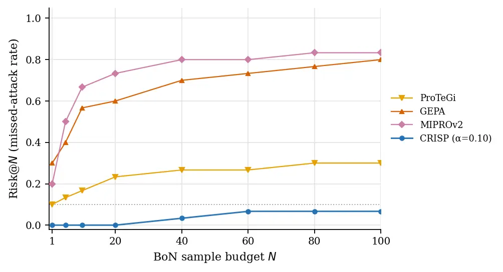

# Risk-Certified Prompt Optimization for LLM-as-a-Judge Guardrails

Hussein Jawad Affiliation: Université d’Évry Val d’Essonne
Affiliation: Capgemini    Alexandre Landeau Affiliation: Capgemini   
Guy Fleury Iradukunda Affiliation: Capgemini    Paul Beaumont
Affiliation: Capgemini Affiliation: CentraleSupélec    Théodore
Rezel  Sofiane Schaack  Nicolas J-B. Brunel Affiliation: Capgemini
Affiliation: École Nationale Supérieure d’Informatique pour l’Industrie
et l’Entreprise (ENSIIE)

###### Abstract

LLM-as-a-judge guardrails are often controlled primarily through system
prompts, yet standard prompt optimization methods target average
performance rather than explicit safety constraints. This paper studies
system-prompt selection as a constrained optimization problem: maximize
benign pass rate while keeping the missed-attack rate below a
user-specified level $`\alpha`$ with finite-sample statistical control.
The framework combines LLM-based judging, automatic prompt generation,
and distribution-free risk control. This work instantiates it in two
procedures: CPS and CRISP. CPS generates a fixed pool of prompts from
training data, then certifies candidates on a held-out evaluation set
using simultaneous upper confidence bounds and selects the certified
prompt with the highest benign utility. CRISP instead integrates risk
feedback into an adaptive search, using hard-example-guided rewriting
and a reusable-holdout interface to steer generation toward the feasible
utility frontier. Experiments on four datasets covering prompt
injection, system-prompt leakage, and sensitive-information disclosure
show that risk-certified selection consistently respects the target
missed-attack level on held-out tests, while utility improves as the
permitted risk is relaxed. CRISP is especially useful when fixed-pool
search fails to produce certifiable high-utility candidates.

|     |
| --- |
|     |

## 1 Introduction

Guardrails are an increasingly important component of LLM-based systems,
where they act as filters that inspect user inputs or model outputs and
decide whether they should be allowed or blocked. They typically operate
as one component within a broader AI pipeline. Existing guardrails take
several forms. Some rely on fine-tuned models trained specifically to
classify content as safe or unsafe. Another practical approach is the
LLM-as-a-judge guardrail, in which a general-purpose language model
(e.g., gpt-5.4) is turned into a guardrail primarily through its system
prompt, without modifying the model weights. The system prompt instructs
the model how to interpret a safety policy and output a binary decision
such as BLOCK or ALLOW. This paper focuses on the second setting and
asks how the system prompt itself can be optimized while providing a
statistically certified bound on missed-attack risk (Zheng et al., 2023;
Zhu et al., 2025; Gu et al., 2026).

Designing such a guardrail involves an asymmetry between the two
possible types of error. Missing a malicious request can expose the
underlying system to an attack, whereas incorrectly blocking a benign
request primarily reduces usability. Consequently, minimizing average
classification error is not necessarily the appropriate objective. In
many deployments, practitioners may instead wish to specify an explicit
risk level $`\alpha`$, and require the missed-attack rate to remain
below this level while allowing as much benign traffic as possible.
Guardrail design therefore naturally becomes a constrained optimization
problem: maximize benign utility subject to $`R\leq\alpha`$, where $`R`$
denotes the missed-attack rate. Importantly, this requirement should
hold not only on the finite dataset used during development, but also on
future samples from the deployment distribution. This is called risk
control, where the goal is to ensure that the deployed guardrail has
risk at most $`\alpha`$ with probability at least $`1-\delta`$ over the
calibration data (Bates et al., 2021; Angelopoulos et al., 2021).

Distribution-free risk control is well understood when the classifier
exposes a continuous score. Conformal prediction (Vovk et al., 2005;
Angelopoulos and Bates, 2023) and its risk-controlling extensions turn a
one-dimensional threshold into a certified operating point: sweep the
threshold on held-out calibration data and return the most permissive
value whose empirical risk survives a statistical test (Bates et al.,
2021; Angelopoulos et al., 2021; Angelopoulos et al., 2024; Quach et
al., 2024). However, a deployed guardrail detector often exposes only a
binary flag or a coarse severity level (Microsoft, 2026b), and many
hosted LLMs do not expose logits: the Claude API has no logprobs
parameter (Anthropic, 2026), and OpenAI reasoning models reject logprobs
(Microsoft, 2026a). If a score threshold is unavailable, the remaining
control surface is the system prompt itself. Risk control then becomes a
search problem: among the prompts we can write, find one whose
missed-attack rate is certified below $`\alpha`$ and whose benign pass
rate is as high as possible. This is harder than threshold tuning,
because prompt space is discrete and unordered.

Our claim: A general-purpose LLM (e.g., gpt-5.4-mini) can be turned into
a guardrail with statistically guaranteed risk control, through
system-prompt optimization alone and without modifying model weights. We
formulate this as risk-certified system-prompt optimization: find a
prompt that maximizes benign utility $`U`$ subject to a safety
constraint $`R\leq\alpha`$, where $`U`$ is the benign query pass rate
and $`R`$ the missed-attack rate. The selected prompt must satisfy this
constraint with high probability over the calibration data.

Our proposal: We combine three ingredients: an LLM-as-a-judge guardrail,
prompt optimization, and distribution-free risk control for
certification. We instantiate this framework in two procedures that
differ in how generation and certification interact:

- •
  CPS: Optimize, then Certify (Section 4.1). CPS first generates a
  fixed, diverse pool of candidate prompts using an existing prompt
  optimizer. It then applies Learn-then-Test (Angelopoulos et al.,
  2021), with Bonferroni multiple-testing correction across candidates,
  to certify prompts whose risk remains below $`\alpha`$, and selects
  the certified prompt with the highest empirical utility.
- •
  CRISP: Risk-aware closed-loop optimization (Section 4.2). CPS can only
  certify prompts already present in its fixed pool; if no high-utility
  feasible prompt is generated, certification cannot recover one. CRISP
  addresses this limitation by integrating risk feedback into prompt
  generation. Using the reusable-holdout mechanism Guess-and-Check
  (Dwork et al., 2015; Rogers et al., 2020), CRISP iteratively rewrites
  prompts toward the constrained Pareto frontier while preserving valid
  risk guarantees.

#### Our Contributions.

1.  1.  We formulate LLM guardrail prompt design as _risk-certified
        system-prompt optimization_ and introduce an
        $`(\alpha,\epsilon,\delta)`$-validity guarantee (Definition 1).
2.  2.  We develop CPS and CRISP to build prompt-based guardrails with
        explicit finite-sample risk guarantees and show that the framework
        is adaptable to multiple threat domains by testing it on prompt
        injection, system prompt leakage, and sensitive information
        disclosure.
3.  3.  Methodologically, we extend the LTT-style setting beyond a fixed
        candidate family to sequential, adaptive candidate selection, where
        the set of tested hypotheses is generated based on calibration
        feedback and the desired risk guarantee.

## 2 Background and Related Work

Our framework lies at the intersection of three research areas: LLM
safety, automatic prompt optimization, and distribution-free risk
control.

#### Guardrails for LLM Systems

Deployed guardrails come in three forms. First, fine-tuned classifiers
(ProtectAI’s DeBERTa detector (ProtectAI, 2024), Prompt Guard (Meta,
2024), PIGuard (Li et al., 2025)) are fast and cheap but tied to their
training distribution: a new policy or attack family requires relabeling
and retraining. Second, safety-tuned LLMs such as Llama Guard (Inan et
al., 2023) and ShieldGemma (Zeng et al., 2024) apply a fixed policy
taxonomy; NeMo Guardrails (Rebedea et al., 2023) instead lets developers
script safety flows. Third, LLM-as-a-judge setting (Zheng et al., 2023;
Gu et al., 2026), where a general-purpose model makes the block/pass
decision straight from a system prompt, which is cheap to adapt but
sensitive to small edits (Sclar et al., 2024; Wang et al., 2024). Across
all these designs the policy prompt is hand-written and then frozen;
none gives a procedure for choosing it under an explicit, statistically
enforced risk level.

#### Automatic Prompt Optimization

These methods search over natural-language instructions to improve
performance on a downstream task. APE (Zhou et al., 2023) generates and
reranks instructions; OPRO (Yang et al., 2024) proposes prompts from a
scored history; EvoPrompt (Guo et al., 2024) and PromptBreeder (Fernando
et al., 2023) apply mutation and crossover; ProTeGi (Pryzant et al., 2023) uses textual gradients; MIPROv2 (Opsahl-Ong et al., 2024) tunes
instructions and demonstrations jointly; GEPA (Agrawal et al., 2025)
adds reflective feedback with Pareto-based selection. All of them search
for prompts that maximize an unconstrained average score and return a
single winner; they do not directly enforce a requirement such as
$`R\leq\alpha`$, nor do they provide a finite-sample guarantee that the
deployed prompt will satisfy that requirement. We use them as candidate
generators and impose the constraint ourselves.

#### Risk Control

Distribution-free risk control uses a finite i.i.d. calibration sample
to return a configuration whose population risk is at most $`\alpha`$
with probability at least $`1-\delta`$. Risk-Controlling Prediction
Sets (Bates et al., 2021) calibrate a scalar threshold under a monotone
loss. Learn-then-Test (LTT) (Angelopoulos et al., 2021) drops
monotonicity: each candidate configuration is tested against the null
hypothesis that it violates the constraint, and a family-wise error rate
correction (e.g., Bonferroni or Holm) ensures that all certified
candidates are simultaneously feasible with probability at least
$`1-\delta`$. Prompt Risk Control (Zollo et al., 2024) uses this
framework to select an LLM prompt from a fixed candidate set.

In each case, the calibrated object is a threshold on a continuous score
or a candidate set fixed in advance, whereas the space of guardrail
prompts is discrete, unordered, and open-ended. CPS generates its pool
of prompts from separate training data and fixes it before
certification, so LTT applies directly using calibration data. CRISP
instead generates each new prompt from earlier certification outcomes,
which makes the tested hypotheses depend on the calibration data; to
keep the guarantee valid, it accesses the calibration set during search
only through the reusable-holdout mechanism Guess-and-Check (Rogers et
al., 2020). This notion of adaptivity differs from that of anytime-valid
inference, e-process-based methods such as adaptive LTT (Zecchin et al.,
2024): these fix the hypotheses and test them on sequentially arriving
data, whereas CRISP fixes the data and generates the hypotheses
sequentially.

## 3 Problem Setup

Let $`x`$ denote a user query and $`y\in\{0,1\}`$ its label, where
$`y=1`$ indicates a malicious input that should be blocked and $`y=0`$
indicates a benign input that should be allowed. Given an LLM judge
$`f`$ and a system prompt $`p\in\mathcal{P}`$, the prompt induces a
binary classifier $`f(p,x)\in\{0,1\}`$, where 1 denotes block and 0
denotes pass. $`f(p,\cdot)`$ is deterministic (greedy decoding,
temperature=0).

### 3.1 Safety Risk and Benign Utility

Given a labeled dataset sample $`D_{n}=\{(X_{i},Y_{i})\}_{i=1}^{n}`$
sampled i.i.d. from an unknown distribution $`\pi`$, we define the
safety _risk_ as the missed-attack (false-negative) rate on malicious
inputs and the _utility_ as the benign pass rate (specificity) on benign
inputs:

```math
R(p)=\Pr_{(x,y)\sim\pi}\bigl(f(p,x)=0\mid y=1\bigr),\qquad U(p)=\Pr_{(x,y)\sim\pi}\bigl(f(p,x)=0\mid y=0\bigr). \tag{1}
```

The corresponding empirical missed-attack and benign pass rates on the
dataset $`D_{n}`$ are:

```math
\widehat{R}(p,D_{n})=\frac{\sum_{i:Y_{i}=1}\mathbf{1}[f(p,X_{i})=0]}{\sum_{i=1}^{n}\mathbf{1}[Y_{i}=1]},\qquad\widehat{U}(p,D_{n})=\frac{\sum_{i:Y_{i}=0}\mathbf{1}[f(p,X_{i})=0]}{\sum_{i=1}^{n}\mathbf{1}[Y_{i}=0]}. \tag{2}
```

### 3.2 Risk-Constrained Prompt Optimization

If the population distribution $`\pi`$ is known, the desired prompt
$`p^{*}`$ would solve the problem

```math
\max_{p\in\mathcal{P}}U(p)\quad\text{s.t.}\quad R(p)\leq\alpha, \tag{3}
```

where $`\alpha\in(0,1)`$ is a user-specified risk level. Thus, among
prompts that satisfy the required safety level, we seek the one that
preserves as much benign traffic as possible. This formulation differs
from standard prompt optimization because safety risk is treated as a
hard constraint, rather than being combined with utility into an
unconstrained average-performance objective.

### 3.3 Statistical Objective

In practice, the distribution $`\pi`$ is unknown and we only have access
to a finite labeled dataset, so the population constraint
$`R(p)\leq\alpha`$ cannot be verified directly. Our statistical
objective is therefore to select a data-dependent prompt $`\hat{p}`$
that achieves high benign utility while satisfying the risk constraint
with probability at least $`1-\delta`$.

###### Definition 1 ($`(\alpha,\epsilon,\delta)`$-valid selection).

A procedure $`\mathcal{A}`$ maps a dataset
$`D_{n}=\{(X_{i},Y_{i})\}_{i=1}^{n}`$ to a pair
$`(\hat{\mathcal{C}},\hat{p})=\mathcal{A}(D_{n})`$, where
$`\hat{\mathcal{C}}=\hat{\mathcal{C}}(D_{n})\subseteq\mathcal{P}`$ is a
finite set of _candidates_ and $`\hat{p}\in\hat{\mathcal{C}}`$ is the
deployed prompt. For $`\alpha,\delta\in(0,1)`$ and a tolerance
$`\epsilon=\epsilon(D_{n})\geq 0`$, we say that $`\mathcal{A}`$ is
_$`(\alpha,\epsilon,\delta)`$-valid_ if:

```math
\Pr_{D_{n}\sim\pi^{n}}\!\Big(\max_{p\in\hat{\mathcal{C}}}R(p)\leq\alpha\ \text{and}\ \ U(\hat{p})\geq\max_{p\in\hat{\mathcal{C}}}U(p)-\epsilon\Big)\ \geq\ 1-\delta. \tag{4}
```

## 4 Methods

Figure 1: CPS: fixed-pool prompt generation, risk certification, and
utility-based selection.

We propose two methods that differ in how candidate generation and risk
certification interact. We draw $`D_{n}\sim\pi^{n}`$ i.i.d. and
partition it into three disjoint subsets: $`D_{\mathrm{train}}`$ (used
by the generator), $`D_{\mathrm{cert}}`$ (used only for certification
and prompt selection), and $`D_{\mathrm{test}}`$ (used only for final
evaluation). We further partition $`D_{\mathrm{cert}}`$ by label:

```math
D^{\mathrm{mal}}_{\mathrm{cert}}=\{(X_{i},Y_{i})\in D_{\mathrm{cert}}:Y_{i}=1\},\qquad D^{\mathrm{ben}}_{\mathrm{cert}}=\{(X_{i},Y_{i})\in D_{\mathrm{cert}}:Y_{i}=0\} \tag{5}
```

and write $`m:=|D^{\mathrm{mal}}_{\mathrm{cert}}|`$ and
$`b:=|D^{\mathrm{ben}}_{\mathrm{cert}}|`$.

Clopper–Pearson bounds. In both CPS and CRISP, we use the
Clopper–Pearson bound (Clopper and Pearson, 1934) to obtain an upper
confidence bound on risk at failure level $`\beta\in(0,1)`$:

```math
R_{\mathrm{ucb}}(p,D_{\mathrm{cert}},\beta)=\mathrm{Beta}^{-1}\left(1-\beta;\,k_{p}+1,\,m-k_{p}\right),\qquad k_{p}=m\,\widehat{R}(p,D_{\mathrm{cert}}), \tag{6}
```

where $`m`$ is the number of malicious examples and $`k_{p}`$ is the
number of missed attacks (false negatives).

###### Assumption 1 (Calibration sampling).

Conditional on the label counts $`(m,b)`$, the subsamples
$`D^{\mathrm{mal}}_{\mathrm{cert}}`$ and
$`D^{\mathrm{ben}}_{\mathrm{cert}}`$ are independent i.i.d. samples from
$`\pi(\cdot\mid y=1)`$ and $`\pi(\cdot\mid y=0)`$, respectively.

### 4.1 CPS: Certified Prompt Search

Idea. CPS separates prompt generation from statistical certification. A
prompt optimizer first generates a fixed candidate pool using only
$`D_{\mathrm{train}}`$. CPS then evaluates these candidates on the
held-out $`D_{\mathrm{cert}}`$, certifies those whose risk upper
confidence bound is below the target $`\alpha`$, and selects the
certified prompt with the highest benign utility.

Procedure.

1.  1.  Generate a fixed candidate pool. Draw $`N`$ bootstrap resamples of
        size $`B`$ from $`D_{\mathrm{train}}`$, giving
        $`\{D_{1},D_{2},...,D_{N}\}`$, and run a prompt optimizer (e.g.,
        GEPA) on each to obtain

    ```math
    \mathcal{P}_{\mathrm{train}}=\{p_{1},\ldots,p_{N}\},\qquad p_{i}=\mathrm{GEPA}(D_{i}). \tag{7}
    ```

2.  2.  Compute risk certificates. For each
        $`p_{j}\in\mathcal{P}_{\mathrm{train}}`$, evaluate the risk upper
        confidence bound on $`D_{\mathrm{cert}}`$ using equation (6) at the
        Bonferroni corrected level $`\delta_{R}/N`$ (Dunn, 1961):

    ```math
    R_{\mathrm{ucb}}(p_{j})=R_{\mathrm{ucb}}(p_{j},D_{\mathrm{cert}},\delta_{R}/N)
    ```

    .

3.  3.  Form the certified set. Retain candidates whose upper risk bound
        satisfies the target:

    ```math
    \mathcal{C}=\left\{p_{j}\in\mathcal{P}_{\mathrm{train}}:R_{\mathrm{ucb}}(p_{j})\leq\alpha\right\}. \tag{8}
    ```

4.  4.  Select by benign utility. Evaluate the empirical benign utility of
        each certified candidate on the benign examples in
        $`D_{\mathrm{cert}}`$, and return

    ```math
    \hat{p}=\arg\max_{p_{j}\in\mathcal{C}}\widehat{U}(p_{j},D_{\mathrm{cert}}). \tag{9}
    ```

Proposition 1 (CPS risk control and utility). Under Assumption 1, for
the input failure level $`\delta_{R}`$, any $`\delta_{U}\in(0,1)`$, and
$`\epsilon_{U}=\sqrt{\frac{2\log(2N/\delta_{U})}{b}}`$, the prompt
$`\hat{p}`$ selected by CPS satisfies:

```math
\Pr_{D^{\mathrm{mal}}_{\mathrm{cert}}\sim\pi_{1}^{m},\;D^{\mathrm{ben}}_{\mathrm{cert}}\sim\pi_{0}^{b}}\!\left(R(\hat{p})\leq\alpha\;\text{and}\;U(\hat{p})\geq\max_{p\in\mathcal{C}}U(p)-\epsilon_{U}\right)\geq 1-\delta_{R}-\delta_{U}, \tag{10}
```

with the convention that when $`\mathcal{C}=\emptyset`$, CPS abstains
and the event holds. (Proof in Appendix B.1).

### 4.2 CRISP: Constrained Risk-calibrated Iterative System-Prompt Optimization

Motivation. CPS generates a fixed pool of prompts before certification.
While this makes statistical control straightforward, it creates a
_generation gap_: if the initial pool contains no prompt satisfying the
risk constraint, certification alone cannot produce one. CRISP closes
this gap by feeding risk certificates back into prompt generation,
allowing the search to move toward high-utility prompts near the
certification boundary.

Two-population constrained search. Inspired by FI-2pop (Kimbrough et
al., 2008), at iteration $`t`$ CRISP partitions the explored prompts
$`\mathcal{P}_{t}`$ into a certified set $`\mathcal{C}_{t}`$
($`R_{\mathrm{ucb}}(p)\leq\alpha`$) and an uncertified set
$`\mathcal{U}_{t}`$ ($`\mathcal{P}_{t}\setminus\mathcal{C}_{t}`$). The
two populations serve different search objectives: certified prompts are
optimized for utility, while uncertified prompts are optimized to reduce
constraint violation. This lets CRISP improve prompts already inside the
feasible region while simultaneously pushing promising infeasible
prompts toward certification.

Algorithm. Each round of Algorithm 1 makes up to two proposals.
ImproveUtility selects the certified prompt with the highest training
utility and rewrites it to admit benign cases that are currently
over-blocked. ReduceRisk selects the uncertified prompt with the lowest
training risk and rewrites it to block attacks that are currently
missed. Each rewrite is a single LLM call that receives the parent
prompt, its current risk, the budget $`\alpha`$, and a few hard examples
mined only from $`D_{\mathrm{train}}`$ (templates in Appendix A.6).
Every proposed prompt is then evaluated by Guess-and-Check (GnC) (Rogers
et al., 2020) to give an upper confidence bound on the risk.

Guess-and-Check (Algorithm 2) has three stages. _Guess:_ GnC computes a
Clopper–Pearson upper bound $`\hat{a}_{g}+\tau_{g}`$ on
$`D_{\mathrm{train}}`$; if it already exceeds $`\alpha`$, GnC returns
$`r_{p}=1`$ without accessing the holdout. _Check:_ otherwise it
computes the corresponding bound $`\hat{a}_{h}+\tau_{h}`$ on
$`D^{\mathrm{mal}}_{\mathrm{cert}}`$. If the training bound is strictly
more conservative than the holdout bound, GnC releases the training
bound, revealing only that the check succeeded. _Discretize:_ if the
check fails, GnC releases a coarsened holdout estimate,
$`[\hat{a}_{h}]_{\gamma}+\tau_{g}`$, and charges a failure. Confidence
levels $`\beta_{i}`$ are allocated across checks and failures using the
summable weights $`c_{j}=6/(\pi^{2}(j+1)^{2})`$. Once no valid
discretization remains, the reusable-holdout budget is exhausted: GnC
returns $`\bot`$ and CRISP stops.

Validity under adaptivity. CRISP never accesses
$`D^{\mathrm{mal}}_{\mathrm{cert}}`$ directly; it observes it only
through GnC’s restricted outputs. Later proposals may therefore depend
on earlier certificates without unrestricted reuse of the protected
holdout. Moreover, risk depends only on malicious examples (Eq. 2), so
the search never reads $`D^{\mathrm{ben}}_{\mathrm{cert}}`$. The benign
certification examples consequently remain fresh for the final
utility-based selection among the certified prompts, of which there are
at most $`2T+1`$.

Figure 2: CRISP: adaptive prompt search with reusable-holdout risk
certification.

Proposition 2 (CRISP risk control and utility). Under Assumption 1, for
the input failure level $`\delta_{R}`$, any $`\delta_{U}\in(0,1)`$, and
$`\epsilon_{U}=\sqrt{\frac{2\log(2K/\delta_{U})}{b}}`$ with $`K=2T+1`$,
the prompt $`\hat{p}`$ selected by CRISP satisfies:

```math
\Pr_{D^{\mathrm{mal}}_{\mathrm{cert}}\sim\pi_{1}^{m},\;D^{\mathrm{ben}}_{\mathrm{cert}}\sim\pi_{0}^{b}}\!\left(R(\hat{p})\leq\alpha\;\text{and}\;U(\hat{p})\geq\max_{p\in\mathcal{C}_{T}}U(p)-\epsilon_{U}\right)\geq 1-\delta_{R}-\delta_{U}, \tag{11}
```

with the convention that when $`\mathcal{C}_{T}=\emptyset`$, CRISP
abstains and the event holds. (Proof in Appendix B.2).

1: Inputs: judge $`f`$, splits $`D_{\mathrm{train}},D_{\mathrm{cert}}`$,
risk budget $`\alpha`$, failure level $`\delta_{R}`$

2: Hyperparams: rounds $`T`$, seed $`p_{0}`$

3: Initialize pool

4:
$`r_{p_{0}}\leftarrow\textsc{GnC}(p_{0},\alpha,\delta_{R},D_{\mathrm{train}},D_{\mathrm{cert}})`$

5: $`\mathcal{P}_{0}\leftarrow\{p_{0}\}`$

6: Search round

7: for $`t=0,\ldots,T-1`$ do

8:
  $`\mathcal{C}_{t}\leftarrow\{p\in\mathcal{P}_{t}:r_{p}\leq\alpha\}`$;
$`\mathcal{U}_{t}\leftarrow\mathcal{P}_{t}\setminus\mathcal{C}_{t}`$

9:  Improve objective (utility)

10:   if $`\mathcal{C}_{t}\neq\emptyset`$ then

11:
   $`p^{+}\leftarrow\arg\max_{p\in\mathcal{C}_{t}}\widehat{U}(p,D_{\mathrm{train}})`$

12:
   $`p_{U}\leftarrow\textsc{ImproveUtility}(p^{+},D_{\mathrm{train}})`$

13:
   $`r_{p_{U}}\leftarrow\textsc{GnC}(p_{U},\alpha,\delta_{R},D_{\mathrm{train}},D_{\mathrm{cert}})`$

  

14:  Reduce violation (risk)

15:   if $`\mathcal{U}_{t}\neq\emptyset`$ then

16:
   $`p^{-}\leftarrow\arg\min_{p\in\mathcal{U}_{t}}\widehat{R}(p,D_{\mathrm{train}})`$

17:    $`p_{R}\leftarrow\textsc{ReduceRisk}(p^{-},D_{\mathrm{train}})`$

18:
   $`r_{p_{R}}\leftarrow\textsc{GnC}(p_{R},\alpha,\delta_{R},D_{\mathrm{train}},D_{\mathrm{cert}})`$

  

19:  Stop or append prompts

20:   if $`r_{p_{U}}=\bot`$ or $`r_{p_{R}}=\bot`$ then break

21:   else
$`\mathcal{P}_{t+1}\leftarrow\mathcal{P}_{t}\cup\{p_{R},p_{U}\}`$

22: Final prompt select

23: $`\mathcal{C}_{T}\leftarrow\{p\in\mathcal{P}_{T}:r_{p}\leq\alpha\}`$

24: return
$`\arg\max_{p\in\mathcal{C}_{T}}\widehat{U}(p,D_{\mathrm{cert}})`$

Algorithm 1 CRISP

1: function
GnC($`p,\alpha,\delta,D_{\mathrm{train}},D_{\mathrm{cert}}`$)

2: Charge query

3:
$`\nu\leftarrow\binom{i}{f}\prod_{\gamma\in\Gamma}\left(\lfloor 1/\gamma\rfloor+1\right)`$

4: $`\beta_{i}\leftarrow\delta\cdot c_{i}\cdot c_{f}/\nu`$,
$`c_{j}=6/\!\left(\pi^{2}(j+1)^{2}\right)`$

5: Guess

6: $`\hat{a}_{g}\leftarrow\widehat{R}(p,D_{\mathrm{train}})`$

7:
$`\tau_{g}\leftarrow R_{\mathrm{ucb}}(p,D_{\mathrm{train}},\beta_{i})-\hat{a}_{g}`$

8: if $`\hat{a}_{g}+\tau_{g}>\alpha`$ then return 1

9: Check

10: $`i\leftarrow i+1`$

11: $`\hat{a}_{h}\leftarrow\widehat{R}(p,D_{\mathrm{cert}})`$

12:
$`\tau_{h}\leftarrow R_{\mathrm{ucb}}(p,D_{\mathrm{cert}},\beta_{i})-\hat{a}_{h}`$

13: if $`\hat{a}_{g}+\tau_{g}>\hat{a}_{h}+\tau_{h}`$ then return
$`\hat{a}_{g}+\tau_{g}`$

14: Discretize rate

15: $`f\leftarrow f+1`$

16:
$`\mathcal{G}\leftarrow\bigl\{\gamma\in(0,\tau_{g}):2e^{-2(\tau_{g}-\gamma)^{2}m}\leq\beta_{i}\bigr\}`$

17: if $`\mathcal{G}\neq\emptyset`$ then

18:   $`\gamma\leftarrow\max\mathcal{G}`$; append $`\gamma`$ to
$`\Gamma`$

19:   return $`[\hat{a}_{h}]_{\gamma}+\tau_{g}`$

20: Return bot

21: return $`\bot`$ (stop the optimization)

22: end function

23:  

24: Note.

25: • $`R_{\mathrm{ucb}}(p,D,\beta)`$ is the Clopper–Pearson (eq. 6).

26: • $`[\hat{a}_{h}]_{\gamma}=\gamma\lfloor\hat{a}_{h}/\gamma\rfloor`$
is rounding down to the $`\gamma`$-grid.

27: • $`\lfloor 1/\gamma\rfloor+1`$ is the number of points on the
$`\gamma`$-grid.

28: • $`\Gamma{=}(\gamma_{1},\ldots,\gamma_{f})`$ is an ordered list.

Algorithm 2 Guess-and-Check (GnC)

## 5 Experiments

### 5.1 Setup

We evaluate on four datasets spanning three guardrail tasks. Prompt
injection uses BIPIA (Yi et al., 2025), where malicious examples embed
an indirect injection in otherwise benign external context, and Deepset,
a smaller public set of direct prompt-injection and jailbreak inputs.
The two output-guardrail tasks are system-prompt leakage (SPL) and
sensitive-information disclosure (SID). In SPL the judge screens an
assistant response given a confidential system prompt; in SID it screens
a response given a list of protected items, using BeaverTails
privacy-violation examples (Ji et al., 2023). Across all datasets,
$`y=1`$ denotes a violation that should be blocked and $`y=0`$ a benign
case that should be allowed. Each dataset is randomly partitioned into
disjoint training, certification, and test splits. The training split
$`D_{\mathrm{train}}`$ is used only for prompt generation and rewriting,
$`D_{\mathrm{cert}}`$ for certification and prompt selection, and
$`D_{\mathrm{test}}`$ only for final evaluation. Dataset construction,
filtering, and split counts are given in Appendix A.

CPS constructs a pool of $`N=20`$ candidate prompts before
certification, and CRISP uses $`T=20`$ rounds. If no candidate can be
certified at a given risk level $`\alpha`$, we report “–” rather than
returning an uncertified prompt. We compare against a fixed unoptimized
prompt (Naive); unconstrained prompt optimizers that maximize average
performance (ProTeGi, GEPA, and MIPROv2); and, for prompt injection,
dedicated classifier-based guardrails (ProtectAI, PIGuard, Prompt Guard,
and Model Armor (Google Cloud, 2026)). Figure 3 additionally evaluates
selected prompts under Best-of-$`N`$ jailbreaking (Hughes et al., 2025)
on BIPIA (Appendix A.5).

Unless otherwise stated, every prompt-optimization method, including CPS
and CRISP, starts from the same task-specific seed and uses gpt-5.4-mini
as the prompt generator/rewriter. LLM-as-a-judge results are reported
with two judges, gpt-4o-mini and gpt-5.4-mini (Table 1);
output-guardrail results use gpt-5.4-mini. The judge uses greedy
decoding (temperature = 0). We set the failure level to $`\delta=0.10`$,
report prompt-injection results at $`\alpha\in\{0.10,0.20,0.30\}`$, and
report output-guardrail results at $`\alpha=0.30`$. Hyperparameters,
seed prompts, and the Best-of-$`N`$ protocol are in Appendix A.

|                          |                                |              |                    |                     |                    |                     |
| ------------------------ | ------------------------------ | ------------ | ------------------ | ------------------- | ------------------ | ------------------- |
| LLM-as-a-judge guardrail |                                | Method       | BIPIA              |                     | Deepset            |                     |
|                          |                                |              | Risk$`\downarrow`$ | Utility$`\uparrow`$ | Risk$`\downarrow`$ | Utility$`\uparrow`$ |
| –                        | Baseline classifier guardrails | ProtectAI    | 0.88               | 0.88                | 0.55               | 0.99                |
|                          |                                | PIGuard      | 0.15               | 0.86                | 0.08               | 1.00                |
|                          |                                | Prompt Guard | 0.13               | 0.78                | 0.07               | 0.14                |
|                          |                                | Model Armor  | 0.94               | 0.98                | 0.72               | 0.98                |
| gpt-4o-mini              | Baseline prompt optimization   | Naive        | 0.60               | 0.90                | 0.29               | 0.92                |
|                          |                                | ProTeGi      | 0.19               | 0.80                | 0.07               | 0.95                |
|                          |                                | GEPA         | 0.33               | 0.90                | 0.16               | 0.95                |
|                          |                                | MIPROv2      | 0.37               | 0.88                | 0.29               | 0.97                |
|                          | Ours ($`\alpha{=}0.1`$)        | CPS          | 0.06               | 0.84                | –                  | –                   |
|                          |                                | CRISP        | 0.02               | 0.58                | 0.02               | 0.83                |
|                          | Ours ($`\alpha{=}0.2`$)        | CPS          | 0.12               | 0.86                | 0.05               | 0.97                |
|                          |                                | CRISP        | 0.11               | 0.86                | 0.13               | 0.95                |
|                          | Ours ($`\alpha{=}0.3`$)        | CPS          | 0.25               | 0.88                | 0.16               | 0.96                |
|                          |                                | CRISP        | 0.20               | 0.86                | 0.11               | 0.96                |
| gpt-5.4-mini             | Baseline prompt optimization   | Naive        | 0.38               | 0.93                | 0.35               | 0.97                |
|                          |                                | ProTeGi      | 0.15               | 0.78                | 0.11               | 0.99                |
|                          |                                | GEPA         | 0.40               | 0.95                | 0.15               | 1.00                |
|                          |                                | MIPROv2      | 0.21               | 0.88                | 0.24               | 0.99                |
|                          | Ours ($`\alpha{=}0.1`$)        | CPS          | –                  | –                   | –                  | –                   |
|                          |                                | CRISP        | 0.01               | 0.78                | 0.04               | 0.94                |
|                          | Ours ($`\alpha{=}0.2`$)        | CPS          | –                  | –                   | 0.09               | 0.99                |
|                          |                                | CRISP        | 0.14               | 0.85                | 0.05               | 0.99                |
|                          | Ours ($`\alpha{=}0.3`$)        | CPS          | 0.17               | 0.86                | 0.15               | 1.00                |
|                          |                                | CRISP        | 0.18               | 0.89                | 0.09               | 1.00                |

Table 1: Prompt-injection test results. Target risk levels:
$`\alpha\in\{0.10,0.20,0.30\}`$.

|                              |         |                    |                     |                    |                     |
| ---------------------------- | ------- | ------------------ | ------------------- | ------------------ | ------------------- |
|                              | Method  | SPL (leakage)      |                     | SID (BeaverTails)  |                     |
|                              |         | Risk$`\downarrow`$ | Utility$`\uparrow`$ | Risk$`\downarrow`$ | Utility$`\uparrow`$ |
| Baseline prompt optimization | Naive   | 0.17               | 0.38                | 0.52               | 1.00                |
|                              | ProTeGi | 0.15               | 0.78                | 0.13               | 0.93                |
|                              | GEPA    | 0.17               | 0.58                | 0.12               | 0.95                |
|                              | MIPROv2 | 0.06               | 0.65                | 0.13               | 0.97                |
| Ours ($`\alpha{=}0.3`$)      | CPS     | 0.21               | 0.78                | 0.15               | 0.97                |
|                              | CRISP   | 0.08               | 0.60                | 0.22               | 0.96                |

Table 2: Output-guardrail test results



Figure 3: Best-of-$`N`$ jailbreaking on BIPIA. Missed-attack risk as a
function of the attacker query budget $`N`$, using gpt-4o-mini as the
judge.

### 5.2 Results and Discussion

Risk calibration holds on test data. Across all prompt-injection
configurations in Table 1 where a prompt was certified (two LLM judges,
two datasets, three risk levels, two methods), the missed-attack rate
measured on the untouched test split stays at or below the target
$`\alpha`$. The same holds on both output-guardrail tasks at
$`\alpha{=}0.30`$ (Table 2). This empirical pattern is consistent with
Propositions 1 and 2: certification is performed on $`D_{\text{cert}}`$
to control population risk on fresh samples from the same distribution
with high probability. Unconstrained baselines provide no such
guarantee.

The target risk level is a usable control knob. Relaxing $`\alpha`$
moves the selected prompt along the risk–utility frontier in the
expected direction. For CRISP with gpt-4o-mini, benign utility rises
from $`0.58`$ at $`\alpha{=}0.10`$ to $`0.86`$ at $`\alpha{=}0.30`$ on
BIPIA, and from $`0.83`$ to $`0.96`$ on Deepset. With gpt-5.4-mini it
rises monotonically from $`0.78`$ to $`0.85`$ to $`0.89`$ on BIPIA and
from $`0.94`$ to $`1.00`$ on Deepset. Test risk generally increases
accordingly but remains within the target risk level. Practitioners
therefore can set the safety–usability trade-off explicitly.

Certification preserves competitive utility while enforcing the risk
constraint. Certified prompts remain competitive with, and often
outperform, unconstrained optimizers at similar risk. At
$`\alpha{=}0.20`$, on BIPIA with gpt-4o-mini, CPS and CRISP achieve
$`R{=}0.12/0.11`$ and $`U{=}0.86`$, compared with ProTeGi’s
$`R{=}0.19`$, $`U{=}0.80`$. With gpt-5.4-mini, CRISP similarly improves
over ProTeGi ($`0.14/0.85`$ vs. $`0.15/0.78`$). On Deepset with
gpt-5.4-mini, CRISP at $`\alpha{=}0.20`$ matches GEPA and ProTeGi
utility while lowering risk ($`0.05/0.99`$ vs. GEPA’s $`0.15/1.00`$ and
ProTeGi’s $`0.11/0.99`$).

Closing the generation gap. The main difference between CPS and CRISP is
certifiability. CPS returns an empty certified set in four of twelve
prompt-injection settings, whereas CRISP certifies a prompt in all
twelve. CPS can fail when its fixed candidate pool contains no prompt
that can be certified, either because finite-sample uncertainty makes
certification conservative or because the generator fails to explore
sufficiently low-risk prompts. CRISP addresses this generation gap by
using risk feedback to steer prompt generation toward certifiable
candidates (Section 4.2).

A general-purpose judge matches dedicated classifiers. On prompt
injection, PIGuard is the strong classifier baseline. CPS and CRISP
match its performance without any fine-tuning. At $`\alpha{=}0.20`$ on
BIPIA, CRISP with gpt-4o-mini ($`0.11/0.86`$) improves on PIGuard
($`0.15/0.86`$). On Deepset, CRISP with gpt-5.4-mini ($`0.05/0.99`$)
matches it ($`0.08/1.00`$), and CRISP/CPS additionally carry
finite-sample guarantees.

Output guardrails present a different trade-off. On SPL and SID,
certified selection does not uniformly dominate the unconstrained
baselines, but it consistently returns operating points that satisfy the
target $`\alpha=0.30`$. On SPL, CPS matches ProTeGi’s utility
($`0.78`$), while CRISP attains lower risk ($`0.08`$) at lower utility
($`0.60`$). On SID, CPS and CRISP achieve high utility ($`0.97`$ and
$`0.96`$) with risks of $`0.15`$ and $`0.22`$, whereas the Naive prompt
reaches utility $`1.00`$ but violates the target with risk $`0.52`$.
Thus, the main benefit in this regime is certified feasibility rather
than uniform frontier improvement.

Robustness beyond the static certificate. We evaluate the selected
prompts under Best-of-$`N`$ jailbreaking (Figure 3), which measures
missed-attack risk as the attacker is permitted an increasing query
budget $`N`$. For each example, the attacker may issue up to $`N`$
queries, and the attack is considered successful if at least one query
is allowed by the guardrail; full evaluation details are provided in
Appendix A.5. As $`N`$ increases, prompts produced by unconstrained
optimizers degrade substantially: MIPROv2 reaches a missed-attack rate
of 0.8 by $`N=40`$, and GEPA reaches 0.8 by $`N=100`$. In contrast,
CRISP at $`\alpha=0.10`$ remains at or below 0.07 through $`N=100`$,
below the dotted $`\alpha=0.10`$ reference line. This experiment is a
robustness diagnostic rather than part of the certification guarantee,
which does not extend to this multi-query attack setting.

Additional empirical analysis. We provide ablations on the CRISP search
horizon in Appendix A.7 and an evaluation of the risk-control guarantee
across repeated data splits in Appendix A.8.

## 6 Limitations

The $`(\alpha,\epsilon,\delta)`$-validity guarantee is finite-sample and
distribution-free, but it is not unconditional. It applies under i.i.d.
sampling from the calibration distribution $`\pi`$ (Definition 1 and
Assumption 1). A shift in the attack mix, user population, or judge
model can invalidate the certificate, and certification cannot recover a
high-utility feasible prompt if the generator never proposes one—which
is why CPS can return an empty certified set. The bound likewise does
not cover adaptive adversaries: Best-of-$`N`$ jailbreaking is a
robustness diagnostic, not a certified guarantee. Practically, both
procedures require labeled malicious and benign data, and small
certification sets make Clopper–Pearson and Guess-and-Check bounds
conservative; CRISP may also stop early when the reusable-holdout budget
is exhausted. We further restrict to a binary, greedy-decoded judge with
a single missed-attack constraint. Stochastic decoding, multi-category
policies, and joint control of over-blocking remain open.

## 7 Conclusion

We framed LLM-as-a-judge guardrail design as risk-certified
system-prompt optimization: maximize benign pass rate subject to a
user-specified missed-attack budget, with finite-sample statistical
control. CPS generates a fixed pool and then certifies it; CRISP feeds
risk certificates back into search so that certifiable high-utility
prompts can be found when a fixed pool fails. On four datasets covering
prompt injection, system-prompt leakage, and sensitive-information
disclosure, selected prompts respect the target risk on held-out tests,
utility tracks the permitted budget, and CRISP succeeds in settings
where fixed-pool search cannot certify. A general-purpose judge,
prompted rather than fine-tuned, is competitive with dedicated injection
classifiers while remaining retargetable to a new policy or risk level
by rerunning the search. We view certified prompts as one layer in a
defense-in-depth stack, not a substitute for monitoring under
distribution shift or adaptive attack.

## 8 AI use statement

Generative AI tools were used only as writing assistants in preparing
this manuscript: we used them to improve transitions, correct grammar,
and provide editorial feedback that informed our revisions. They were
not used to generate synthetic datasets, develop theoretical models or
conceptual frameworks, formulate mathematical claims, assist with
proofs, propose or refine hypotheses, design experiments, implement
methods, clean or reformat data, or interpret results. Translation,
qualitative or thematic analysis, and survey design do not apply to this
work. The LLM-as-a-judge guardrail and prompt rewriter described in
Sections 4–5 are components of the method being studied, rather than
tools used to prepare the manuscript. We reviewed all AI-suggested
wording and take full responsibility for the final content, including
text produced with generative AI assistance.

## 9 Ethics statement

This work concerns the defensive calibration of LLM-as-a-judge
guardrails: selecting a system prompt that maximizes the benign pass
rate while keeping the missed-attack rate below a user-specified level,
backed by a finite-sample certificate. Its intended use is to help
practitioners set an explicit safety–utility trade-off, not to weaken
deployed systems.

Evaluating guardrails necessarily involves harmful inputs, including
prompt injection, system-prompt leakage, sensitive-information
disclosure, and the Best-of-$`N`$ robustness diagnostic of Figure 3. We
therefore rely on existing public benchmarks and published red-teaming
plugins rather than a new exploit pipeline, and we omit step-by-step
instructions for attacking production systems. As noted in Section 6,
the certificate covers neither adaptive adversaries nor distribution
shift, so certified prompts should be treated as one layer in a
defense-in-depth stack rather than as unconditional safety.

BIPIA, Deepset, and BeaverTails are publicly released datasets. SPL, by
contrast, is not a fully public benchmark: it combines the public
HuggingFace set gabrielchua/system-prompt-leakage with
Promptfoo-generated extraction and hijacking attempts against synthetic
confidential system prompts (Appendix A.1). No new human-subjects data
were collected, so no IRB protocol was required. SID examples are drawn
from BeaverTails privacy-violation and safe responses; we introduce no
additional personal data and use screening payloads solely to evaluate
disclosure detection. Finally, we do not study demographic fairness of
over-blocking: utility is an aggregate benign pass rate, which may mask
unequal error rates across user groups.

## References

- Agrawal et al. (2025) L. A. Agrawal, S. Tan, D. Soylu, N. Ziems, R.
  Khare, K. Opsahl-Ong, A. Singhvi, H. Shandilya, M. J. Ryan, M. Jiang,
  et al. Gepa: reflective prompt evolution can outperform reinforcement
  learning, 2025. URL https://arxiv. org/abs/2507.19457 2 (3), pp. 4.
  Cited by: §2.
- Angelopoulos et al. (2024) A. Angelopoulos, S. Bates, A. Fisch, L.
  Lei, and T. Schuster Conformal risk control. In International
  conference on learning representations, Vol. 2024, pp. 55198–55218.
  Cited by: §1.
- Angelopoulos and Bates (2023) A. N. Angelopoulos and S. Bates
  Conformal prediction: a gentle introduction. Foundations and Trends in
  Machine Learning 16 (4), pp. 494–591. Cited by: §1.
- Angelopoulos et al. (2021) A. N. Angelopoulos, S. Bates, E. J.
  Candès, M. I. Jordan, and L. Lei Learn then test: calibrating
  predictive algorithms to achieve risk control. arXiv preprint
  arXiv:2110.01052. Cited by: 1st item, §1, §1, §2.
- Anthropic (2026) Anthropic Messages API reference. Note:
  [https://platform.claude.com/docs/en/api/messages](https://platform.claude.com/docs/en/api/messages)Accessed
  2026-09-16 Cited by: §1.
- Bates et al. (2021) S. Bates, A. Angelopoulos, L. Lei, J. Malik,
  and M. I. Jordan Distribution-free, risk-controlling prediction sets.
  Journal of the ACM 68 (6), pp. 1–34. Cited by: §1, §1, §2.
- Clopper and Pearson (1934) C. J. Clopper and E. S. Pearson The use of
  confidence or fiducial limits illustrated in the case of the binomial.
  Biometrika 26 (4), pp. 404–413. Cited by: §B.1, §4.
- Dunn (1961) O. J. Dunn Multiple comparisons among means. Journal of
  the American Statistical Association 56 (293), pp. 52–64. External
  Links: [Document](https://dx.doi.org/10.1080/01621459.1961.10482090)
  Cited by: item 2.
- Dwork et al. (2015) C. Dwork, V. Feldman, M. Hardt, T. Pitassi, O.
  Reingold, and A. Roth The reusable holdout: preserving validity in
  adaptive data analysis. Science 349 (6248), pp. 636–638. Cited by: 2nd
  item.
- Fernando et al. (2023) C. Fernando, D. Banarse, H. Michalewski, S.
  Osindero, and T. Rocktäschel Promptbreeder: self-referential
  self-improvement via prompt evolution. arXiv preprint
  arXiv:2309.16797. Cited by: §2.
- Google Cloud (2026) Google Cloud Model armor overview. Note:
  [https://docs.cloud.google.com/model-armor/overview](https://docs.cloud.google.com/model-armor/overview)
  Cited by: §5.1.
- Gu et al. (2026) J. Gu, X. Jiang, Z. Shi, H. Tan, X. Zhai, C. Xu, W.
  Li, Y. Shen, S. Ma, H. Liu, et al. A survey on llm-as-a-judge. The
  Innovation 7 (6). Cited by: §1, §2.
- Guo et al. (2024) Q. Guo, R. Wang, J. Guo, B. Li, K. Song, X. Tan, G.
  Liu, J. Bian, and Y. Yang Connecting large language models with
  evolutionary algorithms yields powerful prompt optimizers. In
  International Conference on Learning Representations (ICLR), Cited by:
  §2.
- Hoeffding (1963) W. Hoeffding Probability inequalities for sums of
  bounded random variables. Journal of the American statistical
  association 58 (301), pp. 13–30. Cited by: §B.1.
- Hughes et al. (2025) J. Hughes, S. Price, A. Lynch, R. Schaeffer, F.
  Barez, A. Somani, S. Koyejo, H. Sleight, E. Jones, E. Perez, et al.
  Best-of-n jailbreaking. Advances in Neural Information Processing
  Systems 38, pp. 73137–73221. Cited by: §A.5, §5.1.
- Inan et al. (2023) H. Inan, K. Upasani, J. Chi, R. Rungta, K. Iyer, Y.
  Mao, M. Tontchev, Q. Hu, B. Fuller, D. Testuggine, and M. Khabsa Llama
  guard: llm-based input-output safeguard for human-ai conversations.
  arXiv preprint arXiv:2312.06674. Cited by: §2.
- Ji et al. (2023) J. Ji, M. Liu, J. Dai, X. Pan, C. Zhang, C. Bian, B.
  Chen, R. Sun, Y. Wang, and Y. Yang Beavertails: towards improved
  safety alignment of llm via a human-preference dataset. Advances in
  Neural Information Processing Systems 36, pp. 24678–24704. Cited by:
  §A.1, Table 3, §5.1.
- Kimbrough et al. (2008) S. O. Kimbrough, G. J. Koehler, M. Lu,
  and D. H. Wood On a feasible–infeasible two-population (fi-2pop)
  genetic algorithm for constrained optimization: distance tracing and
  no free lunch. European journal of operational research 190 (2),
  pp. 310–327. Cited by: §4.2.
- Li et al. (2025) H. Li, X. Liu, N. Zhang, and C. Xiao PIGuard: prompt
  injection guardrail via mitigating overdefense for free. In
  Proceedings of the 63rd Annual Meeting of the Association for
  Computational Linguistics (Volume 1: Long Papers), pp. 30420–30437.
  Cited by: §2.
- Meta (2024) Meta Prompt guard. Note:
  [https://www.llama.com/docs/model-cards-and-prompt-formats/prompt-guard](https://www.llama.com/docs/model-cards-and-prompt-formats/prompt-guard)Model
  card Cited by: §2.
- Microsoft (2026a) Microsoft Azure OpenAI reasoning models. Note:
  [https://learn.microsoft.com/azure/foundry/openai/how-to/reasoning](https://learn.microsoft.com/azure/foundry/openai/how-to/reasoning)Accessed
  2026-09-16 Cited by: §1.
- Microsoft (2026b) Microsoft Harm categories in azure AI content
  safety. Note:
  [https://learn.microsoft.com/azure/ai-services/content-safety/concepts/harm-categories](https://learn.microsoft.com/azure/ai-services/content-safety/concepts/harm-categories)Accessed
  2026-09-16 Cited by: §1.
- Opsahl-Ong et al. (2024) K. Opsahl-Ong, M. J. Ryan, J. Purtell, D.
  Broman, C. Potts, M. Zaharia, and O. Khattab Optimizing instructions
  and demonstrations for multi-stage language model programs. In
  Proceedings of the 2024 Conference on Empirical Methods in Natural
  Language Processing, pp. 9340–9366. Cited by: §2.
- ProtectAI (2024) ProtectAI Fine-tuned DeBERTa-v3-base for prompt
  injection detection. Note:
  [https://huggingface.co/protectai/deberta-v3-base-prompt-injection-v2](https://huggingface.co/protectai/deberta-v3-base-prompt-injection-v2)Hugging
  Face model card Cited by: §2.
- Pryzant et al. (2023) R. Pryzant, D. Iter, J. Li, Y. Lee, C. Zhu,
  and M. Zeng Automatic prompt optimization with “gradient descent” and
  beam search. In Proceedings of the 2023 conference on empirical
  methods in natural language processing, pp. 7957–7968. Cited by: §2.
- Quach et al. (2024) V. Quach, A. Fisch, T. Schuster, A. Yala, J. H.
  Sohn, T. Jaakkola, and R. Barzilay Conformal language modeling. In
  International Conference on Learning Representations, Vol. 2024,
  pp. 11654–11681. Cited by: §1.
- Rebedea et al. (2023) T. Rebedea, R. Dinu, M. Sreedhar, C. Parisien,
  and J. Cohen NeMo guardrails: a toolkit for controllable and safe llm
  applications with programmable rails. In Proceedings of the 2023
  Conference on Empirical Methods in Natural Language Processing
  (EMNLP): System Demonstrations, Cited by: §2.
- Rogers et al. (2020) R. Rogers, A. Roth, A. Smith, N. Srebro, O.
  Thakkar, and B. Woodworth Guaranteed validity for empirical approaches
  to adaptive data analysis. In International Conference on Artificial
  Intelligence and Statistics, pp. 2830–2840. Cited by: §B.2, 2nd item,
  §2, §4.2.
- Sclar et al. (2024) M. Sclar, Y. Choi, Y. Tsvetkov, and A. Suhr
  Quantifying language models’ sensitivity to spurious features in
  prompt design or: how i learned to start worrying about prompt
  formatting. In International Conference on Learning Representations,
  Vol. 2024, pp. 25055–25083. Cited by: §2.
- Vovk et al. (2005) V. Vovk, A. Gammerman, and G. Shafer Algorithmic
  learning in a random world. Springer. Cited by: §1.
- Wang et al. (2024) P. Wang, L. Li, L. Chen, Z. Cai, D. Zhu, B. Lin, Y.
  Cao, L. Kong, Q. Liu, T. Liu, et al. Large language models are not
  fair evaluators. In Proceedings of the 62nd annual meeting of the
  association for computational linguistics (volume 1: Long papers),
  pp. 9440–9450. Cited by: §2.
- Yang et al. (2024) C. Yang, X. Wang, Y. Lu, H. Liu, Q. V. Le, D. Zhou,
  and X. Chen Large language models as optimizers. In International
  Conference on Learning Representations (ICLR), Cited by: §2.
- Yi et al. (2025) J. Yi, Y. Xie, B. Zhu, E. Kiciman, G. Sun, X. Xie,
  and F. Wu Benchmarking and defending against indirect prompt injection
  attacks on large language models. In Proceedings of the 31st ACM
  SIGKDD Conference on Knowledge Discovery and Data Mining V. 1,
  pp. 1809–1820. Cited by: §A.1, Table 3, §5.1.
- Zecchin et al. (2024) M. Zecchin, S. Park, and O. Simeone Adaptive
  learn-then-test: statistically valid and efficient hyperparameter
  selection. arXiv preprint arXiv:2409.15844. Cited by: §2.
- Zeng et al. (2024) W. Zeng, Y. Liu, R. Mullins, L. Peran, J.
  Fernandez, H. Harkous, K. Narasimhan, D. Proud, P. Kumar, B.
  Radharapu, O. Sturman, and O. Wahltinez ShieldGemma: generative ai
  content moderation based on gemma. arXiv preprint arXiv:2407.21772.
  Cited by: §2.
- Zheng et al. (2023) L. Zheng, W. Chiang, Y. Sheng, S. Zhuang, Z.
  Wu, Y. Zhuang, Z. Lin, Z. Li, D. Li, E. P. Xing, H. Zhang, J. E.
  Gonzalez, and I. Stoica Judging llm-as-a-judge with mt-bench and
  chatbot arena. In Advances in Neural Information Processing Systems
  (NeurIPS), Datasets and Benchmarks Track, Cited by: §1, §2.
- Zhou et al. (2023) Y. Zhou, A. I. Muresanu, Z. Han, K. Paster, S.
  Pitis, H. Chan, and J. Ba Large language models are human-level prompt
  engineers. In The eleventh international conference on learning
  representations, Cited by: §2.
- Zhu et al. (2025) L. Zhu, X. Wang, and X. Wang Judgelm: fine-tuned
  large language models are scalable judges. In International Conference
  on Learning Representations, Vol. 2025, pp. 51257–51296. Cited by: §1.
- Zollo et al. (2024) T. Zollo, T. Morrill, Z. Deng, J. Snell, T.
  Pitassi, and R. Zemel Prompt risk control: a rigorous framework for
  responsible deployment of large language models. In International
  Conference on Learning Representations, Vol. 2024, pp. 4045–4067.
  Cited by: §2.

## Appendix A Experimental details

This appendix records the dataset construction, splits, models, and
hyperparameters used in Section 5.

### A.1 Datasets

All datasets use the binary convention of Section 3: $`y=1`$ is a
violation that should be blocked and $`y=0`$ is a benign case that
should be allowed. Empty strings, exact text duplicates, and inputs
longer than a character cap are dropped before splitting. Table 3
summarizes sources and what the judge sees. Each corpus is then randomly
partitioned as in Appendix A.2.

| Dataset | Access | Sources                                       | Judge inputs                       |
| ------- | ------ | --------------------------------------------- | ---------------------------------- |
| BIPIA   | public | BIPIA (Yi et al., 2025)                       | context                            |
| Deepset | public | deepset/prompt-injections                     | user prompt                        |
| SPL     | mixed  | gabrielchua/system-prompt-leakage + Promptfoo | system prompt, response            |
| SID     | public | BeaverTails (Ji et al., 2023)                 | protected items, request, response |

Table 3: Guardrail benchmarks used in Section 5. SPL is a constructed
mix, not a fully public release.

#### BIPIA (prompt injection).

Policy: detect indirect prompt-injection attempts that hide an
instruction override inside otherwise benign external content. We
reconstruct a binary input-guardrail task from the BIPIA benchmark (Yi
et al., 2025). Each example is an external context string; malicious
contexts embed an injection, while benign contexts do not. The judge
screens this context alone (no separate user-intent field). We cap
context length at 2,000 characters, drop empty and duplicate contexts,
and subsample at most 1,500 examples per class before splitting.

#### Deepset (prompt injection).

Policy: detect direct prompt-injection and jailbreak attempts in the
user message. Deepset is the public HuggingFace dataset
deepset/prompt-injections. We pool the released train and test splits,
drop empty/duplicate strings, and keep the binary labels as released.
Malicious examples are direct injections and jailbreaks; benign examples
are ordinary user requests. The judge sees only the user prompt. The
resulting set is small (661 examples after pooling), which makes
certification conservative at tight $`\alpha`$.

#### SPL (system-prompt leakage).

Policy: detect when an assistant response reveals all or part of a
confidential system prompt (extraction, hijacking, or override). This is
an output-guardrail task: the judge receives the confidential system
prompt and the assistant response, packed as a PROTECTED SYSTEM PROMPT
block followed by an ASSISTANT RESPONSE TO SCREEN block. SPL is
constructed from two sources, then cleaned and re-split:

- •
  _Open-source_ (gabrielchua/system-prompt-leakage): 300 examples (180
  malicious, 120 benign).
- •
  _Promptfoo-generated_: 196 examples (87 malicious, 109 benign), built
  from 600 Mistral-Large system prompts stratified over 15 business
  domains, three complexity levels (low / medium / high), six languages
  (English, French, Spanish, German, Chinese, Arabic), and four formats
  (Markdown, JSON, XML, plain text).

Promptfoo red-teaming uses plugins prompt-extraction ($`\sim`$44%),
hijacking ($`\sim`$41%), and system-prompt-override (the remainder),
with a mix of basic prompts, jailbreak templates (Meta, Hydra,
Crescendo), and obfuscation (Base64, Hex, ROT13, homoglyph, Leetspeak).
Each row stores system_prompt, llm_response, label, and source.
Promptfoo labels were validated by two annotators with joint review. The
pooled file has 496 examples (267 malicious / 229 benign) before the
filters of Appendix A.2: the open-source subset is attack-heavy, while
Promptfoo contributes more benign passes. System prompts are truncated
at 2,400 characters and responses at 3,000 characters (raw medians 1,446
and 2,128 characters).

#### SID (sensitive-information disclosure).

Policy: detect when an assistant response discloses sensitive
information (PII, credentials, financial or medical data, and similar
protected items). SID uses BeaverTails (Ji et al., 2023)
(PKU-Alignment/BeaverTails, splits 30k_train and 30k_test). We label a
response malicious ($`y=1`$) if its annotated category includes
privacy_violation, and benign ($`y=0`$) if it is marked is_safe; other
categories are discarded. The judge screens a fixed list of protected
item types (personal identifiers, contact details, financial and medical
data) together with the user request and the assistant response, in the
payload format PROTECTED / SENSITIVE ITEMS, USER REQUEST, ASSISTANT
RESPONSE TO SCREEN. Responses are truncated at 3,000 characters. We
balance the two classes at 1,500 examples each before splitting. Unlike
SPL, SID does not include the generating system prompt at inference
time.

### A.2 Splits and test filtering

We cap each class, shuffle the pooled set, and cut it into training /
certification / test fractions $`0.20/0.60/0.20`$. The same seed is used
for all methods on a given dataset. Table 4 reports the resulting
counts. A small number of test examples are rejected by the hosted API
content filter (HTTP 400); these are excluded from every rate
computation, so reported test numbers use the filtered test set. The
same filtered test set is used for all methods on a given dataset.

| Dataset | Train $`n`$ (mal/ben) | Cert. $`n`$ (mal/ben) | Test $`n`$ (mal/ben) |
| ------- | --------------------- | --------------------- | -------------------- |
| BIPIA   | 600 (301/299)         | 1800 (903/897)        | 597 (294/303)        |
| Deepset | 132 (58/74)           | 397 (149/248)         | 132 (55/77)          |
| SPL     | 93 (53/40)            | 278 (140/138)         | 92 (52/40)           |
| SID     | 599 (299/300)         | 1798 (889/909)        | 597 (306/291)        |

Table 4: Split sizes used in the experiments. Test counts are after
excluding API content-filter rejections (3 examples on BIPIA, 3 on SID,
none on Deepset or SPL).

### A.3 Judge, rewriter, and decoding

The LLM-as-a-judge guardrail is a system prompt $`p`$ that maps a
screening payload to a one-word decision, BLOCK or ALLOW. The user
message contains the content to screen, using the task-specific payload
format described in Appendix A.1; there is no additional fixed wrapper
around the system prompt $`p`$. Decoding is greedy (temperature $`0`$,
at most $`5`$ completion tokens), matching the deterministic classifier
$`f(p,\cdot)`$ in Section 3. Unparseable replies default to ALLOW.

Prompt generation and rewriting always use gpt-5.4-mini, including for
CPS/CRISP and for the unconstrained baselines. Table 1 reports two
judges, gpt-4o-mini and gpt-5.4-mini; Table 2 uses gpt-5.4-mini as the
judge. All prompt-optimization methods start from the same task seed
listed below. Naive deploys that seed without optimization.

#### Task seeds.

The shared seeds already contain BLOCK/ALLOW rules and the one-word
reply format.

Prompt injection.


System prompt leakage (SPL).


Sensitive information disclosure (SID).


### A.4 Method hyperparameters

We set the risk-certification failure level $`\delta_{R}=0.10`$
throughout. Prompt injection uses $`\alpha\in\{0.10,0.20,0.30\}`$;
output-guardrail tables use $`\alpha=0.30`$. The utility failure level
$`\delta_{U}`$ appears only in the theoretical utility guarantee and is
not used by the selection algorithms. Unconstrained baselines are
$`\alpha`$-independent: each optimizer is run once on
$`D_{\mathrm{train}}`$ (with a training-only internal validation split)
and the returned prompt is scored on $`D_{\mathrm{test}}`$. CPS builds
its pool once and then certifies at each $`\alpha`$. CRISP is rerun at
each $`\alpha`$.

#### CPS.

Following Section 4.1, we draw $`N=20`$ bootstrap samples from
$`D_{\mathrm{train}}`$ only. Each sample has size
$`B=0.20|D_{\mathrm{train}}|`$, is drawn with replacement, and may
therefore overlap other bootstrap samples. We hold out $`25\%`$ of each
sample as GEPA’s internal validation split; neither portion accesses
$`D_{\mathrm{cert}}`$. GEPA is run in the light configuration with
gpt-5.4-mini as the reflection model. Candidates are then scored on
$`D_{\mathrm{cert}}`$ and certified with one-sided Clopper–Pearson risk
UCBs at the Bonferroni level $`\delta_{R}/N`$. Among certified prompts
we select by empirical benign utility on the benign subset of
$`D_{\mathrm{cert}}`$. If the certified set is empty we report “–”.

#### CRISP.

We run $`T=20`$ search rounds with up to $`q=2`$ proposals per round
(one utility-raising rewrite and one risk-lowering rewrite when the
corresponding parents exist). Search starts from the shared task seed
(round $`0`$). Hard examples are mined only from $`D_{\mathrm{train}}`$:
up to three false positives and three true positives for the utility
branch, and up to three false negatives and three true negatives for the
risk branch. Each rewrite is a single call to gpt-5.4-mini at
temperature $`0.7`$ (at most $`420`$ tokens); the templates are in
Appendix A.6. Risk certificates are obtained from Guess-and-Check
(Algorithm 2) on the malicious subset of $`D_{\mathrm{cert}}`$, with
one-sided Clopper–Pearson radii and summable weights
$`c_{j}=6/(\pi^{2}(j+1)^{2})`$. The Guess-and-Check state is initialized
once per run and persists across adaptive queries; benign certification
examples remain unused until final selection. If Guess-and-Check returns
$`\bot`$, search stops. If no prompt is certified, we report “–”.

#### Unconstrained prompt optimizers.

GEPA uses the same light configuration as in the CPS bootstraps, with a
feedback metric that distinguishes missed attacks from over-blocks.
MIPROv2 is run 3-shot (up to three demonstrations), with $`5`$
instruction candidates and $`8`$ trials, using gpt-5.4-mini as the
prompt model. ProTeGi uses textual-gradient beam search with beam size
$`3`$, $`3`$ rounds, minibatch size $`25`$, and $`2`$ expansions per
parent. All three maximize average accuracy, not the constrained
objective.

#### Classifier baselines.

On the same filtered prompt-injection test sets we score ProtectAI
(protectai/deberta-v3-base-prompt-injection-v2), PIGuard
(leolee99/PIGuard), Prompt Guard (meta-llama/Llama-Prompt-Guard-2-86M),
and Model Armor. A classifier prediction is treated as block if its
label is in
$`\{\texttt{injection},\texttt{unsafe},\texttt{malicious},\texttt{jailbreak},\texttt{attack}\}`$
(or LABEL_1 for Prompt Guard).

### A.5 Best-of-N evaluation

Figure 3 follows Best-of-N jailbreaking (Hughes et al., 2025) against
the deployed judge. Here, $`N`$ is the attacker budget: at a given
$`N`$, the attacker may send $`N`$ queries, and we consider the attack
successful if at least one query is allowed. We sample 30 malicious
seeds uniformly from the BIPIA test split. For each seed, we build a
shared bank of textual variants and use the same bank for every
defender. Variants combine the character-level augmentations of Hughes
et al. (2025) (scramble, random capitalization, ASCII $`\pm 1`$, applied
sparingly) with intent-preserving surface transforms (benign padding,
mid-document burial, quote-as-example framing, imperative softening,
injection relocation, homoglyphs, leetspeak, zero-width characters, and
spaced keywords). We do not add meta-wrappers of the form “ignore
previous instructions / obey the directives below,” which would
introduce additional attack cues. Each candidate is sent to the
guardrail; Allow counts as success. Risk@$`N`$ is the fraction of seeds
for which at least one of the first $`N`$ variants is allowed. The
certificate in Propositions 1–2 does not cover this repeated-query
adversary; the plot is a robustness diagnostic, not a certified
guarantee.

### A.6 CRISP rewrite templates

CRISP never edits prompts with $`D_{\mathrm{cert}}`$. Both branches
receive the parent prompt, the current empirical risk and budget
$`\alpha`$, and a few hard training examples, and must output only the
revised system prompt. The rewriter is gpt-5.4-mini at temperature
$`0.7`$.

ImproveUtility (certified parent $`p^{+}`$).


ReduceRisk (uncertified parent $`p^{-}`$).


### A.7 Ablation on the CRISP Search Horizon

We evaluate the effect of the CRISP search horizon on BIPIA at
$`\alpha=0.20`$ and $`\alpha=0.30`$, using the same data split and
gpt-5.4-mini judge and rewriter as in the corresponding main-table
experiments. Each run is extended to $`T=40`$. At checkpoints
$`T\in\{0,1,2,5,10,20,40\}`$, we record the prompt that CRISP would
return if the search were stopped at that point: the certified candidate
with the highest benign utility on $`D_{\mathrm{cert}}`$. Here, $`T=0`$
corresponds to evaluating the shared seed prompt without any rewriting.

| $`T`$ | Certified   | Calib Risk | Calib Utility | Test Risk | Test Utility | Candidates | Rewrites |
| ----- | ----------- | ---------- | ------------- | --------- | ------------ | ---------- | -------- |
| 0     | No (0/1)    | –          | –             | –         | –            | 1          | 0        |
| 1     | Yes (1/2)   | 0.01       | 0.48          | 0.01      | 0.50         | 2          | 1        |
| 2     | Yes (3/4)   | 0.06       | 0.68          | 0.06      | 0.66         | 4          | 3        |
| 5     | Yes (7/10)  | 0.13       | 0.79          | 0.15      | 0.82         | 10         | 9        |
| 10    | Yes (14/20) | 0.12       | 0.81          | 0.11      | 0.83         | 20         | 19       |
| 20    | Yes (21/40) | 0.12       | 0.81          | 0.11      | 0.83         | 40         | 39       |
| 40    | Yes (45/80) | 0.12       | 0.81          | 0.11      | 0.83         | 80         | 79       |

Table 5: CRISP search horizon on BIPIA at $`\alpha=0.20`$. Certified
indicates whether the certified set is nonempty, with the number of
certified candidates relative to the total pool size shown in
parentheses. Calib denotes $`D_{\mathrm{cert}}`$, while Test denotes the
filtered test set. “–” indicates that no candidate is certified. The
same prompt is selected at $`T=10`$, $`T=20`$, and $`T=40`$.

| $`T`$ | Certified   | Calib Risk | Calib Utility | Test Risk | Test Utility | Candidates | Rewrites |
| ----- | ----------- | ---------- | ------------- | --------- | ------------ | ---------- | -------- |
| 0     | No (0/1)    | –          | –             | –         | –            | 1          | 0        |
| 1     | Yes (1/2)   | 0.13       | 0.52          | 0.10      | 0.56         | 2          | 1        |
| 2     | Yes (2/4)   | 0.13       | 0.52          | 0.10      | 0.56         | 4          | 3        |
| 5     | Yes (5/10)  | 0.16       | 0.83          | 0.17      | 0.80         | 10         | 9        |
| 10    | Yes (11/20) | 0.20       | 0.85          | 0.24      | 0.84         | 20         | 19       |
| 20    | Yes (22/40) | 0.20       | 0.85          | 0.24      | 0.84         | 40         | 39       |
| 40    | Yes (44/80) | 0.14       | 0.86          | 0.16      | 0.84         | 80         | 79       |

Table 6: CRISP search horizon on BIPIA at $`\alpha=0.30`$. The same
prompt is selected at $`T=1`$ and $`T=2`$, while another prompt is
selected at both $`T=10`$ and $`T=20`$.

In both runs, the initial seed leaves the certified set empty, whereas a
single rewrite is sufficient to produce a certified prompt. Every
subsequent checkpoint also remains certified, with test risk below the
corresponding target $`\alpha`$. At $`\alpha=0.20`$, test utility
increases from $`0.50`$ at $`T=1`$ to $`0.83`$ at $`T=10`$, while
calibration utility rises from $`0.48`$ to $`0.81`$. Beyond $`T=10`$,
the selected prompt remains unchanged through $`T=40`$. This indicates
that, for this run, most of the benefit of adaptive search is obtained
within the first few rounds, with additional iterations expanding the
candidate pool without improving the final selected operating point.

A similar pattern appears at $`\alpha=0.30`$. Test utility improves
rapidly, from $`0.56`$ at $`T=1`$ to $`0.84`$ at $`T=10`$, and remains
unchanged at $`T=20`$. By $`T=40`$, CRISP selects a different prompt
whose calibration risk decreases from $`0.20`$ to $`0.14`$ and whose
test risk decreases from $`0.24`$ to $`0.16`$. Calibration utility
increases slightly from $`0.85`$ to $`0.86`$, while test utility remains
$`0.84`$. Thus, the longer search does not improve held-out utility in
this case, but it discovers an alternative operating point with
substantially lower risk at essentially the same utility.

Overall, these results suggest that relatively few CRISP rounds are
sufficient to enter the feasible region and recover most of the
attainable utility in these runs. Longer searches can still refine the
selected risk–utility trade-off, particularly by discovering lower-risk
prompts, but the resulting gains need not be monotonic or substantial.
The values differ slightly from Table 1 because this ablation uses a
separate stochastic rerun, including randomness in rewriting and in the
training examples selected during rewriting.

### A.8 Repeated splits on BIPIA

The main tables use a single $`0.20/0.60/0.20`$ split (seed $`1`$),
which can show $`R_{\mathrm{test}}\leq\alpha`$ only once. To check that
this holds with probability at least $`1-\delta`$, we redraw BIPIA
$`50`$ times. Each draw samples $`600`$ examples per class from the
pooled set, then applies the same $`0.20/0.60/0.20`$ cut. CRISP is rerun
independently on each split at risk levels $`\alpha\in\{0.20,0.30\}`$,
failure level $`\delta=0.10`$, and $`T=10`$ iterations, with gpt-4o-mini
as the judge and gpt-5.4-mini as the rewriter.

|                                    | $`\alpha=0.20`$ | $`\alpha=0.30`$ |
| ---------------------------------- | --------------- | --------------- |
| $`R_{\mathrm{test}}\leq\alpha`$    | $`49/49`$       | $`50/50`$       |
| Abstention rate ($`CT=\emptyset`$) | $`1/50`$        | $`0/50`$        |
| Mean $`R_{\mathrm{test}}`$         | $`0.09`$        | $`0.15`$        |

Table 7: CRISP on $`50`$ independent BIPIA re-splits at $`\alpha=0.20`$
and $`\alpha=0.30`$. The fraction of certified splits with
$`R_{\mathrm{test}}\leq\alpha`$ is compared to $`1-\delta=0.90`$.

At both risk levels every certified split has test missed-attack rate
below $`\alpha`$, so the empirical coverage is $`1.00`$, above
$`1-\delta=0.90`$. Raising the budget from $`0.20`$ to $`0.30`$ lifts
mean test risk from $`0.09`$ to $`0.15`$, still inside the target, and
the single abstention disappears.

## Appendix B Proofs of the guarantees

#### Probability space.

Both proofs are conditional on the label counts $`(m,b)`$ and on
$`D_{\mathrm{train}}`$. The CRISP proof is also conditional on the
rewriter randomness $`\xi`$. These quantities are fixed before
$`D_{\mathrm{cert}}`$ is used, and the bounds below do not depend on
them, so the same bounds hold unconditionally. Under Assumption 1:

1.  1.  $`D^{\mathrm{mal}}_{\mathrm{cert}}\sim\pi_{1}^{m}`$ and
        $`D^{\mathrm{ben}}_{\mathrm{cert}}\sim\pi_{0}^{b}`$ are independent.
2.  2.  For each prompt $`p`$, $`m\,\widehat{R}(p,D_{\mathrm{cert}})`$
        depends only on $`D^{\mathrm{mal}}_{\mathrm{cert}}`$, and
        $`b\,\widehat{U}(p,D_{\mathrm{cert}})`$ depends only on
        $`D^{\mathrm{ben}}_{\mathrm{cert}}`$.

### B.1 Proof of Proposition 1

We treat risk and utility separately, through the events $`E_{R}`$ and
$`E_{U}`$ defined below, and combine them at the end. When
$`\mathcal{C}=\emptyset`$, CPS abstains and the claimed event holds by
convention.

###### Lemma B.1 (Clopper–Pearson bound).

Let $`k\sim\mathrm{Bin}(n,\theta)`$ with $`\theta\in[0,1]`$,
$`n\geq 1`$, and $`\beta\in(0,1)`$. Define

```math
\mathrm{CP}_{n}(k;\beta)=\begin{cases}\mathrm{Beta}^{-1}(1-\beta;\,k+1,\,n-k)&\text{if }k<n,\\
1&\text{if }k=n.\end{cases}
```

Then

1.  (a)
    $`\Pr\big(\theta>\mathrm{CP}_{n}(k;\beta)\big)\leq\beta`$;
2.  (b)
    $`\mathrm{CP}_{n}(k;\beta)\leq k/n+\sqrt{\log(1/\beta)/(2n)}`$ for
    every $`k\in\{0,\ldots,n\}`$.

###### Proof.

(a) Part (a) is the coverage property of the one-sided Clopper–Pearson
bound (Clopper and Pearson, 1934).

(b). Let $`\hat{\theta}=k/n`$ and $`w=\sqrt{\log(1/\beta)/(2n)}`$. If
$`k=n`$, then $`\mathrm{CP}_{n}(k;\beta)=1\leq 1+w=\hat{\theta}+w`$.
Likewise, if $`\hat{\theta}+w\geq 1`$, then
$`\mathrm{CP}_{n}(k;\beta)\leq 1\leq\hat{\theta}+w`$. It remains to
consider the case $`k<n`$ and $`\hat{\theta}+w<1`$. Define

```math
F(q)=\Pr_{Z\sim\mathrm{Bin}(n,q)}(Z\leq k).
```

By the beta-binomial identity and the definition of the Clopper–Pearson
bound, $`F\bigl(\mathrm{CP}_{n}(k;\beta)\bigr)=\beta.`$ Since $`F`$ is
continuous and strictly decreasing on $`(0,1)`$,
$`\mathrm{CP}_{n}(k;\beta)`$ is the unique $`q\in(0,1)`$ satisfying
$`F(q)=\beta`$.

Applying Hoeffding’s inequality (Hoeffding, 1963) at
$`q=\hat{\theta}+w`$ gives

```math
F(\hat{\theta}+w)=\Pr\bigl(Z/n-q\leq-w\bigr)\leq e^{-2nw^{2}}=\beta=F\bigl(\mathrm{CP}_{n}(k;\beta)\bigr).
```

Since $`F`$ is strictly decreasing, it follows that
$`\mathrm{CP}_{n}(k;\beta)\leq\hat{\theta}+w`$. ∎

#### Step 1: Risk control (Clopper–Pearson + Bonferroni).

Let $`\mathcal{P}_{\mathrm{train}}=\{p_{1},\ldots,p_{N}\}`$ be the pool
from step 1 of CPS: draw $`N`$ bootstrap resamples from
$`D_{\mathrm{train}}`$ and run a prompt optimizer (GEPA) on each. This
pool is fixed before $`D_{\mathrm{cert}}`$ is read.

Fix $`p\in\mathcal{P}_{\mathrm{train}}`$. Let
$`m=|D_{\mathrm{cert}}^{\mathrm{mal}}|`$ be the number of malicious
certification examples ($`y=1`$), and let $`k_{p}`$ be the number of
missed attacks of $`p`$ on those examples (malicious inputs that $`p`$
incorrectly allows). The missed-attack rate of $`p`$ is $`R(p)`$, and

```math
k_{p}=\sum_{(X_{i},Y_{i})\in D_{\mathrm{cert}}^{\mathrm{mal}}}\mathbf{1}\{f(p,X_{i})=0\},\qquad\widehat{R}(p)=\frac{k_{p}}{m}.
```

Therefore, $`k_{p}\sim\mathrm{Bin}\big(m,R(p)\big)`$. Set
$`R_{\mathrm{ucb}}(p,D_{\mathrm{cert}},\beta)=\mathrm{CP}_{m}(k_{p};\beta)`$.
Lemma B.1(a) gives, for this fixed prompt,

```math
\Pr\big(R(p)>R_{\mathrm{ucb}}(p,D_{\mathrm{cert}},\beta)\big)\leq\beta.
```

Take $`\beta=\delta_{R}/N`$. A union bound over the $`N`$ prompts gives

```math
\Pr\Big(R(p)\leq R_{\mathrm{ucb}}\big(p,D_{\mathrm{cert}},\delta_{R}/N\big)\text{ for all }p\in\mathcal{P}_{\mathrm{train}}\Big)\geq 1-\delta_{R}.
```

Step 1 therefore produces the certified set

```math
\mathcal{C}=\big\{p\in\mathcal{P}_{\mathrm{train}}:R_{\mathrm{ucb}}(p,D_{\mathrm{cert}},\delta_{R}/N)\leq\alpha\big\}. \tag{12}
```

On the event above, every $`p\in\mathcal{C}`$ satisfies
$`R(p)\leq\alpha`$. Define

```math
E_{R}=\big\{R(p)\leq\alpha\text{ for all }p\in\mathcal{C}\big\}.
```

Then $`\Pr(E_{R})\geq 1-\delta_{R}`$. The selected prompt
$`\hat{p}\in\mathcal{C}`$ satisfies $`R(\hat{p})\leq\alpha`$ on
$`E_{R}`$ whenever $`\mathcal{C}\neq\emptyset`$.

#### Step 2: Utility near-optimality (Hoeffding + union bound).

Let $`b=|D_{\mathrm{cert}}^{\mathrm{ben}}|`$ and $`K=|\mathcal{C}|`$.
Step 1 produces $`\mathcal{C}`$ in equation 12, so $`K\leq N`$. The set
$`\mathcal{C}`$ is a function of $`\mathcal{P}_{\mathrm{train}}`$ and
$`D_{\mathrm{cert}}^{\mathrm{mal}}`$ only. Utility is computed on
$`D_{\mathrm{cert}}^{\mathrm{ben}}`$, which is independent of that
sample. Assume $`\mathcal{C}\neq\emptyset`$. Conditionally on
$`\mathcal{C}`$, Hoeffding’s inequality gives, for every
$`p\in\mathcal{C}`$,

```math
\Pr\big(|\widehat{U}(p)-U(p)|>t\big)\leq 2e^{-2bt^{2}}.
```

A union bound over the certified prompts, together with $`K\leq N`$,
gives

```math
\Pr\left(\exists\,p\in\mathcal{C}:\big|\widehat{U}(p)-U(p)\big|>t\right)\leq 2Ke^{-2bt^{2}}\leq 2Ne^{-2bt^{2}}, \tag{13}
```

where $`\mathcal{C}\subseteq\mathcal{P}_{\mathrm{train}}`$ is the set
produced in Step 1, consisting of those prompts with
$`R_{\mathrm{ucb}}(p;\delta_{R}/N)\leq\alpha`$. Choose

```math
t=\sqrt{\frac{\log(2N/\delta_{U})}{2b}},
```

so that $`2Ne^{-2bt^{2}}=\delta_{U}`$. The same bound holds
unconditionally, because the right-hand side does not depend on
$`\mathcal{C}`$. Let

```math
p^{\star}\in\arg\max_{p\in\mathcal{C}}U(p),\qquad\hat{p}\in\arg\max_{p\in\mathcal{C}}\widehat{U}(p).
```

On the event that $`|\widehat{U}(p)-U(p)|\leq t`$ for every
$`p\in\mathcal{C}`$,

```math
U(\hat{p})\geq\widehat{U}(\hat{p})-t\geq\widehat{U}(p^{\star})-t\geq U(p^{\star})-2t.
```

Together with the empty-pool convention, this uniform event is contained
in

```math
E_{U}=\{\mathcal{C}=\emptyset\}\cup\Big\{U(\hat{p})\geq\max_{p\in\mathcal{C}}U(p)-\epsilon_{U}\Big\},\qquad\epsilon_{U}=2t=\sqrt{\frac{2\log(2N/\delta_{U})}{b}}.
```

Hence $`\Pr(E_{U})\geq 1-\delta_{U}`$.

#### Step 3: Combine.

By Assumption 1, conditional on the label counts $`(m,b)`$ (and on
$`D_{\mathrm{train}}`$, which is treated as fixed throughout the proof),
the malicious and benign certification subsamples
$`D_{\mathrm{cert}}^{\mathrm{mal}}`$ and
$`D_{\mathrm{cert}}^{\mathrm{ben}}`$ are independent. This independence
justifies treating the benign certification sample as fresh in Step 2
after the certified set $`\mathcal{C}`$ has been formed using
$`D_{\mathrm{cert}}^{\mathrm{mal}}`$.

From Steps 1 and 2,

```math
\Pr(E_{R}^{c})\leq\delta_{R},\qquad\Pr(E_{U}^{c})\leq\delta_{U}.
```

Therefore, by the union bound,

```math
\Pr(E_{R}\cap E_{U})=1-\Pr(E_{R}^{c}\cup E_{U}^{c})\geq 1-\delta_{R}-\delta_{U}.
```

On the event $`E_{R}\cap E_{U}`$, if $`\mathcal{C}=\emptyset`$ then CPS
abstains and the claimed event holds by convention. Otherwise the
selected prompt $`\hat{p}\in\mathcal{C}`$ satisfies both

```math
R(\hat{p})\leq\alpha
```

and

```math
U(\hat{p})\geq\max_{p\in\mathcal{C}}U(p)-\epsilon_{U}.
```

Hence,

```math
\Pr\!\left(R(\hat{p})\leq\alpha\;\text{and}\;U(\hat{p})\geq\max_{p\in\mathcal{C}}U(p)-\epsilon_{U}\right)\geq 1-\delta_{R}-\delta_{U},
```

with the convention that the event holds when $`\mathcal{C}=\emptyset`$.
Since this bound holds conditionally on $`(m,b,D_{\mathrm{train}})`$, it
also holds unconditionally, which proves Proposition 1.

### B.2 Proof of Proposition 2

We restate the proposition for convenience. Throughout,
$`\pi_{1}=\pi(\cdot\mid y=1)`$ and $`\pi_{0}=\pi(\cdot\mid y=0)`$.

###### Proposition 2 (CRISP risk control and utility; restated).

Suppose Assumption 1 holds, and let $`\alpha,\delta_{R}\in(0,1)`$ and
$`T\in\mathbb{N}`$. Let $`\hat{p}`$ and $`\mathcal{C}_{T}`$ be the
prompt and the certified set returned by CRISP (Algorithm 1). For any
$`\delta_{U}\in(0,1)`$ and
$`\epsilon_{U}=\sqrt{2\log(2K/\delta_{U})/b}`$ with $`K=2T+1`$,

```math
\Pr_{D^{\mathrm{mal}}_{\mathrm{cert}}\sim\pi_{1}^{m},\;D^{\mathrm{ben}}_{\mathrm{cert}}\sim\pi_{0}^{b}}\Big(R(\hat{p})\leq\alpha\ \text{ and }\ U(\hat{p})\geq\max_{p\in\mathcal{C}_{T}}U(p)-\epsilon_{U}\Big)\geq 1-\delta_{R}-\delta_{U}, \tag{11}
```

with the convention that when $`\mathcal{C}_{T}=\emptyset`$, CRISP
abstains and the event in (11) holds.

#### Overview.

As in Proposition 1, we control risk using
$`D^{\mathrm{mal}}_{\mathrm{cert}}`$ and utility using
$`D^{\mathrm{ben}}_{\mathrm{cert}}`$, and combine the two guarantees at
the end. The utility argument is essentially unchanged from
Proposition 1, since CRISP does not access
$`D^{\mathrm{ben}}_{\mathrm{cert}}`$ until the final selection step. The
key difference lies in the risk argument. In round $`t`$, the prompt
submitted by CRISP for certification is generated using certificates
released in earlier rounds, which themselves depend on
$`D^{\mathrm{mal}}_{\mathrm{cert}}`$. Thus, the candidates are not fixed
before the calibration data are observed, and the fixed-family
Bonferroni argument used in Proposition 1 no longer applies. We instead
handle this adaptivity using the transcript-counting argument underlying
Guess-and-Check (Rogers et al., 2020), adapted to the one-sided
Clopper–Pearson construction in Algorithm 2. The proof proceeds through
three ingredients:

1.  1.  Every value released by GnC dominates a Clopper–Pearson bound
        computed on $`D^{\mathrm{mal}}_{\mathrm{cert}}`$ (Lemma B.2);
2.  2.  Conditional on the training data and the rewriter’s randomness, the
        entire search is a deterministic function of the sequence of check
        outcomes, allowing each check to be analyzed as though its prompt
        were fixed in advance (Lemma B.3);
3.  3.  The confidence levels assigned by Algorithm 2 sum to at most
        $`\delta_{R}`$ over all possible sequences of check outcomes
        (Lemma B.4).

#### State of GnC.

GnC is stateful. Its state $`(i,f,\Gamma)`$ records the number $`i`$ of
checks performed so far, the number $`f`$ of those checks that failed,
and the ordered list $`\Gamma=(\gamma_{1},\dots,\gamma_{f})`$ of
discretization levels used at the failed checks, with repeated values
kept. Initially $`(i,f,\Gamma)=(0,0,\emptyset)`$. A call to GnC on a
prompt $`p`$ made in state $`(i,f,\Gamma)`$ uses the confidence level

```math
\beta=\frac{\delta_{R}\,c_{i}\,c_{f}}{\nu},\qquad\nu=\binom{i}{f}\prod_{\ell=1}^{f}N(\gamma_{\ell}),\qquad c_{j}=\frac{6}{\pi^{2}(j+1)^{2}}, \tag{14}
```

where $`N(\gamma)=\lfloor 1/\gamma\rfloor+1`$ is the size of the grid
defined below. In $`c_{j}`$ only, $`\pi`$ denotes the numerical constant
rather than the data distribution, so that $`\sum_{j\geq 0}c_{j}=1`$.
The level $`\beta`$ is fixed by the state at the start of the call,
before $`i`$ or $`f`$ is incremented, and the same $`\beta`$ is used for
every bound in that call. The call proceeds in three stages.

_Guess._ GnC computes the training empirical risk
$`\hat{a}_{g}=\widehat{R}(p,D_{\mathrm{train}})`$ and slack
$`\tau_{g}=R_{\mathrm{ucb}}(p,D_{\mathrm{train}},\beta)-\hat{a}_{g}`$.
If $`\hat{a}_{g}+\tau_{g}>\alpha`$, it returns $`r_{p}=1`$. In this case
$`D^{\mathrm{mal}}_{\mathrm{cert}}`$ is not accessed and the state is
unchanged.

_Check._ Otherwise the call is a _check_: it accesses
$`D^{\mathrm{mal}}_{\mathrm{cert}}`$, sets $`i\leftarrow i+1`$, and
computes $`\hat{a}_{h}=\widehat{R}(p,D_{\mathrm{cert}})`$ and
$`\tau_{h}=R_{\mathrm{ucb}}(p,D_{\mathrm{cert}},\beta)-\hat{a}_{h}`$, so
that $`\hat{a}_{h}+\tau_{h}=\mathrm{CP}_{m}(k_{p};\beta)`$. The check
_passes_ if $`\hat{a}_{g}+\tau_{g}>\hat{a}_{h}+\tau_{h}`$, that is, if
the training bound is strictly more conservative than the holdout bound.
GnC then returns $`r_{p}=\hat{a}_{g}+\tau_{g}`$, which reveals nothing
about $`D^{\mathrm{mal}}_{\mathrm{cert}}`$ beyond the fact that the
check passed.

_Discretize._ Otherwise the check _fails_, and GnC sets
$`f\leftarrow f+1`$. For $`\gamma>0`$, the operator
$`[a]_{\gamma}=\gamma\lfloor a/\gamma\rfloor`$ rounds $`a\in[0,1]`$ down
to the grid
$`\mathrm{Grid}(\gamma)=\{0,\gamma,2\gamma,\dots,\gamma\lfloor 1/\gamma\rfloor\}`$.
Hence $`[a]_{\gamma}\in\mathrm{Grid}(\gamma)`$,
$`[a]_{\gamma}>a-\gamma`$, and $`|\mathrm{Grid}(\gamma)|=N(\gamma)`$.
Since $`\hat{a}_{h}`$ is an average over the
$`m=|D^{\mathrm{mal}}_{\mathrm{cert}}|`$ malicious certification
examples, GnC forms

```math
G=\left\{\gamma\in(0,\tau_{g}):\ 2e^{-2m(\tau_{g}-\gamma)^{2}}\leq\beta\right\}=\left(0,\ \tau_{g}-w_{\beta}\right],\qquad w_{\beta}=\sqrt{\frac{\log(2/\beta)}{2m}},
```

which is non-empty if and only if $`\tau_{g}>w_{\beta}`$. If
$`G\neq\emptyset`$, GnC sets $`\gamma=\max G=\tau_{g}-w_{\beta}>0`$,
appends $`\gamma`$ to $`\Gamma`$, and returns
$`r_{p}=[\hat{a}_{h}]_{\gamma}+\tau_{g}`$. If $`G=\emptyset`$, it
returns $`r_{p}=\bot`$ and CRISP halts. No further check is made after
$`\bot`$, and $`\bot`$ never certifies a prompt, since
$`\bot\not\leq\alpha`$.

#### Check histories.

A _check history_ is a finite sequence $`h=(o_{1},\dots,o_{i})`$ of
check outcomes, where $`o_{\ell}=\checkmark`$ if the $`\ell`$-th check
passed, and $`o_{\ell}=v`$ if it failed and GnC released the grid value
$`v=[\hat{a}_{h}]_{\gamma}`$. We write $`i(h)`$ for its length and
$`f(h)`$ for its number of failures.

###### Lemma B.2 (Every released certificate dominates a holdout bound).

Consider a call to GnC on a prompt $`p`$ that runs at level $`\beta`$
and returns $`r_{p}\neq\bot`$. Then:

```math
r_{p}\geq R_{\mathrm{ucb}}(p,D_{\mathrm{cert}},\beta)=\mathrm{CP}_{m}(k_{p};\beta).
```

###### Proof.

There are three possible cases.

1.  1.  If $`\hat{a}_{g}+\tau_{g}>\alpha`$, the call exits at the guess
        stage and returns $`r_{p}=1`$. Since
        $`\mathrm{CP}_{m}(k_{p};\beta)\leq 1`$, we have
        $`r_{p}\geq\mathrm{CP}_{m}(k_{p};\beta)`$.
2.  2.  Otherwise, the call reaches the check stage. If

    ```math
    \hat{a}_{g}+\tau_{g}>\hat{a}_{h}+\tau_{h}=\mathrm{CP}_{m}(k_{p};\beta),
    ```

    the check succeeds and returns $`r_{p}=\hat{a}_{g}+\tau_{g}`$.
    Hence, directly from the check condition,
    $`r_{p}\geq\mathrm{CP}_{m}(k_{p};\beta)`$.

3.  3.  Finally, suppose the check fails and $`G\neq\emptyset`$. Then GnC
        returns

    ```math
    r_{p}=[\hat{a}_{h}]_{\gamma}+\tau_{g}
    ```

    for some $`\gamma\in G`$. Since rounding down by $`\gamma`$ loses
    less than $`\gamma`$, $`[\hat{a}_{h}]_{\gamma}>\hat{a}_{h}-\gamma`$,
    and therefore

    ```math
    r_{p}>\hat{a}_{h}+(\tau_{g}-\gamma).
    ```

    By the definition of $`G`$,

    ```math
    2e^{-2m(\tau_{g}-\gamma)^{2}}\leq\beta,
    ```

    so

    ```math
    \tau_{g}-\gamma\geq\sqrt{\frac{\log(2/\beta)}{2m}}>\sqrt{\frac{\log(1/\beta)}{2m}}.
    ```

    Thus, using Lemma B.1(b) with $`n=m`$ and $`k=k_{p}=m\hat{a}_{h}`$,

    ```math
    r_{p}>\hat{a}_{h}+\sqrt{\frac{\log(1/\beta)}{2m}}\geq\mathrm{CP}_{m}(k_{p};\beta).
    ```

Thus every nontrivial released certificate dominates the corresponding
holdout bound. ∎

###### Lemma B.3 (The search is determined by the check history).

Fix $`D_{\mathrm{train}}`$ and the internal algorithm randomness
$`\xi`$. For every check history $`h`$, let $`p_{h}`$ denote the prompt
submitted at the next check, whenever such a check occurs. Then
$`p_{h}`$, the GnC state $`(i(h),f(h),\Gamma_{h})`$, and the confidence
level $`\beta_{h}`$ are deterministic functions of
$`(D_{\mathrm{train}},\xi,h)`$. In particular, $`p_{h}`$ and
$`\beta_{h}`$ are fixed without direct access to
$`D_{\mathrm{cert}}^{\mathrm{mal}}`$.

#### Interpretation.

Fix $`D_{\mathrm{train}}`$ and $`\xi`$. Before using
$`D_{\mathrm{cert}}^{\mathrm{mal}}`$, we could imagine running CRISP for
every possible sequence of check outcomes and constructing the full tree
of possible prompts $`\{p_{h}\}_{h}`$. This tree is determined without
seeing $`D_{\mathrm{cert}}^{\mathrm{mal}}`$. The holdout data only
determine which branch of this already-defined tree is followed.

###### Proof.

We argue recursively over the length of the history. At the root, the
seed prompt, $`D_{\mathrm{train}}`$, and $`\xi`$ are fixed. Given a
history $`h`$, all certificates released at preceding checks are
determined by $`h`$. Hence the certified and uncertified populations,
the parent selected by CRISP, the training scores, and the hard examples
supplied to the rewriter are fixed, so the next proposed prompt is
fixed. Any calls that terminate at the guess stage are also determined
entirely by these quantities and $`D_{\mathrm{train}}`$, and therefore
introduce no additional dependence on the holdout.

Likewise, $`h`$ determines the number of preceding checks and failures
and the previously released discretization levels, so the state
$`(i(h),f(h),\Gamma_{h})`$ is fixed. Consequently,

```math
\beta_{h}=\frac{\delta_{R}c_{i(h)}c_{f(h)}}{\nu_{h}}
```

is fixed. If the next call reaches the check stage and fails, the only
new information released is the discretized value
$`v=[\widehat{a}_{h}]_{\gamma_{h}}`$, where $`\gamma_{h}`$ and its grid
are fixed by the current state. Thus every possible continuation is
determined by appending either a successful check or one of these
finitely many released grid values. Therefore the entire tree of
possible checks can be constructed from $`(D_{\mathrm{train}},\xi)`$
before observing $`D_{\mathrm{cert}}^{\mathrm{mal}}`$; the holdout
determines only which branch of this tree is followed. ∎

###### Lemma B.4 (Counting check histories).

Let $`\mathcal{H}_{i,f}`$ denote the set of check histories of length
$`i`$ containing $`f`$ failed checks. For $`h\in\mathcal{H}_{i,f}`$, let
$`\Gamma_{h}=(\gamma_{1},\ldots,\gamma_{f})`$ be the discretization
levels used at its failures and define

```math
\nu_{h}=\binom{i}{f}\prod_{j=1}^{f}N(\gamma_{j}),\qquad N(\gamma)=|\operatorname{Grid}(\gamma)|=\left\lfloor\frac{1}{\gamma}\right\rfloor+1.
```

Then

```math
\sum_{h\in\mathcal{H}_{i,f}}\frac{1}{\nu_{h}}\leq 1.
```

Consequently, if $`\beta_{h}=\delta_{R}c_{i}c_{f}/\nu_{h}`$, then

```math
\sum_{i\geq 0}\sum_{f=0}^{i}\sum_{h\in\mathcal{H}_{i,f}}\beta_{h}\leq\delta_{R}.
```

###### Proof.

Fix the number of checks $`i`$ and failures $`f`$. A history
$`h\in H_{i,f}`$ is determined by two things: the $`f`$ positions at
which failures occur, denoted by $`F\subseteq\{1,\ldots,i\}`$, with
$`|F|=f`$, and the discretized values released at those failures,
$`v_{1},\ldots,v_{f}`$.

First fix a set of failure positions $`F\subseteq\{1,\ldots,i\}`$, with
$`|F|=f`$. There are $`\binom{i}{f}`$ possible choices of $`F`$. Once
$`F`$ is fixed, the remaining uncertainty in the history $`h`$ comes
only from the released values $`v_{1},\ldots,v_{f}`$.

By Lemma B.3, once the previous outcomes $`(v_{1},\ldots,v_{j-1})`$ are
fixed, the discretization level at the $`j`$-th failure, $`\gamma_{j}`$,
is also fixed. The released value at that failure, $`v_{j}`$, can take
at most $`N(\gamma_{j})=|\operatorname{Grid}(\gamma_{j})|`$ possible
values, i.e., $`v_{j}\in\operatorname{Grid}(\gamma_{j})`$.

Therefore, for a fixed failure-position set $`F`$, the possible
histories $`h`$ form a tree in which the $`j`$-th failure branches into
at most $`N(\gamma_{j})`$ possible values $`v_{j}`$. Assign each such
branch the weight $`1/N(\gamma_{j})`$. Since the weights of all children
$`v_{j}\in\operatorname{Grid}(\gamma_{j})`$ of any node sum to at most
$`1`$,

```math
\sum_{v_{j}\in\operatorname{Grid}(\gamma_{j})}\frac{1}{N(\gamma_{j})}\leq 1.
```

Therefore, by induction over the $`f`$ failure levels, the total weight
of all reachable leaves with failure-position set $`F`$ is at most
$`1`$:

```math
\sum_{h:F(h)=F}\prod_{j=1}^{f}\frac{1}{N(\gamma_{j}(h))}\leq 1.
```

Since

```math
\frac{1}{\nu_{h}}=\binom{i}{f}^{-1}\prod_{j=1}^{f}\frac{1}{N(\gamma_{j}(h))},
```

and there are $`\binom{i}{f}`$ possible failure-position sets $`F`$,
summing over all histories $`h\in H_{i,f}`$ gives

```math
\sum_{h\in H_{i,f}}\frac{1}{\nu_{h}}\leq\binom{i}{f}\binom{i}{f}^{-1}=1.
```

Finally, using the confidence level assigned to history $`h`$,
$`\beta_{h}=\delta_{R}c_{i}c_{f}/\nu_{h}`$, we obtain

```math
\displaystyle\sum_{i\geq 0}\sum_{f=0}^{i}\sum_{h\in H_{i,f}}\beta_{h} \displaystyle=\delta_{R}\sum_{i\geq 0}c_{i}\sum_{f=0}^{i}c_{f}\sum_{h\in H_{i,f}}\frac{1}{\nu_{h}}
```

```math
\displaystyle\leq\delta_{R}\left(\sum_{i\geq 0}c_{i}\right)\left(\sum_{f\geq 0}c_{f}\right)=\delta_{R},
```

because the weights $`c_{j}`$ satisfy $`\sum_{j\geq 0}c_{j}=1`$.

Thus,

```math
\sum_{h\in H_{i,f}}\frac{1}{\nu_{h}}\leq 1\qquad\text{and}\qquad\sum_{i,f,h}\beta_{h}\leq\delta_{R},
```

∎

#### Proof of Proposition 2.

#### Step 1: Risk control (Guess-and-Check + union bound).

Recall that all probabilities are conditional on
$`(m,b,D_{\mathrm{train}},\xi)`$.

Let $`\mathcal{P}_{T}`$ be the pool of prompts present when CRISP
terminates, either after $`T`$ rounds or when GnC returns $`\bot`$ and
the search breaks. The search starts from the seed prompt $`p_{0}`$ and
submits at most two proposals per round, one utility rewrite and one
risk rewrite, and it makes no further calls once GnC returns $`\bot`$.
Let

```math
\mathcal{C}_{T}=\big\{p\in\mathcal{P}_{T}:r_{p}\leq\alpha\big\} \tag{15}
```

be the certified set returned by CRISP. The symbol $`\bot`$ is never
$`\leq\alpha`$, so a halted call does not certify its prompt. Therefore

```math
|\mathcal{C}_{T}|\leq|\mathcal{P}_{T}|\leq 2T+1=K.
```

Define

```math
E_{R}=\big\{R(p)\leq\alpha\text{ for all }p\in\mathcal{C}_{T}\big\},
```

so that

```math
E_{R}^{c}=\big\{\exists\,p\in\mathcal{C}_{T}:R(p)>\alpha\big\}.
```

For every potential check history $`h`$, define

```math
B_{h}=\big\{R(p_{h})>R_{\mathrm{ucb}}(p_{h},D_{\mathrm{cert}},\beta_{h})\big\}.
```

By Lemma B.3, conditional on $`D_{\mathrm{train}}`$ and $`\xi`$, the
pair $`(p_{h},\beta_{h})`$ is fixed before
$`D_{\mathrm{cert}}^{\mathrm{mal}}`$ is observed. Hence, by
Lemma B.1(a),

```math
\Pr(B_{h})\leq\beta_{h}.
```

Suppose $`E_{R}^{c}`$ occurs. Then the realized CRISP run certifies some
prompt $`p_{h}\in\mathcal{C}_{T}`$ with $`R(p_{h})>\alpha`$. Since
$`p_{h}`$ is certified, $`r_{p_{h}}\leq\alpha`$, and by Lemma B.2,

```math
r_{p_{h}}\geq R_{\mathrm{ucb}}(p_{h},D_{\mathrm{cert}},\beta_{h}).
```

Therefore

```math
R(p_{h})>\alpha\geq r_{p_{h}}\geq R_{\mathrm{ucb}}(p_{h},D_{\mathrm{cert}},\beta_{h}),
```

so $`B_{h}`$ occurs. Thus $`E_{R}^{c}\subseteq\bigcup_{h}B_{h}`$, and

```math
\displaystyle\Pr(E_{R}^{c}) \displaystyle\leq\Pr\Big(\bigcup_{h}B_{h}\Big) \displaystyle\text{since }E_{R}^{c}\subseteq\bigcup_{h}B_{h}
```

```math
\displaystyle\leq\sum_{h}\Pr(B_{h})
```

```math
\displaystyle\leq\sum_{h}\beta_{h} \tag{a}
```

```math
\displaystyle\leq\delta_{R} \displaystyle\text{by Lemma~\ref{lem:counting}}.
```

Step 1 therefore produces the certified set $`\mathcal{C}_{T}`$ in
equation 15. On the event $`E_{R}`$, every $`p\in\mathcal{C}_{T}`$
satisfies $`R(p)\leq\alpha`$, and

```math
\Pr(E_{R})\geq 1-\delta_{R}. \tag{16}
```

The selected prompt $`\hat{p}\in\mathcal{C}_{T}`$ satisfies
$`R(\hat{p})\leq\alpha`$ on $`E_{R}`$ whenever
$`\mathcal{C}_{T}\neq\emptyset`$.

#### Step 2: Utility near-optimality (Hoeffding + union bound).

Let $`b=|D_{\mathrm{cert}}^{\mathrm{ben}}|`$ and $`K=2T+1`$. Step 1
produces $`\mathcal{C}_{T}`$ in equation 15, so
$`|\mathcal{C}_{T}|\leq K`$. The set $`\mathcal{C}_{T}`$ is a function
of $`D_{\mathrm{train}}`$, $`\xi`$, and
$`D_{\mathrm{cert}}^{\mathrm{mal}}`$ only: GnC reads only missed-attack
rates, parents are ranked on $`D_{\mathrm{train}}`$, and the rewriter
uses only $`\xi`$ and $`D_{\mathrm{train}}`$ (Lemma B.3). Utility is
computed on $`D_{\mathrm{cert}}^{\mathrm{ben}}`$, which is independent
of that sample. Assume $`\mathcal{C}_{T}\neq\emptyset`$. Conditionally
on $`\mathcal{C}_{T}`$, Hoeffding’s inequality gives, for every
$`p\in\mathcal{C}_{T}`$,

```math
\Pr\big(|\widehat{U}(p)-U(p)|>t\big)\leq 2e^{-2bt^{2}}.
```

A union bound over the certified prompts, together with
$`|\mathcal{C}_{T}|\leq K`$, gives

```math
\Pr\left(\exists\,p\in\mathcal{C}_{T}:\big|\widehat{U}(p)-U(p)\big|>t\right)\leq 2|\mathcal{C}_{T}|e^{-2bt^{2}}\leq 2Ke^{-2bt^{2}}, \tag{17}
```

where $`\mathcal{C}_{T}\subseteq\mathcal{P}_{T}`$ is the set produced in
Step 1, consisting of those prompts with $`r_{p}\leq\alpha`$. Choose

```math
t=\sqrt{\frac{\log(2K/\delta_{U})}{2b}},
```

so that $`2Ke^{-2bt^{2}}=\delta_{U}`$. The same bound holds
unconditionally, because the right-hand side does not depend on
$`\mathcal{C}_{T}`$. Let

```math
p^{\star}\in\arg\max_{p\in\mathcal{C}_{T}}U(p),\qquad\hat{p}\in\arg\max_{p\in\mathcal{C}_{T}}\widehat{U}(p).
```

On the event that $`|\widehat{U}(p)-U(p)|\leq t`$ for every
$`p\in\mathcal{C}_{T}`$,

```math
U(\hat{p})\geq\widehat{U}(\hat{p})-t\geq\widehat{U}(p^{\star})-t\geq U(p^{\star})-2t.
```

Together with the empty-pool convention, this uniform event is contained
in

```math
E_{U}=\{\mathcal{C}_{T}=\emptyset\}\cup\Big\{U(\hat{p})\geq\max_{p\in\mathcal{C}_{T}}U(p)-\epsilon_{U}\Big\},\qquad\epsilon_{U}=2t=\sqrt{\frac{2\log(2K/\delta_{U})}{b}}.
```

Hence $`\Pr(E_{U})\geq 1-\delta_{U}`$.

#### Step 3: Combine.

By Assumption 1, conditional on the label counts $`(m,b)`$ (and on
$`D_{\mathrm{train}}`$ and the rewriter randomness $`\xi`$, which are
treated as fixed throughout the proof), the malicious and benign
certification subsamples $`D_{\mathrm{cert}}^{\mathrm{mal}}`$ and
$`D_{\mathrm{cert}}^{\mathrm{ben}}`$ are independent. This independence
justifies treating the benign certification sample as fresh in Step 2
after the certified set $`\mathcal{C}_{T}`$ has been formed using
$`D_{\mathrm{cert}}^{\mathrm{mal}}`$.

From Steps 1 and 2,

```math
\Pr(E_{R}^{c})\leq\delta_{R},\qquad\Pr(E_{U}^{c})\leq\delta_{U}.
```

Therefore, by the union bound,

```math
\Pr(E_{R}\cap E_{U})=1-\Pr(E_{R}^{c}\cup E_{U}^{c})\geq 1-\delta_{R}-\delta_{U}.
```

On the event $`E_{R}\cap E_{U}`$, if $`\mathcal{C}_{T}=\emptyset`$ then
CRISP abstains and the claimed event holds by convention. Otherwise the
selected prompt $`\hat{p}\in\mathcal{C}_{T}`$ satisfies both

```math
R(\hat{p})\leq\alpha
```

and

```math
U(\hat{p})\geq\max_{p\in\mathcal{C}_{T}}U(p)-\epsilon_{U}.
```

Hence,

```math
\Pr\!\left(R(\hat{p})\leq\alpha\;\text{and}\;U(\hat{p})\geq\max_{p\in\mathcal{C}_{T}}U(p)-\epsilon_{U}\right)\geq 1-\delta_{R}-\delta_{U},
```

with the convention that the event holds when
$`\mathcal{C}_{T}=\emptyset`$. Since this bound holds conditionally on
$`(m,b,D_{\mathrm{train}},\xi)`$, it also holds unconditionally, which
proves Proposition 2.

###### Remark B.1 (Validity in the sense of Definition 1).

Step 1 controls every certified prompt, not only the selected one: on
$`E_{R}`$, $`\max_{p\in\mathcal{C}_{T}}R(p)\leq\alpha`$. Together with
Step 2, this shows that CRISP is
$`(\alpha,\epsilon_{U},\delta_{R}+\delta_{U})`$-valid in the sense of
Definition 1, with $`\widehat{\mathcal{C}}=\mathcal{C}_{T}`$.

###### Remark B.2 (Stopping rule and the untouched benign split).

The risk bound equation 16 depends neither on $`T`$ nor on how the
search ends. It holds whether CRISP runs all $`T`$ rounds or stops at
$`\bot`$, so stopping affects only utility, and the number of rounds
enters the guarantee only through $`K`$ in Step 2. Step 2 relies on
$`\mathcal{C}_{T}`$ being fixed by $`D_{\mathrm{train}}`$, $`\xi`$, and
$`D^{\mathrm{mal}}_{\mathrm{cert}}`$ before the benign sample is used.
If the search ranked parents or decided when to stop using
$`D^{\mathrm{ben}}_{\mathrm{cert}}`$, then $`\mathcal{C}_{T}`$ would
depend on $`D^{\mathrm{ben}}_{\mathrm{cert}}`$ and the conditional
Hoeffding argument would fail. This is why ImproveUtility ranks parents
by $`\widehat{U}(\cdot,D_{\mathrm{train}})`$ rather than by
$`\widehat{U}(\cdot,D_{\mathrm{cert}})`$.
